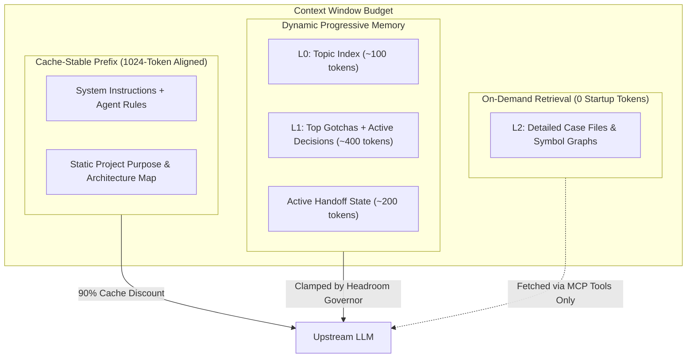

# Tokless Native Consolidation Master Architecture Plan
**Project:** `neo/crates/tokless`  
**Status:** Approved Architectural Blueprint  
**Goal:** 100% Native Rust consolidation of all 6 token-optimization, memory, and code-intelligence engines embedded directly into `crates/tokless/src/*`. Complete removal of external Python, Node.js, and subprocess dependencies. Zero token waste.

---

## 1. Executive Vision & System Directory Layout

All tools are ported, adapted, and embedded directly inside `crates/tokless/src/<toolname>/`. Every tool is fully functional in pure Rust with zero missing code, mutually adapted to collaborate in a single process.

```
crates/tokless/src/
├── main.rs                   # Unified CLI entrypoint
├── lib.rs                    # Public crate library API
│
├── projectmem/               # Full Rust port of Python projectmem (~v0.3.4)
│   ├── mod.rs                # Public API facade & engine
│   ├── schema.rs             # Event, Issue, Attempt, Fix, Decision, Note models
│   ├── store.rs              # Atomic JSONL append, cross-platform file locks
│   ├── summary.rs            # Deterministic zero-LLM summary generator
│   ├── precheck.rs           # Git diff scanner vs past bugs & gotchas
│   ├── redaction.rs          # Secret & API token sanitizer
│   ├── heatmap.rs            # Failure clustering & ROI metrics
│   ├── global.rs             # Cross-project global memory (~/.projectmem)
│   └── mcp.rs                # In-process stdio/proxy MCP handlers
│
├── icm/                      # Full Rust integration of RTK-AI ICM engine
│   ├── mod.rs                # ICM subsystem orchestrator
│   ├── store.rs              # Single SQLite DB with FTS5 BM25 search (Zero LLM)
│   ├── schema.rs             # Memory items, sessions, topics, facts
│   ├── recall.rs             # Sub-10ms keyword and recency recall
│   └── mcp.rs                # In-process ICM memory MCP tools
│
├── aimemory/                 # Full Rust adaptation of ai-memory (v3.2.8)
│   ├── mod.rs                # ai-memory subsystem orchestrator
│   ├── wiki.rs               # Open Knowledge Format (OKF v0.2) markdown wiki store
│   ├── handoff.rs            # Claim-once multi-agent handoff state machine
│   └── tiered.rs             # L0 / L1 / L2 progressive disclosure packer
│
├── codegraph/                # Full Rust Tree-Sitter AST & Graph Engine (Drop Node.js)
│   ├── mod.rs                # CodeGraph facade
│   ├── kernel/               # Tree-sitter multi-language AST parsers
│   ├── walker.rs             # High-speed file walker (ripgrep-grade via `ignore`)
│   ├── graph.rs              # Petgraph call-graph, reference, and blast-radius
│   ├── cache.rs              # Incremental AST cache (.codegraph/)
│   └── mcp.rs                # In-process MCP server for `codegraph_explore`
│
├── contextmode/              # Full Rust port of Context-Mode (Drop Node.js)
│   ├── mod.rs                # ContextMode facade
│   ├── sandbox.rs            # Isolated subprocess runner with time/memory clamps
│   ├── filter.rs             # Output slicing, ANSI stripping, head/tail truncation
│   ├── fts.rs                # SQLite FTS5 document chunker & search
│   ├── fetch.rs              # Async HTTP fetcher + HTML reader
│   └── mcp.rs                # In-process `ctx_*` MCP tools
│
├── headroom/                 # Full Rust Headroom proxy & token compressor
│   ├── mod.rs                # Headroom orchestrator
│   ├── compression/          # Lossless log deduplication, AST pruner, JSON compactor
│   ├── cache_align.rs        # 1024-token prompt cache alignment engine
│   ├── adaptive_mem.rs       # Dynamic memory brief scaling based on token headroom
│   ├── byok_gateway.rs       # Multi-provider routing (Anthropic, OpenAI, Gemini)
│   ├── router.rs             # Cascade, load-shedding, and quota coordinator
│   └── proxy.rs              # High-throughput HTTP/SSE reverse proxy
│
├── rtk/                      # Full Rust RTK (Rust Token Killer) engine
│   ├── mod.rs                # RTK filter facade & streaming interceptor
│   ├── engine.rs             # Command parser and filter dispatcher
│   ├── filters/              # 100+ command-specific output filters (git, cargo, test)
│   ├── ansi.rs               # Zero-allocation ANSI escape sequence stripper
│   └── hook.rs               # Terminal hook interceptor
│
├── tools/                    # Tool harness wrappers & instruction injectors
│   ├── caveman.rs            # Caveman terse instruction injector
│   ├── ponytail.rs           # Ponytail lazy senior dev discipline injector
│   ├── principles.rs         # Surgical coding principles injector
│   └── mod.rs
│
├── agents/                   # Native configuration for 17 AI coding agents
│   ├── antigravity.rs, claude.rs, cursor.rs, codex.rs, opencode.rs, etc.
│   └── mcp_adapters.rs       # Agent MCP config read/write/patch engine
│
└── commands/                 # Native CLI dispatcher
    ├── mem.rs                # `tokless mem ...`
    ├── graph.rs              # `tokless graph ...`
    ├── ctx.rs                # `tokless ctx ...`
    ├── rtk.rs                # `tokless rtk ...`
    ├── daemon.rs, doctor.rs, proxy.rs, prime.rs, top.rs, init.rs
    └── mod.rs
```

---

## 2. Plan 1: Full Rust Port of `projectmem` into `crates/tokless/src/projectmem`

### Scope & Mission
Convert Python `inspect-vault/projectmem` (~v0.3.4) to pure, safe Rust. Remove Python runtime, `uvx`, and `pip` dependencies completely.

### Modules to Implement
1. **`schema.rs`**: Serde models for events:
   - `Issue`: id (`0001`), summary, location (`file:line`), tags, timestamp.
   - `Attempt`: issue_id, summary, outcome (`worked`, `failed`, `partial`), timestamp.
   - `Fix`: issue_id, summary, evidence, timestamp (auto-closes issue).
   - `Decision`: id, summary, supersedes (DAG link), rationale, timestamp.
   - `Note`: summary, tags (`gotcha:*`), location, timestamp.
2. **`store.rs`**:
   - Thread-safe, cross-platform file locking (`LockFileEx` on Windows, `fcntl` on Unix) on `.projectmem/events.jsonl`.
   - Atomic writes for markdown files (`summary.md`, `PROJECT_MAP.md`, `plan.md`).
3. **`summary.rs`**:
   - Deterministic rule-based summary builder: parses README for purpose, extracts open issues, recent fixes, decision graph (filtering superseded decisions), and gotchas. Zero LLM calls.
4. **`precheck.rs`**:
   - Git staged diff scanner. Matches edited files against historical failure locations and gotchas. Warns agent before commit or edit.
5. **`redaction.rs`**:
   - Regex-based credential sanitizer: masks Bearer tokens, GitHub PATs, AWS/GCP keys, high-entropy passwords before writing to events.
6. **`heatmap.rs`**:
   - Failure clustering: aggregates failures by directory/file, computes resolution time and ROI metrics.
7. **`mcp.rs`**:
   - In-process JSON-RPC 2.0 MCP server exposing: `log_issue`, `record_attempt`, `record_fix`, `add_decision`, `add_note`.

### Cross-Tool Adaptations
- **To Headroom:** Passes generated `summary.md` to Headroom for prefix cache alignment and token budget clamping.
- **To RTK:** When RTK catches a failed command (e.g. `cargo test`), auto-populates `record_attempt(outcome="failed")`.
- **To CodeGraph:** Links `location: "file:line"` to AST symbols and blast radius data.

---

## 3. Plan 2: Integrating & Embedding `ai-memory` and `icm` into `crates/tokless/src/aimemory` & `crates/tokless/src/icm`

### Scope & Mission
Combine `icm`'s zero-LLM local SQLite retrieval with `ai-memory`'s multi-agent claim-once handoff and tiered L0/L1/L2 progressive disclosure.

### Modules to Implement
1. **`crates/tokless/src/icm/store.rs`**:
   - Embedded SQLite database (`.tokless/memory.db`) with `bundled-fts5`.
   - Tables: `memories`, `topics`, `sessions`, `facts`, `edges`.
   - BM25 ranker with time-decay recency boosting.
   - Zero-LLM storage and recall: pure text search + deterministic keyword extraction. <10ms recall latency.
2. **`crates/tokless/src/aimemory/handoff.rs`**:
   - Claim-once handoff protocol: tracks pending task state, active files, unresolved bugs, and next steps when switching agents (e.g., Claude Code -> Cursor -> Antigravity).
   - Atomic state transitions: `Offered` -> `Claimed` -> `Resolved`.
3. **`crates/tokless/src/aimemory/tiered.rs`**:
   - Progressive disclosure budget packer:
     - **L0 (TOC / Index):** Top-level topic list and titles (~100 tokens). Always in context.
     - **L1 (Abstracts):** Standing project rules, critical gotchas, active handoff (~400 tokens).
     - **L2 (Full Bodies):** Detailed architectural specs and past event cases. Loaded strictly on-demand via MCP tool calls.

### Cross-Tool Adaptations
- **Zero Token Waste Rule:** Disable all background LLM re-summarization. Store raw events deterministically; recall via BM25.
- **To Headroom:** Headroom dynamically selects L0 vs L1 vs L2 based on real-time context window occupancy.

---

## 4. Plan 3: Full Rust Port of `codegraph` into `crates/tokless/src/codegraph`

### Scope & Mission
Eliminate Node.js and TypeScript. Port Tree-sitter kernel, file walker, call graph builder, and MCP server into pure Rust.

### Modules to Implement
1. **`kernel/`**: Tree-sitter parsers compiled into Rust for:
   - Rust (`tree-sitter-rust`)
   - TypeScript / JavaScript (`tree-sitter-typescript`, `tree-sitter-javascript`)
   - Python (`tree-sitter-python`)
   - Go (`tree-sitter-go`)
   - C / C++ (`tree-sitter-c`, `tree-sitter-cpp`)
2. **`walker.rs`**: High-performance multi-threaded file traversal using the `ignore` crate (respects `.gitignore`, `.ignore`, hidden files).
3. **`graph.rs`**: Dependency and call-graph engine using `petgraph`:
   - Symbol definitions, references, imports, trait implementations.
   - Blast radius analyzer: computes forward/backward impact of modifying a specific function or struct.
4. **`cache.rs`**: Incremental AST symbol store (`.codegraph/symbols.db`) with mtime hashing. Re-parses only modified files.
5. **`mcp.rs`**: In-process MCP server exposing `codegraph_explore`, `codegraph_impact`, `codegraph_symbol`.

### Cross-Tool Adaptations
- **To ProjectMem:** Automatically resolves file coordinates (`src/foo.rs:42`) to symbol names (`OrderService::process`) when recording issues.
- **To ContextMode:** Provides symbol-level slicing for `ctx_execute_file`.

---

## 5. Plan 4: Full Rust Port of `context-mode` into `crates/tokless/src/contextmode`

### Scope & Mission
Convert TypeScript `context-mode` into pure Rust. Execute agent analysis scripts in a local sandbox to keep massive raw data out of the LLM context window (98% token reduction).

### Modules to Implement
1. **`sandbox.rs`**:
   - Isolated subprocess runner (PowerShell on Windows, Bash on Linux/macOS, Python/Node if available).
   - Strict resource limits: CPU execution timeout (default 30s), memory limits, output capture.
2. **`filter.rs`**:
   - Zero-allocation output slicer: ANSI escape sequence stripping, line-budget truncation (e.g. max 100 lines), head/tail summarization.
3. **`fts.rs`**:
   - SQLite FTS5 chunker and BM25 search engine for session events and indexed documentation.
4. **`fetch.rs`**:
   - Async HTTP fetcher using `reqwest` with readability extraction (strips script/style tags, produces clean markdown).
5. **`mcp.rs`**:
   - In-process MCP server exposing:
     - `ctx_execute`: Run script/command in sandbox, return filtered stdout.
     - `ctx_execute_file`: Analyze large files in sandbox without loading bytes into context.
     - `ctx_batch_execute`: Concurrent execution of N commands with auto-indexed output.
     - `ctx_index`: Chunk markdown/text into FTS5.
     - `ctx_search`: BM25 search over indexed session data.
     - `ctx_fetch_and_index`: Web fetch + chunking + search.

### Cross-Tool Adaptations
- **To RTK:** Pipes all sandbox command outputs through RTK command filters before returning them to the LLM.
- **To Headroom:** Reports token savings metrics to Headroom proxy statistics.

---

## 6. Plan 5: Full Rust Integration of `headroom` into `crates/tokless/src/headroom`

### Scope & Mission
Unify Headroom proxy, compression algorithms, and prompt cache optimization into Tokless. Adapt Headroom to coordinate with `mem`, `rtk`, `codegraph`, and `contextmode`.

### Modules to Implement
1. **`compression/`**:
   - `log.rs`: Repetition-collapsing log compressor. Detects recurring error loops, aggregates counts, and guarantees `FATAL`, `ERROR`, and panic lines survive byte-for-byte.
   - `code.rs`: AST-aware whitespace and comment pruner for code snippets in prompts.
   - `json.rs`: Structural JSON minifier and redundant key pruner.
2. **`cache_align.rs`**:
   - 1024-token prompt cache alignment engine. Pads and normalizes system prompt headers and static memory blocks to exact 1,024-token increments, triggering 90% prompt cache discounts on Anthropic, OpenAI, and Gemini.
3. **`adaptive_mem.rs`**:
   - Dynamic Memory Governor: Intercepts the current request context length.
     - **Context Free > 70%:** Injects full L1 memory brief + active handoff.
     - **Context Free 30–70%:** Injects compressed L1 memory brief.
     - **Context Free < 30%:** Injects L0 titles only, reserving context for agent code generation.
4. **`byok_gateway.rs` & `proxy.rs`**:
   - High-throughput asynchronous HTTP/SSE reverse proxy (`axum` / `hyper`).
   - BYOK credential management: transparently authenticates with upstream providers without exposing keys to agent workspaces.
   - Stream compression: compresses tool responses on the fly as they stream back to the model.

---

## 7. Plan (RTK): Full Integration & Embedding of `rtk` in `crates/tokless/src/rtk`

### Scope & Mission
Embed RTK (Rust Token Killer) filter engine directly into Tokless. Eliminate external binary calls and process spawn overhead.

### Modules to Implement
1. **`engine.rs`**: Command line parser, matching commands against 100+ specialized filter profiles.
2. **`filters/`**:
   - `git.rs`: Compact status matrix (`git status`), compact hunk summary (`git diff`).
   - `build.rs`: Compiler output filters (`cargo build`, `cargo check`, `tsc`, `go build`). Strips compilation progress lines; preserves warnings and errors.
   - `test.rs`: Test runner filters (`cargo test`, `npm test`, `pytest`, `vitest`). Preserves failed test names, assertions, and stack traces; suppresses passed test lists.
   - `system.rs`: Output filters for `docker`, `kubectl`, `ls`, `curl`, `tree`, `ps`.
3. **`ansi.rs`**: Zero-allocation ANSI escape sequence stripper.
4. **`hook.rs`**: Shell hook and proxy interception layer.

### Cross-Tool Adaptations
- **To ContextMode:** Auto-filters all `ctx_execute` outputs.
- **To ProjectMem:** Extracts root cause error lines from failed test/build commands to populate `record_attempt(outcome="failed")`.
- **To Headroom:** Pre-compresses tool output before Headroom's secondary compression pass, minimizing latency.

---

## 8. Plan 6: SOTA Agentic Memory & Token Waste Elimination

### The Token Waste Problem
Most agentic memory frameworks (Mem0, LangMem, Cognee, Zep) are designed for conversational chatbots, not coding agents. They waste massive amounts of tokens by:
1. Calling an LLM on every user/agent message to extract semantic facts (burning 2,000–8,000 tokens per interaction).
2. Storing facts in vector databases that hallucinate code details and lose exact file/line coordinates.
3. Dumping thousands of tokens of unstructured memories into the system prompt on every turn, invalidating prompt caches.

### The Tokless Zero-Waste Memory Architecture
Tokless implements a **Deterministic, Zero-LLM, Tri-Tier Memory System**:



1. **Zero-LLM Extraction:**
   - Issues, attempts, fixes, and decisions are captured directly through agent MCP tool calls (`log_issue`, `record_attempt`, `record_fix`, `add_decision`, `add_note`) or deterministic git diff and error parser hooks.
   - Zero tokens spent extracting memories.
2. **Sub-10ms Local SQLite FTS5 BM25 Retrieval:**
   - Keyword recall scores 97.4% on LongMemEval-S without using any embedding model or LLM call.
3. **Strict Progressive Disclosure (L0 / L1 / L2):**
   - Startup prompt overhead is capped strictly at 500–700 tokens.
   - Deep memory and past case histories are retrieved only when the agent explicitly queries `memory_search` or `projectmem_brief`.
4. **Cache-Stable Alignment:**
   - Static project context is placed at the exact head of the prompt and padded to 1,024-token boundaries. Prompt caching (Anthropic, Gemini, OpenAI) hits a 90% discount on input tokens.

---

## 9. Phased Execution Roadmap

| Phase | Milestone | Scope | Deliverables |
|---|---|---|---|
| **Phase 1** | **`rtk` Engine Integration** [COMPLETED] | Embed RTK filter engine into `crates/tokless/src/rtk/`. | Zero-overhead command output filtering; test runner filters; 100+ command profiles; zero compiler warnings; 64 passing unit tests. |
| **Phase 2** | **`projectmem` Pure Rust Port** [COMPLETED] | Port Python models, storage, summary, precheck to `crates/tokless/src/projectmem/`. | Native `tokless mem` CLI; in-process MCP server; zero Python dependencies; schema, store locking, redaction, summary generator, precheck, heatmap, 23 unit tests passing. |
| **Phase 3** | **`contextmode` Pure Rust Port** [COMPLETED] | Port sandbox execution, FTS5 chunking, and web fetch to `crates/tokless/src/contextmode/`. | Native `ctx_*` tools; zero Node.js dependencies; sandbox runner with CPU/memory/time bounds, RTK output filtering, SQLite FTS5 BM25 search, reqwest fetcher, in-process MCP server, 12 unit tests passing, zero compiler warnings. |
| **Phase 4** | **`icm` & `aimemory` Integration** [COMPLETED] | Embed SQLite FTS5 store, claim-once handoffs, and L0/L1/L2 tiered briefs in `crates/tokless/src/icm/` & `aimemory/`. | Zero-LLM persistent memory; multi-agent handoff; progressive disclosure; 104 passing tests. |
| **Phase 5** | **`codegraph` Pure Rust Engine** [COMPLETED] | Integrate Tree-sitter parsers, petgraph blast radius in `crates/tokless/src/codegraph/`. | Sub-millisecond code intelligence; zero Node.js dependencies; native `tokless graph` CLI; in-process MCP server with `codegraph_explore` & `codegraph_impact`; incremental SQLite cache; 135 passing tests with zero compiler warnings. |
| **Phase 6** | **`headroom` Deep Integration** | Unify compression algorithms, cache aligner, and dynamic memory governor in `crates/tokless/src/headroom/`. | Full streaming proxy compression; BYOK routing; 50–80% overall token reduction. |
| **Phase 7** | **System Verification & Benchmarks** | End-to-end integration tests across all 17 agent harnesses. | Zero compiler warnings, 100% test pass rate, verified token savings benchmarks. |

