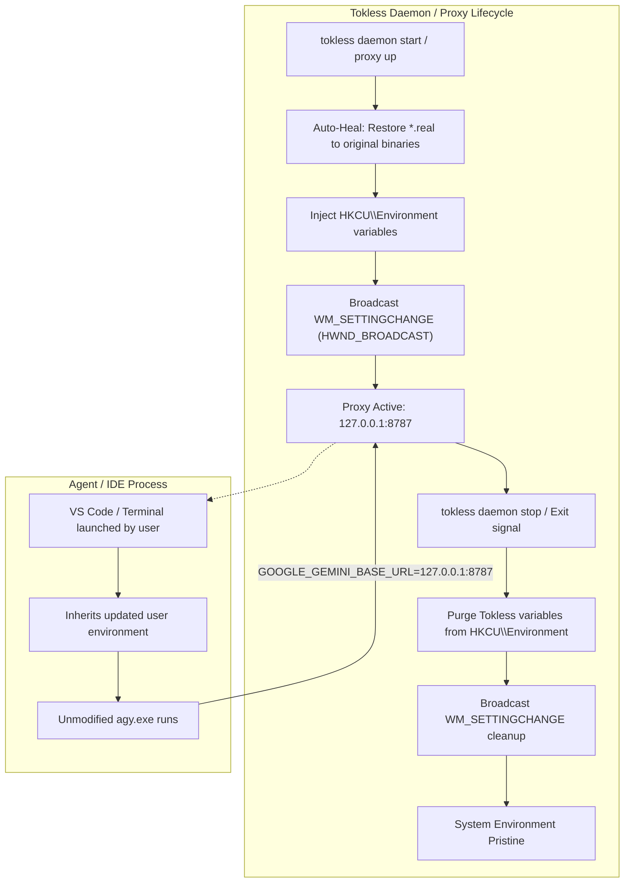

# Tokless Native Consolidation Master Architecture Plan (v2.3)
**Project:** `neo/crates/tokless`  
**Status:** Approved Master Architectural Blueprint  
**Objective:** 100% Native Rust consolidation of all token-optimization, memory, code-intelligence, rules, and telemetry engines directly embedded into `crates/tokless/src/*`. Complete removal of external package manager downloads (npm, pip, uv, curl). Pure in-process execution, zero missing code, full feature parity, rich TUI, the ultimate zero-dependency real-time Telemetry & Control Dashboard, complete replacement of legacy `HoangP8/tokless` wiring, and non-destructive user environment proxy injection.

---

## 1. Core Architectural Mandates

1. **100% Native In-Tree Embedding (`crates/tokless/src/*`)**:
   - Every tool (`projectmem`, `icm`, `aimemory`, `codegraph`, `contextmode`, `headroom`, `rtk`, `rules`) is implemented as an internal Rust module.
   - Tokless agent harnesses, MCP proxies, and CLI commands call internal Rust functions directly via zero-cost Rust abstractions—**never via spawned external tool binaries or shell wrappers**.
2. **Purge of Runtime Downloader / Installer Slop**:
   - Completely remove `npminstall.rs`, `nodewin.rs`, `nodelinux.rs`, `uv.rs`, and Python/pip/uvx bootstrapping code from `tokless`.
   - `tokless` never downloads or installs runtimes. If an external tool is optional (e.g. system `git`, or an optional `python`/`node` interpreter for user scripts), `tokless` only detects it on system `PATH` via `which`.
   - Toolchain installation is cleanly decoupled and reserved for `crates/nbuild`.
3. **In-Tree Rules & Skills (`caveman`, `ponytail`, `principles`)**:
   - Ingest all instructions, guidelines, and rules from `inspect-vault/andrej-karpathy-skills`, `inspect-vault/caveman`, etc., directly into `crates/tokless/src/rules/` and compile them with `include_str!`.
   - Zero external repo dependencies. All rules are distributed with the single `tokless` binary and directly accessible from the project directory.
4. **Zero-Token Waste Memory Foundation**:
   - Zero background LLM re-summarization loops.
   - Sub-10ms local SQLite FTS5 BM25 search (from ICM).
   - Claim-once cross-agent handoff state machine + progressive L0/L1/L2 disclosure (from ai-memory).
   - Append-only structured issue/attempt/fix/decision tracking (from ProjectMem).
5. **Non-Destructive Environment Injection (Zero Binary Renames)**:
   - **Never rename or hijack agent CLI binaries** (e.g., renaming `agy.exe` to `agy.real.exe` or `grok` to `grok.real`).
   - Extensions and IDE plugins (e.g., Gemini Code Assist in VS Code) actively monitor, download, and execute agent CLIs; binary tampering breaks updates and integrity checks.
   - Instead, inject routing variables directly into the OS user environment before IDE launch (`HKCU\Environment` on Windows with `WM_SETTINGCHANGE` broadcast; user session env on Unix/macOS) and cleanly remove them upon Tokless daemon shutdown.
6. **Legacy HoangP8/tokless Cleanup & Self-Healing**:
   - Automatically detect and heal all legacy leftovers: restore any `.real` binaries back to original executables, purge orphaned wrapper batch/shell scripts, remove obsolete state files, and repair damaged agent JSON/JSONC settings.
7. **Full Observability & Control**:
   - **Full-Featured Interactive TUI (`tokless tui` / `tokless top`)**: Multi-tab live monitoring, agent wire manager, memory explorer, and graph inspector.
   - **Ultimate Telemetry & Control Dashboard (`tokless dashboard`)**: Embedded local web server with zero external dependencies, providing real-time token compression waterfalls, dollar savings counters, error telemetry, agent fleet management, CodeGraph topology visualizer, and memory decision DAGs.

---

## 2. System Directory Topology

```
crates/tokless/src/
├── main.rs                   # Unified CLI entrypoint
├── lib.rs                    # Public crate library API
│
├── projectmem/               # Native Rust Port of ProjectMem (~v0.3.4)
│   ├── mod.rs                # Public API facade
│   ├── schema.rs             # Serde models: Event, Issue, Attempt, Fix, Decision, Note
│   ├── store.rs              # Thread-safe JSONL append with Windows/Unix file locking
│   ├── summary.rs            # Deterministic zero-LLM summary generator
│   ├── precheck.rs           # Git staged diff scanner vs gotchas & past failure locations
│   ├── redaction.rs          # Zero-allocation regex sanitizer (strips keys & tokens)
│   ├── heatmap.rs            # Failure clustering & ROI metrics
│   ├── global.rs             # Cross-project global memory (~/.projectmem)
│   └── mcp.rs                # In-process stdio/proxy MCP server handlers
│
├── icm/                      # Native Rust Port of RTK-AI ICM Engine
│   ├── mod.rs                # ICM subsystem orchestrator
│   ├── store.rs              # Single SQLite DB (`.tokless/memory.db`) with FTS5 BM25
│   ├── schema.rs             # Memory items, topics, sessions, facts
│   ├── recall.rs             # Sub-10ms keyword and recency recall (Zero LLM tokens)
│   └── mcp.rs                # In-process memory MCP endpoints
│
├── aimemory/                 # Native Rust Adaptation of ai-memory (v3.2.8)
│   ├── mod.rs                # ai-memory subsystem orchestrator
│   ├── wiki.rs               # Open Knowledge Format (OKF v0.2) markdown wiki store
│   ├── handoff.rs            # Claim-once multi-agent handoff state machine
│   └── tiered.rs             # L0 (TOC) / L1 (Abstract) / L2 (Full) progressive packer
│
├── codegraph/                # Native Rust Tree-Sitter & Call-Graph Engine (Drop Node.js)
│   ├── mod.rs                # CodeGraph facade
│   ├── kernel/               # Embedded Tree-sitter parsers (Rust, TS/JS, Py, Go, C/C++)
│   ├── walker.rs             # High-speed ripgrep-grade file traversal (`ignore` crate)
│   ├── graph.rs              # Petgraph AST dependency, call-path, and blast-radius
│   ├── cache.rs              # Incremental AST symbol cache (.codegraph/symbols.db)
│   └── mcp.rs                # In-process MCP server for `codegraph_explore`
│
├── contextmode/              # Native Rust Port of Context-Mode (Drop Node.js)
│   ├── mod.rs                # ContextMode facade
│   ├── sandbox.rs            # Subprocess runner with CPU timeout & memory bounds
│   ├── filter.rs             # Output slicing, ANSI stripping, head/tail truncation
│   ├── fts.rs                # SQLite FTS5 document chunker & BM25 search
│   ├── fetch.rs              # Async HTTP fetcher + HTML reader (`reqwest`)
│   └── mcp.rs                # In-process `ctx_*` MCP tools
│
├── headroom/                 # Native Rust Headroom Proxy & Token Compressor
│   ├── mod.rs                # Headroom orchestrator
│   ├── compression/          # Lossless log deduplication, AST code pruner, JSON minifier
│   ├── cache_align.rs        # 1024-token prompt cache alignment engine
│   ├── adaptive_mem.rs       # Dynamic memory brief scaling based on context headroom
│   ├── byok_gateway.rs       # Multi-provider routing (Anthropic, OpenAI, Gemini)
│   ├── router.rs             # Cascade, load-shedding, and quota coordinator
│   └── proxy.rs              # High-throughput HTTP/SSE reverse proxy
│
├── rtk/                      # Native Rust RTK (Rust Token Killer) Engine
│   ├── mod.rs                # RTK filter facade & streaming interceptor
│   ├── engine.rs             # Command parser and filter dispatcher
│   ├── filters/              # 100+ command-specific output filters (git, cargo, test)
│   ├── ansi.rs               # Zero-allocation ANSI escape sequence stripper
│   └── hook.rs               # Terminal hook interceptor
│
├── rules/                    # In-Tree Rules, Skills & Principles (Zero External Repos)
│   ├── mod.rs                # Rule injector and compiler
│   ├── principles.rs         # Karpathy guidelines (think, simplify, surgical, verify)
│   ├── caveman.rs            # ASD-STE100 primitive English compressor
│   ├── ponytail.rs           # Lazy senior developer build discipline ladder
│   └── embedded/             # Compile-time embedded markdown resources (`include_str!`)
│       ├── principles.md
│       ├── caveman.md
│       └── ponytail.md
│
├── env_injector/             # Non-Destructive Environment Lifecycle & Proxy Injection
│   ├── mod.rs                # Public interface for env management
│   ├── windows.rs            # HKCU\Environment registry manager + WM_SETTINGCHANGE broadcast
│   ├── unix.rs               # User session environment injector (systemd / env files)
│   ├── teardown.rs           # Graceful teardown guard (clears vars on daemon/process exit)
│   └── heal.rs               # Auto-healer: restores legacy .real binaries and cleans wrappers
│
├── dashboard/                # Ultimate Telemetry & Control Web Server (Zero-Dependency)
│   ├── mod.rs                # Embedded local HTTP & SSE/WebSocket server (`127.0.0.1:9099`)
│   ├── state.rs              # Shared in-memory metrics ring buffer and event bus
│   ├── sse.rs                # Server-Sent Events real-time streaming broadcaster
│   ├── api/                  # REST endpoints: metrics, errors, agents, memory, graph, control
│   └── ui/                   # Bundled single-page application (Embedded via `include_str!`)
│
├── tui/                      # Full-Featured Terminal User Interface (`ratatui` + `crossterm`)
│   ├── mod.rs                # TUI event loop & terminal guard
│   ├── app.rs                # Global TUI state & active tab model
│   ├── views/                # Tab view renderers (monitor, agents, memory, graph, headroom, logs)
│   └── widgets/              # Gauges, charts, sparklines, tables
│
├── agents/                   # Native configurations for 17 AI coding agents
│   ├── antigravity.rs, claude.rs, cursor.rs, codex.rs, opencode.rs, etc.
│   └── mcp_adapters.rs       # Agent MCP config read/write/patch engine
│
├── util/                     # Pure System & OS Utilities (All Downloaders Purged)
│   ├── paths.rs, exec.rs, jsonc.rs, toml.rs, colors.rs, etc.
│   └── (Purged: npminstall.rs, nodewin.rs, nodelinux.rs, uv.rs)
│
└── commands/                 # Native CLI Command Dispatcher
    ├── mem.rs                # `tokless mem ...`
    ├── graph.rs              # `tokless graph ...`
    ├── ctx.rs                # `tokless ctx ...`
    ├── rtk.rs                # `tokless rtk ...`
    ├── tui.rs                # `tokless tui` (Full interactive control center)
    ├── dashboard.rs          # `tokless dashboard` (Web telemetry server)
    ├── daemon.rs, doctor.rs, proxy.rs, prime.rs, top.rs, init.rs
    └── mod.rs
```

---

## 3. Master Transition & Clean Wiring (Non-Destructive Injection)

### The Legacy Problem (`HoangP8/tokless`)
Legacy Tokless used invasive binary hijacking:
- Renaming `agy.exe` to `agy.real.exe` and inserting an `agy.cmd` batch shim.
- Renaming `grok.exe` to `grok.real.exe`.
- Renaming `copilot` to `copilot.real`.

**Why this fails:** Modern IDE extensions (such as Gemini Code Assist in VS Code) verify binary file sizes, integrity digests, and digitally signed attributes. When a plugin self-updates or triggers the CLI, it fails against the batch wrapper or locks the `.real` executable.

### The Pure Rust Solution: Environment-Based Proxying



1. **Auto-Healing Legacy Leftovers (`heal.rs`)**:
   - Scans system PATH and vendor paths for `*.real` and `*.real.exe`.
   - Restores the original binary name (`agy.real.exe` -> `agy.exe`).
   - Deletes wrapper batch files (`agy.cmd`), bash wrappers, and obsolete state tracking JSONs.
2. **Windows Registry User Environment (`windows.rs`)**:
   - Directly manages `HKEY_CURRENT_USER\Environment`:
     - `GOOGLE_GEMINI_BASE_URL = http://127.0.0.1:8787`
     - `CLOUD_CODE_URL = http://127.0.0.1:8787`
     - Associated proxy endpoints for Copilot, Grok, etc.
   - Marks keys with `TOKLESS_OWNED = 1`.
   - Dispatches `SendMessageTimeoutW(HWND_BROADCAST, WM_SETTINGCHANGE, 0, "Environment", SMTO_ABORTIFHUNG, 2000)` so new terminal and IDE windows immediately acquire the configuration without a system restart.
3. **Graceful Teardown (`teardown.rs`)**:
   - Controlled via console ctrl-c handlers, daemon shutdown commands, and process exit guards.
   - Completely removes the registered environment variables and broadcasts `WM_SETTINGCHANGE` so the system returns to its pristine state.
4. **Agent Configuration & Self-Healing (`doctor.rs`, `init.rs`)**:
   - `tokless doctor --fix` verifies all 17 agent configurations.
   - Ensures agent configs point to in-tree rules (Karpathy, Caveman, Ponytail) and in-process MCP tools.
   - Unwires obsolete external MCP entries.

---

## 4. Chronological & Dependency-Ordered Execution Roadmap

The 12 phases are organized in strict logical dependency order: from foundational filters, memory, and code intelligence engines, to clean runtime purging, non-destructive proxying, and comprehensive user interfaces.

```
[Phase 1: RTK] ──▶ [Phase 2: ProjectMem] ──▶ [Phase 3: ContextMode] ──▶ [Phase 4: ICM & ai-memory]
                                                                                │
┌───────────────────────────────────────────────────────────────────────────────┘
▼
[Phase 5: CodeGraph] ──▶ [Phase 6: In-Tree Rules] ──▶ [Phase 7: Headroom Proxy]
                                                              │
┌─────────────────────────────────────────────────────────────┘
▼
[Phase 8: Downloader Purge] ──▶ [Phase 9: Legacy Un-Hijack] ──▶ [Phase 10: Non-Destructive Env]
                                                                          │
┌─────────────────────────────────────────────────────────────────────────┘
▼
[Phase 11: Agent Doctor & Self-Healing] ──▶ [Phase 12: TUI & Dashboard] ──▶ [Phase 13: End-to-End Verification]
```

| Phase | Subsystem | Core Focus & Actions | Key Deliverable |
|---|---|---|---|
| **Phase 1** | **RTK Filter Engine** | Embed 100+ filters and zero-allocation ANSI stripper into `crates/tokless/src/rtk/`. | Core CLI filter engine; zero-overhead command filtering. |
| **Phase 2** | **ProjectMem Port** | Port models, JSONL storage, summary, precheck into `crates/tokless/src/projectmem/`. | Native `tokless mem` CLI; in-process MCP server. |
| **Phase 3** | **ContextMode Port** | Port sandbox runner, FTS5 chunker, fetcher into `crates/tokless/src/contextmode/`. Pipe stdout to RTK. | Native `ctx_*` MCP tools; 98% context reduction. |
| **Phase 4** | **ICM & ai-memory** | Embed SQLite FTS5 store, claim-once handoffs, L0/L1/L2 briefs in `crates/tokless/src/{icm, aimemory}/`. | Zero-LLM persistent memory; cross-agent handoffs. |
| **Phase 5** | **CodeGraph Engine** | Integrate Tree-sitter parsers, petgraph blast radius in `crates/tokless/src/codegraph/`. | Sub-millisecond AST & blast radius without Node.js. |
| **Phase 6** | **In-Tree Rules & Skills** | Embed Karpathy principles, Caveman, Ponytail into `crates/tokless/src/rules/` via `include_str!`. | Self-contained, distributable agent rules. |
| **Phase 7** | **Headroom Integration** | Port compression, 1024-token cache aligner, adaptive memory governor into `crates/tokless/src/headroom/`. | Streaming HTTP proxy; 50–80% overall token cut. |
| **Phase 8** | **Downloader Purge** | Remove `npminstall.rs`, `nodewin.rs`, `nodelinux.rs`, `uv.rs`. Rewire all tools to internal modules. | Clean `crates/tokless/src/util/`; zero downloader code. |
| **Phase 9** | **Legacy Healing & Un-Hijack** | Implement `crates/tokless/src/env_injector/heal.rs` to restore `*.real` binaries and delete shims. | Pristine binaries (`agy.exe`, `grok.exe`, `copilot`). |
| **Phase 10** | **Non-Destructive Env Injection** | Implement `crates/tokless/src/env_injector/{windows, unix, teardown}.rs` with `WM_SETTINGCHANGE`. | Pre-VS Code environment readiness; clean exit teardown. |
| **Phase 11** | **Agent Doctor & Self-Healing** | Upgrade `tokless doctor --fix` and `init.rs` to validate and heal all 17 agent configurations. | Perfectly wired agent configs across all 17 harnesses. |
| **Phase 12** | **TUI & Telemetry Dashboard** | Build multi-tab interactive TUI (`tui/`) and zero-dependency local web dashboard (`dashboard/`). | `tokless tui` / `top` and `tokless dashboard` interfaces. |
| **Phase 13** | **End-to-End System Verification** | Run workspace integration tests, verify proxy compression, memory recall, and benchmarks. | 0 warnings, 100% tests passing, proven token reduction. |

---

## 5. Master-Plan-Aware Ready-to-Run Prompts

Use these prompts when starting a new chat for each phase:

### Phase 1: RTK Engine Integration
```text
Read crates/tokless/CONSOLIDATION_PLAN.md first to understand the global master architecture, cross-tool coupling, and directory topology.

Execute Phase 1: RTK Engine Integration.
Source: neo\inspect-vault\rtk
Target: crates/tokless/src/rtk/

Requirements:
1. Full port and embed of RTK's 100+ command-specific output filters (git, cargo, test runners, system tools) and zero-allocation ANSI stripper into crates/tokless/src/rtk/.
2. Adapt RTK to serve as the shared in-process filter engine for:
   - crates/tokless/src/contextmode/ (filtering sandbox outputs)
   - crates/tokless/src/projectmem/ (extracting root-cause failure traces)
   - crates/tokless/src/headroom/ (pre-filtering tool outputs)
3. Expose the native CLI command `tokless rtk <command...>`.
4. Ensure 100% functional parity, zero missing filter code, zero external binary spawns, 0 compiler warnings, and passing unit tests.
```

### Phase 2: ProjectMem Pure Rust Port
```text
Read crates/tokless/CONSOLIDATION_PLAN.md first to understand the global master architecture, cross-tool coupling, and directory topology.

Execute Phase 2: ProjectMem Pure Rust Port.
Source: neo\inspect-vault\projectmem (~v0.3.4, Python)
Target: crates/tokless/src/projectmem/

Requirements:
1. Full port of ProjectMem from Python to pure safe Rust in crates/tokless/src/projectmem/:
   - schema.rs (Event, Issue, Attempt, Fix, Decision, Note)
   - store.rs (atomic append to .projectmem/events.jsonl, Windows LockFileEx and Unix fcntl locking, atomic markdown updates)
   - summary.rs (deterministic zero-LLM summary generator from README, active issues, fixes, decision DAG, and gotchas)
   - precheck.rs (git staged diff scanner vs gotchas and historical failure locations)
   - redaction.rs (zero-allocation regex secret/token sanitizer)
   - heatmap.rs (failure clustering & ROI metrics)
   - mcp.rs (in-process MCP handlers: log_issue, record_attempt, record_fix, add_decision, add_note)
2. Connect to crates/tokless/src/rtk/ so failed test/build commands auto-populate failure traces in record_attempt.
3. Wire into `tokless mem <init|log|attempt|fix|decision|note|summary|precheck|stats>` CLI.
4. Drop all Python, pip, and uvx dependencies.
5. Ensure 100% functional parity with Python projectmem, zero missing code, 0 compiler warnings, and passing unit tests.
```

### Phase 3: Context-Mode Pure Rust Port
```text
Read crates/tokless/CONSOLIDATION_PLAN.md first to understand the global master architecture, cross-tool coupling, and directory topology.

Execute Phase 3: Context-Mode Pure Rust Port.
Source: neo\inspect-vault\context-mode (TypeScript)
Target: crates/tokless/src/contextmode/

Requirements:
1. Full port of Context-Mode from TypeScript to pure Rust in crates/tokless/src/contextmode/:
   - sandbox.rs (isolated subprocess runner with strict CPU timeout and memory bounds)
   - filter.rs (output slicing, head/tail truncation, 98% context reduction)
   - fts.rs (SQLite FTS5 document chunker & BM25 search)
   - fetch.rs (async reqwest HTTP fetcher with clean markdown extraction)
   - mcp.rs (in-process ctx_* MCP tools: ctx_execute, ctx_execute_file, ctx_batch_execute, ctx_index, ctx_search, ctx_fetch_and_index)
2. Pipe all sandbox execution stdout directly through crates/tokless/src/rtk/ filters in-memory.
3. Drop Node.js and TypeScript runtime dependencies completely.
4. Wire into `tokless ctx <eval|search|index>` CLI.
5. Ensure 100% functional parity, zero missing code, 0 compiler warnings, and passing unit tests.
```

### Phase 4: ICM & ai-memory Integration
```text
Read crates/tokless/CONSOLIDATION_PLAN.md first to understand the global master architecture, cross-tool coupling, and directory topology.

Execute Phase 4: ICM & ai-memory Integration.
Sources:
- neo\inspect-vault\icm (Rust) -> crates/tokless/src/icm/
- neo\inspect-vault\ai-memory (Rust, v3.2.8) -> crates/tokless/src/aimemory/

Requirements:
1. From ICM: Embed single-file SQLite database (.tokless/memory.db) with bundled FTS5 BM25 search. Guarantee zero LLM token spend on store and recall with sub-10ms latency.
2. From ai-memory: Embed claim-once multi-agent handoff state machine (transferring pending context across 17+ agents) and tiered L0 (TOC) / L1 (Abstracts) / L2 (Full bodies) progressive disclosure packer.
3. Strictly enforce the Zero-LLM token rule: no background LLM re-summarization loops.
4. Coordinate with crates/tokless/src/projectmem/ and prepare hooks for headroom dynamic memory budgeting.
5. Ensure zero compiler warnings and passing unit tests.
```

### Phase 5: CodeGraph Pure Rust Engine
```text
Read crates/tokless/CONSOLIDATION_PLAN.md first to understand the global master architecture, cross-tool coupling, and directory topology.

Execute Phase 5: CodeGraph Pure Rust Engine.
Source: neo\inspect-vault\codegraph (codegraph-kernel in Rust + TS wrapper)
Target: crates/tokless/src/codegraph/

Requirements:
1. Eliminate Node.js and TypeScript wrapper completely.
2. Integrate embedded Tree-sitter parsers directly via Rust dependencies (Rust, TS/JS, Python, Go, C/C++).
3. Implement high-speed file traversal using the `ignore` crate (respecting .gitignore and hidden files).
4. Build AST dependency, call-path, and blast-radius engine using `petgraph`.
5. Implement incremental AST symbol cache in .codegraph/symbols.db.
6. Serve `codegraph_explore`, `codegraph_impact`, and `codegraph_symbol` via in-process MCP server.
7. Connect to crates/tokless/src/projectmem/ to auto-resolve `location: "file:line"` coordinates to AST symbol names.
8. Wire into `tokless graph <explore|impact|symbols|index>` CLI.
9. Ensure 100% functional parity, zero missing code, 0 compiler warnings, and passing unit tests.
```

### Phase 6: In-Tree Rules & Skills Integration
```text
Read crates/tokless/CONSOLIDATION_PLAN.md first to understand the global master architecture, cross-tool coupling, and directory topology.

Execute Phase 6: In-Tree Rules & Skills Integration.
Sources: neo\inspect-vault\andrej-karpathy-skills, neo\inspect-vault\caveman
Target: crates/tokless/src/rules/

Requirements:
1. Ingest instructions and guidelines directly into crates/tokless/src/rules/embedded/:
   - principles.rs (Karpathy guidelines: think, simplify, surgical changes, verify)
   - caveman.rs (ASD-STE100 primitive English compression guidelines)
   - ponytail.rs (lazy senior developer build discipline ladder)
2. Compile markdown assets into the binary using `include_str!`.
3. Eliminate all external repository clone links. All rules must be distributed inside the single tokless binary and accessible from the repo project directory.
4. Expose clean functions to inject or patch instructions into agent configs (CLAUDE.md, .cursor/rules/, AGENTS.md).
5. Ensure zero compiler warnings and passing unit tests.
```

### Phase 7: Headroom Deep Integration
```text
Read crates/tokless/CONSOLIDATION_PLAN.md first to understand the global master architecture, cross-tool coupling, and directory topology.

Execute Phase 7: Headroom Deep Integration.
Source: neo\inspect-vault\headroom (crates/headroom-core)
Target: crates/tokless/src/headroom/

Requirements:
1. Drop Python headroom-py completely.
2. Implement core token compression in crates/tokless/src/headroom/compression/:
   - log.rs (repetition-collapsing log compressor; guarantees FATAL, ERROR, and panic lines survive byte-for-byte)
   - code.rs (AST-aware whitespace and comment pruner)
   - json.rs (structural JSON minifier)
3. Implement 1024-token prompt cache alignment (padding and normalizing headers to 1,024-token boundaries for 90% cache discounts on Anthropic, OpenAI, Gemini).
4. Implement adaptive memory governor: dynamically scale injected memory from crates/tokless/src/{projectmem, aimemory, icm} between L0 (TOC), L1 (Abstracts), and L2 (Full) based on real-time context window headroom.
5. Unify with BYOK gateway and streaming reverse proxy (/v1/chat/completions, /v1/messages).
6. Ensure zero compiler warnings and passing unit tests.
```

### Phase 8: Downloader Purge & System Refactor
```text
Read crates/tokless/CONSOLIDATION_PLAN.md first to understand the global master architecture, cross-tool coupling, and directory topology.

Execute Phase 8: Downloader Purge & System Refactor.
Target: crates/tokless/src/util/ and tool wiring harnesses

Requirements:
1. Completely delete runtime downloader and installer modules:
   - crates/tokless/src/util/npminstall.rs
   - crates/tokless/src/util/nodewin.rs
   - crates/tokless/src/util/nodelinux.rs
   - crates/tokless/src/util/uv.rs
   - crates/tokless/src/util/projectmem.rs
2. Rewire all 17 agent harnesses (crates/tokless/src/agents/) and tool harnesses to call native in-tree Rust modules directly (projectmem, icm, aimemory, codegraph, contextmode, headroom, rtk, rules).
3. Enforce the system detection policy: optional tools (e.g. git, optional python/node script runners) must only be detected on system PATH via `which::which`. Tokless never downloads or installs runtimes.
4. Clean up Cargo.toml, purge unused dependencies, remove dead code, and ensure 0 compiler warnings with all tests passing.
```

### Phase 9: Legacy Healing & Binary Un-Hijack
```text
Read crates/tokless/CONSOLIDATION_PLAN.md first to understand the global master architecture, cross-tool coupling, and directory topology.

Execute Phase 9: Legacy Healing & Binary Un-Hijack.
Target: crates/tokless/src/env_injector/heal.rs, crates/tokless/src/agents/{antigravity.rs, grok.rs, copilot.rs}

Requirements:
1. Purge destructive binary hijacking from Tokless:
   - Stop renaming `agy.exe` to `agy.real.exe` or `agy` to `agy.real`.
   - Stop renaming `grok.exe` to `grok.real.exe` or `copilot` to `copilot.real`.
   - Delete all shim batch wrappers (`agy.cmd`, `grok.cmd`, shell wrappers) that collide with IDE extensions and package managers.
2. Build an automated self-healing engine in `crates/tokless/src/env_injector/heal.rs`:
   - Detect any `.real` or `.real.exe` binaries left behind by legacy HoangP8/tokless or early ports.
   - Atomically restore them to their canonical binary filenames (`agy.exe`, `grok.exe`, `copilot`).
   - Remove orphaned state files (`antigravity-cli-proxy.json`, `grok-cli-proxy.json`, etc.) from data directories.
3. Automatically invoke this healing routine inside `tokless init`, `tokless doctor --fix`, and `tokless daemon start`.
4. Ensure zero compiler warnings, 100% test coverage for healing, and clean filesystem restoration.
```

### Phase 10: Non-Destructive Environment Injection & Lifecycle Teardown
```text
Read crates/tokless/CONSOLIDATION_PLAN.md first to understand the global master architecture, cross-tool coupling, and directory topology.

Execute Phase 10: Non-Destructive Environment Injection & Lifecycle Teardown.
Target: crates/tokless/src/env_injector/{windows.rs, unix.rs, teardown.rs}, crates/tokless/src/commands/daemon.rs

Requirements:
1. Implement non-destructive user environment management without modifying any agent binaries:
   - On Windows (`windows.rs`): Manage `HKEY_CURRENT_USER\Environment` directly via Windows APIs.
     Inject proxy environment variables (`GOOGLE_GEMINI_BASE_URL`, `CLOUD_CODE_URL`, etc.) with `TOKLESS_OWNED=1` markers.
     Broadcast `WM_SETTINGCHANGE` via `SendMessageTimeoutW(HWND_BROADCAST, WM_SETTINGCHANGE, 0, "Environment", SMTO_ABORTIFHUNG, 2000)` so new VS Code and terminal windows pick up the proxy immediately without restart.
   - On Linux/macOS (`unix.rs`): Inject variables into user session environment (systemd user env or standard agent `.env` configs).
2. Implement lifecycle teardown guard (`teardown.rs`):
   - Hook into `tokless daemon stop`, `tokless proxy down`, and process termination handlers (SIGINT, SIGTERM, Ctrl+C).
   - Automatically purge all Tokless-owned environment variables upon shutdown.
   - Broadcast the environment update so the OS returns to its clean default state with zero leftovers.
3. Connect environment injection to `tokless daemon start` so the environment is ready before VS Code or IDEs launch.
4. Ensure zero compiler warnings and passing unit tests.
```

### Phase 11: Agent Doctor & Self-Healing Parity
```text
Read crates/tokless/CONSOLIDATION_PLAN.md first to understand the global master architecture, cross-tool coupling, and directory topology.

Execute Phase 11: Agent Doctor & Self-Healing Parity.
Target: crates/tokless/src/commands/doctor.rs, crates/tokless/src/commands/init.rs, crates/tokless/src/agents/

Requirements:
1. Upgrade `tokless doctor` and `tokless doctor --fix`:
   - Audit all 17 agent configurations (Claude Code, Cursor, Codex, OpenCode, Antigravity, Copilot, Cline, Droid, Grok, Kilo, OMP, Pi, Amp, Kimi, ZCode, DSH).
   - Verify all rules and instructions point to the native compiled in-tree rules (`crates/tokless/src/rules/`): Karpathy guidelines, Caveman, Ponytail.
   - Verify all MCP server entries point to in-process native Tokless MCP handlers; automatically unwire and purge broken legacy `npx`/`uvx`/`pip` entries.
   - Check and report environment proxy status (confirming no hijacked `.real` binaries exist and registry environment variables are healthy).
2. Ensure `tokless init` idempotently writes clean configs and repairs broken settings across all detected agents.
3. Ensure zero compiler warnings, 0 test failures, and clean verification reports across all 17 agents.
```

### Phase 12: TUI & Telemetry Web Dashboard
```text
Read crates/tokless/CONSOLIDATION_PLAN.md first to understand the global master architecture, cross-tool coupling, and directory topology.

Execute Phase 12: TUI & Telemetry Web Dashboard.
Target: crates/tokless/src/tui/, crates/tokless/src/dashboard/

Requirements:
1. Implement full multi-tab interactive TUI in crates/tokless/src/tui/ using `ratatui` and `crossterm`:
   - Tab 1: Live Monitor & Waterfall (real-time token throughput, compression percentage, dollar savings counter)
   - Tab 2: Agent Wire Manager (interactive table of 17 agents; Space to toggle wire/unwire, Enter to inspect MCP config)
   - Tab 3: Memory Explorer (search .projectmem/events.jsonl and ICM SQLite DB, filter issues/decisions/gotchas, key 'p' triggers precheck)
   - Tab 4: CodeGraph Visualizer (interactive symbol search, call paths, blast radius tree)
   - Tab 5: Headroom BYOK & Cache Inspector (cache alignment gauges, provider quota meters, fallback cascades)
   - Tab 6: Diagnostic Logs (real-time logs from daemon, proxy, and watchdog)
   - Connect to CLI commands `tokless tui` and `tokless top`.
2. Implement the embedded local HTTP & SSE/WebSocket server (127.0.0.1:9099) in crates/tokless/src/dashboard/:
   - Single-page application (HTML/CSS/JS/SVG) embedded via `include_str!` (zero npm/node build dependencies).
   - Live token savings waterfall, dollar counter, error telemetry (429s, outages), agent fleet grid, and SVG decision DAG visualizer.
   - Connect to CLI command `tokless dashboard [--port 9099] [--open]`.
3. Ensure zero compiler warnings and passing tests.
```

### Phase 13: End-to-End System Verification & Benchmarks
```text
Read crates/tokless/CONSOLIDATION_PLAN.md first to understand the global master architecture, cross-tool coupling, and directory topology.

Execute Phase 13: End-to-End System Verification & Benchmarks.

Requirements:
1. Perform end-to-end integration tests across all 17 supported agent harnesses (Claude Code, Cursor, Codex, OpenCode, Antigravity, Copilot, Cline, Droid, Grok, Kilo, OMP, Pi, Amp, Kimi, ZCode, DSH).
2. Verify all unified CLI commands: `tokless mem`, `tokless graph`, `tokless ctx`, `tokless rtk`, `tokless proxy`, `tokless doctor`, `tokless tui`, `tokless dashboard`.
3. Verify streaming proxy compression and in-process MCP multiplexer with live simulated agent requests.
4. Verify non-destructive environment injection and clean shutdown (confirming no `.real` binary renames, clean user environment teardown, and intact IDE extension compatibility).
5. Run `cargo test --workspace` and verify:
   - 0 compiler warnings
   - 0 test failures
   - 0 external runtime dependencies (no npm, no pip, no node, no python required)
6. Run benchmarks measuring token reduction ratio (target 40–80% overall savings) and latency overhead (<10ms).
```
