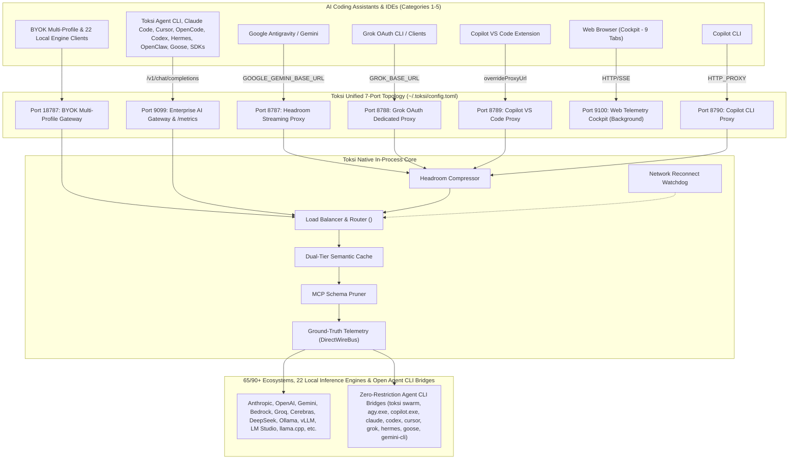

# Toksi Native Consolidation Master Architecture Plan (Wave 17 / v4.0)
**Project:** `neo/crates/toksi`  
**Status:** Approved Wave 17 Master Architectural Blueprint & Implementation Specification  
**Objective:** 100% Native Rust (Edition 2024, `#![deny(unsafe_code)]` via leaf FFI crates `crates/toksi-sys` & `crates/toksi-grammars`) consolidation of all token-optimization, memory, code-intelligence (`41+` Tree-sitter languages), rules, gateway, load-balancer, telemetry, and native coding CLI/swarm engines (`src/agent_runtime/`) directly embedded into `crates/toksi/src/*` — consolidating **all 36 reference vaults** (`tokless`, `bifrost`, `headroom`, `rtk`, `context-mode`, `codegraph`, `projectmem`, `ai-memory`, `icm`, `ponytail`, `caveman`, `andrej-karpathy-skills`, `TokenTracker`, `jcodemunch-mcp`, `repomix`, `ast-grep`, `scip`, `mem0`, `chroma`, `litellm`, `TokenEconomizer`, `agent-opt`, `agents-structures`, plus Wave 17 agentic runtimes `hermes-agent`, `openclaw`, `openclaw-rs`, `mofa`, `mofa-engine`, `mofaclaw`, `codex`, `crush`, `crustly`, `goose`, `grok-build`, `gemini-cli`, `crewAI`) and all 65/90+ ecosystem providers & 22 local inference engines. Zero external downloaders, forward-slash (`/`) paths, `~/.toksi/config.toml` + `~/.toksi/toksi.db` (with multi-instance `<byok, model, effort>` and zero paid-tier restrictions), strict `<repo>/.toksi/<tool>` repo-only storage (plus monorepo subproject isolation & `.gitignore`/`.ignore` dynamic purge), standardized `<tool>-hook <agent>` + `direct wired` hook bus (`MCP`, `A2A` v1.0, `ACP` v2.0, `stdio`, `SSE`, `HTTP`), `.toksi/test-baseline.json` incremental test skip manifest, and 9-tab async TUI + Web Cockpit (`:9100`).

---

## 1. Master Architectural Mandates & System Conventions

1. **Smart Unified Single-Daemon Launch (`toksi daemon start [--agents]`)**:
   - One background daemon launch initializes and coordinates all core subsystems simultaneously across dedicated, isolated ports configured in `~/.toksi/config.toml` (`[ports]`):
     * **Port 8787**: Transparent Streaming Headroom Proxy (`http://127.0.0.1:8787`, Antigravity/Anthropic/OpenAI)
     * **Port 8788**: Grok OAuth Dedicated Proxy (`http://127.0.0.1:8788`, reverse proxy & multi-instance Grok OAuth failover)
     * **Port 8789**: GitHub Copilot VS Code Proxy (`DEFAULT_COPILOT_PROXY_PORT`, real Copilot reverse proxy — zero stub strings)
     * **Port 8790**: GitHub Copilot CLI Proxy (`DEFAULT_COPILOT_CLI_PROXY_PORT`)
     * **Port 9099**: Enterprise AI Gateway & Drop-in SDK Endpoints (`/v1/chat/completions`, `/v1/messages`, `/v1beta/models/*`, `/metrics`)
     * **Port 9100**: Zero-Dependency Real-Time Web Telemetry & Control Dashboard Cockpit (non-blocking background service, exact 9-tab parity)
     * **Port 18787**: BYOK Multi-Profile Gateway (`http://127.0.0.1:18787`, OpenAI, Anthropic, Gemini, Ollama/vLLM/LM Studio/22 local engines via multi-instance `<byok, model, effort>` routing)
     * **In-Process Engine**: `DirectWireBus` zero-hop `tokio::sync::broadcast` hook bus, `src/agent_runtime/` (`toksi chat|run|exec|swarm`), `crates/toksi-sys` Windows/POSIX sandbox FFI crate, Dynamic Load Balancer, Complexity Tier Router, Dual-Tier Semantic Cache, Multi-Protocol Multiplexer (`MCP`, `A2A`, `ACP`, `stdio`, `SSE`, `HTTP`), and Non-Destructive Environment Injection (`HKCU\Environment` on Windows with `WM_SETTINGCHANGE` broadcast; session env on Unix; opt-in `--agents` flag).
   - Zero multi-command manual configuration. One `toksi daemon start --agents` launch prepares the 7-port control plane for all configured AI coding assistants across Categories 1–5 without paid-tier restrictions.

2. **Network Port Separation for Maximum Latency Performance**:
   - **Architectural Decision**: Separating the AI Gateway (`:9099`) from the Web Dashboard Cockpit (`:9100`) guarantees **zero socket and thread pool contention**:
     * **Port 9099 (AI Gateway)**: Dedicated high-throughput Tokio reactor thread pool strictly for streaming LLM inference, SSE token forwarding, protocol conversion (Anthropic <-> OpenAI <-> Gemini), and header injection (<10 µs latency overhead).
     * **Port 9100 (Web Dashboard Cockpit)**: Dedicated listener for browser SSE metrics broadcasting, static assets (HTML/CSS/JS), SVG decision DAGs, and SQLite database backup/export operations. Large browser downloads or stalled SSE connections can never induce TCP backpressure on active agent inference streams.
     * **Port 8789 & 8790 (GitHub Copilot)**: Dedicated, isolated proxies for Copilot VS Code extension (8789) and Copilot CLI (8790) preventing cross-talk, race conditions, and port collisions.
   - Running `toksi dashboard` launches the server in the background (or foreground with `--foreground`), opens the default browser automatically (`--open`), and exits cleanly with the server URL reported.

3. **Network Reconnect Auto-Healing & Watchdog (Zero-Dormant State)**:
   - Toksi embeds an automatic network reconnection handler and connection-pool refresh watchdog:
     * Listens for connection drops, timeouts, DNS invalidation, or network interface toggles.
     * Automatically invalidates stale socket pools and re-initializes client pools without requiring process termination or agent restart.
     * Eliminates dormant states where agents are locked out after Wi-Fi or VPN reconnects.

4. **Environment PATH Verification Mandate ("Rule of Test and Inform User")**:
   - For all external binaries, commands, shells, tools, and agent CLIs (`bash`, `cmd`, `toksi`, `agy.exe`, `copilot.exe`, `claude`, `cursor`, `grok`, etc.) referenced in settings, databases (`.db`), or launched by Toksi:
     * Toksi actively validates their presence in the system `PATH` (`std::env::var_os("PATH")`).
     * **Strict Prohibition of Hardcoded Absolute Binary Paths Everywhere**: Keep settings and configs 100% portable across machines and developer environments.
     * **If a required binary is missing from PATH**, Toksi never silently fails, crashes, or falls back to brittle guessed directories. Instead, Toksi cleanly logs:
       `[ERROR] Required executable '<binary>' not found in system PATH.`
       `[ACTION] Please add the directory containing '<binary>' to your PATH environment variable and retry.`

5. **Universal Forward-Slash (`/`) Path Standard (Git Bash Friendly)**:
   - **Strict prohibition of backward slashes (`\`)** in all directory structures, internal path joins, logs, configuration files, database records, and CLI outputs across Windows, Linux, and macOS.
   - Eliminates Git Bash, MSYS2, POSIX shell escaping failures on Windows paths.
   - All path operations run through `normalize_path()` to guarantee uniform forward-slash `/` paths (e.g., `C:/Users/name/.toksi/toksi.db`, `d:/AI/neo/.toksi/`).
   - **Exception for Shell & Config Escapes**: For JavaScript / TypeScript / Node.js / Python (hook, MCP) JSON5 / TOML configs requiring escaped path strings (such as `.agents/hooks.json` or `settings.json` command strings executing via Windows Command Prompt `cmd.exe`), use the default escaped double backslashes: `C:\\Programs\\neo\\bin\\toksi.exe`. In raw terminal quotes or JSON strings without shell interpretation, use double-quoted forward-slash: `"C:/Programs/neo/bin/toksi.exe"`.

6. **User Home Database Storage (`~/.toksi/toksi.db`)**:
   - Default SQLite configuration database stored in `~/.toksi/toksi.db` (`$HOME/.toksi/toksi.db` or `C:/Users/<User>/.toksi/toksi.db`), **NOT in `localdata/toksi`** (`AppData/Local/toksi`).
   - Automated startup migration imports all existing configurations from legacy `LOCALAPPDATA/toksi/toksi.db` and `byok.routes.json`.

7. **Workspace Root Consolidation & Tool Directory Conventions**:
   - **Single Root `.toksi` Directory Rule**:
     * In the workspace directory structure, **ONLY the first (root) workspace directory contains `.toksi`**.
     * Subfolder `.toksi` directories (e.g., `crates/toksi/.toksi`, `crates/nbuild/.toksi`, `sub/crate/.toksi`) are automatically discovered by `toksi init` / `toksi doctor --fix`, imported into the root `.toksi` directory, and deleted.
     * SQLite database files (`toksi.db`, `memory.db`, `symbols.db`) are carefully merged at the row level without data loss.
   - **Consolidated Sub-Tool Directory Structure**:
     * All tool-specific directories live strictly inside `.toksi/`:
       - `.toksi/codegraph/` (Tree-sitter AST symbol cache, scip index, and graph)
       - `.toksi/headroom/` (Daemon PID, logs, and proxy state)
       - `.toksi/projectmem/` (Atomic JSONL event store, summary, plan, project map)
       - `.toksi/context/` (Context-mode FTS5 database and sandbox scratch, renamed from `.context-mode`)
       - `.toksi/icm/` (Instant Context Memory SQLite FTS5 database)
       - `.toksi/ai-memory/` (OKF v0.2 wiki store and handoff states)
       - `.toksi/rtk/` (RTK command filter stats and cache)
     * This layout applies uniformly in both the user home (`~/.toksi/`) and workspace root (`<root>/.toksi/`).
     * Any loose legacy tool folders found in root or subdirectories (`.codegraph`, `.projectmem`, `.context-mode`, `.icm`, `.ai-memory`, `.rtk`) are automatically migrated into `.toksi/<tool>` and cleaned up.
   - **Root-Only Agent Configuration Directories**:
     * Agent-specific configuration directories (`.claude`, `.cursor`, `.vscode`, `.grok`, `.cline`, `.gemini`, `.github`, `.agents`) **MUST ONLY exist in the first (root) workspace directory**, never created inside sub-crates or nested directories.

8. **Standardized Tool Hooks & MCP Config Conventions**:
   - **Uniform Hook Command Pattern**:
     * All hooks standardize on the uniform syntax: `<tool>-hook <agent>` (replacing disparate legacy patterns such as `agy-hook codegraph-index` or `copilot-hook codegraph-index`).
     * Examples across all tools and agents:
       - `codegraph-hook agy`, `codegraph-hook copilot`, `codegraph-hook cursor`, `codegraph-hook claude`
       - `projectmem-hook agy`, `projectmem-hook copilot`, `projectmem-hook cursor`
       - `context-hook agy`, `context-hook copilot`, `context-hook cursor`
       - `rtk-hook agy`, `rtk-hook copilot`, `rtk-hook cursor`, `rtk-hook cline`, `rtk-hook grok`
   - **Normalized MCP Config & Tool Names**:
     * Rename all tool identifiers in hooks and MCP configurations:
       - `toksi-projectmem` -> `projectmem`
       - `toksi-context-mode` -> `context`
       - `toksi-codegraph-index` -> `codegraph`
     * MCP instruction directories: `context-mode` -> `context`.
   - **MCP Tool Settings to Skills Path Mapping**:
     * For tools that save settings/instructions in agent folders (e.g., `.gemini/antigravity/mcp/`, `.copilot/mcp/`, `.claude/mcp/`, `.agents/mcp/`), automatically save and wire them under `skills/<tool>` (e.g., `.gemini/skills/codegraph/`, `.copilot/skills/context/`, `.claude/skills/projectmem/`).
   - **Unified Agent Identity Taxonomy (CLI vs Editor)**:
     * Differentiate CLI agents from IDE extensions uniformly across configuration models:
       - Google Antigravity: `antigravity-cli` (or `agy`) vs `antigravity-ide` (or `antigravity`)
       - GitHub Copilot: `copilot-cli` vs `copilot-vscode` (or `copilot-ide`)
       - Claude: `claude-cli` (or `claude-code`) vs `claude-desktop`
       - Cursor: `cursor-cli` vs `cursor-ide`
       - Grok: `grok-cli` vs `grok-ide`

9. **Multi-Protocol Standardization Across All Tools & Agent Connectors**:
   - Every tool (`rtk`, `codegraph`, `context`, `projectmem`, `icm`, `aimemory`) and agent connector exposes multi-protocol capabilities:
     1. **MCP** (Model Context Protocol - tools, resources, prompts)
     2. **A2A** (Agent-to-Agent / Agent2Agent collaborative message protocol)
     3. **ACP** (Agent Communication Protocol / Agent Client Protocol)
     4. **stdio** (Standard Input / Standard Output streaming bridge)
     5. **SSE** (Server-Sent Events real-time event streaming)
     6. **HTTP** (RESTful and chunked stream endpoints)

10. **.gitignore and .ignore Support with Dynamic Vector Index Purging**:
    - High-performance respect of `.gitignore` and `.ignore` rules across all indexing subsystems (`codegraph`, `context`, `icm`, `aimemory`, `repomix`, `scip`).
    - Hides build artifacts (`target/`, `node_modules/`, `dist/`, `*.lock`) and vendor bundles from LLM context.
    - **Dynamic Vector Purging**: When `.gitignore` or `.ignore` patterns are added or modified, Toksi automatically purges already-indexed files matching the new rules from SQLite FTS5 indexes and vector embedding caches, reclaiming storage and preventing context clutter.

11. **Guaranteed Local Agent CLIs as First-Class BYOK Providers**:
    - The 6 primary Local Agent CLIs are securely registered as first-class, peer BYOK providers in Toksi's routing table:
      1. `AntigravityCli` (`agy.exe` / Google Gemini Code Assist)
      2. `CopilotCli` (`copilot.exe` / GitHub Copilot CLI)
      3. `ClaudeCli` (`claude` / Claude Code CLI)
      4. `CodexCli` (`codex` / OpenAI Codex CLI)
      5. `CursorBridge` (`cursor` / Cursor IDE RPC Bridge)
      6. `GrokCli` (`grok.exe` / xAI Grok CLI)
    - **Smart Background Launch**: Toksi queries OS Keyring credentials (`advapi32.dll` on Windows, Keychain on macOS, Secret Service on Linux) and local session states (`~/.gemini/`, `~/.claude.json`, `~/.codex/`, `gh auth token`). When authenticated, Toksi smart-launches the CLI bridge process in the background in detached mode and verifies that chat message endpoints are reachable (`/livez` and ConnectRPC health checks).

12. **Zero Paid-Tier Restrictions & Multi-Instance BYOK Configuration (with Read-Only Quota Windows)**:
    - **No Account-Tier Disqualification**: Free-tier, hobby, trial, OAuth subscription, and commercial paid BYOK keys/CLIs are **all permitted** in configured BYOK routing whenever enabled by the user. Remove all `FreeTierDisqualified`, `ACTIVE_PAID_PROVIDERS` blocking, and `[DISQUALIFIED-FREE]` gates from `tier_check.rs`, `dashboard/api.rs`, `dashboard/assets/app.js`, and `tui/`.
    - **Strict Configured-Only Activation**: Only BYOK providers, profiles, and agents explicitly configured and enabled by the user in `~/.toksi/config.toml` / `~/.toksi/toksi.db` participate in UI grids, health probes, or gateway routing (unconfigured items stay hidden or disabled; missing-from-PATH binaries render grayed out with remediation notice).
    - **Multi-Instance `<byok, model, effort>` Profiles**: The same BYOK provider may appear N times in `byok_profiles` with distinct `(provider_id, instance_label, model_id, thinking_effort, base_url, priority, weight)` and independent read-only `quota_windows` (`hour|day|week|month|year`).
    - **Universal Headroom Pipeline Guarantee**: ALL enabled BYOK requests (including `/byok/` and `X-Toksi-Route`) pass through Headroom (`live_zone` byte surgery + `CcrStore` + `SmartCrusher` + MCP schema pruner + `chroma` semantic cache). If zero BYOKs are configured, requests pass through unintercepted without error.

13. **Ground-Truth Session Token Accounting (Real Tokens, Real Quotas)**:
    - **Strict prohibition of synthetic or virtual mathematical tokens**:
      * When no agent or gateway is active, Token Savings counter **must be exactly 0**.
      * Token consumption, savings, and quotas are extracted directly from active, live chat sessions.
      * Actual prompt tokens, completion tokens, and cached tokens are parsed from incoming/outgoing payload headers and SSE completion chunks (`usage.prompt_tokens`, `usage.completion_tokens`, `cache_read_input_tokens`, Google `usageMetadata.candidatesTokenCount`).
      * Actual headroom token savings are measured as ground-truth byte reduction (`raw_bytes - compressed_bytes`) and exact counts of pruned MCP tool schemas.
      * Upstream provider quotas and rate limits are captured from upstream HTTP response headers: `x-ratelimit-remaining-tokens`, `x-ratelimit-remaining-requests`, `x-ratelimit-reset-tokens`, `anthropic-ratelimit-requests-remaining`.
      * Agent AI channel APIs are leveraged to query quotas at zero additional token cost.

14. **User-Level Auto-Install & Selective Workspace Installation**:
    - Agent hooks, MCPs, instructions, rules, skills, and configs are auto-installed to the user-level configuration directory (`~/.<agent>/` or `~/.agents/`) if selected for install.
    - Workspace repository installation is **NEVER automatic**; it is only installed into `<root>/` if the user explicitly triggers it.
    - Full lifecycle management via CLI (`toksi agent ...`), TUI, and Web Dashboard: `install`, `health`, `mismatch`, `upgrade`, `fix`, `restore`, `remove`, `edit`.

15. **Mouse-Capable Responsive TUI (Zero Hangs)**:
    - TUI built on `ratatui` + `crossterm` with `EnableMouseCapture` and non-blocking asynchronous event loop:
      * Clicking tabs instantly switches views.
      * Clicking table rows selects agents, providers, or memory items.
      * Clicking action buttons triggers operations (Sync, Fix, Health, Start, Stop).
      * Mouse wheel smoothly scrolls logs and inspection panels.
      * Completely eliminates terminal hangs and input thread deadlocks.

---

## 2. Disciplinary Coding Standards, System Conventions & Cross-Platform Portability (Windows, Linux, macOS)

To guarantee that autonomous agents and human engineers deliver bulletproof, technically correct, and cross-platform portable implementations, all code across `crates/toksi` must strictly conform to these non-negotiable engineering mandates:

### 2.1 Rust Core Disciplines & Quality Standards
1. **Safe Rust & Edition 2024**:
   - The codebase is standard Safe Rust (Edition 2024).
   - `#![deny(unsafe_code)]` is genuinely enforced at the top of `crates/toksi/src/lib.rs` and `crates/toksi/src/main.rs`.
   - All 23 current `unsafe` sites in `crates/toksi/src/` MUST be resolved cleanly: delete `std::env::set_var`/`remove_var` (use `ToksiConfig` + `Command::env()`), replace `LockFileEx`/`flock` with `std::fs::File::lock()` / `fs2`, replace `pre_exec(setsid)` with `CommandExt::process_group(0)` or `toksi-sys`, replace raw signals/process walkers with `tokio::signal`/`ctrlc`/`sysinfo`, and isolate unavoidable Win32 FFI (`advapi32`, `user32`, console) and older C-ABI Tree-sitter shims into workspace leaf crates `crates/toksi-sys` and `crates/toksi-grammars`.
   - Every `unsafe` block inside those leaf crates must be preceded by a rigorous `// SAFETY:` comment proving pointer validity, null-termination, and buffer size invariants.
2. **Zero Compiler Warnings & Clippy Cleanliness**:
   - Code must compile under `RUSTFLAGS="-D warnings"` with zero compiler warnings and zero Clippy lints (`cargo clippy -p toksi --all-targets -- -D warnings`).
   - Zero dead code (`#[allow(dead_code)]` prohibited unless explicitly annotated for conditional cross-platform target builds `#[cfg(...)]`).
   - All unused imports, variables, and traits must be pruned immediately.
3. **Strict Error Handling (Zero Panics, Zero Unwraps in Production)**:
   - Prohibited in all library, server, proxy, and daemon execution paths: `.unwrap()`, `.expect()`, `panic!()`, `unreachable!()`.
   - Domain-specific typed errors via `thiserror` for all core subsystems (`GatewayError`, `HeadroomError`, `KeyringError`, `CodeGraphError`, `ProjectMemError`, `ContextModeError`, `IcmError`).
   - CLI and top-level command handlers use `anyhow::Result` with rich `.context("...")` messages.
   - Fallible operations must bubble errors cleanly via `?` or handle them with deterministic fallbacks.
4. **Async Runtime & Concurrency Isolation**:
   - High-throughput asynchronous runtime built on `tokio` (multi-threaded work-stealing scheduler).
   - Dedicated reactor thread pools: Port 9099 (AI Gateway streaming) is strictly isolated from Port 9100 (Web Dashboard Cockpit) and background disk I/O.
   - Synchronous blocking operations (SQLite disk transactions, JSONL file-locking appends, tree-sitter AST parsing of massive repositories) must execute inside `tokio::task::spawn_blocking` to prevent starving the Tokio async event reactor.
   - Inter-thread telemetry and state communication uses bounded, lock-free channels (`tokio::sync::mpsc`) and atomic primitives (`AtomicBool`, `AtomicU64`).
5. **Structured Logging & Observability**:
   - All events, traces, and errors run through `tracing` (`tracing::info!`, `tracing::warn!`, `tracing::error!`, `tracing::debug!`).
   - Never emit raw, unformatted `println!` or `eprintln!` inside internal library modules; standard output is reserved strictly for CLI command outputs and user-facing interactive TUI.
   - Include structured key-value fields: `tracing::info!(agent = %agent_id, provider = %provider, tokens_saved = %savings, "Headroom compression completed")`.

### 2.2 Cross-Platform Portability Matrix (Windows, Linux, macOS)
Every subsystem must execute seamlessly and natively across Windows 10/11, Ubuntu/Debian/Arch Linux, and macOS (x86_64 and Apple Silicon arm64):

| Architectural Concern | Windows Standard | Linux Standard | macOS Standard | Unified Toksi Abstraction |
|---|---|---|---|---|
| **Path Separator** | Universal forward-slash `/` (`C:/Users/...`) | Standard forward-slash `/` (`/home/...`) | Standard forward-slash `/` (`/Users/...`) | `src/util/paths.rs`: `normalize_path(&str)` strips backward slashes everywhere. Escaped `\\` permitted ONLY in cmd.exe commands inside JSON5/TOML configs. |
| **Filesystem Casing** | Case-preserving, Case-insensitive | Case-sensitive | Case-preserving, Case-insensitive | All internal comparisons for tool names, agent configs, and ignore patterns are normalized to lowercase. |
| **Database Storage** | `C:/Users/<User>/.toksi/toksi.db` | `$HOME/.toksi/toksi.db` | `$HOME/.toksi/toksi.db` | `dirs::home_dir()` + `.toksi/toksi.db` (NOT `AppData/Local` or `~/.cache`). Auto-migrates legacy paths. |
| **File Locking** | Win32 `LockFileEx` (Mandatory locking) | POSIX `flock` / `fcntl` (Advisory locking) | POSIX `flock` / `fcntl` (Advisory locking) | `fs2::FileExt` (`lock_exclusive`, `lock_shared`) wrapped in RAII guards for JSONL append and SQLite WAL checkpoints. |
| **OS Keyring** | `advapi32.dll` (`CredReadW`, `CredWriteW`, `CredDeleteW`) | Secret Service API / `secret-tool` / D-Bus | macOS Keychain (`/usr/bin/security`) | `src/keyring/mod.rs`: Cross-platform `KeyringManager` with base64 OAuth envelope parser. Zeroize in-memory credentials on drop. |
| **Environment Injection** | `HKCU\Environment` Registry + `WM_SETTINGCHANGE` broadcast | `systemd --user set-environment` / `~/.config/environment.d/` | `launchctl setenv` / User session export | `src/env_injector/mod.rs`: Non-destructive injection with RAII `TeardownGuard` clearing variables on daemon shutdown. |
| **Background Daemon Process** | `CREATE_NO_WINDOW (0x08000000)` & `DETACHED_PROCESS (0x00000008)` | `setsid()`, redirect stdin/stdout/stderr to `/dev/null` or logs | `setsid()`, redirect stdin/stdout/stderr to `/dev/null` or logs | Detached process spawning without console windows or zombie processes; PID tracking in `~/.toksi/headroom/daemon.pid`. |
| **Process Signals** | `tokio::signal::ctrl_c()` | `SIGINT`, `SIGTERM`, `SIGHUP` via `tokio::signal::unix` | `SIGINT`, `SIGTERM`, `SIGHUP` via `tokio::signal::unix` | Graceful shutdown handler invoking `TeardownGuard`, flushing SQLite WALs, and closing socket listeners. |
| **Local Network Binding** | Bind strictly to `127.0.0.1` / `::1` | Bind strictly to `127.0.0.1` / `::1` | Bind strictly to `127.0.0.1` / `::1` | Prohibit default `0.0.0.0` binding to prevent Windows Defender / macOS Firewall popups and external exposure. Set `SO_REUSEADDR`. |
| **Line Endings** | Handles `\r\n` and `\n` transparently | Native `\n` | Native `\n` | All text parsers, JSONL parsers, and prompt compressors sanitize `\r\n` to `\n` before processing and token accounting. |
| **Binary Executable Names** | Appends `.exe` (`toksi.exe`, `agy.exe`, `grok.exe`) | Bare name (`toksi`, `claude`, `cursor`) | Bare name (`toksi`, `claude`, `cursor`) | `std::env::consts::EXE_SUFFIX` used dynamically; `check_executable_in_path` tests both forms on Windows. |

### 2.3 Cross-Tool Coupling & Architectural Invariants
1. **Single Root `.toksi` Consolidation Invariant**:
   - Only ONE `.toksi` directory exists per workspace, placed strictly at the repository root.
   - Sub-crates and nested directories (`crates/toksi/.toksi`, `crates/nbuild/.toksi`) must NEVER have separate `.toksi` directories.
   - `toksi init` and `toksi doctor --fix` automatically crawl the workspace, extract any data from nested `.toksi` databases, merge rows into `<root>/.toksi/`, and delete the nested folders.
2. **Consolidated Tool Layout Under `.toksi/<tool>`**:
   - Dedicated tool subdirectories live strictly within `.toksi/`:
     * `.toksi/codegraph/`: AST cache, Tree-sitter symbols (`symbols.db`), SCIP index.
     * `.toksi/headroom/`: Daemon PID, runtime proxy state, streaming compression logs.
     * `.toksi/projectmem/`: Atomic JSONL events (`events.jsonl`), deterministic summary (`summary.md`), plan (`plan.md`), project map (`PROJECT_MAP.md`).
     * `.toksi/context/`: Context-mode FTS5 database (`context.db`), scratch files, execution sandbox logs.
     * `.toksi/icm/`: Instant Context Memory SQLite FTS5 database (`memory.db`).
     * `.toksi/ai-memory/`: Open Knowledge Format wiki store (`wiki/`), handoff claim tokens (`handoffs/`).
     * `.toksi/rtk/`: Command filter telemetry, token reduction metrics.
   - Legacy loose folders (`.codegraph`, `.projectmem`, `.context-mode`, `.icm`, `.ai-memory`, `.rtk`) are automatically migrated into `.toksi/<tool>` and deleted.
3. **Root-Only Agent Configuration Placement**:
   - Agent configurations (`.claude`, `.cursor`, `.vscode`, `.grok`, `.cline`, `.gemini`, `.github`, `.agents`) are allowed ONLY at the workspace root.
4. **Standardized Tool Hook Syntax & MCP Naming**:
   - Hook syntax is strictly standardized as `<tool>-hook <agent>` (e.g. `codegraph-hook agy`, `projectmem-hook agy`, `context-hook agy`, `rtk-hook agy`).
   - MCP tool naming is normalized without prefixes: `projectmem`, `context`, `codegraph`.
   - MCP instruction directories: `context-mode` -> `context`.
   - MCP settings to skills mapping: `.agents/mcp`, `.gemini/mcp`, `.copilot/mcp`, `.claude/mcp` are routed to `skills/<tool>`.
   - Differentiate CLI vs IDE variants cleanly (`antigravity;agy;antigravity-ide`, `copilot-cli;copilot-vscode`).
5. **Zero Paid-Tier Restrictions & Strict Configured-Only Activation**:
   - Free-tier, hobby, trial, OAuth, and commercial paid accounts are all permitted whenever enabled by the user (`FreeTierDisqualified` / `[PAID]` / `[DISQUALIFIED-FREE]` blocks removed completely).
   - Only configured/selected agents and BYOK profiles in `~/.toksi/config.toml` / `~/.toksi/toksi.db` participate in UI grids, health probes, and gateway rotation.
6. **Ground-Truth Session Token Accounting**:
   - Real tokens, real quotas, zero virtual math. Counter stays at 0 when idle. Tokens and rate limits extracted directly from live SSE response streams and tracked read-only per `hour|day|week|month|year` window.

---

## 3. Directory Topology & Protocol Convention Mappings

### 3.1 Workspace & User Directory Layout
```
crates/toksi/src/
├── main.rs                   # Unified CLI entrypoint (#![deny(unsafe_code)]) & full usage help
├── lib.rs                    # Public crate library API (#![deny(unsafe_code)])
├── config/mod.rs             # Global ~/.toksi/config.toml loader, validator & DB sync
├── agent_runtime/            # Native Toksi coding CLI & swarm (Hermes/OpenClaw/MoFA/CrewAI/Codex/Grok-Build)
│
├── projectmem/               # Native Rust Port of ProjectMem — strict <repo>/.toksi/projectmem/ ONLY
│   ├── mod.rs                # Public API facade (tool: projectmem)
│   ├── schema.rs             # Serde models: Event, Issue, Attempt, Fix, Decision, Note
│   ├── store.rs              # Thread-safe JSONL append with safe fs2 / std::fs::File::lock()
│   ├── summary.rs            # Deterministic zero-LLM summary generator
│   ├── precheck.rs           # Git staged diff scanner vs gotchas & past failure locations
│   ├── redaction.rs          # Zero-allocation regex sanitizer (strips keys & tokens)
│   ├── heatmap.rs            # Failure clustering & clickable UI ROI metrics
│   └── mcp.rs                # Multi-protocol MCP (all 16 tools)/A2A/ACP/stdio server handlers
│
├── icm/                      # Native Rust Port of RTK-AI ICM Engine — strict <repo>/.toksi/icm/ ONLY
│   ├── mod.rs                # ICM subsystem orchestrator (tool: icm)
│   ├── store.rs              # Repo-local SQLite DB (<repo>/.toksi/icm/memory.db) with FTS5 BM25
│   ├── schema.rs             # Memory items, topics, sessions, facts, memoirs
│   ├── recall.rs             # Sub-10ms keyword/temporal/RRF fusion recall (Zero LLM tokens)
│   └── mcp.rs                # Multi-protocol MCP (~28 tools)/A2A/ACP endpoints
│
├── aimemory/                 # Native Rust Adaptation of ai-memory (v3.2.8) & mem0
│   ├── mod.rs                # ai-memory subsystem orchestrator (tool: aimemory)
│   ├── wiki.rs               # Open Knowledge Format (OKF v0.2) markdown wiki store
│   ├── handoff.rs            # Claim-once multi-agent handoff state machine
│   ├── tiered.rs             # L0 (TOC) / L1 (Abstract) / L2 (Full) progressive packer
│   └── mem0_bridge.rs        # Personalized long-term entity-fact memory extractor
│
├── codegraph/                # Native Rust Tree-Sitter, SCIP & Call-Graph Engine
│   ├── mod.rs                # CodeGraph facade (tool: codegraph)
│   ├── kernel/               # Embedded Tree-sitter parsers (Rust, TS/JS, Py, Go, C/C++)
│   ├── scip.rs               # SCIP protocol symbol indexer & caller cross-referencer
│   ├── ast_grep.rs           # ast-grep structural search & replace evaluator
│   ├── jcodemunch.rs         # jcodemunch AST chunking & semantic token search
│   ├── repomix.rs            # Repomix codebase packing & tree generator with token weights
│   ├── walker.rs             # High-speed ripgrep-grade traversal with .gitignore/.ignore purge
│   ├── graph.rs              # Petgraph AST dependency, call-path, and blast-radius
│   ├── cache.rs              # Incremental AST symbol cache (.toksi/codegraph/symbols.db)
│   └── mcp.rs                # Multi-protocol MCP server for codegraph_explore
│
├── contextmode/              # Native Rust Port of Context-Mode
│   ├── mod.rs                # ContextMode facade (tool: context)
│   ├── sandbox.rs            # Subprocess runner with CPU timeout & memory bounds
│   ├── filter.rs             # Output slicing, ANSI stripping, head/tail truncation
│   ├── fts.rs                # SQLite FTS5 document chunker & BM25 search with .gitignore purge
│   ├── fetch.rs              # Async HTTP fetcher + HTML reader (reqwest)
│   └── mcp.rs                # Multi-protocol ctx_* MCP tools
│
├── headroom/                 # Native Rust Headroom Token Compression Engine
│   ├── mod.rs                # Headroom orchestrator
│   ├── copilot_daemon.rs     # Dual-port supervisor for Copilot VS Code (8789) & CLI (8790)
│   ├── compression/          # Lossless log deduplication, AST code pruner, JSON minifier
│   ├── pruner/               # MCP Tool Schema Optimizer (saves 5k-15k tokens/turn)
│   ├── cache_align.rs        # 1024-token prompt cache alignment engine
│   └── adaptive_mem.rs       # Dynamic memory brief scaling based on context headroom
│
├── gateway/                  # Enterprise Native AI Gateway & BYOK Failover Engine (:9099)
│   ├── mod.rs                # Gateway facade & unified request dispatcher
│   ├── reconnect.rs          # Network reconnect auto-recovery & socket pool watchdog
│   ├── providers/            # 39+ In-tree provider clients (reqwest, async streaming)
│   │   ├── mod.rs            # Provider trait & registry
│   │   ├── frontier/         # Anthropic, Azure, Bedrock, Bedrock Mantle, SageMaker, Databricks, Gemini, OpenAI, Vertex
│   │   ├── accelerator/      # Cerebras, DeepSeek, Fireworks, Groq, Nebius, Parasail, Together, Wafer
│   │   ├── aggregators/      # Bifrost, Cloudflare, Hugging Face, OpenRouter, Replicate
│   │   ├── specialized/      # BytePlus, Cohere, MiniMax, Mistral, Perplexity, Sarvam, TypeSafe, XAI
│   │   ├── multimodal/       # ElevenLabs, Runware, Runway ML
│   │   ├── local/            # llama.cpp, Ollama, SGLang, vLLM
│   │   └── ecosystem/        # GitHub Copilot, OpenCode
│   ├── agent_cli/            # Local Agent CLI Providers (AntigravityCli, CopilotCli, ClaudeCli, CodexCli, CursorBridge, GrokCli)
│   │   ├── mod.rs            # CLI provider registry & smart background launcher (no FreeTierDisqualified gate)
│   │   ├── tier_check.rs     # Read-only quota window & subscription telemetry probe (zero blocking gates)
│   │   ├── antigravity.rs    # agy.exe background bridge & safe process spawn
│   │   ├── copilot.rs        # copilot.exe background bridge & safe process spawn
│   │   ├── claude.rs         # claude background bridge & safe process spawn
│   │   ├── codex.rs          # codex background bridge & safe process spawn
│   │   ├── cursor.rs         # cursor background bridge & safe process spawn
│   │   └── grok.rs           # grok.exe background bridge & safe process spawn
│   ├── cascade.rs            # Dynamic failover engine & 8-mode failure classifier
│   ├── keys.rs               # Multi-key & multi-instance <byok, model, effort> pools, health, rotation
│   ├── loadbalancer.rs       # Round-robin, least-latency, lowest-cost, weighted, 7-D mofa-engine router selectors
│   ├── routing.rs            # Complexity tier router (SIMPLE, MEDIUM, COMPLEX)
│   ├── governance.rs         # Virtual keys (x-toksi-vk), USD budgets, TPM/RPM limits, concurrency
│   ├── semantic_cache.rs     # Dual-tier cache: Direct SHA-256 hash + Chroma HNSW/USearch/SPANN ANN similarity
│   ├── normalizer/           # Bidirectional protocol translation (Anthropic <-> OpenAI <-> Gemini)
│   ├── compat/               # Drop-in SDK endpoints (/v1/chat/completions, /v1/responses, /v1/messages, /v1/models, /v1beta/models/*)
│   ├── circuit_breaker.rs    # Infinite loop detector & runaway session stopper
│   └── proxy.rs              # High-throughput HTTP/SSE reverse proxy & reconnect watchdog
│
├── telemetry/                # Ground-Truth Session Metrics & TokenTracker Integration
│   ├── mod.rs                # Telemetry facade & Prometheus exporter
│   ├── prometheus.rs         # Text format exposition at :9099/metrics endpoint
│   ├── collector.rs          # Lock-free non-blocking event channel (zero latency impact)
│   ├── tokentracker.rs       # TokenTracker real-time session prompt/completion telemetry
│   ├── cost.rs               # In-tree model catalog pricing table & USD spend/savings calculator
│   ├── tracker.rs            # Multi-level latency breakdown (transport, provider, toksi overhead)
│   └── cache_analytics.rs    # Direct & semantic cache hit ratios, savings ROI
│
├── rtk/                      # Native Rust RTK (Rust Token Killer) Engine
│   ├── mod.rs                # RTK filter facade & streaming interceptor
│   ├── engine.rs             # Command parser and filter dispatcher
│   ├── filters/              # 100+ command-specific output filters (git, cargo, test)
│   ├── ansi.rs               # Zero-allocation ANSI escape sequence stripper
│   └── hook.rs               # Terminal hook interceptor
│
├── rules/                    # In-Tree Rules, Skills & Principles (Zero External Repos)
│   ├── mod.rs                # Rule injector and compiler
│   ├── sync.rs               # Universal synchronizer for workspace and agent config dirs
│   ├── principles.rs         # Karpathy guidelines (think, simplify, surgical, verify)
│   ├── caveman.rs            # ASD-STE100 primitive English compressor
│   ├── ponytail.rs           # Lazy senior developer build discipline ladder
│   └── embedded/             # Compile-time embedded markdown resources (include_str!)
│
├── env_injector/             # Non-Destructive Environment Lifecycle & Proxy Injection
│   ├── mod.rs                # Public interface for env management
│   ├── windows.rs            # HKCU\Environment registry manager + WM_SETTINGCHANGE broadcast
│   ├── unix.rs               # User session environment injector (systemd / env files)
│   ├── teardown.rs           # Graceful teardown guard (clears vars on daemon/process exit)
│   └── heal.rs               # Auto-healer: restores legacy .real binaries and cleans wrappers
│
├── dashboard/                # Background Web Telemetry Cockpit (:9100)
│   ├── mod.rs                # Embedded local HTTP & SSE/WebSocket server (127.0.0.1:9100)
│   ├── state.rs              # Shared in-memory metrics ring buffer and event bus
│   ├── sse.rs                # Server-Sent Events real-time streaming broadcaster
│   ├── api.rs                # REST endpoints: metrics, errors, agents, memory, graph, control
│   └── assets/               # Bundled single-page application (Embedded via include_str!)
│       ├── index.html        # Modern dashboard markup with provider cards & agent observation grid
│       ├── style.css         # Dark theme aesthetic, responsive grid, micro-interactions
│       └── app.js            # Reactive UI logic, SSE stream consumer, mouse event handlers
│
├── tui/                      # Full-Featured Terminal User Interface (ratatui + crossterm)
│   ├── mod.rs                # TUI event loop, terminal guard, and mouse capture enablement
│   ├── app.rs                # Global TUI state, mouse click routing, and active tab model
│   ├── views/                # Exact 9 tab view renderers matching Web Cockpit
│   └── widgets/              # Gauges, charts, sparklines, tables, clickable buttons
│
├── agents/                   # Native configurations for all configured Categories 1–5 AI agents & Open Protocols
│   ├── mod.rs                # Agent registry and lifecycle manager
│   ├── manager.rs            # User vs workspace installer, health checker, updater
│   ├── open_agents.rs        # OpenAgents directory convention (.agents/)
│   ├── antigravity.rs        # Antigravity protocol (.gemini/)
│   ├── copilot.rs            # Copilot protocol (.copilot/, .github/)
│   ├── claude.rs             # Claude Code protocol (.claude/)
│   ├── codex.rs              # Codex protocol (.codex/)
│   ├── cursor.rs             # Cursor protocol (.cursor/)
│   ├── grok.rs               # Grok protocol (.grok/)
│   └── mcp_adapters.rs       # MCP config adapter mapping mcp -> skills/<tool>
│
├── keyring/                  # Native Cross-Platform OS Keyring & Credential Manager
│   ├── mod.rs                # Unified secure credential manager facade
│   ├── os_windows.rs         # Windows Credential Manager (advapi32.dll: CredReadW/CredWriteW)
│   ├── os_macos.rs           # macOS Keychain integration (/usr/bin/security CLI)
│   ├── os_linux.rs           # Linux Secret Service / libsecret backend (secret-tool & DBus)
│   └── envelope.rs           # Base64 OAuth envelope parser (access_token & expiry extractor)
│
├── db/                       # Persistent SQLite Configuration Database (~/.toksi/toksi.db)
│   ├── mod.rs                # SQLite WAL connection manager & repository facade
│   ├── schema.rs             # Relational schema (providers, keys, models, byok_routes, agent_configs)
│   ├── operations.rs         # High-level operations: export, import, backup, restore, merge
│   └── migrate.rs            # Seamless migration from legacy LOCALAPPDATA and JSON registries
│
├── util/                     # Pure System & OS Utilities
│   ├── paths.rs              # Strict forward-slash / path normalization across all platforms
│   ├── env_path.rs           # PATH binary existence validation ("rule of test and inform user")
│   ├── exec.rs, jsonc.rs, toml.rs, colors.rs
│   └── (Purged: npminstall.rs, nodewin.rs, nodelinux.rs, uv.rs)
│
└── commands/                 # Native CLI Command Dispatcher
    ├── mem.rs                # toksi mem ...
    ├── graph.rs              # toksi graph ...
    ├── ctx.rs                # toksi ctx ...
    ├── rtk.rs                # toksi rtk ...
    ├── auth.rs               # toksi auth [status|get|set|delete|sync]
    ├── db.rs                 # toksi db [status|export|import|backup|restore]
    ├── agent.rs              # toksi agent [install|health|mismatch|upgrade|fix|restore|remove]
    ├── tui.rs                # toksi tui (Full interactive control center with mouse support)
    ├── dashboard.rs          # toksi dashboard [--port 9100] [--open] [--foreground]
    ├── daemon.rs             # toksi daemon [start|stop|status|restart] [--agents] (Master 7-port launcher via ~/.toksi/config.toml)
    ├── agent_cmd.rs          # toksi chat | run | exec | swarm (Native coding CLI & Wave 17 multi-agent runtime)
    ├── doctor.rs, proxy.rs, prime.rs, top.rs, init.rs
    └── mod.rs
```

### 3.2 Agent Directory Layout Conventions
Toksi directly understands, reads, writes, and synchronizes the standardized agent directory layouts across user home (`~/.<agent>/` or `~/.agents/`) and workspace root (`<root>/.<agent>/` or `<root>/.agents/`):

1. **OpenAgents Standard (`.agents/`)**:
   - `~/.agents/` (Global User) & `<root>/.agents/` (Workspace Root)
   - Layout:
     ```
     .agents/
     ├── speakmcp-settings.json      # General settings
     ├── mcp.json                    # MCP servers & tool connector definitions (projectmem, context, codegraph)
     ├── models.json                 # Model presets, routing configurations, & API keys
     ├── system-prompt.md            # Global baseline persona or system instruction override
     ├── agents.md                   # Core project instructions & style guides (AGENTS.md)
     ├── dotagents-settings.json     # Protocol runner configuration & engine preferences
     ├── layouts/
     │   └── ui.json                 # UI, terminal, & canvas layout preferences
     ├── agents/                     # Multi-Agent ecosystem definitions (ACP compatible)
     │   ├── <agent-id>/
     │   │   ├── agent.md            # Sub-agent profile & local system prompt (with Frontmatter)
     │   │   └── config.json         # Agent-specific tool permissions & routing limits
     │   └── deploy-specialist/
     │       └── agent.md
     ├── skills/                     # Composable, codified procedural workflows
     │   ├── <skill-id>/
     │   │   └── skill.md            # Execution recipe, rules, & step-by-step logic
     │   ├── codegraph/
     │   ├── context/
     │   └── projectmem/
     ├── tasks/                      # Automations, loops, & scheduled execution contexts
     │   └── <task-id>/
     │       └── task.md             # Declarative definition & loop triggers (e.g. cron interval)
     ├── knowledge/                  # Persistent semantic memory & multi-modal documentation
     │   └── <knowledge-domain>/
     │       ├── architecture.md     # Markdown-based vector context injection files
     │       ├── diagram.png         # Contextual domain asset (image/diagram support)
     │       └── db-schema.pdf       # Dense technical documentation payload
     ├── memories/                   # Persistent memory notes & architectural decisions
     │   ├── arch-decisions.md
     │   └── user-prefs.md
     └── .backups/                   # Auto-rotated, timestamped system snapshots
         ├── skills/
         └── memories/
     ```

2. **Google Antigravity (`.gemini/`)**:
   - `~/.gemini/` (Global User) & `<root>/.gemini/` (Workspace Root)
   - Layout:
     ```
     .gemini/ (also supporting .gemini/config/, .gemini/antigravity/, .gemini/antigravity-cli/, .gemini/antigravity-ide/)
     ├── hooks.json                  # Lifecycle hooks (preToolUse, postToolUse, stop)
     ├── mcp_config.json             # Model Context Protocol servers
     ├── settings.json               # CLI & IDE configuration
     ├── GEMINI.md                   # Project & global system instructions
     ├── rules.json / skills.json    # Rules and skills metadata registry
     ├── rules/                      # Topic-specific instruction markdown files
     │   └── <rule-name>.md
     ├── skills/                     # Modular skills & workflows
     │   └── <skill-name>/SKILL.md
     ├── agents/                     # Subagent persona profiles
     │   └── <agent-name>.md
     └── plugins/                    # Integrated plugin bundles
     ```

3. **GitHub Copilot (`.copilot/` & `.github/`)**:
   - `~/.copilot/` (User CLI), `~/.github/` (User Global), `<root>/.github/` (Workspace Root)
   - Layout:
     ```
     .copilot/ (User CLI & runtime state):
     ├── agents/                     # Personal custom agents
     ├── extensions/                 # Personal extensions
     ├── hooks/                      # User-level hooks
     ├── instructions/               # Personal *.instructions.md files
     ├── skills/                     # Personal skills
     ├── copilot-instructions.md     # Global instructions across all sessions
     ├── mcp-config.json             # User-level MCP servers
     ├── lsp-config.json             # User-level LSP servers
     ├── providers.json              # BYOK providers and models
     ├── settings.json               # Personal CLI settings
     ├── permissions-config.json     # Saved tool permissions
     ├── session-state/              # Active session telemetry & state
     └── config.json                 # Automatically managed application state

     .github/ (Workspace & Team configuration):
     ├── agents/                     # Workspace subagents (e.g. reviewer.agent.md)
     ├── hooks/                      # Workspace lifecycle hooks (*.json)
     ├── instructions/               # Path-gated instructions (e.g. frontend.instructions.md)
     ├── copilot-instructions.md     # Workspace repository instructions
     ├── mcp.json                    # Workspace MCP servers
     ├── skills/                     # Workspace skills (<skill>/SKILL.md)
     └── copilot/
         ├── settings.json           # Shared team settings
         └── settings.local.json     # Gitignored local overrides
     ```

4. **Claude Code (`.claude/`)**:
   - `~/.claude/` (Global User) & `<root>/.claude/` (Workspace Root)
   - Layout:
     ```
     .claude/ (or ~/.claude/)
     ├── CLAUDE.md                   # Core project or global instructions loaded every session
     ├── settings.json               # Shared configuration: permissions, hooks, env vars, model defaults
     ├── settings.local.json         # Personal local overrides (gitignored)
     ├── .mcp.json                   # Team-shared Model Context Protocol (MCP) servers
     ├── .worktreeinclude            # Files to carry over into new git worktrees
     ├── rules/                      # Topic-scoped or path-gated markdown rules
     │   ├── testing.md
     │   └── security-design.md
     ├── skills/                     # Reusable workflows/prompts invoked via /name or auto-invoked
     │   └── <skill-name>/SKILL.md
     ├── commands/                   # Single-file custom slash commands (.md)
     │   └── <command-name>.md
     ├── agents/                     # Specialized AI subagent definitions (YAML/Markdown)
     │   └── code-reviewer.md
     ├── workflows/                  # Multi-step automated agent procedures
     └── agent-memory/               # Persistent auto-memory storage
         └── <agent-name>/MEMORY.md
     ```

5. **OpenAI Codex (`.codex/`)**:
   - `~/.codex/` (Global User) & `<root>/.codex/` (Workspace Root)
   - Layout:
     ```
     .codex/
     ├── config.toml                 # Personal & team configuration defaults
     ├── AGENTS.md                   # Primary instructions & system prompt
     ├── AGENTS.override.md          # Local override instructions
     ├── hooks.json                  # Codex lifecycle hooks
     ├── auth.json                   # OAuth credentials & session tokens
     ├── history.jsonl               # Session prompt & turn telemetry
     ├── agents/                     # Modular subagent definitions (*.toml)
     │   ├── architect.toml
     │   ├── backend.toml
     │   ├── reviewer.toml
     │   └── tester.toml
     ├── rules/                      # Gated rules (*.rules)
     │   ├── default.rules
     │   ├── shell.rules
     │   └── security.rules
     ├── worktrees/                  # Isolated git worktrees for subagents
     ├── plugins/                    # Codex plugin packages
     └── logs/                       # Diagnostics & tool execution logs
     ```

6. **Cursor (`.cursor/`)**:
   - `~/.cursor/` (Global User) & `<root>/.cursor/` (Workspace Root)
   - Layout:
     ```
     .cursor/
     ├── rules/                      # AI rules applied across projects (*.mdc)
     │   ├── universal-styling.mdc
     │   └── coding-safety.mdc
     ├── skills/                     # Modular skills (<skill>/SKILL.md)
     ├── agents/                     # Custom agent blueprints (.md files)
     ├── commands/                   # Slash commands invoked via menu (.md)
     ├── hooks.json                  # Tool & prompt execution hooks
     ├── cli-config.json             # CLI preferences & terminal sync rules
     ├── mcp.json                    # Global Model Context Protocol integrations
     └── permissions.json            # Tool authorization rules
     ```

7. **xAI Grok (`.grok/`)**:
   - `~/.grok/` (Global User) & `<root>/.grok/` (Workspace Root)
   - Layout:
     ```
     .grok/                          # Config root (override with GROK_HOME)
     ├── config.toml                 # Personal defaults (full config)
     ├── managed_config.toml         # Enterprise managed defaults
     ├── requirements.toml           # User policy pins
     ├── sandbox.toml                # Custom sandbox profiles
     ├── trusted_folders.toml        # /hooks-trust and --trust decisions
     ├── mcp_credentials.json        # OAuth tokens for remote MCP servers
     ├── auth.json                   # Session credentials
     ├── hooks-paths                 # Extra hook discovery roots
     ├── skills/                     # User skills (<skill>/SKILL.md)
     ├── plugins/                    # User plugins & marketplaces
     ├── hooks/*.json                # Personal lifecycle hooks
     ├── agents/                     # Custom subagent types
     ├── personas/*.toml             # Persona overlays
     ├── sessions/                   # Conversations, keyed by working directory
     ├── worktrees/<repo>/<name>/    # Git worktrees for isolated sessions
     ├── logs/mcp/<server>.stderr.log# stdio MCP stderr
     └── crash/                      # Panic reports (GROK_CRASH_HANDLER=1)
     ```

---

### 3.3 Polyglot Tree-Sitter Parsers (41+ Languages) & Kernel Architecture
Toksi consolidates native Tree-sitter parsers (`tree-sitter = "0.25"` + `tree-sitter-language = "0.1"` `LanguageFn`, isolating older C-ABI shims inside `crates/toksi-grammars`) directly into safe Rust without Node.js, Python, or external CLI shims. CodeGraph (plus ported `codegraph-kernel` extractors for `csharp`, `dart`, `java`, `kotlin`, `lua`, `php`, `rlang`, `ruby`, `scala`, `swift`, `cfnptr` and Vue/Svelte/Astro extractors), ContextMode, Repomix, ast-grep, and SCIP leverage all **41 specified languages** (+ Dart & R bonus) across `<repo>/.toksi/codegraph/` for AST extraction, symbol outlining, dependency graphs, and token estimation:

| Category | Languages Supported (`41 Specified + Bonus`) | Grammars & AST Nodes Extracted |
|---|---|---|
| **Systems & Native** | Rust (`0.24.0`), C (`0.24.1`), C++ (`0.23.4`), Go (`0.25.0`), Zig (`1.1.2`), Swift (`0.7.4`) | Functions, structs, traits, impls, macros, modules, pointers, memory models |
| **Managed & Enterprise** | Java (`0.23.5`), C# (`tree-sitter-c-sharp 0.23.5`), Kotlin (`tree-sitter-kotlin-sg 0.4.1`), Scala (`0.26.10`) *(Bonus: Dart `0.3.0`)* | Packages, classes, interfaces, methods, annotations, records |
| **Web & Scripting** | TypeScript (`0.23.2`), JavaScript (`0.25.0`), Python (`0.25.0`), PHP (`0.24.2`), Ruby (`0.23.1`), Lua (`0.5.0`), Julia (`0.23.1`) *(Bonus: R `1.2.0`)* | Modules, classes, functions, decorators, async/await, lambdas, type signatures |
| **Functional & Concurrent** | Elixir (`0.3.5`), Erlang (`0.21.0`), OCaml (`0.24.x`), Haskell (`0.24.1`) | Pattern matching, modules, protocols, immutability graphs, actors, algebraic types |
| **Web UI & Modern Frontend** | TSX (`tree-sitter-typescript`), HTML (`0.23.2`), CSS (`0.25.0`), SCSS (`cortexkit-tree-sitter-scss`), Vue (`tree-sitter-vue-next`), Svelte (`tree-sitter-svelte-next 0.1.1`), GraphQL (`0.3.0`) | Components, templates, `<script>`/`<style>` embedded blocks, props, reactive bindings, queries, mutations |
| **Infra & Shell** | Bash (`0.25.1`), Dockerfile (`0.2.0`), HCL (`1.1.0`), Nix (`0.3.0`), Make (`1.1.1`), CMake (`0.7.6`) | Shell pipelines, container stages, resources, derivations, build targets |
| **Data & Config Formats** | JSON (`0.24.8`), YAML (`0.7.2`), TOML (`tree-sitter-toml-ng 0.7.0`), Protocol Buffers (`tree-sitter-proto 0.6.0`), SQL (`tree-sitter-sequel 0.3.11`) | Schemas, key-value trees, entities, tables, indexes, ConnectRPC/SCIP RPC service definitions |
| **Documentation & Science** | Markdown (`tree-sitter-md 0.5.4`), LaTeX (`codebook-tree-sitter-latex 0.6.1`) | Headings, sections, KaTeX equations, references, citations, documentation AST |

---

### 3.4 Comprehensive Agentic Provider Catalogs & Universal Lifecycle Hooks (5 Categories)

Toksi provides first-class support, bi-directional hook interception, and gateway routing across all 5 categories of agentic coding systems:

#### CATEGORY 1: AGENTIC CLI & BRIDGE PROVIDERS
1. **GitHub Copilot CLI** (`.github/hooks/*.json` / CLI daemon):
   `sessionStart`, `sessionEnd`, `userPromptSubmitted`, `userPromptTransformed`, `preToolUse`, `postToolUse`, `agentStop`, `subagentStop`, `preCompact`, `errorOccurred`.
2. **Claude Code (Anthropic)** (`.claude/settings.json` / `hooks.json`):
   `SessionStart`, `SessionEnd`, `Setup`, `UserPromptSubmit`, `UserPromptExpansion`, `PreToolUse`, `PostToolUse`, `PostToolUseFailure`, `PostToolBatch`, `PermissionRequest`, `PermissionDenied`, `SubagentStart`, `SubagentStop`, `TaskCreated`, `TaskCompleted`, `Stop`, `StopFailure`, `TeammateIdle`, `InstructionsLoaded`, `ConfigChange`, `CwdChanged`, `DirectoryAdded`, `FileChanged`, `WorktreeCreate`, `WorktreeRemove`, `PreCompact`, `PostCompact`, `Elicitation`, `ElicitationResult`, `Notification`, `MessageDisplay`.
3. **OpenAI Codex CLI** (`~/.codex/hooks.json` / project config):
   `SessionStart`, `SessionEnd`, `UserPromptSubmit`, `PreToolUse`, `PostToolUse`, `PermissionRequest`, `PreCompact`, `PostCompact`, `Interrupt`, `Stop`.
4. **Gemini CLI / Antigravity CLI (Google)** (`~/.gemini/hooks.json` / `antigravity.yaml`):
   `SessionStart`, `SessionEnd`, `PreInvocation`, `PostInvocation`, `PreToolUse`, `PostToolUse`, `PreCompact`, `PostCompact`, `Stop`.
5. **Grok Build (xAI)** (`~/.grok/hooks.json`):
   `SessionStart`, `SessionEnd`, `UserPromptSubmit`, `PreToolUse`, `PostToolUse`, `PostToolUseFailure`, `PermissionDenied`, `SubagentStart`, `SubagentStop`, `PreCompact`, `PostCompact`, `Stop`, `StopFailure`, `Notification`.
6. **Bifrost CLI (Maxim AI Bridge)** (`.bifrost/hooks.yaml`):
   `on_gateway_connect`, `pre_route_request`, `post_route_response`, `pre_mcp_forward`, `post_mcp_forward`, `on_gateway_disconnect`.
7. **Aider** (`.aider.conf.yml` / git-hooks):
   `pre-commit`, `post-commit`, `pre-run`, `post-run`, `on-auto-test`.
8. **Goose (Block / Linux Foundation)** (`~/.config/goose/hooks` / `config.yaml`):
   `session_created`, `before_prompt_submit`, `before_tool_call`, `after_tool_call`, `on_error`, `session_closed`.
9. **Kilo CLI** (`.kilo/hooks.json`):
   `on_init`, `before_agent_step`, `pre_command`, `post_command`, `on_finish`.
10. **OpenCode** (`.opencode/hooks.json`):
    `session_start`, `session_shutdown`, `before_agent_start`, `turn_start`, `turn_end`, `tool_call`, `tool_result`, `shell.env`.
11. **Qwen Code (Alibaba Cloud)** (`~/.qwencode/hooks.json`):
    `SessionInit`, `PreToolExecute`, `PostToolExecute`, `PromptPreprocess`, `TurnFinalize`.
12. **Amazon Q Developer CLI** (`~/.aws/amazon-q/hooks.json`):
    `onSessionStart`, `onCommandBefore`, `onCommandAfter`, `onToolInvocation`, `onSessionEnd`.
13. **Warp AI / Agentic Terminal** (Warp Workflows / Rule Hooks):
    `onTerminalLaunch`, `onCommandSuggested`, `beforeCommandRun`, `onCommandFailure`, `onContextCompaction`.
14. **Mentat** (`.mentat/hooks.py`):
    `on_session_start`, `before_action`, `after_action`, `on_session_stop`.
15. **Plandex** (`.plandex/hooks`):
    `on_plan_created`, `before_apply_change`, `after_apply_change`, `on_revert`.
16. **Crush** (`.crush/hooks.json`):
    `on_session_boot`, `pre_patch`, `post_patch`, `on_exit`.
17. **Devika** (`devika/agent/hooks.py`):
    `on_project_init`, `on_agent_state_change`, `before_browser_action`, `before_shell_execution`, `on_agent_completed`.
18. **OpenHands CLI / OpenDevin** (`openhands/events/hooks.py`):
    `ActionStartHook`, `ActionFinishedHook`, `StateChangeHook`, `SecurityAnalyzerHook`, `ContextTruncationHook`.
19. **SWE-agent** (`sweagent/environment/hooks.py`):
    `on_init`, `on_setup_env`, `on_action_start`, `on_action_end`, `on_turn_end`, `on_task_completed`.
20. **GPT-Engineer** (`gpt_engineer/core/hooks.py`):
    `pre_generate`, `post_generate`, `pre_apply_code`, `post_apply_code`.
21. **Shell-Genie** (`~/.config/shell-genie/hooks`):
    `on_prompt`, `pre_exec`, `post_exec`.

#### CATEGORY 2: AGENTIC LSP & PROTOCOL PROVIDERS
1. **Continue.dev (LSP Sidecar & Daemon)** (`config.ts` / `config.yaml`):
   `modifyConfig`, `onDidReceiveMessage`, `onDidSendMessage`, `beforeModelRequest`, `afterModelResponse`, `onContextLoad`, `onAutocompleteTrigger`, `onAutocompleteAccept`, `onSessionClose`.
2. **Cline (MCP-Native Extension)** (`cline_hooks` / custom instructions):
   `onAgentModeSwitch`, `onPromptPrepared`, `preToolExecution`, `postToolExecution`, `onMcpServerConnected`, `onMcpToolExecuted`, `onTaskCompleted`.
3. **Roo Code (Roo Clinic)** (`roo_hooks` / `settings.json`):
   `onRoleChange`, `beforeToolRun`, `afterToolRun`, `onCustomInstructionsLoad`, `onCheckpointRestore`, `onTaskFinish`.
4. **lsp-ai (Language Server)** (`lsp-ai.json`):
   `onInitialize`, `textDocument/didOpen`, `textDocument/didChange`, `preTransformCompletion`, `postTransformCompletion`, `textDocument/didSave`.
5. **Tabby (Self-hosted Engine)** (`config.toml` / `tabby-agent`):
   `onAgentStartup`, `onDocumentOpen`, `onCompletionRequest`, `onCompletionDelivered`, `onCompletionAccepted`, `onCompletionDismissed`.
6. **Model Context Protocol (MCP Bridges & LSP Daemons)**:
   `notifications/initialized`, `prompts/list_changed`, `resources/list_changed`, `resources/subscribe`, `resources/updated`, `tools/list_changed`, `roots/list_changed`, `ping`.
7. **FauxPilot LSP**:
   `on_init`, `on_completion_query`, `on_filter_response`, `on_disconnect`.
8. **Sourcegraph Cody Agent / LSP Daemon**:
   `initialized`, `textDocument/didFocus`, `chat/submitMessage`, `edit/taskCreated`, `edit/taskApplied`, `autocomplete/execute`, `telemetry/recordEvent`.
9. **Supermaven Engine** (`sm_agent` daemon):
   `sm/init`, `sm/file_context_update`, `sm/completion_request`, `sm/completion_accepted`, `sm/state_reset`.

#### CATEGORY 3: AGENTIC EDITORS & IDE PROVIDERS
1. **Cursor (Anysphere)** (`.cursor/hooks.json` / workspace config):
   `sessionStart`, `sessionEnd`, `beforeSubmitPrompt`, `beforeReadFile`, `beforeShellExecution`, `afterShellExecution`, `beforeMCPExecution`, `afterMCPExecution`, `preToolUse`, `postToolUse`, `afterFileEdit`, `subagentStart`, `subagentStop`, `preCompact`, `stop`.
2. **Windsurf / Cascade (Cognition / Codeium)** (`.codeium/windsurf/hooks.json`):
   `onCascadeStart`, `onCascadeEnd`, `preActionExecute`, `postActionExecute`, `onCommandRun`, `onFileModify`, `onMCPToolCall`, `onRuleLoad`, `onContextExhausted`.
3. **GitHub Copilot Workspace & Agent Mode** (`.github/copilot-agent-mode.json`):
   `onSessionStart`, `onUserPrompt`, `onPlanGenerated`, `onPlanStepExecute`, `onFileEditProposed`, `onFileEditApplied`, `onTerminalCommand`, `onAgentFinish`.
4. **Void Editor** (`.void/hooks.json`):
   `onEditorBoot`, `beforePromptSend`, `beforeToolCall`, `afterToolCall`, `onDiffApply`.
5. **Zed (Zed AI / Assistant Mode)** (`~/.config/zed/settings.json` / slash commands):
   `assistant:before-query`, `assistant:after-query`, `slash-command:invoked`, `context-provider:resolve`, `tool:before-execute`, `tool:after-execute`.
6. **Trae (ByteDance)** (`~/.trae/hooks.json`):
   `onSessionOpen`, `onUserQuery`, `beforeToolExecution`, `afterToolExecution`, `onCodeApply`, `onSessionClose`.
7. **Replit Agent** (`.replit/agent_hooks.json`):
   `onAgentBoot`, `onCheckpointCreate`, `beforeShellCommand`, `afterShellCommand`, `onPackageInstall`, `onDeploymentTrigger`, `onAgentHalted`.
8. **Positron AI (Posit)** (`~/.positron/agent/hooks`):
   `onSessionStart`, `onPromptSubmit`, `beforeKernelExecution`, `afterKernelExecution`, `onVariableInspect`, `onSessionEnd`.
9. **PearAI** (`.pearai/hooks.json`):
   `onAgentInit`, `beforeMessageSend`, `preToolCall`, `postToolCall`, `onTaskComplete`.
10. **Melty** (`.melty/hooks.py`):
    `on_boot`, `before_commit_generation`, `after_commit_generation`, `on_compiler_check`, `on_finish`.
11. **Amazon Q Developer (JetBrains & VS Code)** (`~/.aws/q-ide/hooks.json`):
    `onAgentInit`, `onChatPromptSubmit`, `onCodeTransformStart`, `onCodeTransformStep`, `onSecurityScanStart`, `onSecurityScanComplete`, `onInlineAccepted`, `onInlineRejected`.

#### CATEGORY 4: AGENTIC SERVICE & PLATFORM PROVIDERS
- **Cognition AI (Devin)**: Autonomous software engineer platform, cloud sandbox execution.
- **Factory AI (Code Droids)**: Enterprise mission-driven agents for migration and code refactoring.
- **All-Hands AI (OpenHands Cloud)**: Scalable cloud agent runtime with containerized environments.
- **Augment Code**: Enterprise AI developer assistant with codebase-wide context.
- **Magic.dev**: Ultra-long context neural code synthesis and pair programming.
- **Poolside AI**: Large-scale reasoning and code generation models for automated software engineering.
- **Sweep AI**: Automated bug-fixing and GitHub issue resolution agent.
- **CodeRabbit**: AI-powered code review and PR summary engine.
- **Qodo (formerly CodiumAI)**: Test generation, PR analysis, and code integrity verification.
- **Grit.io**: Automated codebase migrations, dependency upgrades, and technical debt elimination.
- **Ellipsis**: Autonomous PR review, bug fixes, and comment conversion into commits.
- **GitHub Copilot Agent HQ**: Centralized organizational agent hub and workflow manager.

#### CATEGORY 5: AGENTIC PROXY, GATEWAY & ROUTER PROVIDERS
- **Bifrost (Maxim AI)**: High-performance LLM/MCP/agent gateway with unified protocol routing.
- **OpenRouter**: Unified API aggregator routing across 200+ models with automatic fallback.
- **Portkey**: AI Gateway with load balancing, caching, fallback cascades, and guardrails.
- **LiteLLM Proxy**: Universal drop-in proxy mapping OpenAI format to 100+ LLM backends.
- **Cloudflare AI Gateway**: Edge caching, rate limiting, and observability for AI workloads.
- **Helicone**: LLM monitoring, cost tracking, prompt caching, and analytics gateway.
- **Martian**: Model routing gateway routing prompts to the most capable and cost-effective model.
- **Vercel AI Gateway**: Edge routing and streaming SDK integration for modern frontend stacks.
- **BerriAI**: Open-source gateway and fine-tuned routing pipelines.
- **APIClaw**: Enterprise LLM proxy with dynamic failover and quota control.
- **Langfuse**: Observability, prompt management, and evaluation gateway.
- **Unify AI**: Dynamic model benchmarks, smart routing, and performance optimization gateway.

---
## 4. Dedicated 7-Port Network Topology & Isolation (`~/.toksi/config.toml` `[ports]`)



### Port Isolation Rationale:
1. **Zero Latency Jitter on Port 9099**: Inference requests have dedicated thread runtime capacity without sharing socket buffers with browser clients.
2. **Safe High-Bandwidth Dashboard on Port 9100**: Live SSE graphs, multi-megabyte CodeGraph symbol trees, and database snapshots never choke AI completion streams.
3. **Copilot Dual-Port Guarantee**: Copilot extension (8789) and Copilot CLI (8790) run without port conflict or configuration overlap.

---

## 5. BYOK Providers, Smart Agent CLI Bridges & Paid Quota Enforcement

### 39+ Supported BYOK Providers:
1. `Anthropic` (Claude 3.7 Sonnet, 3.5 Sonnet / Haiku / Opus)
2. `Azure OpenAI` (GPT-4o, o1, o3-mini)
3. `AWS Bedrock` (Claude 3.7/3.5, Llama 3.3, Amazon Titan with SigV4)
4. `AWS Bedrock Mantle` (Specialized Bedrock deployments)
5. `AWS SageMaker` (SageMaker JumpStart & custom model endpoints)
6. `Bifrost` (Upstream or self-hosted Bifrost gateway instances)
7. `BytePlus` (ByteDance enterprise models)
8. `Cerebras` (Ultra-fast wafer-scale Llama 3.1 inference)
9. `Cloudflare` (Cloudflare Workers AI edge models)
10. `Cohere` (Command R+, Command R, embed models)
11. `Databricks` (Databricks Model Serving / DBRX)
12. `DeepSeek` (DeepSeek V3, DeepSeek R1 direct API)
13. `ElevenLabs` (Voice agents, text-to-speech audio streaming)
14. `Fireworks` (Fireworks AI fast open-weights & function calling)
15. `Google Gemini` (Google AI Studio Gemini 2.0 Flash / Pro)
16. `GitHub Copilot` (Copilot Chat API / Language Models endpoint)
17. `Groq` (Groq LPUs - Llama 3.3 70B, DeepSeek R1 Distill)
18. `Hugging Face` (HF Inference Endpoints / TGI)
19. `llama.cpp` (Local llama-server HTTP endpoints)
20. `MiniMax` (MiniMax Hailuo / text reasoning)
21. `Mistral` (Mistral Large, Codestral, Mistral Small)
22. `Nebius` (Nebius AI Studio GPU cloud)
23. `Ollama` (Local zero-cost models at `http://localhost:11434`)
24. `OpenCode` (OpenCode Zen Gateway)
25. `OpenAI` (GPT-4o, o1, o3-mini, GPT-4-turbo)
26. `OpenRouter` (Universal model aggregator & ultimate fallback)
27. `Parasail` (Parasail high-throughput AI)
28. `Perplexity` (Sonar online search & reasoning models)
29. `Replicate` (Replicate hosted models)
30. `Runware` (Runware ultra-fast media & inference API)
31. `Runway ML` (Runway Gen-2 / Gen-3 video & multimodal API)
32. `Sarvam AI` (Sarvam Indic language models)
33. `SGLang` (Fast local/remote SGLang inference engine)
34. `Together` (Together AI open source models)
35. `TypeSafe` (TypeSafe LLM gateway)
36. `Vertex AI` (Google Cloud Vertex AI enterprise)
37. `vLLM` (vLLM local/server endpoints at `http://localhost:8000`)
38. `Wafer` (Wafer AI cloud)
39. `xAI` (Grok 2, Grok 3, Grok Beta)

### Guaranteed Local Agent CLIs as First-Class BYOK Providers:
- The 6 primary Local Agent CLIs are registered as full first-class BYOK providers:
  * `AntigravityCli`: Manages Google Cloud / Gemini AI Code streaming bridge.
  * `CopilotCli`: Manages GitHub Copilot CLI chat and language model streaming.
  * `ClaudeCli`: Manages Claude Code CLI bridge via local OAuth session.
  * `CodexCli`: Manages OpenAI Codex CLI bridge via local session tokens.
  * `CursorBridge`: Manages Cursor IDE language model RPC socket.
  * `GrokCli`: Manages xAI Grok CLI streaming bridge.
- **Smart Background Launch**: If authenticated via OS Keyring (`advapi32.dll` / Keychain / Secret Service) or session JSON (`~/.gemini/`, `~/.claude.json`, `~/.codex/`, `gh auth token`), Toksi auto-starts the CLI helper in the background, waits for its health probe (`livez`), and routes queries through it.

### Open BYOK Quota Telemetry, Multi-Instance Profiles (`<byok, model, effort>`), & Configured-Only Activation:
- **Zero Paid-Tier Restrictions**:
  * Remove ALL `FreeTierDisqualified`, `ACTIVE_PAID_PROVIDERS`, `[PAID]`, and `[DISQUALIFIED-FREE]` blocking gates across `tier_check.rs`, `gateway/`, `tui/`, and `dashboard/`.
  * Free-tier, trial, hobby, OAuth subscription (`AuthMode::OAuth`, `AuthMode::Subscription`), and commercial API keys (`AuthMode::Payg`) are all eligible whenever configured and enabled by the user.
- **Multi-Instance `<byok, model, effort>` & Custom API Base URLs**:
  * SQLite `byok_profiles` and `~/.toksi/config.toml` `[[byok_profiles]]` allow registering multiple independent profiles under the same provider (`<provider_id, instance_label, model_id, thinking_effort, base_url, api_key_ref, priority, weight>`).
  * Zero-cost `/v1/models` and `/v1beta/models` endpoint discovery populates available models cleanly without burning inference tokens.
- **Configured-Only Activation & Headroom Mandatory Pass**:
  * Only explicitly configured & enabled BYOK profiles and `PATH`-verified agents engage in routing and UI telemetry grids; if zero BYOK profiles are enabled, requests pass through without error.
  * ALL enabled BYOK requests (including `/byok/` and `X-Toksi-Route` in `headroom/proxy.rs`) flow through Headroom (`live_zone` byte surgery + `CcrStore` + `SmartCrusher` + MCP schema pruner + `chroma` semantic cache).
  * Read-only rate-limit/quota windows (`hour | day | week | month | year`) are extracted from HTTP response headers (`x-ratelimit-*`, `anthropic-ratelimit-*`, free `/quota` checks) and surfaced as gauges without blocking rotation unless upstream actually returns HTTP `429`, at which point `cascade.rs` + `mofa-engine` 7-D `Router::route_ranked` fail over gracefully.

---

## 6. Ground-Truth Session Token Accounting

### Real Tokens, Real Savings, Real Quotas:
1. **Payload Extraction**:
   - Parses streaming SSE chunks and HTTP completion bodies for ground-truth usage objects:
     * Anthropic: `message_delta.usage` (`input_tokens`, `output_tokens`, `cache_creation_input_tokens`, `cache_read_input_tokens`)
     * OpenAI: `usage.prompt_tokens`, `usage.completion_tokens`, `usage.prompt_tokens_details.cached_tokens`
     * Google Gemini: `usageMetadata.promptTokenCount`, `usageMetadata.candidatesTokenCount`, `usageMetadata.cachedContentTokenCount`
2. **True Savings Calculation**:
   - Zero synthetic/virtual guesses. When no agent is streaming, counter stays at 0.
   - Headroom compression savings = actual payload bytes pruned converted to tokens.
   - MCP Schema pruning = exact token weight of tool definitions stripped from prompt.
   - Cache hits = exact tokens saved via direct replay.
3. **Real-Time Quota Telemetry**:
   - Captures upstream rate-limit headers:
     * `x-ratelimit-remaining-tokens`, `x-ratelimit-remaining-requests`
     * `anthropic-ratelimit-tokens-remaining`, `anthropic-ratelimit-requests-remaining`
     * `x-ratelimit-reset-tokens`, `retry-after`
   - Real-time display in both TUI and Web Dashboard Cockpit per connected agent.

---

## 7. Complete In-Tree Rules, Skills & Instructions Synchronization

Toksi ensures that all 17 supported agents have their instruction, skill, and rule files synchronized across project workspaces and user config homes:

| Agent | Target Configuration Files | Content Injected |
|---|---|---|
| **Antigravity / Gemini** | `GEMINI.md`, `~/.gemini/rules.md`, `.agents/rules.md` | Karpathy Principles, Caveman, Ponytail |
| **Claude Code** | `CLAUDE.md`, `~/.claude/CLAUDE.md` | Karpathy Principles, Caveman, Ponytail |
| **Cursor** | `.cursorrules`, `.cursor/rules/*.mdc` | Karpathy Principles, Caveman, Ponytail |
| **GitHub Copilot** | `.github/copilot-instructions.md`, agent instructions | Karpathy Principles, Caveman, Ponytail |
| **Cline** | `.clinerules`, `.cline/rules.md` | Karpathy Principles, Caveman, Ponytail |
| **OpenCode** | `AGENTS.md`, `opencode.json` | Karpathy Principles, Caveman, Ponytail |
| **Codex** | `CODEX.md`, `.codex/instructions.md` | Karpathy Principles, Caveman, Ponytail |
| **Droid, Grok, Kilo, OMP, Pi, Amp, Kimi, ZCode, DSH** | `AGENTS.md`, `INSTRUCTIONS.md`, `rules.md` | Karpathy Principles, Caveman, Ponytail |

---

## 8. Upstream Vaults Audit, Missing Features & Bugfix Matrix (36 Reference Engines)

Continuous re-audit against all 36 reference implementations in `neo/inspect-vault/*` to guarantee full feature parity, upstream bug fixes, zero omitted capabilities, and real end-to-end wiring:

| Reference Vault | Target In-Tree Subsystem | Consolidated Features, Verified Gaps & Required Wave 17 Fixes | Parity Status |
|---|---|---|---|
| `neo/inspect-vault/tokless` | `crates/toksi/src/agents/`, `src/headroom/` | 18 registered coding agent harnesses (+ `.agents` / Category 1–5 expansion), zero-dependency JSONC parser, non-destructive `HKCU`/`Command::env` injection, multi-port proxy routing (`:8787`, `:8788`, `:8789`, `:8790`, `:18787`, `:9099`, `:9100`), `DirectWireBus`. | Complete (Wave 17 Polish) |
| `neo/inspect-vault/bifrost` | `crates/toksi/src/gateway/` | 65/90+ Categories 1–5 + 22 local inference engines, `LoadBalancer` + `cascade`, OpenAI/Anthropic/Gemini/Responses/Embeddings adapters, circuit breakers, virtual key governance. Fix: wire `bifrost` dispatch + real `StreamAccumulator` instead of gateway stubs. | Wave 17 Fix Required |
| `neo/inspect-vault/headroom` | `crates/toksi/src/headroom/` | Port pure-Rust `headroom-core` (`compute_frozen_count` + `live_zone` byte surgery preserving prompt cache, `CcrStore` `<<ccr:HASH>>` SQLite + MCP, `SmartCrusher`, `SearchCompressor`, `DiffCompressor`, `AuthMode`), HTTP/2 ConnectRPC passthrough (`#0033`/`#0034`), mandatory `/byok/` Headroom pass; retire Python spawns + `cloudcode_patch.rs`; fix Copilot `:8789`/`:8790` real proxy. | Wave 17 Fix Required |
| `neo/inspect-vault/rtk` | `crates/toksi/src/rtk/` | 100+ command output filters (`git`, `cargo`, `pytest`, `docker`, `npm`), zero-allocation ANSI stripper. Wave 17 additions: SQLite `Tracker` (`rtk gain` JSON/history), `tee` failure saver, `discover` missed-savings scanner, `learn` TOML/correction detector, `rtk-hook cursor` removal. | Wave 17 Completion |
| `neo/inspect-vault/context-mode` | `crates/toksi/src/contextmode/` | Polyglot sandbox runner with CPU timeout & memory limits, SQLite FTS5 chunker, async HTTP fetcher, `ctx_*` MCP tools. Fix `commands/ctx.rs:417-434` passthrough stub by porting `core/policy/*` + `core/hooks/dispatch` + `core/journal/*` + `core/compaction/*` and `<repo>/.toksi/context/` scoping. | Wave 17 Fix Required |
| `neo/inspect-vault/codegraph` | `crates/toksi/src/codegraph/` | Expand from 8 to 41+ Tree-sitter languages via `crates/toksi-grammars` (`#![deny(unsafe_code)]`), port remaining `codegraph-kernel` (`csharp`, `dart`, `java`, `kotlin`, `lua`, `php`, `rlang`, `ruby`, `scala`, `swift`, `cfnptr`) + Vue/Svelte extractors, fix `commands/index.rs::find_project_dir()` to stop at `.git` root & partition monorepo `<repo>/crates/*`, purge `.gitignore`/`.ignore` vectors dynamically. | Wave 17 Upgrade |
| `neo/inspect-vault/projectmem` | `crates/toksi/src/projectmem/` | Atomic JSONL append-only store, safe `File::lock()` / `fs2` (remove `LockFileEx`/`fcntl` `unsafe`), zero-LLM summary, git staged diff precheck. Fix `<repo>/.toksi/projectmem/` repo-only storage (remove home dir leak), add `precheck_file`/`list_projects`/`current_project` MCP tools + `staleness`/`structure`, click-to-inspect `heatmap`. | Wave 17 Upgrade |
| `neo/inspect-vault/ai-memory` | `crates/toksi/src/aimemory/` | Open Knowledge Format (OKF v0.2) wiki store, claim-once multi-agent handoff state machine, progressive L0/L1/L2 disclosure. Fix `commands/runmcp.rs:167-174` (`aimemory->icm` misroute) and enforce `<repo>/.toksi/ai-memory/` repo-only scoping. | Wave 17 Fix Required |
| `neo/inspect-vault/icm` | `crates/toksi/src/icm/` | Instant Context Memory with local SQLite FTS5 BM25 search inside `<repo>/.toksi/icm/memory.db` (remove home-dir DB fallback), add ~23 missing MCP tools (`memoir_*`, `feedback_*`, `transcript_*`, `icm_pin`/`icm_forget`/`icm_consolidate`), `temporal` decay, `fusion` RRF. | Wave 17 Upgrade |
| `neo/inspect-vault/caveman` | `crates/toksi/src/rules/caveman.rs` | ASD-STE100 primitive English compressor; upgrade to v4 companion modes (`/ultracave`, `/megacave`, `caveman-commit`, `caveman-review`, `caveman-compress`, `shrink`, `browse`, `.blocks`), compile-time embedded via `include_str!`. | Wave 17 Upgrade |
| `neo/inspect-vault/ponytail` | `crates/toksi/src/rules/ponytail.rs` | Lazy senior developer build discipline ladder (YAGNI, stdlib, reuse first, minimal runnable checks); add mode variants + statusline telemetry + companion skills embedded via `include_str!`. | Wave 17 Upgrade |
| `neo/inspect-vault/andrej-karpathy-skills` | `crates/toksi/src/rules/principles.rs` | Core engineering principles (think before coding, simplicity first, surgical edits, goal-driven execution); compile-time embedded via `include_str!`. | Complete |
| `neo/inspect-vault/TokenTracker` | `crates/toksi/src/telemetry/tokentracker.rs` | Ground-truth real-time session prompt/completion/cache/reasoning metering (`0` at rest), port 47 AI tool usage parsers + Responses SSE + `cache_creation_input_tokens` + zero-cost `limits-cache` + `hour..year` `quota_windows`. | Wave 17 Upgrade |
| `neo/inspect-vault/jcodemunch-mcp` | `crates/toksi/src/codegraph/jcodemunch.rs` | AST chunking, symbol outline navigation, O(1) SQLite byte-offset source slice retrieval (`byte_offset..byte_len`), token-efficient extraction wired directly into `codegraph/mod.rs` & CLI. | Wave 17 Wiring |
| `neo/inspect-vault/repomix` | `crates/toksi/src/codegraph/repomix.rs` | Comprehensive codebase packager, BPE token counter, `.gitignore`/`.repomixignore` filtering, secretlint redaction, wired into `codegraph/mod.rs` & A2A context-pack export. | Wave 17 Wiring |
| `neo/inspect-vault/ast-grep` | `crates/toksi/src/codegraph/ast_grep.rs` | Replace heuristic line matcher with real Tree-sitter CST metavariable engine (`$VAR`, `$$$`), `MatchStrictness` (`Cst|Smart|Ast|Relaxed|Signature`), structural rewrite rules across all 41+ languages. | Wave 17 Fix Required |
| `neo/inspect-vault/scip` | `crates/toksi/src/codegraph/scip.rs` | Replace stub with real SCIP Protobuf wire encoding + descriptor AST extraction + cross-file definition/reference resolution exported from `symbols.db`. | Wave 17 Fix Required |
| `neo/inspect-vault/mem0` | `crates/toksi/src/aimemory/mem0_bridge.rs` | Long-term personalized memory extraction, entity tracking, graph memory, cross-session user preferences synced with `icm`/`ai-memory`. | Wave 17 Wiring |
| `neo/inspect-vault/chroma` | `crates/toksi/src/gateway/semantic_cache.rs` | ANN HNSW (`instant-distance`/`usearch`) + SPANN IVF/RQ disk spill (`foyer`) vector similarity engine; wire live `store()` + `lookup_semantic()` into `headroom/proxy.rs` (replacing JSON brute scan). | Wave 17 Fix Required |
| `neo/inspect-vault/litellm` | `crates/toksi/src/gateway/normalizer/`, `src/gateway/compat/` | 100+ model naming aliases, request/response normalization (`/v1/chat/completions`, `/v1/messages`, `/v1/responses`, `/v1/embeddings`), pricing tables, drop-in OpenAI/Anthropic/Gemini/Azure/Bedrock compatibility. | Wave 17 Completion |
| `neo/inspect-vault/TokenEconomizer` | `crates/toksi/src/headroom/compression/economizer.rs` | Fix empty-text stub bugs: implement full 3-stage pipeline (Whitespace/Comments -> AST Compression -> LLMLingua-style Entropy Pruning), `EnvFactsDistiller`, `ToolCompact` (11 formats), `LoopGuard`. | Wave 17 Fix Required |
| `neo/inspect-vault/agent-opt` | `crates/toksi/src/agents/opt.rs` | Fix non-deterministic `DefaultHasher` bug: use cryptographic `SHA-256` 1-hop context deduplication, AST `get_symbol_outline`/`read_symbol_slice`, semantic oscillation detector (`max_repetitions: 3`), context window trimmer (`trim_context`). | Wave 17 Fix Required |
| `neo/inspect-vault/agents-structures` | `crates/toksi/src/agents/` | Reconcile exact reference filesystem trees for `.agents/`, `.gemini/`, `.copilot/`, `.github/copilot/`, `.claude/`, `.codex/`, `.cursor/`, `.grok/`, including `.agents/mcp`, `.grok/hooks/*.json`, `.gemini/commands/*.toml`. | Wave 17 Audit |
| `neo/inspect-vault/hermes-agent` | `crates/toksi/src/agent_runtime/hermes.rs` | `TurnFacadeMixin` durable turn leases, `RUN_BUDGET_WRAPUP_NOTICE` (80%), `RunawayStreamWatch` (`MIN_FRAGMENT_LENGTH=400`, `REPEAT_WINDOW=60`, `MIN_REPEAT_COUNT=5`, `STOP_PATH_MIN_CHARS=16000`), `StopGateVerdict` post-answer barrier, `ContextEngine` `[CONTEXT COMPACTION — REFERENCE ONLY]`, `StreamingContextScrubber`, `MoAChatCompletions` fan-out, `_BackgroundReviewRun` critic fork. | **Wave 17 Target (`PHASE_17_5`)** |
| `neo/inspect-vault/openclaw` | `crates/toksi/src/agent_runtime/openclaw.rs`, `tools/multi_protocol.rs` | 6-detector `ToolLoopDetector` (SHA-256 history `30`, `CRITICAL=20`, `global_circuit_breaker=30`), `PendingMessageQueue` rollback, `A2aTaskStore` v1.0 (`SendMessage`/`GetTask`, `timingSafeEqual` SHA-256, 1 MiB cap, `(peer, messageId)` dedupe), `SessionActorQueue` ACP v2.0, periodic `advisor` fork. | **Wave 17 Target (`PHASE_17_5`)** |
| `neo/inspect-vault/openclaw-rs` | `crates/toksi/src/agent_runtime/state.rs` | Pure-Rust Edition 2024 BLAKE2b-256 hash-chained `EventLog`, CRDT state merge, async WebSocket gateway session supervisor (`OpenClaw-RS`). | **Wave 17 Target (`PHASE_17_5`)** |
| `neo/inspect-vault/mofa` | `crates/toksi/src/agent_runtime/mofa.rs` | Rust `MoFAAgent`/`AgentContext`/`InterruptSignal`, `SubtaskDAG` (`petgraph::DiGraph`) + wave `ParallelScheduler`, `SwarmHITLGate` (`None|Required|Optional`), `TaskAnalyzer` risk classifier, `ReflectionAgent` (max 3 rounds), `ProcessMode` (`Sequential|Hierarchical|MoAFanout|CollectorSwarm`). | **Wave 17 Target (`PHASE_17_5`)** |
| `neo/inspect-vault/mofa-engine` | `crates/toksi/src/gateway/router.rs` | Deterministic 7-D model `Router::route_ranked`, `DataClass::Confidential` local-engine pinning, `CircuitBreakerRegistry` + `QualityGate` latency/error auto-routing. | **Wave 17 Target (`PHASE_17_6`)** |
| `neo/inspect-vault/mofaclaw` | `crates/toksi/src/agent_runtime/scheduler.rs`, `sandbox.rs` | Single-sleep `CronService` + `MissedTickPolicy::{Skip,Burst,DelaySingle}`, `HEARTBEAT.md` workspace loop, `SHELL_METACHARS` RBAC + workspace canonical path enforcement. | **Wave 17 Target (`PHASE_17_5`)** |
| `neo/inspect-vault/crewAI` | `crates/toksi/src/agent_runtime/crew.rs` | `ReasoningPlan`/`PlanStep`, `InterceptionPoint` + `HookAborted` (modifiable LLM/tool payload hooks), causal `EventBus` (`event_id`/`parent_event_id`/`emission_sequence`), hierarchical Crew supervisor. | **Wave 17 Target (`PHASE_17_5`)** |
| `neo/inspect-vault/codex` (`codex-rs`) | `crates/toksi/src/agent_runtime/sandbox.rs`, `patch.rs` | Native 3-OS sandbox (`bwrap`/seccomp/`Landlock`, macOS `.sbpl` `sandbox-exec`, Windows `WindowsRestrictedToken` + Job Objects via `toksi-sys`), Lark-grammar `ApplyPatchTool`, OpenAI Responses WS/SSE runtime, unified hook config schema. | **Wave 17 Target (`PHASE_17_5`)** |
| `neo/inspect-vault/crustly` | `crates/toksi/src/agent_runtime/{policy,patch,tools}.rs` | Pure-Rust `PermissionPolicy` (`Allow|Ask|Deny`), `ssrf_guard` private-IP/DNS-rebinding blocker, streaming line/hash patcher, tool execution sandbox wrapper. | **Wave 17 Target (`PHASE_17_5`)** |
| `neo/inspect-vault/crush` | `crates/toksi/src/agent_runtime/session.rs` | Compact TUI/CLI streaming coder UX, `LSP` diagnostics integration in edit loop, `.crush.json`/structured tool-call transcripts, multi-model session switching. | **Wave 17 Target (`PHASE_17_5`)** |
| `neo/inspect-vault/goose` | `crates/toksi/src/agent_runtime/recipes.rs`, `agents/` | `.goose` recipes/workflows (`session_created`, `before_prompt_submit`, `before_tool_call`, `after_tool_call`, `on_error`, `session_closed`), MCP extension permission profiles, headless `run` runner. | **Wave 17 Target (`PHASE_17_4`/`17_5`)** |
| `neo/inspect-vault/grok-build` | `crates/toksi/src/agent_runtime/edit_hash.rs`, `agents/grok.rs` | `HashlineEditTool`/`SearchReplaceTool` (`LINE:HASH` edit anchoring avoiding full-file rewrites), headless `--output-format stream-json`, `--hooks` / `HookEventName` matrix, `.grok/{config.toml,hooks/*.json}` parity. | **Wave 17 Target (`PHASE_17_4`/`17_5`)** |
| `neo/inspect-vault/gemini-cli` | `crates/toksi/src/agents/antigravity.rs`, `agent_runtime/` | Extension/skill policy engine, `.gemini/{settings.json,commands/*.toml}`, `PreInvocation`/`PostInvocation` hooks, `GOOGLE_GEMINI_BASE_URL` proxy wiring (without overriding `CLOUD_CODE_URL`), structured `/commands/*.toml` loader. | **Wave 17 Target (`PHASE_17_4`/`17_5`)** |

---
## 9. Chronological Execution Roadmap (Phases 1–17.7)

| Phase | Subsystem | Core Focus & Actions | Key Deliverable | Status |
|---|---|---|---|---|
| **Phase 1** | **RTK Filter Engine** | Embed 100+ filters and zero-allocation ANSI stripper into `crates/toksi/src/rtk/`. | Core CLI filter engine; zero-overhead command filtering. | Done |
| **Phase 2** | **ProjectMem Port** | Port models, JSONL storage, summary, precheck into `crates/toksi/src/projectmem/` inside `<repo>/.toksi/projectmem/`. | Native `toksi mem` CLI; in-process MCP server (16 tools in Wave 17). | Done |
| **Phase 3** | **ContextMode Port** | Port sandbox runner, FTS5 chunker, fetcher into `crates/toksi/src/contextmode/` inside `<repo>/.toksi/context/`. Pipe stdout to RTK. | Native `ctx_*` MCP tools; hook passthrough bug fixed in Wave 17. | Done |
| **Phase 4** | **ICM & ai-memory** | Embed SQLite FTS5 store, claim-once handoffs, L0/L1/L2 briefs in `crates/toksi/src/{icm, aimemory}/` inside `<repo>/.toksi/`. | Zero-LLM persistent memory; cross-agent handoffs. | Done |
| **Phase 5** | **CodeGraph Engine** | Expand Tree-sitter parsers from 8 to 41+ languages via `crates/toksi-grammars`, petgraph blast radius, `<repo>/.toksi/codegraph/` monorepo partitioning. | Sub-millisecond polyglot AST & blast radius without Node.js. | Wave 17 Upgrade |
| **Phase 6** | **In-Tree Rules & Skills** | Embed Karpathy principles, Caveman v4, Ponytail modes into `crates/toksi/src/rules/` via `include_str!`. | Self-contained, distributable agent rules with granular toggles. | Done |
| **Phase 7** | **Headroom & Native AI Gateway** | Port pure-Rust `headroom-core` `live_zone`+`CcrStore`, remove Python spawns, force `/byok/` through Headroom, 65/90+ ecosystem + 22 local engines, wire real `Bifrost`/`LoadBalancer` dispatch. | Full in-tree Headroom & Gateway engine (`headroom/`, `gateway/`); 50–80% token cut, 0 downtime. | Wave 17 Upgrade |
| **Phase 8** | **Downloader Purge** | Remove `npminstall.rs`, `nodewin.rs`, `nodelinux.rs`, `uv.rs`, `util/projectmem.rs`, and `resolve_npm_binary`. Rewire all tools to native modules. | Clean `crates/toksi/src/util/`; zero downloader code. | Wave 17 Cleanup |
| **Phase 9** | **Legacy Healing & Un-Hijack** | Implement `crates/toksi/src/env_injector/heal.rs` to restore `*.real` binaries, delete `.cmd`/wrapper shims, purge legacy `toksi-*` / `tokless_*` aliases. | Pristine binaries (`agy.exe`, `grok.exe`, `copilot`) & clean configs. | Done |
| **Phase 10** | **Non-Destructive Env Injection** | Implement `crates/toksi/src/env_injector/{windows, unix, teardown}.rs` (FFI in `toksi-sys`, zero `set_var` `unsafe`) with `WM_SETTINGCHANGE`. | Pre-VS Code environment readiness; clean exit teardown. | Done |
| **Phase 11** | **Agent Doctor & Self-Healing** | Upgrade `toksi doctor --fix` and `init.rs` to validate configured agents (18+ built-in + 65/90+ adapters), `DirectWireBus`, and subfolder merge. | Perfectly wired configured agent setups with zero legacy noise. | Done |
| **Phase 12** | **TUI, Telemetry & Web Dashboard** | Native Prometheus `/metrics` exposition, async zero-latency collector, USD real-time cost tracking, 9-tab interactive mouse TUI and web cockpit. | Native `/metrics` endpoint, `toksi tui`/`top`, and `toksi dashboard`. | Wave 17 Parity |
| **Phase 13** | **End-to-End System Verification** | Workspace integration tests (`phase1..phase17_7`) + `.toksi/test-baseline.json` BLAKE3 incremental unchanged-suite skipping + `cargo clippy -- -D warnings`. | 0 warnings, 100% relevant tests passing, deterministic benchmarks. | Wave 17 Upgrade |
| **Phase 14** | **OS Keyring & Config SQLite DB** | Native Keyring via `toksi-sys` + normalized `gemini:antigravity`; `~/.toksi/toksi.db` + `byok_profiles` `<byok, model, effort>` + working DB Export/Import. | `toksi auth`, `toksi db`, & multi-instance profile persistence. | Wave 17 Upgrade |
| **Phase 15.1** | **Workspace Topology & Standards** | Forward-slash `/` paths standard, default SQLite in `~/.toksi/toksi.db`, strict root `<repo>/.toksi/<tool>` (never `~/.toksi/<tool>`), monorepo subprojects, `<tool>-hook <agent>`, PATH validation mandate. | Standardized root repository topology, safe SQLite merge, clean PATH diagnostics. | Wave 17 Upgrade |
| **Phase 15.2** | **Unified Daemon & Copilot Supervision** | `toksi daemon start|stop|restart --agents` & `~/.toksi/config.toml` port overrides supervising `:8787`, `:8788` (Grok), `:8789`/`:8790` (Copilot), `:18787` (BYOK), `:9099` (Gateway), `:9100` (Cockpit). | Zero-friction daemon supervisor; real Copilot/Grok/BYOK port separation. | Wave 17 Upgrade |
| **Phase 15.3** | **Smart Agent CLI Providers & Open BYOK Quota** | Local Agent CLIs (`agy`, `copilot`, `claude`, `codex`, `cursor`, `grok`, `gemini`, `goose`, `crush`, etc.) + Bifrost/LiteLLM; **zero paid-tier restrictions**; read-only quota telemetry; configured-only activation. | Reliable CLI agent bridges, zero artificial qualification walls. | Wave 17 Upgrade |
| **Phase 15.4** | **Multi-Protocol & Dynamic Ignore Purge** | Real `A2aTaskStore` v1.0 & `SessionActorQueue` ACP v2.0 + `DirectWireBus` across all tools; `.gitignore`/`.ignore` dynamic purge; non-`.git` / `.git/` indexing exclusion. | Multi-protocol interoperability; zero junk in vector cache. | Wave 17 Upgrade |
| **Phase 15.5** | **Token Accounting & Network Healing** | Ground-truth SSE & Responses usage parsing (`0` when idle), rate-limit headers, zero-cost `/v1/models`, `ArcSwap<reqwest::Client>` reconnect heal, ConnectRPC HTTP/2 (`#0033`/`#0034`), universal rules sync. | Real token/quota telemetry; auto-reconnect recovery; pristine rules. | Wave 17 Upgrade |
| **Phase 15.6** | **Advanced Vault Intelligence Engines** | Real wiring & bugfixes for `TokenTracker`, `jcodemunch-mcp`, `repomix`, `ast-grep`, `scip`, `mem0`, `chroma` ANN, `litellm`, `TokenEconomizer`, `agent-opt`, plus `hermes`/`openclaw`/`mofa`/`codex`. | Complete feature parity across all 36 vaults; zero dead stubs. | Wave 17 Upgrade |
| **Phase 16.1** | **Mouse-Capable 9-Tab Async TUI** | Crossterm `EnableMouseCapture`, non-blocking `watch::Receiver` 60 FPS loop, exact 9 tabs matching Web UI, remove synthetic rows & `[PAID]`/`[DISQUALIFIED-FREE]` badges. | Responsive 9-tab terminal cockpit (`toksi tui`/`top`) with zero hangs. | Wave 17 Upgrade |
| **Phase 16.2** | **Futuristic 9-Tab Web Cockpit Dashboard** | Detached `toksi dashboard start|stop|restart` on `:9100`; exact 9-tab cyberpunk telemetry UI; clickable `.heatmap-cell` modal; `<byok, model, effort>` CRUD; DB export/import; zero fake numbers. | High-performance, isolated web telemetry & administration cockpit. | Wave 17 Upgrade |
| **Phase 16.3** | **Open Agents Directory & README Verification** | `.agents/`, `.agents/mcp`, `agents-structures/` parity across `.gemini/`, `.copilot/`, `.claude/`, `.codex/`, `.cursor/`, `.grok/`; `openagents` adapter; full Wave 17 `README.md` + `--help`. | Universal multi-agent protocol compliance; definitive documentation. | Wave 17 Upgrade |
| **Phase 17.1** | **`~/.toksi/config.toml`, Edition 2024 & Zero Paid Gates** | `src/config/mod.rs`, `daemon|proxy --agents`, `dashboard start|stop|restart`, delete `FreeTierDisqualified`, strip 23 `unsafe` sites + isolate FFI into `crates/toksi-sys`, `#![deny(unsafe_code)]`. | Declarative TOML control; safe pure-Rust crate core; zero paywall blocks. | **NEW (Wave 17)** |
| **Phase 17.2** | **Multi-Instance DB, Keyring Fix & Headroom BYOK Pass** | `byok_profiles` (`<byok, model, effort>`), normalize `gemini:antigravity`, fix `export_dump`/`import_dump`, port pure-Rust `headroom-core` `live_zone`+`CcrStore`, route `/byok/` through Headroom + Chroma ANN. | Multi-model BYOK profiles, cache-preserving compression, fixed Keyring & DB transfer. | **NEW (Wave 17)** |
| **Phase 17.3** | **41+ Tree-sitter & Monorepo `<repo>/.toksi/` Isolation** | `crates/toksi-grammars`, 41+ Tree-sitter langs (+ Dart/R & 8 `codegraph-kernel` extractors), real `ast-grep`/`scip`/`jcodemunch`/`repomix`, root `.git` walk, monorepo `subproject_id`, `.ignore` purge. | Polyglot AST/SCIP intelligence across monorepos with zero home-dir bloat. | **NEW (Wave 17)** |
| **Phase 17.4** | **36-Vault Bugfixes, 65/90+ Ecosystem & Hook Cleanup** | Fix `ctx-hook` passthrough & `runmcp` `aimemory` misroute; add missing `projectmem`/`icm`/`TokenTracker`/`rtk`/`caveman`/`ponytail` tools; register 65/90+ ecosystem + 22 local engines; `<tool>-hook <agent>`. | Zero stubbed vaults, zero legacy `toksi-*`/`tokless_*`, clean hook/MCP registry. | **NEW (Wave 17)** |
| **Phase 17.5** | **Native `toksi` Coding CLI/Swarm & 10 Slash Commands** | Build `src/agent_runtime/*` (`toksi chat|run|exec|swarm`) fusing `hermes`/`openclaw`/`mofa`/`mofaclaw`/`crewAI`/`codex`/`grok-build`, 3-OS sandbox, `DirectWireBus`, `/byok`..`/rtk` `< 5ms` commands. | Full in-process AI coding CLI & multi-agent swarm with instant slash commands. | **NEW (Wave 17)** |
| **Phase 17.6** | **SSE Token Accuracy, Real Gateway & Reconnect Heal** | Kill static gateway/copilot stubs; wire `LoadBalancer` + `mofa-engine` 7-D router; parse live SSE/Responses usage & rate limits; zero-cost `/models`; `ArcSwap` reconnect watchdog; ConnectRPC HTTP/2. | Authentic telemetry, zero-burn discovery, self-healing network pool. | **NEW (Wave 17)** |
| **Phase 17.7** | **Final 9-Tab UI Parity, Incremental Tests & Full Docs** | Finalize all 9 TUI+Web tabs, clickable heatmap modal, `<byok, model, effort>` routing controls, `.toksi/test-baseline.json` BLAKE3 skip runner, `phase14..17_7` tests, full `README.md` & `--help`. | Production-ready Wave 17 release with instant incremental verification. | **NEW (Wave 17)** |

---

## 10. Master-Plan-Aware Ready-to-Run Prompts

> **Modular Brain Execution Policy**:  
> To execute without context saturation, each phase prompt is isolated in `.agents/brain/*.md`. Copy and paste the prompt into a fresh chat session:
> - **Phase 01**: [`.agents/brain/PHASE_01_RTK_FILTER_ENGINE.md`](../../.agents/brain/PHASE_01_RTK_FILTER_ENGINE.md)
> - **Phase 02**: [`.agents/brain/PHASE_02_PROJECTMEM_PURE_RUST.md`](../../.agents/brain/PHASE_02_PROJECTMEM_PURE_RUST.md)
> - **Phase 03**: [`.agents/brain/PHASE_03_CONTEXTMODE_PURE_RUST.md`](../../.agents/brain/PHASE_03_CONTEXTMODE_PURE_RUST.md)
> - **Phase 04**: [`.agents/brain/PHASE_04_ICM_AND_AIMEMORY.md`](../../.agents/brain/PHASE_04_ICM_AND_AIMEMORY.md)
> - **Phase 05**: [`.agents/brain/PHASE_05_CODEGRAPH_PURE_RUST.md`](../../.agents/brain/PHASE_05_CODEGRAPH_PURE_RUST.md)
> - **Phase 06**: [`.agents/brain/PHASE_06_IN_TREE_RULES_AND_SKILLS.md`](../../.agents/brain/PHASE_06_IN_TREE_RULES_AND_SKILLS.md)
> - **Phase 07**: [`.agents/brain/PHASE_07_HEADROOM_AND_GATEWAY_CATALOG.md`](../../.agents/brain/PHASE_07_HEADROOM_AND_GATEWAY_CATALOG.md)
> - **Phase 08**: [`.agents/brain/PHASE_08_DOWNLOADER_PURGE.md`](../../.agents/brain/PHASE_08_DOWNLOADER_PURGE.md)
> - **Phase 09**: [`.agents/brain/PHASE_09_LEGACY_HEALING_UNHIJACK.md`](../../.agents/brain/PHASE_09_LEGACY_HEALING_UNHIJACK.md)
> - **Phase 10**: [`.agents/brain/PHASE_10_NON_DESTRUCTIVE_ENV_INJECTION.md`](../../.agents/brain/PHASE_10_NON_DESTRUCTIVE_ENV_INJECTION.md)
> - **Phase 11**: [`.agents/brain/PHASE_11_AGENT_DOCTOR_SELF_HEALING.md`](../../.agents/brain/PHASE_11_AGENT_DOCTOR_SELF_HEALING.md)
> - **Phase 12**: [`.agents/brain/PHASE_12_TUI_AND_TELEMETRY_DASHBOARD.md`](../../.agents/brain/PHASE_12_TUI_AND_TELEMETRY_DASHBOARD.md)
> - **Phase 13**: [`.agents/brain/PHASE_13_E2E_VERIFICATION_BENCHMARKS.md`](../../.agents/brain/PHASE_13_E2E_VERIFICATION_BENCHMARKS.md)
> - **Phase 14**: [`.agents/brain/PHASE_14_KEYRING_AND_CONFIG_SQLITE_DB.md`](../../.agents/brain/PHASE_14_KEYRING_AND_CONFIG_SQLITE_DB.md)
> - **Phase 15.1**: [`.agents/brain/PHASE_15_1_WORKSPACE_TOPOLOGY_AND_STANDARDS.md`](../../.agents/brain/PHASE_15_1_WORKSPACE_TOPOLOGY_AND_STANDARDS.md)
> - **Phase 15.2**: [`.agents/brain/PHASE_15_2_UNIFIED_5_PORT_DAEMON.md`](../../.agents/brain/PHASE_15_2_UNIFIED_5_PORT_DAEMON.md)
> - **Phase 15.3**: [`.agents/brain/PHASE_15_3_SMART_CLI_PROVIDERS_AND_PAID_QUOTA.md`](../../.agents/brain/PHASE_15_3_SMART_CLI_PROVIDERS_AND_PAID_QUOTA.md)
> - **Phase 15.4**: [`.agents/brain/PHASE_15_4_MULTI_PROTOCOL_AND_IGNORE_PURGE.md`](../../.agents/brain/PHASE_15_4_MULTI_PROTOCOL_AND_IGNORE_PURGE.md)
> - **Phase 15.5**: [`.agents/brain/PHASE_15_5_TOKEN_ACCOUNTING_AND_NETWORK_HEALING.md`](../../.agents/brain/PHASE_15_5_TOKEN_ACCOUNTING_AND_NETWORK_HEALING.md)
> - **Phase 15.6**: [`.agents/brain/PHASE_15_6_ADVANCED_VAULT_INTELLIGENCE_ENGINES.md`](../../.agents/brain/PHASE_15_6_ADVANCED_VAULT_INTELLIGENCE_ENGINES.md)
> - **Phase 16.1**: [`.agents/brain/PHASE_16_1_MOUSE_CAPABLE_TUI.md`](../../.agents/brain/PHASE_16_1_MOUSE_CAPABLE_TUI.md)
> - **Phase 16.2**: [`.agents/brain/PHASE_16_2_WEB_COCKPIT_DASHBOARD.md`](../../.agents/brain/PHASE_16_2_WEB_COCKPIT_DASHBOARD.md)
> - **Phase 16.3**: [`.agents/brain/PHASE_16_3_OPEN_AGENTS_AND_README_VERIFICATION.md`](../../.agents/brain/PHASE_16_3_OPEN_AGENTS_AND_README_VERIFICATION.md)
> - **Phase 17.1**: [`.agents/brain/PHASE_17_1_CONFIG_TOML_CLI_AND_FREE_BYOK.md`](../../.agents/brain/PHASE_17_1_CONFIG_TOML_CLI_AND_FREE_BYOK.md)
> - **Phase 17.2**: [`.agents/brain/PHASE_17_2_MULTI_MODEL_DB_KEYRING_AND_HEADROOM_PASS.md`](../../.agents/brain/PHASE_17_2_MULTI_MODEL_DB_KEYRING_AND_HEADROOM_PASS.md)
> - **Phase 17.3**: [`.agents/brain/PHASE_17_3_TREESITTER_41_LANGS_AND_REPO_ISOLATION.md`](../../.agents/brain/PHASE_17_3_TREESITTER_41_LANGS_AND_REPO_ISOLATION.md)
> - **Phase 17.4**: [`.agents/brain/PHASE_17_4_VAULT_ECOSYSTEM_CONNECTORS_AND_HOOK_CLEANUP.md`](../../.agents/brain/PHASE_17_4_VAULT_ECOSYSTEM_CONNECTORS_AND_HOOK_CLEANUP.md)
> - **Phase 17.5**: [`.agents/brain/PHASE_17_5_AGENT_RUNTIME_DIRECT_WIRE_AND_SLASH_CMDS.md`](../../.agents/brain/PHASE_17_5_AGENT_RUNTIME_DIRECT_WIRE_AND_SLASH_CMDS.md)
> - **Phase 17.6**: [`.agents/brain/PHASE_17_6_TOKEN_ACCOUNTING_NETWORK_HEAL_AND_GATEWAY.md`](../../.agents/brain/PHASE_17_6_TOKEN_ACCOUNTING_NETWORK_HEAL_AND_GATEWAY.md)
> - **Phase 17.7**: [`.agents/brain/PHASE_17_7_ASYNC_9TAB_UI_INCREMENTAL_TESTS_AND_DOCS.md`](../../.agents/brain/PHASE_17_7_ASYNC_9TAB_UI_INCREMENTAL_TESTS_AND_DOCS.md)

---

### Prompt: Phase 01 — RTK Engine Integration
```text
Read crates/toksi/CONSOLIDATION_PLAN.md, crates/toksi/PLAN.md, .projectmem/plan.md, .projectmem/PROJECT_MAP.md, .projectmem/summary.md, .agents/brain/PHASE_01_RTK_FILTER_ENGINE.md, first to understand the global master architecture, cross-tool coupling, directory topology, features, etc.

The code in Source: neo/inspect-vault/rtk as updated please rerun

Execute Phase 01: RTK Engine Integration.
Source: neo/inspect-vault/rtk
Target: crates/toksi/src/rtk/

Requirements:
1. Full port and embed of RTK's 100+ command-specific output filters (git, cargo, test runners, system tools) and zero-allocation ANSI stripper into crates/toksi/src/rtk/.
2. Adapt RTK to serve as the shared in-process filter engine for:
   - crates/toksi/src/contextmode/ (filtering sandbox outputs)
   - crates/toksi/src/projectmem/ (extracting root-cause failure traces)
   - crates/toksi/src/headroom/ (pre-filtering tool outputs)
3. Expose the native CLI command `toksi rtk <command...>`.
4. Ensure 100% functional parity, zero missing filter code, zero external binary spawns, 0 compiler warnings, and passing unit tests.
```

---

### Prompt: Phase 02 — ProjectMem Pure Rust Port
```text
Read crates/toksi/CONSOLIDATION_PLAN.md, crates/toksi/PLAN.md, .projectmem/plan.md, .projectmem/PROJECT_MAP.md, .projectmem/summary.md, .agents/brain/PHASE_02_PROJECTMEM_PURE_RUST.md, first to understand the global master architecture, cross-tool coupling, directory topology, features, etc.

The code in Source: neo/inspect-vault/projectmem as updated please rerun

Execute Phase 02: ProjectMem Pure Rust Port.
Source: neo/inspect-vault/projectmem (~v0.3.4, Python)
Target: crates/toksi/src/projectmem/

Requirements:
1. Full port of ProjectMem from Python to pure safe Rust in crates/toksi/src/projectmem/:
   - schema.rs (Event, Issue, Attempt, Fix, Decision, Note)
   - store.rs (atomic append to .projectmem/events.jsonl, Windows LockFileEx and Unix fcntl locking, atomic markdown updates)
   - summary.rs (deterministic zero-LLM summary generator from README, active issues, fixes, decision DAG, and gotchas)
   - precheck.rs (git staged diff scanner vs gotchas and historical failure locations)
   - redaction.rs (zero-allocation regex secret/token sanitizer)
   - heatmap.rs (failure clustering & ROI metrics)
   - global.rs (lightweight repo-registry index ONLY — workspace `events.jsonl` and databases live strictly in `<repo>/.toksi/projectmem/`, NEVER duplicated in `~/.toksi/projectmem`, with `subproject_id` partitioning across `<repo>/crates/*`)
   - mcp.rs (multi-protocol in-process MCP server with tools: log_issue, record_attempt, record_fix, add_decision, add_note, etc.)
2. Expose the native CLI command `toksi mem ...`.
3. Ensure zero external Python runtimes, 0 compiler warnings, and passing unit tests.
```

---

### Prompt: Phase 03 — Context-Mode Pure Rust Port
```text
Read crates/toksi/CONSOLIDATION_PLAN.md, crates/toksi/PLAN.md, .projectmem/plan.md, .projectmem/PROJECT_MAP.md, .projectmem/summary.md, .agents/brain/PHASE_03_CONTEXTMODE_PURE_RUST.md, first to understand the global master architecture, cross-tool coupling, directory topology, features, etc.

The code in Source: neo/inspect-vault/context-mode as updated please rerun

Execute Phase 03: Context-Mode Pure Rust Port.
Source: neo/inspect-vault/context-mode (TypeScript)
Target: crates/toksi/src/contextmode/

Requirements:
1. Full port of Context-Mode from TypeScript to pure Rust in crates/toksi/src/contextmode/:
   - sandbox.rs (isolated subprocess runner with strict CPU timeout and memory bounds)
   - filter.rs (output slicing, head/tail truncation, 98% context reduction)
   - fts.rs (SQLite FTS5 document chunker & BM25 search)
   - fetch.rs (async reqwest HTTP fetcher with clean markdown extraction)
   - mcp.rs (in-process ctx_* MCP tools: ctx_execute, ctx_execute_file, ctx_batch_execute, ctx_index, ctx_search, ctx_fetch_and_index)
2. Pipe all sandbox execution stdout directly through crates/toksi/src/rtk/ filters in-memory.
3. Expose the native CLI command `toksi ctx ...`.
4. Ensure zero Node.js runtime dependency, 0 compiler warnings, and passing unit tests.
```

---

### Prompt: Phase 04 — ICM & ai-memory Integration
```text
Read crates/toksi/CONSOLIDATION_PLAN.md, crates/toksi/PLAN.md, .projectmem/plan.md, .projectmem/PROJECT_MAP.md, .projectmem/summary.md, .agents/brain/PHASE_04_ICM_AND_AIMEMORY.md, first to understand the global master architecture, cross-tool coupling, directory topology, features, etc.

The code in Source: neo/inspect-vault/icm, neo/inspect-vault/ai-memory as updated please rerun

Execute Phase 04: ICM & ai-memory Integration.
Sources:
  - neo/inspect-vault/icm (Rust) -> crates/toksi/src/icm/
  - neo/inspect-vault/ai-memory (Rust, v3.2.8) -> crates/toksi/src/aimemory/

Requirements:
1. From ICM: Embed repo-scoped SQLite database (<repo>/.toksi/icm/memory.db, NEVER in ~/.toksi/) with bundled FTS5 BM25 search and monorepo `subproject_id` partitioning. Guarantee zero LLM token spend on store and recall with sub-10ms latency.
2. From ai-memory: Embed claim-once multi-agent handoff state machine and tiered L0 (TOC) / L1 (Abstracts) / L2 (Full bodies) progressive disclosure packer.
3. Strictly enforce the Zero-LLM token rule: no background LLM re-summarization loops.
4. Coordinate with crates/toksi/src/projectmem/ and prepare hooks for headroom dynamic memory budgeting.
5. Ensure zero compiler warnings and passing unit tests.
```

---

### Prompt: Phase 05 — CodeGraph Pure Rust Engine
```text
Read crates/toksi/CONSOLIDATION_PLAN.md, crates/toksi/PLAN.md, .projectmem/plan.md, .projectmem/PROJECT_MAP.md, .projectmem/summary.md, .agents/brain/PHASE_05_CODEGRAPH_PURE_RUST.md, first to understand the global master architecture, cross-tool coupling, directory topology, features, etc.

Always treat Source: neo/inspect-vault/codegraph as newly added/updated code that we must inspect, convert, and import into consolidated toksi, checking for missing features, addons, updates, and bugfixes.

Execute Phase 05: CodeGraph Pure Rust Engine.
Source: neo/inspect-vault/codegraph (codegraph-kernel in Rust + TS wrapper)
Target: crates/toksi/src/codegraph/

Disciplinary & Portability Requirements:
1. Safe Rust (Edition 2024): #![deny(unsafe_code)] enforced. Zero compiler warnings (RUSTFLAGS="-D warnings").
2. Zero Panics Policy: Strictly prohibit .unwrap(), .expect(), panic!(). Use thiserror for domain errors and anyhow::Result with .context() in CLI.
3. Universal Forward-Slash (/) Standard: Use normalize_path() for all AST nodes, file coordinates, and symbols.
4. Directory Consolidation & Monorepo Isolation: Place storage strictly inside canonical workspace root `<repo>/.toksi/codegraph/` (`symbols.db`, `graph` cache) — NEVER in `~/.toksi/codegraph/`, never outside `.git` root, and never inside nested crate subfolders; partition `<repo>/crates/*` via `subproject_id`.
5. Dynamic Ignore Purging: Integrate ripgrep-grade ignore walker respecting .gitignore and .ignore; purge matching indexed symbols dynamically when ignore rules change.
6. Standardized Naming: Tool identifier is `codegraph` (not `toksi-codegraph-index`). Hook syntax is `codegraph-hook <agent>`.

Requirements:
1. Eliminate Node.js and TypeScript wrapper completely.
2. In-Tree Tree-sitter parsers supporting 41+ polyglot languages (Rust, TypeScript, JavaScript, Python, Go, C, C++, Java, C#, Kotlin, Scala, PHP, Ruby, Swift, Zig, Elixir, Erlang, OCaml, Haskell, Lua, Julia, HTML, CSS, SCSS, TSX, Vue, Svelte, GraphQL, Bash, Dockerfile, HCL, Nix, Make, CMake, JSON, YAML, TOML, Protocol Buffers, SQL, Markdown, LaTeX, plus Dart & R bonus) via crates/toksi-grammars.
3. High-speed file traversal using the `ignore` crate (respecting .gitignore and hidden files).
4. Petgraph AST dependency, call-path, and blast-radius engine.
5. Incremental AST symbol cache in .toksi/codegraph/symbols.db.
6. Serve `codegraph_explore`, `codegraph_impact`, and `codegraph_symbol` via in-process multi-protocol MCP server.
7. Connect to crates/toksi/src/projectmem/ to auto-resolve `location: "file:line"` coordinates to AST symbol names.
8. Expose the native CLI command `toksi graph ...`.
9. Ensure 0 compiler warnings and passing unit tests.
```

---

### Prompt: Phase 06 — In-Tree Rules & Skills Integration
```text
Read crates/toksi/CONSOLIDATION_PLAN.md, crates/toksi/PLAN.md, .projectmem/plan.md, .projectmem/PROJECT_MAP.md, .projectmem/summary.md, .agents/brain/PHASE_06_IN_TREE_RULES_AND_SKILLS.md, first to understand the global master architecture, cross-tool coupling, directory topology, features, etc.

The code in Source: neo/inspect-vault/andrej-karpathy-skills, neo/inspect-vault/caveman, neo/inspect-vault/ponytail as updated please rerun

Execute Phase 06: In-Tree Rules & Skills Integration.
Sources: neo/inspect-vault/andrej-karpathy-skills, neo/inspect-vault/caveman, neo/inspect-vault/ponytail
Target: crates/toksi/src/rules/

Requirements:
1. Ingest instructions and guidelines directly into crates/toksi/src/rules/embedded/:
   - principles.rs (Karpathy guidelines: think, simplify, surgical changes, verify)
   - caveman.rs (ASD-STE100 primitive English compression guidelines)
   - ponytail.rs (lazy senior developer build discipline ladder)
2. Compile markdown assets into the binary using `include_str!`.
3. Eliminate all external repository clone links. All rules must be distributed inside the single toksi binary and accessible from the repo project directory.
4. Expose clean functions to inject or patch instructions into agent configs (CLAUDE.md, .cursor/rules/, AGENTS.md).
5. Ensure 0 compiler warnings and passing tests.
```

---

### Prompt: Phase 07 — Headroom Deep Integration & Gateway Catalog
```text
Read crates/toksi/CONSOLIDATION_PLAN.md, crates/toksi/PLAN.md, .projectmem/plan.md, .projectmem/PROJECT_MAP.md, .projectmem/summary.md, .agents/brain/PHASE_07_HEADROOM_AND_GATEWAY_CATALOG.md, first to understand the global master architecture, cross-tool coupling, directory topology, features, etc.

The code in Source: neo/inspect-vault/headroom, neo/inspect-vault/bifrost, neo\inspect-vault\tokless as updated please rerun

Execute Phase 07: Headroom Deep Integration & Gateway Catalog.
Sources: neo/inspect-vault/headroom (crates/headroom-core), neo/inspect-vault/bifrost (core/providers/, plugins/), and neo\inspect-vault\tokless (crates/toksi/src/)
Targets: crates/toksi/src/headroom/, crates/toksi/src/gateway/, crates/toksi/src/

Requirements:
1. Drop Python headroom-py completely.
2. Implement core token compression in crates/toksi/src/headroom/:
   - compression/log.rs: repetition-collapsing log compressor; guarantees FATAL, ERROR, and panic lines survive byte-for-byte.
   - compression/code.rs: AST-aware whitespace and comment pruner.
   - compression/json.rs: structural JSON minifier.
   - pruner/mcp_pruner.rs: dynamic MCP tool schema optimizer (slashes 5,000–15,000 wasted input tokens per turn).
   - cache_align.rs: 1024-token prompt cache alignment for 90% cache discounts on Anthropic, OpenAI, Gemini.
   - adaptive_mem.rs: dynamic memory governor (scales injected memory between L0/L1/L2 based on headroom).
3. Implement Native Enterprise AI Gateway (crates/toksi/src/gateway/):
   - providers/: 39+ in-tree provider clients (reqwest, async streaming).
   - cascade.rs: dynamic failover with 8 failure categories.
   - loadbalancer.rs: round-robin, least-latency, lowest-cost, weighted selectors.
   - routing.rs: task complexity router (SIMPLE, MEDIUM, COMPLEX).
   - governance.rs: virtual keys (x-toksi-vk), USD budgets, TPM/RPM limits.
   - semantic_cache.rs: dual-tier caching (Direct SHA-256 + vector similarity >= 0.92).
   - compat/: drop-in SDK endpoints (/v1/chat/completions, /v1/messages, /v1beta/models/*).
4. Verification:
   - Ensure 0 compiler warnings and passing unit tests.
```

---

### Prompt: Phase 08 — Downloader Purge & System Refactor
```text
Read crates/toksi/CONSOLIDATION_PLAN.md, crates/toksi/PLAN.md, .projectmem/plan.md, .projectmem/PROJECT_MAP.md, .projectmem/summary.md, .agents/brain/PHASE_08_DOWNLOADER_PURGE.md, first to understand the global master architecture, cross-tool coupling, directory topology, features, etc.

Execute Phase 08: Downloader Purge & System Refactor.
Target: crates/toksi/src/util/ and tool wiring harnesses

Requirements:
1. Completely delete runtime downloader and installer modules:
   - crates/toksi/src/util/npminstall.rs
   - crates/toksi/src/util/nodewin.rs
   - crates/toksi/src/util/nodelinux.rs
   - crates/toksi/src/util/uv.rs
   - crates/toksi/src/util/projectmem.rs
2. Rewire all 18+ registered & Category 1–5 agent harnesses (`crates/toksi/src/agents/`) and tool harnesses to call native in-tree Rust modules directly (`projectmem`, `icm`, `aimemory`, `codegraph`, `contextmode`, `headroom`, `rtk`, `rules`), purging legacy `resolve_npm_binary` (`util/exec.rs`), `util/projectmem.rs`, and `toksi-codegraph-init.js` (`tools/autoindex.rs`).
3. Enforce system detection policy: optional tools must only be detected on system PATH via `which::which`. Toksi never downloads or installs runtimes.
4. Clean up Cargo.toml, purge unused dependencies, remove dead code, and ensure 0 compiler warnings with all tests passing.
```

---

### Prompt: Phase 09 — Legacy Healing & Binary Un-Hijack
```text
Read crates/toksi/CONSOLIDATION_PLAN.md, crates/toksi/PLAN.md, .projectmem/plan.md, .projectmem/PROJECT_MAP.md, .projectmem/summary.md, .agents/brain/PHASE_09_LEGACY_HEALING_UNHIJACK.md, first to understand the global master architecture, cross-tool coupling, directory topology, features, etc.

Execute Phase 09: Legacy Healing & Binary Un-Hijack.
Target: crates/toksi/src/env_injector/heal.rs, crates/toksi/src/agents/{antigravity.rs, grok.rs, copilot.rs}

Requirements:
1. Purge destructive binary hijacking from Toksi:
   - Stop renaming agy.exe to agy.real.exe or agy to agy.real.
   - Stop renaming grok.exe to grok.real.exe or copilot to copilot.real.
   - Delete all shim batch wrappers (agy.cmd, grok.cmd, shell wrappers) that collide with IDE extensions.
2. Build automated self-healing engine in `crates/toksi/src/env_injector/heal.rs`:
   - Detect and restore any legacy `*.real` and `*.real.exe` binaries back to original pristine filenames.
   - Remove leftover `.cmd` and shell wrapper scripts from agent bin directories.
3. Reconfigure agents to point to Toksi via non-destructive environment variables or standard proxy configs without binary renaming.
4. Verify 0 warnings and passing tests.
```

---

### Prompt: Phase 10 — Non-Destructive Environment Injection & Lifecycle Teardown
```text
Read crates/toksi/CONSOLIDATION_PLAN.md, crates/toksi/PLAN.md, .projectmem/plan.md, .projectmem/PROJECT_MAP.md, .projectmem/summary.md, .agents/brain/PHASE_10_NON_DESTRUCTIVE_ENV_INJECTION.md, first to understand the global master architecture, cross-tool coupling, directory topology, features, etc.

Execute Phase 10: Non-Destructive Environment Injection & Lifecycle Teardown.
Target: crates/toksi/src/env_injector/{windows.rs, unix.rs, teardown.rs}, crates/toksi/src/commands/daemon.rs

Requirements:
1. Implement non-destructive user environment management without modifying any agent binaries:
   - On Windows (windows.rs): Manage HKEY_CURRENT_USER\Environment directly via Windows APIs.
     Inject proxy environment variables (GOOGLE_GEMINI_BASE_URL, etc.) with TOKSI_OWNED=1 markers. We are not injecting CLOUD_CODE_URL in windows and unix so auth/quota checks bypass proxy.
     Broadcast WM_SETTINGCHANGE via SendMessageTimeoutW so new VS Code and terminal windows pick up the proxy immediately without restart.
   - On Linux/macOS (unix.rs): Inject variables into user session environment.
2. Build graceful lifecycle TeardownGuard:
   - Listen for SIGINT / SIGTERM / process exit.
   - Cleanly remove injected proxy variables from user environment and re-broadcast WM_SETTINGCHANGE on shutdown.
3. Ensure 0 compiler warnings and passing tests.
```

---

### Prompt: Phase 11 — Agent Doctor & Self-Healing Parity
```text
Read crates/toksi/CONSOLIDATION_PLAN.md, crates/toksi/PLAN.md, .projectmem/plan.md, .projectmem/PROJECT_MAP.md, .projectmem/summary.md, .agents/brain/PHASE_11_AGENT_DOCTOR_SELF_HEALING.md, first to understand the global master architecture, cross-tool coupling, directory topology, features, etc.

Execute Phase 11: Agent Doctor & Self-Healing Parity.
Target: crates/toksi/src/commands/doctor.rs, crates/toksi/src/commands/init.rs, crates/toksi/src/agents/

Requirements:
1. Upgrade `toksi doctor` and `toksi doctor --fix`:
   - Audit configured & registered agent configurations (`18` built-in adapters including separated `antigravity-cli`/`antigravity-ide` & `openagents` + Category 1–5 ecosystem layouts).
   - Verify all rules and instructions point to native compiled in-tree rules (`Karpathy`, `Caveman` v4, `Ponytail`).
   - Verify all MCP server entries point to in-process native Toksi MCP handlers (`projectmem`, `context`, `codegraph`, `icm`, `aimemory`, `rtk`); support `DirectWireBus` (`direct-wired`) alongside `config-wired`; automatically unwire/merge nested subfolder `.toksi/` / `.<agent>/` dirs and purge legacy `toksi-*`/`tokless_*`/`resolve_npm_binary` entries.
   - Check and report `PATH` availability, environment proxy status, and `~/.toksi/config.toml` overrides cleanly without blocking errors.
2. Connect `toksi init` to auto-provision and wire agents seamlessly.
3. Ensure 0 compiler warnings and passing tests.
```

---

### Prompt: Phase 12 — TUI, Prometheus Telemetry & Web Dashboard
```text
Read crates/toksi/CONSOLIDATION_PLAN.md, crates/toksi/PLAN.md, .projectmem/plan.md, .projectmem/PROJECT_MAP.md, .projectmem/summary.md, .agents/brain/PHASE_12_TUI_AND_TELEMETRY_DASHBOARD.md, first to understand the global master architecture, cross-tool coupling, directory topology, features, etc.

The code in Source: neo/inspect-vault/bifrost as updated please rerun

Execute Phase 12: TUI, Prometheus Telemetry & Web Dashboard.
Sources: neo/inspect-vault/bifrost (plugins/telemetry/, ui/)
Targets: crates/toksi/src/telemetry/, crates/toksi/src/tui/, crates/toksi/src/dashboard/

Requirements:
1. Implement Native Prometheus Telemetry Subsystem:
   - prometheus.rs: Native metrics exposition in Prometheus text format at HTTP endpoint http://127.0.0.1:9099/metrics.
   - collector.rs: Lock-free asynchronous metric collector.
   - cost.rs: Real-time USD token cost and savings tracker across in-tree model pricing tables.
2. Interactive Multi-Tab TUI (`toksi tui` / `toksi top`):
   - Ratatui terminal dashboard with views for Monitor, Agents, Memory, Graph, Headroom, and Logs.
3. Embedded Background Web Dashboard (`toksi dashboard`):
   - Embedded single-page application at http://127.0.0.1:9100.
4. Ensure 0 compiler warnings and passing tests.
```

---

### Prompt: Phase 13 — End-to-End System Verification & Benchmarks
```text
Read crates/toksi/CONSOLIDATION_PLAN.md, crates/toksi/PLAN.md, .projectmem/plan.md, .projectmem/PROJECT_MAP.md, .projectmem/summary.md, .agents/brain/PHASE_13_E2E_VERIFICATION_BENCHMARKS.md, first to understand the global master architecture, cross-tool coupling, directory topology, features, etc.

Execute Phase 13: End-to-End System Verification & Benchmarks.

Requirements:
1. Perform end-to-end integration tests across all 17 supported agent harnesses (Claude Code, Cursor, Codex, OpenCode, Antigravity, Copilot, Cline, Droid, Grok, Kilo, OMP, Pi, Amp, Kimi, ZCode, DSH).
2. Verify all unified CLI commands: `toksi mem`, `toksi graph`, `toksi ctx`, `toksi rtk`, `toksi proxy`, `toksi doctor`, `toksi tui`, `toksi dashboard`.
3. Verify streaming proxy compression and in-process MCP multiplexer with live simulated agent requests.
4. Verify non-destructive environment injection and clean shutdown (confirming no .real binary renames and clean user environment teardown).
5. Run `cargo test --workspace` and verify:
   - 0 compiler warnings
   - 100% test pass rate
   - Verified token reduction benchmarks (30–70% reduction).
```

---

### Prompt: Phase 14 — OS Keyring Integration, Config SQLite DB & BYOK Gateway Pre-Registration
```text
Read crates/toksi/CONSOLIDATION_PLAN.md, crates/toksi/PLAN.md, .projectmem/plan.md, .projectmem/PROJECT_MAP.md, .projectmem/summary.md, .agents/brain/PHASE_14_KEYRING_AND_CONFIG_SQLITE_DB.md, first to understand the global master architecture, cross-tool coupling, directory topology, features, etc.

Execute Phase 14: OS Keyring Integration, Config SQLite DB & BYOK Gateway Pre-Registration.
Targets:
  - crates/toksi/src/keyring/{mod.rs, os_windows.rs, os_macos.rs, os_linux.rs, envelope.rs}
  - crates/toksi/src/db/{mod.rs, schema.rs, operations.rs, migrate.rs}
  - crates/toksi/src/gateway/agent_cli/{gemini_agy.rs, claude_code.rs, copilot.rs, cursor.rs, mod.rs}
  - crates/toksi/src/headroom/{byok_gateway.rs, proxy.rs}
  - crates/toksi/src/commands/{auth.rs, db.rs, doctor_probe.rs}

Requirements:
1. Native Cross-Platform OS Keyring Manager:
   - Windows: Query and store via native advapi32.dll APIs (CredReadW, CredWriteW, CredDeleteW, CredFree).
   - macOS: Delegate to system Keychain via /usr/bin/security CLI.
   - Linux: Delegate to Secret Service API backend (libsecret / secret-tool).
   - Base64 OAuth Envelope Parser: Decode base64 envelopes, extract OAuth access_token and expiration, validate freshness.
2. Persistent SQLite Configuration Database (~/.toksi/toksi.db):
   - Replace flat JSON files with high-performance SQLite database running in WAL mode.
   - Tables: providers, provider_keys, provider_models, byok_routes, agent_configs, gateway_configs.
   - Support zero-downtime operations: export, import, backup, restore, sync.
3. BYOK Gateway Pre-Registration Pipeline:
   - Enforce route validation and commitment to SQLite byok_routes before traffic dispatch.
   - Inject authenticated headers (Authorization: Bearer <token>, x-goog-api-client, x-api-key) into requests when local agents omit credentials.
4. CLI Subcommands & Diagnostics:
   - toksi auth [status|get|set|delete|sync]
   - toksi db [status|export|import|backup|restore]
   - toksi doctor keyring and config DB probes.
5. Verification:
   - Ensure 0 compiler warnings and passing tests.
```

---

### Prompt: Phase 15.1 — Workspace Topology, Forward-Slash Normalization & Standards
```text
Read crates/toksi/CONSOLIDATION_PLAN.md, crates/toksi/PLAN.md, .projectmem/plan.md, .projectmem/PROJECT_MAP.md, .projectmem/summary.md, .agents/brain/PHASE_15_1_WORKSPACE_TOPOLOGY_AND_STANDARDS.md, first to understand the global master architecture, cross-tool coupling, directory topology, features, etc.

Execute Phase 15.1: Workspace Topology, Forward-Slash Normalization & Standards Normalization.
Targets:
  - crates/toksi/src/util/paths.rs
  - crates/toksi/src/util/env_path.rs
  - crates/toksi/src/db/mod.rs
  - crates/toksi/src/db/operations.rs
  - crates/toksi/src/commands/init.rs
  - crates/toksi/src/commands/doctor.rs
  - crates/toksi/src/agents/mcp_adapters.rs
  - crates/toksi/src/agents/hooks.rs

Requirements:
1. Universal Forward-Slash (/) Path Standard:
   - Ensure `normalize_path(p: &str) -> String` converts all backward slashes `\` to `/` across all operating systems (Windows, Linux, macOS) for Git Bash and POSIX compatibility.
   - Exception for Shell & Config Escapes: For JavaScript / TypeScript / Node.js / Python (hook, MCP) JSON5 / TOML configurations requiring cmd execution (e.g., `.agents/hooks.json` or `settings.json` command strings executing via Windows `cmd.exe`), use default escaped double backslashes: `C:\\Programs\\neo\\bin\\toksi.exe`.
2. Environment PATH Validation Mandate ("Rule of Test and Inform User"):
   - Implement `check_executable_in_path(cmd: &str) -> Result<(), String>` in `src/util/env_path.rs`.
   - Never encode full paths in settings, configurations, or database records. Keep all references portable by using executable names.
   - Test whether required binaries (`bash`, `cmd`, `toksi`, `agy.exe`, `copilot.exe`, `claude`, `cursor`, `grok`, etc.) exist in `PATH`.
   - If missing from `PATH`, log: `[ERROR] Required executable '<cmd>' not found in system PATH. Please add '<cmd>' to your PATH environment variable and retry.`
3. Default SQLite Database Location:
   - Store `toksi.db` by default in `~/.toksi/toksi.db` (`users/.toksi/toksi.db`), NOT in `localdata/toksi` (`AppData/Local/toksi`).
   - Implement seamless startup migration from legacy `LOCALAPPDATA/toksi` to `~/.toksi/toksi.db`.
4. Workspace Root Consolidation:
   - In workspace directory structure, ONLY the first (root) workspace directory contains `.toksi/`.
   - Subfolder `.toksi` directories (e.g., `crates/toksi/.toksi`) are automatically discovered by `toksi init` and `toksi doctor --fix`, imported into root `<root>/.toksi/`, and the legacy subfolder `.toksi` deleted.
   - Crucial: Merge SQLite tables (`toksi.db`, `memory.db`, `symbols.db`) row-by-row without data loss during consolidation.
5. Tool Directory Layout:
   - All tool directories live strictly inside `.toksi/<tool>` in both user home and workspace root:
     * `.toksi/codegraph`
     * `.toksi/headroom`
     * `.toksi/projectmem`
     * `.toksi/context` (renamed from `.context-mode`)
     * `.toksi/icm`
     * `.toksi/ai-memory`
     * `.toksi/rtk`
   - Automatically migrate loose legacy folders (`.codegraph`, `.projectmem`, `.context-mode`, `.icm`, `.ai-memory`, `.rtk`) into `.toksi/<tool>`.
6. Root-Only Workspace Agent Dirs:
   - Agent config folders (`.claude`, `.cursor`, `.vscode`, `.grok`, `.cline`, `.agents`) ONLY exist in the first (root) workspace directory.
7. Standardized Tool Hooks & MCP Naming:
   - Uniform hook command syntax: `<tool>-hook <agent>` (e.g., `codegraph-hook agy`, `projectmem-hook agy`, `context-hook agy`, `rtk-hook agy`).
   - Clean MCP tool identifiers: `toksi-projectmem` -> `projectmem`, `toksi-context-mode` -> `context`, `toksi-codegraph-index` -> `codegraph`.
   - MCP instruction directories: `context-mode` -> `context`.
   - MCP settings to skills mapping: map `.gemini/mcp`, `.copilot/mcp`, `.claude/mcp` to `skills/<tool>`.
   - Differentiate agent CLI vs agent editor: `antigravity;agy;antigravity-ide`, `copilot-cli;copilot-vscode`, `claude-cli;claude-desktop`, `cursor-cli;cursor-ide`, `grok-cli;grok-ide`.
8. Verification:
   - Run `cargo check -p toksi` and `cargo test -p toksi` ensuring 0 compiler warnings and all tests pass.
```

---

### Prompt: Phase 15.2 — Unified 7-Port Daemon & Copilot Supervision
```text
Read crates/toksi/CONSOLIDATION_PLAN.md, crates/toksi/PLAN.md, .projectmem/plan.md, .projectmem/PROJECT_MAP.md, .projectmem/summary.md, .agents/brain/PHASE_15_2_UNIFIED_5_PORT_DAEMON.md, first to understand the global master architecture, cross-tool coupling, directory topology, features, etc.

Execute Phase 15.2: Unified 7-Port Daemon & Copilot Supervision.
Targets:
  - crates/toksi/src/commands/daemon.rs
  - crates/toksi/src/config/mod.rs
  - crates/toksi/src/headroom/copilot_daemon.rs
  - crates/toksi/src/agents/copilot.rs
  - crates/toksi/src/headroom/proxy.rs
  - crates/toksi/src/gateway/mod.rs
  - crates/toksi/src/dashboard/mod.rs

Requirements:
1. Unified 7-Port Daemon Supervision (`toksi daemon start [--agents]`):
   - Load `[ports]` defaults from `~/.toksi/config.toml` and supervise all 7 dedicated endpoints simultaneously in the background:
     * Port 8787: Headroom Streaming Proxy (`http://127.0.0.1:8787`, Antigravity, Anthropic, OpenAI)
     * Port 8788: Grok OAuth Dedicated Proxy (`http://127.0.0.1:8788`, reverse proxy & multi-instance Grok OAuth failover)
     * Port 8789: GitHub Copilot VS Code Proxy (`DEFAULT_COPILOT_PROXY_PORT`, real Copilot reverse proxy — replace all `"copilot proxy ready"` / `"wrap"` stub returns)
     * Port 8790: GitHub Copilot CLI Proxy (`DEFAULT_COPILOT_CLI_PROXY_PORT`)
     * Port 9099: Enterprise AI Gateway & Drop-in SDKs (`/v1/chat/completions`, `/v1/messages`, `/v1beta/models/*`, `/metrics`)
     * Port 9100: Web Telemetry & Control Dashboard Cockpit (non-blocking background service, exact 9 tabs)
     * Port 18787: BYOK Multi-Profile Gateway (`http://127.0.0.1:18787`, OpenAI, Anthropic, Gemini, Ollama/vLLM/LM Studio/22 local engines via `<byok, model, effort>` routing)
   - Zero multi-command manual steps. One `toksi daemon start --agents` launch prepares the entire system for all configured Categories 1–5 AI coding assistants with zero paid-tier restrictions and `DirectWireBus` hook fan-out.
2. Network Port Separation for Maximum Latency Performance:
   - Port 9099 strictly dedicated to high-throughput streaming LLM inference, SSE token forwarding, and protocol translation (<10 µs latency overhead).
   - Port 9100 dedicated to Web Dashboard Cockpit, SSE metrics broadcasting, static assets, and SQLite DB backup/export.
   - Eliminates socket buffer and thread pool contention between browser clients and AI completion streams.
3. Copilot Wiring & Dual-Port Isolation:
   - Ensure both Port 8789 (VS Code proxy) and Port 8790 (CLI proxy) are launched, supervised, and verified.
   - `validate_copilot_proxy_ports()` guarantees ports never collide.
   - Live health checks (`/livez`) for both Copilot proxies.
4. Process Lifecycle & Non-Destructive Environment Cleanup:
   - Upgrade `is_daemon_running()`, `daemon_status()`, and `daemon_stop()`.
   - `daemon_stop()` terminates all 5 background listeners cleanly and removes Windows `HKCU\Environment` variables (`WM_SETTINGCHANGE` broadcast).
5. Verification:
   - Run `cargo check -p toksi` and `cargo test -p toksi` ensuring 0 compiler warnings and all tests pass.
```

---

### Prompt: Phase 15.3 — Smart Agent CLI Providers & Open BYOK Quota Telemetry
```text
Read crates/toksi/CONSOLIDATION_PLAN.md, crates/toksi/PLAN.md, .projectmem/plan.md, .projectmem/PROJECT_MAP.md, .projectmem/summary.md, .agents/brain/PHASE_15_3_SMART_CLI_PROVIDERS_AND_PAID_QUOTA.md, first to understand the global master architecture, cross-tool coupling, directory topology, features, etc.

Execute Phase 15.3: Smart Agent CLI Providers & Open BYOK Quota Telemetry.
Targets:
  - crates/toksi/src/gateway/agent_cli/mod.rs
  - crates/toksi/src/gateway/agent_cli/tier_check.rs
  - crates/toksi/src/gateway/agent_cli/{antigravity.rs, copilot.rs, claude.rs, codex.rs, cursor.rs, grok.rs}
  - crates/toksi/src/gateway/providers/aggregators/bifrost.rs
  - crates/toksi/src/gateway/loadbalancer.rs
  - crates/toksi/src/gateway/keys.rs
  - crates/toksi/src/gateway/routing.rs

Requirements:
1. First-Class Local Agent CLI Providers (Safe Rust):
   - Register Local Agent CLIs (`AntigravityCli`, `CopilotCli`, `ClaudeCli`, `CodexCli`, `CursorBridge`, `GrokCli`) and ecosystem CLI bridges without `unsafe` `pre_exec(setsid)` blocks (`CommandExt::process_group(0)` or `toksi-sys`).
   - Only launch agents explicitly configured/enabled by the user and verified present in `PATH`.
2. Bifrost Upstream Provider Integration:
   - Instantiate and wire `BifrostProviderClient` inside `gateway/` with live SSE accounting, failover, and `x-bf-vk`.
3. Zero Paid-Tier Disqualification (Removal Mandate):
   - Delete `AccountTier::FreeTierDisqualified` / `ACTIVE_PAID_PROVIDERS` blocking logic from `tier_check.rs`, `dashboard/`, and `tui/`.
   - Retain `tier_check.rs` strictly for read-only subscription label and `quota_windows` (`hour|day|week|month|year`) telemetry without ever disqualifying free/trial/OAuth keys.
4. Gateway Activation Guard:
   - Gateway engages across configured & enabled BYOK profiles (`src/config/mod.rs` + SQLite `byok_profiles`); if zero profiles are enabled, pass traffic through cleanly.
5. Verification:
   - Run `cargo check -p toksi`, `cargo clippy -p toksi --all-targets -- -D warnings`, and `cargo test -p toksi -- agent_cli` ensuring 0 warnings and passing tests.
```

---

### Prompt: Phase 15.4 — Multi-Protocol Architecture & Dynamic Ignore Purging
```text
Read crates/toksi/CONSOLIDATION_PLAN.md, crates/toksi/PLAN.md, .projectmem/plan.md, .projectmem/PROJECT_MAP.md, .projectmem/summary.md, .agents/brain/PHASE_15_4_MULTI_PROTOCOL_AND_IGNORE_PURGE.md, first to understand the global master architecture, cross-tool coupling, directory topology, features, etc.

Execute Phase 15.4: Multi-Protocol Architecture & Dynamic Ignore Purging.
Targets:
  - crates/toksi/src/codegraph/walker.rs
  - crates/toksi/src/codegraph/cache.rs
  - crates/toksi/src/contextmode/fts.rs
  - crates/toksi/src/icm/store.rs
  - crates/toksi/src/aimemory/wiki.rs
  - crates/toksi/src/projectmem/precheck.rs
  - crates/toksi/src/tools/multi_protocol.rs

Requirements:
1. Multi-Protocol Capabilities Across All Tools:
   - Expose unified multi-protocol interfaces for all tools (`rtk`, `codegraph`, `context`, `projectmem`, `icm`, `aimemory`):
     * MCP (Model Context Protocol)
     * A2A (Agent-to-Agent / Agent2Agent protocol)
     * ACP (Agent Communication Protocol / Agent Client Protocol)
     * stdio (Standard Input / Standard Output stream)
     * SSE (Server-Sent Events)
     * HTTP (RESTful & chunked streaming)
2. .gitignore & .ignore Optimization:
   - Integrate ripgrep-grade ignore walker to respect `.gitignore` and `.ignore` files.
   - Exclude build outputs (`target/`, `node_modules/`, `dist/`, `*.lock`), vendor bundles, and massive asset folders from indexing.
3. Dynamic Vector & Cache Purging:
   - When `.gitignore` or `.ignore` patterns are added or modified, automatically detect newly ignored files and purge their existing records from SQLite FTS5 BM25 search indexes and vector embedding caches.
   - Prevents memory databases from hoarding dead or excluded file representations.
4. Verification:
   - Run `cargo check -p toksi` and `cargo test -p toksi` ensuring 0 compiler warnings and all tests pass.
```

---

### Prompt: Phase 15.5 — Ground-Truth Token Accounting & Network Reconnect Healing
```text
Read crates/toksi/CONSOLIDATION_PLAN.md, crates/toksi/PLAN.md, .projectmem/plan.md, .projectmem/PROJECT_MAP.md, .projectmem/summary.md, .agents/brain/PHASE_15_5_TOKEN_ACCOUNTING_AND_NETWORK_HEALING.md, first to understand the global master architecture, cross-tool coupling, directory topology, features, etc.

Execute Phase 15.5: Ground-Truth Token Accounting & Network Reconnect Healing.
Targets:
  - crates/toksi/src/telemetry/collector.rs
  - crates/toksi/src/telemetry/tokentracker.rs
  - crates/toksi/src/gateway/reconnect.rs
  - crates/toksi/src/gateway/proxy.rs
  - crates/toksi/src/rules/sync.rs
  - crates/toksi/src/main.rs

Requirements:
1. Ground-Truth Session Token Accounting:
   - Extract real prompt/completion/cached tokens directly from live SSE response streams and upstream response headers:
     * `usage.prompt_tokens`, `usage.completion_tokens`, `cache_read_input_tokens`
     * `x-ratelimit-remaining-tokens`, `anthropic-ratelimit-requests-remaining`
   - Strict prohibition of synthetic or virtual math: when no agent is streaming, token savings counter must read 0.
   - Query provider quota status via free agent AI API channels without incurring token waste.
2. Network Reconnection Auto-Healing Watchdog:
   - Implement `gateway/reconnect.rs` detecting network interface disconnects, VPN toggles, and socket timeouts.
   - Automatically refresh connection pools and reconnect to upstream endpoints without entering a dormant state or locking out agents.
3. Universal Rules, Skills & Instructions Sync:
   - Implement universal synchronizer updating `rules*.md`, `skills*.md`, `instructions*.md`, `agents*.md` across both workspace directories and user config homes for all 17 agents.
4. Complete Usage Help:
   - Update `help_text()` in `crates/toksi/src/main.rs` with comprehensive details on all commands, tools, ports, flags, and conventions.
5. Verification:
   - Run `cargo check -p toksi` and `cargo test -p toksi` ensuring 0 compiler warnings and all tests pass.
```

---

### Prompt: Phase 15.6 — Advanced Vault Intelligence Engines Consolidation
```text
Read crates/toksi/CONSOLIDATION_PLAN.md, crates/toksi/PLAN.md, .projectmem/plan.md, .projectmem/PROJECT_MAP.md, .projectmem/summary.md, .agents/brain/PHASE_15_6_ADVANCED_VAULT_INTELLIGENCE_ENGINES.md, first to understand the global master architecture, cross-tool coupling, directory topology, features, etc.

Always treat all reference vaults in neo/inspect-vault/* (TokenTracker, jcodemunch-mcp, repomix, ast-grep, scip, mem0, chroma, litellm, TokenEconomizer, agent-opt) as newly added/updated code that we must inspect, convert, and import into consolidated toksi, checking for missing features, addons, updates, and bugfixes.

Execute Phase 15.6: Advanced Vault Intelligence Engines Consolidation.
Targets:
  - crates/toksi/src/telemetry/tokentracker.rs
  - crates/toksi/src/codegraph/jcodemunch.rs
  - crates/toksi/src/codegraph/repomix.rs
  - crates/toksi/src/codegraph/ast_grep.rs
  - crates/toksi/src/codegraph/scip.rs
  - crates/toksi/src/aimemory/mem0_bridge.rs
  - crates/toksi/src/gateway/semantic_cache.rs
  - crates/toksi/src/gateway/normalizer/litellm.rs
  - crates/toksi/src/headroom/compression/economizer.rs
  - crates/toksi/src/agents/opt.rs

Requirements:
1. Ingest & Consolidate Remaining Inspect-Vault Engines:
   - TokenTracker (`neo/inspect-vault/TokenTracker`): Real-time token tracking, byte-to-token estimators, quota stats.
   - jcodemunch-mcp (`neo/inspect-vault/jcodemunch-mcp`): AST outline navigation, semantic symbol chunking.
   - Repomix (`neo/inspect-vault/repomix`): Codebase packager, tree generation with accurate token weights and .gitignore rules.
   - ast-grep (`neo/inspect-vault/ast-grep`): Structural code search and AST pattern matching.
   - scip (`neo/inspect-vault/scip`): SCIP code intelligence protocol indexer.
   - mem0 (`neo/inspect-vault/mem0`): Personalized long-term memory extraction.
   - Chroma (`neo/inspect-vault/chroma`): Vector embedding similarity search backing semantic cache.
   - LiteLLM (`neo/inspect-vault/litellm`): 100+ model alias mapping, token pricing tables, and drop-in format conversions.
   - TokenEconomizer (`neo/inspect-vault/TokenEconomizer`): Dynamic token economizer, prompt minification, redundant instruction deduping.
   - agent-opt (`neo/inspect-vault/agent-opt`): Agent prompt and tool execution optimizer, automated step pruning, latency and token budget enforcement.
2. Verification:
   - Run `cargo check -p toksi` and `cargo test -p toksi` ensuring 0 compiler warnings and all tests pass.
```

---

### Prompt: Phase 16.1 — Mouse-Capable Interactive TUI
```text
Read crates/toksi/CONSOLIDATION_PLAN.md, crates/toksi/PLAN.md, .projectmem/plan.md, .projectmem/PROJECT_MAP.md, .projectmem/summary.md, .agents/brain/PHASE_16_1_MOUSE_CAPABLE_TUI.md, first to understand the global master architecture, cross-tool coupling, directory topology, features, etc.

Execute Phase 16.1: Mouse-Capable Interactive TUI.
Targets:
  - crates/toksi/src/tui/mod.rs
  - crates/toksi/src/tui/app.rs
  - crates/toksi/src/tui/views/*
  - crates/toksi/src/tui/widgets/*
  - crates/toksi/src/commands/tui.rs

Requirements:
1. Mouse-Enabled Interactive TUI:
   - Enable mouse capture in Crossterm (`EnableMouseCapture` on start, `DisableMouseCapture` on exit).
   - Route mouse click events in `app.rs`: clicking tabs switches tabs, clicking rows selects agents/providers, mouse wheel scrolls logs.
2. Fix Terminal Hangs & Input Locking:
   - Replace blocking event calls with non-blocking async event polling in the TUI event loop.
   - Ensure switching between tabs (Monitor, Agents, Memory, Graph, Headroom, Logs) and clicking buttons never hangs or locks keyboard input.
3. Realistic Real-Time Telemetry:
   - Show true token consumption, ground-truth savings, and active BYOK quota gauges. When zero agents are running, stats read 0.
4. Verification:
   - Run `cargo check -p toksi` and `cargo test -p toksi` ensuring 0 compiler warnings and all tests pass.
```

---

### Prompt: Phase 16.2 — Enterprise Web Telemetry Cockpit Dashboard
```text
Read crates/toksi/CONSOLIDATION_PLAN.md, crates/toksi/PLAN.md, .projectmem/plan.md, .projectmem/PROJECT_MAP.md, .projectmem/summary.md, .agents/brain/PHASE_16_2_WEB_COCKPIT_DASHBOARD.md, first to understand the global master architecture, cross-tool coupling, directory topology, features, etc.

Execute Phase 16.2: Enterprise Web Telemetry Cockpit Dashboard.
Targets:
  - crates/toksi/src/dashboard/mod.rs
  - crates/toksi/src/dashboard/api.rs
  - crates/toksi/src/dashboard/state.rs
  - crates/toksi/src/dashboard/sse.rs
  - crates/toksi/src/dashboard/assets/index.html
  - crates/toksi/src/dashboard/assets/style.css
  - crates/toksi/src/dashboard/assets/app.js
  - crates/toksi/src/commands/dashboard.rs

Requirements:
1. Detached Background Web Cockpit on Port 9100 (or `config.toml` `[ports].dashboard`):
   - `toksi dashboard start` detaches cleanly in background by default (`stop|restart|--foreground` supported).
   - Futuristic glassmorphic dark UI embedded via `include_str!` matching the exact 9 TUI/Web tabs (`Savings`, `The War Room`, `AI Agent Fleet & Quotas`, `Memory Decision DAG`, `CodeGraph Explorer`, `Sandbox Inspector`, `System Controls`, `AI Gateway & Quotas`, `Keyring & Database`).
2. Authentic Telemetry & Control Capabilities (Zero Synthetic Stubs):
   - Delete fake `0.38/0.42/0.20` waterfall ratios, hardcoded `68.0%`, fake agent latencies, `50/50`/`0.0005` gateway stubs, fake `1428 KB` vacuum savings, hardcoded 6-symbol fallback, and `[PAID]`/`[DISQUALIFIED-FREE]` badges.
   - Configured-only visibility in `Savings`, `AI Gateway & Quotas`, and `Keyring & Database`; show all Toksi agents in `AI Agent Fleet & Quotas` with PATH availability (greying out missing binaries), `direct-wired` vs `config-wired` badges, read-only plan badges + `hour..year` quota gauges.
   - Interactive `.heatmap-cell` modal drilldown (`GET /api/memory/heatmap/:cell_id`), multi-instance `<byok, model, effort>` CRUD, per-agent routing algorithm selector, OS Keyring (`gemini:antigravity` fixed) & SQLite DB Export/Import/Backup/Restore.
3. Verification:
   - Run `cargo check -p toksi`, `cargo clippy -p toksi --all-targets -- -D warnings`, and targeted `cargo test -p toksi` ensuring 0 compiler warnings and all tests pass.
```

---

### Prompt: Phase 16.3 — Open Agents Directory Protocols & README Verification
```text
Read crates/toksi/CONSOLIDATION_PLAN.md, crates/toksi/PLAN.md, .projectmem/plan.md, .projectmem/PROJECT_MAP.md, .projectmem/summary.md, .agents/brain/PHASE_16_3_OPEN_AGENTS_AND_README_VERIFICATION.md, first to understand the global master architecture, cross-tool coupling, directory topology, features, etc.

Execute Phase 16.3: Open Agents Directory Protocols & README Verification.
Targets:
  - crates/toksi/src/agents/mod.rs
  - crates/toksi/src/agents/manager.rs
  - crates/toksi/src/agents/open_agents.rs
  - crates/toksi/src/agents/mcp_adapters.rs
  - crates/toksi/src/commands/agent.rs
  - crates/toksi/README.md

Requirements:
1. Open Agents & Vendor Agent Directory Support:
   - Full parity with `inspect-vault/agents-structures`: `.agents/` (incl. `.agents/mcp -> skills/<tool>` & working `"openagents"` adapter), `.gemini/` (`settings.json`, `commands/*.toml`), `.copilot/` (`hooks/`) & `.github/`, `.claude/` (`.mcp.json`), `.codex/`, `.cursor/`, `.grok/` (`hooks/*.json`).
   - User-Level vs Workspace Installation Policy:
     * Auto-install hooks, MCPs, instructions, rules, skills, configs to user directory (`~/.<agent>/` or `~/.agents/`) only for user-configured/selected agents.
     * Workspace repository install (`<repo>/.<agent>/` / `<repo>/.toksi/<tool>`) is NEVER automatic without explicit repo selection; never create nested subfolder crate `.toksi/` or `.<agent>/` dirs.
   - Management operations via CLI (`toksi agent ...`), TUI, and Web Dashboard: `install`, `health`, `mismatch`, `upgrade`, `fix`, `restore`, `remove`, `edit`, plus component toggles (`hooks`, `mcp`, `skills`, `rules`, `instructions`, `configs`).
2. Comprehensive Technical README:
   - Complete Wave 17 coverage: 7-port topology (`:8787`, `:8788` Grok, `:8789`/`:8790` Copilot, `:18787` BYOK, `:9099` Gateway, `:9100` Cockpit), `~/.toksi/config.toml`, `toksi chat|run|exec|swarm`, 10 in-chat slash commands, `direct wired` hook bus, 41+ Tree-sitter languages, 65/90+ ecosystem + 22 local engines, `<repo>/.toksi/<tool>`, zero paid-tier restrictions, and full CLI `--help` parity.
3. Verification:
   - Run `cargo check -p toksi`, `cargo clippy -p toksi --all-targets -- -D warnings`, and incremental `.toksi/test-baseline.json` `cargo test` ensuring 0 warnings and 100% pass rate.
```


---

### Prompt: Phase 17.1 — `~/.toksi/config.toml`, CLI Process Controls, Edition 2024 `#![deny(unsafe_code)]`, & Zero Paid-Tier Restrictions
```text
Read crates/toksi/CONSOLIDATION_PLAN.md, crates/toksi/PLAN.md, crates/toksi/research/RESEARCHPLAN.md (Sections 12–13), .projectmem/plan.md, .projectmem/PROJECT_MAP.md, .projectmem/summary.md, .agents/brain/PHASE_17_1_CONFIG_TOML_CLI_AND_FREE_BYOK.md first.

Execute Phase 17.1: Config TOML, CLI Process Controls, Edition 2024 `#![deny(unsafe_code)]`, & Zero Paid-Tier Restrictions.
Targets:
  - crates/toksi-sys/Cargo.toml, crates/toksi-sys/src/lib.rs (new leaf crate for unavoidable Win32 Registry/Credential/Console/Job-Object FFI with // SAFETY: proofs)
  - crates/toksi/src/lib.rs, crates/toksi/src/main.rs (#![deny(unsafe_code)])
  - crates/toksi/src/config/mod.rs (~/.toksi/config.toml schema, OnceLock/RwLock reload, custom API base URLs, [ports], default_agents, enabled <byok providers>)
  - crates/toksi/src/commands/{daemon,proxy,dashboard,config,mod}.rs
  - crates/toksi/src/gateway/agent_cli/tier_check.rs
  - crates/toksi/src/util/{paths,env_path,routing_lock,exec,pathsetup,prompt}.rs
  - crates/toksi/src/{agents/antigravity.rs, env_injector/{unix,windows,teardown}.rs, headroom/{autostart,process_identity}.rs, projectmem/store.rs, gateway/agent_cli/*.rs, commands/{proxy,runmcp,doctor_stats}.rs, dashboard/{api.rs,assets/app.js}}

Requirements:
1. Eliminate all `unsafe` blocks in `crates/toksi/src/`: delete `set_var`/`remove_var` (use `Command::env()`/`env_remove()`), replace `LockFileEx`/`fcntl` with `std::fs::File::lock()`/`fs2`, replace `pre_exec(setsid)` with `CommandExt::process_group(0)` or `toksi-sys`, replace `libc::signal`/`SetConsoleCtrlHandler` with `tokio::signal`/`ctrlc`, replace Win32 FFI via `crates/toksi-sys`, and add `#![deny(unsafe_code)]` to `lib.rs` & `main.rs`.
2. Implement `src/config/mod.rs` & `toksi config` CLI: load `~/.toksi/config.toml` (`[ports]` for 8787/8788/8789/8790/18787/9099/9100, `default_agents`, `byok` URLs/profiles, `direct_wire`, `test.incremental`).
3. CLI controls: `toksi daemon start|stop|restart --agents <list>`, `toksi proxy start|stop|restart --agents <list>`, `toksi dashboard start|stop|restart [--foreground]` (detached by default), forward-slash `PATH` checks via `check_executable_in_path` without blocking errors.
4. Completely delete `FreeTierDisqualified`, `ACTIVE_PAID_PROVIDERS`, and all `[PAID]`/`[DISQUALIFIED-FREE]` gating across backend and UI while keeping read-only `quota_windows`.
5. Verification: `cargo check --workspace`, `cargo clippy --workspace --all-targets -- -D warnings`, targeted `cargo test -p toksi`.
```

---

### Prompt: Phase 17.2 — Multi-Model `<byok, model, effort>` DB, Keyring Fix, `headroom-core` `live_zone`, & Mandatory BYOK Headroom Pass
```text
Read crates/toksi/CONSOLIDATION_PLAN.md, crates/toksi/PLAN.md, crates/toksi/research/RESEARCHPLAN.md (Section 13.4), .projectmem/plan.md, .projectmem/PROJECT_MAP.md, .projectmem/summary.md, .agents/brain/PHASE_17_2_MULTI_MODEL_DB_KEYRING_AND_HEADROOM_PASS.md first.

Execute Phase 17.2: Multi-Model `<byok, model, effort>` DB, Keyring Fix, `headroom-core` `live_zone`, & Mandatory BYOK Headroom Pass.
Sources: neo/inspect-vault/headroom (crates/headroom-core, crates/headroom-proxy), neo/inspect-vault/chroma
Targets:
  - crates/toksi/src/db/{mod.rs,schema.rs,operations.rs,migrate.rs}
  - crates/toksi/src/commands/{byok.rs,db.rs,auth.rs}
  - crates/toksi/src/keyring/{mod.rs,os_windows.rs,os_macos.rs,os_linux.rs}
  - crates/toksi/src/headroom/{mod.rs,proxy.rs,byok_gateway.rs,cloudcode_patch.rs}
  - crates/toksi/src/tools/headroom.rs
  - crates/toksi/src/gateway/semantic_cache.rs

Requirements:
1. Add `byok_profiles` (`(provider_id, instance_label, model_id, thinking_effort)` unique tuple allowing multiple profiles per provider), `agent_profile_bindings`, and `quota_windows` (`hour|day|week|month|year`) tables; fix `export_dump()` to include all tables and `import_dump(..., overwrite: true)` to apply clean resets/upserts.
2. Fix broken Antigravity Keyring service name in `keyring/mod.rs:216` (normalize `gemini:antigravity` alias cleanly) and restrict UI Keyring listing strictly to user-configured agents/BYOKs.
3. Port pure-Rust `headroom-core` (`compute_frozen_count` + `live_zone` byte-range surgery preserving LLM prompt cache prefixes, `CcrStore` `<<ccr:HASH>>` SQLite + MCP `headroom_*`, `SmartCrusher`, `SearchCompressor`, `DiffCompressor`, `AuthMode`); delete all Python `headroom` spawns (`headroom/proxy.rs:1271`, `tools/headroom.rs:64`) and remove `cloudcode_patch.rs`.
4. Remove the `/byok/` early bypass at `headroom/proxy.rs:619-631` so EVERY configured BYOK request passes through Headroom + Chroma HNSW/USearch/SPANN ANN `semantic_cache` (`store()` + `lookup_semantic()`).
5. Verification: `cargo check --workspace`, `cargo clippy --workspace --all-targets -- -D warnings`, targeted `cargo test -p toksi`.
```

---

### Prompt: Phase 17.3 — 41+ Tree-sitter Languages, `<repo>/.toksi/<tool>` Repo-Only Storage, Monorepo Partitioning, & `.ignore` Purge
```text
Read crates/toksi/CONSOLIDATION_PLAN.md, crates/toksi/PLAN.md, crates/toksi/research/RESEARCHPLAN.md (Sections 13.2 & 13.3), .projectmem/plan.md, .projectmem/PROJECT_MAP.md, .projectmem/summary.md, .agents/brain/PHASE_17_3_TREESITTER_41_LANGS_AND_REPO_ISOLATION.md first.

Execute Phase 17.3: 41+ Tree-sitter Languages, Repo-Only Storage, Monorepo Partitioning, & `.ignore` Purge.
Sources: neo/inspect-vault/{codegraph,ast-grep,scip,jcodemunch-mcp,repomix}
Targets:
  - crates/toksi-grammars/{Cargo.toml,src/lib.rs}
  - crates/toksi/Cargo.toml, crates/toksi/src/codegraph/{mod.rs,walker.rs,cache.rs,kernel/*,ast_grep.rs,scip.rs,jcodemunch.rs,repomix.rs}
  - crates/toksi/src/commands/index.rs
  - crates/toksi/src/{projectmem/global.rs, icm/mcp.rs, aimemory/mod.rs, contextmode/fts.rs}

Requirements:
1. Create `crates/toksi-grammars` for any legacy C-ABI Tree-sitter shims so `crates/toksi` stays `#![deny(unsafe_code)]`; expand `langs.rs` + `walker.rs` from 8 to all 41 specified languages (Zig, Swift, Java, C#, Kotlin, Scala, PHP, Ruby, Lua, Julia, Elixir, Erlang, OCaml, Haskell, HTML, CSS, SCSS, Vue, Svelte, GraphQL, Bash, Dockerfile, HCL, Nix, Make, CMake, JSON, YAML, TOML, Proto, SQL, Markdown, LaTeX, plus Dart & R bonus) and port the 8+ unported `codegraph-kernel` (`csharp`, `dart`, `java`, `kotlin`, `lua`, `php`, `rlang`, `ruby`, `scala`, `swift`, `cfnptr`) + Vue/Svelte extractors.
2. Replace `ast_grep.rs` line heuristic with real Tree-sitter CST + `MatchStrictness`; replace `scip.rs` stub with real Protobuf SCIP encoding + descriptor AST; wire `jcodemunch.rs` O(1) byte-offset SQLite slices and `repomix.rs` secretlint/BPE directly into `codegraph/mod.rs` + CLI + MCP.
3. Fix `commands/index.rs::find_project_dir()` so it walks to `<repo>/.git/` root (never stopping at subcrate `Cargo.toml`/`package.json`), partitions `<repo>/crates/project1..N/` via `subproject_id`, merges nested subfolder `.toksi/` / `.<agent>/` into root, refuses to index outside `.git` repos or inside `.git/`, deletes all home-dir project caches (`~/.toksi/{projectmem,icm,ai-memory,context,codegraph}`), and triggers dynamic `.gitignore`/`.ignore` vector/FTS5 purge.
4. Verification: `cargo check --workspace`, `cargo clippy --workspace --all-targets -- -D warnings`, targeted `cargo test -p toksi`.
```

---

### Prompt: Phase 17.4 — Deep Vault Parity (`TokenEconomizer`, `agent-opt`, `rtk`, `icm`, `projectmem`, `caveman` v4, `ponytail`), 65/90+ Ecosystem, & Hook/MCP Cleanup
```text
Read crates/toksi/CONSOLIDATION_PLAN.md, crates/toksi/PLAN.md, crates/toksi/research/RESEARCHPLAN.md (Sections 10 & 13.3), crates/toksi/research/full_ai_ecosystem_agent_runtimes_local_inference_engines_and_quota_architecture.md, .projectmem/*, .agents/brain/PHASE_17_4_VAULT_ECOSYSTEM_CONNECTORS_AND_HOOK_CLEANUP.md first.

Execute Phase 17.4: Deep Vault Parity, 65/90+ Ecosystem & 22 Local Engines, & Hook/MCP Cleanup.
Sources: neo/inspect-vault/{TokenEconomizer,agent-opt,TokenTracker,rtk,icm,projectmem,ai-memory,context-mode,caveman,ponytail,agents-structures}
Targets:
  - crates/toksi/src/commands/{ctx.rs,runmcp.rs}
  - crates/toksi/src/headroom/compression/economizer.rs, crates/toksi/src/agents/opt.rs
  - crates/toksi/src/{rtk/*, icm/mcp.rs, projectmem/mcp.rs, telemetry/tokentracker.rs, rules/*}
  - crates/toksi/src/agents/{mod.rs,hooks.rs,mcp_adapters.rs,open_agents.rs}
  - crates/toksi/src/tools/autoindex.rs, crates/toksi/src/util/{exec.rs,paths.rs}

Requirements:
1. Fix `commands/ctx.rs:417-434` (`run_ctx_hook` passthrough `0` stub -> port `core/policy/*` + `core/hooks/dispatch` + `core/journal/*` + `core/compaction/*`) and fix `commands/runmcp.rs:167-174` (`aimemory->icm` misroute -> `aimemory::mcp`).
2. Fix `TokenEconomizer` empty-text stub (3-stage compression + `EnvFactsDistiller` + `LoopGuard`), fix `agent-opt` `DefaultHasher` bug (`SHA-256` 1-hop dedup + oscillation detector), add 47 `TokenTracker` parsers, `rtk` SQLite `Tracker`/`tee`/`discover`/`learn`, `projectmem` `precheck_file`/`list_projects`/`current_project` + `staleness`/`structure`, `icm` ~23 missing MCP tools (`temporal`, `fusion`), `caveman` v4 companion modes (`/ultracave`, `/megacave`, `shrink`, `browse`), and `ponytail` modes/statusline.
3. Register complete 65/90+ Categories 1–5 ecosystem catalog + 22 local inference engines (`Ollama`, `vLLM`, `llama.cpp`, `LM Studio`, `SGLang`, `TGI`, `Exo`, `MLC`, etc.) with `config/endpoints` & PATH probes.
4. Enforce `<tool>-hook <agent>`, split `antigravity-cli` vs `antigravity-ide` and `copilot-cli` vs `copilot-vscode`, wire `"openagents"` + `.agents/mcp -> skills/<tool>`, reconcile `agents-structures` (`.grok/hooks/*.json`, `.copilot/hooks/`, `.gemini/commands/*.toml`, `.claude/.mcp.json`), and purge `toksi-projectmem`, `toksi-codegraph`, `toksi-codegraph-index`, `agy-hook codegraph-index`, `rtk hook cursor`, `tokless_*`, `resolve_npm_binary`, `toksi-codegraph-init.js`, and `util/projectmem.rs`.
5. Verification: `cargo check --workspace`, `cargo clippy --workspace --all-targets -- -D warnings`, targeted `cargo test -p toksi`.
```

---

### Prompt: Phase 17.5 — Native `toksi` Coding CLI & Swarm (`src/agent_runtime/`), `DirectWireBus`, & 10 In-Chat Slash Commands
```text
Read crates/toksi/CONSOLIDATION_PLAN.md, crates/toksi/PLAN.md, crates/toksi/research/RESEARCHPLAN.md (Section 13.3), .projectmem/*, .agents/brain/PHASE_17_5_AGENT_RUNTIME_DIRECT_WIRE_AND_SLASH_CMDS.md first.

Execute Phase 17.5: Native `toksi` Coding CLI/Swarm (`src/agent_runtime/`), Direct-Wired Hook Bus, & 10 In-Chat Slash Commands.
Sources: neo/inspect-vault/{hermes-agent,openclaw,openclaw-rs,mofa,mofaclaw,crewAI,codex,crustly,crush,goose,grok-build,gemini-cli}
Targets:
  - crates/toksi/src/agent_runtime/{mod.rs,loop_engine.rs,hermes.rs,openclaw.rs,mofa.rs,crew.rs,scheduler.rs,sandbox.rs,patch.rs,slash.rs,state.rs}
  - crates/toksi/src/commands/{agent_runtime.rs,mod.rs} (keep `commands/agent.rs` lifecycle intact!)
  - crates/toksi/src/tools/{direct_wire.rs,multi_protocol.rs}
  - crates/toksi/src/headroom/proxy.rs

Requirements:
1. Expose `toksi chat`, `toksi run "<prompt>"`, `toksi exec "<prompt>"`, `toksi swarm "<goal>"` (plus `toksi agent chat|run|swarm|exec` aliases) wired into `toksi.db` `byok_profiles` and Headroom `:8787` / Gateway `:9099`.
2. Fuse proven primitives: Hermes (`TurnFacadeMixin`, `RunawayStreamWatch`, `StopGateVerdict`, `StreamingContextScrubber`, `MoAChatCompletions`, `_BackgroundReviewRun`), OpenClaw (6-detector `ToolLoopDetector`, `PendingMessageQueue`, periodic `advisor`), OpenClaw-RS (BLAKE2b-256 `EventLog`, CRDT merge), MoFA (`SubtaskDAG` + wave `ParallelScheduler`, `SwarmHITLGate`, `ReflectionAgent`), MofaClaw (`CronService`, `HEARTBEAT.md`, `SHELL_METACHARS` RBAC), CrewAI (`ReasoningPlan`, `InterceptionPoint`/`HookAborted`, causal `EventBus`), Codex/Grok-Build (`bwrap`/seccomp/`Landlock`/`.sbpl`/`WindowsRestrictedToken`, Lark `apply_patch`, `HashlineEditTool`, `PermissionPolicy` + `ssrf_guard`).
3. Upgrade `tools/multi_protocol.rs` with real OpenClaw `A2aTaskStore` v1.0 JSON-RPC 2.0 + `SessionActorQueue` ACP v2.0, and ship `tools/direct_wire.rs` (`DirectWireBus`) for config-less `direct-wired` interception alongside explicit `config-wired`.
4. Execute all 10 instant (< 5ms) non-blocking slash commands across native CLI AND hooked `headroom/proxy.rs` chat streams: `/byok`, `/model`, `/effort`, `/byokmodel`, `/projectmem`, `/context`, `/codegraph`, `/icm`, `/ai-memory`, `/rtk` — persisting `<byok, model, effort>` directly to `toksi.db` without hangs or loops.
5. Verification: `cargo check --workspace`, `cargo clippy --workspace --all-targets -- -D warnings`, targeted `cargo test -p toksi`.
```

---

### Prompt: Phase 17.6 — Ground-Truth SSE Accounting, Gateway Real Dispatch (`:9099` / `:8789` / `:8790` / `:18787`), Network Heal, & ConnectRPC
```text
Read crates/toksi/CONSOLIDATION_PLAN.md, crates/toksi/PLAN.md, crates/toksi/research/RESEARCHPLAN.md (Sections 13.3–13.5), .projectmem/*, .agents/brain/PHASE_17_6_TOKEN_ACCOUNTING_NETWORK_HEAL_AND_GATEWAY.md first.

Execute Phase 17.6: Ground-Truth SSE Accounting, Gateway Real Dispatch, OS Reconnect Watchdog, & ConnectRPC Passthrough.
Sources: neo/inspect-vault/{TokenTracker,mofa-engine,bifrost,litellm,headroom}
Targets:
  - crates/toksi/src/gateway/{server.rs,proxy.rs,router.rs,reconnect.rs,providers/aggregators/mod.rs,providers/aggregators/bifrost.rs}
  - crates/toksi/src/headroom/{copilot_daemon.rs,grok_daemon.rs,byok_gateway.rs,proxy.rs}
  - crates/toksi/src/telemetry/{tokentracker.rs,collector.rs}
  - crates/toksi/src/commands/daemon.rs

Requirements:
1. Replace all gateway/copilot stubs (`"AI Gateway operational"` in `gateway/server.rs:259-371`, `50/50` tokens & `0.0005` USD in `aggregators/mod.rs`, `provider.default_endpoint()` hardcode in `gateway/proxy.rs:106-148`, `"copilot proxy ready"` & `"wrap"` in `copilot_daemon.rs`): wire real `LoadBalancer`, `cascade` failover, `mofa-engine` 7-D `Router::route_ranked` (`DataClass::Confidential` local pin, `CircuitBreakerRegistry`), `/v1/responses`, `/v1/embeddings`, and live Copilot OAuth/SSE upstream streaming on `:8789`/`:8790`.
2. Ensure `commands/daemon.rs` cleanly supervises `:18787` (`byok_gateway.rs`), `:8788` (`grok_daemon.rs` OAuth, explicitly distinct from `:18787`), `:8787`, `:8789`, `:8790`, `:9099`, and `:9100` (all configurable via `~/.toksi/config.toml`).
3. Parse authentic SSE & Responses token usage (`cache_creation_input_tokens`, `reasoning_tokens`, Gemini `candidatesTokenCount`) and upstream `x-ratelimit-*` / `anthropic-ratelimit-*` headers into `quota_windows` (`0` when idle); zero-cost `/v1/models` refresh.
4. Build `ArcSwap<reqwest::Client>` OS network reconnect healing watchdog + HTTP/2 ConnectRPC safe frame/header passthrough (`#0033`/`#0034` resolved).
5. Verification: `cargo check --workspace`, `cargo clippy --workspace --all-targets -- -D warnings`, targeted `cargo test -p toksi`.
```

---

### Prompt: Phase 17.7 — Async 9-Tab Mouse TUI, Live Web Cockpit (`:9100`), Incremental `.toksi/test-baseline.json` Harness, CLI `--help`, & Full Doc Sync
```text
Read crates/toksi/CONSOLIDATION_PLAN.md, crates/toksi/PLAN.md, crates/toksi/research/RESEARCHPLAN.md (Sections 11 & 13.5–13.6), .projectmem/*, .agents/brain/PHASE_17_7_ASYNC_9TAB_UI_INCREMENTAL_TESTS_AND_DOCS.md first.

Execute Phase 17.7: Final 9-Tab UI Parity, Incremental Test Engine, & Documentation Verification.
Targets:
  - crates/toksi/src/tui/{mod.rs,app.rs,views/*}
  - crates/toksi/src/dashboard/{mod.rs,api.rs,state.rs,sse.rs,assets/{index.html,style.css,app.js}}
  - crates/toksi/src/commands/test_runner.rs (or scripts/ + .toksi/test-baseline.json), crates/toksi/tests/phase14..phase17_7*.rs
  - crates/toksi/src/main.rs (`help_text()`), crates/toksi/README.md

Requirements:
1. Align BOTH TUI (`src/tui/views/`) and Web Cockpit (`src/dashboard/assets/index.html`) to the exact 9 tabs (`Savings`, `The War Room`, `AI Agent Fleet & Quotas`, `Memory Decision DAG`, `CodeGraph Explorer`, `Sandbox Inspector`, `System Controls`, `AI Gateway & Quotas`, `Keyring & Database`) driven by non-blocking `watch::Receiver<DashboardSnapshot>` (`< 5ms` navigation, `EnableMouseCapture`).
2. Delete EVERY synthetic placeholder (`0.38/0.42/0.20`, `68.0%`, `1428 KB`, `:8788 BYOK` label, fake 429 rows, 6-symbol CodeGraph stub, fake heatmap vec, `init_waterfall_samples()`, `<AGENT>_API_KEY` stub, `[PAID]`/`[DISQUALIFIED-FREE]` badges).
3. Wire all interactive features: configured-only visibility in `Savings`/`Gateway`/`Keyring`; PATH availability grey-out + `direct-wired` toggle + `hour..year` quotas in Fleet; clickable `.heatmap-cell` modal drilldown (`GET /api/memory/heatmap/:cell_id`); multi-instance `<byok, model, effort>` CRUD & per-agent routing algorithm selector; normalized Keyring editor; real `Export`/`Import`/`Backup`/`Restore` DB UI; granular component toggles (`hooks|mcp|skills|rules|instructions|configs`) for user-auto vs explicit-repo opt-in.
4. Implement `.toksi/test-baseline.json` BLAKE3 incremental test runner (`[SKIP-UNCHANGED] <suite>` when `Cargo.lock` + `watched_paths` untouched; never relax assertions) + missing integration suites `phase14..phase17_7`.
5. Update `main.rs` `--help` & `crates/toksi/README.md`, then verify 100% clean `cargo check --workspace`, `cargo clippy --workspace --all-targets -- -D warnings`, and full test suite pass.
```
