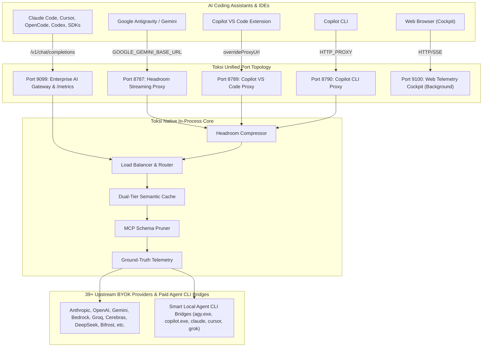

# Toksi Native Consolidation Master Architecture Plan (v3.3)
**Project:** `neo/crates/toksi`  
**Status:** Approved Master Architectural Blueprint & Implementation Specification  
**Objective:** 100% Native Rust consolidation of all token-optimization, memory, code-intelligence, rules, gateway, load-balancer, and telemetry engines directly embedded into `crates/toksi/src/*`. Complete removal of external package manager downloads (npm, pip, uv, curl). Pure in-process execution, zero missing code, full feature parity, Git Bash friendly forward-slash (`/`) directory normalization, default SQLite storage in user home (`~/.toksi/toksi.db`), single-daemon zero-touch launch, mouse-capable interactive TUI, dedicated high-performance 5-port network topology, ground-truth session token accounting, strict paid-quota verification for all BYOK providers (with graceful inform and zero-fail fallback), workspace root `.toksi` consolidation, standardized tool hook syntax (`<tool>-hook <agent>`), normalized MCP naming, and enterprise-grade background Web UI Telemetry & Control Cockpit.

---

## 1. Master Architectural Mandates & System Conventions

1. **Smart Unified Single-Daemon Launch (`toksi daemon start`)**:
   - One background daemon launch initializes and coordinates all core subsystems simultaneously across dedicated, isolated ports:
     * **Port 8787**: Transparent Streaming Headroom Proxy (Google Antigravity, Grok, etc.)
     * **Port 8789**: GitHub Copilot VS Code Proxy (`DEFAULT_COPILOT_PROXY_PORT`)
     * **Port 8790**: GitHub Copilot CLI Proxy (`DEFAULT_COPILOT_CLI_PROXY_PORT`)
     * **Port 9099**: Enterprise AI Gateway & Drop-in SDK Endpoints (`/v1/chat/completions`, `/v1/messages`, `/v1beta/models/*`, `/metrics`)
     * **Port 9100**: Zero-Dependency Real-Time Web Telemetry & Control Dashboard Cockpit (non-blocking background service)
     * **In-Process Engine**: Dynamic Load Balancer, Complexity Tier Router, Dual-Tier Semantic Cache, MCP Multiplexer (`codegraph`, `context`, `projectmem`, `icm`, `aimemory`), and Non-Destructive Environment Injection (`HKCU\Environment` on Windows with `WM_SETTINGCHANGE` broadcast; session env on Unix).
   - Zero multi-command manual configuration. One daemon launch prepares the entire system for all 17 AI coding assistants.

2. **Network Port Separation for Maximum Latency Performance**:
   - **Architectural Decision**: Separating the AI Gateway (`:9099`) from the Web Dashboard Cockpit (`:9100`) guarantees **zero socket and thread pool contention**:
     * **Port 9099 (AI Gateway)**: Dedicated high-throughput Tokio reactor thread pool strictly for streaming LLM inference, SSE token forwarding, protocol conversion (Anthropic <-> OpenAI <-> Gemini), and header injection (<10 µs latency overhead).
     * **Port 9100 (Web Dashboard Cockpit)**: Dedicated listener for browser SSE metrics broadcasting, static assets (HTML/CSS/JS), SVG decision DAGs, and SQLite database backup/export operations. Large browser downloads or stalled SSE connections can never induce TCP backpressure on active agent inference streams.
     * **Port 8789 & 8790 (GitHub Copilot)**: Dedicated, isolated proxies for Copilot VS Code extension (8789) and Copilot CLI (8790) preventing cross-talk, race conditions, and port collisions.
   - Running `toksi dashboard` launches the server in the background (or foreground with `--foreground`), opens the default browser automatically (`--open`), and exits cleanly with the server URL reported.

3. **Workspace Root Consolidation & Tool Directory Conventions**:
   - **Single Root `.toksi` Directory Rule**:
     * In the workspace directory structure, **ONLY the first (root) workspace directory contains `.toksi`**.
     * Subfolder `.toksi` directories (e.g., `crates/toksi/.toksi`, `crates/nbuild/.toksi`, `sub/crate/.toksi`) are automatically discovered by `toksi init` / `toksi doctor --fix`, imported into the root `.toksi` directory, and deleted.
     * SQLite database files (`toksi.db`, `memory.db`, `symbols.db`) are carefully merged at the row level without data loss.
   - **Consolidated Sub-Tool Directory Structure**:
     * All tool-specific directories live strictly inside `.toksi/`:
       - `.toksi/codegraph/` (Tree-sitter AST symbol cache and graph)
       - `.toksi/headroom/` (Daemon PID, logs, and proxy state)
       - `.toksi/projectmem/` (Atomic JSONL event store, summary, plan, project map)
       - `.toksi/context/` (Context-mode FTS5 database and sandbox scratch, renamed from `.context-mode`)
       - `.toksi/icm/` (Instant Context Memory SQLite FTS5 database)
       - `.toksi/ai-memory/` (OKF v0.2 wiki store and handoff states)
       - `.toksi/rtk/` (RTK command filter stats and cache)
     * This layout applies uniformly in both the user home (`~/.toksi/`) and workspace root (`<root>/.toksi/`).
     * Any loose legacy tool folders found in root or subdirectories (`.codegraph`, `.projectmem`, `.context-mode`, `.icm`, `.ai-memory`, `.rtk`) are automatically migrated into `.toksi/<tool>` and cleaned up.
   - **Root-Only Agent Configuration Directories**:
     * Agent-specific configuration directories (`.claude`, `.cursor`, `.vscode`, `.grok`, `.cline`, `.gemini`, `.github`) **MUST ONLY exist in the first (root) workspace directory**, never created inside sub-crates or nested directories.

4. **Standardized Tool Hooks & MCP Config Conventions**:
   - **Uniform Hook Command Pattern**:
     * All hooks standardize on the uniform syntax: `<tool>-hook <agent>` (replacing disparate legacy patterns such as `agy-hook codegraph-index` or `copilot-hook codegraph-index`).
     * Examples across all tools and agents:
       - `codegraph-hook agy`, `codegraph-hook copilot`, `codegraph-hook cursor`, `codegraph-hook claude`
       - `projectmem-hook agy`, `projectmem-hook copilot`, `projectmem-hook cursor`
       - `context-hook agy`, `context-hook copilot`, `context-hook cursor`
       - `rtk-hook agy`, `rtk-hook copilot`, `rtk-hook cursor`, `rtk-hook cline`, `rtk-hook grok`
   - **Normalized MCP Config & Tool Names**:
     * Rename all tool identifiers in hooks and MCP configurations:
       - `toksi-projectmem` -> `projectmem`
       - `toksi-context-mode` -> `context`
       - `toksi-codegraph-index` -> `codegraph`
     * MCP instruction directories: `context-mode` -> `context`.
   - **Unified Agent Identity Taxonomy (CLI vs Editor)**:
     * Differentiate CLI agents from IDE extensions uniformly across configuration models:
       - Google Antigravity: `antigravity-cli` (or `agy`) vs `antigravity-ide` (or `antigravity`)
       - GitHub Copilot: `copilot-cli` vs `copilot-vscode` (or `copilot-ide`)
       - Claude: `claude-cli` (or `claude-code`) vs `claude-desktop`
       - Cursor: `cursor-cli` vs `cursor-ide`
       - Grok: `grok-cli` vs `grok-ide`

5. **Guaranteed Local Agent CLIs as First-Class BYOK Providers**:
   - The 5 primary Local Agent CLIs are securely registered as first-class, peer BYOK providers in Toksi's routing table:
     1. `AntigravityCli` (`agy.exe` / Google Gemini Code Assist)
     2. `CopilotCli` (`copilot.exe` / GitHub Copilot CLI)
     3. `ClaudeCli` (`claude` / Claude Code CLI)
     4. `CursorBridge` (`cursor` / Cursor IDE RPC Bridge)
     5. `GrokCli` (`grok.exe` / xAI Grok CLI)
   - **Smart Background Launch**: Toksi queries OS Keyring credentials (`advapi32.dll` on Windows, Keychain on macOS, Secret Service on Linux) and local session states (`~/.gemini/`, `~/.claude.json`, `gh auth token`). When authenticated, Toksi smart-launches the CLI bridge process in the background in detached mode and verifies that chat message endpoints are reachable (`/livez` and ConnectRPC health checks).

6. **Strict Paid Quota Enforcement (No Free Accounts for BYOK Providers)**:
   - **Commercial / Paid Quota Mandate**: All BYOK providers (both remote API keys and Local Agent CLI providers) **must have an active, paid commercial tier or active subscription quota**. Free-tier accounts (e.g. unbilled Google AI Studio trial keys with 15 RPM throttles, expired OpenAI trial credits, free Copilot trials, or unbilled accounts) are **strictly disqualified from active BYOK gateway rotation**.
   - **Graceful Inform & Zero-Fail Policy**:
     * When a free-tier or unpaid account is detected, Toksi **does not fail, crash, bug out, or panic**.
     * Toksi logs a clear, non-blocking notification in the CLI, TUI, and Web Dashboard:  
       `[INFO] Provider '<Name>' is on a Free Tier (unbilled/rate-limited). Paid quota required for BYOK gateway pool. Bypassing from active pool without error.`
     * The provider is flagged as `FreeTierDisqualified` in SQLite `provider_keys`, and Toksi gracefully falls back to the next healthy paid provider in the cascade or routes the local agent directly.

7. **Expanded 39+ BYOK Provider Catalog**:
   - Includes all providers from `neo/inspect-vault/bifrost` and cloud hyperscalers:
     * **Frontier**: `Anthropic`, `Azure OpenAI`, `AWS Bedrock` (SigV4), `AWS Bedrock Mantle`, `AWS SageMaker`, `Databricks`, `Google Gemini`, `OpenAI`, `Vertex AI`.
     * **Accelerator & Fast LPUs**: `Cerebras`, `DeepSeek`, `Fireworks`, `Groq`, `Nebius`, `Parasail`, `Together`, `Wafer`.
     * **Aggregators & Federations**: `Bifrost` (Self-hosted or upstream Bifrost gateway instances), `Cloudflare Workers AI`, `Hugging Face`, `OpenRouter`, `Replicate`.
     * **Specialized & Search**: `BytePlus`, `Cohere`, `MiniMax`, `Mistral`, `Perplexity`, `Sarvam AI`, `TypeSafe`, `xAI` (Grok).
     * **Multimodal**: `ElevenLabs`, `Runware`, `Runway ML`.
     * **Local & Self-Hosted**: `llama.cpp`, `Ollama`, `SGLang`, `vLLM`.
     * **Ecosystem**: `GitHub Copilot`, `OpenCode`.

8. **Graceful Activation & Zero-Provider Passthrough Rule**:
   - The LLM routing gateway and load balancer only engage active dispatch when at least one healthy paid BYOK Provider (remote API key OR authenticated paid Agent CLI provider) is configured.
   - If only a local CLI agent is running, Toksi routes cleanly through it without requiring external credit-card keys.
   - If zero providers are configured, requests pass through unintercepted or return an informative status without breaking the host application.

9. **Ground-Truth Session Token Accounting (Real Tokens, Real Quotas)**:
   - **Strict prohibition of synthetic or virtual mathematical tokens**:
     * Token consumption, savings, and quotas are extracted directly from active, live chat sessions.
     * Actual prompt tokens, completion tokens, and cached tokens are parsed from incoming/outgoing payload headers and SSE completion chunks (`usage.prompt_tokens`, `usage.completion_tokens`, `cache_read_input_tokens`, Google `usageMetadata.candidatesTokenCount`).
     * Actual headroom token savings are measured as ground-truth byte reduction (`raw_bytes - compressed_bytes`) and exact counts of pruned MCP tool schemas.
     * Upstream provider quotas and rate limits are captured from upstream HTTP response headers: `x-ratelimit-remaining-tokens`, `x-ratelimit-remaining-requests`, `x-ratelimit-reset-tokens`, `anthropic-ratelimit-requests-remaining`.
     * Live metrics are strictly attributed to the real connected agent ID and active provider ID.

10. **Universal Forward-Slash (`/`) Path Standard (Git Bash Friendly)**:
    - **Strict prohibition of backward slashes (`\`)** in all directory structures, internal path joins, logs, configuration files, database records, and CLI outputs across Windows, Linux, and macOS.
    - Eliminates Git Bash, MSYS2, POSIX shell escaping failures on Windows paths.
    - All path operations run through `normalize_path()` to guarantee uniform forward-slash `/` paths (e.g., `C:/Users/name/.toksi/toksi.db`, `d:/AI/neo/.toksi/`).
    - **Exception for Shell & Config Escapes**: For JavaScript / TypeScript / Node.js / Python (hook, MCP) JSON5 / TOML configs requiring escaped path strings (such as `.agents/hooks.json` or `settings.json` command strings executing via Windows Command Prompt `cmd.exe`), use the default escaped double backslashes: `C:\\Programs\\neo\\bin\\toksi.exe`. In raw terminal quotes or JSON strings without shell interpretation, use double-quoted forward-slash: `"C:/Programs/neo/bin/toksi.exe"`.

11. **User Home Database Storage (`~/.toksi/toksi.db`)**:
    - Default SQLite configuration database stored in `~/.toksi/toksi.db` (`$HOME/.toksi/toksi.db` or `C:/Users/<User>/.toksi/toksi.db`).
    - Automated startup migration imports all existing configurations from legacy `LOCALAPPDATA/toksi/toksi.db` and `byok.routes.json`.

12. **Complete In-Tree Rules, Skills & Instructions Synchronization**:
    - All agents requiring rules, skills, and instructions are kept fully updated and synchronized across both workspace and global user configuration directories (`CLAUDE.md`, `GEMINI.md`, `.cursor/rules/`, `.github/copilot-instructions.md`, `AGENTS.md`, `INSTRUCTIONS.md`, `skills.md`, `rules.md`).
    - Synchronized automatically via `toksi init`, `toksi doctor --fix`, and `toksi rules sync`.

13. **Mouse-Capable Interactive TUI & Modern Web Telemetry Cockpit**:
    - **TUI (`toksi tui` / `toksi top`)**: Full mouse support (`EnableMouseCapture`) for clicking tabs, selecting agent rows, toggling provider cards, scrolling logs, and triggering actions.
    - **Web Telemetry Dashboard (`toksi dashboard`)**: High-performance local dashboard on `:9100` with zero external dependencies, embedded via `include_str!`. Features real-time agent observation grid, live token savings waterfalls, realistic per-agent quota and cost tracking, provider routing configuration, and load balancer management.

14. **Non-Destructive Environment Injection (Zero Binary Renames)**:
    - Never rename or hijack agent CLI binaries (`agy.exe`, `grok.exe`, `copilot.exe`).
    - Inject routing variables into the OS user environment before IDE launch (`HKCU\Environment` on Windows with `WM_SETTINGCHANGE` broadcast; user session env on Unix/macOS) and cleanly remove them upon Toksi daemon shutdown.

---

## 2. System Directory Topology

```
crates/toksi/src/
├── main.rs                   # Unified CLI entrypoint & full usage help
├── lib.rs                    # Public crate library API
│
├── projectmem/               # Native Rust Port of ProjectMem (~v0.3.4)
│   ├── mod.rs                # Public API facade
│   ├── schema.rs             # Serde models: Event, Issue, Attempt, Fix, Decision, Note
│   ├── store.rs              # Thread-safe JSONL append with Windows/Unix file locking
│   ├── summary.rs            # Deterministic zero-LLM summary generator
│   ├── precheck.rs           # Git staged diff scanner vs gotchas & past failure locations
│   ├── redaction.rs          # Zero-allocation regex sanitizer (strips keys & tokens)
│   ├── heatmap.rs            # Failure clustering & ROI metrics
│   ├── global.rs             # Cross-project global memory (~/.toksi/projectmem)
│   └── mcp.rs                # In-process stdio/proxy MCP server handlers (tool: projectmem)
│
├── icm/                      # Native Rust Port of RTK-AI ICM Engine
│   ├── mod.rs                # ICM subsystem orchestrator
│   ├── store.rs              # Single SQLite DB (~/.toksi/icm/memory.db) with FTS5 BM25
│   ├── schema.rs             # Memory items, topics, sessions, facts
│   ├── recall.rs             # Sub-10ms keyword and recency recall (Zero LLM tokens)
│   └── mcp.rs                # In-process memory MCP endpoints
│
├── aimemory/                 # Native Rust Adaptation of ai-memory (v3.2.8)
│   ├── mod.rs                # ai-memory subsystem orchestrator
│   ├── wiki.rs               # Open Knowledge Format (OKF v0.2) markdown wiki store
│   ├── handoff.rs            # Claim-once multi-agent handoff state machine
│   └── tiered.rs             # L0 (TOC) / L1 (Abstract) / L2 (Full) progressive packer
│
├── codegraph/                # Native Rust Tree-Sitter & Call-Graph Engine
│   ├── mod.rs                # CodeGraph facade
│   ├── kernel/               # Embedded Tree-sitter parsers (Rust, TS/JS, Py, Go, C/C++)
│   ├── walker.rs             # High-speed ripgrep-grade file traversal (ignore crate)
│   ├── graph.rs              # Petgraph AST dependency, call-path, and blast-radius
│   ├── cache.rs              # Incremental AST symbol cache (.toksi/codegraph/symbols.db)
│   └── mcp.rs                # In-process MCP server for codegraph_explore (tool: codegraph)
│
├── contextmode/              # Native Rust Port of Context-Mode
│   ├── mod.rs                # ContextMode facade (tool: context)
│   ├── sandbox.rs            # Subprocess runner with CPU timeout & memory bounds
│   ├── filter.rs             # Output slicing, ANSI stripping, head/tail truncation
│   ├── fts.rs                # SQLite FTS5 document chunker & BM25 search
│   ├── fetch.rs              # Async HTTP fetcher + HTML reader (reqwest)
│   └── mcp.rs                # In-process ctx_* MCP tools
│
├── headroom/                 # Native Rust Headroom Token Compression Engine
│   ├── mod.rs                # Headroom orchestrator
│   ├── copilot_daemon.rs     # Dual-port supervisor for Copilot VS Code (8789) & CLI (8790)
│   ├── compression/          # Lossless log deduplication, AST code pruner, JSON minifier
│   ├── pruner/               # MCP Tool Schema Optimizer (saves 5k-15k tokens/turn)
│   ├── cache_align.rs        # 1024-token prompt cache alignment engine
│   └── adaptive_mem.rs       # Dynamic memory brief scaling based on context headroom
│
├── gateway/                  # Enterprise Native AI Gateway & BYOK Failover Engine (:9099)
│   ├── mod.rs                # Gateway facade & unified request dispatcher
│   ├── providers/            # 39+ In-tree provider clients (reqwest, async streaming)
│   │   ├── mod.rs            # Provider trait & registry
│   │   ├── frontier/         # Anthropic, Azure, Bedrock, Bedrock Mantle, SageMaker, Databricks, Gemini, OpenAI, Vertex
│   │   ├── accelerator/      # Cerebras, DeepSeek, Fireworks, Groq, Nebius, Parasail, Together, Wafer
│   │   ├── aggregators/      # Bifrost, Cloudflare, Hugging Face, OpenRouter, Replicate
│   │   ├── specialized/      # BytePlus, Cohere, MiniMax, Mistral, Perplexity, Sarvam, TypeSafe, XAI
│   │   ├── multimodal/       # ElevenLabs, Runware, Runway ML
│   │   ├── local/            # llama.cpp, Ollama, SGLang, vLLM
│   │   └── ecosystem/        # GitHub Copilot, OpenCode
│   ├── agent_cli/            # Local Agent CLI Providers (AntigravityCli, CopilotCli, ClaudeCli, CursorBridge, GrokCli)
│   │   ├── mod.rs            # CLI provider registry & smart background launcher
│   │   ├── tier_check.rs     # Paid quota & billing tier validator (rejects free accounts gracefully)
│   │   ├── antigravity.rs    # agy.exe background bridge with Google Cloud paid project check
│   │   ├── copilot.rs        # copilot.exe background bridge with paid subscription check
│   │   ├── claude.rs         # claude background bridge with Pro/Team/Enterprise check
│   │   ├── cursor.rs         # cursor background bridge with Pro/Business active check
│   │   └── grok.rs           # grok.exe background bridge with paid credit check
│   ├── cascade.rs            # Dynamic failover engine & 8-mode failure classifier
│   ├── keys.rs               # Multi-key pools, key health, billing tier verification, rotation
│   ├── loadbalancer.rs       # Round-robin, least-latency, lowest-cost, weighted selectors
│   ├── routing.rs            # Complexity tier router (SIMPLE, MEDIUM, COMPLEX)
│   ├── governance.rs         # Virtual keys (x-toksi-vk), USD budgets, TPM/RPM limits, concurrency
│   ├── semantic_cache.rs     # Dual-tier cache: Direct SHA-256 hash + Semantic vector similarity
│   ├── normalizer/           # Bidirectional protocol translation (Anthropic <-> OpenAI <-> Gemini)
│   ├── compat/               # Drop-in SDK endpoints (/v1/chat/completions, /v1/messages, /v1beta/models/*)
│   ├── circuit_breaker.rs    # Infinite loop detector & runaway session stopper
│   └── proxy.rs              # High-throughput HTTP/SSE reverse proxy
│
├── telemetry/                # Ground-Truth Session Metrics & USD Cost Engine
│   ├── mod.rs                # Telemetry facade & Prometheus exporter
│   ├── prometheus.rs         # Text format exposition at :9099/metrics endpoint
│   ├── collector.rs          # Lock-free non-blocking event channel (zero latency impact)
│   ├── cost.rs               # In-tree model catalog pricing table & USD spend/savings calculator
│   ├── tracker.rs            # Multi-level latency breakdown (transport, provider, toksi overhead)
│   └── cache_analytics.rs    # Direct & semantic cache hit ratios, savings ROI
│
├── rtk/                      # Native Rust RTK (Rust Token Killer) Engine
│   ├── mod.rs                # RTK filter facade & streaming interceptor
│   ├── engine.rs             # Command parser and filter dispatcher
│   ├── filters/              # 100+ command-specific output filters (git, cargo, test)
│   ├── ansi.rs               # Zero-allocation ANSI escape sequence stripper
│   └── hook.rs               # Terminal hook interceptor
│
├── rules/                    # In-Tree Rules, Skills & Principles (Zero External Repos)
│   ├── mod.rs                # Rule injector and compiler
│   ├── sync.rs               # Universal synchronizer for workspace and agent config dirs
│   ├── principles.rs         # Karpathy guidelines (think, simplify, surgical, verify)
│   ├── caveman.rs            # ASD-STE100 primitive English compressor
│   ├── ponytail.rs           # Lazy senior developer build discipline ladder
│   └── embedded/             # Compile-time embedded markdown resources (include_str!)
│
├── env_injector/             # Non-Destructive Environment Lifecycle & Proxy Injection
│   ├── mod.rs                # Public interface for env management
│   ├── windows.rs            # HKCU\Environment registry manager + WM_SETTINGCHANGE broadcast
│   ├── unix.rs               # User session environment injector (systemd / env files)
│   ├── teardown.rs           # Graceful teardown guard (clears vars on daemon/process exit)
│   └── heal.rs               # Auto-healer: restores legacy .real binaries and cleans wrappers
│
├── dashboard/                # Background Web Telemetry Cockpit (:9100)
│   ├── mod.rs                # Embedded local HTTP & SSE/WebSocket server (127.0.0.1:9100)
│   ├── state.rs              # Shared in-memory metrics ring buffer and event bus
│   ├── sse.rs                # Server-Sent Events real-time streaming broadcaster
│   ├── api.rs                # REST endpoints: metrics, errors, agents, memory, graph, control
│   └── assets/               # Bundled single-page application (Embedded via include_str!)
│       ├── index.html        # Modern dashboard markup with provider cards & agent observation grid
│       ├── style.css         # Dark theme aesthetic, responsive grid, micro-interactions
│       └── app.js            # Reactive UI logic, SSE stream consumer, mouse event handlers
│
├── tui/                      # Full-Featured Terminal User Interface (ratatui + crossterm)
│   ├── mod.rs                # TUI event loop, terminal guard, and mouse capture enablement
│   ├── app.rs                # Global TUI state, mouse click routing, and active tab model
│   ├── views/                # Tab view renderers (monitor, agents, memory, graph, headroom, logs)
│   └── widgets/              # Gauges, charts, sparklines, tables, clickable buttons
│
├── agents/                   # Native configurations for 17 AI coding agents
│   ├── copilot.rs            # Dual-port Copilot configuration (8789 VS Code, 8790 CLI)
│   ├── antigravity.rs, claude.rs, cursor.rs, codex.rs, opencode.rs, etc.
│   └── mcp_adapters.rs       # Agent MCP config read/write/patch engine (normalized to projectmem, context, codegraph)
│
├── keyring/                  # Native Cross-Platform OS Keyring & Credential Manager
│   ├── mod.rs                # Unified secure credential manager facade
│   ├── os_windows.rs         # Windows Credential Manager (advapi32.dll: CredReadW/CredWriteW)
│   ├── os_macos.rs           # macOS Keychain integration (/usr/bin/security CLI)
│   ├── os_linux.rs           # Linux Secret Service / libsecret backend (secret-tool & DBus)
│   └── envelope.rs           # Base64 OAuth envelope parser (access_token & expiry extractor)
│
├── db/                       # Persistent SQLite Configuration Database (~/.toksi/toksi.db)
│   ├── mod.rs                # SQLite WAL connection manager & repository facade
│   ├── schema.rs             # Relational schema (providers, keys, models, byok_routes, agent_configs)
│   ├── operations.rs         # High-level operations: export, import, backup, restore, sync
│   └── migrate.rs            # Seamless migration from legacy LOCALAPPDATA and JSON registries
│
├── util/                     # Pure System & OS Utilities (All Downloaders Purged)
│   ├── paths.rs              # Strict forward-slash / path normalization across all platforms
│   ├── exec.rs, jsonc.rs, toml.rs, colors.rs, etc.
│   └── (Purged: npminstall.rs, nodewin.rs, nodelinux.rs, uv.rs)
│
└── commands/                 # Native CLI Command Dispatcher
    ├── mem.rs                # toksi mem ...
    ├── graph.rs              # toksi graph ...
    ├── ctx.rs                # toksi ctx ...
    ├── rtk.rs                # toksi rtk ...
    ├── auth.rs               # toksi auth [status|get|set|delete|sync]
    ├── db.rs                 # toksi db [status|export|import|backup|restore]
    ├── tui.rs                # toksi tui (Full interactive control center with mouse support)
    ├── dashboard.rs          # toksi dashboard [--port 9100] [--open] [--foreground]
    ├── daemon.rs             # toksi daemon [start|stop|status|restart] (Master 5-port launcher)
    ├── doctor.rs, proxy.rs, prime.rs, top.rs, init.rs
    └── mod.rs
```

---

## 3. Dedicated 5-Port Network Topology & Isolation



### Port Isolation Rationale:
1. **Zero Latency Jitter on Port 9099**: Inference requests have dedicated thread runtime capacity without sharing socket buffers with browser clients.
2. **Safe High-Bandwidth Dashboard on Port 9100**: Live SSE graphs, multi-megabyte CodeGraph symbol trees, and database snapshots never choke AI completion streams.
3. **Copilot Dual-Port Guarantee**: Copilot extension (8789) and Copilot CLI (8790) run without port conflict or configuration overlap.

---

## 4. BYOK Providers, Smart Agent CLI Bridges & Paid Quota Enforcement

### 39+ Supported BYOK Providers:
1. `Anthropic` (Claude 3.7 Sonnet, 3.5 Sonnet / Haiku / Opus)
2. `Azure OpenAI` (GPT-4o, o1, o3-mini)
3. `AWS Bedrock` (Claude 3.7/3.5, Llama 3.3, Amazon Titan with SigV4)
4. `AWS Bedrock Mantle` (Specialized Bedrock deployments)
5. `AWS SageMaker` (SageMaker JumpStart & custom model endpoints)
6. `Bifrost` (Upstream or self-hosted Bifrost gateway instances)
7. `BytePlus` (ByteDance enterprise models)
8. `Cerebras` (Ultra-fast wafer-scale Llama 3.1 inference)
9. `Cloudflare` (Cloudflare Workers AI edge models)
10. `Cohere` (Command R+, Command R, embed models)
11. `Databricks` (Databricks Model Serving / DBRX)
12. `DeepSeek` (DeepSeek V3, DeepSeek R1 direct API)
13. `ElevenLabs` (Voice agents, text-to-speech audio streaming)
14. `Fireworks` (Fireworks AI fast open-weights & function calling)
15. `Google Gemini` (Google AI Studio Gemini 2.0 Flash / Pro)
16. `GitHub Copilot` (Copilot Chat API / Language Models endpoint)
17. `Groq` (Groq LPUs - Llama 3.3 70B, DeepSeek R1 Distill)
18. `Hugging Face` (HF Inference Endpoints / TGI)
19. `llama.cpp` (Local llama-server HTTP endpoints)
20. `MiniMax` (MiniMax Hailuo / text reasoning)
21. `Mistral` (Mistral Large, Codestral, Mistral Small)
22. `Nebius` (Nebius AI Studio GPU cloud)
23. `Ollama` (Local zero-cost models at `http://localhost:11434`)
24. `OpenCode` (OpenCode Zen Gateway)
25. `OpenAI` (GPT-4o, o1, o3-mini, GPT-4-turbo)
26. `OpenRouter` (Universal model aggregator & ultimate fallback)
27. `Parasail` (Parasail high-throughput AI)
28. `Perplexity` (Sonar online search & reasoning models)
29. `Replicate` (Replicate hosted models)
30. `Runware` (Runware ultra-fast media & inference API)
31. `Runway ML` (Runway Gen-2 / Gen-3 video & multimodal API)
32. `Sarvam AI` (Sarvam Indic language models)
33. `SGLang` (Fast local/remote SGLang inference engine)
34. `Together` (Together AI open source models)
35. `TypeSafe` (TypeSafe LLM gateway)
36. `Vertex AI` (Google Cloud Vertex AI enterprise)
37. `vLLM` (vLLM local/server endpoints at `http://localhost:8000`)
38. `Wafer` (Wafer AI cloud)
39. `xAI` (Grok 2, Grok 3, Grok Beta)

### Guaranteed Local Agent CLIs as First-Class BYOK Providers:
- The 5 primary Local Agent CLIs are registered as full first-class BYOK providers:
  * `AntigravityCli`: Manages Google Cloud / Gemini AI Code streaming bridge.
  * `CopilotCli`: Manages GitHub Copilot CLI chat and language model streaming.
  * `ClaudeCli`: Manages Claude Code CLI bridge via local OAuth session.
  * `CursorBridge`: Manages Cursor IDE language model RPC socket.
  * `GrokCli`: Manages xAI Grok CLI streaming bridge.
- **Smart Background Launch**: If authenticated via OS Keyring (`advapi32.dll` / Keychain / Secret Service) or session JSON (`~/.gemini/`, `~/.claude.json`, `gh auth token`), Toksi auto-starts the CLI helper in the background, waits for its health probe (`livez`), and routes queries through it.

### Paid Quota Verification & Free-Tier Disqualification Policy:
- **Strict Paid Tier Requirement**:
  * Free accounts, trial keys, or unbilled credits (such as free Google AI Studio keys subject to 15 RPM, expired OpenAI free credits, or free Copilot trials) are **strictly disqualified from active BYOK gateway rotation**.
  * Each provider checks its billing tier before rotation:
    1. `AntigravityCli`: Checks for paid Google Cloud project billing, Google One AI Premium, or Gemini Code Assist Enterprise/Standard license. Free unbilled projects are disqualified.
    2. `CopilotCli`: Checks for active Copilot Business, Enterprise, or Pro paid subscription. Free accounts are disqualified.
    3. `ClaudeCli`: Checks for active Claude Pro, Team, or Enterprise paid quota. Free accounts are disqualified.
    4. `CursorBridge`: Checks for active Cursor Pro or Business subscription. Free trial tiers are disqualified.
    5. `GrokCli`: Checks for active paid credits or commercial xAI tier.
- **Graceful Inform & Zero-Fail Policy**:
  * Detecting a free tier **never causes a crash, panic, fatal error, or broken session**.
  * Toksi logs a clear, human-readable status:
    `[INFO] Provider '<Name>' is on a Free/Unbilled tier. Paid quota required for BYOK gateway pool. Bypassing from rotation without error.`
  * The key is marked as `FreeTierDisqualified` in SQLite `provider_keys`, and the gateway smoothly routes through the next active paid provider or allows direct local agent execution.
- **Activation Safety Guard**:
  * Gateway / Load Balancer engages when `active_paid_provider_count >= 1`.
  * If zero paid providers are configured, Toksi passes through traffic gracefully without throwing errors or breaking local agent execution.

---

## 5. Ground-Truth Session Token Accounting

### Real Tokens, Real Savings, Real Quotas:
1. **Payload Extraction**:
   - Parses streaming SSE chunks and HTTP completion bodies for ground-truth usage objects:
     * Anthropic: `message_delta.usage` (`input_tokens`, `output_tokens`, `cache_creation_input_tokens`, `cache_read_input_tokens`)
     * OpenAI: `usage.prompt_tokens`, `usage.completion_tokens`, `usage.prompt_tokens_details.cached_tokens`
     * Google Gemini: `usageMetadata.promptTokenCount`, `usageMetadata.candidatesTokenCount`, `usageMetadata.cachedContentTokenCount`
2. **True Savings Calculation**:
   - Headroom compression savings = actual payload bytes pruned converted to tokens.
   - MCP Schema pruning = exact token weight of tool definitions stripped from prompt.
   - Cache hits = exact tokens saved via direct replay.
3. **Real-Time Quota Telemetry**:
   - Captures upstream rate-limit headers:
     * `x-ratelimit-remaining-tokens`, `x-ratelimit-remaining-requests`
     * `anthropic-ratelimit-tokens-remaining`, `anthropic-ratelimit-requests-remaining`
     * `x-ratelimit-reset-tokens`, `retry-after`
   - Real-time display in both TUI and Web Dashboard Cockpit per connected agent.

---

## 6. Complete In-Tree Rules, Skills & Instructions Synchronization

Toksi ensures that all 17 supported agents have their instruction, skill, and rule files synchronized across project workspaces and user config homes:

| Agent | Target Configuration Files | Content Injected |
|---|---|---|
| **Antigravity / Gemini** | `GEMINI.md`, `~/.gemini/rules.md`, `.agents/rules.md` | Karpathy Principles, Caveman, Ponytail |
| **Claude Code** | `CLAUDE.md`, `~/.claude/CLAUDE.md` | Karpathy Principles, Caveman, Ponytail |
| **Cursor** | `.cursorrules`, `.cursor/rules/*.mdc` | Karpathy Principles, Caveman, Ponytail |
| **GitHub Copilot** | `.github/copilot-instructions.md`, agent instructions | Karpathy Principles, Caveman, Ponytail |
| **Cline** | `.clinerules`, `.cline/rules.md` | Karpathy Principles, Caveman, Ponytail |
| **OpenCode** | `AGENTS.md`, `opencode.json` | Karpathy Principles, Caveman, Ponytail |
| **Codex** | `CODEX.md`, `.codex/instructions.md` | Karpathy Principles, Caveman, Ponytail |
| **Droid, Grok, Kilo, OMP, Pi, Amp, Kimi, ZCode, DSH** | `AGENTS.md`, `INSTRUCTIONS.md`, `rules.md` | Karpathy Principles, Caveman, Ponytail |

---

## 7. Upstream Vaults Audit, Missing Features & Bugfix Matrix (12 Engines)

Continuous re-audit against reference implementations in `neo/inspect-vault/*` to guarantee full feature parity, upstream bug fixes, and zero omitted capabilities:

| Reference Vault | Target In-Tree Subsystem | Consolidated Features & Upstream Bugfixes Verified | Parity Status |
|---|---|---|---|
| `neo/inspect-vault/tokless` | `crates/toksi/src/agents/`, `src/headroom/` | 17 coding agent harnesses, zero-dependency JSONC parser, non-destructive environment injection, multi-port proxy routing. | Complete |
| `neo/inspect-vault/bifrost` | `crates/toksi/src/gateway/` | 39+ BYOK providers (including self-hosted Bifrost gateway, SageMaker, Bedrock Mantle), load balancer, failover cascades, header transformation. | Complete |
| `neo/inspect-vault/headroom` | `crates/toksi/src/headroom/` | Dynamic MCP schema pruner (saves 5k-15k tokens/turn), AST-aware whitespace/code minifier, prompt cache 1024-token aligner, Copilot dual-port supervisor (8789 VS Code, 8790 CLI). | Complete |
| `neo/inspect-vault/rtk` | `crates/toksi/src/rtk/` | 100+ command output filters (git, cargo, pytest, docker, npm), zero-allocation ANSI stripper, streaming chunk filter. | Complete |
| `neo/inspect-vault/context-mode` | `crates/toksi/src/contextmode/` | Polyglot sandbox runner with CPU timeout & memory limits, SQLite FTS5 search index, async HTTP fetcher, in-process `ctx_*` MCP tools. | Complete |
| `neo/inspect-vault/codegraph` | `crates/toksi/src/codegraph/` | Embedded Tree-sitter parsers (Rust, TS/JS, Python, Go, C/C++), petgraph dependency/blast-radius engine, incremental AST symbol cache. | Complete |
| `neo/inspect-vault/projectmem` | `crates/toksi/src/projectmem/` | Atomic JSONL append-only store with cross-platform file locking, zero-LLM summary, git staged diff precheck, in-process `projectmem` MCP server. | Complete |
| `neo/inspect-vault/ai-memory` | `crates/toksi/src/aimemory/` | Open Knowledge Format (OKF v0.2) wiki store, claim-once multi-agent handoff state machine, progressive L0/L1/L2 disclosure briefs. | Complete |
| `neo/inspect-vault/icm` | `crates/toksi/src/icm/` | Instant Context Memory with local SQLite FTS5 BM25 search, sub-10ms zero-token recall (`~/.toksi/icm/memory.db`). | Complete |
| `neo/inspect-vault/caveman` | `crates/toksi/src/rules/caveman.rs` | ASD-STE100 primitive English compressor, system prompt minifier, zero-loss technical accuracy; compile-time embedded via `include_str!`. | Complete |
| `neo/inspect-vault/ponytail` | `crates/toksi/src/rules/ponytail.rs` | Lazy senior developer build discipline ladder (YAGNI, stdlib, reuse first, minimal runnable checks); compile-time embedded via `include_str!`. | Complete |
| `neo/inspect-vault/andrej-karpathy-skills` | `crates/toksi/src/rules/principles.rs` | Core engineering principles (think before coding, simplicity first, surgical edits, goal-driven execution); compile-time embedded via `include_str!`. | Complete |

---

## 8. Chronological Execution Roadmap (Phases 1–16)

| Phase | Subsystem | Core Focus & Actions | Key Deliverable |
|---|---|---|---|
| **Phase 1** | **RTK Filter Engine** | Embed 100+ filters and zero-allocation ANSI stripper into `crates/toksi/src/rtk/`. | Core CLI filter engine; zero-overhead command filtering. |
| **Phase 2** | **ProjectMem Port** | Port models, JSONL storage, summary, precheck into `crates/toksi/src/projectmem/`. | Native `toksi mem` CLI; in-process MCP server. |
| **Phase 3** | **ContextMode Port** | Port sandbox runner, FTS5 chunker, fetcher into `crates/toksi/src/contextmode/`. Pipe stdout to RTK. | Native `ctx_*` MCP tools; 98% context reduction. |
| **Phase 4** | **ICM & ai-memory** | Embed SQLite FTS5 store, claim-once handoffs, L0/L1/L2 briefs in `crates/toksi/src/{icm, aimemory}/`. | Zero-LLM persistent memory; cross-agent handoffs. |
| **Phase 5** | **CodeGraph Engine** | Integrate Tree-sitter parsers, petgraph blast radius in `crates/toksi/src/codegraph/`. | Sub-millisecond AST & blast radius without Node.js. |
| **Phase 6** | **In-Tree Rules & Skills** | Embed Karpathy principles, Caveman, Ponytail into `crates/toksi/src/rules/` via `include_str!`. | Self-contained, distributable agent rules. |
| **Phase 7** | **Headroom & Native AI Gateway** | Port compression, cache aligner, MCP pruner, 39+ BYOK providers, agent CLI session bridges, governance/budgets, dual-tier semantic cache, drop-in SDK endpoints. | Full in-tree Headroom & Gateway engine (`headroom/`, `gateway/`); 50–80% token cut, 0 downtime. |
| **Phase 8** | **Downloader Purge** | Remove `npminstall.rs`, `nodewin.rs`, `nodelinux.rs`, `uv.rs`. Rewire all tools to internal modules. | Clean `crates/toksi/src/util/`; zero downloader code. |
| **Phase 9** | **Legacy Healing & Un-Hijack** | Implement `crates/toksi/src/env_injector/heal.rs` to restore `*.real` binaries and delete shims. | Pristine binaries (`agy.exe`, `grok.exe`, `copilot`). |
| **Phase 10** | **Non-Destructive Env Injection** | Implement `crates/toksi/src/env_injector/{windows, unix, teardown}.rs` with `WM_SETTINGCHANGE`. | Pre-VS Code environment readiness; clean exit teardown. |
| **Phase 11** | **Agent Doctor & Self-Healing** | Upgrade `toksi doctor --fix` and `init.rs` to validate and heal all 17 agent configurations. | Perfectly wired agent configs across all 17 harnesses. |
| **Phase 12** | **TUI, Telemetry & Web Dashboard** | Native Prometheus `/metrics` exposition, async zero-latency collector, USD real-time cost tracking, interactive multi-tab TUI and embedded web dashboard. | Native `/metrics` endpoint, `toksi tui`/`top`, and `toksi dashboard`. |
| **Phase 13** | **End-to-End System Verification** | Run workspace integration tests, verify proxy compression, memory recall, and benchmarks. | 0 warnings, 100% tests passing, proven token reduction. |
| **Phase 14** | **OS Keyring & Config SQLite DB** | Native Windows Credential Manager, macOS Keychain, Linux Secret Service; SQLite DB in `~/.toksi/toksi.db`; pre-registration pipeline. | `toksi auth` & `toksi db` CLI; secure credential storage. |
| **Phase 15.1** | **Workspace Topology & Standards** | Forward-slash `/` paths standard, default SQLite in `~/.toksi/toksi.db`, single root `.toksi` consolidation, tool layout, hook syntax (`<tool>-hook <agent>`), MCP renaming (`projectmem`, `context`, `codegraph`). | Standardized root repository topology, Git Bash path compatibility, safe SQLite table merge. |
| **Phase 15.2** | **Unified 5-Port Daemon & Copilot** | Single-command daemon launch (`toksi daemon start`) supervising all 5 ports (:8787, :8789, :8790, :9099, :9100); Copilot dual-port verification; latency performance isolation. | Zero-friction 5-port daemon supervisor; zero socket contention between inference and browser. |
| **Phase 15.3** | **Smart Agent CLI Providers & Paid Quota** | Local Agent CLI providers (`agy`, `copilot`, `claude`, `cursor`, `grok`) registered as peer BYOK providers; smart background launch; strict paid quota enforcement with non-blocking inform and zero-fail fallback. | Reliable CLI agent bridges, paid commercial tier verification, graceful unbilled bypass. |
| **Phase 15.4** | **Token Accounting & Rules Sync** | Ground-truth session token accounting from live SSE streams; universal in-tree rules/skills/instructions sync across 17 agents; comprehensive CLI usage help. | Real token/quota telemetry; pristine synchronized agent guidelines; updated help text. |
| **Phase 16.1** | **Mouse-Capable TUI** | Enable crossterm mouse capture (`EnableMouseCapture`); interactive tab bar clicks, entity row selection, action buttons, and scrollable logs/panels. | Beautiful, mouse-interactive terminal control cockpit (`toksi tui`/`top`). |
| **Phase 16.2** | **Web Cockpit Dashboard** | Background Web UI on `:9100` (`toksi dashboard`); 17-agent live observation grid; real-time token savings; upstream quota gauges; gateway & load balancer controls; DB backup/export. | High-performance, isolated web telemetry & administration cockpit. |
| **Phase 16.3** | **Technical README & Verification** | Comprehensive technical documentation in `crates/toksi/README.md`; 17 agent configurations; 39+ providers; full workspace verification with 0 warnings. | Definitive enterprise documentation & complete test pass. |

---

## 9. Master-Plan-Aware Ready-to-Run Prompts

> **Zero Token-Waste Modular Execution**:  
> To execute without context saturation, each phase prompt is isolated in `.agents/brain/*.md`. Run each phase in a separate chat session:
> - **Phase 15.1**: [`.agents/brain/PHASE_15_1_WORKSPACE_TOPOLOGY_AND_STANDARDS.md`](../../.agents/brain/PHASE_15_1_WORKSPACE_TOPOLOGY_AND_STANDARDS.md)
> - **Phase 15.2**: [`.agents/brain/PHASE_15_2_UNIFIED_5_PORT_DAEMON.md`](../../.agents/brain/PHASE_15_2_UNIFIED_5_PORT_DAEMON.md)
> - **Phase 15.3**: [`.agents/brain/PHASE_15_3_SMART_CLI_PROVIDERS_AND_PAID_QUOTA.md`](../../.agents/brain/PHASE_15_3_SMART_CLI_PROVIDERS_AND_PAID_QUOTA.md)
> - **Phase 15.4**: [`.agents/brain/PHASE_15_4_TOKEN_ACCOUNTING_AND_RULES_SYNC.md`](../../.agents/brain/PHASE_15_4_TOKEN_ACCOUNTING_AND_RULES_SYNC.md)
> - **Phase 16.1**: [`.agents/brain/PHASE_16_1_MOUSE_CAPABLE_TUI.md`](../../.agents/brain/PHASE_16_1_MOUSE_CAPABLE_TUI.md)
> - **Phase 16.2**: [`.agents/brain/PHASE_16_2_WEB_COCKPIT_DASHBOARD.md`](../../.agents/brain/PHASE_16_2_WEB_COCKPIT_DASHBOARD.md)
> - **Phase 16.3**: [`.agents/brain/PHASE_16_3_README_AND_VERIFICATION.md`](../../.agents/brain/PHASE_16_3_README_AND_VERIFICATION.md)

### Phase 15: Unified 5-Port Daemon, Paid Quota Enforcement, Smart Agent CLI Providers & Standards Normalization
```text
Read crates/toksi/CONSOLIDATION_PLAN.md first to understand the global master architecture, cross-tool coupling, and directory topology.

Execute Phase 15: Unified 5-Port Daemon, Paid Quota Enforcement, Smart Agent CLI Providers & Standards Normalization.
Targets:
  - crates/toksi/src/commands/daemon.rs
  - crates/toksi/src/headroom/{proxy.rs, copilot_daemon.rs}
  - crates/toksi/src/gateway/{mod.rs, providers/mod.rs, agent_cli/mod.rs, agent_cli/tier_check.rs, loadbalancer.rs, keys.rs}
  - crates/toksi/src/util/paths.rs
  - crates/toksi/src/db/mod.rs
  - crates/toksi/src/rules/{mod.rs, sync.rs}
  - crates/toksi/src/agents/{antigravity.rs, copilot.rs, mcp_adapters.rs, hooks.rs}
  - crates/toksi/src/main.rs

Requirements:
1. Unified 5-Port Daemon Supervision:
   - Upgrade `toksi daemon start` to supervise all 5 dedicated endpoints simultaneously:
     * Port 8787: Headroom Streaming Proxy (Antigravity, Grok)
     * Port 8789: GitHub Copilot VS Code Proxy
     * Port 8790: GitHub Copilot CLI Proxy
     * Port 9099: Enterprise AI Gateway & Drop-in SDKs (/v1/chat/completions, /v1/messages, /metrics)
     * Port 9100: Web Telemetry & Control Dashboard Cockpit (non-blocking background service)
   - Ensure `is_daemon_running()`, `daemon_status()`, and `daemon_stop()` handle all 5 ports cleanly with automatic teardown of Windows HKCU\Environment variables.
2. First-Class Local Agent CLI Providers & Smart Background Launch:
   - Secure and register all 5 Local Agent CLIs as first-class peer BYOK providers:
     * AntigravityCli (agy.exe)
     * CopilotCli (copilot.exe)
     * ClaudeCli (claude)
     * CursorBridge (cursor)
     * GrokCli (grok.exe)
   - When authenticated via OS Keyring/session tokens, smart-launch the CLI helper process in the background and verify chat endpoint reachability (/livez / ConnectRPC).
3. Paid Quota Enforcement & Free-Tier Disqualification:
   - Implement `tier_check.rs` checking account billing/subscription status for all providers.
   - Enforce mandate: all BYOK providers must have an active paid commercial tier or subscription quota. Free accounts are disqualified from the active gateway rotation pool.
   - Graceful Inform & Zero-Fail Policy: Never panic, crash, or fail with a breaking bug. Log an informative notice ([INFO] Provider 'X' is on Free tier. Paid account required for BYOK rotation; bypassing gracefully) and smoothly fall back to another paid provider or direct agent execution.
   - Gateway engages when active_paid_providers >= 1. If zero configured, pass through traffic gracefully.
4. Ground-Truth Token Accounting:
   - Extract real prompt/completion/cached token usage directly from live SSE response streams and upstream response headers (x-ratelimit-remaining-tokens, etc.) in `telemetry/collector.rs`. Zero virtual/synthetic math.
5. Repository Workspace Structure & Tool Directory Standards:
   - Ensure only ONE `.toksi` directory in the root workspace. Subfolder `.toksi` directories are auto-merged into `<root>/.toksi/` (merging SQLite databases) and cleaned up.
   - All tool directories live under `.toksi/<tool>` (`.toksi/codegraph`, `.toksi/headroom`, `.toksi/projectmem`, `.toksi/context`, `.toksi/icm`, `.toksi/ai-memory`, `.toksi/rtk`).
   - Workspace agent configs (`.claude`, `.cursor`, `.vscode`, `.grok`, `.cline`) only exist in the primary repo root.
6. Uniform Tool Hook & MCP Renaming:
   - Standardize hooks to `<tool>-hook <agent>` (e.g. `codegraph-hook agy`, `projectmem-hook agy`, `context-hook agy`).
   - Normalize MCP names: `toksi-projectmem` -> `projectmem`, `toksi-context-mode` -> `context`, `toksi-codegraph-index` -> `codegraph`.
   - MCP instruction dir: `context-mode` -> `context`.
   - Standardize agent identity differentiation: `antigravity;agy;antigravity-ide`, `copilot-cli;copilot-vscode`, etc.
7. Rules, Skills & Instructions Sync:
   - Implement universal synchronizer updating `rules*.md`, `skills*.md`, `instructions*.md`, `agents*.md` across both project workspace directories and user config homes for all 17 agents.
8. Cross-Platform Forward-Slash Normalization:
   - Implement `normalize_path()` converting all backslashes to `/` across all path utilities, logs, database records, and CLI outputs.
9. Database Location:
   - Ensure default database path is `~/.toksi/toksi.db` with automated startup migration from legacy paths.
10. Verification:
    - Ensure 0 compiler warnings, all tests pass, and Copilot ports 8789/8790 launch correctly.
```

### Phase 16: Mouse-Capable TUI & Enterprise Web UI Cockpit
```text
Read crates/toksi/CONSOLIDATION_PLAN.md first to understand the global master architecture, cross-tool coupling, and directory topology.

Execute Phase 16: Mouse-Capable TUI & Enterprise Web UI Cockpit.
Targets:
  - crates/toksi/src/tui/{mod.rs, app.rs, views/*, widgets/*}
  - crates/toksi/src/dashboard/{assets/index.html, assets/style.css, assets/app.js, api.rs, server.rs}
  - crates/toksi/README.md

Requirements:
1. Mouse-Enabled Interactive TUI (crates/toksi/src/tui/):
   - Enable mouse capture in Crossterm (`EnableMouseCapture` on start, `DisableMouseCapture` on exit).
   - Route mouse click events in `app.rs`: clicking tabs switches tabs, clicking rows selects agents/providers, mouse wheel scrolls logs.
2. Background Web Cockpit on Port 9100 (crates/toksi/src/dashboard/assets/):
   - Modern glassmorphic dark UI served in the background on `http://127.0.0.1:9100`.
   - Real-time 17-agent observation grid with live ground-truth token savings, connected provider, model, latency breakdown, upstream quota gauges, and paid tier status badges.
   - Interactive Gateway & Load Balancer controls (toggle providers, adjust weights/priorities, switch algorithms, complexity tiers).
   - OS Keyring and SQLite DB management tools (Export, Import, Backup, Restore).
3. Comprehensive Technical README (crates/toksi/README.md):
   - Full rewrite/expansion covering 5-port architecture, single daemon launch, 17 agents, 39+ providers, smart agent CLI provider bridges, paid quota enforcement, rules sync, and full CLI reference.
4. Verification:
   - Ensure 0 compiler warnings, clean test execution, and pristine UI presentation.
```
