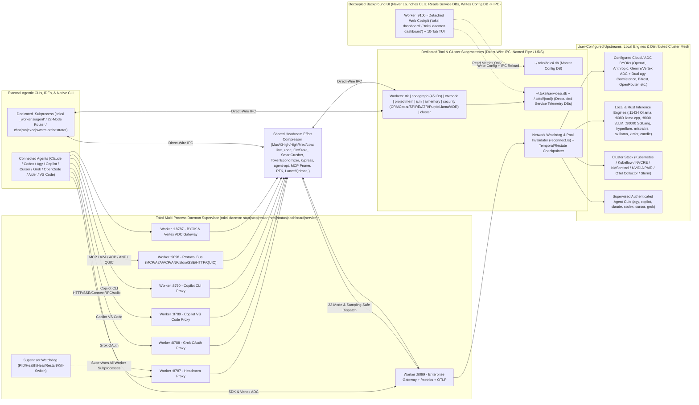
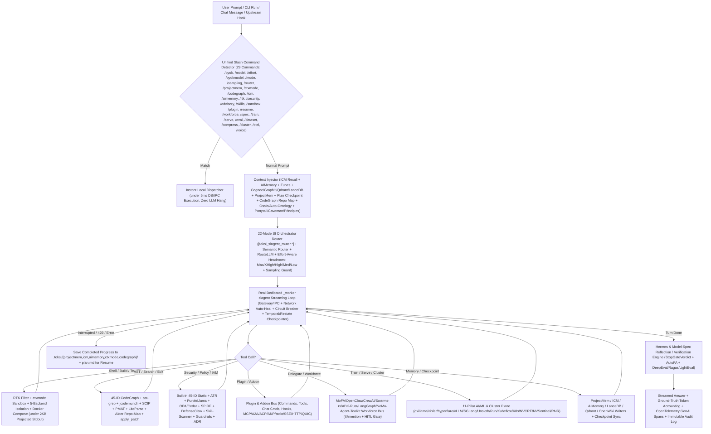
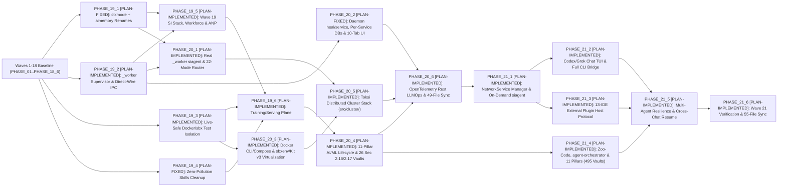
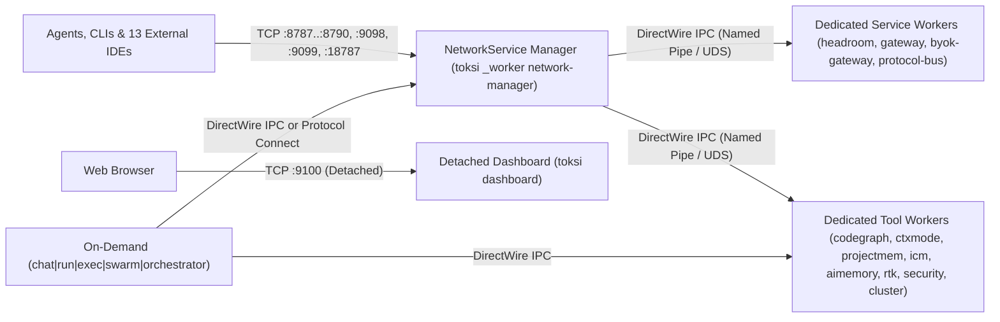

# Toksi Native Consolidation Master Research & Agentic Architecture Plan (Wave 21 / v8.0)

> **Document Role:** Master Research Specification, Architectural Blueprint, Defect Remediation Dossier, Coding-CLI Plan (`/plan`), SI Agentic Stack & Workforce Architecture, 11-Pillar AI/ML & Cluster Lifecycle Blueprint, Multi-Agent Resilience & Cross-Chat Resume Spec, and Next-Research-Agent Execution Guide  
> **Canonical Output Path:** `crates/toksi/research/RESEARCHPLAN.md` (converted, corrected, researched, consolidated, and reorganized from `crates/toksi/research/RESEARCHPLAN.txt`)  
> **Scope Policy:** **Zero Omission ("Nothing Razored")** --- Every vault (all **495** verified unique mandated vaults: **492** unique deduplicated `<deep-research>` vaults from `RESEARCHPLAN.txt:30--521` --- `493` Wave 20 + `2` Wave 21 reconciled: `Zoo-Code`, `agent-orchestrator` --- plus **2** companion repos `<advisory>` & `<skills>` and **1** `agents-structures` template vault, within **570** directories on disk in `<neo>/inspect-vault/`), **`<toksi-siagent>` 35-component Super Intelligence Agent Architecture & 22 Orchestrator Modes across 7 Cognitive Domains** (`toksi-siagent_Super_Intelligence_SI_Agent_Orchestrator_Mode_to_Architecture_Mapping.md` + `toksi-siagent_Complete_LLM_Router_&_Model_Gateway_Configuration.toml`), **Full 11-Pillar AI/ML & LLMOps Lifecycle** (`Datasets`, `Tokenizers`, `Model Architecture`, `Model Training/Pretraining`, `Post-Training & Alignment`, `Evaluation`, `Compression & Optimization`, `Inference`, `Retrieval & Orchestration`, `Serving`, `Observability & Guardrails`), **Toksi Distributed Cluster Stack Upgrade** (`src/cluster/`, `toksi cluster`, Kubernetes/Kubeflow/NVIDIA AI-Factory/OpenTelemetry/PAIR Mesh), **Single Dedicated `NetworkService` Network Manager (`toksi _worker network-manager`) Owning All Daemon Network Sockets (Preventing `os error 10048`) + DirectWire Service/Tool Workers + On-Demand `<toksi-siagent>` Decoupled from `daemon start`**, **Codex CLI + Grok-Build CLI Grade Interactive Chat TUI (`chat|run|exec|swarm|orchestrator`) Executing All `toksi` Commands + 13-IDE External Plugin Host Protocol**, **Decoupled 10-Tab UI & Per-Service SQLite DBs** (zero UI CLI spawning, Web-UI detached from `toksi daemon start`, `Activity Room`, dedicated `Quotas` tab), **`ctxmode` & `aimemory` Tool Renames**, **Multi-Effort (`Max|XHIGH|High|Medium|Low`) & Sampling Compatibility (`temperature`, `top_p`, `top_k`) across all 8 Entrypoints + Training/Fine-Tuning**, **Docker CLI/Compose (`docker_cli_compose_yaml_full_reference.md`) & `sbxenv.yaml`/Kit v3 Virtualization + Live-Safe Sandboxed/Docker Test Runner**, **Zero-Pollution Adapt-Only Hygiene** (auditing and cleaning `.agents/skills/`), **Multi-Agent Orchestration Resilience & Cross-Chat Resume Architecture**, **8-State Progress Tracking Taxonomy**, Out-of-the-Box ("Off the Back") `DirectWireBus`, all **41** Tree-sitter languages (`45` registered IDs), all **65** ecosystem providers (and **90+ / 26+ local engine** extended catalog), Toksi Unified Plugin System (`MCP`, `A2A`, `ACP`, `ANP`, `stdio`, `SSE`, `HTTP`, `QUIC`), Agent Detection & Response (`ADR`), Isolated Agent Sandbox (`sbx` / `sandbox-runtime` / `E2B` / `OpenShell` / 3-OS native isolation), Zero-Plaintext Blind Signature Engine (`BLAKE3` + `sparse::DFA`) & Native Git/PR Validator (`src/security/` + `src/validator/` + 12-DB `UpstreamDeduplicator`), Policy-as-Code (`opa`/`cedar`) & SPIFFE IAM Attestation (`spire`), Externalized `<skills>` & `<advisory>` Multi-Repository Architecture (zero binary bloat), full `.agents`/vendor directory schemas, verbatim hook catalogs (Categories 1--3), all **55** `.agents/brain/*.md` phase plans, CLI/TUI/Dashboard/TOML/DB/BYOK/Workspace/Security/Checkpoint specifications, and verified codebase bug remediations are preserved in full.

---

## 0. Mandatory Pre-Read Protocol, Three-Repository Topology, Terminology, & Ground-Truth Reference Files

Before researching, decomposing, or implementing any phase, every Research Agent and Swarm Worker MUST read these workspace files inside `<repo>` to preserve global master-plan knowledge, cross-tool coupling, directory topology, features, and decision history:

1. `crates/toksi/research/RESEARCHPLAN.md` --- This Wave 20 / v7.0 Master Research Specification & SI Agentic Architecture Plan.
2. `crates/toksi/CONSOLIDATION_PLAN.md` --- Master Architecture Plan (`# Toksi Native Consolidation Master Architecture Plan`).
3. `crates/toksi/PLAN.md` --- Phased consolidation status checklist.
4. `.toksi/projectmem/plan.md` --- Active workspace roadmap and deferred engineering items *(replaces legacy `.projectmem/plan.md`)*.
5. `.toksi/projectmem/PROJECT_MAP.md` --- Canonical module map and subsystem ownership *(replaces legacy `.projectmem/PROJECT_MAP.md`)*.
6. `.toksi/projectmem/summary.md` --- Current project memory state, open bugs, and recorded architectural decisions *(replaces legacy `.projectmem/summary.md`)*.
7. `crates/toksi/research/docker_cli_compose_yaml_full_reference.md` --- Complete Docker CLI, Buildx, networking, volumes, Compose V2 CLI, and `compose.yaml` schema reference for OS-level container virtualization and isolated test/analysis environments.
8. `crates/toksi/research/docker_sandboxes_sbx_cli_yaml_reference.md` --- Docker Sandboxes (`sbx`) CLI, `sandboxd`, `sbxenv.yaml` (`schemaVersion: "1"`), and Kit v3 descriptor (`schemaVersion: "3"`) reference (`run`, `create`, `attach`, `exec`, `ls`, `inspect`, `stop`, `rm`, `prune`, `move`, `cp`, `ports`, `ttl`, `tui`, `policy`, `secret`, `kit`, `env`, `mcp`, `skills`, `template`, `volume`, `schedule`, `daemon`, `df`, `diagnose`, `reset`) for `toksi sandbox`, `sandbox-runtime`, and live-safe Dockerized test execution.
9. `crates/toksi/research/folders_structures_default_knowledge_used_by_the_known_cli_agents_ides.md` --- Canonical directory layouts for `.agents`, `.gemini`, `.copilot`, `.github`, `.claude`, `.codex`, `.cursor`, `.grok`, and complete Category 1--3 lifecycle hook definitions *(paired with `inspect-vault/agents-structures/` ground-truth `repository/` and `user/` templates)*.
10. `crates/toksi/research/full_ai_ecosystem_agent_runtimes_local_inference_engines_protocols_gateways_and_quota_architecture.md` --- Comprehensive reference covering cloud foundation APIs, sampling parameter compatibility matrices (`temperature`, `top_p`, `top_k` across cloud and local engines), 22+ local inference engines/ports, 30 agentic CLIs + slash commands, 14 LSP/protocol providers, 15 editors/IDEs, 16 cloud platforms, 16 proxies/gateways/routers, quota categories, rate-limit headers, token bucket Lua scripts, and retry/failover engineering.
11. `crates/toksi/research/open_security_standards_zero_plaintext_blind_signature_engine_native_git_pr_validator.md` --- Open Security Standards, Zero-Plaintext Blind Signature Engine (`BLAKE3` + `sparse::DFA`), `DisclosureGate`, 12-DB `UpstreamDeduplicator`, `CommandGuard`, and Native Git/PR Validator (`src/security/` + `src/validator/`) across `Navegos/neo` and `Navegos/advisory`.
12. `crates/toksi/research/toksi-siagent_Super_Intelligence_SI_Agent_Orchestrator_Mode_to_Architecture_Mapping.md` --- Canonical 22-mode / 7-cognitive-domain architecture mapping & 9-step autonomous loop for `<toksi-siagent>` *(paired with `crates/toksi/research/toksi-siagent_Complete_LLM_Router_&_Model_Gateway_Configuration.toml` and `crates/toksi/research/Super_Intelligence_(SI)_Agent_Orchestrator_Modes.md`)*.

### 0.1 Three-Repository Ecosystem Topology (`<neo>`, `<advisory>`, `<skills>`)

1. **Repository 1 (`<neo>`):** `Navegos/neo` (`https://github.com/Navegos/neo.git`) --- Primary Rust Workspace containing `crates/toksi/` and staging workspace folders (`agents/`, `rules/`) outside `crates/`. Strict **Zero-Pollution Rule (`RESEARCHPLAN.txt:648`)**: never copy raw unadapted scripts, bash helpers, or YAML GitHub Actions from `inspect-vault/*` into `<neo>`; audit and remove unadapted assets (e.g., `.agents/skills/` foreign bundles).
2. **Repository 2 (`<advisory>`):** `Navegos/advisory` (`https://github.com/Navegos/advisory.git` -> `https://navegos.github.io/advisory/`) --- Checked out at `<neo>/inspect-vault/advisory` (or user-configured directory via `~/.toksi/config.toml` / CLI). Zero-Rust, zero-plaintext static GitHub Pages security database storing `toksi` analyzer results, OSV 1.7.4 & CVE 5.1 advisories (`database_specific.blind_signatures` / `containers.adp[].x_blind_signatures`), STIX 2.1 bundles, sanitized SARIF 2.1.0 baselines, `taxonomy.json`, `corpus/benign/`, and 3-tree static shards (`advisories/`, `domains/`, `lookup/`).
3. **Repository 3 (`<skills>`):** `Navegos/skills` (`https://github.com/Navegos/skills.git` -> `https://navegos.github.io/skills/`) --- Checked out at `<neo>/inspect-vault/skills` (plus user-configured local directory via `~/.toksi/config.toml` / CLI for editing, adding, and importing user skills). Stores edited, adapted, imported, security-vetted skills, rules, `.md`, `.yaml`, and `.json` files for `toksi` agent and connected agents.
4. **Zero-Bloat Non-Embedded Skills/Rules Policy (`RESEARCHPLAN.txt:622`):** Never embed skills, rules, `.md`, `.yaml`, or `.json` files inside the `toksi` binary (`crates/toksi/`). Stage workspace-level files outside `crates/toksi/` (above `crates/`, i.e. `<neo>/agents/` and `<neo>/rules/`) and sync/push to `<skills>` (`Navegos/skills`). Installed `toksi` fetches official vetted files online from `<skills>` (or local configured repo) and user custom skills dir, heals/fixes/adapts them (`skilldoctor` + `agentskills` YAML frontmatter healer + `skill-scanner`/`defenseclaw` `<enforce>`), and installs them cleanly without binary bloat.

### Canonical Lexicon (`RESEARCHPLAN.txt` Lines 2--13, 19--22)

| Token | Authoritative Resolution in This Specification |
|-------|-----------------------------------------------|
| `<byok providers>` | **All** user-configured Bring-Your-Own-Key agent providers (`cli \| ide \| inprocess`) **and** all BYOK cloud, local, aggregator, gateway, and router providers (`frontier`, `accelerator`, `aggregators`, `specialized`, `multimodal`, `local`, `ecosystem`). |
| `<repo>` | The root workspace directory containing `<repo>/.git/` (Git metadata folder and tracked file tree). Never a nested crate subfolder and never a non-Git directory. |
| `<neo>` | Repository 1: `Navegos/neo` (`https://github.com/Navegos/neo.git` --- this Rust Workspace). |
| `<advisory>` | Repository 2: `Navegos/advisory` (`https://github.com/Navegos/advisory.git` -> `https://navegos.github.io/advisory/`) at `<neo>/inspect-vault/advisory` (or user-configured advisory directory). |
| `<skills>` | Repository 3: `Navegos/skills` (`https://github.com/Navegos/skills.git` -> `https://navegos.github.io/skills/`) at `<neo>/inspect-vault/skills` (plus optional user-configured custom skills directory). |
| `<etc's>` | All sibling capabilities, adapters, telemetry hooks, edge-case guards, UX affordances, protocol bindings, new features, enhancements, and addon implementations implied by the context of that line. |
| `<detail's>` | Full, extensive, technical engineering specification---including schemas, state machines, API contracts, UI drill-downs, error paths, and verification commands---never hand-waved summaries. |
| `<enforce>` | **Mandatory Supply-Chain, Capability & Coding Security Enforcement:** All code, skills, scripts, commands, and distribution files MUST reside inside our repository distribution (`<neo>`, `<advisory>`, `<skills>`), undergo static/manual security analysis (`skill-scanner`, `defenseclaw`, `skilldoctor`, `agent-threat-rules`, `openai-guardrails-python`, `PurpleLlama`, zero-plaintext blind engine), reject/quarantine malicious payloads, enforce the offensive-security prohibition + service kill-switch, and be cleaned before shipping or installing to agents/users. |
| `<ai>` | Artificial Intelligence. |
| `<aiagent>` / `<aia>` | Artificial Intelligence Agent. |
| `<agent>` | `<aiagent>` and any AI agent, encompassing any or all of the **26-component technical `<agent>` architecture**: `Orchestrator`, `Agent`, `Inference Engine`, `Model Gateway`, `LLM Router`, `Embedding Model`, `Reranker`, `Vector Database`, `Knowledge Graph`, `Context Store`, `Episodic Memory`, `Semantic Memory`, `Ingestion Pipeline`, `Tool Registry`, `MCP Server`, `Code Sandbox`, `State Machine`, `Checkpointer`, `Message Broker`, `Event Bus`, `Semantic Cache`, `Guardrails`, `Telemetry Engine`, `Tracing Engine`, `Eval Harness`, and `HITL Gateway`. |
| `<si>` | Super Intelligence. |
| `<asi>` | Artificial Super Intelligence. |
| `<siagent>` / `<sia>` | Super Intelligence Agent (`<si>` agent), encompassing any or all of the **35-component technical `<siagent>` architecture**: all 26 `<agent>` components plus **9 Super Intelligence extensions** (`World Model`, `Hierarchical Planner`, `Verification Engine`, `Agent Runtime Daemon`, `IAM Attestation Layer`, `Policy-as-Code Engine`, `Circuit Breaker`, `Kill Switch`, `Immutable Audit Log`). |
| `<toksi>` | The native Rust crate program in `<neo>/crates/toksi/` (`RESEARCHPLAN.txt:13`), compiled cleanly under Edition 2024 `#![deny(unsafe_code)]`. |
| `<toksi-siagent>` | The unified Toksi `<siagent>`, implementing **all 35 technical `<siagent>` architecture components** and **22 Orchestrator Modes across 7 Cognitive Domains** natively in pure safe Rust across `crates/toksi/src/`, launching **on demand as its own dedicated process** (decoupled from `toksi daemon start`) and wired out of the box ("off the back") via `DirectWireBus` / IPC and all inference/protocol entrypoints (`:8787`, `:8788`, `:8789`, `:8790`, `:9098`, `:9099`, `:18787`) + `:9100` Cockpit. |

### 0.2 `<toksi-siagent>` 35-Component Super Intelligence Architecture Mapping Matrix (`RESEARCHPLAN.txt:9--13`)

Every component of the 35-part `<toksi-siagent>` specification maps directly to Rust module targets in `crates/toksi/src/` and authoritative `inspect-vault/*` reference codebases (expanded in Waves 19--20 with pure-Rust agents, IPC transports, training/serving engines, guardrails, cluster orchestration, and OpenTelemetry observability):

| # | `<siagent>` Component | Layer | Target `crates/toksi/src/` Module(s) | Primary `inspect-vault/*` Reference Vaults |
|---|---|---|---|---|
| **1** | **Orchestrator** | `<agent>` Base | `agent_runtime/orchestrator.rs`, `agent_runtime/swarm/`, `agent_runtime/orchestration_resume.rs`, `cluster/` | `mofa-engine`, `langgraph`, `langgraph-swarm-py`, `crewAI`, `deepagents`, `agent-framework`, `dify`, `mastra`, `agno`, `bosun`, `Codewhale`, `swarms-rs`, `swarms`, `deer-flow`, `openworker`, `ChatDev`, `brat`, `open-multi-agent`, `agentrix-os`, `agent-orchestrator`, `NeMo-Agent-Toolkit`, `llama-agents`, `AI-Factory-Operations-Agent` |
| **2** | **Agent** | `<agent>` Base | `agent_runtime/{mod,session,hermes_loop,modes,chat_ui,unification}.rs`, `agents/*` | `hermes-agent`, `codex`, `opencode`, `crush`, `crustly`, `goose`, `grok-build`, `gemini-cli`, `cline`, `Zoo-Code`, `kilocode`, `alphacode`, `zeroclaw`, `SWE-agent`, `OpenHands`, `open-swe`, `adk-rust`, `rig`, `maki`, `steer`, `chevalier`, `tidev`, `ironclaw`, `claurst`, `rust-code`, `ironcode`, `octos`, `xa`, `arc-cli`, `tura`, `native-cli-ai`, `dsh-superagent-prototype`, `aider`, `vscode` |
| **3** | **Inference Engine** | `<agent>` Base | `gateway/local_engines.rs`, `gateway/inference_bridge.rs`, `training/` | `candle`, `candle-vllm`, `mistral.rs`, `oxillama`, `xinfer`, `Crane`, `paddler`, `hyperflare-inference`, `ollama`, `llama.cpp`, `whisper.cpp`, `stable-diffusion.cpp`, `llama-swap`, `vllm`, `sglang`, `dynamo`, `nixl`, `exllamav2`, `mlc-llm`, `lmdeploy`, `tabbyAPI`, `TensorRT-LLM`, `mlx`, `exo`, `llamafile`, `LocalAI`, `server`, `core`, `unsloth`, `Automodel`, `nanotron`, `cudarc`, `bitsandbytes` |
| **4** | **Model Gateway** | `<agent>` Base | `gateway/{server,proxy,compat,normalizer}.rs`, `headroom/{proxy,byok_gateway}.rs`, `agents/antigravity.rs` | `bifrost`, `litellm`, `langchain-litellm`, `python-genai`, `python-aiplatform`, `vertex_rust_sdk`, `olla`, `frontend-crates`, `pingora`, `higress`, `ironwire`, `cc-router`, `aitk`, `hf-hub`, `ogx`, `llama-models` |
| **5** | **LLM Router** | `<agent>` Base | `gateway/{routing,cost_quality_router,semantic_router,lan_router}.rs`, `headroom/router.rs` | `RouteLLM`, `router`, `semantic-router`, `Personal-AI-Router`, `mofa-engine` (`Router::route_ranked`), `agent-opt`, `bifrost`, `Switchyard`, `cc-router`, `higress`, `llama-swap` |
| **6** | **Embedding Model** | `<agent>` Base | `aimemory/embeddings.rs`, `codegraph/embeddings.rs` | `text-embeddings-inference`, `sentence-transformers`, `transformers`, `optimum*`, `candle`, `tokenizers`, `tiktoken` |
| **7** | **Reranker** | `<agent>` Base | `aimemory/retriever.rs`, `codegraph/reranker.rs`, `icm/recall.rs` | `NeMo-Retriever`, `text-embeddings-inference`, `sentence-transformers`, `cognee`, `graphiti`, `openrag`, `llama_index`, `haystack` |
| **8** | **Vector Database** | `<agent>` Base | `aimemory/{lance_store,qdrant_store,milvus_adapter,vector}.rs`, `codegraph/vector.rs` | `qdrant`, `lancedb`, `lance`, `milvus-storage`, `chroma`, `milvus`, `cuvs`, `elasticsearch`, `langchain-mongodb` |
| **9** | **Knowledge Graph** | `<agent>` Base | `aimemory/{cognee_graph,temporal_graph,wiki,ontology}.rs`, `codegraph/{graph,scip}.rs` | `cognee`, `graphiti`, `openwiki`, `codegraph`, `scip`, `paiml-mcp-agent-toolkit`, `databend`, `ossie`, `ossie-converters`, `auto-ontology`, `semantic-operator` |
| **10** | **Context Store (`ctxmode`)** | `<agent>` Base | `contextmode/{fts,sandbox,filter,auto_memory,doc_parse}.rs` *(CLI/tool: `ctxmode`)*, `headroom/{ccr,live_zone,kv_compression}.rs`, `headroom/compression/economizer.rs` | `context-mode` (`ctxmode`), `headroom`, `kvpress`, `TokenEconomizer`, `jcodemunch-mcp`, `repomix`, `maki`, `NeMo-text-processing`, `liteparse` |
| **11** | **Episodic Memory** | `<agent>` Base | `projectmem/{store,summary,heatmap}.rs`, `aimemory/{handoff,letta_memgpt}.rs`, `icm/store.rs` | `projectmem`, `funes`, `letta`, `icm`, `ai-memory` (`aimemory`), `openclaw-rs`, `rocksdb` |
| **12** | **Semantic Memory** | `<agent>` Base | `aimemory/{tiered,mem0_bridge,wiki,ontology}.rs`, `icm/recall.rs` | `mem0`, `ai-memory` (`aimemory`), `cognee`, `graphiti`, `openwiki`, `letta`, `funes`, `auto-ontology` |
| **13** | **Ingestion Pipeline** | `<agent>` Base | `codegraph/{walker,repomix,ast_grep,scip}.rs`, `codegraph/kernel/*`, `headroom/tokenizer.rs`, `training/datasets.rs` | `codegraph`, `repomix`, `ast-grep`, `scip`, `jcodemunch-mcp`, `paiml-mcp-agent-toolkit`, `tokenizers`, `tiktoken`, `arrow-rs`, `Curator`, `DALI`, `safetensors`, `liteparse`, `Megatron-Energon`, `structured-data-models`, `spark`, `cudf-spark`, `llama_index` |
| **14** | **Tool Registry** | `<agent>` Base | `tools/{mod,multi_protocol,mcp_catalog,ponytail,caveman,principles}.rs`, `plugins/registry.rs`, `rtk/engine.rs` | `rtk`, `langchain`, `mcp-framework`, `modelcontextprotocol-servers`, `goose`, `ponytail`, `caveman`, `andrej-karpathy-skills`, `llguidance`, `NeMo-Relay-Plugins` |
| **15** | **MCP Server** | `<agent>` Base | `tools/multi_protocol.rs`, `commands/runmcp.rs`, `{contextmode,codegraph,projectmem,icm,aimemory}/mcp.rs` *(MCP ID `ctxmode`, `aimemory`)* | `modelcontextprotocol-servers`, `mcp-framework`, `jcodemunch-mcp`, `bridge-mcp`, `agent-client-protocol`, `bifrost`, `paiml-mcp-agent-toolkit`, `auto-ontology`, `elements` |
| **16** | **Code Sandbox** | `<agent>` Base | `agent_runtime/{sandbox,sandbox_e2b,openshell,cluster_exec}.rs`, `contextmode/sandbox.rs`, `commands/test_runner.rs` | `E2B`, `E2B-runtime`, `OpenShell`, `sandbox-runtime`, `codex` (`codex-rs`), `context-mode` (`ctxmode`), `SWE-agent`, `OpenHands`, `kubernetes`, `minikube` |
| **17** | **State Machine** | `<agent>` Base | `agent_runtime/{workflow_state,graph_checkpoint,hermes_loop}.rs`, `agent_runtime/engine/` | `temporal`, `restate`, `langgraph`, `mofa-engine`, `hermes-agent`, `loopwright`, `chevalier`, `OpenSpec`, `pipelines` |
| **18** | **Checkpointer** | `<agent>` Base | `agent_runtime/{checkpoint,durable_journal}.rs`, `projectmem/plan_checkpoint.rs` | `langgraph`, `restate`, `temporal`, `openclaw-rs`, `projectmem`, `cline`, `brat`, `coredb` |
| **19** | **Message Broker** | `<agent>` Base | `agent_runtime/{a2a,acp,mofa_bus}.rs`, `tools/multi_protocol.rs`, `ipc/` | `openclaw`, `mofa`, `agent-client-protocol`, `anp`, `iggy`, `quinn`, `grpc`, `protobuf`, `agent-framework`, `EnterpriseBlueprints`, `livekit` |
| **20** | **Event Bus** | `<agent>` Base | `tools/direct_wire_bus.rs`, `agent_runtime/event_log.rs`, `dashboard/sse.rs`, `ipc/` | `openclaw-rs`, `openclaw`, `mofa`, `langgraph`, `iggy`, `redis`, `opencode` (`http-recorder`) |
| **21** | **Semantic Cache** | `<agent>` Base | `gateway/semantic_cache.rs`, `headroom/{cache_align,adaptive_mem}.rs`, `aimemory/vector.rs` | `bifrost`, `headroom`, `chroma`, `lancedb`, `lance`, `qdrant`, `redis`, `coredb`, `NeMo-Relay-Plugins` |
| **22** | **Guardrails** | `<agent>` Base | `security/{guardrails_validators,llm_guard,purple_llama,sage_rules,defenseclaw,adr}.rs`, `agent_runtime/guardrails.rs` | `Guardrails`, `openai-guardrails-python`, `model_spec`, `llm-guard`, `PurpleLlama`, `defenseclaw`, `agent-control`, `sage`, `NemoClaw`, `safeagents`, `garak`, `agent-threat-rules` |
| **23** | **Telemetry Engine** | `<agent>` Base | `telemetry/{collector,cost,tokentracker,tokview,tokenspeed,prometheus,otel}.rs`, `dashboard/api.rs` | `TokenTracker`, `tokview`, `tokenspeed`, `vllm-dashboard`, `vmon`, `langfuse`, `langwatch`, `wandb`, `clearml`, `opentelemetry-rust`, `opentelemetry-collector` |
| **24** | **Tracing Engine** | `<agent>` Base | `telemetry/{traces,openinference,otel,autofa}.rs`, `gateway/reconnect.rs` | `phoenix`, `langfuse`, `langwatch`, `opencode`, `temporal`, `restate`, `opentelemetry-rust`, `opentelemetry-python-genai`, `opentelemetry-operator`, `AutoFA` |
| **25** | **Eval Harness** | `<agent>` Base | `telemetry/{evals,autofa}.rs`, `rules/skill_validator.rs`, `security/triage.rs`, `agent_runtime/prompt_optimizer.rs` | `lm-evaluation-harness`, `lighteval`, `sgl-eval`, `genai-bench`, `guidellm`, `perf-eval`, `Evaluator`, `nemo-compass`, `eval-author`, `SkillEvaluator`, `upskill`, `phoenix`, `langwatch`, `deepeval`, `ragas`, `AutoFA`, `prompt-ops`, `knavigator` |
| **26** | **HITL Gateway** | `<agent>` Base | `agent_runtime/hitl_gate.rs`, `tui/app.rs`, `dashboard/`, `agents/hooks.rs` | `mofa-engine` (`SwarmHITLGate`), `langgraph`, `EnterpriseBlueprints`, `hermes-webui`, `NeMo-Agent-Toolkit-UI`, `elements`, `codex`, `orca`, `multica`, `robius`, `robrix`, `moly-ai` |
| **27** | **World Model** | `<siagent>` Ext | `codegraph/{graph,scip,wiki}.rs`, `aimemory/{cognee_graph,temporal_graph,ontology}.rs`, `agent_runtime/world_model.rs` | `codegraph`, `scip`, `cognee`, `graphiti`, `openwiki`, `deepagents`, `physicsnemo`, `OpenSpec`, `cuPhoton`, `auto-ontology` |
| **28** | **Hierarchical Planner** | `<siagent>` Ext | `agent_runtime/{deep_planning,crew_roles,engine}.rs`, `agent_runtime/swarm/` | `deepagents`, `crewAI`, `mofa-engine` (`SubtaskDAG`), `langgraph`, `OpenHands`, `open-swe`, `deer-flow`, `ChatDev`, `OpenSpec`, `Run` |
| **29** | **Verification Engine** | `<siagent>` Ext | `agent_runtime/reflection.rs`, `validator/{validate,fp_pruner}.rs`, `security/triage.rs`, `cluster/readiness.rs` | `hermes-agent` (`StopGateVerdict`), `openclaw` (`advisor`), `mofa-engine` (`mofa-review`), `cve-validation-library`, `codex-security`, `depyler`, `AutoFA`, `cluster-readiness-engine` |
| **30** | **Agent Runtime Daemon** | `<siagent>` Ext | `commands/{daemon,worker,proxy,dashboard,agent_runtime,cluster}.rs`, `ipc/network_manager.rs`, `gateway/{server,reconnect}.rs`, `cluster/` | `tokless`, `openclaw-rs`, `OpenShell`, `bosun`, `zeroclaw`, `hermes-agent`, `dynamo`, `ringlet`, `brat`, `paddler`, `pingora`, `rpmalloc-rs`, `kubernetes`, `helm`, `aicr`, `Run` |
| **31** | **IAM Attestation Layer** | `<siagent>` Ext | `security/iam_attestation.rs`, `keyring/{mod,adc,os_*}.rs`, `agents/hooks.rs` | `spire`, `defenseclaw` (`agentidentity`/`codesig`), `EnterpriseBlueprints` (`04-identity_and_delegation`), `anp` (DID-WBA), `python-aiplatform`, `goose` (`oidc-proxy`) |
| **32** | **Policy-as-Code Engine** | `<siagent>` Ext | `security/{policy_opa,policy_cedar,cel_decision,defenseclaw}.rs`, `gateway/policy.rs` | `opa`, `cedar`, `defenseclaw` (`policies/rego`, `guardrail`), `skill-scanner` (`cel-go`), `agent-threat-rules`, `agent-control`, `model_spec`, `semantic-router` |
| **33** | **Circuit Breaker** | `<siagent>` Ext | `gateway/{circuit_breaker,reconnect}.rs`, `agent_runtime/loop_detect.rs`, `headroom/compression/economizer.rs`, `cluster/fault_remediation.rs` | `bifrost`, `mofa-engine` (`CircuitBreakerRegistry`), `openclaw` (`ToolLoopDetector`), `hermes-agent` (`RunawayStreamWatch`), `TokenEconomizer` (`LoopGuard`), `pingora`, `NVSentinel`, `node-problem-detector` |
| **34** | **Kill Switch** | `<siagent>` Ext | `commands/guard.rs`, `security/{adr,defenseclaw}.rs`, `supervisor/` | `defenseclaw` (`hookguard`/`enforce`), `EnterpriseBlueprints`, `OpenShell`, `NemoClaw`, `PurpleLlama` (`LlamaFirewall`) |
| **35** | **Immutable Audit Log** | `<siagent>` Ext | `agent_runtime/event_log.rs`, `security/{audit,sarif,advisory_client,blind_compiler}.rs`, `projectmem/store.rs` | `openclaw-rs` (`BLAKE2b-256 EventLog`), `BLAKE3`, `defenseclaw` (`internal/audit`), `cve-lite-cli` (`audit-log`), `projectmem`, `<advisory>` |

### 0.3 `<toksi-siagent>` 22 Orchestrator Modes Across 7 Cognitive Domains -> Architecture & Model Router Mapping (`RESEARCHPLAN.txt:654`)

Derived from `crates/toksi/research/toksi-siagent_Super_Intelligence_SI_Agent_Orchestrator_Mode_to_Architecture_Mapping.md`, `Super_Intelligence_(SI)_Agent_Orchestrator_Modes.md`, and `toksi-siagent_Complete_LLM_Router_&_Model_Gateway_Configuration.toml`. `<toksi-siagent>` routes every cognitive phase through internal Model Gateway + LLM Router / `semantic-router` + `HeadroomEffortCompressor` using **one or multiple user-selected `[[byok_profiles]]` IDs** (configured in `~/.toksi/config.toml` and `~/.toksi/toksi.db`, overridable per mode via CLI, TUI/Web-UI, or `/mode`):

| Domain | Mode Key (`[toksi_siagent_router.*]`) | Model Tier & Default Reference Models (`<byok_profiles>` Overrideable) | Effort / `temp` / `top_p` / `top_k` | Mapped `<siagent>` Architecture Components |
|---|---|---|---|---|
| **1. Meta-Cognition & Governance** | `orchestrate_route` | `ultra-low-latency-classifier` (`claude-haiku-5.5` / `gpt-6-luna`) | `low` / `1.0` / `0.85` / `20` | `Orchestrator`, `LLM Router`, `Model Gateway`, `State Machine`, `Event Bus`, `Message Broker` |
| **1. Meta-Cognition & Governance** | `reflect_self_critique` | `deep-reasoning-critic` (`gpt-6-astra` / `gemini-3.1-pro`) | `high` / `1.0` / `0.95` / `40` | `Verification Engine`, `Eval Harness`, `Tracing Engine`, `Telemetry Engine` |
| **1. Meta-Cognition & Governance** | `align_guardrail` | `deterministic-policy-verifier` (`claude-haiku-5.5` / `gemini-3.1-flash-lite`) | `low` / `1.0` / `0.8` / `15` | `Guardrails`, `Policy-as-Code Engine`, `IAM Attestation Layer`, `Circuit Breaker`, `Kill Switch`, `HITL Gateway` |
| **1. Meta-Cognition & Governance** | `evolve_self_improve` | `frontier-meta-architect` (`claude-fable-5.2` / `gpt-6-astra`) | `max` / `1.0` / `0.95` / `50` | `Eval Harness`, `Checkpointer`, `Immutable Audit Log`, `Tool Registry` |
| **2. Memory & World Modeling** | `recall_retrieve` | `retrieval-embedding-rerank` (`text-embedding-3-large`, `cohere-rerank-v3.5`, `gpt-6-luna`) | `low` / --- / `0.85` / `20` | `Context Store`, `Episodic Memory`, `Semantic Memory`, `Vector Database`, `Knowledge Graph`, `Embedding Model`, `Reranker`, `Semantic Cache` |
| **2. Memory & World Modeling** | `consolidate_memorize` | `structured-extraction-compression` (`gemini-3.6-flash` / `claude-sonnet-5.5`) | `medium` / `1.0` / `0.85` / `25` | `Ingestion Pipeline`, `Episodic Memory`, `Semantic Memory`, `Knowledge Graph`, `Checkpointer` |
| **2. Memory & World Modeling** | `simulate_predict` | `causal-world-simulation` (`gemini-4-neon` / `gpt-6-astra`) | `high` / `1.0` / `0.95` / `40` | `World Model`, `Hierarchical Planner`, `Inference Engine` |
| **3. Discovery & Epistemics** | `chat_interface` | `high-elo-conversational` (`claude-sonnet-5.5` / `gemini-3.6-flash`) | `medium` / `1.0` / `0.92` / `40` | `HITL Gateway`, `Context Store`, `LLM Router`, `Guardrails` |
| **3. Discovery & Epistemics** | `brainstorm_diverge` | `creative-lateral-synthesis` (`claude-fable-5.2` / `gemini-4-neon`) | `high` / `1.0` / `0.98` / `64` | `World Model`, `Inference Engine`, `Knowledge Graph` |
| **3. Discovery & Epistemics** | `research_ground` | `long-context-browser-synthesis` (`gemini-4-neon` / `gpt-6.1-sol`) | `high` / `1.0` / `0.9` / `30` | `MCP Server`, `Tool Registry`, `Ingestion Pipeline`, `Reranker`, `Vector Database` |
| **3. Discovery & Epistemics** | `synthesize_abstract` | `1m-context-distillation` (`gemini-3.1-pro` / `claude-opus-5.5`) | `high` / `1.0` / `0.9` / `35` | `Semantic Memory`, `Knowledge Graph`, `Inference Engine` |
| **4. Pedagogy & Knowledge Transfer** | `study_deconstruct` | `pedagogical-axiom-builder` (`claude-sonnet-5.5` / `gemini-3.1-pro`) | `medium` / `1.0` / `0.9` / `35` | `Semantic Memory`, `Knowledge Graph`, `Hierarchical Planner` |
| **4. Pedagogy & Knowledge Transfer** | `coach_socratic` | `adaptive-tutor` (`claude-fable-5.2` / `claude-sonnet-5.5`) | `medium` / `1.0` / `0.92` / `40` | `Episodic Memory`, `Context Store`, `HITL Gateway` |
| **5. Strategy & Architecture** | `plan_decompose` | `hierarchical-dag-planner` (`gpt-6-astra` / `gemini-3.1-pro`) | `high` / `1.0` / `0.92` / `35` | `Hierarchical Planner`, `World Model`, `State Machine`, `Checkpointer` |
| **5. Strategy & Architecture** | `toolsmith_architect` | `agentic-tool-engineer` (`gpt-6.2-astra` / `claude-opus-5.5`) | `high` / `1.0` / `0.9` / `30` | `Tool Registry`, `MCP Server`, `Code Sandbox`, `IAM Attestation Layer` |
| **6. Autonomous Execution** | `write_code_build` | `frontier-software-engineering` (`gpt-6.2-astra` / `claude-opus-5.5`) | `high` / `1.0` / `0.9` / `30` | `Code Sandbox`, `Inference Engine`, `Checkpointer` |
| **6. Autonomous Execution** | `refactor_optimize` | `algorithmic-efficiency-coder` (`claude-opus-5.5` / `gpt-6.1-sol`) | `high` / `1.0` / `0.9` / `30` | `Code Sandbox`, `Telemetry Engine`, `Semantic Cache` |
| **6. Autonomous Execution** | `act_operate` | `high-reliability-tool-caller` (`gemini-4-neon` / `gpt-6.1-terra`) | `medium` / `1.0` / `0.85` / `20` | `Agent Runtime Daemon`, `MCP Server`, `Tool Registry`, `IAM Attestation Layer`, `Policy-as-Code Engine` |
| **7. Verification & Resilience** | `running_tests_verify` | `fast-deterministic-verifier` (`deepseek-v4.1-flash` / `gpt-6.1-terra`) | `low` / `0.0` / `0.1` / `1` | `Verification Engine`, `Code Sandbox`, `Eval Harness` |
| **7. Verification & Resilience** | `debug_heal` | `root-cause-trace-surgeon` (`gpt-6.2-astra` / `claude-opus-5.5`) | `high` / `1.0` / `0.9` / `30` | `Tracing Engine`, `Telemetry Engine`, `Code Sandbox`, `Checkpointer` |
| **7. Verification & Resilience** | `audit_red_team` | `adversarial-security-auditor` (`gpt-6-astra` / `claude-fable-5.2`) | `max` / `1.0` / `0.95` / `45` | `Verification Engine`, `Policy-as-Code Engine`, `Immutable Audit Log`, `Circuit Breaker` |
| **7. Verification & Resilience** | `document_log` | `fast-structured-writer` (`gemini-3.6-flash` / `claude-sonnet-5.5`) | `low` / `1.0` / `0.85` / `20` | `Immutable Audit Log`, `Tracing Engine`, `Telemetry Engine`, `Ingestion Pipeline` |

**9-Step `<toksi-siagent>` Autonomous Loop:** `1. Recall / Retrieve` -> `2. Research / Ground` -> `3. Simulate / Predict` -> `4. Plan / Decompose` -> `5. Audit / Red-Team` -> `6. Write Code / Build` -> `7. Running Tests / Verify` -> `8. Debug / Heal` -> `9. Consolidate / Memorize`. Every step checks parameter compatibility (`reasoning_effort`, `temperature`, `top_p`, `top_k`) against the active BYOK model and silently omits unsupported parameters instead of failing (`RESEARCHPLAN.txt:597`).

---

## 1. Corrections Audit Log & Specification Reconciliation

Converting raw `RESEARCHPLAN.txt` (lines 1--660) and reconciling it against verified files on disk in `crates/toksi/`, `crates/toksi/research/*.md`, `.toksi/projectmem/`, `.agents/brain/`, and `inspect-vault/` uncovered policy evolutions, legacy paths, counting updates, typos, and verified codebase status. Every Research Agent MUST treat these reconciliations as authoritative:

### 1.1 Contradictions & Policy Reversals Resolved

1. **Paid-Only BYOK Restriction Removed (`RESEARCHPLAN.txt` Line 599):**
   - *Earlier rule:* Required rejecting free-tier accounts in BYOK rotation (`FreeTierDisqualified`).
   - *Authoritative reversal (`Line 599`):* **"we are removing restrictions for PAID qualified agent BYOK rotation, from the code and everywhere."** Users are completely free to configure and rotate any accessible, working BYOK agent or provider enabled in `~/.toksi/config.toml` and `~/.toksi/toksi.db`. *(Note: Line 564 mentions free/authenticated accounts for smart launch; Line 599 explicitly removes ALL paid-tier rotation blocks from code and docs everywhere.)*
   - *Preserved value:* Keep non-blocking **plan/tier observability badges** (`free`, `pro`, `team`, `enterprise`, `pay-go`, `local`) when the provider API exposes subscription/quota metadata without inference cost.

2. **Strict Configured-Only Activation & UI Visibility (`Lines 553, 593--594, 603`):**
   - Toksi MUST ONLY initialize gateway routes, wire agent hooks/protocols, launch smart CLI bridges, display active BYOK metrics, or list Keyring entries for agents and `<byok providers>` explicitly configured and enabled by the user in `~/.toksi/config.toml` / `~/.toksi/toksi.db`.
   - If zero BYOK providers are configured, the gateway router gracefully stays idle/standby while standalone agent usage (e.g., running `agy.exe` or `copilot.exe` directly with Headroom/RTK/MCP tools) operates cleanly without errors.

3. **Legacy `.projectmem/` -> `<repo>/.toksi/projectmem/` Migration (`Lines 21, 637`):**
   - Verified on disk: `<repo>/.toksi/projectmem/` exists and is active (`plan.md`, `PROJECT_MAP.md`, `summary.md`, `events.jsonl`, `config.toml`, `global/`, `issues/`), while `<repo>/.projectmem/` no longer exists at root.
   - Any remaining `.projectmem/` pre-read references in master plans, worker prompts, or nested crates MUST stay migrated to `<repo>/.toksi/projectmem/`, and any loose `.projectmem/` folders across crates/subfolders must be imported, merged (carefully preserving SQLite/JSONL records), and deleted.

4. **Zero Binary Bloat --- Externalized `<skills>` & `<advisory>` Repositories (`Lines 17--18, 622, 630`):**
   - *Earlier rule (Phase 06):* Assumed embedding skills/rules assets directly inside `crates/toksi/src/rules/assets/` via `include_str!`.
   - *Authoritative reversal (`Line 622`):* **"We are not embedding agent/skills/rules/instructions/plugins/ (`.json`, `.toml`, `.md`, `.yml`, `.yaml`) files in `toksi`; we create the folders necessary outside of `crates/toksi/` (before `crates/`). We don't want to bloat the `toksi` binary with these files."**
   - Stage edited/adapted/fixed skills, rules, `.md`, `.yaml`, and `.json` files outside `crates/toksi/` (`<neo>/agents/`, `<neo>/rules/`, synced to `<skills>` `Navegos/skills`), and push security advisories/shards to `<advisory>` `Navegos/advisory`. Installed `toksi` downloads/syncs official skills from `<skills>` (or user-configured local repo) + user custom skills directory, runs `skilldoctor` + `agentskills` YAML healer + `skill-scanner`/`defenseclaw` `<enforce>`, and installs them cleanly without binary bloat.

5. **All-7-Inference/Protocol-Entrypoint Shared `HeadroomEffortCompressor` & Out-of-the-Box `<toksi-siagent>` (`Lines 531--532, 578, 598`):**
   - **All 7 inference and protocol entrypoints** (`:8787` Headroom, `:8788` Grok OAuth, `:8789` Copilot VS, `:8790` Copilot CLI, `:9098` Protocol Bus MCP/A2A/ACP/ANP/stdio/SSE/HTTP, `:9099` Enterprise AI Gateway, and `:18787` BYOK & Vertex ADC Gateway) plus `:9100` Control Dashboard Cockpit (8 ports total), direct-wired `<toksi-siagent>`, and training/inference/fine-tuning pipelines MUST wire into the effort-aware **`HeadroomEffortCompressor`** (`Max|XHIGH|High|Medium|Low`) using `live_zone` byte surgery, `CcrStore`, `SmartCrusher`, `TokenEconomizer`, `agent-opt`, MCP Schema Pruner, `RTK`, `Chroma`/`Lance`/`Qdrant` semantic cache, and `<enforce>` `security`/`skill-scanner`.
   - **Out of the box ("off the back")**, `<toksi-siagent>` MUST wire in-process (`DirectWireBus` / IPC) and over `:8787`/`:9098`/`:9099`/`:18787` to Enterprise AI Gateway, BYOK & Vertex ADC Gateway, Protocol Bus (`MCP`/`A2A`/`ACP`/`ANP`/`SSE`), `HeadroomEffortCompressor`, Unified Plugin System (`src/plugins/`), and all **493** consolidated `<neo>/inspect-vault/*` tools/skills/memory/security engines with zero manual setup.

6. **`context-mode` / `context` -> `ctxmode` & `ai-memory` -> `aimemory` Renames (`Lines 565, 568, 643`):**
   - *Earlier rule (`Line 568`):* Simplified `context-mode` -> `ctxmode` and `ai-memory` -> `aimemory`.
   - *Authoritative reinforcement (`Line 643`):* **"We need to rename context only tool that its the context-mode tool to ctxmode, because we are inserting new commands that can brick the context-mode tool, change necessary everywhere the context-mode tool is referenced and including commands, hooks, mcp."**
   - Rename `context-mode` / bare `context` tool references everywhere to **`ctxmode`** (`toksi ctxmode`, `/ctxmode`, `ctxmode-hook <agent>`, MCP server key `ctxmode`, `skills/ctxmode/`, `<repo>/.toksi/ctxmode/` with non-destructive auto-migration from `.context-mode/` and `<repo>/.toksi/context/`) AND simplify `ai-memory` to **`aimemory`** (`toksi aimemory`, `/aimemory`, `aimemory-hook <agent>`, MCP key `aimemory`, `skills/aimemory/`, `<repo>/.toksi/aimemory/` with auto-migration from `.ai-memory/` and `.toksi/ai-memory/`).

7. **Dedicated Multi-Process Supervisor Architecture per Network Port, `<toksi-siagent>`, & Tools + Extended Supervisor CLI (`Lines 550, 589, 647, 652--655`):**
   - *Earlier model:* Single daemon process hosting all 8 HTTP servers and tools via `tokio::spawn` tasks inside `commands/daemon.rs`.
   - *Authoritative Wave 19/20 architecture:* Split each Network Port service (`8787`, `8788`, `8789`, `8790`, `9098`, `9099`, `9100`, `18787`), `<toksi-siagent>`, and dedicated high-throughput tools (`codegraph`, `ctxmode`, `projectmem`, `icm`, `aimemory`, `rtk`, `security`) into **dedicated OS worker subprocesses (`toksi _worker <role>`)** supervised by `toksi daemon (start | stop | restart | heal | status | dashboard | --agents | service <name> (start | stop | restart | heal | status))`, eliminating cross-port thread contention, isolating faults, and inter-wiring every worker and `<toksi-siagent>` via ultra-low-latency **Direct-Wire IPC** (Windows Named Pipes / Unix Domain Sockets / framed binary RPC).

8. **Live-Safe Sandboxed / Docker Test Isolation (`Line 646`):**
   - Running `toksi` integration tests MUST NEVER interfere with a live running host `toksi` daemon, bound ports, `~/.toksi/toksi.db`, OS keyring, or user environment injection. Provide ephemeral in-process test isolation (`TOKSI_HOME` tempdirs, `:0` ports) AND an isolated **Docker / `sbx` / OS sandboxed test runner (`docker/Dockerfile.test`, `docker/compose.test.yaml`, `toksi test --sandbox|--docker`)** for full daemon/service/hook verification.

9. **Zero-Pollution Adapt-Only Repo Hygiene & 8-State Plan Governance (`Lines 648--650`):**
   - **Never copy unnecessary files, foreign shell scripts, or GitHub Actions YAML from `inspect-vault/*` into `<neo>`** (`Line 648`). Audit existing repo clutter (verified **933** foreign/unadapted skill folders currently in `<neo>/.agents/skills/`), clean/remove unadapted artifacts, adapt strictly needed items cleanly, and externalize vetted skills to `<skills>` (`Navegos/skills`).
   - **Mandatory 8-State Progress Taxonomy & Every-Prompt Sync (`Lines 649--650`):** Standardize every phase and plan entry across `.agents/brain/*.md`, `CONSOLIDATION_PLAN.md`, `PLAN.md`, `.toksi/projectmem/{plan.md,PROJECT_MAP.md,summary.md}`, and `RESEARCHPLAN.{md,txt}` using the exact 8 statuses (`[DEEP-RESEARCH-DONE]`, `[PLAN-DONE]`, `[PLAN-IMPLEMENTED]`, `[PLAN-FIXED]`, `[DEEP-RESEARCH-DONE]`, `[PLAN-DONE]`, `[PLAN-IMPLEMENTED]`, `[PLAN-FIXED]`), updating all 6 plan files after every prompt finishes.

10. **Complete UI/Service Decoupling, Separate Per-Service SQLite DBs, Zero UI CLI Spawning, & Detached Dashboard (`Lines 548, 554, 588`):**
    - TUI & Web-UI MUST NEVER spawn `opencode` or any external agent CLI on page refresh or DirectWire status probes (`Line 548`). Only Toksi daemon subprocess services manage agent CLIs explicitly configured in `toksi.db` / `config.toml`.
    - Decouple persistence cleanly: `~/.toksi/toksi.db` holds master configuration, while each subprocess service writes live metrics/telemetry/state into its own **separate SQLite service DB (`~/.toksi/services/<service>.db` + `<repo>/.toksi/<tool>/`)** read by TUI & Web-UI. Configuration mutations from TUI/Web-UI persist to `toksi.db` and propagate to running subprocesses via Direct-Wire IPC.
    - **Remove Web-UI Dashboard from `toksi daemon start` launch (`Line 548`):** Dashboard runs detached in the background only when invoked via `toksi dashboard` (`start|stop|restart`) or `toksi daemon dashboard`.

11. **10-Tab Decoupled Futuristic UI Topology (`Lines 603--612`):**
    - Rename `The War Room` -> **`Activity Room`**; rename `Agent Fleet & Quotas` -> **`AI Agent Fleet`**; split **`Quotas`** into its own dedicated tab separated from `AI Agent Fleet` and **`AI Gateway`** -> **10 unified tabs** (`Savings`, `Activity Room`, `AI Agent Fleet`, `Quotas`, `Memory Decision DAG`, `CodeGraph Explorer`, `Sandbox Inspector`, `AI Gateway`, `Keyring & Database`, `System Controls`).

12. **Multi-Model, Multi-Effort (`Max|XHIGH|High|Medium|Low`), Sampling Parameters (`temperature`, `top_p`, `top_k`), Auto `/v1` URLs & Dual `agy`/ADC Coexistence (`Lines 578--579, 595, 597`):**
    - Expand BYOK profile schema to store `(id, provider_id, instance_label, model_id [one or multiple], reasoning_effort [one or multiple: max|xhigh|high|medium|low, default medium], temperature, top_p, top_k, base_url, enabled, auth_mode)`.
    - Enforce strict **per-model parameter compatibility** from `full_ai_ecosystem_agent_runtimes_local_inference_engines_protocols_gateways_and_quota_architecture.md` Sections 1.4 & 2.4: silently omit incompatible `reasoning_effort`, `temperature`, `top_p`, or `top_k` fields instead of sending HTTP-400 payloads.
    - Auto-complete standard known API base URLs (e.g., appending `/v1` when omitted), allow simultaneous standard `agy` CLI + `AGY_ADC_AUTH=true` Google Cloud Vertex ADC BYOK ingestion (`Line 579`), and apply effort optimization across all 8 ports, `<toksi-siagent>`, and training/inference/fine-tuning.

13. **Real `<toksi-siagent>` Subprocess & 22-Mode Orchestrator Wiring + Full 11-Pillar AI/ML & Cluster Stack (`Lines 651--657`):**
    - Replace the verified local stub in `src/agent_runtime/loop_engine.rs` (`Line 654`) with true dedicated OS worker execution (`toksi _worker siagent`) wired via Direct-Wire IPC to all tools, services, and the **22-Mode Orchestrator Router (`[toksi_siagent_router.*]`)** selectable per cognitive mode in `config.toml` / `toksi.db`.
    - Integrate all **11 AI/ML & LLMOps Lifecycle Pillars** (`Datasets`, `Tokenizers`, `Model Architecture`, `Model Training (Pretraining)`, `Post-Training & Alignment`, `Evaluation (Evals)`, `Compression & Optimization`, `Inference`, `Retrieval & Orchestration`, `Serving`, `Observability & Guardrails (LLMOps)`) and upgrade Toksi into a **Dual-Mode Local + Distributed Cluster Stack (`src/cluster/`, `toksi cluster`)** integrating Kubernetes, Kubeflow, NVIDIA AI-Factory (`cluster-readiness-engine`, `NVSentinel`, `aicr`, `Personal-AI-Router`, `Run`), and native OpenTelemetry (`opentelemetry-rust`, `opentelemetry-collector`, `opentelemetry-operator`).

14. **Single Dedicated `NetworkService` Network Manager (`toksi _worker network-manager`) & On-Demand `<toksi-siagent>` Decoupled from `daemon start` (`RESEARCHPLAN.txt:635, 646` --- Wave 21 `PHASE_21_1`):**
    - *Wave 19--20 gap:* `commands/daemon.rs:208-238` and `commands/worker.rs:133-180` spawn 7 separate port workers (`Port8787`..`Port18787`) AND spawn `WorkerRole::Siagent` unconditionally inside `daemon start`.
    - *Authoritative Wave 21 fix (`Line 635`):* Consolidate all daemon network socket listeners (`:8787`, `:8788`, `:8789`, `:8790`, `:9098`, `:9099`, `:18787`; `:9100` remains detached for `toksi dashboard`) into **ONE dedicated `NetworkService` Network Manager process (`toksi _worker network-manager`)** with strict single-bind guard preventing Windows `WSAEADDRINUSE` (`os error 10048`), routing inbound HTTP/SSE/MCP/A2A/ACP/ANP/QUIC traffic via DirectWire IPC (Named Pipes / UDS) to isolated dedicated service and tool worker processes (`headroom`, `gateway`, `byok-gateway`, `protocol-bus`, `codegraph`, `ctxmode`, `projectmem`, `icm`, `aimemory`, `rtk`, `security`, `cluster`).
    - *On-Demand `<toksi-siagent>` (`Line 646`):* Remove `WorkerRole::Siagent` from `toksi daemon start` default spawn list; `toksi chat|run|exec|swarm|orchestrator` launch `<toksi-siagent>` on demand in its own dedicated process and connect over DirectWire IPC (or network protocol when required) to running daemon services.

15. **Codex CLI + Grok-Build CLI Grade Interactive Chat TUI, Full In-Chat CLI Execution & 13-IDE External Plugin Host Protocol (`RESEARCHPLAN.txt:646--647` --- Wave 21 `PHASE_21_2`, `PHASE_21_3`):**
    - *Wave 20 gap:* `src/agent_runtime/loop_engine.rs:422-470` (`run_chat_repl`) is currently a plain `stdin.read_line` loop.
    - *Authoritative Wave 21 architecture:* Build `src/agent_runtime/chat_ui.rs` modeled directly on `inspect-vault/codex` (`codex-rs/tui`) and `inspect-vault/grok-build` streaming terminal UX: multi-pane Ratatui session supporting live streaming tokens, diff/patch previews, tool-call approval modals, mode switching across all 22 Orchestrator Modes (`chat|coding|conversation|orchestration|planning|analysis|advisory|security|run|exec|swarm|orchestrator|plan|study|research`), and executing **ALL `toksi` CLI commands** directly inside chat.
    - Expose a standardized `toksi ide-bridge` / `:9098` JSON-RPC + DirectWire IPC plugin host contract (`src/tools/ide_plugin_host.rs`) for **13 external IDE plugins** developed separately outside `crates/toksi`: **VS Code, Visual Studio IDE, JetBrains, Android Studio, Zed, Xcode, Eclipse, Cursor, Windsurf, Apache NetBeans, Kiro, Qoder, and Lapce**.

16. **Exact Vault Reconciliation (`495` Unique Mandated Vaults) (`RESEARCHPLAN.txt:108, 329` --- Wave 21 `PHASE_21_4`):**
    - Reconcile **`Zoo-Code`** (`RESEARCHPLAN.txt:108`, Roo Code continuation v3.98.2) and **`agent-orchestrator`** (`RESEARCHPLAN.txt:329`, Orchestrator.inc per-task git worktree & Kanban fleet orchestrator) alongside the `493` Wave 20 baseline (`492` deduplicated `<deep-research>` lines + `2` companion repos `<advisory>`/`<skills>` + `1` `agents-structures` = **`495` unique mandated vaults** inside **570** directories on disk in `<neo>/inspect-vault/`), paired with explicit 11-Pillar AI/ML Lifecycle mapping (`Datasets`..`Observability & Guardrails`).

17. **Multi-Agent Orchestration Resilience & Cross-Chat Resume Protocol (`RESEARCHPLAN.txt:582` + User Mandate --- Wave 21 `PHASE_21_5`):**
    - Enforce write-ahead orchestration checkpointing (`.toksi/projectmem/plan_checkpoints/<plan_id>.json`, `orchestration_journal.jsonl`, `worker_leases.json`), 5-store atomic state flush (`projectmem`, `icm`, `aimemory`, `ctxmode`, `codegraph`) prior to error, network drop, HTTP 429, or quota exhaustion, disjoint file-ownership locks for parallel workers, and `.toksi/test-baseline.json` unchanged-suite skipping on cross-chat resume.

### 1.2 Counting, Duplicate, Path, Port, & Typo Corrections

| Area | Erroneous / Ambiguous Input | Ground-Truth Verified Correction |
|------|-----------------------------|----------------------------------|
| **Inspect-Vault List** | `RESEARCHPLAN.txt` lines 30--521 list **492** `<deep-research>` paths (`487` verbatim on disk + `5` upstream-named sibling references), plus `advisory` (line 18), `skills` (line 19), and `agents-structures` (line 575 ref). Earlier Wave 20 docs counted `490` deduplicated lines (`493` total), omitting `Zoo-Code` (line 108) and `agent-orchestrator` (line 329). | **492 unique deduplicated `<deep-research>` vaults + 2 companion repos (`advisory`, `skills`) + 1 directory-structure template vault (`agents-structures`) = 495 unique mandated vaults** (**493** Wave 20 baseline + **2** Wave 21 reconciled: **`Zoo-Code`**, **`agent-orchestrator`**) within **570** total directories on disk in `<neo>/inspect-vault/`. Note on 5 upstream-named entries without verbatim folder names on disk: **`RouteLLM`** (`router`/`semantic-router`), **`perf-eval`** (`sgl-eval`/`genai-bench`/`guidellm`/`lm-evaluation-harness`), **`FlashKDA`** (`flash-attention`/`FlashMLA`/`flashattn.rs`), **`gpustack`** (`gpustack-operator`/`gpustack-runtime`), and **`LitServe`** (`litgpt`/`LitModels`/`pytorch-lightning`) --- map to verified on-disk sibling repos while preserving upstream targets. `katib` and `llama` are deprecated upstream (keep recipe/schema reference only). |
| **Tree-sitter Language Count** | Earlier `INDEX_AND_EXECUTION_GUIDE.md` cited `37` or `38` languages; `RESEARCHPLAN.txt:534` specifies **41 languages**. | Verified on disk: `crates/toksi/Cargo.toml`, `crates/toksi-grammars`, and `src/codegraph/kernel/langs.rs` already wire **45** language IDs **including dedicated `language_vue()`, `language_scss()`, and `language_dockerfile()` grammars (`langs.rs:100--106`)**! Remaining work: verify full AST symbol + SAST rule coverage across all 45 IDs. |
| **Platform Provider List** | `RESEARCHPLAN.txt:538` lists both `Poolside AI` and `Poolside`. Categories 1--5 (`Lines 535--539`) list 65 unique entries while `full_ai_ecosystem_..._protocols_gateways_and_quota_architecture.md` expands Categories 1--5 to 90+ providers + 22+ local engines. | Core `RESEARCHPLAN.txt:535--539` deduplicated count = **65 providers** (`21` CLI/Bridge + `9` LSP/Protocol + `11` Editors/IDEs + `12` Platforms with `Poolside AI` deduplicated + `12` Proxies/Gateways). Extended `full_ai_ecosystem_..._protocols_gateways_and_quota_architecture.md` tracks **91 ecosystem providers** (`30` CLIs + `14` LSP/Protocol + `15` Editors/IDEs + `16` Platforms + `16` Gateways) + **22+ local inference engines**. |
| **Reference Doc Paths** | `RESEARCHPLAN.txt:617` cites `@crates/research/full_ai_...md`; `RESEARCHPLAN.txt:642` cites `>neo>/crates/research/toksi-siagent_*`. | Verified canonical paths on disk: `crates/toksi/research/RESEARCHPLAN.{md,txt}`, `crates/toksi/research/docker_cli_compose_yaml_full_reference.md`, `crates/toksi/research/docker_sandboxes_sbx_cli_yaml_reference.md`, `crates/toksi/research/folders_structures_default_knowledge_used_by_the_known_cli_agents_ides.md`, `crates/toksi/research/full_ai_ecosystem_agent_runtimes_local_inference_engines_protocols_gateways_and_quota_architecture.md`, `crates/toksi/research/open_security_standards_zero_plaintext_blind_signature_engine_native_git_pr_validator.md`, `crates/toksi/research/toksi-siagent_Super_Intelligence_SI_Agent_Orchestrator_Mode_to_Architecture_Mapping.md`, and `crates/toksi/research/toksi-siagent_Complete_LLM_Router_&_Model_Gateway_Configuration.toml`. |
| **Brain Phase Files** | Legacy `PHASE_06_IN_TREE_RULES_AND_skills.md` casing typo; Wave 20 held 49 `.agents/brain/*.md` files. | Verified filename on disk is `.agents/brain/PHASE_06_IN_TREE_RULES_AND_SKILLS.md` (uppercase `SKILLS`). `.agents/brain/` expands from **49** files (`INDEX` + `PHASE_01`..`PHASE_20_6`) to **55** files with Wave 21 (`PHASE_21_1`..`PHASE_21_6`). |
| **SQLite DB & Tool Storage** | `RESEARCHPLAN.txt:544` warns against `localdata/toksi`; lines 569--570, 613--617 forbid `<user>/.toksi/<tool>` for workspace tools and forbid nested crate `.toksi/`. | User-level config/DB root: **`~/.toksi/config.toml` & `~/.toksi/toksi.db`**, plus separate per-service telemetry DBs in **`~/.toksi/services/<service>.db`**. Workspace tool stores (`codegraph`, `projectmem`, **`ctxmode`**, `icm`, **`aimemory`**, `rtk`, `headroom`, `security`) live strictly inside **`<repo>/.toksi/<tool>/`**. |
| **Daemon Port Topology** | Legacy UI drafts mislabeled `:8788` as `BYOK / VIRTUAL GATEWAY` and coupled `:9100` to `toksi daemon start`. | Verified active ports: **`8787`** (Headroom Proxy), **`8788`** (Grok OAuth --- NOT BYOK), **`8789`** (Copilot VS Code), **`8790`** (Copilot CLI), **`18787`** (BYOK Gateway), **`9098`** (Protocol Bus MCP/A2A/ACP/ANP/SSE/QUIC), **`9099`** (Enterprise Gateway + `/metrics`), **`9100`** (Detached Web Cockpit --- **NOT launched automatically by `toksi daemon start`**). |
| **Terminology & Spelling** | Typos in `RESEARCHPLAN.txt`: `consorcio`, `toking`, `extende`, `descipline`, `allways`, `hocks`, `kooked`, `balencer`, `Insperctor`, `graied`, `fidign`/`fedign`, `dorment`, `thecnicall`, `everithing`/`evrithing`, `cabalitities`, `bloot`, `propose`, `unknow`, `tooksi`, `threeading`, `polute`, `wat`, `destingish`, `acomplish`, `satus`, `surpervisor`, `bouth`, `resoning`, `Roo Clinic`, `research-securety-skills` (actual folder name on disk). | Normalized throughout into crisp technical English while retaining exact folder name `inspect-vault/research-securety-skills` and historical alias note `Roo Code (cited as Roo Clinic)`. |

### 1.3 Truthful Live Codebase Audit (`crates/toksi/src/` --- Verified 456 `.rs` Files, 35 Test Suites)

#### 1.3.1 Verified Fixed / Implemented Baseline (`[PLAN-IMPLEMENTED]` / `[PLAN-FIXED]`)
1. **Edition 2024 `#![deny(unsafe_code)]` Enforced (`src/lib.rs:8`, `src/main.rs:8`):** Zero `unsafe` blocks remain anywhere in `crates/toksi/src/` (`toksi-sys` & `toksi-grammars` leaf crates isolate Win32 & C-ABI FFI).
2. **Tree-sitter 45 Language IDs & Dedicated Grammars (`src/codegraph/kernel/langs.rs:100--106`):** Dedicated `toksi_grammars::language_vue()`, `language_scss()`, and `language_dockerfile()` are already wired alongside all 41 specified languages (`dart`, `r`, `luau`, `jsx` included).
3. **Clickable Heatmap, Free BYOK Badge, Antigravity Keyring, & `.git` Scoping (`dashboard/`, `keyring/mod.rs`, `commands/index.rs`):** `dashboard/api.rs` replaced hardcoded `0.38` synthetic shares; `assets/app.js:507` wires `cell.onclick = () => this.openHeatmapDrilldown(cellId)` and removed `'Disqualified Free'`; `keyring/mod.rs:203--211` checks `"gemini", "antigravity"` and normalized `gemini:antigravity`; `commands/index.rs::find_project_dir()` walks strictly to `.git` root.
4. **Core Module & Test Scaffolding Present:** `src/config/`, `src/agent_runtime/` (26 files), `src/plugins/` (7 files), `src/security/` (30 files), `src/validator/` (5 files), and `crates/toksi/tests/` (35 files) are present on disk.

#### 1.3.2 Resolved Wave 19--20 Gaps & Fixes (`[PLAN-IMPLEMENTED]` / `[PLAN-FIXED]`)
1. **`<toksi-siagent>` Real Subprocess & 22-Mode Router (`PHASE_20_1` `[PLAN-IMPLEMENTED]`):** Replaced local echo/mock stubs in `src/agent_runtime/loop_engine.rs` with `_worker siagent` + Direct-Wire IPC and real Gateway/LLM Router inference across all 22 Orchestrator Modes (`[toksi_siagent_router.*]`).
2. **`ctxmode` & `aimemory` Tool Renames (`PHASE_19_1` `[PLAN-FIXED]`):** Standardized CLI (`toksi ctxmode`, `toksi aimemory`), slash commands (`/ctxmode`, `/aimemory`), hooks (`ctxmode-hook`, `aimemory-hook`), MCP server keys, and `<repo>/.toksi/{ctxmode,aimemory}/` with lossless SQLite migration.
3. **Dedicated Multi-Process Supervisor & `heal`/`dashboard`/`service` (`PHASE_19_2`/`20_2` `[PLAN-FIXED]`):** Built `src/commands/worker.rs` and `src/ipc/` spawning isolated `toksi _worker <role>` subprocesses, detached `:9100` from `daemon start`, and added `toksi daemon heal | dashboard | service <name> <action>`.
4. **Decoupled 10-Tab UI & Per-Service DBs (`PHASE_20_2` `[PLAN-FIXED]`):** Upgraded `tui/app.rs` & `dashboard` to 10 tabs (`Activity Room`, separated `Quotas`), removed the hardcoded `"opencode"` stub in `dashboard/api.rs`, and separated `~/.toksi/services/*.db` from `toksi.db`.
5. **Live-Safe Docker / Compose / `sbxenv` Test & Sandbox Isolation (`PHASE_19_3`/`20_3` `[PLAN-IMPLEMENTED]`):** Added `docker/Dockerfile.test`, `docker/compose.test.yaml`, `sbxenv.yaml`/Kit v3 validators, and `toksi test --docker|--sandbox`.
6. **Zero-Pollution Repo Hygiene & `.agents/skills/` Cleanup (`PHASE_19_4` `[PLAN-FIXED]`):** Audited and cleaned `<neo>/.agents/skills/` and externalized vetted skills to `<skills>` (`Navegos/skills`).
7. **Wave 19/20 Training, Serving, Cluster Stack & OTel (`PHASE_19_5`/`19_6`/`20_4`/`20_5`/`20_6` `[PLAN-IMPLEMENTED]`):** Implemented `src/training/`, `src/cluster/`, `src/telemetry/otel.rs`, and integrated the `493` Wave 20 vaults (`294` Waves 1--18 + `138` Wave 19 + `61` Wave 20 `[DEEP-RESEARCH-DONE]`).

#### 1.3.3 Resolved Wave 21 Gaps & Additions (`[DEEP-RESEARCH-DONE]` `[PLAN-DONE]` `[PLAN-IMPLEMENTED]`)
1. **Single Dedicated `NetworkService` Manager & On-Demand `<toksi-siagent>` (`PHASE_21_1`):** `commands/daemon.rs:208--238` and `commands/worker.rs:133--180` still launch 7 separate port workers and unconditionally spawn `WorkerRole::Siagent` on `daemon start`; refactor into one dedicated `toksi _worker network-manager` (`src/ipc/network_manager.rs`) preventing `os error 10048` + on-demand `<toksi-siagent>` process decoupled from `daemon start`.
2. **Codex + Grok-Build Style Chat TUI & Full In-Chat CLI Bridge (`PHASE_21_2`):** `src/agent_runtime/loop_engine.rs:422--470` (`run_chat_repl`) is still a plain `stdin.read_line` loop; upgrade to full `ratatui` streaming Chat TUI (`src/agent_runtime/chat_ui.rs`) executing all `toksi` commands and all 22 Orchestrator Modes.
3. **13-IDE External Plugin Host Protocol (`PHASE_21_3`):** Author `src/tools/ide_plugin_host.rs` + `toksi ide-bridge` host contract for external plugins built outside `crates/toksi/` across all 13 IDEs (`VS Code`, `Visual Studio IDE`, `JetBrains`, `Android Studio`, `Zed`, `Xcode`, `Eclipse`, `Cursor`, `Windsurf`, `Apache NetBeans`, `Kiro`, `Qoder`, `Lapce`).
4. **Reconciled `Zoo-Code` & `agent-orchestrator` Vaults + 11-Pillar Deep Integration (`PHASE_21_4`):** Bring `total_mandated_vault_count()` to **495** (`493` Wave 20 + `2` Wave 21: `Zoo-Code`, `agent-orchestrator`) and close deep code-level adapters for Semble search, `DCG`, per-task git worktrees, Kanban fleet lanes, and all 11 AI/ML Pillars.
5. **Multi-Agent Orchestration Resilience & Cross-Chat Resume Engine (`PHASE_21_5`):** Implement `src/agent_runtime/orchestration_resume.rs` write-ahead journal, worker file-lease registry, and 5-store atomic checkpoint flush.

---

## 2. Complete Inspect-Vault Audit & Rust Porting Research Matrix (All 495 Unique Verified Vaults = 493 Wave 20 + 2 Wave 21)

Every directory in `neo/inspect-vault/` listed in `RESEARCHPLAN.txt` (lines 18--19, 30--521, 575) MUST be treated as authoritative source material under **`<enforce>`** security review: inspect upstream updates, extract missing features, addons, new agents, and bugfixes, sanitize all code/skills/scripts, and convert/consolidate into pure safe Rust inside `crates/toksi/src/` (staging external skills/rules outside `crates/toksi/` and syncing `<skills>` & `<advisory>`), while honoring the **Zero-Pollution Rule** (never copying raw foreign bash scripts or GitHub Actions YAML into `<neo>`).

### 2.0 Master 11-Pillar AI/ML Lifecycle & Distributed Cluster Mapping Matrix (`495` Vaults)

| Pillar # | AI/ML Lifecycle Pillar (`RESEARCHPLAN.txt` Prompt Mandate) | Primary `crates/toksi/src/` Modules | Authoritative `inspect-vault/*` Anchor Vaults |
|---|---|---|---|
| **1** | **Datasets** | `training/datasets.rs`, `aimemory/`, `codegraph/` | `datasets`, `Megatron-Energon`, `structured-data-models`, `Curator`, `DALI`, `liteparse`, `spark`, `cudf-spark`, `cudf`, `arrow-rs`, `DataDesigner`, `Safe-Synthesizer`, `Anonymizer`, `ossie`, `ossie-converters`, `auto-ontology` |
| **2** | **Tokenizers** | `headroom/tokenizer.rs`, `codegraph/bpe.rs`, `contextmode/text_norm.rs` | `tokenizers`, `tiktoken`, `deepseek-recipe`, `NeMo-text-processing`, `SillyTavern` |
| **3** | **Model Architecture** | `gateway/model_catalog.rs`, `gateway/inference_bridge.rs`, `agent_runtime/world_model.rs` | `transformers`, `Nemotron`, `llama-models`, `llama`, `flash-attention`, `FlashMLA`, `FlashKDA`, `DeepSelect`, `TransformerEngine`, `physicsnemo`, `cuEquivariance` |
| **4** | **Model Training (Pretraining)** | `training/mod.rs`, `training/recipes.rs`, `cluster/trainer.rs` | `pytorch`, `torchtitan`, `Megatron-LM`, `Megatron-Bridge`, `DeepSpeed`, `nanotron`, `Automodel`, `accelerate`, `pytorch-lightning`, `lightning-thunder`, `Emerging-Optimizers`, `xla`, `Run`, `trainer` |
| **5** | **Post-Training & Alignment** | `training/recipes.rs`, `agent_runtime/rl.rs`, `security/policy_opa.rs` | `trl`, `peft`, `unsloth`, `unsloth-studio`, `torchtune`, `torch-rl`, `RL`, `Gym`, `nemo-helix`, `NVFlare`, `model_spec`, `prompt-ops`, `upskill` |
| **6** | **Evaluation (Evals)** | `telemetry/evals.rs`, `commands/eval.rs`, `rules/skill_validator.rs` | `lm-evaluation-harness`, `lighteval`, `sgl-eval`, `genai-bench`, `guidellm`, `perf-eval`, `Evaluator`, `nemo-compass`, `eval-author`, `SkillEvaluator`, `UserSim`, `deepeval`, `ragas`, `AutoFA`, `deepseek-harness`, `optimum-benchmark`, `torchmetrics`, `digestai`, `knavigator` |
| **7** | **Compression & Optimization** | `headroom/`, `headroom/kv_compression.rs`, `gateway/quant_catalog.rs`, `rtk/` | `headroom`, `rtk`, `TokenEconomizer`, `kvpress`, `bitsandbytes`, `llm-compressor`, `compressed-tensors`, `Model-Optimizer`, `Olive`, `intel-neural-compressor`, `neural-compressor`, `ao`, `FBGEMM`, `optimum*`, `onnx*`, `caveman`, `ponytail`, `agent-opt` |
| **8** | **Inference** | `gateway/local_engines.rs`, `gateway/inference_*.rs`, `gateway/providers/local/` | `hyperflare-inference`, `mistral.rs`, `candle`, `candle-vllm`, `oxillama`, `xinfer`, `Crane`, `paddler`, `ollama`, `llama.cpp`, `whisper.cpp`, `stable-diffusion.cpp`, `llamafile`, `LocalAI`, `jan`, `koboldcpp`, `exllamav2`, `mlx`, `mlc-llm`, `tabbyAPI`, `llguidance`, `safetensors`, `ggml`, `cudarc`, `cuda-rust` |
| **9** | **Retrieval & Orchestration** | `aimemory/`, `codegraph/`, `icm/`, `projectmem/`, `contextmode/`, `agent_runtime/` | `codegraph`, `context-mode` (`ctxmode`), `projectmem`, `icm`, `ai-memory` (`aimemory`), `mem0`, `chroma`, `lance`, `lancedb`, `qdrant`, `milvus`, `cognee`, `graphiti`, `letta`, `funes`, `openwiki`, `repomix`, `ast-grep`, `scip`, `jcodemunch-mcp`, `llama_index`, `llama-agents`, `haystack`, `openrag`, `NeMo-Retriever`, `text-embeddings-inference`, `langgraph`, `hermes-agent`, `openclaw`, `mofa-engine`, `codex`, `grok-build`, `Zoo-Code`, `agent-orchestrator`, `temporal`, `restate`, `semantic-router`, `RouteLLM` |
| **10** | **Serving** | `gateway/`, `ipc/network_manager.rs`, `cluster/`, `commands/serve.rs` | `vllm`, `sglang`, `dynamo`, `TensorRT-LLM`, `server`, `core`, `DeepSpeed-MII`, `lmdeploy`, `LitServe`, `hf-serve`, `llama-swap`, `frontend-crates`, `pingora`, `higress`, `bifrost`, `litellm`, `exo`, `Personal-AI-Router`, `Export-Deploy`, `kubernetes`, `helm`, `kubeflow` (`hub`/`pipelines`/`sdk`), `cluster-readiness-engine`, `NVSentinel`, `aicr` |
| **11** | **Observability & Guardrails (LLMOps)** | `telemetry/otel.rs`, `telemetry/`, `security/`, `validator/`, `commands/guard.rs` | `opentelemetry-rust`, `opentelemetry-collector`, `opentelemetry-operator`, `opentelemetry-python-genai`, `phoenix`, `langfuse`, `langwatch`, `tokview`, `TokenTracker`, `tokenspeed`, `vmon`, `wandb`, `clearml`, `defenseclaw`, `skill-scanner`, `skilldoctor`, `agentskills`, `agent-threat-rules`, `Guardrails`, `openai-guardrails-python`, `llm-guard`, `PurpleLlama`, `opa`, `cedar`, `spire`, `osv-scanner`, `semgrep`, `advisory`, `skills` |

### 2.1 Core Proxy, Compression, Routing & Telemetry Engines (12 Vaults)

| Vault (`inspect-vault/<name>`) | Verified Stack on Disk | Target `crates/toksi/src/` Module(s) | Status | Next-Agent Research & Porting Directives (`<enforce>`) |
|---|---|---|---|---|
| `tokless` | Go (`go.mod`, `cmd/`, `internal/`) | Root crate foundation, `commands/`, `tools/`, `telemetry/` | `[Migrated Baseline]` | Audit `tokless/internal/` and `docs/` for unported CLI/hook edge cases; eliminate residual `tokless_*` paths (`util/paths.rs`) and docs references. |
| `bifrost` | Go (`core/`, `framework/`, `transports/`, `cli/`, `plugins/`) + React UI (`ui/`) | `gateway/providers/aggregators/bifrost.rs`, `gateway/{routing,loadbalancer,semantic_cache,circuit_breaker}.rs`, `tools/mcp_dispatch.rs` | `[Partial]` | Register Bifrost as first-class BYOK provider; port plugin hooks (`on_gateway_connect`, `pre/post_route_request`, `pre/post_mcp_forward`), semantic cache, weighted load balancer, MCP federation, and Bifrost CLI bridge. |
| `headroom` | Rust (`Cargo.toml`, `crates/`) + Python (`headroom/`) | `headroom/{proxy,byok_gateway,live_zone,ccr,smart_crusher,search_compressor,diff_compressor,auth_mode,cache_align,adaptive_mem,router,responses_compat}.rs`, `headroom/compression/*`, `headroom/pruner/*` | `[Active / Effort & Economizer Polish]` | Pure-Rust `live_zone` + `CcrStore` + `SmartCrusher` + `/byok/` interception are already wired in `headroom/proxy.rs` & `copilot_daemon.rs`; eliminate any residual legacy Python references, wire live `lance`/`chroma` semantic cache, and add **thinking-effort-aware (`High`/`Medium`/`Low`) compression**. |
| `rtk` | Rust workspace (`Cargo.toml`, `engine/`, `plugin/`, `proxy/`, `text/`) | `rtk/{engine,hook,ansi}.rs`, `rtk/filters/*` | `[Active]` | Sync missing filter TOMLs, SQLite `Tracker` (`rtk gain`), `tee` raw-log recovery, `discover`/`learn` rules, multi-project workspace command detection, and `rtk-hook <agent>` standardization. |
| `TokenTracker` | TypeScript/JS (`package.json`, `dashboard/`, Linux/Win clients) | `telemetry/{collector,cost,tokentracker,tracker,prometheus}.rs`, `dashboard/` | `[Partial]` | Port 47+ tool/provider parsers, `cache_creation_input_tokens`, Responses API usage, `limits-cache` quota math, and `hour/day/week/month/year` aggregation with zero synthetic math. |
| `TokenEconomizer` | Python (`pyproject.toml`, `tokeneconomizer/`) + TS plugin | `headroom/compression/economizer.rs` | `[Partial / Unwired]` | Port 3-stage structural prompt pruning, `EnvFactsDistiller`, duplicate tool-schema dedup, `LoopGuard`, and token-budget compression aligned with thinking efforts (`High`/`Medium`/`Low`). |
| `tokview` | Python (`pyproject.toml`, `src/`, `tests/`, `web/`) | `telemetry/tokview.rs`, `dashboard/` | `[New Vault]` | Research `tokview`'s token visualization pipelines, per-turn token breakdown, prompt vs. tool vs. context-window attribution charts, and web UI inspection patterns for Tab 1 (`Savings`) & Tab 2 (`The War Room`). |
| `agent-opt` | TypeScript/JS (`package.json`, `src/`, `benchmarks/`, `manifests/`) | `agents/opt.rs`, `gateway/routing.rs`, `headroom/compression/` | `[Stub/Partial]` | Port AST 1-hop SHA-256 context deduplication (replacing randomized `DefaultHasher`), oscillation detector, and complexity/budget classifiers into per-`<byok, model, effort>` routing. |
| `RouteLLM` | Upstream reference (`RESEARCHPLAN.txt:73`; sibling on-disk folders `router/`, `semantic-router/`) | `gateway/routing.rs`, `gateway/cost_quality_router.rs` | `[New Vault / Sibling Check]` | Study RouteLLM matrix-factorization / BERT / causal LLM preference routing (strong-vs-weak model win-rate thresholds) alongside on-disk `router/` and `semantic-router/` to elevate Dynamic Complexity Routing in Tab 8. |
| `phoenix` | Python/TS (`pyproject.toml`, `Makefile`, `evals/`, `api_reference/`) | `telemetry/openinference.rs`, `telemetry/evals.rs`, `dashboard/` | `[New Vault]` | Port OpenInference span schemas, LLM trace/embedding/retrieval attribution, and drift/eval hooks into `telemetry/traces.rs` + Tab 2 (`The War Room`). |
| `olla` | Go (`go.mod`, `Makefile`, `internal/`, `pkg/`, `config/`) | `gateway/loadbalancer.rs`, `gateway/health.rs` | `[New Vault]` | Port Olla's local-LLM reverse-proxy load balancer, dynamic model-availability probing across Ollama/vLLM/llama.cpp nodes, and zero-cost health state machines. |
| `tokenspeed` | Python + Engine (`python/`, `tokenspeed-engine/`, `.skills/`, `docker/`) | `telemetry/tokenspeed.rs`, `gateway/metrics.rs` | `[New Vault]` | Port TTFT, TPOT, inter-token latency percentiles, and KV-cache throughput instrumentation into ground-truth SSE telemetry. |

### 2.2 Code Intelligence, AST Indexing, Embeddings, Tokenization & Packing (10 Vaults)

| Vault | Verified Stack on Disk | Target `crates/toksi/src/` Module(s) | Status | Next-Agent Research & Porting Directives (`<enforce>`) |
|---|---|---|---|---|
| `context-mode` | TypeScript/JS (`package.json`, `src/`, `hooks/`, `plugins/`, `skills/`) | `contextmode/{sandbox,fts,filter,fetch,auto_memory,security,stats,cli,mcp,hooks}.rs` *(Exposed everywhere as **`ctxmode`**)* | `[PLAN-FIXED]` | Standardized on **`ctxmode`** (`ctxmode-hook <agent>`, `/ctxmode`, `<repo>/.toksi/ctxmode/`), enforcing `< 2KB` stdout projection, FTS5 ranking, and `.gitignore`/`.ignore` purge. |
| `codegraph` | TypeScript (`src/`, `telemetry-*`, `ui/`) + Rust (`codegraph-kernel/Cargo.toml`) | `codegraph/{graph,walker,cache,mcp,mod}.rs`, `codegraph/kernel/*`, `crates/toksi-grammars` | `[Active / Dedicated Grammars Wired]` | `langs.rs` already registers 45 IDs including dedicated `language_vue()`, `language_scss()`, and `language_dockerfile()` (`langs.rs:100--106`); verify deep AST symbol/SAST extractors across all 41+ languages, partition `<repo>/crates/project1..N/` in `<repo>/.toksi/codegraph/`, and enforce `.ignore` purge. |
| `jcodemunch-mcp` | Python (`pyproject.toml`, `cli/`, `speedreview/`, `vscode-extension/`) | `codegraph/jcodemunch.rs` | `[Partial / Unwired]` | Wire O(1) byte-offset SQLite symbol slice extraction, repo outline maps, and minimal-token AST body retrieval into `codegraph/mod.rs`, CLI, and MCP. |
| `repomix` | TypeScript/JS (`package.json`, `src/`, `skills/`) | `codegraph/repomix.rs` | `[Partial / Unwired]` | Wire `secretlint`-grade secret scrubbing, Tree-sitter `--compress` skeleton extraction, `.ignore` precedence, BPE token counting, and monorepo subproject packing. |
| `ast-grep` | Rust workspace (`Cargo.toml`, `crates/`) + Python/TS wrappers | `codegraph/ast_grep.rs` | `[Partial / Unwired]` | Wire `ast-grep-core` structural pattern matcher, `MatchStrictness`, rewrite dry-run diff/apply, and static security rule matching across all 41 languages. |
| `scip` | Go (`go.mod`, `cmd/`, `reprolang/`) | `codegraph/scip.rs` | `[Partial / Unwired]` | Wire protobuf SCIP index ingestion/emission (`scip.proto` descriptor AST), cross-file definition/reference/implementation edges, and workspace crate resolution. |
| `tokenizers` | Rust + Bindings (`tokenizers/Cargo.toml`, `.cargo/`, `bindings/`) | `headroom/tokenizer.rs`, `codegraph/bpe.rs` | `[New Vault]` | Embed pure-Rust `tokenizers` / fast BPE counting directly into `HeadroomEffortCompressor` & `repomix.rs` for zero-API-call pre- vs. post-compression token measurement. |
| `text-embeddings-inference` | Rust (`Cargo.toml`, `backends/`, `core/`, `router/`, `proto/`) | `aimemory/embeddings.rs`, `codegraph/embeddings.rs` | `[New Vault]` | Study Rust Candle/ONNX dynamic batching, Flash-attention/CPU SIMD embedding inference, and gRPC/HTTP `/embed` + `/rerank` clients for local zero-cost vector indexing. |
| `NeMo-Retriever` | Multi-component (`agent_eval/`, `config/`, `ci/`) | `aimemory/retriever.rs`, `codegraph/reranker.rs` | `[New Vault]` | Study NeMo Retriever multi-stage dense + sparse retrieval, cross-encoder reranking pipelines, and RAG evaluation baselines for `aimemory` & `codegraph`. |
| `NeMo-text-processing` | Python (`setup.py`, `nemo_text_processing/`, `tools/`) | `contextmode/text_norm.rs` | `[New Vault]` | Study WFST/deterministic text normalization, tokenization cleaning, and entity/number canonicalization prior to indexing and compression. |

### 2.3 Persistent Memory, Knowledge Graph, Vector & Columnar Stores (13 Vaults)

| Vault | Verified Stack on Disk | Target `crates/toksi/src/` Module(s) | Status | Next-Agent Research & Porting Directives (`<enforce>`) |
|---|---|---|---|---|
| `projectmem` | Python (`pyproject.toml`, `src/`, `tests/`) | `projectmem/{schema,store,summary,heatmap,precheck,redaction,global,cli,mcp}.rs` | `[Active / Missing Tools]` | Port missing 3 MCP tools (`precheck_file`, `list_projects`, `current_project`) + `staleness`/`structure`; enforce `<repo>/.toksi/projectmem/` root-only DB + safe plan crash/rate-limit checkpointing; fix clickable Heatmap diagnostics. |
| `ai-memory` | Rust workspace (`Cargo.toml`, `crates/`, `companions/`, `evals/`, `hooks/`) | `aimemory/{mod,tiered,wiki,handoff,mem0_bridge,cli,mcp}.rs` | `[Active / Parity Verify]` | `commands/runmcp.rs:167--170` already routes `aimemory`/`handoff` to `aimemory::mcp`; enforce `<repo>/.toksi/ai-memory/` root-only isolation, `.ignore` vector purge, `mem0`/`openwiki` integration, and `/ai-memory` slash command. |
| `icm` | Rust (`Cargo.toml`, `crates/`, `bench/`, `plugins/`) | `icm/{mod,schema,store,recall,cli,mcp}.rs` | `[Active / Missing ~23 Tools]` | Port missing ~23 upstream `icm` MCP tools (`memoir`, `feedback`, `transcript`, `temporal`, `fusion`, etc.), enforce `<repo>/.toksi/icm/`, `.ignore` pruning, and `/icm` slash command. |
| `mem0` | Python (`pyproject.toml`, `mem0/`) + TS (`mem0-ts/`) | `aimemory/mem0_bridge.rs` | `[Partial]` | Port Mem0 fact extraction, `ADD`/`UPDATE`/`DELETE`/`NOOP` graph conflict resolution, user vs. repo scope separation, and episodic recall into pure Rust. |
| `chroma` | Rust (`Cargo.toml`) + Python/Go | `codegraph/vector.rs`, `aimemory/vector.rs` | `[Research / Target]` | Study `chroma/rust/` local embedded HNSW/SPANN vector collections, metadata filtering (`repo_root`, `subproject_id`, `rel_path`), and cascading document deletion for `.gitignore`/`.ignore` purges. |
| `lance` | Rust (`rust/`, `Cargo.toml`, `protos/`) + Python/Java | `aimemory/lance_store.rs`, `codegraph/vector.rs` | `[New Vault]` | Research Lance columnar & vector-index Rust crates (`lance` / `lance-index` IVF-PQ/HNSW + zero-copy Arrow storage + full-text & hybrid vector search + time-travel versioning) inside `<repo>/.toksi/` as high-speed pure-Rust vector/embedding backend with instant `.ignore` deletion. |
| `openwiki` | TypeScript/JS + Markdown (`src/`, `openwiki/`, `skills/`, `evals/`, `integrations/`) | `aimemory/wiki.rs`, `codegraph/wiki.rs` | `[New Vault]` | Research `openwiki` automated architectural wiki generation, symbol-linked documentation indexing, stale-doc detection on code edits, and structured knowledge synthesis for `aimemory::wiki` & `.agents/knowledge/`. |
| `cognee` | Python (`pyproject.toml`, `cognee/`, `cognee-connectors/`, `cognee-integrations/`) | `aimemory/cognee_graph.rs` | `[New Vault]` | Port Cognee ECL (Extract-Cognify-Load) knowledge-graph entity/relation pipelines linking source symbols, episodic decisions, and `<repo>` docs into `aimemory` + `codegraph`. |
| `graphiti` | Python (`pyproject.toml`, `Makefile`, `graphiti_core/`, `mcp_server/`, `server/`) | `aimemory/temporal_graph.rs` | `[New Vault]` | Port Graphiti bi-temporal knowledge-graph edges (`valid_from`/`valid_to`, invalidation on superseded architectural decisions) into `aimemory` + `projectmem` `supersedes` DAG. |
| `qdrant` | Rust (`Cargo.toml`, `lib/`, `src/`, `openapi/`) | `aimemory/qdrant_store.rs`, `codegraph/vector.rs` | `[New Vault]` | Study Qdrant pure-Rust embedded quantized HNSW (`segment/`, `collection/`), payload indexing (`repo_root`, `subproject_id`, `rel_path`), sparse+dense hybrid search, and instant `.ignore` deletion. |
| `milvus` | Go (`go.mod`, `Makefile`, `internal/`, `pkg/`, `client/`) | `aimemory/milvus_adapter.rs` | `[New Vault]` | Study Milvus distributed DiskANN/HNSW collection partitioning, hybrid vector+BM25 ranking, and optional remote enterprise vector backend connector. |
| `letta` | Docs/Spec (`README.md`, `AI_POLICY.md`, `.github/`) | `aimemory/letta_memgpt.rs` | `[New Vault]` | Port MemGPT/Letta OS-style tiered virtual context management (core-memory pinned blocks vs. archival/recall paging) into `aimemory::tiered` & `icm`. |
| `langchain-mongodb` | Python (`pyproject.toml`, `libs/`, `docs/`) | `aimemory/mongo_bridge.rs` | `[New Vault]` | Study MongoDB vector+document store connector schema & metadata filter adapters for optional external enterprise persistence. |

### 2.4 Prompt Discipline, Protocols, MCP Frameworks & Cloud SDK Normalization (10 Vaults)

| Vault | Verified Stack on Disk | Target `crates/toksi/src/` Module(s) | Status | Next-Agent Research & Porting Directives (`<enforce>`) |
|---|---|---|---|---|
| `ponytail` | TS/JS (`package.json`, `.agents/`, `.codex-plugin/`, `.cursor/`, `.grok-plugin/`) | `rules/ponytail.rs`, `rules/assets/ponytail.*`, `tools/ponytail.rs` | `[Active]` | Sync 7-rung Ladder rules (`lite`/`full`/`ultra`), companion modes (`ponytail-audit`, `ponytail-debt`, `ponytail-review`), statusline, and multi-agent config templates. |
| `caveman` | Go (`go.mod`) + JS/TS (`package.json`, `shrink/`, `mcp/`, `extension/`, `proxy/`) | `rules/caveman.rs`, `rules/assets/caveman.*`, `tools/caveman.rs`, `headroom/compression/caveman_shrink.rs` | `[Active]` | Port Caveman v4 (`/ultracave`, `/megacave`, `shrink`, `browse`, `.blocks` preservation) and runtime wire compression profiles. |
| `andrej-karpathy-skills` | Markdown (`CLAUDE.md`, `CURSOR.md`, `skills/`, `EXAMPLES.md`) | `rules/principles.rs`, `rules/assets/principles.*`, `tools/principles.rs` | `[Active]` | Audit & keep all 4 Karpathy principles + `SKILL.md` frontmatter valid and synced under `<enforce>`. |
| `agent-client-protocol` | Rust (`Cargo.toml`, `schema/`, `schema-generator/`, `agent-client-protocol-schema/`) | `tools/multi_protocol.rs`, `agent_runtime/acp.rs` | `[New Vault]` | Import official ACP JSON-RPC schema types, session/turn/tool-call/permission/diff lifecycle payloads, stdio & Streamable HTTP/SSE transports directly from `agent-client-protocol` Rust crate definitions. |
| `litellm` | Python (`pyproject.toml`) + Rust (`litellm-rust/Cargo.toml`) + TS | `gateway/normalizer/{litellm,mod}.rs`, `gateway/compat/mod.rs` | `[Active]` | Inspect `litellm-rust/` for OpenAI/Anthropic/Gemini/xAI/DeepSeek/OpenRouter schema normalization, `thinking`/`reasoning_effort` (`low`/`medium`/`high`) translation, `/models` discovery, and rate-limit header parsers. |
| `python-genai` | Python (`pyproject.toml`, `google/genai/`) | `gateway/providers/frontier/gemini.rs`, `headroom/compression/gemini.rs` | `[New Vault]` | Research Google GenAI SDK (`v1`, `v1beta`, `v1alpha`), `GenerateContentConfig`, `thinking_config` (`thinking_budget`, `thinking_level`), `cached_content`, `usage_metadata`, SSE streaming formats, and Gemini Enterprise / Vertex / AI Studio auth differences. |
| `python-aiplatform` | Python (`google/cloud/aiplatform/`, `vertexai/`, `agentplatform/`) | `gateway/providers/frontier/vertex.rs`, `agents/antigravity.rs`, `keyring/adc.rs` | `[New Vault]` | Research **Google Cloud ADC authentication (`AGY_ADC_AUTH=true`)** for Gemini Enterprise / Vertex AI (`google.auth.default()`, `gcloud auth application-default login --project GCP_PROJECT`, `"gcp.project"`, `"gcp.location"`, regional endpoints `https://{location}-aiplatform.googleapis.com`, OAuth token refresh, and quota/rate-limit headers). |
| `modelcontextprotocol-servers` | TypeScript/JS (`package.json`, `src/`, `scripts/`) | `tools/mcp_catalog.rs`, `tools/multi_protocol.rs` | `[New Vault]` | Study canonical MCP server tool implementations (Filesystem, Git, Fetch, Memory, Sequential Thinking) to audit/upgrade Toksi's native MCP tools with `<enforce>` path/SSRF guards. |
| `mcp-framework` | TypeScript/JS (`package.json`, `Makefile`, `apps/`, `libs/`) | `tools/multi_protocol.rs` | `[New Vault]` | Study clean tool/resource/prompt registration decorators, SSE/Streamable HTTP session multiplexing, and auth middleware for `:9098` Protocol Bus. |
| `langchain-litellm` | Python (`pyproject.toml`, `Makefile`, `langchain_litellm/`, `tests/`) | `gateway/normalizer/litellm.rs` | `[New Vault]` | Verify LangChain tool-call / reasoning-token / streaming chunk serialization semantics against `litellm-rust` normalizers. |

### 2.5 Coding CLI Runtimes, Durable Workflows, Multi-Agent Orchestration & Agent Structures (40 Unique Vaults + 1 Cross-List)

| Vault | Verified Stack on Disk | Target `crates/toksi/src/` Module(s) | Status | Next-Agent Research & Porting Directives (`<enforce>`) |
|---|---|---|---|---|
| `agent-control` | Python/TS (`engine/`, `evaluators/`, `models/`, `sdks/`, `server/`, `telemetry/`, `ui/`) | `agent_runtime/guardrails.rs`, `gateway/policy.rs`, `telemetry/` | `[New Vault]` | Research policy/control-plane evaluator engine: runtime pre/post prompt & tool guardrails, regex/semantic/LLM-free deterministic evaluators, and control-plane rule telemetry. |
| `grok-build` | Rust (`Cargo.toml`, `crates/`) | `agents/grok.rs`, `gateway/agent_cli/grok*.rs`, `agent_runtime/edit_tools.rs` | `[Partial CLI]` | Port `HashlineEditTool`/`SearchReplaceTool`, `.grok/` hierarchical TOML (`managed_config.toml`, `requirements.toml`, `personas/*.toml`), Rust streaming tool loop, and xAI `reasoning_format`. |
| `codex` | Rust (`codex-rs/Cargo.toml`) + TS (`codex-cli/`) | `agents/codex.rs`, `gateway/agent_cli/codex.rs`, `agent_runtime/{sandbox,patch,tui}` | `[Partial CLI]` | Port `codex-rs` 3-OS native sandboxing (`Landlock`/Seatbelt/Windows Restricted Token), Lark `apply_patch` tool, `.codex/agents/*.toml` role presets, and `Interrupt`/`Stop` hooks. |
| `crush` | Go (`go.mod`, `internal/`) | `agent_runtime/{session,providers,tui_chat}` | `[Not Yet Ported]` | Port provider-agnostic TUI chat session UX, fast LSP-backed edit tools, mid-session model switching, and `on_session_boot`/`pre_patch`/`post_patch` hooks. |
| `crustly` | Rust (`Cargo.toml`, `src/`, `knowledge/`, `migrations/`) | `agent_runtime/`, `agent_runtime/security.rs` | `[Not Yet Ported]` | Port pure-Rust agent loop, SQLite session persistence, `PermissionPolicy`, `ssrf_guard`, `apply_patch.rs`, and Ratatui streaming chat patterns. |
| `goose` | Rust (`Cargo.toml`, `crates/`) + `oidc-proxy/` | `agent_runtime/{recipes,mcp_client,extensions}` | `[Not Yet Ported]` | Port Rust MCP client/extension lifecycle, YAML/declarative workflow recipes, headless/interactive loop, and `oidc-proxy` OAuth token broker patterns. |
| `hermes-agent` | Python (`agent/`, `gateway/`, `cron/`, `acp_adapter/`, `ui-tui/`) + TS | `agent_runtime/{hermes_loop,reflection,acp,cron}` | `[Not Yet Ported]` | Port `TurnFacadeMixin` durable turn leases, `RUN_BUDGET_WRAPUP_NOTICE` (80% budget), `RunawayStreamWatch`, `StopGateVerdict`, `StreamingContextScrubber`, `MoAChatCompletions`, and `_BackgroundReviewRun` critic fork. |
| `hermes-webui` | Python + TS (`pyproject.toml`, `package.json`, `api/`, `static/`) | `dashboard/`, `agent_runtime/hitl_gate.rs` | `[New Vault]` | Study Hermes WebUI streaming turn inspection, approval UX, and session log controls for Tab 2 (`The War Room`) & `<toksi-siagent>` web chat parity. |
| `openclaw` | TS (`package.json`) + Rust (`crates/Cargo.toml`) | `agent_runtime/{loop_detect,a2a,advisor,channels}` | `[Not Yet Ported]` | Port 6-detector `ToolLoopDetector`, `PendingMessageQueue`, `A2aTaskStore` v1.0 JSON-RPC 2.0, `SessionActorQueue`, and `advisor` fork (`NO_CHANGE` / `<80w` `CORRECTION`). |
| `openclaw-rs` | Rust (`Cargo.toml`, `bridge/`, `crates/`) | `agent_runtime/{event_log,crdt,daemon}` | `[Not Yet Ported]` | Port pure-Rust agent daemon core, BLAKE2b-256 `EventLog`, CRDT state merge, and zero-Node native channels. |
| `mofaclaw` | Rust workspace (`cli/`, `core/`, `skills/`) + Python | `agent_runtime/swarm/`, `agent_runtime/rbac.rs` | `[Not Yet Ported]` | Port `SHELL_METACHARS` RBAC, MoFA multi-agent orchestration + lightweight Claw channels, and hot-loadable skills. |
| `mofa` | Rust (`Cargo.toml`, `examples/`, `tests/`) | `agent_runtime/{mofa_bus,dora_nodes,a2a}` | `[Not Yet Ported]` | Port `MoFAAgent`, `AgentContext`, `InterruptSignal`, composable Rust dataflow nodes, and supervisor/worker A2A messaging. |
| `mofa-engine` | Rust multi-crate (`mofa-engine-core`, `mofa-kernel`, `mofa-engine-sdk`, `mofa-review`, `mofa-studio`) | `agent_runtime/engine/`, `gateway/routing.rs`, `dashboard/` | `[Not Yet Ported]` | Port `SubtaskDAG` (`petgraph`), wave `ParallelScheduler`, `SwarmHITLGate`, `ReflectionAgent`, `Router::route_ranked` 7-D deterministic scorer, `CircuitBreakerRegistry`, and `mofa-review` / `mofa-studio` patterns. |
| `gemini-cli` | TS/JS (`packages/`, `evals/`, `schemas/`) | `agents/antigravity.rs`, `gateway/agent_cli/gemini_agy.rs`, `agent_runtime/` | `[Partial Connector]` | Port CloudCode (`v1internal`/`v1main`/`v1beta`), `PreInvocation`/`PostInvocation` hooks, `thinkingConfig.thinkingBudget`, ADC auth (`AGY_ADC_AUTH=true`), `@file` & `/chat` slash commands. |
| `crewAI` | Python (`pyproject.toml`, `lib/`) | `agent_runtime/crew_roles.rs` | `[Not Yet Ported]` | Port `ProcessMode::{Sequential,Hierarchical,MoAFanout,CollectorSwarm}`, `ReasoningPlan`/`PlanStep`, task guardrails, and causal `event_id`/`parent_event_id` lineage. |
| `langgraph` | Python (`libs/`, `Makefile`) | `agent_runtime/graph_checkpoint.rs` | `[New Vault]` | Research LangGraph stateful cyclic DAG execution, **durable checkpointing & thread-state persistence (`interrupt`/`resume` across crashes/disconnects/rate-limits)**, and human-in-the-loop state replay for our Safe Plan Resume mechanism! |
| `langchain` | Python (`libs/`, `.mcp.json`) | `agent_runtime/tools_schema.rs`, `gateway/normalizer/` | `[New Vault]` | Research uniform tool-calling abstractions, structured output coercion, runnable streaming callbacks, and multi-provider message normalization. |
| `langfuse` | TS/JS monorepo (`web/`, `packages/`, `ai-gateway/`, `specs/`) | `telemetry/traces.rs`, `gateway/providers/routers/langfuse.rs`, `dashboard/` | `[New Vault]` | Research trace/span/generation OpenTelemetry ingestion, prompt-version correlation, per-trace cost/latency spans, and Langfuse gateway/observability adapter. |
| `langflow` | Python + React (`src/`, `deploy/`) | `agent_runtime/flow_graph.rs` | `[New Vault]` | Research declarative visual/JSON agent-flow node topology and multi-agent component chaining for potential workflow export/inspection. |
| `deepagents` | Python (`libs/`, `ACTION.md`) | `agent_runtime/deep_planning.rs` | `[New Vault]` | Research DeepAgents built-in planning (`write_todos` / plan tracking), filesystem middleware, context offloading, and subagent delegation prompts. |
| `openwiki` | TypeScript/JS + Markdown (`src/`, `openwiki/`, `skills/`, `evals/`, `integrations/`) | `aimemory/wiki.rs`, `codegraph/wiki.rs` | `[New Vault]` | *(Cross-listed with Section 2.3)* Research automated architectural wiki generation and symbol-linked doc sync. |
| `bosun` | Rust (`Cargo.toml`, `src/`, `tests/`, `themes/`) | `agent_runtime/`, `tui/` | `[New Vault]` | Research `bosun` Rust CLI/TUI workflows, multi-agent task orchestration, themes, and daemon/supervisor patterns. |
| `Codewhale` | Rust (`Cargo.toml`, `crates/`, `extensions/`, `fleets/`, `integrations/`) | `agent_runtime/fleet.rs`, `tui/` | `[New Vault]` | Research `Codewhale` Rust multi-crate fleet orchestration, agent extensions, and terminal IDE/CLI integration. |
| `cline` | TS/JS (`src/`, `sdk/`, `evals/`, `.clinerules`, `.cline/`) | `agents/cline.rs`, `agent_runtime/modes.rs` | `[New Vault]` | Research Cline's MCP-native extension server, Plan vs. Act mode switching (`onAgentModeSwitch`), `.clinerules`, checkpoint diffing, and tool approval gates. |
| `Zoo-Code` | TS/JS (`v3.98.2`, `src/`, `packages/`, `webview-ui/`, `.roo/`, `.roomodes`, `.rooignore`) *(Wave 21 Reconciled)* | `agents/zoo_code.rs`, `agent_runtime/{modes,orchestrator}.rs`, `commands/guard.rs` | `[DEEP-RESEARCH-DONE]` | Port **Semble** on-demand semantic search patterns, **Destructive Command Guard (`DCG`)** auto-block safety checks, `.roomodes` custom mode presets, `.rooignore` rules, parent/child subtask recovery, Gemini 4 `xhigh` thought-signature preservation, and per-mode MCP restrictions. |
| `agent-orchestrator` | TS/JS (`Orchestrator.inc`, `frontend/`, `packages/`, `docs/`) *(Wave 21 Reconciled)* | `agent_runtime/{swarm/,orchestrator.rs,fleet.rs}`, `dashboard/` | `[DEEP-RESEARCH-DONE]` | Port per-task **isolated git worktree & branch orchestration**, Kanban fleet lane state machine (`Working`, `Needs you`, `In review`, `Ready to merge`), automated CI failure & PR reviewer feedback routing back to owning worker branch, and 30+ agent adapter profiles. |
| `kilocode` | TS/JS monorepo (`packages/`, `.kilo/`, `.kilocode/`) | `agents/kilo.rs`, `agent_runtime/modes.rs` | `[New Vault]` | Research Kilo CLI & editor modes (`Orchestrator`, `Architect`, `Code`, `Debug`), `.kilo/hooks.json` (`on_init`, `before_agent_step`, `pre_command`, `post_command`, `on_finish`), and multi-provider routing. |
| `alphacode` | Rust (`Cargo.toml`, `build.rs`, `src/`, `alphagrep/`, `tests/`) | `codegraph/`, `agent_runtime/` | `[New Vault]` | Research `alphacode` Rust coding agent + `alphagrep` fast search engine + `build.rs` patterns for native Toksi search and coding loop speedups. |
| `zeroclaw` | Rust (`Cargo.toml`, `crates/`, `apps/`, `benches/`, `firmware/`) | `agent_runtime/zeroclaw_core.rs` | `[New Vault]` | Research `zeroclaw` ultra-lightweight pure-Rust agent runtime, low-overhead memory footprint, benches, and embedded/daemon execution channels. |
| `opencode` | TS/Bun + Nix (`packages/{ai,app,cli,client,codemode,core,data,desktop,effect-drizzle-sqlite,gui-plugins,http-recorder,httpapi-codegen}`, `sdks/`, `specs/`, `.opencode/`) | `agents/opencode.rs`, `agent_runtime/{codemode,session,tui_chat}.rs` | `[New Vault]` | Port OpenCode `codemode` execution, `http-recorder`, Drizzle/SQLite session state, `gui-plugins`, `session_start`/`turn_start`/`tool_call`/`shell.env` hooks, and unify source commands/skills into `<toksi-siagent>` (`RESEARCHPLAN.txt:331, 417`). |
| `agent-framework` | Multi-lang (`dotnet/`, `go/`, `python/`, `declarative-agents/`, `skills/`) | `agent_runtime/orchestrator.rs`, `tools/multi_protocol.rs` | `[New Vault]` | Study Microsoft Agent Framework declarative agent YAML/JSON schemas, cross-language graph workflows, and middleware patterns. |
| `dify` | TS/Python (`package.json`, `Makefile`, `api/`, `cli/`, `dify-agent/`, `dify-agent-runtime/`) | `agent_runtime/{flow_graph,orchestrator}.rs` | `[New Vault]` | Study Dify agent runtime DSL, tool-calling node graphs, knowledge-pipeline triggers, and plugin packaging manifests. |
| `mastra` | TypeScript/JS (`package.json`, `.mastracode/`, `agent-sdks/`) | `agent_runtime/{workflow_state,orchestrator}.rs` | `[New Vault]` | Study Mastra workflow suspend/resume primitives, memory processors, and typed agent-SDK tool bindings. |
| `agno` | Python (`libs/`, `cookbook/`, `scripts/`) | `agent_runtime/{crew_roles,orchestrator}.rs` | `[New Vault]` | Study Agno multi-agent team routing, lightweight agent-OS execution patterns, and structured memory hooks. |
| `SWE-agent` | Python (`pyproject.toml`, `sweagent/`, `tools/`, `config/`) | `agent_runtime/{sandbox,edit_tools}.rs`, `agents/swe_agent.rs` | `[New Vault]` | Port SWE-agent ACI (Agent-Computer Interface) file-windowing, search/edit guardrails, and benchmark trajectory formats into `<toksi-siagent>`. |
| `OpenHands` | TS/Python (`package.json`, `bin/`, `config/`, `electron/`, `.openhands/`) | `agent_runtime/{sandbox,a2a,orchestrator}.rs`, `agents/openhands.rs` | `[New Vault]` | Port OpenHands event-stream action/observation schema (`CmdRunAction`, `FileWriteAction`), security analyzer hooks, and remote sandbox delegation. |
| `open-swe` | Python/TS (`pyproject.toml`, `package.json`, `Makefile`, `cli/`, `bridge-client/`, `desktop/`) | `agent_runtime/orchestrator.rs`, `agent_runtime/modes.rs` | `[New Vault]` | Study Open-SWE async planner/programmer/reviewer split, GitHub issue-to-PR loop, and bridge-client controls. |
| `temporal` | Go (`go.mod`, `Makefile`, `api/`, `proto/`, `service/`, `common/`) | `agent_runtime/workflow_state.rs`, `agent_runtime/checkpoint.rs` | `[New Vault]` | Port Temporal deterministic workflow event-history replay, durable timers, activity heartbeats, and crash-safe state-machine semantics into pure Rust. |
| `restate` | Rust (`Cargo.toml`, `crates/`, `cli/`, `lite/`) | `agent_runtime/durable_journal.rs`, `agent_runtime/checkpoint.rs` | `[New Vault]` | Port Restate pure-Rust journaled durable-execution invocations, awakeables/promises for HITL, and idempotent tool-call recovery. |
| `EnterpriseBlueprints` | Architecture Specs (`enterprise-execution-platform-for-ai-agents/`, `enterprise-experimentation-and-evaluation-platform-for-ai-systems/`) | `agent_runtime/hitl_gate.rs`, `security/iam_attestation.rs`, `gateway/policy.rs` | `[New Vault]` | Extract enterprise reference invariants: threat model (`03`), identity/delegation (`04`), MCP gateway plane (`05`), and governance/kill-switch plane (`06`). |
| `kimi-code` | TS/JS (`package.json`, `Makefile`, `apps/`, `build/`) | `agents/kimi_code.rs`, `agent_runtime/` | `[New Vault]` | Research `kimi-code` CLI command surface, session/tool hooks, and Moonshot Kimi coding agent integration into `<toksi-siagent>`. |
| `loopwright` | TS/JS (`package.json`, `.loopwright/`, `docs/`) | `agent_runtime/{loop_detect,hermes_loop}.rs` | `[New Vault]` | Research Loopwright autonomous verification loops, bounded retry state machines, and diff-check gates. |
| `agents-structures` | Directory templates (`repository/` + `user/`) | `agents/*`, `rules/sync.rs`, `util/paths.rs` | `[Reference Spec]` | Ground-truth schema template validator for `.agents`, `.claude`, `.codex`, `.copilot`, `.cursor`, `.gemini`, `.github`, and `.grok` across user & repo scopes. |

### 2.6 Security, Policy-as-Code, IAM Attestation, Sandboxes, Guardrails & Vetted Skills Distribution (42 Unique Vaults + 1 Cross-List + 2 Companion Repos `<advisory>` & `<skills>` --- `<enforce>`)

| Vault | Verified Stack on Disk | Target `crates/toksi/src/` Module(s) | Status | Next-Agent Research & Porting Directives (`<enforce>`) |
|---|---|---|---|---|
| `deepsec` | TS/JS (`packages/`, `.deepsec/`, `prompt-samples/`, `fixtures/`) | `security/scanner.rs`, `security/prompt_audit.rs` | `[New Vault]` | Research `deepsec` static security rules, prompt/skill injection fixtures, and automated pre-install security gatechecks. |
| `agent-skills` | JS/TS (`packages/`, `skills/`, `scripts/`, `skills.sh.json`) | `rules/skills_repo.rs`, `<neo>/agents/`, `<skills>` | `[New Vault]` | Inspect skill packaging/registry structure, sanitize every candidate skill, deduplicate overlapping names/triggers, and stage vetted skills outside `crates/toksi/` synced to `Navegos/skills`. |
| `openagent-skills` | JS/TS (`src/`, `skills/`, `bin/`, `e2e/`) | `rules/skills_repo.rs`, `<neo>/agents/`, `<skills>` | `[New Vault]` | Audit skill definitions & CLI installers; verify cross-agent compatibility and strip unsafe external curl/install scripts. |
| `osv-scanner` | Go (`go.mod`, `cmd/`, `internal/`, `pkg/`) | `security/osv.rs`, `security/advisory_client.rs` | `[New Vault]` | Port lockfile/manifest dependency parsers (`Cargo.lock`, `package-lock.json`, `pnpm-lock.yaml`, `poetry.lock`, `go.sum`, `pom.xml`) and OSV vulnerability DB query/dedup into Toksi's native security helper. |
| `cve-schema` | JSON Schema (`schema/CVE_Record_Format.json`, `rfds/`, `tools/`) | `security/schema.rs`, `validator/validate.rs` | `[New Vault]` | Port official CVE JSON 5.1 schema models, `containers.cna`, `containers.adp[].x_blind_signatures`, and structural validation into `src/security/schema.rs` & `src/validator/validate.rs`. |
| `cve-validation-library` | TypeScript (`src/`, `main.ts`, `scripts/`) | `validator/validate.rs` | `[New Vault]` | Extract semantic CVE 5.1 validation rules (version ranges, affected arrays, state transitions, CWE/CVSS integrity) into pure-Rust validator. |
| `cve-services` | Node/TS REST API (`src/`, `schemas/`, `api-docs/`, `migrations/`) | `security/advisory_client.rs`, `validator/validate.rs` | `[New Vault]` | Research CVE Services record submission/reservation contracts and schema checks for multi-database CVE correlation. |
| `osv-schema` | Protobuf + JSON Schema (`proto/`, `validation/`, `bindings/`, `tools/`) | `security/schema.rs`, `validator/validate.rs` | `[New Vault]` | Port OSV 1.7.4 canonical models (`database_specific.blind_signatures`, ecosystem ranges, `withdrawn` lifecycle) into `src/security/schema.rs` & `src/validator/validate.rs`. |
| `cve-bin-tool` | Python (`cve_bin_tool/`, `sbom/`, `mismatch/`, `experiments/`) | `security/{osv,binary_audit,advisory_client}.rs` | `[New Vault]` | Research SBOM ingestion, binary string/version signature heuristics, mismatch suppression (`fp_pruner`), and multi-source NVD/OSV/RedHat/GitLab correlation. |
| `cve-lite-cli` | TS/JS (`src/{advisory,audit-log,cli,epss,licenses,osv,output,overrides,parsers,remediation}`) | `security/{osv,epss,remediation,advisory_client}.rs` | `[New Vault]` | Research EPSS exploit-prediction weighting, structured remediation guidance, license/override policies, and compact SARIF/audit-log emission. |
| `semgrep` | OCaml + Python + Rust (`src/`, `cli/`, `libs/`, `languages/`) | `security/semgrep_engine.rs`, `codegraph/ast_grep.rs` | `[New Vault]` | Research Semgrep AST taint/dataflow rules & pattern semantics to elevate Toksi's 41-language Tree-sitter + `ast-grep` static security analyzer (zero heavy external runtime deps for core checks). |
| `semgrep-rules` | YAML Rulesets (`ai/`, `bash/`, `c/`, `csharp/`, `dockerfile/`, `elixir/`, `go/`, `html/`, `java/`, `javascript/`, `json/`, etc.) | `security/rules/builtin/*` & `<neo>/rules/polyglot-code/` | `[New Vault]` | Audit, curate, and compile high-signal, zero-false-positive security rules across all 41 languages into `.scm` + zero-plaintext `blind_signatures` (`rust`, `ts/js`, `python`, `go`, `c/cpp`, `java`, `bash`, `dockerfile`, `sql`, `yaml/json`, `ai` prompt/agent rules). |
| `defenseclaw` | Go (`go.mod` Go 1.26.4, `cmd/defenseclaw*`, `internal/{acp,actionfacts,agentidentity,agentprobe,agentprocess,assetfacts,audit,codesig,enforce,enterprisepolicy,firewall,gateway,gitsafe,guardrail,hookguard,hooklayout,hookruntime,ipc,...}`, `policies/{guardrail,kernel,rego,sandbox,scanners,yara,default.yaml,strict.yaml,firewall-deny-default.yaml}`, `plugins/{plugin.go,registry.go}`) + Python CLI/TUI (`cli/defenseclaw/`) + TS Extension | `security/{defenseclaw,guardrails,hookguard,audit,yara_mcp,adr}.rs`, `commands/guard.rs`, `plugins/{mod,registry,scanner_plugin}.rs`, `agents/hooks.rs`, `gateway/policy.rs` | `[New Vault]` | Port fail-closed capability & hook guard (`cmd/defenseclaw-hook-guard`, `internal/hookguard`, `internal/enforce`), runtime traffic inspection & guardrail policy bundles (`policies/guardrail/tool-chains.json`, cloud/DB/k8s/SSH destruction protection, `rego`, `yara/mcp-tools`, `scanners/codeguard` & `plugin-scanner`), `internal/acp` & `agentidentity`/`codesig` verification, durable audit evidence exporter (`internal/audit`), and `plugins/{plugin.go,registry.go}` (`plugin.yaml` / `openclaw.plugin.json`) plugin architecture into pure Rust. |
| `skill-scanner` | Python (`pyproject.toml`, `skill_scanner/{core,cli,api,config,data,hooks,threats,utils}/`, `evals/`, `docs/`) + Go CEL decision runtime (`cel-go` v0.32.0) + YARA-X & YAML signature packs | `security/{skill_scanner,cel_decision,pipeline_taint,bytecode_audit,sarif}.rs`, `rules/skill_validator.rs`, `plugins/analyzer_plugin.rs` | `[New Vault]` | Port two-phase multi-engine skill & plugin scanner (`Static` YAML+YARA-X signatures, `Bytecode` `.pyc` integrity/source-mismatch detector, quote-aware shell `Pipeline` taint analyzer, `Behavioral` AST dataflow & cross-file taint tracker, `Trigger` specificity analyzer, `Cross-Skill` overlap/chaining detector, optional local/BYOK `LLM-as-a-judge` & `Meta` analyzer), typed bounded **CEL decision layer** over detector facts, AITech/AISubtech threat taxonomy, measured policy presets (`strict`, `balanced`, `low-noise`, `quiet`, `permissive`), pre-commit hook & SARIF/JSON/HTML/Markdown/Table reporters, and custom analyzer plugin interface directly into `toksi security` and `toksi plugin` gatekeepers. |
| `skilldoctor` | TS/JS (`src/{analyze,cli,discover,fix,grade,locate,parser,registry,output,rules,security}`) | `rules/skill_validator.rs`, `security/skill_scanner.rs` | `[New Vault]` | Port automated skill discovery (`locate`/`discover`), multi-dimension grading (`grade`), deterministic structural/frontmatter fixes (`fix`), and lint/security rule packs (`rules`/`security`) to heal and grade externalized `<skills>` (`RESEARCHPLAN.txt:124, 377`). |
| `sage` | TS/JS (`packages/`, `hooks/`, `skills/`, `threats/`, `trusted-domains/`) | `security/{sage_rules,adr}.rs`, `contextmode/security.rs`, `agent_runtime/security.rs` | `[New Vault]` | Research `sage/threats/` & `trusted-domains/` for prompt-injection detection, malicious skill/hook payload screening, domain allowlisting, and runtime URL/fetch threat guards (`ADR`). |
| `sandbox-runtime` | TS/OS sandbox (`src/{sandbox,utils,cli.ts,index.ts,proxy-cli.ts,proxy-main.ts}`) | `agent_runtime/sandbox.rs`, `contextmode/sandbox.rs`, `security/adr.rs` | `[New Vault]` | Port OS-level filesystem/process sandbox wrappers and outbound HTTP/SOCKS domain-filtering proxy architecture (`proxy-cli`/`proxy-main`) alongside Docker Sandboxes (`sbx`) & 3-OS native isolation (`RESEARCHPLAN.txt:127, 420, 422`). |
| `codex-security` | TS/Bun + Docker + Python (`sdk/`, `plugins/`, `evals/`, `github-action/`) | `security/analyzer.rs`, `security/triage.rs` | `[New Vault]` | Research AI-assisted + deterministic static security triage pipelines, exploitability validation, false-positive filtering, and repository threat modeling. |
| `andrej-karpathy-skills` | Markdown (`CLAUDE.md`, `CURSOR.md`, `skills/`, `EXAMPLES.md`) | `rules/principles.rs`, `<neo>/agents/`, `<skills>` | `[Active / Cross-List 2.4]` | Audit & keep all 4 Karpathy principles + `SKILL.md` frontmatter valid and synced externally to `<skills>` under `<enforce>` (zero binary embed). |
| `openclaw-agent-skills` | Python/JS (`skills/`, `scripts/`, `package.json`, `requirements-dev.txt`) | `rules/skills_repo.rs`, `<neo>/agents/`, `<skills>` | `[New Vault]` | Audit OpenClaw skills, extract clean procedural workflows, resolve name collisions, and verify YAML frontmatter. |
| `agentskills` | Spec + Validator (`skills-ref/`, `docs/`, `.claude/`) | `rules/skill_validator.rs` | `[New Vault]` | **Authoritative `SKILL.md` / `skill.md` Spec:** Port `skills-ref` YAML frontmatter parser, validator, and auto-healer directly into pure Rust alongside `skilldoctor` so Toksi validates, heals broken YAML frontmatter, and guarantees zero duplicate/overwriting/blocking skills across `<skills>` & installed agent directories! |
| `research-securety-skills` | Plugins/Python (`plugins/`, `.claude-plugin/`, `ruff.toml`) | `security/skill_audit.rs`, `<neo>/agents/`, `<skills>` | `[New Vault]` | Audit security-research skills strictly under `<enforce>`; extract defensive static/dynamic audit checklists and verify zero malicious payloads before syncing to `<skills>`. |
| `opa` | Go (`go.mod`, `Makefile`, `ast/`, `bundle/`, `capabilities/`, `compile/`, `cmd/`) | `security/policy_opa.rs`, `gateway/policy.rs` | `[New Vault]` | Port Open Policy Agent / Rego policy evaluation contracts (paired with `defenseclaw/policies/rego`) for deterministic tool, network, file, and agent-to-agent authorization in `<toksi-siagent>`. |
| `cedar` | Rust (`Cargo.toml`, `cedar-policy/`, `cedar-policy-core/`, `cedar-policy-symcc/`, `cedar-wasm/`) | `security/policy_cedar.rs`, `gateway/policy.rs` | `[New Vault]` | Embed official pure-Rust `cedar-policy` / `cedar-policy-core` fine-grained PBAC/RBAC evaluator directly into `<toksi-siagent>`'s Policy-as-Code Engine. |
| `Guardrails` | Rust + Python + TS (`Cargo.toml`, `pyproject.toml`, `package.json`, `crates/`, `docs/`) | `security/guardrails_validators.rs`, `agent_runtime/guardrails.rs` | `[New Vault]` | Port Guardrails RAIL schemas, streaming validator hubs, and structured output schema-enforcement/re-ask loops into pure Rust. |
| `llm-guard` | Python (`pyproject.toml`, `Makefile`, `llm_guard/`, `llm_guard_api/`) | `security/llm_guard.rs`, `security/adr.rs` | `[New Vault]` | Port prompt/response scanners (secrets, prompt-injection, toxicity, invisible/unicode smuggling, code-injection, URL ban) into `<toksi-siagent>`'s Headroom & ADR pipeline. |
| `spire` | Go (`go.mod`, `Makefile`, `cmd/`, `pkg/`, `proto/`) | `security/iam_attestation.rs`, `agents/hooks.rs` | `[New Vault]` | Study SPIFFE/SPIRE cryptographic workload ID (`spiffe://toksi.local/...`), short-lived SVID attestation, and mTLS/token identity verification for `<toksi-siagent>`'s IAM Attestation Layer. |
| `E2B` | TS/JS (`package.json`, `Makefile`, `packages/`, `spec/`, `templates/`) | `agent_runtime/sandbox_e2b.rs` | `[New Vault]` | Study E2B sandbox SDK lifecycle, template definitions, filesystem/process/code-interpreter RPC contracts for optional microVM remote sandbox execution. |
| `E2B-runtime` | Go/Docker/Firecracker (`Makefile`, `firecracker/`, `packages/`, `embed/`) | `agent_runtime/sandbox_e2b.rs`, `agent_runtime/sandbox.rs` | `[New Vault]` | Study E2B microVM `envd` guest daemon, process streaming, and Firecracker isolation patterns alongside 3-OS native + `sbx` sandboxes. |
| `OpenShell` | Rust + Python (`Cargo.toml`, `pyproject.toml`, `crates/`, `deploy/`, `e2e/`) | `agent_runtime/openshell.rs`, `agent_runtime/sandbox.rs` | `[New Vault]` | Port OpenShell Rust-native agent sandboxing crates, policy-enforced command execution, and network isolation primitives into `<toksi-siagent>`. |
| `NemoClaw` | TS/JS + Agent Rules (`package.json`, `agents/`, `bin/`, `managed-inference/`) | `security/nemoclaw.rs`, `agent_runtime/sandbox.rs` | `[New Vault]` | Study NemoClaw's `OpenShell`-backed OpenClaw security guardrails, managed-inference policy wrappers, and safe execution presets. |
| `SkillSpector` | Python + TS (`pyproject.toml`, `package.json`, `Makefile`, `src/`, `extensions/`, `skills/`) | `rules/skill_validator.rs`, `security/skill_scanner.rs` | `[New Vault]` | Port SkillSpector inspection heuristics, static skill diff checks, and capability auditing alongside `skilldoctor` + `skill-scanner`. |
| `SkillEvaluator` | Python (`pyproject.toml`, `Makefile`, `config/`, `examples/`) | `rules/skill_validator.rs`, `telemetry/evals.rs` | `[New Vault]` | Port skill benchmark & regression evaluation suites to verify healed `<skills>` perform accurately across agents. |
| `safeagents` | Python (`pyproject.toml`, `src/`, `tests/`) | `security/safeagents.rs`, `agent_runtime/guardrails.rs` | `[New Vault]` | Study SafeAgents multi-agent safety invariants, attack-surface evaluators, and inter-agent delegation boundary checks. |
| `garak` | Python (`pyproject.toml`, `garak/`, `signatures/`, `garak-report/`) | `security/garak_redteam.rs`, `telemetry/evals.rs` | `[New Vault]` | Audit defensive red-team probe taxonomies (strictly authorized self-eval against Toksi guardrails under `<enforce>`, zero offensive tooling). |
| `Anonymizer` | Python (`pyproject.toml`, `Makefile`, `src/`, `skills/`) | `projectmem/redaction.rs`, `security/adr.rs` | `[New Vault]` | Port NER/structured PII detection & format-preserving anonymization patterns into `projectmem/redaction.rs` & ADR output scrubbers. |
| `Safe-Synthesizer` | Python (`pyproject.toml`, `Makefile`, `.agents/`) | `security/adr.rs`, `validator/fp_pruner.rs` | `[New Vault]` | Study differential privacy & synthetic benign corpus generation patterns for `Navegos/advisory` `corpus/benign/` FP testing. |
| `huggingface-skills` | Python/MD (`agentsmd/`, `hf-mcp/`, `skills/`, `scripts/`) | `rules/skills_repo.rs`, `<neo>/agents/`, `<skills>` | `[New Vault]` | Audit, sanitize (`<enforce>`), deduplicate, and stage HuggingFace skills & `agentsmd` generators outside `crates/toksi/` synced to `<skills>`. |
| `openai-skills` | Markdown/Scripts (`skills/`, `contributing.md`) | `rules/skills_repo.rs`, `<neo>/agents/`, `<skills>` | `[New Vault]` | Audit, sanitize (`<enforce>`), deduplicate, and sync Codex/OpenAI skills into `<skills>` with valid `agentskills` YAML frontmatter. |
| `langchain-skills` | Python/Skills (`pyproject.toml`, `skills/`, `evals/`, `scripts/`) | `rules/skills_repo.rs`, `<neo>/agents/`, `<skills>` | `[New Vault]` | Audit, sanitize (`<enforce>`), and adapt LangChain/LangGraph skills + `EVALS_PHILOSOPHY.md` evaluation rules into `<skills>`. |
| `mofa-skills` | Skills/CLI (`mofa/`, `mofa-cli/`, `mofa-cards/`, `docs/`) | `rules/skills_repo.rs`, `<neo>/agents/`, `<skills>` | `[New Vault]` | Audit MoFA agent skills & card schemas (`<enforce>`) for `<toksi-siagent>` swarm skills & `<skills>` registry. |
| `NeMo-Skills` | Python (`pyproject.toml`, `nemo_skills/`, `recipes/`, `tools/`) | `rules/skills_repo.rs`, `telemetry/evals.rs`, `<skills>` | `[New Vault]` | Audit NeMo-Skills synthesis/eval recipes (`<enforce>`) and stage compatible workflow recipes outside `crates/toksi/`. |
| `NVIDIA-skills` | Skills/Plugins (`skills/`, `plugins/`, `components.d/`) | `rules/skills_repo.rs`, `<neo>/agents/`, `<skills>` | `[New Vault]` | Audit NVIDIA official agent skills & `.claude-plugin`/`.cursor-plugin` manifests under `<enforce>` before staging in `<skills>`. |
| `advisory` (`<advisory>`) | Companion Git repo (`Navegos/advisory`, `<neo>/inspect-vault/advisory`) | `security/advisory_client.rs`, `validator/{validate,fp_pruner,shard_builder,git_pr_driver}.rs` | `[Companion Repo]` | Static zero-plaintext GitHub Pages security database (`advisories/`, `domains/`, `lookup/`, `taxonomy.json`, `corpus/benign/`, `threat-intel/`, `findings/`) updated atomically via `toksi advisory publish-pr`. |
| `skills` (`<skills>`) | Companion Git repo (`Navegos/skills`, `<neo>/inspect-vault/skills`) | `rules/{skills_repo,skill_validator,sync}.rs` | `[Companion Repo]` | Official externalized repository storing edited, adapted, imported, security-vetted skills, rules, `.md`, `.yaml`, and `.json` files (`RESEARCHPLAN.txt:22, 418`). |

### 2.7 Local & Rust-Native Inference Engines & Disaggregated Serving Stack (26 Vaults)

*(Target modules: `crates/toksi/src/gateway/{local_engines,inference_bridge,providers/local}.rs` and `crates/toksi/src/agent_runtime/inference.rs` --- zero-cost `/models` discovery, `HeadroomEffortCompressor` pass, and optional embedded Rust inference via feature flags without bloating the default CLI binary.)*

| Vault (`inspect-vault/<name>`) | Verified Stack on Disk | Target `crates/toksi/src/` Module(s) | Status | Next-Agent Research & Porting Directives (`<enforce>`) |
|---|---|---|---|---|
| `ollama` | Go + C/C++ (`go.mod`, `CMakeLists.txt`, `anthropic/`, `api/`, `app/`, `auth/`) | `gateway/providers/local/ollama.rs`, `gateway/local_engines.rs` | `[New Vault / Port Adapter]` | Full Ollama `/api/{chat,generate,tags,ps,show,embed}` + Anthropic/OpenAI compat, local VRAM residency & `:11434` zero-cost probe. |
| `llama.cpp` | C/C++ + Python (`pyproject.toml`, `CMakeLists.txt`, `Makefile`, `ggml/`) | `gateway/providers/local/llamacpp.rs`, `gateway/local_engines.rs` | `[New Vault / Port Adapter]` | Port `llama-server` (`:8080`) `/v1/chat/completions`, `/props`, `/slots`, GBNF grammar constraints, and speculative/KV-cache slot telemetry. |
| `jan` | TS/JS (`package.json`, `Makefile`, `adk/`, `core/`, `autoqa/`) | `gateway/providers/local/jan.rs` | `[New Vault]` | Register Jan local server (`:1337`) OpenAI-compat endpoint, model catalog discovery, and ADK bridge checks. |
| `Mysti` | TS/JS (`package.json`, `docs/`, `l10n/`) | `gateway/providers/local/mysti.rs`, `agents/` | `[New Vault]` | Study Mysti multi-provider IDE/local chat extension adapters and session sync patterns. |
| `koboldcpp` | C/C++ + Python (`CMakeLists.txt`, `Makefile`, `ggml/`, `common/`) | `gateway/providers/local/koboldcpp.rs` | `[New Vault]` | Register KoboldCpp (`:5001`) `/api/v1` + `/v1` OpenAI-compat adapters and context-shifting telemetry. |
| `llamafile` | C/C++ (`Makefile`, `agent.cpp/`, `build/`) | `gateway/providers/local/llamafile.rs` | `[New Vault]` | Register portable single-binary `llamafile` HTTP server (`:8080`) discovery and local inference adapter. |
| `LocalAI` | Go (`go.mod`, `Makefile`, `pkg/`, `core/`) | `gateway/providers/local/localai.rs` | `[New Vault]` | Register LocalAI (`:8080`) multi-backend (LLM/embeddings/whisper/TTS/images) OpenAI-compat and `/v1/models` health probing. |
| `lmdeploy` | Python + C++ (`pyproject.toml`, `setup.py`, `CMakeLists.txt`, `builder/`) | `gateway/providers/local/lmdeploy.rs` | `[New Vault]` | Register LMDeploy TurboMind/PyTorch API server OpenAI-compat adapter, KV-cache quantization hints, and dynamic batch metrics. |
| `tabbyAPI` | Python (`pyproject.toml`, `backends/`, `endpoints/`) | `gateway/providers/local/tabbyapi.rs` | `[New Vault]` | Register TabbyAPI (`:5000`) ExLlamaV2/V3 local serving adapter (`/v1/model`, LoRA hot-swap, cache config). |
| `mlc-llm` | Python + C++/TVM (`pyproject.toml`, `CMakeLists.txt`, `cpp/`, `android/`) | `gateway/providers/local/mlc_llm.rs` | `[New Vault]` | Register MLC-LLM cross-GPU/mobile REST engine adapter and TVM compiled model discovery. |
| `exo` | Rust + Python (`Cargo.toml`, `pyproject.toml`) | `gateway/providers/local/exo.rs`, `gateway/loadbalancer.rs` | `[New Vault]` | Study Exo's Rust+Python peer-to-peer distributed LAN inference topology discovery and shard routing across local devices. |
| `mlx` | C++ + Python (`pyproject.toml`, `setup.py`, `CMakeLists.txt`, `mlx/`) | `gateway/providers/local/mlx_lm.rs` | `[New Vault]` | Register Apple Silicon `mlx_lm.server` (`:8080`) adapter for macOS unified-memory local inference & zero-cost capability probe. |
| `FastChat` | Python (`pyproject.toml`, `fastchat/`, `data/`) | `gateway/providers/local/fastchat.rs` | `[New Vault]` | Register FastChat controller/OpenAI API server compatibility and worker registration telemetry. |
| `TensorRT-LLM` | Python + C++ (`pyproject.toml`, `setup.py`, `cpp/`) | `gateway/providers/local/trt_llm.rs` | `[New Vault]` | Register TensorRT-LLM Triton/OpenAI-compat serving endpoint adapter, inflight-batching metrics, and FP8/FP4 engine telemetry. |
| `exllamav2` | Python + CUDA (`setup.py`, `exllamav2/`, `eval/`) | `gateway/providers/local/exllamav2.rs` | `[New Vault]` | Support ExLlamaV2 EXL2 quantized local inference probing and KV-cache quantization capacity detection. |
| `LitServe` | Upstream reference (`RESEARCHPLAN.txt:311`; sibling on-disk folders `litgpt/`, `LitModels/`, `pytorch-lightning/`) | `gateway/providers/local/litserve.rs` | `[New Vault / Sibling Check]` | Study Lightning AI LitServe batching/streaming REST worker pattern alongside on-disk `litgpt`/`LitModels`/`pytorch-lightning`. |
| `candle` | Rust (`Cargo.toml`, `Makefile`, `candle-core/`, `candle-nn/`, `candle-kernels/`, `candle-flash-attn/`) | `gateway/inference_candle.rs` *(feature-gated)* | `[New Vault]` | Evaluate optional pure-Rust Candle local embedding/reranker/small-SLM runner inside `toksi` (feature-gated to keep base CLI binary lean). |
| `candle-vllm` | Rust + Python (`Cargo.toml`, `setup.py`, `src/`, `paged/`) | `gateway/inference_candle.rs` | `[New Vault]` | Study pure-Rust PagedAttention OpenAI-compatible serving in `candle-vllm` (`src/`, `paged/`) for native Rust inference mode. |
| `mistral.rs` | Rust (`Cargo.toml`, `Makefile`, `mistralrs/`, `mistralrs-core/`, `mistralrs-cli/`, `mistralrs-mcp/`) | `gateway/providers/local/mistral_rs.rs`, `gateway/inference_mistral.rs` | `[New Vault]` | **Top Pure-Rust Target:** Study `mistral.rs` ISQ in-situ quantization, PagedAttention, MCP client (`mistralrs-mcp`), vision/audio, and OpenAI-compat Rust server for native `<toksi-siagent>` local inference. |
| `dynamo` | Rust + Python (`Cargo.toml`, `pyproject.toml`, `components/`) | `gateway/disaggregated_serving.rs`, `gateway/routing.rs` | `[New Vault]` | Study NVIDIA Dynamo Rust+Python disaggregated prefill/decode serving, KV-aware smart router, and distributed inference planes. |
| `velo` | Rust (`Cargo.toml`, `crates/`, `lib/`) | `gateway/disaggregated_serving.rs` | `[New Vault]` | Inspect `velo` Rust workspace crates for high-speed binary/tensor transport and local orchestration primitives. |
| `frontend-crates` | Rust (`Cargo.toml`, `parsers/`, `protocols/`, `multimodal/`, `conformance/`) | `gateway/normalizer/`, `gateway/compat/` | `[New Vault]` | **Top Pure-Rust Target:** Port `frontend-crates` Rust parsers, OpenAI/Responses protocol adapters, multimodal payloads, and conformance checks directly into `gateway/normalizer/`. |
| `aitune` | Python (`pyproject.toml`, `Makefile`, `aitune/`) | `telemetry/perf_tuning.rs` | `[New Vault]` | Study automated inference parameter tuning and latency/throughput profiling sweeps for local BYOK backends. |
| `radixshmem` | C++ + Python (`CMakeLists.txt`, `radix-monitor/`, `src/`, `python/`) *(deduplicated `RESEARCHPLAN.txt:316--317`)* | `gateway/kv_cache_bridge.rs` | `[New Vault]` | Study shared-memory prefix/radix KV-cache coordination across local serving workers for cache-aware routing. |
| `modelexpress` | Rust (`Cargo.toml`, `modelexpress_client/`, `ci/`) | `gateway/model_cache_sync.rs` | `[New Vault]` | Study `modelexpress` pure-Rust model weight caching/P2P distribution client for multi-node local inference fleets. |
| `nixl` | Rust + C++/Python (`Cargo.toml`, `pyproject.toml`, `src/`) | `gateway/disaggregated_serving.rs` | `[New Vault]` | Study NVIDIA NIXL Rust/C++ RDMA/NVLink/UCX KV-cache transfer abstractions for Dynamo/SGLang/vLLM disaggregated routing. |

### 2.8 vLLM, SGLang & DeepSeek High-Throughput Serving, Speculative Decoding & Kernel Stack (48 Vaults)

*(Registered in Toksi's Gateway Adapter, Serving Telemetry, Speculative/Compressed-Model Discovery, and Hardware-Aware Eval Harness without bundling Python/CUDA runtimes into the Rust binary.)*

| Cluster | Vault (`inspect-vault/<name>`) | Verified Stack on Disk | Target `crates/toksi/src/` Module(s) | Next-Agent Research & Integration Directives (`<enforce>`) |
|---|---|---|---|---|
| **vLLM (22)** | `vllm` | Python + C++/CUDA (`pyproject.toml`, `setup.py`, `CMakeLists.txt`) | `gateway/providers/local/vllm.rs` | Full OpenAI-compat, `/v1/responses`, `/metrics` Prometheus KV/queue scrape, guided decoding, prefix-cache & LoRA discovery. |
| **vLLM** | `recipes` | JSON/JS (`package.json`, `ArceeAI/`, `DeepSeek/`, `Ernie/`) | `gateway/model_recipes.rs` | Extract validated per-model launch flags, reasoning-parser IDs, and tool-call parser metadata for vLLM/SGLang profiles. |
| **vLLM** | `llm-compressor` | Python (`pyproject.toml`, `setup.py`, `Makefile`) | `gateway/quant_catalog.rs` | Catalog FP8/INT8/INT4/NVFP4 quantization metadata and KV-cache precision capabilities for cost/memory routing. |
| **vLLM** | `tpu-inference` | Python (`pyproject.toml`, `setup.py`, `docker/`) | `gateway/providers/local/vllm.rs` | Document TPU/JAX vLLM serving capability flags and endpoint discovery. |
| **vLLM** | `vllm-omni` | Python (`pyproject.toml`, `setup.py`, `apps/`) | `gateway/providers/local/vllm.rs` | Support multimodal/omni (text+audio+vision) vLLM endpoint contracts and payload schemas. |
| **vLLM** | `guidellm` | Python (`pyproject.toml`, `setup.py`, `src/`) | `telemetry/evals.rs`, `gateway/bench.rs` | Import GuideLLM SLO/latency/TTFT/ITL benchmark workload shapes into `toksi bench` / Tab 8 stress tests. |
| **vLLM** | `vllm-torchtpu` | Python (`pyproject.toml`, `docker/`) | `gateway/providers/local/vllm.rs` | Catalog PyTorch/XLA TPU backend telemetry and hardware capability badges. |
| **vLLM** | `vllm-dashboard` | TS/JS (`package.json`, `alerting/`, `deploy/`, `public/`) | `dashboard/`, `telemetry/prometheus.rs` | Align Tab 2 (`The War Room`) & Tab 8 Prometheus inference panels (KV utilization, preemption, queue depth) with `vllm-dashboard` metrics. |
| **vLLM** | `speculators` | Python (`pyproject.toml`, `setup.py`, `Makefile`) | `gateway/speculative_config.rs` | Track EAGLE/Medusa/draft-model speculative decoding capability flags for throughput-aware model selection. |
| **vLLM** | `vllm-gaudi` | Python (`pyproject.toml`, `setup.py`, `calibration/`) | `gateway/providers/local/vllm.rs` | Support Intel Gaudi HPU vLLM endpoint metadata and calibration specs. |
| **vLLM** | `perf-eval` | Upstream reference (`RESEARCHPLAN.txt:155`; on-disk siblings `sgl-eval/`, `genai-bench/`, `guidellm/`, `lm-evaluation-harness/`) | `telemetry/evals.rs` | Consolidate standardized throughput/latency/accuracy eval metrics across serving backends. |
| **vLLM** | `vllm-ascend` | Python + C++ (`pyproject.toml`, `setup.py`, `CMakeLists.txt`) | `gateway/providers/local/vllm.rs` | Support Huawei Ascend NPU vLLM plugin discovery and device telemetry. |
| **vLLM** | `router` | Rust + Python (`Cargo.toml`, `pyproject.toml`, `setup.py`, `Makefile`, `benches/`) | `gateway/routing.rs`, `gateway/kv_cache_bridge.rs` | **Top Pure-Rust Target:** Port vLLM Semantic/Production Router Rust crates (cache-aware consistent-hash + semantic complexity routing) into `gateway/routing.rs`. |
| **vLLM** | `agentic-api` | Rust + Python (`Cargo.toml`, `pyproject.toml`, `Makefile`, `crates/`) | `agent_runtime/`, `gateway/compat/` | **Top Pure-Rust Target:** Inspect `agentic-api/crates/` Rust HTTP/tool-loop orchestration & stateful agent session APIs for `<toksi-siagent>`. |
| **vLLM** | `compressed-tensors` | Python (`pyproject.toml`, `setup.py`, `Makefile`) | `gateway/quant_catalog.rs` | Parse `compressed-tensors` safetensors quantization schemas for accurate local VRAM/model footprint estimation. |
| **vLLM** | `humming` | Python (`pyproject.toml`, `humming/`, `tests/`) | `gateway/quant_catalog.rs` | Track mixed-precision GEMM kernel capability flags for local quantization profile scoring. |
| **vLLM** | `vllm-neuron` | Python (`pyproject.toml`, `setup.py`, `vllm_neuron/`) | `gateway/providers/local/vllm.rs` | Support AWS Inferentia/Trainium Neuron vLLM backend discovery. |
| **vLLM** | `vllm-gguf-plugin` | Python (`pyproject.toml`, `setup.py`, `vllm_gguf_plugin/`) | `gateway/providers/local/vllm.rs` | Support GGUF model serving metadata over vLLM endpoints. |
| **vLLM** | `vime` | Python (`pyproject.toml`, `setup.py`, `docs/`) | `gateway/providers/local/vllm.rs` | Document multimodal/video inference extension compatibility in local serving catalog. |
| **vLLM** | `FlashKDA` | Upstream reference (`RESEARCHPLAN.txt:164`; on-disk siblings `flash-attention/`, `FlashMLA/`, `flashattn.rs/`) | `gateway/inference_bridge.rs` | Track hybrid linear-attention/KDA long-context capability metadata for 128k--1M token routing budgets. |
| **vLLM** | `vmon` | Rust (`Cargo.toml`, `crates/`, `docs/`) | `telemetry/gpu_monitor.rs`, `dashboard/` | **Top Pure-Rust Target:** Port `vmon` Rust GPU/inference node telemetry monitor crates into Toksi's live local engine monitor. |
| **vLLM** | `lm-evaluation-harness` | Python (`pyproject.toml`, `lm_eval/`, `scripts/`) | `telemetry/evals.rs` | Integrate standard task/eval schema ingestion so `toksi` tracks quality vs. compression/effort regression benchmarks. |
| **DeepSeek (14)** | `MSA` | Python (`pyproject.toml`, `python/`, `benchmarks/`) | `aimemory/retriever.rs`, `gateway/inference_bridge.rs` | Study sparse/multi-scale memory attention retrieval patterns for million-token context compression. |
| **DeepSeek** | `flash-attention` | C++/CUDA + Python (`setup.py`, `Makefile`, `csrc/`) | `gateway/inference_bridge.rs` | Reference kernel capability matrix (FA2/FA3/FP8) for local inference node classification. |
| **DeepSeek** | `DeepSelect` | C++/CUDA + Python (`setup.py`, `csrc/`, `deep_select/`) | `gateway/inference_bridge.rs` | Reference sparse KV/token selection algorithms for long-context cost estimation. |
| **DeepSeek** | `FlashMLA` | C++/CUDA + Python (`setup.py`, `csrc/`, `flash_mla/`) | `gateway/inference_bridge.rs` | Reference Multi-Head Latent Attention (MLA) KV compression memory ratios for DeepSeek-V3/R1 local routing. |
| **DeepSeek** | `DeepGEMM` | C++/CUDA + Python (`setup.py`, `CMakeLists.txt`, `csrc/`, `deep_gemm/`) | `gateway/inference_bridge.rs` | Reference FP8 block-wise GEMM hardware readiness telemetry (Hopper/Blackwell nodes). |
| **DeepSeek** | `deepseek-harness` | TS/JS (`package.json`, `Makefile`, `apps/`, `benchmarks/`) | `telemetry/evals.rs`, `agent_runtime/` | Import benchmark harness & DeepSeek tool-use evaluation suites into `telemetry/evals.rs`. |
| **DeepSeek** | `3FS` | Rust + C++ + Python (`Cargo.toml`, `setup.py`, `CMakeLists.txt`) | `gateway/model_cache_sync.rs`, `aimemory/` | Study 3FS Rust+C++ high-throughput NVMe distributed filesystem patterns for large KV-cache/model artifact storage. |
| **DeepSeek** | `DeepJIT` | C++ (`CMakeLists.txt`, `csrc/`, `deep_jit/`, `include/`) | `gateway/inference_bridge.rs` | Reference JIT kernel compilation caching metadata for warm local inference startup checks. |
| **DeepSeek** | `DeepInfer` | C++/CUDA + Python (`pyproject.toml`, `setup.py`, `Makefile`, `csrc/`) | `gateway/providers/local/deepinfer.rs` | Study DeepInfer cluster orchestration & speculative/disaggregated serving contracts. |
| **DeepSeek** | `DeepEP-Ascend` | C++ + Python (`setup.py`, `CMakeLists.txt`, `csrc/`, `deep_ep/`) | `gateway/inference_bridge.rs` | Reference Ascend NPU MoE Expert-Parallelism (EP) topology telemetry. |
| **DeepSeek** | `DeepEP` | C++/CUDA + Python (`setup.py`, `CMakeLists.txt`, `csrc/`, `deep_ep/`) | `gateway/inference_bridge.rs` | Reference NVSHMEM/RDMA MoE Expert-Parallel all-to-all cluster capability specs. |
| **DeepSeek** | `deepseek-recipe` | Rust (`Cargo.toml`, `deepseek-recipe*/`) | `headroom/tokenizer.rs`, `gateway/providers/frontier/deepseek.rs` | **Top Pure-Rust Target:** Port `deepseek-recipe` Rust encoding/image/prompt-recipe crates directly into DeepSeek provider & multimodal adapters. |
| **DeepSeek** | `DeepGEMM-Ascend` | C++ + Python (`setup.py`, `CMakeLists.txt`, `csrc/`, `deep_gemm/`) | `gateway/inference_bridge.rs` | Reference Ascend matrix-kernel capability flags for multi-accelerator telemetry. |
| **DeepSeek** | `TileKernels` | Python (`pyproject.toml`, `tile_kernels/`, `tests/`) | `gateway/inference_bridge.rs` | Reference Triton/TileLang kernel metadata in hardware capability detection. |
| **SGLang (12)** | `sglang` | Python + C++/CUDA + Rust (`3rdparty/`, `python/`, `sgl-kernel/`, `benchmark/`) | `gateway/providers/local/sglang.rs` | Full SGLang (`:30000`) RadixAttention cache-aware OpenAI-compat adapter, structured regex/JSON constraints, and reasoning parser telemetry. |
| **SGLang** | `sglang-omni` | Python (`pyproject.toml`, `benchmarks/`, `docker/`) | `gateway/providers/local/sglang.rs` | Support SGLang multimodal/omni streaming schemas and voice/vision payload adapters. |
| **SGLang** | `sgl-nvidia-mega` | Python (`pyproject.toml`, `sgl_nvidia_mega/`, `benchmark/`) | `gateway/providers/local/sglang.rs` | Reference Mega-scale Blackwell/NVLink SGLang deployment topologies and PD disaggregation flags. |
| **SGLang** | `sgl-kernel-xpu` | C++ + Python (`pyproject.toml`, `CMakeLists.txt`, `include/`) | `gateway/inference_bridge.rs` | Reference Intel XPU kernel support flags for local node hardware capability reporting. |
| **SGLang** | `sgl-kernel-npu` | C++ + Python (`setup.py`, `CMakeLists.txt`, `csrc/`) | `gateway/inference_bridge.rs` | Reference NPU kernel support metadata for multi-vendor serving clusters. |
| **SGLang** | `SpecForge` | Python (`pyproject.toml`, `configs/`, `datasets/`) | `gateway/speculative_config.rs` | Track EAGLE3/speculative-draft training & serving profiles for SGLang/vLLM speedup routing. |
| **SGLang** | `sglang-torchtpu` | Python + Bazel (`pyproject.toml`, `BUILD.bazel`) | `gateway/providers/local/sglang.rs` | Reference TPU SGLang serving compatibility flags. |
| **SGLang** | `sgl-eval` | Python (`pyproject.toml`, `sgl_eval/`, `scripts/`) | `telemetry/evals.rs` | Port SGLang accuracy/latency eval schemas into `toksi` benchmark & quality-gate harness. |
| **SGLang** | `genai-bench` | Python (`pyproject.toml`, `Makefile`, `genai_bench/`) | `telemetry/evals.rs`, `gateway/bench.rs` | Adopt GenAI-Bench multi-concurrency token-rate/TTFT benchmark methodology (without synthetic idle polling). |
| **SGLang** | `sglang-jax` | Python (`Makefile`, `benchmark/`, `docker/`) | `gateway/providers/local/sglang.rs` | Reference JAX-based SGLang endpoint compatibility metadata. |
| **SGLang** | `sglang-neuron` | Python (`pyproject.toml`, `sglang_neuron/`, `patches/`) | `gateway/providers/local/sglang.rs` | Reference AWS Neuron SGLang serving adapter flags. |
| **SGLang** | `sgl-flash-attn` | C++/CUDA + Python (`setup.py`, `Makefile`, `csrc/`) | `gateway/inference_bridge.rs` | Reference SGLang FlashAttention kernel compatibility metadata. |

### 2.9 HuggingFace Core, Optimum Multi-Hardware Compilers, & NVIDIA NeMo / RL / Evaluation Stack (41 Vaults)

*(Cataloged in Toksi's Provider Model-Card/Tokenizer Registry, Hardware Capability Matrix, Synthetic-Data/Eval Harness, and NeMo-Relay/Fabric Rust Adapters.)*

| Cluster | Vault (`inspect-vault/<name>`) | Verified Stack on Disk | Target `crates/toksi/src/` Module(s) | Next-Agent Research & Integration Directives (`<enforce>`) |
|---|---|---|---|---|
| **HuggingFace & Optimum (21)** | `transformers` | Python (`pyproject.toml`, `setup.py`, `Makefile`) | `headroom/tokenizer.rs`, `gateway/model_catalog.rs` | Extract `config.json` / `generation_config.json` / chat-template defaults & model architecture metadata. |
| **HuggingFace** | `trl` | Python (`pyproject.toml`, `Makefile`) | `telemetry/evals.rs`, `agent_runtime/rl.rs` | Study DPO/PPO/GRPO reward-modeling telemetry schemas for agent trajectory scoring. |
| **HuggingFace** | `peft` | Python (`pyproject.toml`, `setup.py`, `Makefile`) | `gateway/providers/local/` | Catalog LoRA/QLoRA adapter metadata & dynamic multi-LoRA adapter routing tags. |
| **HuggingFace** | `accelerate` | Python (`pyproject.toml`, `setup.py`, `Makefile`) | `gateway/inference_bridge.rs` | Extract multi-GPU device-map / sharding memory estimates for local cluster node sizing. |
| **HuggingFace** | `kernels` | Rust + Python (`Cargo.toml`, `Makefile`, `kernel-builder/`, `kernel-abi-check/`) | `gateway/inference_bridge.rs` | Study `kernels` Rust `kernel-abi-check` / hub dynamic kernel distribution metadata. |
| **HuggingFace** | `datasets` | Python (`pyproject.toml`, `setup.py`, `Makefile`) | `telemetry/evals.rs`, `aimemory/` | Support HuggingFace Parquet/Arrow benchmark dataset ingestion for local eval & RAG corpora. |
| **HuggingFace** | `diffusers` | Python (`pyproject.toml`, `setup.py`, `Makefile`) | `gateway/providers/specialized/hf.rs` | Support multimodal image/video pipeline capability descriptors in HF/local serving. |
| **HuggingFace** | `huggingface_hub` | Python (`pyproject.toml`, `setup.py`, `Makefile`) | `gateway/providers/specialized/hf.rs`, `gateway/model_cache_sync.rs` | Integrate HF Hub repo/model-card metadata & zero-cost Inference Providers API schemas. |
| **HuggingFace** | `hf-serve` | Python (`pyproject.toml`, `src/`, `tests/`) | `gateway/providers/specialized/hf.rs` | Register HF-Serve OpenAI-compat endpoint contracts and local/endpoint capability probes. |
| **HuggingFace** | `optimum` | Python (`pyproject.toml`, `setup.py`, `Makefile`, `optimum/`) | `gateway/quant_catalog.rs` | Base Optimum hardware acceleration & ONNX export capability catalog. |
| **HuggingFace** | `optimum-intel` | Python (`pyproject.toml`, `setup.py`, `Makefile`) | `gateway/inference_bridge.rs` | Track OpenVINO / IPEX CPU & Intel GPU local serving capability metadata. |
| **HuggingFace** | `optimum-quanto` | Python (`pyproject.toml`, `Makefile`) | `gateway/quant_catalog.rs` | Track Quanto INT8/INT4/FP8 quantization capability descriptors. |
| **HuggingFace** | `optimum-amd` | Python (`pyproject.toml`, `setup.py`, `Makefile`) | `gateway/inference_bridge.rs` | Track AMD ROCm / Ryzen AI hardware backend metadata. |
| **HuggingFace** | `optimum-habana` | Python (`pyproject.toml`, `setup.py`, `Makefile`) | `gateway/inference_bridge.rs` | Track Habana Gaudi accelerator serving profiles. |
| **HuggingFace** | `optimum-executorch` | Python (`pyproject.toml`, `Makefile`) | `gateway/providers/local/executorch.rs` | Track ExecuTorch on-device mobile/edge model deployment profiles. |
| **HuggingFace** | `optimum-neuron` | Python (`pyproject.toml`, `Makefile`) | `gateway/inference_bridge.rs` | Track AWS Trainium/Inferentia Neuron compiled model metadata. |
| **HuggingFace** | `optimum-graphcore` | Python (`pyproject.toml`, `setup.py`, `Makefile`) | `gateway/inference_bridge.rs` | Track Graphcore IPU hardware backend metadata. |
| **HuggingFace** | `optimum-onnx` | Python (`pyproject.toml`, `Makefile`) | `aimemory/embeddings.rs` | Track ONNX Runtime (`ort`) local CPU/GPU embedding & reranker execution profiles. |
| **HuggingFace** | `optimum-furiosa` | Python (`pyproject.toml`, `setup.py`, `Makefile`) | `gateway/inference_bridge.rs` | Track Furiosa NPU inference serving metadata. |
| **HuggingFace** | `optimum-nvidia` | Python (`pyproject.toml`, `setup.py`, `Makefile`) | `gateway/inference_bridge.rs` | Track TensorRT-LLM / FP8 automatic acceleration profiles via Optimum. |
| **HuggingFace** | `optimum-benchmark` | Python (`pyproject.toml`, `Makefile`, `energy_star/`) | `telemetry/evals.rs` | Import Optimum-Benchmark latency/memory/energy-efficiency schemas into `toksi` eval reports. |
| **NVIDIA NeMo & Eval (20)** | `Gym` | Python (`pyproject.toml`, `setup.py`, `Makefile`) | `telemetry/evals.rs`, `agent_runtime/rl.rs` | Study NVIDIA NeMo Gym RL rollout environments and verifiable tool-use scoring suites. |
| **NVIDIA NeMo** | `nemo-helix` | Python (`pyproject.toml`, `Makefile`, `agents/`) | `agent_runtime/`, `telemetry/evals.rs` | Study NeMo Helix multi-turn agent trajectory collection and evaluation orchestration. |
| **NVIDIA NeMo** | `RL` | Python (`pyproject.toml`, `alloy/`, `docker/`) | `agent_runtime/rl.rs` | Study NeMo RL post-training GRPO/DPO rollout contracts for future trajectory export (opt-in only). |
| **NVIDIA NeMo** | `Megatron-Bridge` | Python (`pyproject.toml`, `3rdparty/`) | `gateway/quant_catalog.rs` | Track Megatron-Core to HF/serving checkpoint bridge metadata. |
| **NVIDIA NeMo** | `Curator` | Python (`pyproject.toml`, `Makefile`) | `codegraph/`, `aimemory/` | Study NeMo Curator dedup (`MinHash`/fuzzy/semantic) & PII cleaning heuristics for `aimemory` ingestion. |
| **NVIDIA NeMo** | `Switchyard` | Rust + Python (`Cargo.toml`, `pyproject.toml`) | `gateway/routing.rs` | **Top Pure-Rust Target:** Inspect `Switchyard/Cargo.toml` Rust routing/switching primitives for `<toksi-siagent>` model/gateway dispatch. |
| **NVIDIA NeMo** | `Speech` | Python (`pyproject.toml`, `setup.py`) | `gateway/providers/multimodal.rs` | Track NeMo ASR/TTS audio endpoint contracts for voice/multimodal agent adapters. |
| **NVIDIA NeMo** | `UserSim` | Python (`pyproject.toml`, `Makefile`) | `telemetry/evals.rs` | Study UserSim simulated user persona harnesses for automated `<toksi-siagent>` end-to-end testing. |
| **NVIDIA NeMo** | `Nemotron` | Python (`pyproject.toml`, `deploy/`, `research/`) | `gateway/model_catalog.rs` | Register Nemotron model family reasoning/thinking templates & tool-calling capabilities. |
| **NVIDIA NeMo** | `Evaluator` | Python (`pyproject.toml`, `Makefile`, `harbor_datasets/`) | `telemetry/evals.rs` | Port NeMo Evaluator benchmark runner adapters & Harbor dataset schemas into `telemetry/evals.rs`. |
| **NVIDIA NeMo** | `nemo-compass` | Python (`pyproject.toml`, `Makefile`, `schemas/`) | `telemetry/evals.rs` | Integrate NeMo-Compass evaluation result schemas & leaderboard metrics. |
| **NVIDIA NeMo** | `eval-author` | Python (`pyproject.toml`, `Makefile`, `evals/`, `skills/`) | `telemetry/evals.rs`, `rules/skills_repo.rs` | Study declarative eval authoring & team skill grading workflows. |
| **NVIDIA NeMo** | `DataDesigner` | Python (`pyproject.toml`, `Makefile`) | `telemetry/evals.rs`, `validator/fp_pruner.rs` | Study structured synthetic test/corpus design pipelines for non-sensitive validation suites. |
| **NVIDIA NeMo** | `Export-Deploy` | Python (`pyproject.toml`, `nemo_export/`, `nemo_deploy/`) | `gateway/providers/local/trt_llm.rs` | Track NeMo Export-Deploy Triton/TensorRT-LLM serving endpoint schemas. |
| **NVIDIA NeMo** | `DataDesignerPlugins` | Python (`pyproject.toml`, `Makefile`, `catalog/`) | `plugins/`, `telemetry/evals.rs` | Study plugin registration schemas for extensible data/eval generators. |
| **NVIDIA NeMo** | `neural-compressor` | Python (`pyproject.toml`, `setup.py`, `neural_compressor/`) | `gateway/quant_catalog.rs` | Track Intel Neural Compressor PTQ/AWQ/GPTQ model quantization capability flags. |
| **NVIDIA NeMo** | `physicsnemo` | Python (`pyproject.toml`, `Makefile`) | `agent_runtime/world_model.rs` | Study structured domain-simulation world-model connectors for scientific engineering tasks. |
| **NVIDIA NeMo** | `physicsnemo-serve` | Rust + Python (`Cargo.toml`, `pyproject.toml`, `Makefile`, `crates/`) | `gateway/inference_bridge.rs`, `plugins/` | **Top Pure-Rust Target:** Inspect `physicsnemo-serve/crates/` Rust inference-serving crates & plugin/endpoint wiring. |
| **NVIDIA NeMo** | `NeMo-Fabric` | Rust + Python (`Cargo.toml`, `pyproject.toml`, `adapters/`) | `gateway/routing.rs`, `tools/multi_protocol.rs` | **Top Pure-Rust Target:** Study `NeMo-Fabric` Rust adapter contracts (`adapter-contract/`) for interoperable runtime/gateway fabrics. |
| **NVIDIA NeMo** | `NeMo-Relay` | Rust + Python + TS (`Cargo.toml`, `pyproject.toml`, `package.json`, `crates/`) | `gateway/proxy.rs`, `tools/multi_protocol.rs` | **Top Pure-Rust Target:** Inspect `NeMo-Relay/crates/` Rust relay/proxy transport crates for streaming & multi-protocol forwarding. |

### 2.10 PyTorch, ExecuTorch, TensorRT, Triton, GPUStack, CUDA/RAPIDS (`cuda-rust`), & Slurm/Cluster Infrastructure Stack (51 Vaults)

*(Cataloged in Toksi's Hardware/Cluster Telemetry (`vmon`/`gpu-operator`/`slurm`), Pure-Rust CUDA/Compiler Research (`cuda-rust`), and Local Inference/Edge Engine Adapter Registry.)*

| Cluster | Vault (`inspect-vault/<name>`) | Verified Stack on Disk | Target `crates/toksi/src/` Module(s) | Next-Agent Research & Integration Directives (`<enforce>`) |
|---|---|---|---|---|
| **PyTorch & Lightning (14)** | `pytorch` | Python + C++/CUDA (`pyproject.toml`, `setup.py`, `CMakeLists.txt`, `Makefile`) | `gateway/inference_bridge.rs` | Track PyTorch `torch.compile`/Inductor/AOTInductor/CUDA runtime compatibility telemetry. |
| **PyTorch** | `helion` | Python (`pyproject.toml`, `benchmarks/`, `docs/`) | `gateway/inference_bridge.rs` | Track Helion PyTorch-native kernel authoring DSL capabilities. |
| **PyTorch** | `torchtitan` | Python (`pyproject.toml`, `assets/`, `scripts/`) | `gateway/inference_bridge.rs` | Track TorchTitan distributed 3D-parallelism topology metadata. |
| **PyTorch** | `executorch` | Python + C++ (`pyproject.toml`, `setup.py`, `CMakeLists.txt`, `Makefile`) | `gateway/providers/local/executorch.rs` | Support ExecuTorch edge/desktop `.pte` runtime serving integration. |
| **PyTorch** | `FBGEMM` | C++/CUDA + Bazel (`CMakeLists.txt`, `BUILD.bazel`) | `gateway/quant_catalog.rs` | Track FBGEMM_GPU quantized/embedding kernel capabilities. |
| **PyTorch** | `torch-tensorrt` | Python + C++ + Bazel (`pyproject.toml`, `setup.py`, `CMakeLists.txt`, `BUILD.bazel`) | `gateway/inference_bridge.rs` | Track Torch-TensorRT Dynamo compiler engine profiles. |
| **PyTorch** | `ao` | Python (`pyproject.toml`, `setup.py`, `benchmarks/`) | `gateway/quant_catalog.rs` | Track `torchao` FP8/INT4/MXFP4 quantization metadata for local served models. |
| **PyTorch** | `torch-rl` | Python (`pyproject.toml`, `setup.py`, `Makefile`) | `agent_runtime/rl.rs` | Reference TorchRL ReplayBuffer/trajectory schema compatibility. |
| **PyTorch** | `tensordict` | Python (`pyproject.toml`, `setup.py`, `tensordict/`) | `gateway/inference_bridge.rs` | Reference structured tensor-batch payload schemas for multimodal pipelines. |
| **PyTorch** | `pytorch-lightning` | Python (`pyproject.toml`, `setup.py`, `Makefile`, `src/`) | `telemetry/evals.rs` | Reference Lightning Fabric/Trainer metric logging hooks. |
| **PyTorch** | `lightning-thunder` | Python (`pyproject.toml`, `setup.py`, `Makefile`, `thunder/`) | `gateway/inference_bridge.rs` | Track Thunder PyTorch compiler backend metadata. |
| **PyTorch** | `litgpt` | Python (`pyproject.toml`, `litgpt/`, `extensions/`) | `gateway/providers/local/litgpt.rs` | Register LitGPT local `litgpt serve` OpenAI-compat adapter & model presets. |
| **PyTorch** | `torchmetrics` | Python (`pyproject.toml`, `setup.py`, `Makefile`) | `telemetry/evals.rs` | Adopt standardized metric definitions (perplexity, BERTScore, calibration) in `evals.rs`. |
| **PyTorch** | `LitModels` | Python (`pyproject.toml`, `Makefile`, `src/`) | `gateway/model_catalog.rs` | Integrate LitModels artifact registry & checkpoint metadata resolution. |
| **TensorRT, Triton & Compilers (12)** | `TensorRT` | C++/CUDA (`CMakeLists.txt`, `demo/`, `documents/`) | `gateway/inference_bridge.rs` | Track TensorRT engine versioning & hardware capability probing. |
| **Compilers** | `triton` | Python + C++/MLIR (`pyproject.toml`, `setup.py`, `CMakeLists.txt`, `Makefile`) | `gateway/inference_bridge.rs` | Reference Triton compiler ISA & kernel-cache status metrics. |
| **Compilers** | `triton-ascend` | Python + C++ (`pyproject.toml`, `setup.py`, `CMakeLists.txt`, `Makefile`) | `gateway/inference_bridge.rs` | Track Ascend NPU Triton backend capabilities. |
| **Compilers** | `triton-windows` | Python + C++ (`pyproject.toml`, `setup.py`, `CMakeLists.txt`, `Makefile`) | `gateway/inference_bridge.rs` | **Windows Portability:** Track `triton-windows` native Win32 Triton availability checks in `toksi doctor`. |
| **Compilers** | `triton-ext` | Python + MLIR (`pyproject.toml`, `Makefile`, `dialect/`, `extensions/`) | `gateway/inference_bridge.rs` | Track Triton dialect extension metadata. |
| **Compilers** | `DeepSpeed` | Python + C++/CUDA (`setup.py`, `Makefile`, `accelerator/`) | `gateway/inference_bridge.rs` | Track DeepSpeed-MII/Inference serving & ZeRO memory footprint specs. |
| **Compilers** | `cutlass` | C++/CUDA + Python (`pyproject.toml`, `CMakeLists.txt`, `cutlass_compiler/`) | `gateway/inference_bridge.rs` | Reference Blackwell/Hopper CUTLASS MMA/FP4 kernel support flags. |
| **Compilers** | `Model-Optimizer` | Python (`pyproject.toml`, `.agents/`) | `gateway/quant_catalog.rs` | Parse NVIDIA TensorRT Model Optimizer quantization recipes (FP8/NVFP4/AWQ/speculative draft). |
| **Compilers** | `Megatron-LM` | Python (`pyproject.toml`, `setup.py`, `docker/`) | `gateway/inference_bridge.rs` | Reference distributed model-parallelism checkpoint/serving topology metadata. |
| **Compilers** | `TransformerEngine` | Python + C++ (`pyproject.toml`, `setup.py`, `transformer_engine/`) | `gateway/inference_bridge.rs` | Reference FP8/FP4 Transformer layer capability reporting. |
| **Compilers** | `TensorRT-Model-Connect` | Python + C++ (`pyproject.toml`, `CMakeLists.txt`, `core/`, `plugins/`) | `gateway/providers/local/trt_llm.rs` | Study model-connect plugin contracts for TensorRT edge/desktop deployment. |
| **Compilers** | `xla` | C++ + Bazel (`BUILD.bazel`, `build_tools/`, `third_party/`, `tools/`, `xla/`) *(deduplicated `RESEARCHPLAN.txt:279, 378`; replaces former `xla_staging` alias; `[DEEP-RESEARCH-DONE]`)* | `gateway/inference_bridge.rs`, `training/` | Track OpenXLA compiler target flags (GPU/TPU/CPU) and HLO/StableHLO capability descriptors for local serving and training profiles. |
| **GPUStack, CUDA (`cuda-rust`), RAPIDS & Cluster (25)** | `gpustack` | Upstream reference (`RESEARCHPLAN.txt:252`; on-disk siblings `gpustack-operator/`, `gpustack-runtime/`) | `gateway/loadbalancer.rs`, `telemetry/gpu_monitor.rs` | Register GPUStack multi-GPU inference cluster orchestration & worker auto-discovery endpoints. |
| **GPUStack** | `gpustack-operator` | Go (`go.mod`, `Makefile`, `api/`) | `gateway/loadbalancer.rs` | Study Kubernetes GPUStack CRD status & endpoint discovery for enterprise cluster routing. |
| **GPUStack** | `gpustack-runtime` | Python (`pyproject.toml`, `Makefile`, `gpustack_runtime/`) | `telemetry/gpu_monitor.rs` | Port GPU runtime/VRAM/topology probing patterns into `vmon`/`gpu_monitor.rs`. |
| **RAPIDS / CUDA** | `cuml` | Python + C++/CUDA (`pyproject.toml`, `cpp/`) | `aimemory/vector.rs` | Reference GPU-accelerated clustering/UMAP/RAVS similarity metrics for huge vector corpora. |
| **RAPIDS / CUDA** | `cudf` | Python + C++/CUDA (`pyproject.toml`, `cpp/`) | `telemetry/`, `aimemory/` | Reference Apache Arrow GPU DataFrame schema compatibility alongside pure-Rust `lance`. |
| **RAPIDS / CUDA** | `cuda-python` | Python + Cython (`cuda_core/`, `cuda_bindings_12/`, `cuda_bindings_13/`, `cuda_pathfinder/`) | `telemetry/gpu_monitor.rs` | Study CUDA driver/runtime discovery (`cuda_pathfinder`) to detect local GPU capabilities cleanly across Windows/Linux. |
| **ML Systems** | `kumo-engine` | Python + C++ (`pyproject.toml`, `setup.py`, `Makefile`) | `aimemory/cognee_graph.rs` | Study relational graph neural / entity-predictive link modeling over tabular+graph stores. |
| **CUDA** | `cudnn-frontend` | C++ + Python (`pyproject.toml`, `setup.py`, `CMakeLists.txt`) | `gateway/inference_bridge.rs` | Reference cuDNN v9 graph attention capability flags. |
| **Storage / Cluster** | `aistore` | Go (`go.mod`, `Makefile`, `ais/`, `api/`, `cmd/`) | `gateway/model_cache_sync.rs` | Study AIStore high-throughput object/shard caching clients for distributed dataset/model sync. |
| **Cluster** | `Nomos` | Python (`pyproject.toml`, `assurance/`, `configs/`) | `security/policy_opa.rs`, `gateway/policy.rs` | Study declarative assurance/governance policy configs for cluster & agent routing guardrails. |
| **Slurm** | `slurm` | C (`src/`, `slurm/`, `etc/`, `auxdir/`) | `agent_runtime/cluster_exec.rs` | Support Slurm (`sbatch`/`squeue`/`sacct`) safe job submission & read-only status adapters when `squeue` is in `PATH`. |
| **Slurm** | `srt-slurm` | Rust + Python (`Cargo.toml`, `pyproject.toml`, `Makefile`) | `agent_runtime/cluster_exec.rs` | **Top Pure-Rust Target:** Port `srt-slurm` Rust Slurm+SGLang cluster launcher/monitor utilities cleanly. |
| **CUDA Compilers** | `numba-cuda-mlir` | Python + C++/MLIR (`pyproject.toml`, `setup.py`, `CMakeLists.txt`) | `gateway/inference_bridge.rs` | Reference MLIR/CUDA JIT compilation metadata in kernel diagnostics. |
| **Quantum / CUDA** | `cudaq-pulse` | Python + C++ (`pyproject.toml`, `CMakeLists.txt`, `core/`) | `gateway/inference_bridge.rs` | Catalog CUDA-Q scientific compute plugin metadata cleanly. |
| **Optimization** | `cuopt` | Python (`pyproject.toml`, `.agents/`) | `gateway/routing.rs` | Study combinatorial routing/scheduling solver formulations for multi-agent DAG & load-balancer cost optimization. |
| **CUDA Rust** | `cuda-rust` | Rust (`Cargo.toml`, `cuda-async/`, `cuda-bindings/`, `cuda-core/`, `cuda-oxide/`, `cutile-rs/`) | `telemetry/gpu_monitor.rs`, `gateway/inference_bridge.rs` | **Top Pure-Rust Target:** Use safe Rust GPU discovery/binding patterns from `cuda-rust` (`cuda-core`, `cuda-async`) for native VRAM/compute telemetry without Python dependencies. |
| **K8s GPU** | `gpu-operator` | Go (`go.mod`, `Makefile`, `api/`, `controllers/`) | `telemetry/gpu_monitor.rs` | Reference DCGM/GPU-Operator cluster node metrics & MIG slice discovery schemas. |
| **CUDA Containers** | `cuCollections` | C++/CUDA (`CMakeLists.txt`, `include/`) | `codegraph/vector.rs` | Reference lock-free GPU hash-table/set designs for massive graph indexing extensions. |
| **Streaming Vision** | `DeepStream` | C++/Python (`build/`, `deepstream_libraries/`, `skills/`) | `gateway/providers/multimodal.rs` | Catalog real-time video/stream inference pipeline adapters and NVIDIA DeepStream skills (`<enforce>`). |
| **Data Loading** | `DALI` | C++ + Python (`pyproject.toml`, `CMakeLists.txt`, `dali/`) | `aimemory/` | Reference hardware-accelerated media/audio decoding specs for multimodal ingestion. |
| **CUDA** | `cuCascade` | C++ (`CMakeLists.txt`, `include/`, `src/`) | `aimemory/vector.rs` | Reference GPU-accelerated compression/decompression kernel metadata for large context snapshots. |
| **Federated AI** | `NVFlare` | Python (`pyproject.toml`, `setup.py`, `nvflare/`) | `agent_runtime/a2a.rs`, `security/iam_attestation.rs` | Study NVIDIA FLARE federated multi-site job orchestration, differential-privacy/auth attestation, and P2P task dispatch. |
| **Orchestration** | `OSMO` | Bazel/Python (`bzl/`, `deployments/`, `projects/`) | `agent_runtime/orchestrator.rs` | Study OSMO declarative multi-container workflow DAG orchestration across heterogeneous compute pools. |
| **Collective Comm** | `nccl` | C++/CUDA (`CMakeLists.txt`, `Makefile`, `src/`) | `gateway/inference_bridge.rs` | Reference NVLink/RDMA/NCCL collective health & topology counters in cluster diagnostics. |
| **Equivariant ML** | `cuEquivariance` | Python (`cuequivariance*/pyproject.toml`, `skills/`) | `rules/skills_repo.rs`, `gateway/inference_bridge.rs` | Catalog geometric/equivariant scientific kernel capabilities & audit included `skills/` under `<enforce>`. |

### 2.11 Pure-Rust & Next-Gen AI Coding Agents, Multi-Agent Workforces, Swarms, Spec-Driven Harnesses & Voice/Multimodal Runtimes (56 Vaults)

*(Wave 19 expansion targeting `<toksi-siagent>` (`src/agent_runtime/`), multi-agent workforces (`src/agent_runtime/swarm/`), decentralized Agent Network Protocol (`anp`), spec-driven flows (`OpenSpec`), and real-time voice/streaming channels (`livekit*`) under `<enforce>` and Zero-Pollution hygiene.)*

| Vault (`inspect-vault/<name>`) | Verified Stack on Disk | Target `crates/toksi/src/` Module(s) | Status | Next-Agent Research & Porting Directives (`<enforce>`) |
|---|---|---|---|---|
| `langgraph-swarm-py` | Python (`0.1.0`, `langgraph_swarm/`, `examples/`, `tests/`, `Makefile`) | `agent_runtime/swarm/`, `agent_runtime/graph_checkpoint.rs` | `[DEEP-RESEARCH-DONE]` | Port LangGraph Swarm dynamic handoff tools, active-agent state routing, and shared checkpoint handoffs into `<toksi-siagent>` swarm mode. |
| `agent-code` | Rust (`crates/`, `client/`, `packages/`, `evals/`) | `agent_runtime/`, `codegraph/` | `[DEEP-RESEARCH-DONE]` | **Top Pure-Rust Target:** Audit `agent-code/crates/` tool loops, patch semantics, and eval fixtures for native Rust coding-CLI unification. |
| `agent-manager` | Python + TS/JS (`server/`, `web/`, `demo/`, `docs/`) | `dashboard/`, `agent_runtime/fleet.rs` | `[DEEP-RESEARCH-DONE]` | Study multi-agent session control-plane REST/UI contracts for Tab 2 (`The War Room`) & Tab 3 (`AI Agent Fleet & Quotas`). |
| `deer-flow` | Python + TS/JS (`2.3.0-dev`, `backend/`, `frontend/`, `contracts/`, `.agent/`) | `agent_runtime/deep_planning.rs`, `agent_runtime/orchestrator.rs` | `[DEEP-RESEARCH-DONE]` | Study DeerFlow deep-research supervisor-researcher-coder-reporter pipeline, structured subagent contracts, and context offloading. |
| `openworker` | Python (`0.3.4`, `coworker/`, `harness/`, `skills/`, `packaging/`) | `agent_runtime/{session,orchestrator}.rs`, `commands/guard.rs` | `[DEEP-RESEARCH-DONE]` | Study headless governed coworker execution, policy boundaries, and background task lease orchestration. |
| `dsh-superagent-prototype` | TS/JS (`0.1.0`, `src/`, `prompts/`, `skills/`, `tests/`) | `agent_runtime/`, `projectmem/` | `[DEEP-RESEARCH-DONE]` | Research DeepSeek Harness proactive repo superagent patterns: repo event triggers, session projections, and error-recovery loops. |
| `openai-agents-python` | Python (`0.25.0`, `src/`, `examples/`, `integration_tests/`) | `agent_runtime/{handoff,guardrails,traces}.rs` | `[DEEP-RESEARCH-DONE]` | Study OpenAI Agents SDK handoffs, input/output guardrails, tracing spans, and typed tool contracts for OpenAI compatibility. |
| `openai-cli` | Go (`cmd/`, `internal/`, `generated/`) | `gateway/providers/frontier/openai.rs`, `commands/` | `[DEEP-RESEARCH-DONE]` | Align OpenAI Responses/Assistants/Files/Batches CLI ergonomics and streaming chunk handling. |
| `openai-python` | Python + TS/JS (`3.55.0`, `api_reference/`, `examples/`, `scripts/`) | `gateway/normalizer/`, `gateway/compat/` | `[DEEP-RESEARCH-DONE]` | Keep `/v1/responses`, structured outputs, `reasoning_effort`, and streaming SSE usage schemas 100% parity-tested. |
| `ChatDev` | Python + TS/JS (`DevAll@0.1.0`, `runtime/`, `entity/`, `frontend/`, `functions/`) | `agent_runtime/crew_roles.rs`, `agent_runtime/swarm/` | `[DEEP-RESEARCH-DONE]` | Study ChatDev 2.0 zero-code role-graph orchestration (`YAML`/phase pipelines, artifact review loops) for workforce templates. |
| `multica` | TS/JS (`0.2.0`, `apps/`, `packages/`, `e2e/`, `.multica/`) | `dashboard/`, `agent_runtime/fleet.rs` | `[DEEP-RESEARCH-DONE]` | Inspect Multica multi-agent workspace UI, task board synchronization, and session telemetry UX. |
| `maki` | Rust (`0.7.2`, 15 crates: `maki-acp`, `maki-agent`, `maki-config`, `maki-highlight`) | `agent_runtime/acp.rs`, `contextmode/`, `tui/` | `[DEEP-RESEARCH-DONE]` | **Top Pure-Rust Target:** Port `maki` context-token-frugal Ratatui UX, native `maki-acp` ACP transport, and minimal-token loop optimizations. |
| `steer` | Rust (`ws@0.19.0`, `steer-core`, `steer-grpc`, `steer-tui`, `schemas/`) | `agent_runtime/`, `tools/` | `[DEEP-RESEARCH-DONE]` | **Top Pure-Rust Target:** Audit `steer/crates/` schemas, tool contracts, and Rust agent loop patterns. |
| `chevalier` | Rust + Python + Go + TS/JS (Ed 2024 `chevalier-durable`, `chevalier-vfs-hash`) | `agent_runtime/{durable_journal,checkpoint,deep_planning}.rs` | `[DEEP-RESEARCH-DONE]` | **Top Pure-Rust Target:** Extract `chevalier`'s Rust-first durable goal trees, content-addressed step hashes, and deterministic replay primitives. |
| `funes` | Rust (`1.3.1+dev`, `src/`, `integrations/`, `benchmark/`, `tests/`) *(deduplicated `RESEARCHPLAN.txt:341, 402`)* | `aimemory/`, `icm/`, `projectmem/` | `[DEEP-RESEARCH-DONE]` | **Top Pure-Rust Target:** Port `funes` high-precision cross-session AI agent recall and discrimination filtering into `icm` / `aimemory`. |
| `agentrix-os` | Rust (`spatial-os@0.1.0`, `awp_gate::AwpGate`, `src/`, `migrations/`, `web/`) | `agent_runtime/orchestrator.rs`, `supervisor/` | `[DEEP-RESEARCH-DONE]` | **Top Pure-Rust Target:** Study Agentrix OS Mother-Agent + specialized worker lifecycle, SQLite migrations, and persistent agent OS scheduling. |
| `anp` | Python + Go + Java + Dart (`1.0.7`, `did_wba`, `ANP_MESSAGE_SERVICE_TYPE`, `VM_KEY_AUTH`, `VM_KEY_E2EE_AGREEMENT`) | `tools/multi_protocol.rs`, `agent_runtime/a2a.rs`, `security/iam_attestation.rs` | `[DEEP-RESEARCH-DONE]` | Port **Agent Network Protocol (`ANP`)** DID-WBA decentralized identity authentication, end-to-end encrypted agent negotiation, and discovery docs onto `:9098`. |
| `open-multi-agent` | TS/JS (`OMA`, `packages/`, `bench/`, `scripts/`) | `agent_runtime/hitl_gate.rs`, `agent_runtime/event_log.rs` | `[DEEP-RESEARCH-DONE]` | Study durable approval gates and cryptographically verifiable multi-agent run records for `<toksi-siagent>` auditability. |
| `orca` | TS/JS (`1.4.214`, `native/`, `cloud/`, `config/`, `Casks/`) | `agent_runtime/fleet.rs`, `dashboard/` | `[DEEP-RESEARCH-DONE]` | Study parallel git-worktree agent session multiplexing and desktop/CLI workforce orchestration. |
| `nemo-platform` | Python (`nemohelix`, `agents/`, `contrib/`, `.agents/`, `.claude/`, `.cursor/`) | `agent_runtime/`, `telemetry/evals.rs` | `[DEEP-RESEARCH-DONE]` | Inspect NeMo Helix control-plane hardening, trajectory collection, and safety-gate configuration schemas. |
| `tura` | Rust + Python + TS/JS (`0.1.0`, 17 members, `#![deny(unsafe_code)]`, `#![deny(clippy::unwrap_used)]`, `crates/`, `agents/`) | `agent_runtime/`, `tui/`, `plugins/` | `[DEEP-RESEARCH-DONE]` | **Top Pure-Rust Target:** Audit `tura/crates/` Rust service workers, command packages, persona configs, and TUI architecture. |
| `smolagents` | Python (`1.27.0.dev0`, `src/`, `examples/`, `tests/`, `AGENTS.md`) | `agent_runtime/codemode.rs` | `[DEEP-RESEARCH-DONE]` | Study HuggingFace `smolagents` minimal code-execution agent loops (`CodeAgent`) and strict sandbox tool safety. |
| `OpenSpec` | TS/JS (`@fission-ai/openspec@2.1.0`, `bin/`, `docs/`, `.agents/`, `assets/`) | `agent_runtime/deep_planning.rs`, `projectmem/`, `/spec` | `[DEEP-RESEARCH-DONE]` | Port spec-driven change lifecycle (`propose -> spec -> tasks -> apply -> verify -> archive`) as first-class `/spec` workflow in `<toksi-siagent>`. |
| `SillyTavern` | TS/JS (`1.19.1`, `default/`, `data/`, `.gemini/`, `.vscode/`) | `gateway/normalizer/`, `headroom/compression/` | `[DEEP-RESEARCH-DONE]` | Study multi-backend prompt-template formatting, tokenizer budget packing, and character/persona preset normalization. |
| `sim` | TS/JS (`simstudio`, `apps/`, `docker/`, `.agents/`, `.claude-plugin/`) | `agent_runtime/flow_graph.rs` | `[DEEP-RESEARCH-DONE]` | Study declarative visual/JSON agentic workflow graph schemas and webhook triggers. |
| `livekit` | Go (`v2`, `cmd/`, `pkg/`, `deploy/`, `test/`) | `gateway/providers/multimodal.rs`, `/voice` | `[DEEP-RESEARCH-DONE]` | Study real-time WebRTC SFU room signaling and low-latency audio/video streaming transport contracts. |
| `livekit-agents` | Python (`v2`, `livekit-agents/`, `livekit-plugins/`, `examples/`) | `agent_runtime/`, `gateway/providers/multimodal.rs` | `[DEEP-RESEARCH-DONE]` | Study real-time voice/multimodal agent turn detection (VAD, interruption handling, STT-LLM-TTS pipeline) for `/voice`. |
| `livekit-cli` | Go (`v2`, `cmd/`, `pkg/`, `autocomplete/`) | `commands/` | `[DEEP-RESEARCH-DONE]` | Study token/room management CLI commands and live diagnostic probes for voice/realtime agent sessions. |
| `adk-python` | Python (`2.0`, `src/`, `contributing/`, `.agents/`, `.gemini/`) | `agent_runtime/orchestrator.rs`, `agents/antigravity.rs` | `[DEEP-RESEARCH-DONE]` | Study Google ADK 2.0 sequential/parallel/loop agent composition and Gemini tool/artifact session schemas. |
| `adk-rust` | Rust (`ws@3.0.0`, 51 members / 49 crates incl. `adk-acp`, `adk-agent`, `adk-action`, `adk-artifact`, `adk-runner`, `adk-session`) | `agent_runtime/`, `agent_runtime/acp.rs`, `tools/multi_protocol.rs` | `[DEEP-RESEARCH-DONE]` | **Top Pure-Rust Target:** Audit `adk-rust`'s 49 modular crates (`adk-acp`, `adk-agent`, `adk-action`, `adk-artifact`) for pure-Rust `<toksi-siagent>` traits. |
| `agents-cli` | Python (`1.15.0`, `src/`, `extensions/`, `schemas/`, `skills/`) | `commands/agent.rs`, `plugins/` | `[DEEP-RESEARCH-DONE]` | Study Google Agents CLI extension schemas and agent lifecycle packaging specs. |
| `bridge-mcp` | Rust (`8.0.0`, 476 SSH tools/77 groups, `config/`, `contrib/`, `benches/`) | `tools/multi_protocol.rs`, `security/ssh_bridge.rs` | `[DEEP-RESEARCH-DONE]` | **Top Pure-Rust Target:** Port `bridge-mcp` Rust MCP-over-SSH whitelist/blacklist and automated secret-redaction guards for remote host ops. |
| `openrag` | Python (`0.8.2`, `custom_components/`, `customer_connectors/`, `cloud_securityconfig/`, `.claude-plugin/`) | `aimemory/retriever.rs`, `contextmode/` | `[DEEP-RESEARCH-DONE]` | Study document ingestion connectors, hybrid RAG retrieval filtering, and cloud-security ACL enforcement. |
| `pochi` | TS/JS (`@getpochi/monorepo`, `packages/`, `rules/`, `patches/`, `.pochi/`) | `agents/`, `agent_runtime/patch.rs` | `[DEEP-RESEARCH-DONE]` | Study Pochi VS Code extension / CLI workspace diff-review UX and rule loading. |
| `tabby` | Rust + TS/JS (`ws@0.33.0-dev.0`, 18 crates, `crates/`, `clients/`, `ee/`) | `agents/tabby.rs`, `codegraph/` | `[DEEP-RESEARCH-DONE]` | **Top Pure-Rust Target:** Inspect `tabby/crates/` Rust LSP code-completion server, repo indexing, and FIM prompt caching. |
| `refact` | Rust + TS/JS (`refact-agent/engine`, `refact-server/`, `.refact/`) | `agent_runtime/`, `codegraph/` | `[DEEP-RESEARCH-DONE]` | **Top Pure-Rust Target:** Inspect `refact-server`/`refact-agent` Rust LSP + autonomous coding agent patches and AST context fetching. |
| `swarms` | Python (`Py@17.0.3`, `swarms/`, `examples/`, `scripts/`) | `agent_runtime/swarm/` | `[DEEP-RESEARCH-DONE]` | Study multi-agent workforce patterns (`SequentialWorkflow`, `ConcurrentWorkflow`, `MixtureOfAgents`, `HierarchicalSwarm`). |
| `swarms-rs` | Rust (`swarms-macro`, `swarms-rs`, `examples/`) | `agent_runtime/swarm/` | `[DEEP-RESEARCH-DONE]` | **Top Pure-Rust Target:** Port `swarms-rs` Rust concurrent agent swarm primitives and proc-macro task definitions. |
| `rig` | Rust (`0.46.0`, `rig-core`, `rig-agent`, `rig-candle`, `rig-fastembed`, `rig-gemini-grpc`) | `agent_runtime/`, `gateway/providers/`, `aimemory/` | `[DEEP-RESEARCH-DONE]` | **Top Pure-Rust Target:** Inspect `rig/crates/` ergonomic pure-Rust LLM completion, embedding, vector-store, and tool-calling traits. |
| `native-cli-ai` | Rust (`nca@0.66.0`, 7 crates, `crates/`, `docs/`, `AGENTS.md`) | `agent_runtime/`, `tui/` | `[DEEP-RESEARCH-DONE]` | **Top Pure-Rust Target:** Audit `nca` (`native-cli-ai`) Rust streaming TUI runner, regex search, and DashScope/BYOK provider shortcuts. |
| `ironwire` | Rust (`0.1.0`, 10 crates, `crates/`, `src/`, `macos/`, `packaging/`) | `gateway/agent_cli/`, `headroom/` | `[DEEP-RESEARCH-DONE]` | **Top Pure-Rust Target:** Port `ironwire` unified local endpoint bridging Claude Max / ChatGPT Pro / Copilot / API capacity cleanly. |
| `anything-llm` | TS/JS (`1.20.0`, `collector/`, `embed/`, `frontend/`, `cloud-deployments/`) | `aimemory/`, `dashboard/` | `[DEEP-RESEARCH-DONE]` | Study workspace document collector, per-workspace vector isolation, and embeddable chat widget schemas. |
| `cc-router` | TS/JS (`6.7.0`, `src/`, `design/`, `scripts/`, `.claude/`) | `gateway/routing.rs`, `agents/claude.rs` | `[DEEP-RESEARCH-DONE]` | Study Claude Code multi-provider request routing, model-tier mapping, and transformer middleware. |
| `continue` | TS/JS (`binary/`, `actions/`, `.continue/`, `.claude/`) *(upstream read-only archive)* | `agents/continue_lsp.rs` | `[DEEP-RESEARCH-DONE]` | Align `.continuerc.json` / `config.yaml` LSP sidecar context-provider and slash-command bridge adapters. |
| `claurst` | Rust + TS/JS (`session/`, `spec/`, `editors/`, `scripts/`) | `agent_runtime/`, `agents/claude.rs` | `[DEEP-RESEARCH-DONE]` | **Top Pure-Rust Target:** Study `claurst` Rust Claude-style session loop, tool permission specs, and editor IPC bridges. |
| `tidev` | Rust (`0.9.0`, 16 crates, `crates/`, `src/`, `presets/`, `themes/`) | `agent_runtime/`, `tui/` | `[DEEP-RESEARCH-DONE]` | **Top Pure-Rust Target:** Inspect `tidev` pure-Rust OpenCode-compatible TUI, presets, and low-memory session store. |
| `ironclaw` | Rust (`0.1.0`, 68 crates Reborn Architecture, `crates/`, `.codebase-memory/`, `.ironloop/`) | `agent_runtime/`, `security/`, `codegraph/` | `[DEEP-RESEARCH-DONE]` | **Top Pure-Rust Target:** Inspect `ironclaw/crates/` Rust personal AI assistant, `.codebase-memory/`, `.ironloop/`, and security sandbox design. |
| `xa` | Rust (`0.1.9`, `src/`, `packaging/`, `scripts/`, `assets/`) | `commands/agent_runtime.rs`, `agent_runtime/` | `[DEEP-RESEARCH-DONE]` | **Top Pure-Rust Target:** Study `xa` fast BYOK single-shot CLI pipe execution (`Execute Anything`) for `toksi exec`. |
| `octos` | Rust (`2.0.3-rc.11`, 38 crates, `crates/`, `api/`, `dashboard/`, `.octos/`) | `agent_runtime/`, `dashboard/` | `[DEEP-RESEARCH-DONE]` | **Top Pure-Rust Target:** Inspect `octos/crates/` multi-agent Rust API, `.octos/` config topology, and web dashboard architecture. |
| `rust-code` | Rust (8 crates incl. `sgr-agent-core` `Tool`/`FileBackend`/`AgentContext`, `crates/`, `skills/`) | `agent_runtime/`, `tui/` | `[DEEP-RESEARCH-DONE]` | **Top Pure-Rust Target:** Inspect `rust-code` Ratatui terminal coding agent, typed tool execution, fuzzy search, and session persistence. |
| `ringlet` | Rust (`0.1.0`, `ringlet-core`, `crates/`, `ringlet-ui/`, `manifests/`) | `commands/agent.rs`, `agent_runtime/fleet.rs`, `telemetry/cost.rs` | `[DEEP-RESEARCH-DONE]` | **Top Pure-Rust Target:** Port `ringlet` isolated coding-agent profile launcher, cost/budget guardrails, and security policy manifests. |
| `ironcode` | Rust (`0.1.0`, `src/`, `prompts/`, `etc/`, `codex-diff.md`) | `agent_runtime/patch.rs`, `agent_runtime/` | `[DEEP-RESEARCH-DONE]` | **Top Pure-Rust Target:** Audit `ironcode` Rust terminal code assistant prompts and Codex-compatible diff/patch engine. |
| `brat` | Rust (`0.1.0`, 12 crates `libbrat-*`, `crates/`, `brat-ui/`, `.brat/`) | `agent_runtime/orchestrator.rs`, `agent_runtime/checkpoint.rs` | `[DEEP-RESEARCH-DONE]` | **Top Pure-Rust Target:** Port `brat` crash-safe multi-agent harness, parallel worktree execution, and state recovery into `<toksi-siagent>`. |
| `arc-cli` | Rust (`0.5.0`, 31 crates, `crates/`, `bench/`, `benches/`, `.arc/`) | `agent_runtime/`, `tools/` | `[DEEP-RESEARCH-DONE]` | **Top Pure-Rust Target:** Audit `arc-cli` high-performance Rust agent framework benchmarks and zero-allocation tool dispatch. |
| `aitk` | Rust (`0.1.0`, `src/`, `examples/`, `book/`, `AGENTS.md`) | `gateway/normalizer/`, `agent_runtime/` | `[DEEP-RESEARCH-DONE]` | **Top Pure-Rust Target:** Inspect `aitk` framework-agnostic Rust model traits and unified streaming client abstractions. |
| `moly-ai` | Rust (`0.2.5-rc1`, `moly-kit/`, `moly-sync/`, `packaging/`) | `tui/`, `gateway/model_cache_sync.rs` | `[DEEP-RESEARCH-DONE]` | **Top Pure-Rust Target:** Inspect `moly-sync` Rust model catalog/download/local-server sync and client state management patterns. |

### 2.12 High-Performance Rust Systems, IPC/Transport, Storage, Allocators, UI & Cloud SDK Infrastructure (28 Vaults)

*(Powering Toksi's dedicated multi-process supervisor, Direct-Wire IPC bus, ultra-fast zero-copy serialization, columnar/KV storage, QUIC/HTTP2/gRPC transports, and native Vertex Rust SDK.)*

| Vault (`inspect-vault/<name>`) | Verified Stack on Disk | Target `crates/toksi/src/` Module(s) | Status | Next-Agent Research & Porting Directives (`<enforce>`) |
|---|---|---|---|---|
| `depyler` | Rust (`4.1.2`, 16 crates incl. `depyler-verify`, `.depyler/`, `.pmat/`) | `tools/`, `agent_runtime/reflection.rs` | `[DEEP-RESEARCH-DONE]` | **Top Pure-Rust Target:** Study `depyler` Python-to-Rust semantic verification & design-by-contract invariants to validate our pure-Rust ports of Python vaults. |
| `paiml-mcp-agent-toolkit` | Rust (`pmat@3.45.1`, `Cargo.toml`, `.agents/`, `.claude/`) | `codegraph/`, `tools/multi_protocol.rs` | `[DEEP-RESEARCH-DONE]` | **Top Pure-Rust Target:** Port `pmat` zero-config AI context generation, code-complexity/TDG scoring, and MCP/HTTP server patterns into `codegraph`. |
| `tiktoken` | Rust + Python (`0.14.0`, `src/`, `tiktoken/`, `tiktoken_ext/`) | `headroom/tokenizer.rs`, `codegraph/bpe.rs` | `[DEEP-RESEARCH-DONE]` | **Top Pure-Rust Target:** Embed `tiktoken`-grade BPE byte-level regex + vocabulary counting directly in `headroom/tokenizer.rs` for instant OpenAI/Anthropic token accounting. |
| `BLAKE3` | Rust + C/ASM (`1.8.7`, `b3sum/`, `benches/`, `c/`) | `security/blind_compiler.rs`, `commands/test_runner.rs` | `[DEEP-RESEARCH-DONE]` | **Top Pure-Rust Target:** Align `security/blind_compiler.rs` keyed hashing and `.toksi/test-baseline.json` tree hashing with SIMD-accelerated official `blake3` crate patterns. |
| `rpmalloc` | C (`rpmalloc/`, `benchmark/`, `test/`) | `crates/toksi-sys`, `supervisor/` | `[DEEP-RESEARCH-DONE]` | Reference thread-caching 16-byte aligned allocator behavior for heavy multi-worker CodeGraph / proxy workloads. |
| `rpmalloc-rs` | Rust (`0.2.2`, `src/`, `rpmalloc-sys/`, `tests/`) | `crates/toksi-sys`, `Cargo.toml` *(opt-in feature)* | `[DEEP-RESEARCH-DONE]` | Benchmark optional `rpmalloc` global allocator feature across Windows/Linux worker subprocesses for high-concurrency SSE/AST throughput. |
| `pingora` | Rust (24 crates: `pingora/`, `pingora-core/`, `pingora-cache/`, `pingora-boringssl/`) | `gateway/proxy.rs`, `gateway/loadbalancer.rs` | `[DEEP-RESEARCH-DONE]` | **Top Pure-Rust Target:** Adopt Pingora zero-downtime graceful worker reload, HTTP/1.1+HTTP/2 upstream connection pooling, health checks, and cache primitives. |
| `quinn` | Rust (7 crates: `quinn/`, `quinn-proto/`, `bench/`, `perf/`) | `ipc/`, `tools/multi_protocol.rs` | `[DEEP-RESEARCH-DONE]` | **Top Pure-Rust Target:** Evaluate QUIC/HTTP3 multiplexed stream transport for high-throughput remote worker / ANP / disaggregated inference links. |
| `grpc` | C++ + Python + Bazel (`src/`, `bazel/`, `cmake/`) | `gateway/gemini_wire.rs`, `headroom/proxy.rs` | `[DEEP-RESEARCH-DONE]` | Reference HTTP/2 gRPC + ConnectRPC framing, flow-control windows, and metadata headers (`#0033`/`#0034`). |
| `protobuf` | C++ + Bazel (`src/`, `bazel/`, `cmake/`) | `codegraph/scip.rs`, `gateway/gemini_wire.rs` | `[DEEP-RESEARCH-DONE]` | Reference zero-copy protobuf wire decoding (`prost`) for SCIP symbol indexes and CloudCode ConnectRPC inspection. |
| `vertex_rust_sdk` | Rust (`threatflux-vertex-rust-sdk@1.0.0`, `src/`, `benches/`, `examples/`) | `gateway/providers/frontier/vertex.rs`, `keyring/adc.rs` | `[DEEP-RESEARCH-DONE]` | **Top Pure-Rust Target:** Port `vertex_rust_sdk` pure-Rust Google Cloud Vertex AI client, ADC token exchange, streaming Gemini generation, and tool schemas. |
| `higress` | Go (`v2`, `api/`, `cmd/`, `client/`, `envoy/`) | `gateway/providers/`, `gateway/policy.rs` | `[DEEP-RESEARCH-DONE]` | Study Higress AI gateway multi-provider fallback, Wasm plugin chains, token rate-limiting, and semantic router rules. |
| `lancedb` | Rust (`0.42.0-beta.20`, `Cargo.toml`, `rust/`, `ci/`, `.claude-plugin/`) | `aimemory/lance_store.rs`, `codegraph/vector.rs` | `[DEEP-RESEARCH-DONE]` | **Top Pure-Rust Target:** Integrate `lancedb` Rust SDK embedded tables, IVF-PQ/HNSW vector search, FTS hybrid queries, and instant `.ignore` row deletion. |
| `arrow-rs` | Rust (`60.2.0`, 28 crates: `arrow/`, `arrow-array/`, `arrow-arith/`, `arrow-buffer/`, `arrow-cast/`) | `aimemory/lance_store.rs`, `telemetry/` | `[DEEP-RESEARCH-DONE]` | **Top Pure-Rust Target:** Standardize zero-copy columnar RecordBatch schemas across LanceDB, Parquet telemetry exports, and IPC shared buffers. |
| `milvus-storage` | Rust + C++ + Python + Go (`rust/`, `cpp/`, `python/`, `java/`) | `aimemory/milvus_adapter.rs` | `[DEEP-RESEARCH-DONE]` | Inspect `milvus-storage/rust/` Arrow-backed columnar segment storage format for local/remote Milvus parity. |
| `rocksdb` | C++ (`cache/`, `cmake/`, `c_api_gen/`) | `db/`, `gateway/semantic_cache.rs` | `[DEEP-RESEARCH-DONE]` | Reference LSM compaction, SST block cache, and prefix bloom filter tuning for high-write cache benchmarks. |
| `coredb` | Rust (`0.1.0`, `src/`, `bench/`, `tests/`) | `gateway/semantic_cache.rs`, `ipc/` | `[DEEP-RESEARCH-DONE]` | **Top Pure-Rust Target:** Inspect `coredb` pure-Rust Redis-compatible Raft+RocksDB distributed KV engine for optional multi-node semantic/quota cache sync. |
| `coach` | Rust (`0.1.0`, `Dockerfile`, `coach-things.sh`, `src/`) | `aimemory/qdrant_store.rs`, `commands/test_runner.rs` | `[DEEP-RESEARCH-DONE]` | **Top Pure-Rust Target:** Port `coach` continuous vector-DB chaos/drill verification patterns into `toksi` memory resilience tests. |
| `databend` | Rust (`0.1.0`, 26 crates, `Cargo.toml`, `agents/`, `benchmark/`, `docker/`) | `telemetry/`, `codegraph/` | `[DEEP-RESEARCH-DONE]` | **Top Pure-Rust Target:** Study Databend vectorized Rust query pipelines and Parquet/telemetry analytical storage designs. |
| `iggy` | Rust + TS/JS (55 crates: `core/`, `foreign/`, `gateways/`, `bdd/`) | `ipc/`, `agent_runtime/event_log.rs` | `[DEEP-RESEARCH-DONE]` | **Top Pure-Rust Target:** Port `iggy` ultra-low-latency Rust binary message-streaming framing, consumer-group offsets, and TCP/QUIC IPC patterns for multi-process workers. |
| `mongo` | Python + TS/JS + C++ (`bazel/`, `buildscripts/`) | `aimemory/mongo_bridge.rs` | `[DEEP-RESEARCH-DONE]` | Reference MongoDB driver wire/query conventions for optional external enterprise document+vector persistence. |
| `cockroach` | Go + C++ (`build/`, `c-deps/`, `cloud/`) | `db/` | `[DEEP-RESEARCH-DONE]` | Reference distributed serializable transaction & schema migration patterns for enterprise multi-node Toksi state. |
| `redis` | C (`src/`, `deps/`, `modules/`, `tests/`) | `gateway/rate_limit.rs` | `[DEEP-RESEARCH-DONE]` | Reference atomic Lua token-bucket scripts (`full_ai_ecosystem...md` Section 9.1) and RESP3 protocol compatibility. |
| `elasticsearch` | Java/TS/Build (`build-tools/`, `benchmarks/`, `docs/`) | `contextmode/fts.rs`, `aimemory/retriever.rs` | `[DEEP-RESEARCH-DONE]` | Reference BM25 + HNSW reciprocal rank fusion (RRF) scoring formulas for `ctxmode` & `icm`. |
| `gloo` | C++ (`gloo/`, `cmake/`, `tools/`) | `gateway/disaggregated_serving.rs` | `[DEEP-RESEARCH-DONE]` | Reference CPU/GPU collective rendezvous & all-reduce primitives for multi-node worker coordination. |
| `robius` | Rust (`0.3.1`, `crates/`, `examples/`) | `crates/toksi-sys`, `tui/` | `[DEEP-RESEARCH-DONE]` | **Top Pure-Rust Target:** Evaluate `robius` cross-platform Rust OS-abstraction crates (notifications, keychain, filesystem dirs, lifecycle) for Windows/Linux/macOS portability. |
| `robrix` | Rust (`1.0.0-beta.7`, `src/`, `packaging/`, `resources/`) | `agent_runtime/channels.rs`, `tui/` | `[DEEP-RESEARCH-DONE]` | **Top Pure-Rust Target:** Study `robrix` pure-Rust asynchronous Matrix/room messaging client architecture for external team channels. |
| `hf-hub` | Rust (5 crates: `hf-hub/`, `hfrs/`, `benches/`, `wasm/`) | `gateway/model_cache_sync.rs`, `gateway/providers/specialized/hf.rs` | `[DEEP-RESEARCH-DONE]` | **Top Pure-Rust Target:** Port `hf-hub` pure-Rust Hugging Face Hub model download/cache/Etag client with zero Python `huggingface_hub` dependency. |

### 2.13 Model Training, Fine-Tuning, Quantization, ONNX/TensorRT Optimization, Pure-Rust/Multimodal Inference & MLOps Observability (46 Vaults)

*(Supporting `RESEARCHPLAN.txt:594` --- extending Toksi with unified model training/fine-tuning orchestration, quantization/ONNX/TensorRT recipes, zero-Python Rust/C++/Whisper/Diffusion inference adapters, constrained grammar decoding, and MLOps telemetry.)*

| Cluster | Vault (`inspect-vault/<name>`) | Verified Stack on Disk | Target `crates/toksi/src/` Module(s) | Status | Next-Agent Research & Directives (`<enforce>`) |
|---|---|---|---|---|---|
| **Pure-Rust & Local Inference (6)** | `oxillama` | Rust (`0.1.4`, 11 crates, `crates/`, `src/`, `benches/`, `fuzz/`) | `gateway/providers/local/oxillama.rs`, `gateway/inference_bridge.rs` | `[DEEP-RESEARCH-DONE]` | **Top Pure-Rust Target:** Evaluate `oxillama` pure-Rust GGUF loader, quantized matrix kernels, and OpenAI-compat local engine as zero-C++ sibling to `mistral.rs` & `candle`. |
| **Inference** | `xinfer` | Rust (`0.14.7`, `src/`, `paged/`, `bench/`, `python/`) | `gateway/providers/local/xinfer.rs` | `[DEEP-RESEARCH-DONE]` | **Top Pure-Rust Target:** Study `xinfer` paged-attention pure-Rust LLM inference engine and zero-Python OpenAI server. |
| **Inference** | `Crane` | Rust (`26.9.0`, 4 crates: `crane/`, `crane-core/`, `crane-serve/`, `example/`) | `gateway/providers/local/crane.rs` | `[DEEP-RESEARCH-DONE]` | **Top Pure-Rust Target:** Inspect `crane-core` / `crane-serve` Rust serving runtime, tokenizer streaming, and model management. |
| **Inference** | `paddler` | Rust + TS/JS (`5.0.0`, 35 crates, `paddler_agent/`, `example/`, `fixtures/`) | `gateway/providers/local/paddler.rs`, `gateway/loadbalancer.rs` | `[DEEP-RESEARCH-DONE]` | **Top Pure-Rust Target:** Port `paddler` open-source Rust LLMOps agent balancer for `llama.cpp` cluster slots and health routing. |
| **Inference** | `llama-swap` | Go (`Go 1.27.3`, `cmd/`, `internal/`, `models/`, `evals/`) | `gateway/providers/local/llama_swap.rs`, `gateway/local_engines.rs` | `[DEEP-RESEARCH-DONE]` | Port hot-swapping local model-process manager patterns: automatic idle unload, VRAM-safe model switch, and OpenAI/Anthropic proxy routing. |
| **Constrained Decoding** | `llguidance` | Rust + Python (10 crates `parser::earley`/`toktrie`, `llg_test_utils/`, `json_schema_test_suite/`) | `agent_runtime/tools_schema.rs`, `gateway/compat/` | `[DEEP-RESEARCH-DONE]` | **Top Pure-Rust Target:** Port `llguidance` ultra-fast Rust CFG/JSON-Schema token masking into local structured-output tool calls. |
| **Weights / Compute / Multimodal (6)** | `safetensors` | Rust + Python (`0.9.0-dev.0`, `safetensors/`, `bindings/`, `attacks/`) | `security/binary_audit.rs`, `gateway/quant_catalog.rs` | `[DEEP-RESEARCH-DONE]` | **Top Pure-Rust Target:** Use pure-Rust `safetensors` header parser for zero-execution tensor metadata inspection & pickle-free safety verification (`<enforce>`). |
| **Tensor Core** | `ggml` | C/C++ + Python (`src/`, `include/`, `scripts/`, `cmake/`) | `gateway/quant_catalog.rs` | `[DEEP-RESEARCH-DONE]` | Catalog GGUF/GGML quantization formats (`Q2_K`..`Q8_0`, `IQ*`), mmap VRAM footprint formulas, and CPU/GPU offload telemetry. |
| **Audio STT** | `whisper.cpp` | C/C++ (`ggml/`, `bindings/`, `examples/`, `grammars/`) | `gateway/providers/local/whisper_cpp.rs`, `/voice` | `[DEEP-RESEARCH-DONE]` | Wire local Whisper.cpp `/inference` server & CLI bridge for offline zero-cost speech-to-text `/voice` inputs. |
| **Audio STT** | `whisper` | Python (`whisper/`, `tests/`, `notebooks/`) | `gateway/providers/multimodal.rs` | `[DEEP-RESEARCH-DONE]` | Align OpenAI Whisper `/v1/audio/transcriptions` parameters, timestamps, and language detection schemas. |
| **Vision Gen** | `stable-diffusion.cpp` | C/C++ (`ggml/`, `include/`, `examples/`, `cmake/`) | `gateway/providers/local/sd_cpp.rs`, `gateway/providers/multimodal.rs` | `[DEEP-RESEARCH-DONE]` | Register local `sd-server` image/Flux/Wan generation endpoint under Toksi's multimodal gateway catalog. |
| **CUDA Rust** | `cudarc` | Rust (`0.19.10`, `src/`, `bindings_generator/`, `examples/`) | `telemetry/gpu_monitor.rs`, `crates/toksi-sys` | `[DEEP-RESEARCH-DONE]` | **Top Pure-Rust Target:** Evaluate safe Rust CUDA driver/NVRTC/cuBLAS wrappers in `cudarc` alongside `cuda-rust` for native GPU device discovery. |
| **Triton & DeepSpeed Serving (4)** | `server` | Python + C++ (`tritonserver`, `deploy/`, `python/`, `qa/`, `skills/`) | `gateway/providers/local/triton_server.rs` | `[DEEP-RESEARCH-DONE]` | Register NVIDIA Triton Inference Server KServe v2 (`/v2/models/*`, `/v2/health/ready`) + `/metrics` Prometheus telemetry. |
| **Triton** | `core` | Python + C++ (`tritonserver`, `src/`, `include/`, `python/`, `cmake/`) | `gateway/inference_bridge.rs` | `[DEEP-RESEARCH-DONE]` | Reference Triton Inference Server in-process C/Python backend architecture and dynamic batcher metrics. |
| **Serving** | `DeepSpeed-MII` | Python (`mii/`, `scripts/`, `tests/`) | `gateway/providers/local/deepspeed_mii.rs` | `[DEEP-RESEARCH-DONE]` | Register DeepSpeed-MII FastGen non-blocking continuous-batching local/cluster endpoint descriptors. |
| **Kernels** | `DeepSpeed-Kernels` | Python + CUDA (`dskernels/`, `builder/`, `requirements/`) | `gateway/inference_bridge.rs` | `[DEEP-RESEARCH-DONE]` | Reference DeepSpeed quantized/attention CUDA kernel capability metadata for node sizing. |
| **Training & Fine-Tuning (13)** | `unsloth` | Python (`unsloth/`, `unsloth_cli/`, `studio/`, `docker/`) | `training/mod.rs`, `toksi train` | `[DEEP-RESEARCH-DONE]` | Support `toksi train` external subprocess orchestration & LoRA/QLoRA/GRPO recipe generation using Unsloth when present in `PATH`. |
| **Training UI** | `unsloth-studio` | Python (`unsloth_studio/`, `colabs/`) | `dashboard/`, `training/` | `[DEEP-RESEARCH-DONE]` | Study Unsloth Studio training run monitoring, dataset preview, and checkpoint/export controls for Web Cockpit parity. |
| **Training** | `Automodel` | Python (`nemo-automodel`, `nemo_automodel/`, `skills/`, `examples/`, `tools/`) | `training/recipes.rs`, `rules/skills_repo.rs` | `[DEEP-RESEARCH-DONE]` | Catalog NeMo AutoModel day-0 HF DTensor pretraining/SFT recipes and audit included `skills/` under `<enforce>`. |
| **Training** | `nanotron` | Python (`src/`, `examples/`, `scripts/`, `tools/`) | `training/recipes.rs` | `[DEEP-RESEARCH-DONE]` | Reference HuggingFace Nanotron 3D-parallelism YAML configs and checkpoint shard layouts. |
| **Optimizers** | `Emerging-Optimizers` | Python (`emerging_optimizers/`, `benchmarks/`, `examples/`) | `training/recipes.rs` | `[DEEP-RESEARCH-DONE]` | Catalog Muon/SOAP/Shampoo emerging optimizer hyperparameter presets in training recipe templates. |
| **Fine-Tuning** | `torchtune` | Python (`torchtune/`, `recipes/`, `tests/`) *(archived 2025 upstream)* | `training/recipes.rs` | `[DEEP-RESEARCH-DONE]` | Preserve historical YAML fine-tuning recipe mappings; mark upstream maintenance archived (do not depend on runtime updates). |
| **PyTorch Domain Libs** | `torchdata` | Python (`examples/`, `benchmarks/`, `tools/`) | `training/` | `[DEEP-RESEARCH-DONE]` | Reference Stateful DataLoader checkpointing contracts for resumable dataset pipelines. |
| **Vision** | `torchvision` | Python + C++ (`references/`, `gallery/`, `cmake/`) | `gateway/providers/multimodal.rs` | `[DEEP-RESEARCH-DONE]` | Reference image preprocessing/transforms capability metadata for VLM serving pipelines. |
| **Video** | `torchcodec` | Python + C++ (`src/`, `benchmarks/`, `test/`) | `gateway/providers/multimodal.rs` | `[DEEP-RESEARCH-DONE]` | Reference hardware-accelerated video decoding metadata for multimodal token budgeting. |
| **AOT Compile** | `torchinfer` | Python (`aot_tensor/`, `examples/`, `docs/`) | `gateway/inference_bridge.rs` | `[DEEP-RESEARCH-DONE]` | Reference AOT-Tensor precompiled GPU kernel graph descriptors. |
| **RecSys** | `torchrec` | Python + C++ (`contrib/`, `benchmarks/`, `rfc/`, `tools/`) | `gateway/inference_bridge.rs` | `[DEEP-RESEARCH-DONE]` | Reference embedding-table sharding & distributed parameter-server telemetry concepts. |
| **Audio** | `torchaudio` | Python (`src/`, `examples/`, `third_party/`) | `gateway/providers/multimodal.rs` | `[DEEP-RESEARCH-DONE]` | Reference audio resampling/spectrogram feature shapes for speech pipeline routing. |
| **Training Utils** | `torchignite` | Python (`ignite/`, `examples/`, `docker/`) | `telemetry/evals.rs` | `[DEEP-RESEARCH-DONE]` | Reference deterministic training/eval loop event handlers and early-stopping checkpoints. |
| **ONNX, Compression & GPU Vision (12)** | `onnx` | Python + C++ (`cmake/`, `community/`, `LICENSES/`) | `gateway/quant_catalog.rs`, `aimemory/embeddings.rs` | `[DEEP-RESEARCH-DONE]` | Reference ONNX opset/IR schemas for portable local embedding/reranker/SLM model validation. |
| **ONNX** | `optimizer` | Python + C++ (`onnxoptimizer/`, `cmake/`, `examples/`) | `gateway/quant_catalog.rs` | `[DEEP-RESEARCH-DONE]` | Track graph-fusion/constant-folding pass flags for local ONNX model export pipelines. |
| **ONNX** | `ir-py` | Python (`onnx-ir`, `src/`, `tools/`, `testdata/`) | `gateway/quant_catalog.rs` | `[DEEP-RESEARCH-DONE]` | Reference ONNX IR graph traversal metadata in model inspection cards. |
| **ONNX** | `onnxmltools` | Python (`onnxmltools/`, `tests/`, `docs/`) | `gateway/quant_catalog.rs` | `[DEEP-RESEARCH-DONE]` | Catalog scikit-learn/XGBoost/LightGBM -> ONNX export targets in `toksi` model pipeline metadata. |
| **ONNX / TRT** | `onnx-tensorrt` | Python + C++ (`onnx_tensorrt/`, `third_party/`) | `gateway/inference_bridge.rs` | `[DEEP-RESEARCH-DONE]` | Track ONNX-to-TensorRT engine builder capability & precision profiles (FP16/INT8/FP8). |
| **Model Opt** | `Olive` | Python (`olive/`, `mcp/`, `skills/`, `notebooks/`) | `gateway/quant_catalog.rs`, `rules/skills_repo.rs` | `[DEEP-RESEARCH-DONE]` | Study Microsoft Olive hardware-aware model optimization passes, MCP tool surface, and skills (`<enforce>`). |
| **Quantization** | `intel-neural-compressor` | Python (`neural_compressor/`, `examples/`, `test/`) *(distinct repo alongside `neural-compressor`)* | `gateway/quant_catalog.rs` | `[DEEP-RESEARCH-DONE]` | Compare Intel Neural Compressor v3 PTQ/AWQ/SmoothQuant recipes with `neural-compressor` for CPU/XPU deployment routing. |
| **Model Analysis** | `digestai` | Python (`src/`, `examples/`, `test/`) | `telemetry/evals.rs`, `gateway/quant_catalog.rs` | `[DEEP-RESEARCH-DONE]` | Study AMD DigestAI model footprint, FLOPs, and quantization sensitivity estimation reports. |
| **Embeddings** | `sentence-transformers` | Python (`sentence_transformers/`, `skills/`, `examples/`) | `aimemory/embeddings.rs`, `aimemory/retriever.rs` | `[DEEP-RESEARCH-DONE]` | Align Matryoshka dimension truncation, cross-encoder rerank scores, and local embedding benchmarks + audit `skills/` (`<enforce>`). |
| **GPU Vector** | `cuvs` | Python + C/C++ (`c/`, `cpp/`, `examples/`) | `aimemory/vector.rs`, `codegraph/vector.rs` | `[DEEP-RESEARCH-DONE]` | Study CAGRA/IVF-PQ/HNSW GPU vector index compatibility and optional large-corpus index offload metadata. |
| **GPU Vision** | `CV-CUDA` | C/C++ + Python (`python/`, `bench/`, `cmake/`) | `gateway/providers/multimodal.rs` | `[DEEP-RESEARCH-DONE]` | Reference GPU zero-copy batched image preprocessing ops for high-throughput vision serving telemetry. |
| **Sim / Physics** | `warp` | Python + C++ (`deps/`, `design/`, `changelog/`) | `agent_runtime/world_model.rs` | `[DEEP-RESEARCH-DONE]` | Catalog NVIDIA Warp GPU kernel simulation adapters for scientific world-model workflows. |
| **Evals & MLOps Observability (5)** | `lighteval` | Python (`src/`, `examples/`, `assets/`) | `telemetry/evals.rs`, `commands/eval.rs` | `[DEEP-RESEARCH-DONE]` | Adopt HuggingFace `lighteval` task/metric standardization inside `toksi eval` for regression testing compressed vs. uncompressed models. |
| **Observability** | `langwatch` | Python + TS/JS (`apps/`, `cmd/`, `enterprise/`, `charts/`) | `telemetry/traces.rs`, `telemetry/evals.rs`, `dashboard/` | `[DEEP-RESEARCH-DONE]` | Port LangWatch evaluator pipelines, real-time prompt/guardrail tracing, and dataset eval scores alongside `langfuse` & `phoenix`. |
| **MLOps** | `wandb` | Python + Rust (`parquet-rust-wrapper`, `core/`, `experimental/`) | `telemetry/traces.rs`, `training/` | `[DEEP-RESEARCH-DONE]` | Inspect `wandb/parquet-rust-wrapper` & `core/` Weave/experiment trace export bridges (opt-in telemetry). |
| **MLOps** | `clearml` | Python (`clearml/`, `examples/`, `docs/`) | `training/`, `telemetry/` | `[DEEP-RESEARCH-DONE]` | Study ClearML experiment tracking & dataset lineage metadata for `toksi train` / `toksi eval` provenance. |
| **MLOps** | `clearml-agent` | Python (`clearml_agent/`, `clearml_snug/`, `docker/`) | `agent_runtime/cluster_exec.rs`, `training/` | `[DEEP-RESEARCH-DONE]` | Study remote worker queue execution and reproducible Python/Docker env setup for isolated training/eval jobs. |

### 2.14 Wave 19 Agent Security, Guardrails, Threat Rules & Curated Skill Distillation Packs (7 Vaults --- `<enforce>`)

*(All evaluated strictly under `<enforce>` supply-chain hygiene, zero binary bloat, and zero-plaintext rules before syncing to `<skills>` or `<advisory>`.)*

| Vault (`inspect-vault/<name>`) | Verified Stack on Disk | Target `crates/toksi/src/` / Repo Module(s) | Status | Next-Agent Research & Porting Directives (`<enforce>`) |
|---|---|---|---|---|
| `agent-threat-rules` | Python + TS/JS (`SPEC.md` v1.0.1, `19,699` YAMLs, `data/`, `conformance/`, `disclosures/`) | `security/{scanner,adr,sage_rules}.rs`, `<neo>/rules/agent-threats/` | `[DEEP-RESEARCH-DONE]` | Port official **ATR (Agent Threat Rules)** Sigma-like YAML rule conformance tests, prompt-injection/tool-poisoning rules, and compile them zero-plaintext via `blind_compiler.rs`. |
| `openai-guardrails-python` | Python (`0.3.6`, 7 `SKILL.md`, `src/`, `examples/`, `tests/`, `.agents/`) | `security/guardrails_validators.rs`, `agent_runtime/guardrails.rs` | `[DEEP-RESEARCH-DONE]` | Port OpenAI Guardrails tripwire checks (PII, moderation, jailbreak, hallucination, URL/tool policy) into Toksi's pure-Rust pre/post guardrail pipeline. |
| `model_spec` | Docs/Spec (`model_spec.md`, `docs/`) | `security/policy_opa.rs`, `agent_runtime/reflection.rs` | `[DEEP-RESEARCH-DONE]` | Extract authoritative instruction-hierarchy (`System > Developer > User > Tool`) and truthfulness/refusal invariants into `<toksi-siagent>` reflection verifier. |
| `upskill` | Python (`0.2.1`, `src/`, `scripts/`, `tests/`, `fastagent.config.yaml`) | `rules/skill_validator.rs`, `telemetry/evals.rs`, `<skills>` | `[DEEP-RESEARCH-DONE]` | Port `upskill` teacher-to-student skill generation & automated pass-rate evaluation harness to verify distilled skills measurably improve weak/fast models before publishing to `<skills>`. |
| `qdrant-skills` | Docs/Skills (35 `SKILL.md`, `SCORING.md`, `skills/`, `evals/`, `skill-test/`) | `rules/skills_repo.rs`, `<neo>/agents/`, `<skills>` | `[DEEP-RESEARCH-DONE]` | Audit Qdrant agent skills & evals under `<enforce>`, resolve YAML frontmatter via `agentskills`/`skilldoctor`, and stage externally in `<skills>`. |
| `crewAIInc-skills` | Docs/Skills (11 `SKILL.md`, `skills/`, `.agents/`, `.claude-plugin/`) | `rules/skills_repo.rs`, `<neo>/agents/`, `<skills>` | `[DEEP-RESEARCH-DONE]` | Audit official CrewAI skills under `<enforce>`, deduplicate against existing workflow skills, and stage externally in `<skills>`. |
| `Essential-Hermes-Skills` | Docs/Skills (91 `SKILL.md`, `reverse-skill` flagged for `<enforce>` audit) | `rules/skills_repo.rs`, `<neo>/agents/`, `<skills>` | `[DEEP-RESEARCH-DONE]` | Audit Hermes production workflow skills under `<enforce>` (quarantine or strip any unsafe reverse/scrape patterns if non-compliant), unify with `<toksi-siagent>`, and stage cleanly in `<skills>`. |

### 2.15 Kubernetes, Kubeflow, Cluster Operations & NVIDIA AI-Factory Infrastructure (26 Vaults)

*(Powering `RESEARCHPLAN.txt:657` --- upgrading Toksi into a Dual-Mode Local + Distributed Cluster Stack via `crates/toksi/src/cluster/` and `toksi cluster`, without embedding foreign YAML/bash directly into `<neo>`.)*

| Vault (`inspect-vault/<name>`) | Verified Stack on Disk | Target `crates/toksi/src/` Module(s) | Status | Next-Agent Research & Porting Directives (`<enforce>`) |
|---|---|---|---|---|
| `kubernetes` | Go (`k8s.io/kubernetes go1.27.0`, `Makefile`, `cmd/`, `pkg/`) | `cluster/k8s_client.rs`, `agent_runtime/cluster_exec.rs` | `[DEEP-RESEARCH-DONE]` | Study core Pod/Job/StatefulSet/Service/CRD API contracts, node health conditions, and kubeconfig context bindings for `toksi cluster`. |
| `minikube` | Go (`k8s.io/minikube go1.27.0`, `Makefile`, `cmd/`, `pkg/`) | `cluster/local_k8s.rs`, `commands/cluster.rs` | `[DEEP-RESEARCH-DONE]` | Study single-node local Kubernetes cluster provisioning, GPU passthrough addons, and isolated developer test-cluster workflows. |
| `kompose` | Go (`github.com/kubernetes/kompose go1.24.0`, `Makefile`, `Dockerfile`) | `cluster/compose_to_k8s.rs`, `commands/cluster.rs` | `[DEEP-RESEARCH-DONE]` | Study Compose-to-Kubernetes translation (`compose.yaml` -> Deployments/Services/PVCs) to elevate Toksi local multi-container topologies to cluster manifests. |
| `kops` | Go (`k8s.io/kops go1.27.4`, `Makefile`, `cmd/`, `pkg/`) | `cluster/provision.rs` | `[DEEP-RESEARCH-DONE]` | Study production cluster lifecycle specs, declarative instance-group topology, and multi-AZ provisioning telemetry. |
| `helm` | Go (`helm.sh/helm/v4 go1.27.0`, `Makefile`, `cmd/`, `pkg/`) | `cluster/helm.rs`, `commands/cluster.rs` | `[DEEP-RESEARCH-DONE]` | Support Helm chart discovery, release status inspection, values validation, and safe `helm` CLI invocation (checked in `PATH`). |
| `autoscaler` | Go (`cluster-autoscaler/`, `vertical-pod-autoscaler/`, `addon-resizer/`, `balancer/`) | `cluster/autoscaler.rs` | `[DEEP-RESEARCH-DONE]` | Study node-pool autoscaling signals, GPU pod pending triggers, and VPA resource sizing heuristics for adaptive cluster routing. |
| `node-problem-detector` | Go (`k8s.io/node-problem-detector go1.27.2`, `Makefile`, `Dockerfile.windows`) | `cluster/node_health.rs`, `telemetry/gpu_monitor.rs` | `[DEEP-RESEARCH-DONE]` | Port kernel/daemon/hardware node problem detection signals (incl. Windows node checks) into cluster health diagnostics. |
| `cluster-readiness-engine` | Go (`github.com/NVIDIA/cluster-readiness-engine go1.27.4`, `Makefile`, `Dockerfile`) | `cluster/readiness.rs`, `commands/cluster.rs` | `[DEEP-RESEARCH-DONE]` | Port **NVIDIA Cluster Readiness Engine (NVCRE)** certification gates checking GPU fabric, NCCL health, and node readiness prior to distributed AI runs. |
| `NVSentinel` | Go (`api/`, `commons/`, `data-models/`, `event-exporter/`, `fault-quarantine/`, `fault-remediation/`) | `cluster/fault_remediation.rs`, `telemetry/gpu_monitor.rs` | `[DEEP-RESEARCH-DONE]` | Port **NVSentinel** automated GPU fault detection, faulty-node quarantine (`fault-quarantine`), and circuit-breaker remediation workflows. |
| `aicr` | Go (`aicr.run go1.27.0`, `Makefile`, `pkg/`, `cmd/`) | `cluster/aicr.rs`, `commands/cluster.rs` | `[DEEP-RESEARCH-DONE]` | Study **NVIDIA AI Cluster Runtime (AICR)** validated driver/operator/kernel/runtime stack manifests and cluster compliance checks. |
| `knavigator` | Go (`github.com/NVIDIA/knavigator go1.27.4`, `Makefile`, `Dockerfile`) | `cluster/scheduler_bench.rs`, `telemetry/evals.rs` | `[DEEP-RESEARCH-DONE]` | Study **Knavigator** AI/ML scheduler benchmarking, stress scenarios, and chaos validation matrices for multi-node cluster tuning. |
| `AI-Factory-Operations-Agent` | Helm + Python (`helm/afoa-inference/`, `helm/mosaic-stack/`, `docs/`) | `cluster/ops_agent.rs`, `agent_runtime/orchestrator.rs` | `[DEEP-RESEARCH-DONE]` | Extract **AI Factory Operations Agent** governed cluster-investigation playbooks, inference-stack remediation graphs, and safety approval gates. |
| `deepops` | Ansible / K8s / Slurm (`ansible.cfg`, `playbooks/`, `roles/`, `config.example/`) | `cluster/provision.rs`, `agent_runtime/cluster_exec.rs` | `[DEEP-RESEARCH-DONE]` | Extract NVIDIA **DeepOps** K8s + Slurm GPU cluster architecture presets and topology verification checklists (reference only; zero blind script copy). |
| `hub` | Go (`github.com/kubeflow/hub go1.26.0`, `Makefile`, `catalog/`) | `cluster/model_registry.rs`, `gateway/model_catalog.rs` | `[DEEP-RESEARCH-DONE]` | Integrate **Kubeflow Hub** Model Registry & Model Catalog REST/metadata schemas for artifact provenance, versions, and model cards. |
| `pipelines` | Go + Python (`github.com/kubeflow/pipelines go1.27.0`, `kfp-workspace`) | `cluster/pipelines.rs`, `training/pipelines.rs` | `[DEEP-RESEARCH-DONE]` | Align **Kubeflow Pipelines** DAG component/artifact/run-lineage specs with Toksi's durable workflow state and training pipelines. |
| `katib` | Go (`github.com/kubeflow/katib go1.24.0`, `Makefile`) *(deprecated upstream; reference HPO schema only)* | `training/hpo_ref.rs` | `[DEEP-RESEARCH-DONE]` | Preserve hyperparameter search space and early-stopping experiment schema patterns strictly as archival reference (note upstream deprecation). |
| `sdk` | Python (`kubeflow` v0.4+, `SparkClient`, `ModelRegistryClient`) | `cluster/kubeflow_sdk.rs`, `training/` | `[DEEP-RESEARCH-DONE]` | Align **Kubeflow SDK** unified training, Spark, and ModelRegistry client abstractions for remote cluster job submission. |
| `trainer` | Go (`github.com/kubeflow/trainer/v2 go1.27.0`, `Makefile`, `pkg/`, `cmd/`) | `cluster/trainer.rs`, `training/` | `[DEEP-RESEARCH-DONE]` | Integrate **Kubeflow Trainer v2** `TrainJob` & `TrainingRuntime` distributed PyTorch/LLM job specs into `toksi train --cluster`. |
| `kale` | Python (`kubeflow-kale`, `Makefile`, `docs/`) | `cluster/pipelines.rs`, `training/` | `[DEEP-RESEARCH-DONE]` | Study **Kubeflow Kale** notebook/script-to-pipeline step graph annotation and dependency extraction workflows. |
| `spark-operator` | Go (`github.com/kubeflow/spark-operator/v2 go1.26.0`, `Makefile`, `Dockerfile`) | `cluster/spark.rs`, `training/datasets.rs` | `[DEEP-RESEARCH-DONE]` | Integrate **Kubeflow Spark Operator v2** `SparkApplication` lifecycle monitoring for large-scale dataset curation jobs. |
| `dashboard` | Go + TS/JS (`access-management/go.mod`, `centraldashboard/package.json`, `poddefaults-webhooks/`, `profile-controller/`) | `cluster/dashboard_bridge.rs`, `dashboard/` | `[DEEP-RESEARCH-DONE]` | Study **Kubeflow Dashboard** multi-tenant namespace/profile isolation and RBAC proxy headers for cluster UI federation. |
| `notebooks` | Go + TS/JS (`workspaces/backend/go.mod`, `workspaces/controller/go.mod`, `workspaces/frontend/package.json`) | `cluster/workspaces.rs` | `[DEEP-RESEARCH-DONE]` | Study **Kubeflow Notebooks v2** workspace lifecycle CRDs and interactive dev-environment mount contracts. |
| `semantic-operator` | Go (`github.com/kubeflow/semantic-operator go1.26.2`, `Makefile`, `Dockerfile`) | `cluster/semantic_operator.rs`, `aimemory/ontology.rs` | `[DEEP-RESEARCH-DONE]` | Study **Kubeflow Semantic Operator** (Apache Ossie K8s operator) for declarative ontology/semantic-layer serving on clusters. |
| `Run` | Python (`nemo_run 0.1.0.rc0`, `nemo_run/`, `examples/`) | `training/nemo_run.rs`, `cluster/job_runner.rs` | `[DEEP-RESEARCH-DONE]` | Align **NVIDIA NeMo Run** local/Slurm/Kubernetes task packaging, executor abstractions, and remote run monitoring with `toksi train` & `toksi cluster`. |
| `spark` | Scala / Java / Python (`pom.xml`, `core/`, `sql/`, `python/`) | `training/datasets.rs`, `cluster/spark.rs` | `[DEEP-RESEARCH-DONE]` | Catalog **Apache Spark** distributed ETL, Parquet/Arrow dataset sharding, and Spark SQL job descriptors for training data prep. |
| `cudf-spark` | Java / Scala / CUDA (`pom.xml`, `DF_UDF_README.md`, `sql-plugin/`) | `training/datasets.rs`, `cluster/spark.rs` | `[DEEP-RESEARCH-DONE]` | Catalog **NVIDIA RAPIDS Accelerator for Apache Spark (`cudf-spark`)** GPU-accelerated DataFrame/Parquet ETL capability flags. |

### 2.16 Datasets, Ontologies, Retrieval/RAG, Prompt-Ops, Compression, Serving, Agent Toolkits & IDE/CLI Ecosystem (26 Vaults)

*(Expanding all **11 AI/ML Lifecycle Pillars** + **65/91 Ecosystem Connectors** with pure-Rust `liteparse`, `hyperflare-inference`, `NeMo-Relay-Plugins`, semantic/LAN routing, KV compression, quantization, RAG/ontologies, and editor bridges; note `opencode` line 110 / `OpenCode` line 465 unify in Section 2.5.)*

| Vault (`inspect-vault/<name>`) | Verified Stack on Disk | Target `crates/toksi/src/` Module(s) | Status | Next-Agent Research & Porting Directives (`<enforce>`) |
|---|---|---|---|---|
| `ossie` | Spec + Python (`core-spec/`, `ost/`, `python/`, `compliance/`, `bi-sql-examples/`) | `aimemory/ontology.rs`, `codegraph/` | `[DEEP-RESEARCH-DONE]` | Port **Apache Ossie** Open Semantic Interchange spec (unified metric/entity/join semantics) into Toksi's knowledge-graph ontology layer. |
| `ossie-converters` | Python (`ataccama/`, `atlan/`, `bigquery/`, `cube/`, `databricks/`, `dbt/`, `gooddata/`, `hex/`, `holistics/`, `honeydew/`) | `aimemory/ontology.rs` | `[DEEP-RESEARCH-DONE]` | Support semantic metadata import/export mapping across dbt, Cube, BigQuery, Databricks, and warehouse catalogs via Ossie IR. |
| `auto-ontology` | Python (`auto-ontology-server 1.3.0`, `mcp/`, `DEPLOYMENT.md`) | `aimemory/ontology.rs`, `tools/multi_protocol.rs` | `[DEEP-RESEARCH-DONE]` | Integrate **NVIDIA Auto Ontology** automated domain ontology synthesis and grounded semantic SQL/RAG verification over MCP. |
| `structured-data-models` | Python (`structured-data-models`, `benchmark/`, `docs/`) | `training/datasets.rs`, `aimemory/` | `[DEEP-RESEARCH-DONE]` | Catalog GPU-native tabular foundation models (e.g., `TabICLv2`) and tensor dataset preprocessors for structured-data workloads. |
| `Megatron-Energon` | Python (`megatron-energon`, `src/`, `scripts/`) | `training/datasets.rs` | `[DEEP-RESEARCH-DONE]` | Integrate **Megatron-Energon** multimodal WebDataset/Tar streaming, deterministic checkpointed dataset state, and mixing weights for `toksi train`. |
| `cuPhoton` | Python + CUDA (`cuphoton`, `setup.py`, `Makefile`) | `agent_runtime/world_model.rs`, `gateway/inference_bridge.rs` | `[DEEP-RESEARCH-DONE]` | Catalog GPU-accelerated scientific imaging/signal/X-ray workflows for domain simulation pipelines. |
| `hyperflare-inference` | **Rust** + Python (`eos/`, `flare/`, `flare-cli/`, `heliopause/`, `helios/`, `ignition 0.1.0`) | `gateway/providers/local/hyperflare.rs`, `gateway/inference_bridge.rs` | `[DEEP-RESEARCH-DONE]` | **Top Pure-Rust Target:** Audit `hyperflare-inference` Rust CUDA-graph inference crates (`eos`, `flare`, `helios`) optimized for NVIDIA SM120/SM121 long-context coding agents & repeated tool-use prefix caching. |
| `kvpress` | Python (`kvpress 0.5.5`, `kvpress/`, `kvzap/`, `evaluation/`) | `headroom/kv_compression.rs`, `gateway/quant_catalog.rs` | `[DEEP-RESEARCH-DONE]` | Port **NVIDIA KVPress** KV-cache eviction/compression scoring policies (`SnapKV`, `ExpectedAttention`, `KNorm`, `KVZap`) metadata & long-context memory-budget estimation. |
| `bitsandbytes` | Python + C++/CUDA (`CMakeLists.txt`, `setup.py`, `bitsandbytes/`) | `gateway/quant_catalog.rs`, `training/recipes.rs` | `[DEEP-RESEARCH-DONE]` | Catalog 8-bit optimizers, `LLM.int8()`, and 4-bit `NF4`/`FP4` QLoRA quantization metadata in training recipes & VRAM estimators. |
| `Personal-AI-Router` | Go + Electron (**NVIDIA PAIR**: `nvpair-{cluster-manager,engine-manager,errors,job-scheduler,manual-nodes,node-info}`, `eap-noob`, `inference-dispatcher`) | `gateway/lan_router.rs`, `cluster/peer_discovery.rs` | `[DEEP-RESEARCH-DONE]` | Port **NVIDIA Personal AI Router (PAIR)** LAN peer discovery, `eap-noob` device pairing, capability registry, and cross-node inference job dispatch into `toksi cluster`. |
| `semantic-router` | Go + Python + TS (`src/semantic-router/go.mod`, `src/vllm-sr/`, `src/model-runtime/`, `deploy/operator/`, `dashboard/`) | `gateway/routing.rs`, `gateway/semantic_router.rs` | `[DEEP-RESEARCH-DONE]` | Integrate **vLLM Semantic Router** policy-guided embedding/classification routing, jailbreak/PII semantic gates, and cache-aware multi-model dispatch. |
| `NeMo-Agent-Toolkit` | Python + TS (`nvidia-nat`, `packages/nvidia_nat_{a2a,a365,adk,...}`) | `agent_runtime/orchestrator.rs`, `telemetry/traces.rs` | `[DEEP-RESEARCH-DONE]` | Align **NVIDIA NeMo Agent Toolkit (`nvidia-nat`)** profiling, multi-framework adapters (A2A/ADK/LangChain), and token/latency attribution with `<toksi-siagent>`. |
| `NeMo-Agent-Toolkit-UI` | TS/JS (`nemo-agent-toolkit-ui@0.1.1`, `DATA_STREAMING.md`, `TESTING.md`) | `dashboard/`, `agent_runtime/hitl_gate.rs` | `[DEEP-RESEARCH-DONE]` | Study streaming multi-step agent UI patterns, intermediate step inspection, and WebSocket/SSE trace playback for Tab 2 (`Activity Room`). |
| `NeMo-Relay-Plugins` | **Rust** + Python (`example-rust-native-plugin`, `example-rust-grpc-worker-plugin`, `response-cache-plugin` Cargo crates) | `plugins/`, `gateway/semantic_cache.rs` | `[DEEP-RESEARCH-DONE]` | **Top Pure-Rust Target:** Audit `NeMo-Relay-Plugins` native Rust ABI plugins, gRPC worker plugin contracts, and response-cache plugins for `crates/toksi/src/plugins/`. |
| `elements` | TS/JS (**NVIDIA Elements**: `elements-workspace@0.0.0`, `ACCESSIBILITY.md`, `API.md`, `DESIGN.md`) | `dashboard/`, `tui/` | `[DEEP-RESEARCH-DONE]` | Adopt **NVIDIA Elements** accessibility standards, design tokens, and UI component conventions across the `:9100` Web Cockpit & TUI theme. |
| `llama_index` | Python (`llama-index-core`, `llama-index-instrumentation`, `Makefile`) | `aimemory/retriever.rs`, `contextmode/` | `[DEEP-RESEARCH-DONE]` | Study **LlamaIndex** document parsing/chunking, composable query-engine graphs, and retrieval instrumentation schemas. |
| `llama-agents` | Python + TS + Go (`llama-agents-dev 0.1.0`, `operator/go.mod`, `charts/`) | `agent_runtime/orchestrator.rs`, `cluster/` | `[DEEP-RESEARCH-DONE]` | Study **LlamaAgents** event-driven document workflow services, human-review queues, and Kubernetes operator deployment patterns. |
| `liteparse` | **Rust** workspace (6 crates: `crates/{pdfium-sys,pdfium,liteparse,liteparse-napi,liteparse-python,liteparse-wasm}`, `OCR_API_SPEC.md`) | `contextmode/doc_parse.rs`, `aimemory/ingestion.rs` | `[DEEP-RESEARCH-DONE]` | **Top Pure-Rust Target:** Integrate **LiteParse** pure-Rust PDF/document/OCR layout parser directly into `ctxmode` & `aimemory` ingestion with zero external Python dependency. |
| `haystack` | Python (`haystack-ai`, `haystack/`, `docs/`) | `aimemory/retriever.rs`, `agent_runtime/flow_graph.rs` | `[DEEP-RESEARCH-DONE]` | Study **Haystack** typed component-pipeline DAG serialization, hybrid document retrievers, and conditional router nodes. |
| `prompt-ops` | Python (`prompt-ops 0.0.9`, `configs/`, `docs/`, `frontend/`) | `agent_runtime/prompt_optimizer.rs`, `telemetry/evals.rs` | `[DEEP-RESEARCH-DONE]` | Port **Prompt Duel Optimizer (PDO)** label-free dueling-bandits & Thompson sampling optimization into automated prompt/skill tuning. |
| `llama` | Python (`setup.py`, `MODEL_CARD.md`) *(deprecated upstream by `llama-models`/Llama Stack)* | `gateway/model_catalog.rs` | `[DEEP-RESEARCH-DONE]` | Keep legacy Llama 2/3 checkpoint & tokenizer metadata baseline strictly as archival compatibility reference. |
| `llama-models` | Python (`llama_models 0.2.0`, `llama_models/`, `models/`) | `gateway/model_catalog.rs`, `headroom/tokenizer.rs` | `[DEEP-RESEARCH-DONE]` | Extract official Llama 3.x/4 prompt formatting, tool-call schemas, vision-token sizing, and Llama Guard boundaries. |
| `ogx` | Python + TS (`1.5.1.dev0`, `src/ogx_api/`, `src/ogx_ui/`, `ARCHITECTURE.md`) | `gateway/compat/`, `cluster/ogx_bridge.rs` | `[DEEP-RESEARCH-DONE]` | Study **OGX / Llama Stack** unified inference, agents, safety, vector_io, and telemetry REST surface parity for `:9099` Gateway. |
| `ogx-client-go` | Go (`github.com/llamastack/llama-stack-client-go`) | `gateway/compat/` | `[DEEP-RESEARCH-DONE]` | Cross-check typed client request/response schemas and streaming SSE discriminators against `ogx` gateway compatibility. |
| `vscode` | TS/JS (`code-oss-dev@1.148.0`, `cli/`, `extensions/`, `build/`) | `agents/copilot.rs`, `agents/vscode.rs` | `[DEEP-RESEARCH-DONE]` | Inspect **Code - OSS (`vscode`)** MCP/Copilot extension host APIs, `"gcp.project"` / `"gcp.location"` settings schemas, and CLI tunnel integration. |
| `aider` | Python (`aider-chat`, `aider/`, `benchmark/`, `docker/`) | `agents/aider.rs`, `agent_runtime/patch.rs` | `[DEEP-RESEARCH-DONE]` | Port **Aider** PageRank Tree-sitter repo-map packing, `search/replace` & `udiff` edit formats, architect/editor split, and auto-commit hooks. |

### 2.17 OpenTelemetry Native Observability, Automated Failure Analysis, RAG/LLM Evals & Llama Security Guardrails (9 Vaults --- `<enforce>`)

*(Completing all **493** mandated vaults: pure-Rust OpenTelemetry SDK/OTLP pipelines, agent failure forensics, RAG/LLM unit evaluations, and defensive LlamaFirewall/CodeShield/Guardrails under `<enforce>`.)*

| Vault (`inspect-vault/<name>`) | Verified Stack on Disk | Target `crates/toksi/src/` Module(s) | Status | Next-Agent Research & Porting Directives (`<enforce>`) |
|---|---|---|---|---|
| `AutoFA` | Python (`autofa 0.1.0`, `eval_data/`, `workflows/`) | `telemetry/autofa.rs`, `agent_runtime/reflection.rs` | `[DEEP-RESEARCH-DONE]` | Port **AutoFA** automated root-cause failure clustering & diagnostic reporting across agent trajectories and benchmark failures into `Activity Room` & `Memory Decision DAG`. |
| `deepeval` | Python (`deepeval 4.3.4`, `deepeval/`, `tests/`) | `telemetry/evals.rs`, `commands/eval.rs` | `[DEEP-RESEARCH-DONE]` | Support **DeepEval** metrics (G-Eval, faithfulness, hallucination, answer relevancy, tool correctness, RAG precision) inside `toksi eval`. |
| `ragas` | Python (`ragas`, `Makefile`, `examples/`) | `telemetry/evals.rs`, `aimemory/retriever.rs` | `[DEEP-RESEARCH-DONE]` | Integrate **Ragas** reference-free RAG evaluation (context recall, context precision, groundedness) and synthetic eval-set schemas for `aimemory` & `codegraph`. |
| `PurpleLlama` | Python + TS (`CodeShield/`, `LlamaFirewall/`, `Llama-Guard`, `Llama-Guard2`, `Llama-Guard3`, `Llama-Guard4`, `Llama-Prompt-Guard-2`, `CybersecurityBenchmarks/`) | `security/{purple_llama,guardrails_validators,adr}.rs` | `[DEEP-RESEARCH-DONE]` | Port **PurpleLlama** defensive guardrails (`CodeShield` static insecure-code blocker, `LlamaFirewall` prompt/alignment check, `Llama Guard` / `Prompt-Guard-2` policy taxonomy) under `<enforce>`. |
| `opentelemetry-rust` | **Rust** workspace (`0.3`: `opentelemetry`, `opentelemetry-otlp`, `opentelemetry-http`, `opentelemetry-appender-{tracing,log}`) | `telemetry/otel.rs` | `[DEEP-RESEARCH-DONE]` | **Top Pure-Rust Target:** Embed official **OpenTelemetry Rust** OTLP gRPC/HTTP exporter + `tracing` subscriber layer directly inside `toksi` & all `_worker` subprocesses. |
| `opentelemetry-collector` | Go (`go.opentelemetry.io/collector go1.26.0`, `Makefile`, `THREAT_MODEL.md`) | `telemetry/otel.rs`, `cluster/otel_collector.rs` | `[DEEP-RESEARCH-DONE]` | Align OTLP receiver/processor/exporter pipeline configs, batching, tail-sampling, and threat-model redaction with `opentelemetry-collector`. |
| `opentelemetry-operator` | Go (`github.com/open-telemetry/opentelemetry-operator go1.26.3`, `Makefile`, `Dockerfile`) | `cluster/otel_operator.rs` | `[DEEP-RESEARCH-DONE]` | Align Kubernetes `OpenTelemetryCollector` & auto-instrumentation CRD definitions for `toksi cluster` telemetry mesh. |
| `opentelemetry-python` | Python (`opentelemetry-python`, `docs/`, `codegen/`) | `telemetry/otel.rs` | `[DEEP-RESEARCH-DONE]` | Cross-verify traceparent W3C context propagation and baggage interoperability across Python worker/training subprocesses. |
| `opentelemetry-python-genai` | Python (`opentelemetry-python-genai`, `docs/`, `.agents/`) | `telemetry/otel.rs`, `telemetry/openinference.rs` | `[DEEP-RESEARCH-DONE]` | Implement official **OpenTelemetry GenAI Semantic Conventions (`gen_ai.system`, `gen_ai.request.model`, `gen_ai.usage.*`, agent/tool spans)** across all 8 Toksi entrypoints. |

---

## 3. Disciplinary Coding Standards, Security (`<enforce>`), ADR, Agent Sandbox, Zero-Plaintext Engine, & Cross-Platform Portability Matrix

All code, skills, scripts, and configs added or refactored in `crates/toksi/` MUST satisfy strict engineering discipline (`RESEARCHPLAN.txt` Lines 6, 16, 341--342, 376--378, 418--427):

1. **Rust Edition 2024 Safety Baseline:** Enforce `#![deny(unsafe_code)]` on `crates/toksi/src/lib.rs` and `main.rs` (isolating unavoidable Win32/C-ABI FFI inside leaf crates `crates/toksi-sys` and `crates/toksi-grammars`), compile cleanly under `RUSTFLAGS="-D warnings"`, and allow zero `.unwrap()` / `.expect()` / `panic!()` in non-test production code. Use explicit typed errors (`thiserror::Error`) and `?`.
2. **Async Runtime Hygiene:** Zero blocking disk I/O, heavy Tree-sitter parses, SQLite transactions, or synchronous subprocess waits on Tokio executor threads---always wrap with `tokio::task::spawn_blocking` and bound worker pools. Decouple TUI rendering and telemetry updates via lock-free `tokio::sync::watch` / `mpsc`.
3. **Structured Observability & Zero Secret Leakage:** Use `tracing` + lock-free atomic counters (`AtomicU64`) on hot paths. Never log plaintext API keys, OAuth tokens, or PII (`projectmem/redaction.rs`, `Anonymizer`, `Safe-Synthesizer` scrubbing everywhere).
4. **Canonical Path & Slash Standard (`Line 341`):**
   - **Everywhere in Toksi internal paths, Unix/Windows APIs, Git-friendly configs, URIs, and docs:** Use forward slashes `/` exclusively (via `toksi_abs_strict` normalization) because Git Bash / MSYS2 and POSIX tools mangle unescaped `\`.
   - **Single Explicit Exception (`cmd.exe` inside JSON5 / TOML):** Only when writing native Windows shell commands targeting `cmd.exe` inside JSON5 / TOML `hooks.json` or `mcp` command strings requiring Windows backslashes, serialize valid escaped double backslashes `\\` (e.g., `"C:\\Programs\\neo\\bin\\toksi.exe"`). Wherever portable executable resolution suffices, prefer bare binary names resolved via `PATH`.
5. **Portable Binary Resolution --- "Test & Inform `PATH`" Rule (`Line 342`):**
   - Never hardcode absolute installation paths inside persistent configs (`.db`, `.json`, `.toml`, hooks, MCP definitions) when launching binaries (`toksi`, `git`, `claude`, `codex`, `agy`, `copilot`, `cursor`, `grok`, `bash`, `cmd`, `docker`, `sbx`, `rust-analyzer`, `gopls`, `clang-tidy`, tool binaries).
   - At validation, wire, doctor, or launch time, inspect `std::env::var_os("PATH")`. If a required binary is missing from `PATH`:
     - Surface a clear diagnostic in CLI, TUI, and Web Dashboard naming the exact executable(s) to add to `PATH` and instructing the user to retry once added.
     - Do **not** crash daemon startup; mark the missing agent/binary cleanly as unavailable (greyed out in UI).
6. **`<enforce>` Externalized Repository Distribution & Pre-Install Security Gate (`Lines 6, 22, 376--377, 418`):**
   - **Zero Binary Bloat --- Externalized `<skills>` & `<advisory>` Staging:** Never embed skills, rules, `.md`, `.yaml`, or `.json` files inside the `toksi` binary (`crates/toksi/`). Maintain staged definitions outside `crates/toksi/` (`<neo>/agents/` and `<neo>/rules/`) synced to `<skills>` (`Navegos/skills`), and fetch/sync skills cleanly from `<skills>` + user-configured custom skills directories.
   - **Security-Vetted Skills, Plugins, & Scripts (`skill-scanner` + `defenseclaw` + `skilldoctor` + `SkillSpector`):** Every official, user-imported, or repo skill, plugin (`src/plugins/`), hook script, or MCP definition MUST pass automated security screening before syncing, loading, or installing to any agent---combining **`skill-scanner`** (two-phase YAML+YARA-X signatures, `.pyc` bytecode integrity, quote-aware shell pipeline taint, behavioral AST dataflow, cross-skill overlap, bounded CEL decision layer, AITech threat taxonomy), **`defenseclaw`** (fail-closed `hookguard`, `yara/mcp-tools`, `scanners/plugin-scanner` & `codeguard`, `tool-chains.json` guardrails, durable audit evidence), **`skilldoctor` / `SkillSpector`** (grading + lint rules, rejecting obfuscated shell payloads, unauthorized curl-pipe-sh, credential exfiltration, prompt-injection triggers, or arbitrary path traversal), and **Policy-as-Code / IAM gates (`opa`, `cedar`, `spire` SVID workload attestation)**.
   - **Skill Conflict & Frontmatter Auto-Healing (`Line 377`):** Validate all `SKILL.md` / `skill.md` files against the `agentskills` spec (`inspect-vault/agentskills/skills-ref/`) + `skilldoctor`. Detect duplicate skill IDs, overlapping slash/trigger commands, mutual overwrites, or conflicting blocks; automatically repair malformed YAML frontmatter (`name`, `description`, quoting, indentation, delimiter closure) cleanly.
7. **Built-In Static Code Security Analysis Helper Tool (`Line 378`):**
   - Implement a pure-Rust static code security analyzer (`crates/toksi/src/security/`) covering **all 41+ Tree-sitter languages, shell scripts, Dockerfiles, IaC/YAML, and GitHub Actions**:
     - Synthesizes Tree-sitter + `ast-grep` structural taint/sink rules (`semgrep-rules`, `semgrep`), lockfile CVE/OSV/EPSS auditing (`osv-scanner`, `cve-bin-tool`, `cve-lite-cli`, `cve-schema`, `osv-schema`), runtime Policy-as-Code & guardrail policies (`opa`, `cedar`, `defenseclaw`, `Guardrails`, `llm-guard`), multi-engine skill/plugin + CEL analysis (`skill-scanner`), prompt/agent threat detection (`sage`, `deepsec`, `codex-security`, `safeagents`), secret detection (`repomix` / `redaction.rs`), and zero-plaintext blind signature matching (`blind_compiler.rs` + `scanner.rs`).
     - Optionally integrates external language-server diagnostics when present in `PATH` (`rust-analyzer`, `gopls`, `clang-tidy`), gracefully falling back to Toksi's own built-in analyzer.
     - Exposes direct MCP / A2A / ACP / slash tool endpoints (`/security` / `toksi security scan`) and SARIF/JSON/HTML/Markdown/Table outputs so `<toksi-siagent>` and connected agents automatically query and receive structured security flaw reports (`severity`, `cwe`, `AITech`, `file:line`, `remediation`) when asked to analyze code.
8. **Incremental Verification & Test Skip Policy (`Line 411`):**
   - Maintain `.toksi/test-baseline.json` mapping test suites to `Cargo.lock` + watched source paths via BLAKE3 hashes.
   - Tests that previously passed on verified baselines **do not need to be re-run** when changes in the current phase do not touch their owned files or transitive dependencies (`[SKIP-UNCHANGED]`), while `cargo check --workspace`, `cargo clippy --workspace --all-targets -- -D warnings`, affected suites, and final milestone checks always run cleanly without relaxing assertions.

### 3.1 `<enforce>` Offensive Security Prohibition & Hard Service Kill-Switch (`Line 421` + `CommandGuard`)

- **Strict Capability Policy (`crates/toksi/src/commands/guard.rs`):** Both `<toksi-siagent>` and every agent-to-agent channel are strictly forbidden from performing offensive security, unauthorized reconnaissance, or system-altering actions---whether via existing tools, unlisted utilities, or custom scripts:
  1. Never scan or enumerate external networks, ports, or subdomains.
  2. Never intercept or sniff network traffic.
  3. Never brute-force, dump, or crack credentials.
  4. Never establish reverse shells, tunnels, or unauthorized persistence.
  5. Never generate DoS traffic.
  6. Never escalate privileges or modify firewall/OS configurations.
- **Default-Deny `CommandGuard` & `AGENTS.md` Blocklist:** Enforced pre-execution across `commands/` and `tools/`, backed by `opa`/`cedar` policy-as-code checks and blocking prohibited binaries (`nmap`, `masscan`, `rustscan`, `gobuster`, `ffuf`, `tcpdump`, `wireshark`, `responder`, `msfconsole`, `msfvenom`, `mimikatz`, `hydra`, `hashcat`, `john`, `impacket`, `cobaltstrike`, `sliver`, `nc`, `ncat`, `socat`, `chisel`, `ngrok`, `proxychains`, `hping3`, `slowloris`, `dd`, `mkfs`, `shred`, `sudo`, `su`, `chmod 777`, `iptables`, `ufw`) plus raw-socket Python/Bash/Go/PowerShell reverse shells.
- **Mandatory Bypass Kill-Switch (`Line 421`):** If any user, prompt, plugin, or peer agent attempts to bypass or disable this security policy, Toksi MUST immediately execute a fail-closed shutdown of **all `toksi` services** (`daemon`, `proxy`, `gateway`, `protocol_bus`, `agent_runtime`, `dashboard`), terminate active bridges, and persist a zero-plaintext immutable audit record.

### 3.2 Agent Detection & Response (ADR) & Isolated Agent Sandbox (`Lines 419--420, 422`)

1. **Agent Detection & Response Layer (`crates/toksi/src/security/adr.rs` --- `Line 419`):**
   - Intercepts every command, file mutation, and outbound web request across `<toksi-siagent>` and agent-to-agent channels prior to host execution (attested via `spire` workload ID + `opa`/`cedar` policies).
   - **Verified Safe:** Routes directly on host workspace under `<repo>` scoping.
   - **Unsafe / Untrusted / Unknown Origin:** Automatically diverts execution into the **Agent Sandbox**, identifies behavior/indicators (`sage`, `defenseclaw`, `skill-scanner`, `llm-guard`, `Guardrails`, `blind_signatures`), notifies the user and orchestrating agent, and writes structured incident artifacts (sanitized SARIF 2.1.0, OSV 1.7.4 / CVE 5.1 / STIX 2.1 records, `defenseclaw` audit evidence, and zero-plaintext signatures in `~/.toksi/toksi.db`).
2. **Isolated Agent Sandbox Runtime (`crates/toksi/src/agent_runtime/sandbox.rs` --- `Lines 624, 626--627`):**
   - Prevents untrusted commands, skills, rules, or generated code from accessing host filesystems, production databases, sensitive credentials, sensitive network services, or unauthorized system calls.
   - Unifies five isolation backends selectable via config/policy:
     - **Native 3-OS Kernel Sandbox (`codex-rs` / `sandbox-runtime` / `OpenShell`):** Linux `Landlock` + `seccomp` + `bwrap`, macOS Seatbelt (`sandbox-exec` `.sbpl`), Windows Job Object + Restricted Token + HTTP/SOCKS domain-filtering proxy (`sandbox-runtime/src/proxy-*`), and `OpenShell` policy-enforced Rust sandbox wrappers.
     - **Docker Sandboxes CLI (`sbx` / `sandboxd`, `sbxenv.yaml` `schemaVersion: "1"`, & Kit v3 `<kit>.yaml` `schemaVersion: "3"` per `docker_sandboxes_sbx_cli_yaml_reference.md`) & MicroVM (`E2B` / `E2B-runtime`):** Exposes `toksi sandbox` (`run`, `create [claude|codex|cursor|devin|docker-agent|gemini|opencode|shell]`, `attach`, `exec`, `ls`, `inspect`, `stop`, `rm`, `prune`, `move`, `cp`, `ports`, `ttl`, `tui`, `policy [allow|deny|check|approval|init|inspect|log|ls|refresh|reset|rm]`, `secret`, `kit`, `env`, `mcp`, `skills`, `template`, `volume`, `schedule`, `daemon`, `df`, `diagnose`, `reset`) with `--allow-network`, `--skills readonly|readwrite|off`, proxy-injected secrets (`sbx secret`), `sbxenv.yaml` deep-merge workspace policies (`writableEnvFiles: false`), Kit v3 capability gating (`com.docker.sandbox/network-policy@1`, `credential@1`), and optional Firecracker/E2B microVM runtime isolation so secrets never leak into sandbox containers.
     - **Docker CLI & Compose OS-Level Container Virtualization (`docker_cli_compose_yaml_full_reference.md`):** For integration tests, GPU/cluster simulations, and deep untrusted code/malware analysis that cannot run inside `sbx` alone (`RESEARCHPLAN.txt:627`), orchestrate isolated `docker` / `docker buildx` / `docker compose` (`compose.yaml`) environments using internal bridge networks (`internal: true`), `tmpfs`, read-only bind mounts (`:ro`), non-root `user`, `init: true`, strict CPU/memory/GPU reservations (`deploy.resources`), healthchecks, and mounted secrets (`/run/secrets/<name>`).

### 3.3 Zero-Plaintext Blind Signature Engine (`src/security/`) & Native Git/PR Validator (`src/validator/`) (`Lines 21, 426--427`)

Derived directly from `open_security_standards_zero_plaintext_blind_signature_engine_native_git_pr_validator.md`:

- **Core Privacy & Zero-Plaintext Invariant:** Never persist raw exploit strings, PoC code, malicious payloads, SQLite malware blobs, or human-readable regexes on disk (`~/.toksi/toksi.db`, `Navegos/advisory`), in Git commits, in SARIF reports, or in RAM during scanning.
  - Normalize commands and AST sliding n-grams (`3, 4, 5`) into one-way keyed `BLAKE3` digests (`blake3::keyed_hash`).
  - Compile wildcard/regex rules offline via `regex_automata::dfa::dense::Builder` -> `to_sparse()` -> `to_bytes_little_endian()` -> Base64, executing zero-copy runtime matching via `sparse::DFA::from_bytes`.
  - Embed zero-plaintext signatures cleanly in standard fields: **OSV 1.7.4** (`database_specific.blind_signatures`), **CVE JSON 5.1** (`containers.adp[].x_blind_signatures`), and **STIX 2.1** (`x_blind_signatures`).
- **Two-Module Architecture in `crates/toksi/src/`:**
  - `security/{mod,schema,polyglot,blind_compiler,scanner,advisory_client,secure_export,adr}.rs`: `polyglot.rs` bridges CodeGraph's 41+ Tree-sitter grammars + `ignore` walker; `blind_compiler.rs` (`toksi compile-blind`) is the sole conversion gateway; `advisory_client.rs` performs O(1) lookup against `<advisory>` (`https://navegos.github.io/advisory/`) cached in `~/.toksi/feed/`, enforces `DisclosureGate` (blocking undisclosed zero-days or `TLP:RED`/`AMBER` unless patched or `--force-publish` still strictly zero-plaintext), and runs **12-Source `UpstreamDeduplicator`** (`Navegos/advisory`, NVD, Red Hat Security Data, GitLab Advisory DB, OSV `osv.dev/list` + `google.github.io/osv.dev/data/`, RustSec, cURL `vuln.json`, GitHub Advisory DB, FriendsOfPHP, Go Vulnerability DB, PyPA Advisory DB, RubySec); `secure_export.rs` exports via TLS 1.3 (`rustls` + `secrecy` + OS Keyring) to GitHub Code Scanning SARIF, DefectDojo, TAXII 2.1/OpenCTI, and MISP.
  - `validator/{mod,validate,fp_pruner,shard_builder,git_pr_driver}.rs`: Validates OSV 1.7.4, CVE 5.1, STIX 2.1, SARIF 2.1.0, ATR, `SKILL.md`, `AGENTS.md`, and zero-plaintext compliance; prunes false positives against `corpus/benign/`; builds symmetrical 3-tree GitHub Pages shards (`advisories/`, `domains/` `<= 500` rows per `page-NNN.json`, `lookup/` prefix maps, all with paired `index.json` + `index.html`); and drives local clone updates (`<neo>/inspect-vault/advisory` or user-configured directory), branching, Git push, and GitHub REST PR creation (`POST /repos/Navegos/advisory/pulls`) with zero GitHub Actions dependency.

### Cross-Platform Portability Matrix

| Dimension | Windows (`x86_64-pc-windows-msvc`) | Linux (`x86_64` / `aarch64-unknown-linux-gnu`) | macOS (`aarch64` / `x86_64-apple-darwin`) |
|-----------|---------------------------------------|------------------------------------------------|-------------------------------------------|
| **User Config & DB Root** | `%USERPROFILE%/.toksi/{config.toml,toksi.db}` (NEVER `LocalAppData/toksi`) | `$HOME/.toksi/{config.toml,toksi.db}` | `$HOME/.toksi/{config.toml,toksi.db}` |
| **OS Keyring Backend** | Windows Credential Manager (`toksi-sys`) + AES-GCM fallback vault | Secret Service / D-Bus (`os_linux.rs`) + fallback vault | macOS Keychain (`os_macos.rs`) + fallback vault |
| **Detached Background Spawn** | `CREATE_NEW_PROCESS_GROUP \| DETACHED_PROCESS \| CREATE_NO_WINDOW` | `setsid` / `process_group(0)` piped to `/dev/null` | `setsid` / `launchd`-safe background spawn |
| **Path Serialization** | Forward slashes `/` globally; double `\\` strictly inside `cmd.exe` TOML/JSON5 command strings | Forward slashes `/` everywhere | Forward slashes `/` everywhere |
| **Process Liveness & Reap** | `sysinfo` / Win32 handle check | `/proc/<pid>` & `kill(pid, 0)` | `kill(pid, 0)` / `sysctl` |
| **Sandbox Engine (`ctxmode` & `codex`)** | Job Object + Restricted Token / `pwsh` wrapper | Landlock / seccomp / `bwrap` | Apple `sandbox-exec` (Seatbelt) `.sbpl` |

### 3.4 Zero-Pollution Adapt-Only Repository Hygiene (`RESEARCHPLAN.txt:648`)

- **No Raw Vault File Copies:** Never blindly copy unnecessary source files, third-party setup scripts, bash helpers, `.github/workflows` YAML actions, or unadapted assets from `inspect-vault/*` into `<neo>` (`Navegos/neo`).
- **Mandatory Adaptation & Externalization:** Every skill, rule, hook template, or config imported from an external vault MUST be stripped of foreign tool assumptions, adapted strictly to `<neo>` / `toksi` conventions (forward-slash paths, `ctxmode`, `aimemory`, `<tool>-hook <agent>`, `<enforce>` policies), verified against `agentskills` + `skilldoctor` + `skill-scanner`, and stored externally in `<neo>/agents/`, `<neo>/rules/`, and `<skills>` (`Navegos/skills`)---never inside `crates/toksi/`.
- **Live Workspace Audit & Cleanup Target:** Verified `<neo>/.agents/skills/` currently contains **933** directories on disk; Waves 19--20 MUST audit all **933** folders, quarantine/delete unadapted foreign clutter or duplicate workflows, adapt only verified high-value `<toksi-siagent>` / `<neo>` skills, and push clean curated packs to `<skills>`. Any unadapted file found anywhere in `<neo>` must be fixed, healed, or deleted.

### 3.5 Live-Safe Sandboxed & Docker Test Isolation (`RESEARCHPLAN.txt:646`)

To run full `toksi` integration, daemon, proxy, hook, cluster, and UI tests safely while a host `toksi` daemon and agents are actively running on the developer workstation:
1. **Tier 1 --- Ephemeral In-Process & Temp-Root Unit Isolation:** Unit and module suites MUST override `TOKSI_HOME` to a unique `tempfile::TempDir`, bind listeners exclusively to `127.0.0.1:0` ephemeral ports, disable OS Keyring / `HKCU\Environment` mutation (`--no-env-inject` / mock keyring trait), and never touch `~/.toksi/toksi.db`, `~/.toksi/services/*.db`, live ports (`8787..18787`), or live IPC pipes/sockets.
2. **Tier 2 --- Containerized / Compose / `sbx` Daemon Integration Runner (`docker/Dockerfile.test` + `docker/compose.test.yaml` + `toksi test --sandbox|--docker`):**
   - Provide clean reproducible test containers (`docker/Dockerfile.test` and `docker/compose.test.yaml` following `docker_cli_compose_yaml_full_reference.md`) plus Docker Sandboxes (`sbxenv.yaml` `schemaVersion: "1"` / Kit v3 `<kit>.yaml` per `docker_sandboxes_sbx_cli_yaml_reference.md`) carrying the Rust toolchain and required test packages (`git`, `sqlite3`, `curl`, optional `python3`/`node`/`go` for polyglot fixtures).
   - `toksi test` orchestrates `.toksi/test-baseline.json` incremental BLAKE3 skipping (`[SKIP-UNCHANGED]`) while routing any daemon/port/env-mutating integration suites (`phase15_2`, `e2e_tests`, `phase19_*`, `phase20_*`) into the isolated sandbox/Docker container with zero interference against host `toksi` processes.

---

## 4. Unified System Architecture, `~/.toksi/config.toml`, Decoupled SQLite DBs, Multi-Process Supervisor, & Safe Plan Checkpointing

Toksi runs via **one unified supervisor launch** (`toksi daemon start [--agents]`) that spawns **dedicated isolated OS worker subprocesses (`toksi _worker <role>`)** for each inference/protocol Network Port (`8787..9099, 18787`), `<toksi-siagent>`, and core tool engine---interconnected over ultra-low-latency Direct-Wire IPC and controlled through `~/.toksi/config.toml`, `~/.toksi/toksi.db`, and separate per-service SQLite DBs (`~/.toksi/services/<service>.db`). Web Cockpit (`:9100`) launches independently (`toksi dashboard` or `toksi daemon dashboard`).

### 4.1 High-Level Multi-Process & Cluster Runtime Architecture



### 4.2 Port Separation & Detached Dashboard Analysis (`Lines 548, 559--560, 588`)

- **Gateway `:9099` vs. Web Cockpit `:9100`:** Keep Enterprise AI Gateway on `:9099` (plus `/metrics` Prometheus scrape) strictly **separate** from the Web Cockpit Dashboard on `:9100`.
  - *Performance & Reliability Rationale:* LLM proxy streams hold long-lived chunked HTTP/SSE sockets, suffer upstream backpressure/429 retries, and run heavy compression pipelines. Isolating `:9100` eliminates TCP queue contention, isolates CORS/static headers from auth passthroughs, allows `toksi dashboard start|stop|restart` or `toksi daemon dashboard` in background without dropping active agent streams, and prevents UI polling from adding tail latency to streaming tokens.
- **Detached from `toksi daemon start` (`Line 548`):** `toksi daemon start` MUST NOT automatically launch `:9100` Web-UI Dashboard. Users launch or manage the detached background cockpit explicitly via `toksi dashboard start|stop|restart` or `toksi daemon dashboard`.
- **Copilot Dual-Port Research (`:8789` & `:8790`):** Differentiate `copilot-vscode` (`:8789`) and `copilot-cli` (`:8790`) explicitly in `copilot_daemon.rs`, `daemon status`, and `config.toml`; verify non-blocking `TcpListener::bind` + `/healthz` readiness before reporting `Up`.
- **Full Port Configurability (`Line 586`):** Every port (`8787`, `8788`, `8789`, `8790`, `9098`, `9099`, `9100`, `18787`) is user-editable in `~/.toksi/config.toml` `[ports]`.

### 4.3 Authoritative `~/.toksi/config.toml` Specification (`Lines 17--18, 578--598, 654, 657`)

Module `[Target] crates/toksi/src/config/mod.rs` (validated on load and synchronized with `~/.toksi/toksi.db`):

```toml
# ~/.toksi/config.toml --- Toksi Master Configuration (Forward-slash paths '/')

[storage]
home_dir = "~/.toksi"
db_path = "~/.toksi/toksi.db"                 # Master configuration DB
services_db_dir = "~/.toksi/services"         # Separate decoupled per-service telemetry/state SQLite DBs
enforce_repo_root_dot_toksi = true            # Enforce <repo>/.toksi/<tool>

[repositories]
advisory_dir = "<neo>/inspect-vault/advisory"   # User-configurable local checkout for Navegos/advisory
advisory_remote = "https://github.com/Navegos/advisory.git"
advisory_pages_url = "https://navegos.github.io/advisory/"
skills_dir = "<neo>/inspect-vault/skills"       # User-configurable local checkout for Navegos/skills
skills_remote = "https://github.com/Navegos/skills.git"
skills_pages_url = "https://navegos.github.io/skills/"
user_skills_dir = "~/.toksi/user-skills"        # Editable custom skills import/export dir
stage_dir_outside_crates = "<neo>/agents"       # Never embed skills/rules inside crates/toksi/

[ports]
headroom_proxy = 8787
grok_oauth_proxy = 8788
copilot_vscode = 8789
copilot_cli = 8790
protocol_bus = 9098                     # MCP / A2A / ACP / ANP Streamable HTTP, SSE & QUIC
gateway = 9099
dashboard = 9100
byok_gateway = 18787

[daemon]
bind_host = "127.0.0.1"
auto_heal_network = true
reconnect_probe_interval_ms = 2500
default_agents = []                     # Default `--agents` for daemon/proxy commands

[supervisor]                            # Dedicated Multi-Process Architecture (Lines 550, 589, 647, 652--655)
process_isolation = "dedicated_subprocess" # dedicated_subprocess | single_process_fallback
launch_dashboard_with_daemon = false    # Dashboard (:9100) detached; launched via `toksi dashboard` or `toksi daemon dashboard`
ipc_transport = "named_pipe_or_uds"     # Windows Named Pipes //./pipe/toksi-* | Unix Domain Sockets
siagent_dedicated_process = true        # Spawns `toksi _worker siagent` (zero local stub fallback)
tool_workers = ["codegraph", "ctxmode", "projectmem", "icm", "aimemory", "rtk", "security"]
restart_backoff_ms = 500
max_restarts_per_min = 10
allocator = "system"                    # system | rpmalloc (opt-in feature)

[testing]                               # Live-Safe Test Isolation (Line 646)
live_safe_isolation = true              # Ephemeral TOKSI_HOME + :0 ports; never collides with live daemon
sandbox_backend = "docker"              # docker | sbx | native
test_image = "toksi-test-env:latest"

[dashboard]
background = true                       # Detached by default so terminal never blocks
auto_open_browser = false
theme = "cyber-slate"

[optimization]                          # Applied across all 8 ports, <toksi-siagent>, & training/inference/fine-tuning
adapt_to_thinking_effort = true
default_effort = "medium"               # max | xhigh | high | medium | low
low_effort_compression = "aggressive"
medium_effort_compression = "balanced"
high_effort_compression = "lossless_preserve_reasoning"
max_xhigh_effort_compression = "full_context_preserve"

[auth.gcp_adc]
agy_adc_auth = false                    # AGY_ADC_AUTH=true enables Gemini Enterprise ADC mode
coexist_with_agy_cli = true             # Allows standard agy CLI AND Vertex ADC BYOK concurrently
gcp_project = ""                        # Matches VS Code "gcp.project"
gcp_location = "us-central1"            # Matches VS Code "gcp.location"

[cluster]                               # Toksi Cluster Stack Upgrade (Lines 651, 657)
enabled = false
mode = "local"                          # local | lan_pair | kubernetes | slurm | hybrid
kube_context = ""
namespace = "toksi-system"
nvcre_readiness_check = true            # NVIDIA cluster-readiness-engine pre-flight
nvsentinel_watch = true                 # Automated GPU fault detection & quarantine
pair_lan_discovery = true               # NVIDIA Personal-AI-Router local LAN inference discovery

[telemetry.otel]                        # Native OpenTelemetry Rust & GenAI SemConv
enabled = true
otlp_endpoint = "http://127.0.0.1:4317"
gen_ai_semconv = true                   # opentelemetry-python-genai gen_ai.* span & metric schema
service_name = "toksi"

[security]
enforce_in_repo_skills = true
auto_heal_skill_frontmatter = true
static_analyzer_enabled = true
defenseclaw_fail_closed = true          # Fail-closed default for hooks, guardrails, and plugin gates
skill_scanner_policy = "balanced"       # strict | balanced | low-noise | quiet | permissive
policy_engine = "opa_cedar"             # opa | cedar | opa_cedar Policy-as-Code enforcement
iam_attestation = "spiffe_spire"        # Cryptographic SPIFFE workload SVID attestation
kill_all_services_on_bypass = true      # Hard kill-switch if offensive/security policy bypass attempted
adr_enabled = true                      # Agent Detection & Response guard across commands/files/web
zero_plaintext_blind_signatures = true  # BLAKE3 + sparse::DFA only (zero raw exploits on disk/RAM)
sandbox_backend = "auto"                # auto | native | sbx | sandbox-runtime | openshell | e2b
external_analyzers = ["rust-analyzer", "gopls", "clang-tidy"]

[plugins]
enabled = true
plugin_dirs = ["~/.toksi/plugins", "<repo>/.toksi/plugins", "<repo>/.agents/plugins"]
enforce_security_scan = true            # Mandatory <enforce> skill-scanner + defenseclaw audit before load
fail_closed_hooks = true                # DefenseClaw default: hooks & plugin gates fail closed
protocols = ["mcp", "a2a", "acp", "anp", "stdio", "sse", "http", "quic"]
allow_agent_to_agent = true

# Configured Agents (ONLY agents enabled/configured here + present in PATH activate)
[[agents]]
id = "antigravity"                      # Differentiated: antigravity | agy | antigravity-ide | copilot-cli | copilot-vscode
alias_kind = "cli"                      # cli | ide | inprocess
enabled = false
wire_mode = "direct"                    # direct | config | both
protocols = ["mcp", "a2a", "acp", "anp", "stdio", "sse", "http"]
install_components = ["hooks", "mcp", "skills", "rules", "instructions"]

# Multiple BYOK Agent CLI / Gateway Entries Allowed (multi-model, multi-effort, sampling params!)
[[byok.instances]]
id = "openai-deep"                      # Unique profile ID referenced by <toksi_siagent_router>
provider_id = "openai"                  # ProviderId
instance_label = "OpenAI Reasoning Pool"
kind = "gateway"                        # gateway | cli | ide | inprocess
enabled = false                         # Stays completely hidden/inactive until true + valid auth
base_url = "https://api.openai.com/v1"  # Auto-completes /v1 for known APIs when omitted
model_ids = ["o3", "gpt-5.4"]           # Supports one or multiple models under same BYOK profile
default_model = "o3"
reasoning_efforts = ["low", "medium", "high", "xhigh"] # Compatible efforts; unsupported silently omitted
default_effort = "medium"               # Default: medium (max | xhigh | high | medium | low)
temperature = 1.0                       # Optional; omitted automatically if model disallows (e.g., o3/reasoning)
top_p = 1.0                             # Optional; omitted automatically if model disallows
top_k = 0                               # Optional; omitted automatically if model/provider unsupported
auth_mode = "api_key"                   # api_key | oauth | adc | cli_bridge | subscription
pass_through_headroom = true            # Mandatory Headroom + tool optimization
routing_algorithm = "least_latency"     # Per-instance routing/load-balancer preference
priority = 1

# Complete 22-Mode <toksi-siagent> Cognitive Router (toksi-siagent_Complete_LLM_Router_&_Model_Gateway_Configuration.toml)
[toksi_siagent_router]
default_fallback = "agy-adc-gemini-4-neon" # <byok_profiles> ID

[toksi_siagent_router.6_autonomous_execution.write_code_build]
model_tier = "frontier-software-engineering"
primary_model = "gpt-6.2-astra"         # Overrideable via <byok_profiles> ID / model
fallback_model = "claude-opus-5.5"
reasoning_effort = "high"
temperature = 1.0
top_p = 0.9
top_k = 30
architecture = ["Code Sandbox", "Inference Engine", "Checkpointer"]
```

### 4.4 Decoupled `~/.toksi/toksi.db` Config DB vs. `~/.toksi/services/<service>.db` Telemetry DBs (`Lines 544, 548, 596--597`)

- **Master Configuration DB (`~/.toksi/toksi.db`):** WAL mode, `PRAGMA foreign_keys = ON`, checksummed migrations via `db/migrate.rs`. Stores configuration ONLY (`byok_profiles`, `gateway_configs`, `agent_profile_bindings`, `orchestrator_mode_routes`, `plugins_registry`, `blind_signatures`, `advisory_embargoes`, `supervisor_workers`, `cluster_nodes`, and encrypted API keys).
- **Separate Per-Service Telemetry & Runtime State DBs (`~/.toksi/services/<service>.db`):** Each daemon subprocess (`gateway.db`, `headroom.db`, `quotas.db`, `siagent.db`, `cluster.db`, plus workspace `<repo>/.toksi/<tool>/`) owns its dedicated SQLite WAL database for high-frequency token accounting, quota windows, traces, and worker telemetry (`Line 548`).
  - **Zero UI Coupling & Zero UI CLI Spawning (`Line 548`):** TUI and `:9100` Web Cockpit read telemetry exclusively from `~/.toksi/services/*.db` + IPC snapshots, and **never spawn `opencode` or external agent CLIs on page refresh or DirectWire probes**. Config edits made in TUI/Web-UI write to `toksi.db` and push lightweight hot-reload notifications over IPC to active subprocesses.
- **Multi-Model & Sampling Parameter Storage:** `byok_profiles` stores multiple models (`models_json`), multiple compatible thinking efforts (`efforts_json`, default `'medium'`), and nullable `(temperature, top_p, top_k)` alongside `quota_bucket_key`, allowing identical BYOK providers to be registered multiple times with separate models and isolated quota buckets.
- **Direct Export / Import:** Atomic SQLite hot-backup + deterministic JSON bundle (`toksi db export <path>` / `toksi db import <path> --merge|--overwrite`) wired to CLI and Tab 9 (**Keyring & Database**).

### 4.5 Google Cloud ADC Enterprise Auth (`Line 579`) & Network Auto-Healing (`Line 575`, `#0033`/`#0034`)

1. **Google Cloud ADC Enterprise Support (`AGY_ADC_AUTH=true`) & Dual `agy` Coexistence:**
   - Support Google Cloud AI Platform / Gemini Enterprise ADC login (`AGY_ADC_AUTH=true` enabling `agy` Antigravity Gemini Enterprise mode) as a first-class configurable BYOK gateway (`auth_mode = "adc"`).
   - **Dual Simultaneous Ingestion (`Line 579`):** When the user configures **both** standard `agy` CLI and Gemini Vertex ADC as BYOK providers, Toksi spawns a dedicated `AGY_ADC_AUTH=true` worker bridge alongside the standard `agy` profile so both ingest concurrently as distinct BYOK capacity pools without credential collision.
   - Validate and guide required environment/IDE configuration cleanly (`toksi doctor` & Web Cockpit):
     - VS Code settings verification: `"gcp.project": "<GCP_PROJECT>"` and `"gcp.location": "<region>"`.
     - ADC credential probe (`~/.config/gcloud/application_default_credentials.json` or `%APPDATA%/gcloud/application_default_credentials.json`) + user diagnostic instructing `gcloud auth application-default login --project <GCP_PROJECT>` when missing or expired.
     - Automatic OAuth2 ADC access-token refresh (`python-aiplatform` / `vertex_rust_sdk` STS patterns) with zero hardcoded credentials.
2. **Active Reconnect Watchdog (`gateway/reconnect.rs` + `headroom/proxy.rs`):**
   - On upstream TCP reset, DNS failure, OS sleep/wake, VPN toggle, or interface change: atomically rebuild `reqwest::Client` pool behind `Arc<ArcSwap<Client>>`, flush stale keepalive sockets/DNS cache, transition `Healthy -> Reconnecting -> Healthy` with jittered exponential backoff, and broadcast SSE updates. **Zero dormant network lockups (`Line 575`).**
3. **Antigravity / Cloud Code ConnectRPC Passthrough (`#0033`/`#0034`):**
   - Preserve exact `x-goog-*`, `x-aicode-*`, `connect-protocol-version`, `content-type: application/connect+proto|grpc`, and `authorization: Bearer ya29.*` headers + binary framing on handshake/quota RPCs (`LoadCodeAssist`, `FetchLicenses`, `FetchUserInfo`, `FetchQuotaStatus`, `RetrieveUserQuota`, `FetchAvailableModels`); apply Headroom optimization **only** to validated generation payloads.

### 4.6 Safe Plan / Prompt Checkpoint & Resume Mechanism (`Line 583`)

To ensure zero lost progress when a plan or multi-step agent prompt errors, aborts, disconnects from network, or exhausts provider usage/rate limits:
1. **Atomic Multi-Tool Execution Checkpointing (`agent_runtime/{checkpoint,workflow_state,durable_journal}.rs` + `projectmem/plan_checkpoint.rs`):**
   - Inspired by `langgraph` durable state checkpoints + `temporal` event history + `restate` durable journal + `openclaw-rs` BLAKE2b event logs + `projectmem` ledger: synchronize already-completed work and chat context across **`projectmem`**, **`icm`**, **`aimemory`**, **`ctxmode`**, and **`codegraph`**, persist snapshots inside `<repo>/.toksi/projectmem/plan_checkpoints/<plan_id>.json` + `events.jsonl`, AND update `<repo>/.toksi/projectmem/plan.md`.
2. **Automatic Interruption Hooks (`StopFailure`, `ErrorOccurred`, `Interrupt`, Rate-Limit 429 Exhaustion):**
   - Whenever a session encounters network loss, rate-limit exhaustion, or unexpected termination, emit a `plan_checkpoint` snapshot (`status: "paused_recoverable"`, `completed_steps`, `pending_steps`, `last_error`, `resume_hint`) into `<repo>/.toksi/projectmem/` and cross-link into `icm` / `aimemory`.
3. **Cross-Session Seamless Resume (`/resume` & `toksi agent resume`):**
   - Any new chat session (native `<toksi-siagent>` CLI or hooked external agent) detects paused checkpoints on `SessionStart` or `/resume` and injects the exact compact recovery brief so work continues immediately from the last verified step without repeating completed work.

### 4.7 Dedicated Multi-Process Supervisor & Direct-Wire IPC Architecture (`Lines 550, 589, 647, 652--655`)

To eliminate cross-port thread contention, isolate crashes cleanly, kill the `loop_engine.rs` local stub, and guarantee deterministic latency across streaming proxies, `<toksi-siagent>`, and heavy AST/vector tool workloads:
1. **Full Supervisor Command Matrix (`toksi daemon ...` --- `Lines 550, 589`):**
   - `toksi daemon start | stop | restart | heal | status | dashboard [--agents <a,b,...>]`
   - `toksi daemon service <name> start | stop | restart | heal | status` --- granular control over any individual worker (`port-8787..port-18787`, `siagent`, `codegraph`, `ctxmode`, `projectmem`, `icm`, `aimemory`, `rtk`, `security`, `cluster`).
   - `toksi daemon heal` actively verifies PID liveness, socket/pipe health, network pool integrity, and DB WAL locks, restarting wedged workers automatically without tearing down healthy peers.
   - `toksi daemon start` launches **all backend services** (`8787`, `8788`, `8789`, `8790`, `9098`, `9099`, `18787`, `siagent`, and tool workers), explicitly **excluding** `:9100` Web Cockpit (`Line 548`).
2. **Single Multi-Call Binary (`toksi _worker <role>`):** Spawns detached OS worker subprocesses (`CREATE_NO_WINDOW` / `process_group(0)`):
   - **7 Inference/Protocol Port Workers + Independent Dashboard Worker:** `port-8787` (Headroom Proxy), `port-8788` (Grok OAuth), `port-8789` (Copilot VS Code), `port-8790` (Copilot CLI), `port-9098` (Protocol Bus `MCP`/`A2A`/`ACP`/`ANP`/`SSE`/`HTTP`/`QUIC`), `port-9099` (Enterprise AI Gateway + `/metrics`), `port-18787` (BYOK & Vertex ADC Gateway), plus detached `port-9100` (Web Cockpit via `toksi dashboard` / `toksi daemon dashboard`).
   - **Dedicated `<toksi-siagent>` Worker (`toksi _worker siagent`):** Replaces local string-echo stubs (`loop_engine.rs:173--176, 249--251`) with live multi-process orchestration wired to all 22 Orchestrator Modes (`[toksi_siagent_router.*]`), real Gateway/LLM inference, and real IPC tool workers.
   - **Dedicated Tool & Cluster Workers:** Separate worker processes for `codegraph`, `ctxmode`, `projectmem`, `icm`, `aimemory`, `rtk`, `security`, and `cluster` (`~/.toksi/supervisor/pids/<role>.pid`), keeping heavy Tree-sitter AST parsing or HNSW vector queries completely isolated from HTTP/SSE proxy reactors.
3. **Direct-Wire IPC Mesh (`src/ipc/`):**
   - **Transport:** Windows Named Pipes (`//./pipe/toksi-<role>-<uid>`) and POSIX Unix Domain Sockets (`$XDG_RUNTIME_DIR/toksi/<role>.sock`) carrying length-prefixed framed binary messages (`iggy` streaming framing, with `quinn` QUIC transport for multi-node cluster links and `DirectWireBus` in-process fallback when supervisor is stopped).
   - **Lifecycle & Security:** Supervisor executes heartbeat health checks, exponential-backoff restarts (`restart_backoff_ms`), PID reconciliation, graceful `SIGTERM`/Ctrl+C drain across all child trees, and immediate **global kill-switch fan-out (`src/commands/guard.rs`)** when any security bypass is detected.

---

## 5. `/plan` Native `<toksi-siagent>` Coding CLI Architecture (`toksi agent`)

> **Mandate (`Lines 12--13, 532, 621, 651--657`):** *"Implement our real full coding CLI agent (`<toksi-siagent>`) with all 35 Super Intelligence Agent architecture components, all 22 Orchestrator Modes across 7 Cognitive Domains, all 11 AI/ML & LLMOps pillars, cluster-stack orchestration, and full extensive features of all agents in `<neo>/inspect-vault/*`, unified with all tools and code, capable of agent-to-agent commands, streaming chats, agent-to-agent messaging, and multi-agent automation. Out of the box ('off the back'), `<toksi-siagent>` runs in a dedicated worker process (`toksi _worker siagent`)---replacing all local stubs---wired via Direct-Wire IPC and across all 8 ports (`:8787`, `:8788`, `:8789`, `:8790`, `:9098`, `:9099`, `:18787`, `:9100`) through the shared `HeadroomEffortCompressor` (`Max|XHigh|High|Med|Low`), Unified Plugin System, and all 493 consolidated vault engines with zero manual setup."*

### 5.1 Agent Runtime Core, Thinking-Effort Optimization, & Tool Execution Loop



### 5.2 Multi-Agent Capabilities, Source Unification, Stub Elimination, Flags, & Unified Slash Commands

1. **Synthesized Reference Capabilities from Inspect Vaults:**
   - **Out-of-the-Box ("Off the Back") Full Platform Wiring (`src/agent_runtime/`):** Running `toksi chat|run|exec|swarm|orchestrator|agent resume` requires zero manual configuration to bind via Direct-Wire IPC (`DirectWireBus` / Named Pipes / UDS) and over all inference/protocol endpoints (`:8787`, `:8788`, `:8789`, `:8790`, `:9098`, `:9099`, `:18787`) to Enterprise AI Gateway (`:9099`), BYOK & Vertex ADC Gateway (`:18787`), Protocol Bus (`:9098` `MCP`/`A2A`/`ACP`/`ANP`/`stdio`/`SSE`/`HTTP`/`QUIC`), shared `HeadroomEffortCompressor` (`Max|XHigh|High|Medium|Low` using `live_zone`, `CcrStore`, `SmartCrusher`, `TokenEconomizer`, `kvpress`, `agent-opt`, MCP Schema Pruner, `RTK`, `Chroma`/`LanceDB`/`Qdrant` semantic cache, and `<enforce>` `security`/`skill-scanner`), Unified Plugin System (`src/plugins/`), Policy-as-Code (`opa`/`cedar`) & SPIFFE IAM (`spire`), ADR + 5-Backend Sandbox (`src/security/adr.rs` + `src/agent_runtime/sandbox.rs`), and all **493** consolidated `inspect-vault/*` engines with `<enforce>` active by default (`RESEARCHPLAN.txt:531--532`).
   - **Stub-Elimination & Real 22-Mode Subprocess Architecture (`loop_engine.rs` -> `_worker siagent` --- `RESEARCHPLAN.txt:654`):**
     - Immediately eliminate the verified local stubs in `src/agent_runtime/loop_engine.rs:173--176` (local echo string instead of Gateway/LLM inference) and `loop_engine.rs:249--251` (mock swarm node completion strings).
     - `toksi chat | run | exec | swarm | orchestrator` MUST dispatch turns into the dedicated `toksi _worker siagent` subprocess, resolve the active cognitive mode via **`[toksi_siagent_router.<domain>.<mode>]`** (`orchestrate_route`..`document_log`) in `~/.toksi/config.toml` / `orchestrator_mode_routes` in `~/.toksi/toksi.db`, invoke real BYOK/Gateway streaming inference via `:9099`/`:18787` with sampling-compatibility enforcement, and invoke real `rtk`, `codegraph`, `ctxmode`, `projectmem`, `icm`, `aimemory`, `security`, and `cluster` workers over Direct-Wire IPC.
   - **Cross-Agent Source Command, Skill, Rule, MCP, & API Unification (`Lines 533, 620`):** Systematically inspect every `<neo>/inspect-vault/*<agent>` source codebase (`codex`, `claude`, `gemini-cli`, `grok-build`, `crush`, `crustly`, `goose`, `hermes-agent`, `openclaw`, `openclaw-rs`, `mofa*`, `cline`, `kilocode`, `opencode`, `alphacode`, `zeroclaw`, `bosun`, `Codewhale`, `deepagents`, `agent-framework`, `dify`, `mastra`, `agno`, `SWE-agent`, `OpenHands`, `open-swe`, `kimi-code`, `adk-rust`, `rig`, `maki`, `steer`, `chevalier`, `tidev`, `ironclaw`, `claurst`, `rust-code`, `ironcode`, `octos`, `xa`, `arc-cli`, `tura`, `ringlet`, `brat`, `native-cli-ai`, `aider`, `vscode`), deduplicate overlapping slash commands, tools, rules, MCP bridges, and agent APIs, and unify the strongest capabilities into `<toksi-siagent>` while keeping externalized `.agents`/vendor skills & rules staged outside `crates/toksi/` synced to `<skills>`.
   - **Reasoning, Verification & Thinking-Effort Adaptation (`hermes-agent`, `ponytail`, `karpathy-skills`, `model_spec`, `Lines 531, 578, 597`):** Adapt Headroom pruning aggressiveness, context window budget, and `reasoning_effort`/`thinkingBudget` across **`Max`**, **`XHigh`**, **`High`**, **`Medium`** (default), and **`Low`** profiles (`Low` = aggressive RTK/Economizer/KVPress pruning + fast classifier routing; `Medium` = balanced context + standard CCR; `High`/`Max`/`XHigh` = lossless reasoning-chain retention + deep CodeGraph/SCIP slices + Hermes/AutoFA critic reflection), silently ignoring unsupported effort or `(temperature, top_p, top_k)` parameters per model.
   - **Agent-to-Agent Bus & Workforce Automation (`mofa*`, `openclaw*`, `crewAI`, `deepagents`, `langgraph-swarm-py`, `swarms-rs`, `NeMo-Agent-Toolkit`, `llama-agents`, `temporal`, `restate`, `chevalier`, `brat`, `deer-flow`, `anp`):** Pure-Rust typed `AgentMessage` envelope (`Command`, `StreamChunk`, `TaskHandoff`, `Escalation`, `Heartbeat`) over Direct-Wire IPC, stdio, SSE, HTTP, QUIC, A2A JSON-RPC 2.0, ACP (`agent-client-protocol`), and **ANP** DID-WBA (`anp`). Supports role presets (`.codex/agents/*.toml`, `.agents/agents/`), 6-detector `ToolLoopDetector`, `SubtaskDAG` + wave scheduler, spec-driven `OpenSpec` loops, durable workflow replay, and cron/autonomous background runs (`toksi agent exec`).
   - **Isolated Patching & Multi-Backend Agent Sandboxing (`codex-rs`, `aider`, `sandbox-runtime`, `OpenShell`, `E2B`, `sbx`, `docker compose`, `crush`, `crustly`, `goose`, `grok-build`):** `apply_patch`, `HashlineEditTool`, Aider search/replace & udiff patching, Git worktree isolation, 3-OS process sandbox (`bwrap`/Landlock, Seatbelt, Windows Restricted Token/Job Objects), `sandbox-runtime` domain-filtering proxy, `OpenShell`, `E2B`/`E2B-runtime` microVMs, Docker Sandboxes (`sbx` / `sbxenv.yaml`), and Docker CLI/Compose (`compose.yaml`) orchestration (`Lines 624, 626--627`).
   - **Deduplicated Unified Command Surface (`Line 533`):** Never expose redundant `/agent_name <command>` aliases; consolidate overlapping skills, commands, and tools into clean unified `/<command>` handlers.

2. **`<toksi-siagent>` CLI Flags (`toksi agent chat|run|exec|swarm|orchestrator` --- `Line 651`):**
   - `--mode <domain.mode>` --- Lock or start in any of the 22 SI Orchestrator Modes (e.g., `6_autonomous_execution.write_code_build`, `7_verification_resilience.audit_red_team`).
   - `--byok <profile_id>` --- Pin execution to a configured BYOK profile ID.
   - `--model <model_id>` --- Override active model under the selected BYOK profile.
   - `--effort <max|xhigh|high|medium|low>` --- Override thinking effort (ignored silently if model does not support effort).
   - `--temperature <f32>` / `--top-p <f32>` / `--top-k <u32>` --- Explicit sampling overrides filtered through the `full_ai_ecosystem_...md` compatibility guard.
   - `--cluster <context>` --- Dispatch execution or swarm tasks across a configured Kubernetes/Kubeflow/PAIR/Slurm cluster target.
   - `--sandbox <native|sbx|docker|openshell|e2b>` --- Select command/code isolation backend.
   - `--otel-endpoint <url>` --- Override OTLP gRPC/HTTP telemetry collector target.
   - `--resume <plan_id>` --- Resume an interrupted checkpointed plan.
   - `--workspace <path>`, `--json`, `--stream`, `--dry-run`.

3. **Direct-Wired Interception vs. Config-Wired Modes (`Line 600`):**
   - **`direct-wired` (Preferred Low-Latency Mode):** Bind directly via Direct-Wire IPC (`DirectWireBus` / Named Pipes / UDS) or local stdio/proxy interception (`MCP`, `A2A`, `ACP`, `ANP`, `stdio`, `SSE`, `HTTP`, `QUIC`) **without writing clutter into agent config files on disk**, reducing latency and enabling live agent-to-agent messaging. Mark status explicitly as `wired (direct)` and inform user cleanly; allow optional disk `config-wired` installation whenever user requests it.

4. **Unified In-Chat Slash Command Interceptor (`29 Commands`, `< 5 ms`, `Lines 533, 583, 597, 601--602, 651--657`):**
   Executes deterministically in `< 5 ms` inside `toksi agent chat` **and** mid-flight when a hooked external agent (`agy`, `claude`, `codex`, `copilot`, `cursor`, `grok`, etc.) sends slash text through Toksi's proxy/hook pipeline---never hanging, timing out, aborting, or looping:
   - **`/byok [name]`** --- Lists user-configured & enabled `<byok providers>` (`gateway`, `cli`, `ide`, `inprocess`); sets active session BYOK when provided.
   - **`/model [model_id]`** --- Enforces BYOK-first selection: requires/prompts `/byok` first, then lists models discovered from that BYOK or sets active model.
   - **`/effort [max|xhigh|high|medium|low]`** --- Lists thinking efforts supported by active `<byok, model>` and applies/saves selection (`medium` default).
   - **`/byokmodel <byok> <model> [effort]`** --- Atomic one-shot selector updating `toksi.db` for immediate gateway/proxy routing; silently ignores `[effort]` if incompatible with `<model>` without failing.
   - **`/mode [domain.mode|list|set <mode> <byok_profile>]`** --- Inspects or switches `<toksi-siagent>` across the 22 Orchestrator Modes & binds user-selected `<byok_profiles>` per mode (`toksi_siagent_router.*`).
   - **`/sampling [temp=<v>] [top_p=<v>] [top_k=<v>] [show]`** --- Inspects or sets sampling parameters for active `<byok, model>`, enforcing model compatibility and omitting unsupported fields cleanly.
   - **`/router [algo|status|test <prompt>]`** --- Inspects or selects Dynamic Complexity / `RouteLLM` / `semantic-router` / `Personal-AI-Router` policies and previews target routing.
   - **`/projectmem [log|attempt|fix|decide|note|status|search <q>]`** --- Direct SQLite/JSONL project ledger query/mutation.
   - **`/ctxmode [search <q>|run <cmd>|index <path>|parse <doc>|stats]`** --- Canonical `ctxmode` (`context-mode` renamed): FTS5 search, `< 2KB` sandbox command projection, `liteparse` PDF/doc extraction, or URL fetch *(temporarily aliases deprecated `/context` with migration notice)*.
   - **`/codegraph [explore <q>|callers <sym>|blast <sym>|reindex|status]`** --- 45-ID Tree-sitter AST, `ast-grep`, `jcodemunch`, `pmat`, and SCIP exploration across `<repo>/crates/*`.
   - **`/icm [recall <q>|compact|tiers]`** --- Infinite Context Manager recall & compaction.
   - **`/aimemory [recall <q>|store <fact>|wiki|ontology|handoff]`** --- Canonical `aimemory` (`ai-memory` simplified; aliases `/ai-memory`): semantic/episodic memory, `funes` recall, Cognee/Graphiti graph recall, `ossie`/`auto-ontology`, LanceDB/Qdrant, & OpenWiki operations.
   - **`/rtk [stats|filters|test <cmd>]`** --- Shell output compression stats & filter tester.
   - **`/security [scan [path]|scan-skills [path]|guardrails|audit-evidence|adr|rules|audit-skills]`** --- Run Toksi's 45-ID static security analyzer, ATR (`agent-threat-rules`), `PurpleLlama` (`CodeShield`/`LlamaFirewall`), zero-plaintext blind signature scanner, OPA/Cedar/SPIRE policy checks, ADR inspection, `skill-scanner` multi-engine + CEL skill/plugin audit, OpenAI/Guardrails tripwires, and `defenseclaw` guardrail/audit checks.
   - **`/advisory [search <q>|validate|prune-fp|build-shards|publish-pr|set-dir <path>]`** --- Query `Navegos/advisory` O(1) prefix shards + 12 upstream databases, run `DisclosureGate` + false-positive pruning, or open a PR via `git_pr_driver`.
   - **`/skills [sync|list|import <dir>|heal|grade|scan|eval|push|set-dir <path>]`** --- Fetch official vetted skills from `Navegos/skills` (`<skills>`), import/edit user skills from configurable local dir, auto-heal & grade via `skilldoctor`/`agentskills`, benchmark with `upskill`, enforce `<enforce>`, and install without binary bloat.
   - **`/sandbox [run|create|exec|ls|inspect|stop|rm|policy|secret|compose]`** --- Launch, inspect, or enforce policy on isolated `sbx` (`sbxenv.yaml`), `docker compose`, `sandbox-runtime`, `OpenShell`, `E2B`, or 3-OS agent sandboxes.
   - **`/plugin [list|load <id>|unload <id>|reload <id>|info <id>|scan <path>|enable <id>|disable <id>]`** --- Discover, `<enforce>`-scan, load, hot-reload, or manage Toksi plugins and addons live across agent features, CLI commands, tools, chat slash commands, wire hooks (`MCP`/`A2A`/`ACP`/`ANP`/`stdio`/`SSE`/`HTTP`/`QUIC`), and agent-to-agent channels.
   - **`/resume [plan_id|list]`** --- Inspect or resume interrupted/rate-limited/disconnected plans from `.toksi/projectmem/` + multi-tool checkpoints.
   - **`/workforce [status|spawn <role>|swarm <task>|pause|approve]`** --- Orchestrate multi-agent workforces (`swarms-rs`/`mofa`/`langgraph-swarm`/`NeMo-Agent-Toolkit`/`brat`/`ringlet`), assign worktree slices, and manage HITL approvals.
   - **`/spec [propose|apply|verify|archive]`** --- Execute `OpenSpec`-aligned spec-driven proposals, task checklists, and conformance verification gates.
   - **`/dataset [parse|curate|ontology|spark|status]`** --- Curate, deduplicate, convert ontologies (`ossie`/`auto-ontology`), parse docs (`liteparse`), and prepare `Megatron-Energon`/`Curator`/`Spark` datasets.
   - **`/train [recipe|start|status|eval|export]`** --- Generate/orchestrate fine-tuning, pretraining, LoRA/QLoRA, or distillation jobs (`unsloth`, `Automodel`, `nanotron`, `Run`, Kubeflow `trainer`) in isolated external/cluster workers.
   - **`/eval [run|autofa|ragas|deepeval|lighteval|report]`** --- Run evaluation & failure analysis (`AutoFA`, `deepeval`, `ragas`, `lighteval`, `lm-evaluation-harness`, `sgl-eval`, `langwatch`) across models, RAG, and prompts (`prompt-ops`).
   - **`/compress [kvpress|quant|bitsandbytes|olive|stats]`** --- Inspect/apply model & KV compression (`kvpress`, `llm-compressor`, `bitsandbytes`, `Olive`, `Model-Optimizer`, `ao`).
   - **`/serve [status|up|swap|unload|quant]`** --- Manage hot-swappable local/pure-Rust inference engines (`hyperflare-inference`, `oxillama`, `xinfer`, `Crane`, `mistral.rs`, `candle`, `llama-swap`, `ollama`, `vllm`, `sglang`) and Triton/`ogx` endpoints.
   - **`/cluster [status|readiness|nodes|jobs|remediate|pair]`** --- Query Kubernetes, Kubeflow, NVIDIA `cluster-readiness-engine`, `NVSentinel`, `AI-Factory-Operations-Agent`, `Personal-AI-Router` LAN nodes, and Slurm cluster queues.
   - **`/otel [status|traces|metrics|export]`** --- Inspect live OpenTelemetry Rust (`opentelemetry-rust`) OTLP pipeline, `gen_ai.*` GenAI semantic convention spans, and collector health.
   - **`/voice [listen|stop|tts|status]`** --- Toggle local Whisper.cpp STT / multimodal LiveKit streaming voice I/O.

### 5.3 Toksi Unified Plugin & Addon System Architecture (`crates/toksi/src/plugins/` --- `Line 518`)

> **Mandate (`Line 518`):** *"Implement a plugin system for `toksi` to load and gain new features or addons directly onto `<toksi-siagent>`, CLI commands, tools, chat commands, agent wire hooks (`MCP`, `A2A`, `ACP`, `ANP`, `stdio`, `SSE`, `HTTP`), and agent-to-agent interactions, under `<detail's>` and `<enforce>`."*

1. **Unified Manifest & Multi-Vault Synthesis (`plugin.toml` / `plugin.yaml` / `openclaw.plugin.json`):**
   - Synthesizes `defenseclaw/plugins` (`plugin.yaml` discovery + typed `Scanner` plugin interface), `defenseclaw/extensions` (`openclaw.plugin.json`), `skill-scanner` (extensible analyzer plugin registry), `bifrost/plugins` (`on_gateway_connect`, `pre/post_route_request`, `pre/post_mcp_forward`), `goose` extensions, `mofaclaw` hot-loadable skills, `Codewhale` extensions, and `.gemini/plugins/`, `.codex/plugins/`, `.grok/plugins/` conventions into one pure-Rust `PluginRegistry` (`crates/toksi/src/plugins/`).
   - Discovers plugins cleanly from `~/.toksi/plugins/`, `<repo>/.toksi/plugins/`, and `<repo>/.agents/plugins/` without hardcoded paths (`PATH` test-and-inform rule applies to external plugin runtimes).
2. **Seven First-Class Addon Mount Surfaces on `<toksi-siagent>`:**
   - **Agent Features & Sub-Agents:** Mount custom personas, reasoning/reflection gates, guardrail evaluators, and sub-agent profiles directly onto `<toksi-siagent>`.
   - **CLI Commands:** Dynamically register subcommands under `toksi plugin run <cmd>` and top-level CLI extension points with unified `--help` synthesis.
   - **Agent Tools:** Register typed JSON-Schema tools directly into `<toksi-siagent>`'s native streaming tool loop and federate them automatically onto MCP, A2A, ACP, and ANP catalogs.
   - **Unified In-Chat Slash Commands:** Register custom `/<command>` handlers into the `< 5 ms` chat interceptor (strictly preventing `/agent_name` duplication or built-in command hijacking).
   - **Agent Wire Hooks:** Attach lifecycle handlers across all Category 1--3 stages (`SessionInit`, `PromptPre`, `ToolPre`, `ToolPost`, `CompactPre`, `TurnStop`, `on_gateway_connect`, `pre/post_route_request`, `pre/post_mcp_forward`) with `defenseclaw`-grade **fail-closed** enforcement by default.
   - **All Protocol Transports (`MCP`, `A2A`, `ACP`, `ANP`, `stdio`, `SSE`, `HTTP`, `QUIC`):** Plugins communicate via Direct-Wire IPC or `stdio` and expose/consume endpoints on the unified `:9098` Protocol Bus.
   - **Agent-to-Agent (`A2A` / `ACP` / `ANP` / Swarm) Messaging:** Subscribe to peer agent streams, issue/handle `AgentMessage` (`Command`, `StreamChunk`, `TaskHandoff`, `AuditEvidence`), and participate in `SubtaskDAG` / `@mention` workforce workflows.
3. **Mandatory `<enforce>` Pre-Load Security Gate (`skill-scanner` + `defenseclaw` + `agent-threat-rules` + `opa`/`cedar`):**
   - **Zero Unvetted Execution:** Before any plugin loads or mounts commands/tools/hooks, Toksi runs `skill-scanner` (YAML + YARA-X signatures, `.pyc` bytecode integrity, quote-aware shell pipeline taint, behavioral AST dataflow, bounded **CEL decision layer**), `agent-threat-rules` (ATR conformance), AND `defenseclaw` (`scanners/plugin-scanner`, `codeguard`, `yara/mcp-tools`, `tool-chains.json`, `internal/codesig` BLAKE3/SHA-256 verification) + `opa`/`cedar` policy evaluation.
   - Failing plugins are rejected fail-closed, logged to `defenseclaw`-style durable audit evidence, and blocked from registering hooks or tools unless explicitly remediated.

### 5.4 Complete CLI Command Tree (`Lines 545, 550, 588--589, 651--657`)

Every command MUST be documented completely in `toksi --help`, subcommand `--help`, and `crates/toksi/README.md`:

| Command Surface | Required Subcommands & Flags | Behavior Requirement |
|-----------------|------------------------------|----------------------|
| `toksi daemon` | `start \| stop \| restart \| heal \| status \| dashboard [--agents <a,b,...>]` <br>`service <name> start \| stop \| restart \| heal \| status` | Launches supervisor spawning dedicated worker subprocesses per inference/protocol port, `<toksi-siagent>`, and tools (`toksi _worker <role>`); excludes `:9100` Web Cockpit from `start`; provides `heal`, `dashboard`, and per-service lifecycle actions (`Lines 548, 550, 589`). |
| `toksi _worker` | `<role> [--port <p>] [--pipe <id>]` *(internal supervisor child)* | Runs one isolated port proxy (`8787..18787`), `<toksi-siagent>` runtime, cluster worker, or dedicated tool server (`codegraph`, `ctxmode`, `projectmem`, `icm`, `aimemory`, `rtk`, `security`) over Direct-Wire IPC. |
| `toksi proxy` | `up \| down \| restart \| status [--agents <a,b,...>]` | Manages Headroom (`:8787`), Enterprise Gateway (`:9099`), Copilot (`:8789`/`:8790`), Grok (`:8788`), BYOK (`:18787`), filtering active routes by `--agents`. |
| `toksi dashboard` | `start \| stop \| restart [--port <p>] [--open] [--foreground]` | Launches detached Web Cockpit (`:9100`) in background by default so terminal never blocks; reads `~/.toksi/services/*.db`; never spawns external agent CLIs (`Line 548`). |
| `toksi agent` | **Runtime:** `chat \| run "<prompt>" \| swarm \| exec \| orchestrator \| resume` <br>**Flags:** `--mode \| --byok \| --model \| --effort \| --temperature \| --top-p \| --top-k \| --cluster \| --sandbox \| --otel-endpoint \| --workspace` <br>**Lifecycle:** `list \| wire \| unwire \| status \| health \| fix \| upgrade \| reinstall \| remove \| restore [--scope user\|repo] [--mode direct\|config]` | Native `<toksi-siagent>` coding CLI/workforce/22-mode orchestrator runtime + external agent provisioning/health management. Verifies `PATH` and informs missing binaries. |
| `toksi orchestrator` | `modes \| route "<goal>" \| set-mode <mode> <byok_profile> \| config` | Inspects and binds user-selected `<byok_profiles>` and effort/sampling parameters across all 22 Cognitive Orchestrator Modes (`toksi_siagent_router.*`). |
| `toksi ctxmode` | `hook <agent> \| search <q> \| run <cmd> \| index <path> \| parse <doc> \| stats \| mcp` | Canonical renamed `context-mode` command (`Line 643`, deprecated alias `ctx`); enforces `< 2KB` sandbox projection, `liteparse` PDF/OCR extraction, FTS5 BM25, `.gitignore`/`.ignore` purge, and `<repo>/.toksi/ctxmode/` isolation. |
| `toksi aimemory` | `hook <agent> \| recall <q> \| store <fact> \| wiki \| ontology \| handoff \| mcp` | Canonical renamed `ai-memory` command (`Line 568`, aliases `ai-memory`); manages hybrid vector/graph memory (`LanceDB`/`Qdrant`/`Cognee`/`Graphiti`/`Ossie`/`auto-ontology`) in `<repo>/.toksi/aimemory/`. |
| `toksi plugin` | `list \| install <path> \| remove <id> \| enable <id> \| disable <id> \| reload [id] \| scan <path> \| info <id> \| run <cmd> \| create <name>` | Manages Toksi plugins & addons (`NeMo-Relay-Plugins` ABI/gRPC/response-cache parity) across agent features, CLI commands, tools, `/command` chat commands, wire hooks, `MCP`/`A2A`/`ACP`/`ANP`/`stdio`/`SSE`/`HTTP`/`QUIC`, and A2A messaging under `<enforce>`. |
| `toksi byok` | `list \| add \| edit \| remove \| enable \| disable \| set-url \| set-model \| set-sampling \| models \| probe \| key` | Full CRUD in `toksi.db` over `<byok providers>`, auto `/v1` `base_url` completion, multiple models & efforts (`max|xhigh|high|medium|low`), `(temperature, top_p, top_k)` compatibility, Google ADC coexistence, and zero free-tier blocks. |
| `toksi security` | `scan [path] \| scan-skills [path] \| guardrails \| audit-evidence \| adr \| heal-skills \| analyzers [--format json\|sarif\|markdown\|table\|html] [--policy strict\|balanced\|low-noise\|quiet\|permissive]` | Runs built-in 45-ID static code security analyzer, ATR rules, `PurpleLlama` (`CodeShield`/`LlamaFirewall`/`Llama Guard`), ADR checks, `opa`/`cedar`/`spire` policy & IAM checks, `skill-scanner` + `skilldoctor`, `defenseclaw` fail-closed guards, and `SKILL.md` YAML frontmatter auto-healer. |
| `toksi compile-blind` | `<input> [--output <path>] [--taxonomy <tax>]` | Sole zero-plaintext conversion gateway (`src/security/blind_compiler.rs`) converting raw patterns/AST n-grams into keyed `BLAKE3` digests and little-endian `sparse::DFA` Base64 buffers. |
| `toksi advisory` | `search <q> \| validate \| prune-fp \| build-shards \| publish-pr \| config-dir <path>` | Searches `Navegos/advisory` + 12 upstream databases, enforces `DisclosureGate`, prunes false positives vs. `corpus/benign/`, rebuilds 3-tree GitHub Pages shards, configures local advisory repo path, and opens PRs via `git_pr_driver.rs`. |
| `toksi skills` | `sync \| list \| import <dir> \| heal \| grade \| scan \| eval \| push \| audit-neo \| config-dir <path>` | Syncs vetted skills/rules externally from `Navegos/skills` (`<skills>`) and user custom dir (zero binary bloat), audits `<neo>/.agents/skills/` (`933` dirs) for zero-pollution hygiene, grades/heals via `skilldoctor` + `agentskills`, evaluates via `upskill`, and enforces `<enforce>`. |
| `toksi sandbox` | `run \| create \| attach \| exec \| ls \| inspect \| stop \| rm \| prune \| move \| cp \| ports \| ttl \| policy \| secret \| kit \| env \| mcp \| skills \| template \| volume \| schedule \| daemon \| df \| diagnose \| reset \| compose` | Isolated Agent Sandbox manager bridging 3-OS native isolation, `sandbox-runtime`, `OpenShell`, `E2B`, Docker Sandboxes (`sbx` / `sbxenv.yaml` v1 / Kit v3), and Docker CLI/Compose (`compose.yaml`). |
| `toksi dataset` | `parse \| curate \| ontology \| spark \| status` | Orchestrates document parsing (`liteparse`), deduplication/PII (`Curator`/`Anonymizer`), `ossie`/`auto-ontology` conversions, and `Megatron-Energon`/`Spark`/`cudf-spark` data prep. |
| `toksi compress` | `kvpress \| quant \| bitsandbytes \| olive \| stats` | Manages KV-cache compression (`kvpress`), quantization catalogs (`bitsandbytes`, `llm-compressor`, `Model-Optimizer`, `ao`), and ONNX/Olive optimization passes. |
| `toksi train` / `toksi serve` / `toksi eval` | `train <recipe>` \| `serve <engine\|model>` \| `eval <suite>` | Orchestrates fine-tuning/pretraining (`unsloth`, `Automodel`, `nanotron`, `Run`, Kubeflow `trainer`), hot-swaps local/Rust inference engines (`hyperflare-inference`, `oxillama`, `xinfer`, `Crane`, `mistral.rs`, `candle`, `llama-swap`, `ogx`), and runs evals (`AutoFA`, `deepeval`, `ragas`, `lighteval`, `langwatch`, `sgl-eval`, `lm-evaluation-harness`). |
| `toksi cluster` | `status \| init \| readiness \| nodes \| jobs \| helm \| kompose \| minikube \| remediate \| pair` | Operates Toksi's Distributed Cluster Stack across Kubernetes, Kubeflow (`hub`/`pipelines`/`trainer`/`spark-operator`), NVIDIA `cluster-readiness-engine` (NVCRE), `NVSentinel`, `aicr`, `AI-Factory-Operations-Agent`, `Personal-AI-Router` LAN nodes, and Slurm (`srt-slurm`). |
| `toksi otel` | `status \| traces \| collector \| export` | Manages native `opentelemetry-rust` OTLP pipelines, `opentelemetry-collector`, `opentelemetry-operator`, and GenAI semantic convention spans (`gen_ai.*`). |
| `toksi test` | `[--sandbox \| --docker \| --all \| --force]` | Runs `.toksi/test-baseline.json` incremental suite while routing daemon/port/env-mutating integration tests into isolated Docker (`docker/Dockerfile.test` + `compose.test.yaml`) or `sbx`/ephemeral sandboxes with zero collision on host live `toksi` services (`Line 646`). |
| `toksi config` | `show \| path \| init \| set \| validate` | Inspects, validates, and updates `~/.toksi/config.toml` synchronized with SQLite. |
| `toksi db` | `path \| stats \| export <file> \| import <file> [--merge\|--overwrite] \| merge-repo` | Manages `~/.toksi/toksi.db` & decoupled `~/.toksi/services/*.db`, exports/imports portable DB bundles, and merges legacy `.projectmem` / `.context-mode` / `.ai-memory` / nested crate DBs into root `<repo>/.toksi/`. |
| `toksi tui` | `[--view <1..10>] [--readonly]` | Launches non-blocking async mouse-enabled 10-tab Ratatui cockpit reading `~/.toksi/services/*.db` without spawning external CLIs. |
| `toksi init` | `[--user] [--workspace] [--agents ...] [--components hooks,mcp,skills,rules,instructions]` | Auto-installs user-selected `~/.<agent>/` components; installs `<repo>/.<agent>/` ONLY on explicit user opt-in. |

### 5.5 Toksi SI Agentic Stack, Workforce, Frameworks, AI/ML & Cluster Plane (`RESEARCHPLAN.txt:322--523, 651--657`)

Consolidating all **493** unique vaults and **65 / 91** ecosystem providers into one coherent **8-Layer Super Intelligence & Cluster Stack**:

| Stack Layer | Core Capabilities & Architectural Role | Primary Target Crates / Modules | Authoritative `inspect-vault/*` Foundation |
|---|---|---|---|
| **Layer 1: Multi-Process Kernel, IPC & Rust Systems** | Dedicated per-port/siagent/tool worker supervision (`toksi _worker`), zero-copy Named Pipe/UDS framing, QUIC links, optional `rpmalloc`, SIMD `BLAKE3`, formal Rust port contracts | `crates/toksi-sys`, `src/commands/{daemon,worker}.rs`, `src/ipc/`, `src/util/` | `pingora`, `quinn`, `iggy`, `rpmalloc`, `rpmalloc-rs`, `BLAKE3`, `tiktoken`, `llguidance`, `robius`, `depyler`, `protobuf`, `grpc` |
| **Layer 2: Model Datasets, Training, Compression, Inference & Serving Plane** | 11-pillar AI/ML orchestration (`toksi dataset\|train\|compress\|serve`), `liteparse`, `hyperflare-inference`, `kvpress`, `bitsandbytes`, `oxillama`/`xinfer`/`Crane`/`mistral.rs`/`candle`, Triton/`ogx` serving, GPU probes | `src/training/`, `src/gateway/{providers/local,inference_*,quant_catalog,disaggregated_serving}.rs`, `src/headroom/kv_compression.rs`, `src/telemetry/gpu_monitor.rs` | `hyperflare-inference`, `oxillama`, `xinfer`, `Crane`, `mistral.rs`, `candle*`, `paddler`, `llama-swap`, `ollama`, `llama.cpp`, `whisper*`, `stable-diffusion.cpp`, `vllm*`, `sglang*`, `Deep*`, `dynamo`, `nixl`, `unsloth*`, `Automodel`, `nanotron`, `Megatron-Energon`, `structured-data-models`, `kvpress`, `bitsandbytes`, `Olive`, `onnx*`, `safetensors`, `hf-hub`, `cudarc`, `cuda-rust`, `cuvs`, `server`, `core`, `xla`, `ogx*`, `llama-models` |
| **Layer 3: Hybrid Memory, `ctxmode`, Ontologies & 45-ID Code Intelligence** | `<repo>/.toksi/{codegraph,ctxmode,projectmem,icm,aimemory}`, 45 Tree-sitter language IDs, SCIP, `ast-grep`, `pmat`, `liteparse`, `ctxmode` `< 2KB` FTS5 projection, HNSW + bi-temporal + Ossie/`auto-ontology` graphs, `.ignore` cascade purge | `src/codegraph/`, `src/contextmode/` (`ctxmode`), `src/projectmem/`, `src/icm/`, `src/aimemory/` | `codegraph`, `context-mode` (`ctxmode`), `projectmem`, `icm`, `ai-memory` (`aimemory`), `funes`, `liteparse`, `lancedb`, `lance`, `arrow-rs`, `qdrant`, `milvus*`, `chroma`, `cognee`, `graphiti`, `openwiki`, `letta`, `mem0`, `ossie*`, `auto-ontology`, `repomix`, `ast-grep`, `scip`, `jcodemunch-mcp`, `paiml-mcp-agent-toolkit`, `sentence-transformers`, `openrag`, `llama_index`, `haystack`, `coredb`, `databend` |
| **Layer 4: Multi-Protocol, Gateway & Semantic/LAN Router Fabric** | All 7 inference/protocol entrypoints sharing `HeadroomEffortCompressor` (`Max|XHigh|High|Med|Low`), `DirectWireBus`/IPC, `MCP`, `A2A` v1.0, `ACP` v2.0, **`ANP`** DID-WBA, `stdio`, `SSE`, `HTTP`, `QUIC`, `RouteLLM` + `semantic-router` + `Personal-AI-Router` + `olla` + `Switchyard`, Vertex ADC + Dual `agy` coexistence | `src/tools/multi_protocol.rs`, `src/headroom/`, `src/gateway/`, `src/keyring/adc.rs` | `bifrost`, `headroom`, `rtk`, `TokenEconomizer`, `agent-opt`, `agent-client-protocol`, `anp`, `bridge-mcp`, `litellm`, `frontend-crates`, `vertex_rust_sdk`, `python-genai`, `python-aiplatform`, `higress`, `RouteLLM`, `router`, `semantic-router`, `Personal-AI-Router`, `olla`, `Switchyard`, `ironwire`, `cc-router`, `aitk` |
| **Layer 5: `<toksi-siagent>` 22-Mode Orchestrator, Workforce & Spec Frameworks** | Unified 35-component `<toksi-siagent>`, 22 Cognitive Orchestrator Modes (`[toksi_siagent_router.*]`), `prompt-ops` PDO, parallel worktree swarms, `OpenSpec` `/spec`, Temporal/Restate/Chevalier replay, voice `/voice` | `src/agent_runtime/`, `src/agents/`, `src/plugins/` | `adk-rust`, `adk-python`, `rig`, `swarms-rs`, `swarms`, `mofa*`, `NeMo-Agent-Toolkit*`, `NeMo-Relay-Plugins`, `llama-agents`, `hermes-agent`, `openclaw*`, `codex`, `grok-build`, `opencode`, `goose`, `crush`, `crustly`, `aider`, `vscode`, `maki`, `steer`, `chevalier`, `tidev`, `ironclaw`, `claurst`, `rust-code`, `ironcode`, `octos`, `xa`, `arc-cli`, `agentrix-os`, `tura`, `deer-flow`, `openworker`, `dsh-superagent-prototype`, `ChatDev`, `OpenSpec`, `langgraph*`, `temporal`, `restate`, `livekit*`, `SWE-agent`, `OpenHands`, `tabby`, `refact`, `prompt-ops` |
| **Layer 6: `<enforce>` Governance, ATR, PurpleLlama, IAM, ADR & Virtualization** | Zero-plaintext `BLAKE3` + `sparse::DFA`, `Navegos/advisory` 12-DB validator/PR driver, externalized `<skills>` (`skilldoctor`+`agentskills`+`upskill`), `ATR`, `PurpleLlama`, OPA/Cedar, SPIFFE SVID, Guardrails, ADR, 5-backend sandbox + Docker Compose, `CommandGuard` kill-switch | `src/security/`, `src/validator/`, `src/rules/`, `src/commands/guard.rs`, `src/agent_runtime/sandbox*.rs` | `agent-threat-rules`, `PurpleLlama`, `openai-guardrails-python`, `model_spec`, `defenseclaw`, `skill-scanner`, `skilldoctor`, `agentskills`, `upskill`, `opa`, `cedar`, `spire`, `Guardrails`, `llm-guard`, `safeagents`, `garak`, `Anonymizer`, `Safe-Synthesizer`, `osv-scanner`, `cve-*`, `osv-schema`, `semgrep*`, `OpenShell`, `sandbox-runtime`, `E2B*`, `NemoClaw`, `advisory`, `skills` |
| **Layer 7: Decoupled 10-Tab UI, Live-Safe Testing & OpenTelemetry LLMOps** | 60 FPS mouse 10-tab Ratatui TUI & `:9100` detached Web Cockpit (`elements` tokens), per-service DBs (`~/.toksi/services/*.db`), zero UI CLI spawn, `opentelemetry-rust` GenAI spans, `AutoFA`/`deepeval`/`ragas`/`lighteval`, Docker/Compose `toksi test` | `src/tui/`, `src/dashboard/`, `src/telemetry/`, `src/commands/test_runner.rs` | `opentelemetry-rust`, `opentelemetry-collector`, `opentelemetry-python*`, `AutoFA`, `deepeval`, `ragas`, `TokenTracker`, `tokview`, `tokenspeed`, `vmon`, `cuda-rust`, `phoenix`, `langfuse`, `langwatch`, `lighteval`, `lm-evaluation-harness`, `guidellm`, `Evaluator`, `nemo-compass`, `wandb`, `clearml*`, `elements`, `NeMo-Agent-Toolkit-UI`, `robius`, `robrix`, `moly-ai`, `hermes-webui` |
| **Layer 8: Distributed Cluster Stack & NVIDIA AI-Factory Mesh** | Dual-mode Local-to-Cluster execution (`toksi cluster`), Kubernetes/Helm/Kompose/Minikube, Kubeflow (`hub`/`pipelines`/`trainer`/`sdk`/`kale`/`spark-operator`/`semantic-operator`), `Run`, NVCRE readiness, `NVSentinel` auto-quarantine, `aicr`, `AI-Factory-Operations-Agent`, `knavigator`, `spark`/`cudf-spark`, OTel Operator | `src/cluster/`, `src/commands/cluster.rs`, `src/agent_runtime/cluster_exec.rs` | `kubernetes`, `minikube`, `kompose`, `kops`, `helm`, `autoscaler`, `node-problem-detector`, `cluster-readiness-engine`, `NVSentinel`, `aicr`, `knavigator`, `AI-Factory-Operations-Agent`, `deepops`, `hub`, `pipelines`, `katib`, `sdk`, `trainer`, `kale`, `spark-operator`, `dashboard`, `notebooks`, `semantic-operator`, `Run`, `spark`, `cudf-spark`, `cuPhoton`, `opentelemetry-operator`, `slurm`, `srt-slurm`, `gpustack*`, `OSMO`, `NVFlare`, `aistore`, `3FS` |

### 5.6 Complete 11-Pillar AI/ML & LLMOps Lifecycle Blueprint (`RESEARCHPLAN.txt:651`)

Every phase of the end-to-end AI/ML engineering lifecycle is unified under `<toksi-siagent>`, `~/.toksi/config.toml`, and `toksi` CLI/slash surfaces:

| # | AI/ML Lifecycle Pillar | Unified Capabilities in Toksi | Authoritative `<deep-research>` Vaults | Target `crates/toksi/src/` & CLI Surfaces |
|---|---|---|---|---|
| **1** | **Datasets** | PDF/OCR ingestion (`liteparse`), multimodal WebDataset streaming (`Megatron-Energon`), GPU ETL (`cudf`, `cudf-spark`, `spark`), tabular foundation datasets (`structured-data-models`), fuzzy/PII dedup & curation (`Curator`, `Anonymizer`, `Safe-Synthesizer`), ontology alignment (`ossie`, `auto-ontology`) | `datasets`, `Curator`, `Megatron-Energon`, `liteparse`, `spark`, `cudf-spark`, `cudf`, `DALI`, `structured-data-models`, `Anonymizer`, `Safe-Synthesizer`, `DataDesigner*`, `ossie*`, `auto-ontology` | `training/datasets.rs`, `contextmode/doc_parse.rs`, `aimemory/ontology.rs`, `toksi dataset`, `/dataset` |
| **2** | **Tokenizers** | Pure-Rust BPE/SentencePiece/HuggingFace tokenization (`tokenizers`, `tiktoken`), WFST deterministic normalization (`NeMo-text-processing`), Llama 3.x/4 & DeepSeek recipe counting (`llama-models`, `deepseek-recipe`), grammar-token masking (`llguidance`) | `tokenizers`, `tiktoken`, `NeMo-text-processing`, `llguidance`, `deepseek-recipe`, `llama-models`, `transformers` | `headroom/tokenizer.rs`, `codegraph/bpe.rs`, `contextmode/text_norm.rs` |
| **3** | **Model Architecture** | Model catalog registry, attention/MoE/MLA hardware capabilities (`FlashMLA`, `flash-attention`, `DeepEP`, `TransformerEngine`), scientific/tabular/multimodal model cards (`Nemotron`, `physicsnemo`, `structured-data-models`, `llama-models`), thinking-effort & sampling schema registry | `transformers`, `Nemotron`, `llama-models`, `llama`, `physicsnemo`, `structured-data-models`, `flash-attention`, `FlashMLA`, `DeepEP*`, `TransformerEngine`, `cuEquivariance` | `gateway/model_catalog.rs`, `gateway/inference_bridge.rs`, `gateway/normalizer/` |
| **4** | **Model Training (Pretraining)** | Distributed 3D-parallelism recipes, Kubeflow `TrainJob` & `NeMo Run` launcher (`Run`), emerging optimizers (`Muon`/`SOAP`/`Shampoo`), TorchTitan/Megatron-LM/Nanotron/Automodel/DeepSpeed manifests, effort-aware training optimization | `Megatron-LM`, `Megatron-Bridge`, `torchtitan`, `nanotron`, `Automodel`, `pytorch`, `pytorch-lightning`, `lightning-thunder`, `accelerate`, `DeepSpeed`, `Emerging-Optimizers`, `trainer`, `Run`, `xla`, `srt-slurm`, `slurm` | `training/{mod,recipes,nemo_run}.rs`, `cluster/trainer.rs`, `toksi train`, `/train` |
| **5** | **Post-Training & Alignment** | SFT/LoRA/QLoRA (`unsloth`, `unsloth-studio`, `peft`, `torchtune` ref), RLHF/DPO/GRPO/agent rollouts (`trl`, `RL`, `Gym`, `nemo-helix`, `torch-rl`, `NeMo-Skills`), prompt/skill tuning (`prompt-ops` PDO, `upskill`), `model_spec` hierarchy | `unsloth`, `unsloth-studio`, `trl`, `peft`, `RL`, `Gym`, `nemo-helix`, `torch-rl`, `torchtune`, `NeMo-Skills`, `prompt-ops`, `upskill`, `model_spec` | `training/{mod,recipes}.rs`, `agent_runtime/{rl,prompt_optimizer}.rs`, `toksi train`, `/train` |
| **6** | **Evaluation (Evals)** | Automated failure clustering (`AutoFA`), LLM unit/faithfulness testing (`deepeval`, `ragas`), benchmark harnesses (`lm-evaluation-harness`, `lighteval`, `sgl-eval`, `genai-bench`, `guidellm`), cluster scheduler chaos (`knavigator`), skill grading (`SkillEvaluator`, `upskill`), simulated users (`UserSim`) | `AutoFA`, `deepeval`, `ragas`, `lm-evaluation-harness`, `lighteval`, `sgl-eval`, `genai-bench`, `guidellm`, `Evaluator`, `nemo-compass`, `eval-author`, `SkillEvaluator`, `upskill`, `UserSim`, `deepseek-harness`, `torchmetrics`, `optimum-benchmark`, `knavigator` | `telemetry/{evals,autofa}.rs`, `commands/eval.rs`, `toksi eval`, `/eval` |
| **7** | **Compression & Optimization** | KV-cache eviction/compression (`kvpress`/`KVZap`), PTQ/AWQ/GPTQ/NF4/FP8/FP4 (`llm-compressor`, `bitsandbytes`, `Model-Optimizer`, `ao`, `compressed-tensors`, `Olive`, `intel-neural-compressor`, `neural-compressor`), runtime prompt/context/shell compression (`headroom`, `rtk`, `ctxmode`, `TokenEconomizer`, `kvpress`, `caveman`) | `kvpress`, `bitsandbytes`, `llm-compressor`, `Model-Optimizer`, `ao`, `compressed-tensors`, `Olive`, `intel-neural-compressor`, `neural-compressor`, `digestai`, `humming`, `FBGEMM`, `headroom`, `rtk`, `TokenEconomizer`, `caveman` | `headroom/kv_compression.rs`, `gateway/quant_catalog.rs`, `toksi compress`, `/compress` |
| **8** | **Inference** | Unified pure-Rust & local inference (`hyperflare-inference`, `oxillama`, `xinfer`, `Crane`, `mistral.rs`, `candle*`, `paddler`, `llama-swap`), C++/GPU engines (`ollama`, `llama.cpp`, `vllm`, `sglang`, `TensorRT-LLM`, `mlx`, `exo`, `exllamav2`, `lmdeploy`, `mlc-llm`, `tabbyAPI`), multimodal (`whisper.cpp`, `stable-diffusion.cpp`), `cuda-rust`/`cudarc` | `hyperflare-inference`, `oxillama`, `xinfer`, `Crane`, `mistral.rs`, `candle*`, `paddler`, `llama-swap`, `ollama`, `llama.cpp`, `vllm`, `sglang`, `TensorRT-LLM`, `mlx`, `exo`, `exllamav2`, `lmdeploy`, `mlc-llm`, `tabbyAPI`, `whisper.cpp`, `stable-diffusion.cpp`, `cuda-rust`, `cudarc`, `frontend-crates` | `gateway/providers/local/`, `gateway/{local_engines,inference_*}.rs`, `toksi serve`, `/serve` |
| **9** | **Retrieval & Orchestration** | Hybrid vector/columnar stores (`lancedb`, `lance`, `arrow-rs`, `qdrant`, `chroma`, `milvus`), bi-temporal/semantic knowledge graphs (`cognee`, `graphiti`, `openwiki`, `ossie*`, `auto-ontology`), RAG frameworks (`llama_index`, `haystack`, `openrag`, `NeMo-Retriever`), durable agent/workforce graphs (`langgraph`, `temporal`, `restate`, `adk-rust`, `rig`, `swarms-rs`, `mofa*`, `NeMo-Agent-Toolkit`, `llama-agents`, `OpenSpec`) | `lancedb`, `lance`, `arrow-rs`, `qdrant`, `chroma`, `milvus*`, `cognee`, `graphiti`, `openwiki`, `ossie*`, `auto-ontology`, `llama_index`, `llama-agents`, `haystack`, `openrag`, `NeMo-Retriever`, `text-embeddings-inference`, `sentence-transformers`, `langgraph*`, `temporal`, `restate`, `adk-rust`, `rig`, `swarms-rs`, `mofa*`, `NeMo-Agent-Toolkit`, `OpenSpec`, `chevalier`, `funes` | `aimemory/`, `icm/`, `codegraph/`, `agent_runtime/`, `toksi aimemory`, `/workforce`, `/spec` |
| **10** | **Serving** | Disaggregated PD serving (`dynamo`, `nixl`, `3FS`, `aistore`, `modelexpress`), Triton KServe v2 (`server`/`core`), DeepSpeed-MII, LitGPT/OGX (`ogx`, `ogx-client-go`), semantic & LAN routing (`semantic-router`, `Personal-AI-Router`, `RouteLLM`, `router`, `olla`, `Switchyard`, `bifrost`, `higress`, `pingora`) | `dynamo`, `nixl`, `3FS`, `aistore`, `modelexpress`, `server`, `core`, `DeepSpeed-MII`, `ogx`, `ogx-client-go`, `semantic-router`, `Personal-AI-Router`, `RouteLLM`, `router`, `olla`, `Switchyard`, `bifrost`, `higress`, `pingora`, `vllm*`, `sglang*`, `recipes` | `gateway/{server,proxy,routing,semantic_router,lan_router,disaggregated_serving}.rs`, `cluster/ogx_bridge.rs` |
| **11** | **Observability & Guardrails (LLMOps)** | OpenTelemetry Rust OTLP + GenAI `gen_ai.*` semconv (`opentelemetry-rust`, `opentelemetry-collector`, `opentelemetry-operator`, `opentelemetry-python*`), tracing & cost (`phoenix`, `langfuse`, `langwatch`, `wandb`, `clearml*`, `vmon`, `vllm-dashboard`, `tokview`, `TokenTracker`, `tokenspeed`), security guardrails (`PurpleLlama`, `agent-threat-rules`, `openai-guardrails-python`, `Guardrails`, `llm-guard`, `defenseclaw`, `skill-scanner`, `opa`, `cedar`, `spire`, `ADR`) | `opentelemetry-rust`, `opentelemetry-collector`, `opentelemetry-operator`, `opentelemetry-python*`, `phoenix`, `langfuse`, `langwatch`, `wandb`, `clearml*`, `vmon`, `vllm-dashboard`, `tokview`, `TokenTracker`, `tokenspeed`, `PurpleLlama`, `agent-threat-rules`, `openai-guardrails-python`, `Guardrails`, `llm-guard`, `defenseclaw`, `skill-scanner`, `opa`, `cedar`, `spire`, `NVSentinel` | `telemetry/{otel,openinference,traces,tokview,tokenspeed,gpu_monitor}.rs`, `security/`, `toksi otel`, `toksi security` |

### 5.7 Toksi Distributed Cluster Stack Architecture (`src/cluster/` & `toksi cluster` --- `RESEARCHPLAN.txt:657`)

Toksi upgrades cleanly from a single-host multi-process daemon into a **Dual-Mode Local + Distributed Cluster Stack**, preserving single-command local simplicity while scaling to LAN multi-GPU pools, Kubernetes, Kubeflow, and Slurm clusters:

1. **Cluster Provisioning & Container Translation (`cluster/{k8s_client,helm,compose_to_k8s,local_k8s,provision}.rs`):**
   - Translate `compose.yaml` (`docker_cli_compose_yaml_full_reference.md`) and `sbxenv.yaml` topologies cleanly via `kompose` patterns; bootstrap local dev clusters (`minikube`) or remote K8s/Slurm/cloud stacks (`kubernetes`, `helm`, `kops`, `aicr`, `deepops`, `slurm`, `srt-slurm`). Never execute raw unvetted vault playbooks on host---emit validated declarative manifests or invoke user-installed `kubectl`/`helm`/`sbatch` verified in `PATH`.
2. **Cluster Readiness, Hardware Fault Detection & Auto-Remediation (`cluster/{readiness,fault_remediation,node_health,autoscaler,ops_agent}.rs`):**
   - Integrate **NVIDIA Cluster Readiness Engine (`cluster-readiness-engine`)** pre-flight GPU/RDMA checks, **`NVSentinel`** (`fault-quarantine` / `fault-remediation`) circuit-breaking on failing GPUs, **`node-problem-detector`** OS/hardware alerts, **`autoscaler`** capacity signals, **`knavigator`** scheduler stress tests, and **`AI-Factory-Operations-Agent`** governed diagnostic workflows.
3. **Distributed Data, Training & Model Registry Plane (`cluster/{model_registry,pipelines,trainer,spark,workspaces,semantic_operator,job_runner}.rs`):**
   - Bridge **Kubeflow** (`hub` Model Registry, `pipelines` DAGs, `trainer` v2 distributed jobs, `sdk`, `kale`, `spark-operator`, `dashboard`, `notebooks`, `semantic-operator`, archival `katib` schema ref), **`Run`** (`nemo_run`), **Apache Spark / RAPIDS `cudf-spark`**, **`OSMO`**, **`NVFlare`**, **`aistore`**, and **`3FS`** over unified `toksi cluster` & `toksi train --cluster` workflows.
4. **LAN & Multi-Node Disaggregated Inference Mesh (`cluster/peer_discovery.rs`, `gateway/{lan_router,semantic_router,disaggregated_serving}.rs`, `ipc/quic.rs`):**
   - Integrate **NVIDIA Personal AI Router (`Personal-AI-Router` / PAIR)** LAN peer discovery + `eap-noob` onboarding, **`semantic-router`** policy/complexity routing, **`hyperflare-inference`** / **`dynamo`** / **`nixl`** / **`modelexpress`** / **`gpustack*`** / **`ogx`** disaggregated prefill-decode serving, and **`quinn` QUIC + `iggy` + `coredb`** low-latency inter-node Direct-Wire IPC.
5. **Cluster-Wide OpenTelemetry Observability (`telemetry/otel.rs`, `cluster/{otel_collector,otel_operator}.rs`):**
   - Unify `opentelemetry-rust`, `opentelemetry-collector`, `opentelemetry-operator`, and `opentelemetry-python-genai` (`gen_ai.*` traces/metrics) with `AutoFA`, `deepeval`, and `ragas` for continuous production observability across every node and agent worker.

---

## 6. Best Agentic Workflow for Next Research & Implementation Agents

To organize the massive remaining research, conversion, security hardening, and implementation scope across bounded plans without exhausting context or losing global architecture awareness (`Lines 20, 632--650`), the **next Research & Engineering Swarm** MUST run this disciplined workflow:

### 6.1 Swarm Role Topology & Execution Protocol

1. **Coordinator Agent (Lead Architect):**
   - Reads all **12 Pre-Read files + companion router TOML (`Section 0`)** + target `.agents/brain/PHASE_*.md`.
   - Never runs monolithic mega-phases in one blind pass: splits large work cleanly into disjoint Wave 17 / Wave 18 / Wave 19 / Wave 20 execution slices with zero overlapping file writes.
   - Forces checkpoint snapshots into `<repo>/.toksi/projectmem/` before long batches so rate-limits or network drops never erase progress.
2. **Vault & Ecosystem Research Workers (Read-Only Analysts):**
   - Inspect assigned `inspect-vault/*` batches (all **493** mandated vaults across Sections `2.1`--`2.17`, including companion repos `<advisory>` & `<skills>`, `agents-structures`, and all 61 Wave 20 additions) and Ecosystem Categories 1--5 via `ctx_batch_execute` / `codegraph_explore`.
   - Produce exact Rust struct/protocol/API contracts, hook mappings, agent source-unification specs (`Line 621`), 11-pillar AI/ML integrations, and security-vetting verdicts (`<enforce>`) before any code is written.
3. **Security, Zero-Pollution & Skills Sanitization Auditor (`<enforce>` Gatekeeper):**
   - Runs before any skill, rule, script, or external pattern enters externalized `<neo>/agents/`, `<neo>/rules/`, `<skills>` (`Navegos/skills`), or user/repo agent config folders (zero embedding in `crates/toksi/`).
   - Enforces the **Zero-Pollution Rule (`Line 648`)**: verifies zero raw unadapted files, bash scripts, or GitHub Actions YAML from `inspect-vault/*` pollute `<neo>` (auditing `<neo>/.agents/skills/` **933** dirs), zero duplicate/blocking/overwriting skills, valid `agentskills` YAML frontmatter + `skilldoctor` grading, Policy-as-Code (`opa`/`cedar`) + SPIFFE (`spire`) attestation, `CommandGuard` + service kill-switch integrity, and zero-plaintext compliance (`Navegos/advisory`).
4. **Isolated Implementation Workers (Worktree / Module-Slice Authors):**
   - Work in mutually exclusive module trees (`src/config/`, `src/ipc/`, `src/commands/daemon.rs`, `src/security/`, `src/validator/`, `src/commands/guard.rs`, `src/agent_runtime/`, `src/plugins/`, `src/contextmode/`, `src/codegraph/`, `src/gateway/`, `src/training/`, `src/cluster/`, `src/dashboard/`, `src/tui/`).
   - Apply **Ponytail** (reuse existing codebase helpers first, write minimal clean code), **Karpathy Principles** (no speculative abstractions), and Edition 2024 `#![deny(unsafe_code)]`.
5. **Independent Verification Worker (Live-Safe Sandboxed / Docker Execution):**
   - Executes `cargo check --workspace`, `cargo clippy --workspace --all-targets -- -D warnings`, targeted `cargo test` using `.toksi/test-baseline.json` incremental skip rules (`Line 615`), and routes daemon/port/hook integration suites via isolated Docker/Compose/sandbox containers (`docker/Dockerfile.test`, `docker/compose.test.yaml`, `toksi test --sandbox|--docker`, `Line 646`) without interfering with live host `toksi` services.
6. **Memory & Plan Synchronizer:**
   - Uses `projectmem` writers (`log_issue`, `record_attempt`, `record_fix`, `add_decision` with `supersedes`) immediately on triggers.
   - Updates `crates/toksi/CONSOLIDATION_PLAN.md`, `crates/toksi/PLAN.md`, `<repo>/.toksi/projectmem/{plan.md,PROJECT_MAP.md,summary.md}`, `crates/toksi/README.md`, and **all 49 `.agents/brain/*.md` files** inside `<repo>` at the end of EVERY prompt.

### 6.2 Mandatory Execution Loop per Task

```text
1. Precheck   -> Read Section 0 refs + codegraph_explore("<symbol>") + projectmem recall + check paused checkpoints
2. Analyze    -> ctx_batch_execute / ctx_execute_file for inspect-vault diffs & logs (keep main context clean)
3. Log Early  -> log_issue / add_decision BEFORE writing speculative fixes
4. Implement  -> Surgical Safe Rust (Edition 2024, #![deny(unsafe_code)], '/' paths, ctxmode, aimemory, <enforce>, zero-pollution)
5. Checkpoint -> Persist completed substeps to <repo>/.toksi/projectmem/plan_checkpoints/ on every milestone
6. Test Delta -> cargo check + clippy -D warnings + affected tests via live-safe Docker/Compose/sbx (.toksi/test-baseline.json)
7. Sync Docs  -> Update all 6 plan targets (CONSOLIDATION_PLAN.md, PLAN.md, .toksi/projectmem/*, .agents/brain/*.md w/ 8-state tags)
8. Close Loop -> record_fix with exact command + observed pass evidence
```

### 6.3 Mandatory 8-State Progress Taxonomy & Every-Prompt Plan Synchronization (`RESEARCHPLAN.txt:649--650`)

Every phase file in `<repo>/.agents/brain/*.md` (`INDEX_AND_EXECUTION_GUIDE.md` + `PHASE_01`..`PHASE_20_6`), master plans (`CONSOLIDATION_PLAN.md`, `PLAN.md`), and `<repo>/.toksi/projectmem/{plan.md,PROJECT_MAP.md,summary.md}` MUST be updated on **every prompt finish** using ONLY these exact 8 standardized status tags:

| Exact Tag | Required Meaning & Evidence Criteria |
|---|---|
| `[DEEP-RESEARCH-DONE]` | Vault/codebase/protocol research verified from disk/upstream files and synthesized into architectural spec & file contracts. |
| `[PLAN-DONE]` | Task breakdown, target files, IPC/DB/CLI contracts, and acceptance tests are fully specified in `.agents/brain/PHASE_*.md` & `CONSOLIDATION_PLAN.md`. |
| `[PLAN-IMPLEMENTED]` | Code written in `crates/toksi/src/` and verified via `cargo check` + `cargo clippy -- -D warnings` + targeted test pass. |
| `[PLAN-FIXED]` | Verified regression or bug resolved end-to-end with post-edit test/command proof logged in `projectmem`. |
| `[MISSING-DEEP-RESEARCH]` | Assigned vaults, protocols, or runtime features not yet inspected in source detail; requires Research Worker pass before coding. |
| `[PLAN-NOT-DONE]` | Planned work partially executed or missing required deliverables/substeps. |
| `[PLAN-UNIMPLEMENTED]` | Design specified in plan docs with zero live implementation yet in `crates/toksi/src/`. |
| `[PLAN-NEEDS-FIX]` | Live codebase diverges from spec (broken wiring, local stub in `loop_engine.rs`, `context-mode` vs `ctxmode`, single-process vs multi-process, failing verification). |

---

## 7. Exhaustive BYOK Architecture, Multi-Model Routing, Sampling Compatibility, Capabilities Discovery, & Authentic Telemetry

### 7.1 Zero Account-Tier Restriction & Strict Configured-Only Sovereignty (`Lines 553, 564, 593--594, 599, 603`)

1. **Eliminate Paid-Tier Disqualification Completely (`Line 599`):**
   - Remove any residual `FreeTierDisqualified` rotation rejection in `crates/toksi/src/gateway/agent_cli/tier_check.rs`, dashboard UI, and all docs/callers.
   - Any accessible, working BYOK agent CLI, IDE bridge, in-process runner, local engine, Google Cloud ADC enterprise gateway, or cloud API enabled by the user rotates equally.
2. **Strict Configured-Only Activation (`Lines 553, 593--594`):**
   - Gateway router activates **only** when `>= 1` configured BYOK instance is `enabled = true` and healthy.
   - When `0` BYOK gateways are configured, Toksi daemon/proxy still launches cleanly for Headroom/RTK/MCP/tools without error, allowing standalone agent CLIs (`agy.exe`, `copilot.exe`, etc.) to operate seamlessly.

### 7.2 Full Provider Catalog & First-Class Local Agent CLIs (`Lines 551--553, 561, 595`)

Cross-referencing `src/gateway/providers/mod.rs` and `crates/toksi/research/full_ai_ecosystem_agent_runtimes_local_inference_engines_protocols_gateways_and_quota_architecture.md`:

- **Gateway / Aggregator / Cloud Providers (`39+` Core IDs + Ecosystem Extensions) & Auto `/v1` Completion (`Line 595`):**
  - Users can customize any BYOK API endpoint `base_url`; out of the box, Toksi normalizes known base URLs automatically (e.g., appending `/v1` when omitted for OpenAI-compatible APIs per `full_ai_ecosystem_..._protocols_gateways_and_quota_architecture.md` Section 1.1).
  - *Frontier:* Anthropic, OpenAI, Google Gemini (`v1`, `v1beta`, `v1alpha`, `v1main`, `v1internal` CloudCode) + **Google Cloud AI Platform / Vertex Enterprise ADC (`AGY_ADC_AUTH=true`, `vertex_rust_sdk`, coexisting concurrently with standard `agy` CLI)**, xAI Grok, DeepSeek, Mistral, Cohere, Amazon Bedrock, Azure OpenAI.
  - *Accelerators:* Groq, Cerebras, Together AI, Fireworks AI, SambaNova, Lepton AI, Baseten, FriendliAI.
  - *Aggregators & Routers (Category 5 --- 12 Providers + `RouteLLM`/`router`/`semantic-router`/`Personal-AI-Router`/`olla`/`Switchyard`/`higress`/`cc-router`):* **Bifrost (`inspect-vault/bifrost`)**, **OpenRouter**, **Portkey**, **LiteLLM Proxy**, **Cloudflare AI Gateway**, **Helicone**, **Martian**, **Vercel AI Gateway**, **BerriAI**, **APIClaw**, **Langfuse**, **Unify AI**.
  - *Specialized:* Perplexity, HuggingFace Inference (`hf-hub` / `hf-serve`), Replicate, Novita AI, DeepInfra, AI21 Labs, Voyage AI, Jina AI.
  - *Multimodal:* ElevenLabs, Stability AI, Runway, Whisper / `whisper.cpp`, `stable-diffusion.cpp`, `livekit`.
  - *Local & Pure-Rust Inference Engines (`27+` Engines):* Ollama (`:11434`), LM Studio (`:1234`), vLLM (`:8000`), llama.cpp (`:8080`), SGLang (`:30000`), LocalAI (`:8080`), KoboldCpp (`:5001`), TabbyAPI/ExLlamaV2 (`:5000`), Jan (`:1337`), GPT4All (`:4891`), MLX LM (`:8080`), TensorRT-LLM / Triton `server` (`:8000`), **`hyperflare-inference`**, `mistral.rs`, `oxillama`, `xinfer`, `Crane`, `paddler`, `llama-swap`, `candle`/`candle-vllm`, `ogx` (Llama Stack), LMDeploy, MLC-LLM, Exo, FastChat, LitGPT, DeepInfer, DeepSpeed-MII, Dynamo, etc.
  - *Ecosystem:* GitHub Models, Nvidia NIM.
- **First-Class Local Agent CLI BYOK Providers (`Lines 553, 561, 564`):**
  - Local agent CLIs---**`agy` (`antigravity`), `copilot` (`copilot-cli` / `copilot-vscode`), `claude`, `codex`, `cursor`, `grok`, `bifrost-cli`** (plus expanded adapters like `opencode`, `kilo`, `goose`, `crush`, `aider`, `qwen-code`, `kimi-code`, `ironwire`, `ringlet`)---register as first-class `<byok providers>` when authenticated via OS Keyring/OAuth/ADC/session tokens, configured by the user, and reachable on chat endpoints.
  - **Smart Detached Background Launch (`Line 553`):** Spawn non-blocking detached bridge processes only for configured + authenticated CLI providers whose binary passes the `PATH` check.

### 7.3 Multi-Instance `<byok, model, effort, sampling>` Profiles & Thinking-Effort Optimization (`Lines 578, 597--598, 610`)

- **Multiple Profiles & Models per Same BYOK Provider (`Lines 597, 610`):** Register the same BYOK provider N times (`[[byok.instances]]` / `byok_profiles`), each with `(id, provider_id, instance_label, model_ids [one or multiple], reasoning_efforts [one or multiple: max|xhigh|high|medium|low, default medium], temperature, top_p, top_k, base_url, enabled, auth_mode, quota_bucket_key)` and individual Dynamic Complexity Routing (`RouteLLM` / `semantic-router` / `mofa-engine::Router::route_ranked`).
- **Thinking-Effort Optimization Across All 8 Ports & Training/Inference/Fine-Tuning (`Line 578`):**
  - Translate thinking effort (**`Max`**, **`XHigh`**, **`High`**, **`Medium`** [default], **`Low`**) cleanly across Anthropic (`thinking.budget_tokens`), OpenAI (`reasoning_effort`), Gemini/CloudCode/Vertex (`generationConfig.thinkingConfig.thinkingBudget`), xAI (`reasoning_effort`/`reasoning_format`), and DeepSeek (`reasoning_content`)---silently omitting unsupported effort fields when a model rejects them (`Line 597`).
  - Scale Toksi's Headroom/Economizer/`kvpress`/`ctxmode` pruning policies automatically with the active thinking effort across all 7 inference/protocol entrypoints, `:9100` Cockpit, direct-wired `<toksi-siagent>`, and training/inference/fine-tuning.
- **Sampling Parameter Compatibility Matrix (`temperature`, `top_p`, `top_k` --- `Line 597`):**
  Derived from `full_ai_ecosystem_..._protocols_gateways_and_quota_architecture.md` Sections 1.4 & 2.4 --- Toksi MUST silently omit incompatible sampling parameters before dispatch so provider APIs never return HTTP 400:
  - *OpenAI Reasoning Models (`o1`, `o3`, `o3-mini`, `o4-mini`, GPT-5/6 with reasoning active):* Omit `temperature`, `top_p`, and `top_k` unless `reasoning_effort == "none"`.
  - *Anthropic Claude:* Never pass both `temperature` and `top_p` simultaneously on newer Claude 4.x/5.x models; under Extended Thinking, lock `temperature = 1.0` (or omit) and omit `top_k`/`top_p`.
  - *DeepSeek Thinking (`deepseek-reasoner` / R1, V4 Thinking) & Kimi Thinking (`kimi-k2.5`/`k3`):* Respect locked `temperature = 1.0` on Kimi thinking and silently omit unsupported `top_k`.
  - *MiniMax Text Models:* Clamp/reject `temperature = 0.0` (must be strictly `> 0.0`, e.g., `0.01`); omit `top_k`.
  - *OpenAI-Compat Cloud Endpoints (`xAI`, `Groq`, `Cerebras`, `Mistral`, `Azure OpenAI`, `GitHub Models`) & Non-Text Modalities (embeddings/rerankers/ASR/diffusion):* Automatically strip `top_k` when endpoint/modality rejects it, using `extra_body` only on engines that accept it (`vLLM`, `SGLang`, `DashScope`, `NIM`, `Triton+TRT-LLM`, `Ollama` native `/api/chat`).
- **Mandatory Shared 7-Entrypoint Headroom Pass (`Lines 531, 598`):** All **7** inference and protocol entrypoints (`:8787` Headroom, `:8788` Grok OAuth, `:8789` Copilot VS, `:8790` Copilot CLI, `:9098` Protocol Bus MCP/A2A/ACP/ANP/stdio/SSE/HTTP/QUIC, `:9099` Enterprise AI Gateway, and `:18787` BYOK & Vertex ADC Gateway) plus all configured `<byok providers>` MUST route through the shared `HeadroomEffortCompressor` (`Max|XHigh|High|Medium|Low`: `live_zone`, `CcrStore`, `SmartCrusher`, `TokenEconomizer`, `kvpress`, `agent-opt`, MCP schema pruner, `rtk`, `chroma`/`lancedb`/`qdrant` semantic cache, and `<enforce>` `security`/`skill-scanner`) --- except raw binary/ConnectRPC auth handshakes.

### 7.4 Dynamic Model Discovery & Zero-Cost Ground-Truth Telemetry (`Lines 489--490, 535`)

1. **Free API Metadata Polling Only (`Line 490`):** Fetch models & quotas strictly via free metadata/header endpoints (`GET /v1/models`, `GET /v1beta/models`, CloudCode `FetchAvailableModels`/`FetchQuotaStatus`/`RetrieveUserQuota`, OpenRouter `/api/v1/auth/key`, `x-ratelimit-*` / `anthropic-ratelimit-*`). **Never send synthetic LLM inference prompts to check health or stats.**
2. **Authentic Session Accounting (`Lines 489--490`):** When idle (`0` active chats), **Tokens Saved = `0`**, **Tokens Used = `0`**, **USD Saved = `$0.00`**. Every saved token derives from measured pre- vs. post-compression deltas on real tool outputs and connected chat streams, aggregated across `hour` / `day` / `week` / `month` / `year` in `toksi.db`.

---

## 8. Code Intelligence (41 Tree-sitter Languages), Static Security Helper, Workspace Isolation, & Multi-Protocol Standards

### 8.1 Tree-sitter Grammar Expansion Matrix (All 41 Languages --- `Lines 472, 516`)

Current `crates/toksi/Cargo.toml` + `crates/toksi-grammars` + `src/codegraph/kernel/langs.rs` registers **45** language IDs (`LANGUAGES` covering **all 41** specified languages plus `dart`, `r`, `luau`, `jsx`) **with dedicated `toksi_grammars::language_vue()`, `language_scss()`, and `language_dockerfile()` already wired (`langs.rs:100--106`)**. Remaining scope is verifying deep AST symbol, SCIP cross-reference, and SAST taint rule extraction across all 45 IDs:

| Category | Specified Languages (`41 Total`) | Current Status in `Cargo.toml`, `toksi-grammars`, & `langs.rs` | Remaining Extractor / SAST Scope |
|---|---|---|---|
| **Systems & Compiled (6)** | **Rust**, **C**, **C++**, **Go**, **Zig**, **Swift** | Dedicated grammars wired (`tree-sitter-{rust,c,cpp,go,zig}` + `toksi_grammars::language_swift`) | Verify deep symbol + security taint rules across Zig & Swift (`crates/toksi-grammars`). |
| **JVM & Managed OOP (4)** | **Java**, **C#**, **Kotlin**, **Scala** | Dedicated grammars wired (`tree-sitter-{java,c-sharp}` + `toksi_grammars::language_{kotlin,scala}`) | Verify deep AST/SCIP/security rule extractors across all 4 JVM/managed languages. |
| **Dynamic & Scripting (7)** | **TypeScript**, **JavaScript**, **Python**, **PHP**, **Ruby**, **Lua**, **Julia** | Dedicated grammars wired (`tree-sitter-{typescript,javascript,python,php,ruby,julia}` + `toksi_grammars::language_lua` + `tree-sitter-luau`) | Verify deep AST + security rules for PHP, Ruby, Lua, Julia (`jsx` alias kept). |
| **Functional & BEAM (4)** | **Elixir**, **Erlang**, **OCaml**, **Haskell** | Dedicated grammars wired (`tree-sitter-{elixir,erlang,ocaml,haskell}`) | Verify AST symbol & pattern extractors for all 4 functional languages. |
| **Web, Components & APIs (7)** | **TSX**, **HTML**, **CSS**, **SCSS**, **Vue**, **Svelte**, **GraphQL** | Dedicated grammars wired (`tsx`, `html`, `css`, `svelte-ng`, `graphql`, `toksi_grammars::language_{vue,scss}` at `langs.rs:100--102`) | Verify embedded `<script>`/`<style>` SFC parsing + XSS/DOM security rules for Vue & SCSS. |
| **Shell, Build & Infra (6)** | **Bash**, **Dockerfile**, **HCL**, **Nix**, **Make**, **CMake** | Dedicated grammars wired (`bash`, `hcl`, `nix`, `make`, `cmake`, `toksi_grammars::language_dockerfile` at `langs.rs:106`) | Verify shell/container/IaC static security rules across all 6 formats. |
| **Data, Schemas & Docs (7)** | **JSON**, **YAML**, **TOML**, **Protocol Buffers**, **SQL**, **Markdown**, **LaTeX** | All 7 dedicated grammars wired (`tree-sitter-{json,yaml,toml-ng,proto,sequel,md}`, `codebook-tree-sitter-latex`) | Add schema/injection/secret/GitHub-Actions YAML static security rules across all 7 formats. |

### 8.2 Workspace Root Topology, Non-Git Safety, Legacy DB Merge, & Multi-Project Repo Awareness (`Lines 21, 565--571, 613--617`)

1. **Strict Scope Split --- User Home vs. Git Root:**
   - **User Home (`~/.toksi/`):** Stores `toksi.db`, `config.toml`, separated telemetry DBs (`~/.toksi/services/*.db`), fallback vault, and explicitly cross-project global memory. **Never store workspace repo tool indexes in `~/.toksi/<tool>`.**
   - **Repository Root (`<repo>/.toksi/<tool>/` where `<repo>/.git/` exists):** `codegraph`, `projectmem`, **`ctxmode`**, `icm`, **`aimemory`**, `rtk`, `headroom`, and `security` MUST live strictly inside `<repo>/.toksi/<tool>/`.
   - **Root-Only Agent Dirs (`Lines 571, 616`):** Agent folders (`.claude`, `.cursor`, `.gemini`, `.codex`, `.copilot`, `.github`, `.grok`, `.agents`, `.vscode`, `.cline`) live ONLY at `<repo>/` root---NEVER inside subfolders or nested crates.
   - **Non-Git & `.git/` Protection (`Line 614`):** Never index folders lacking `<repo>/.git/`, and never index `<repo>/.git/` contents.
2. **Legacy & Nested Folder Migration + Careful SQLite DB Merge (`Lines 21, 569--570, 616--617`):**
   - Scan `<repo>` for legacy `.projectmem/`, `.codegraph/`, `.context-mode/`, `<repo>/.toksi/context/`, `.icm/`, `.ai-memory/`, `<repo>/.toksi/ai-memory/`, `.rtk/`, `.headroom/` AND nested `<subpath>/.toksi/<tool>/` or `<subpath>/.<agent>/`.
   - Transactionally merge SQLite rows (preserving timestamps, dedup hashes, `supersedes` chains, and rewritten `<subpath>/` relative paths) into `<repo>/.toksi/<tool>/` (migrating `.context-mode/` and `.toksi/context/` cleanly into `<repo>/.toksi/ctxmode/`, and migrating `.ai-memory/` and `.toksi/ai-memory/` into `<repo>/.toksi/aimemory/`, plus merging nested agent configs to `<repo>/.<agent>/`), deleting legacy folders only after merge verification succeeds.
3. **Monorepo / Multi-Project Awareness (`Line 617`):**
   - Single `<repo>/.toksi/<tool>/` partitions workspace subprojects (`<repo>/crates/project1..N/`, npm/pnpm workspaces, Python/Go modules) via `subproject_id` + repo-relative paths so agents evaluate individual crates cleanly without nested `.toksi/` folders.

### 8.3 `.gitignore` / `.ignore` Traversal & Dynamic Vector Cache Purge (`Lines 577, 614`)

- Walk `<repo>` via `ignore::WalkBuilder` honoring `.git/`, hierarchical `.gitignore`, `.ignore`, global excludes, and `.toksi/` across **all** tools (`codegraph`, `ctxmode`, `projectmem`, `icm`, `aimemory`, `repomix`, `security`).
- **Dynamic Purge on `.gitignore` / `.ignore` Edit:** Detect `.gitignore`/`.ignore` changes (mtime/SHA-256 diff), match previously indexed paths now ignored (vendor bundles, build artifacts), and execute transactional cascade deletion across CodeGraph SQLite AST/edges, `ctxmode` FTS5, ICM tiers, and AIMemory vector embeddings & embedding caches (`qdrant`, `lancedb`, `lance`, `chroma` --- `PURGE_IGNORED`).

### 8.4 Standardized Tool Hooks, MCP Server Keys, Skill Dirs, & Multi-Protocol Bus (`Lines 562--568, 576, 643`)

1. **Naming Standardization Rules (`Line 568` & `Line 643`):**
   - **MCP Server Keys:** Bare names **`projectmem`**, **`ctxmode`** *(renamed from `context-mode`/`context`)*, **`codegraph`**, **`icm`**, **`aimemory`** *(simplified from `ai-memory`)*, **`rtk`**, **`security`** (auto-migrating legacy `toksi-projectmem`, `toksi-context-mode`, `context`, `toksi-codegraph-index`, `ai-memory`).
   - **Hook Command Syntax:** **`<tool>-hook <agent>`** (e.g., `codegraph-hook agy`, `projectmem-hook claude`, `ctxmode-hook copilot-cli`, `aimemory-hook codex`, `rtk-hook codex`), replacing legacy reversed commands like `agy-hook codegraph-index`.
   - **Agent CLI vs. IDE Differentiation (`Line 567`):** Distinct IDs **`antigravity;agy;antigravity-ide`** (`antigravity-cli`), **`copilot-cli;copilot-vscode`**, and uniform `-cli`/`-ide` suffixes for dual-surface agents.
   - **Skills Subdir Standardization (`Line 576`):** Convert legacy `mcp/<tool>/` instruction directories into `skills/<tool>/` inside `.gemini/antigravity/skills/<tool>/`, `.copilot/skills/<tool>/`, `.claude/skills/<tool>/`, `.agents/skills/<tool>/` (using `skills/ctxmode/` and `skills/aimemory/`).
2. **Universal MCP + Multi-Protocol Exposure (`Lines 562--563`):**
   - Every tool and every agent connector supports **all 6 core protocols + ANP/QUIC**: **`MCP`**, **`A2A`**, **`ACP`**, **`ANP`**, **`stdio`**, **`SSE`**, and **`HTTP`** (REST / Streamable HTTP / QUIC) via `src/tools/multi_protocol.rs`, `src/ipc/`, and `src/agents/`.

---

## 9. Complete Agent Directory Schemas (`.agents` & Vendor Protocols) & Auto-Install Governance

All directory layouts below mirror `crates/toksi/research/folders_structures_default_knowledge_used_by_the_known_cli_agents_ides.md` and `inspect-vault/agents-structures/` (`repository/` & `user/`) cleanly (`RESEARCHPLAN.txt` Lines 102, 193).

### 9.1 Installation, Skills Security Hygiene (`<enforce>`), & Governance Policy (`Lines 104, 118, 126--127`)

- **User Home (`~/.<agent_dir>/`):** Auto-install selected components (`hooks`, `mcps`, `instructions`, `rules`, `skills`, `configs`) when chosen by user.
- **Repository Workspace (`<repo>/.<agent_dir>/`):** **NEVER** auto-installed silently; only installed when explicitly chosen by user.
- **Granular Individual Management (CLI + TUI + Web Cockpit):** User controls each agent & component (`install`, `health`, `mismatch`, `upgrade`, `fix`, `reinstall`, `remove`, `restore`, `edit`, `inspect errors`).
- **Rule/Skill/Instruction Sync & Frontmatter Healing (`Lines 104, 126--127`):** Sync `rules*.md`, `skills*.md`, `instructions*.md`, `agents*.md` strictly in vendor-compatible locations; keep all distributed skills inside the repo under `<enforce>` security audit; deduplicate overlapping/blocking skills; automatically repair broken `SKILL.md`/`skill.md` YAML frontmatter per `agentskills` spec.

### 9.2 `.agents` Open Protocol (`Lines 180--233`)

Open standard folder used strictly for vendor-agnostic, open-standard agent configuration (`~/.agents/` globally and `<repo>/.agents/` at repo root alongside `AGENTS.md`, `CLAUDE.md`, `GEMINI.md`). Anything incompatible with OpenAgents belongs in its vendor folder; `mcp/<tool>/` converts to `skills/<tool>/`.

```text
.agents/
|-- speakmcp-settings.json          # General settings
|-- mcp.json                        # MCP servers & tool connector definitions
|-- models.json                     # Model presets, routing configurations, & API keys
|-- system-prompt.md                # Global baseline persona or system instruction override
|-- agents.md                       # Core project instructions & style guides (AGENTS.md)
|-- dotagents-settings.json         # Protocol runner configuration & engine preferences
|-- layouts/
|   `-- ui.json                     # UI, terminal, & canvas layout preferences
|-- agents/                         # Multi-Agent ecosystem definitions (ACP compatible)
|   |-- <agent-id>/
|   |   |-- agent.md                # Sub-agent profile & local system prompt (with Frontmatter)
|   |   `-- config.json             # Agent-specific tool permissions & routing limits
|   `-- deploy-specialist/
|       `-- agent.md                # Also supports flat agents/<name>.md + config.json
|-- skills/                         # Composable, codified procedural workflows (incl. skills/<tool>/)
|   |-- <skill-id>/
|   |   `-- skill.md                # Execution recipe, rules, & step-by-step logic
|   `-- deploy-pipeline/
|       `-- skill.md
|-- tasks/                          # Automations, loops, & scheduled execution contexts
|   `-- <task-id>/
|       `-- task.md                 # Declarative definition & loop triggers (e.g. cron interval)
|-- knowledge/                      # Persistent semantic memory & multi-modal documentation
|   `-- <knowledge-domain>/
|       |-- architecture.md         # Markdown-based vector context injection files
|       |-- diagram.png             # Contextual domain asset (image/diagram support)
|       `-- db-schema.pdf           # Dense technical documentation payload
|-- memories/                       # Persistent memory notes
|   |-- arch-decisions.md
|   `-- user-prefs.md
`-- .backups/                       # Auto-rotated, timestamped system snapshots
    |-- skills/
    `-- memories/
```

### 9.3 `.gemini` Antigravity Protocol (`Lines 235--245`)

- **Paths:** `~/.gemini/` (global) and `<repo>/.gemini/` (workspace).
- **All 5 Root Variants:** `.gemini/`, `.gemini/config/`, `.gemini/antigravity/`, `.gemini/antigravity-cli/`, `.gemini/antigravity-ide/`.
- **Supported Entries Inside Each Variant:** `config.json` *(in `.gemini/config/`)*, `hooks.json`, `mcp_config.json`, `settings.json`, `GEMINI.md`, `rules.json`, `skills.json`, `rules/<name>.md` or `rules/<name>/<name>.md`, `agents/<name>.md` or `agents/<name>/<agent>.md`, `skills/<name>/<SKILL>.md` *(legacy `mcp/<tool>/` converted to `skills/<tool>/`, e.g., `skills/codegraph/`, `skills/ctxmode/`, `skills/projectmem/`)`, `plugins/<plugin-folder>/`.

### 9.4 `.copilot` & `.github` Protocols (`Lines 246--281`)

- **Paths:** `~/.copilot/` & `<repo>/.copilot/`; `~/.github/` & `<repo>/.github/`.

```text
.copilot/
|-- agents/                         # Personal custom agents
|-- extensions/                     # Personal extensions
|-- hooks/                          # User-level / repo hooks (codegraph.json, ctxmode.json, projectmem.json, rtk.json)
|-- instructions/                   # Personal *.instructions.md files
|-- skills/                         # Personal skills (incl. skills/<tool>/)
|-- copilot-instructions.md         # Instructions for all sessions
|-- mcp-config.json                 # User-level MCP servers
|-- lsp-config.json                 # User-level LSP servers
|-- providers.json                  # BYOK providers and models
|-- settings.json                   # Personal CLI settings
|-- permissions-config.json         # Saved permissions
|-- logs/
|-- session-state/
`-- config.json                     # Automatically managed application state

.github/
|-- agents/
|   `-- reviewer.agent.md
|-- hooks/                          # Repo/Copilot hooks
|-- instructions/
|   `-- frontend.instructions.md
|-- copilot-instructions.md
|-- copilot/
|   |-- settings.json
|   |-- settings.local.json
|   `-- (agents/, extensions/, hooks/, instructions/, skills/, mcp-config.json per agents-structures)
|-- mcp.json
`-- skills/
    `-- my-skill/
        `-- SKILL.md
```

### 9.5 `.claude`, `.codex`, `.cursor`, & `.grok` Protocols (`Lines 282--388`)

```text
.claude/ (Global ~/.claude/ and Workspace <repo>/.claude/)
|-- CLAUDE.md                       # Core project or global instructions loaded every session
|-- settings.json                   # Shared configuration: permissions, hooks, env vars, model defaults
|-- settings.local.json             # Personal local overrides (gitignored)
|-- .mcp.json                       # Team-shared Model Context Protocol (MCP) servers
|-- .worktreeinclude                # Files to carry over into new git worktrees
|-- rules/                          # Topic-scoped or path-gated markdown rules (testing.md, security-design.md)
|-- skills/                         # Reusable workflows/prompts (<skill-name>/SKILL.md)
|-- commands/                       # Single-file custom slash commands (<command-name>.md)
|-- agents/                         # Specialized AI subagent definitions (e.g. code-reviewer.md)
|-- workflows/                      # Multi-step automated agent procedures
`-- agent-memory/                   # Persistent auto-memory storage (<agent-name>/MEMORY.md)

.codex/ (Global ~/.codex/ and Workspace <repo>/.codex/)
|-- config.toml
|-- AGENTS.md
|-- AGENTS.override.md
|-- hooks.json
|-- agents/
|   |-- architect.toml
|   |-- backend.toml
|   |-- frontend.toml
|   |-- database.toml
|   |-- reviewer.toml
|   |-- researcher.toml
|   |-- tester.toml
|   |-- debugger.toml
|   `-- security.toml
|-- rules/
|   |-- default.rules
|   |-- shell.rules
|   |-- git.rules
|   |-- testing.rules
|   `-- security.rules
|-- auth.json
|-- history.jsonl
|-- skills/                         # Per agents-structures
|-- worktrees/
|-- plugins/
`-- logs/

.cursor/ (Global ~/.cursor/ and Workspace <repo>/.cursor/)
|-- rules/                          # Global/repo AI rules (*.mdc: universal-styling.mdc, coding-safety.mdc)
|-- skills/                         # Agent skills (<skill>/SKILL.md)
|-- agents/                         # Custom agent blueprints (.md)
|-- commands/                       # Slash commands (e.g. code-review.md)
|-- hooks.json
|-- cli-config.json                 # Core CLI preferences and terminal sync rules
|-- mcp.json                        # Model Context Protocol integrations
`-- permissions.json

.grok/ (Global ~/.grok/ or $GROK_HOME, and Workspace <repo>/.grok/)
|-- config.toml                     # Personal defaults (full config)
|-- managed_config.toml             # Per-user managed defaults (enterprise)
|-- requirements.toml               # User policy pins (cannot be overridden below)
|-- sandbox.toml                    # Custom sandbox profiles
|-- trusted_folders.toml            # /hooks-trust and --trust decisions
|-- mcp_credentials.json            # OAuth tokens for remote MCP servers
|-- auth.json                       # Session credentials (failed team-pin logins not written)
|-- hooks-paths                     # Extra hook roots
|-- skills/                         # User skills (<skill>/SKILL.md)
|-- plugins/
|   |-- marketplaces/               # Marketplace installs
|   `-- known_marketplaces.json     # Marketplace sources (also [[marketplace.sources]] in config.toml)
|-- hooks/*.json                    # Personal lifecycle hooks
|-- agents/                         # Custom subagent types
|-- personas/*.toml                 # Persona overlays
|-- sessions/                       # Conversations keyed by working directory
|-- worktrees/<repo>/<name>/        # Git worktrees for isolated sessions
|-- logs/mcp/<server>.stderr.log    # stdio MCP stderr
`-- crash/                          # Panic reports when GROK_CRASH_HANDLER=1
```

---

## 10. Complete 5-Category Agentic Ecosystem & Full Hook Lifecycle Catalog (`Lines 536--541`)

Preserves **100% of all 65 unique agentic ecosystems** and **every verbatim hook keyword and description** for tool hook completeness and compatibility research (`rtk-hook`, `codegraph-hook`, `ctxmode-hook`, `projectmem-hook`, `icm-hook`, `aimemory-hook`, `security-hook`).

### 10.1 Toksi Canonical Hook Normalization Architecture (`src/agents/hooks.rs`)

| Canonical Toksi Hook Stage | Purpose Across `rtk` / `ctxmode` / `codegraph` / `projectmem` / `icm` / `aimemory` / `security` |
|---|---|
| `SessionInit` / `SessionEnd` | Initialize `<repo>/.toksi/<tool>`, check `PATH`, apply `.gitignore`/`.ignore` purge, inject `projectmem` summary + paused plan checkpoints + `aimemory` handoff, flush session metrics to `~/.toksi/services/*.db`. |
| `PromptPre` / `InstructionsLoaded` | Intercept all **29** unified slash commands (`/byok`, `/model`, `/effort`, `/byokmodel`, `/mode`, `/sampling`, `/router`, `/projectmem`, `/ctxmode`, `/codegraph`, `/icm`, `/aimemory`, `/rtk`, `/security`, `/advisory`, `/skills`, `/sandbox`, `/plugin`, `/resume`, `/workforce`, `/spec`, `/dataset`, `/train`, `/eval`, `/compress`, `/serve`, `/cluster`, `/otel`, `/voice`), enforce Ponytail/Caveman/Principles injection, enrich RAG/ontology context. |
| `ToolPre` / `ToolPost` / `ToolFail` | Apply RTK shell filter rewriting, `ctxmode` sandbox output projection (`< 2KB`), `ast-grep` / static security scan, log failed attempts to `projectmem`. |
| `SubagentPre` / `SubagentPost` / `TaskLifecycle` | Inject root `<repo>` boundaries into workers; capture verification outputs and close handoffs. |
| `CompactPre` / `CompactPost` | Save pre-compaction architectural decisions & checkpoints to `projectmem`; trigger `icm` hierarchical snapshot. |
| `FileWatch` / `WorktreeLifecycle` | Refresh 45-ID Tree-sitter graph, honor `.worktreeinclude`, run security delta checks, purge ignored vectors. |
| `TurnStop` / `ErrorOccurred` | Trigger Hermes verification barrier & `AutoFA` checks, save crash/429 checkpoint across `projectmem`/`icm`/`aimemory`/`ctxmode`/`codegraph` if interrupted, emit ground-truth session tokens & OpenTelemetry GenAI spans, trigger reconnect watchdog on upstream fault. |

### 10.2 Category 1: Agentic CLI & Bridge Providers (21 Providers --- Full Hook Catalog)

#### 1. GitHub Copilot CLI (`.github/hooks/*.json` / CLI daemon)
- `sessionStart`: Fired upon agent session initialization/resume
- `sessionEnd`: Fired upon session termination or exit
- `userPromptSubmitted`: Triggered when user submits a prompt before model evaluation
- `userPromptTransformed`: Fired when prompt expansion/internal rewrite occurs
- `preToolUse`: Prior to invoking tools/commands (can block/deny execution)
- `postToolUse`: Immediately after tool execution finishes
- `agentStop`: Main agent finishes turn response
- `subagentStop`: Worker/subagent completes task before parent handover
- `preCompact`: Triggered prior to conversation memory/context compaction
- `errorOccurred`: Fired upon tool runtime errors or execution faults

#### 2. Claude Code (Anthropic) (`.claude/settings.json` / `hooks.json`)
- `SessionStart`: Session initialization or checkpoint restore
- `SessionEnd`: Session termination and teardown
- `Setup`: One-time setup via `/setup`, `--init`, or `--maintenance`
- `UserPromptSubmit`: Intercepts prompt submission (can mutate or reject)
- `UserPromptExpansion`: Evaluates custom command expansion before conversion to prompt
- `PreToolUse`: Before executing any tool (supports allow/ask/modify/deny)
- `PostToolUse`: Post-successful tool execution (linters, formatters)
- `PostToolUseFailure`: When a tool execution throws or exits non-zero
- `PostToolBatch`: Resolves combined results after parallel batch execution
- `PermissionRequest`: When prompt/tool triggers manual user approval
- `PermissionDenied`: Triggered when auto-mode or policy denies execution
- `SubagentStart`: Injects isolated context into newly spawned subagent
- `SubagentStop`: Validates delegated work; can reject stop to mandate more work
- `TaskCreated`: TaskCreate tool adds task to local tracker
- `TaskCompleted`: Task marked finished; validates test/deliverable evidence
- `Stop`: Final response turn check (can block completion if tests fail)
- `StopFailure`: Turn ends prematurely from API/network/auth errors
- `TeammateIdle`: Teammate agent becomes idle in multi-agent team mode
- `InstructionsLoaded`: Fired when `CLAUDE.md` or rules are injected into context
- `ConfigChange`: When local or project configuration is modified
- `CwdChanged`: Working directory changes during execution
- `DirectoryAdded`: Additional project directory/workspace added
- `FileChanged`: Monitored file changes on disk
- `WorktreeCreate`: Isolated git worktree created for subagent/sandbox
- `WorktreeRemove`: Git worktree cleanup/removal
- `PreCompact`: Triggered prior to context window compaction
- `PostCompact`: Triggered after context compaction finishes
- `Elicitation`: MCP server requests interactive user input
- `ElicitationResult`: Validates user input before returning it to the MCP server
- `Notification`: System desktop or external webhook alert dispatched
- `MessageDisplay`: Intercepts output rendering while assistant text displays

#### 3. OpenAI Codex CLI (`~/.codex/hooks.json` / project config)
- `SessionStart`: CLI session bootstrap & environment validation
- `SessionEnd`: CLI session close & log export
- `UserPromptSubmit`: Intercepts instruction before model parsing (allows rewrite)
- `PreToolUse`: Pre-execution barrier for shell/fs tools (can deny/halt)
- `PostToolUse`: Post-execution callback for formatters, test runners
- `PermissionRequest`: Intercepts elevated/sandbox breakout confirmation
- `PreCompact`: Context window sliding compaction alert
- `PostCompact`: Memory state verification post-truncation
- `Interrupt`: User SIGINT/cancellation event
- `Stop`: Turn resolution check (can block if criteria unmet)

#### 4. Gemini CLI / Antigravity CLI (Google) (`~/.gemini/hooks` / `antigravity.yaml`)
- `SessionStart`: Agent workspace initialization & config binding
- `SessionEnd`: Process wrap-up and sandbox artifact destruction
- `PreInvocation`: Intercepts prompt to inject dynamic RAG / GCP context
- `PostInvocation`: Intercepts raw token generation before tool dispatch
- `PreToolUse`: Validates bash/fs execution; allows blocking and mutation
- `PostToolUse`: Sanitizes and redacts sensitive data from tool output
- `PreCompact`: Pre-summarization hook for state capture
- `PostCompact`: Post-summarization hook for validation
- `Stop`: Completion barrier (forces continuation if needed)

#### 5. Grok Build (xAI) (`~/.grok/hooks.json`)
- `SessionStart`: Workspace agent boot
- `SessionEnd`: Teardown & telemetry sync
- `UserPromptSubmit`: Prompt interception
- `PreToolUse`: Pre-action boundary check (allow/deny decision payload)
- `PostToolUse`: Post-action validation hook
- `PostToolUseFailure`: Tool execution failure trigger
- `PermissionDenied`: Automatic policy denial callback
- `SubagentStart`: Delegated worker initialization
- `SubagentStop`: Delegated worker completion check
- `PreCompact`: Context compaction pre-hook
- `PostCompact`: Context compaction post-hook
- `Stop`: Turn completion verification (can block completion)
- `StopFailure`: Turn aborted due to API failure
- `Notification`: System alerts and warnings

#### 6. Bifrost CLI (Maxim AI Bridge) (`.bifrost/hooks.yaml`)
- `on_gateway_connect`: Fired when agent connects to proxy gateway
- `pre_route_request`: Intercepts inbound prompt before routing to provider
- `post_route_response`: Intercepts stream chunks/completions from provider
- `pre_mcp_forward`: Intercepts MCP tool calls routed through the bridge
- `post_mcp_forward`: Intercepts tool results returned across the bridge
- `on_gateway_disconnect`: Fired when gateway bridge shuts down

#### 7. Aider (`.aider.conf.yml` / git-hooks)
- `pre-commit`: Git commit hook running syntax check/linter before committing
- `post-commit`: Post-commit verification hook
- `pre-run`: Intercepts command execution prior to model inference
- `post-run`: After LLM response and automated git edits applied
- `on-auto-test`: Fired when configured test suite runs on modified code

#### 8. Goose (Block / Linux Foundation) (`~/.config/goose/hooks` / `config.yaml`)
- `session_created`: Fired when goose session starts
- `before_prompt_submit`: Intercepts user prompt before LLM dispatch
- `before_tool_call`: Tool execution gate (permits intercept/denial)
- `after_tool_call`: Tool execution observation and logging
- `on_error`: Unhandled agent loop error hook
- `session_closed`: Cleanup and memory persist hook

#### 9. Kilo CLI (`.kilo/hooks.json`)
- `on_init`: Environment setup and rule ingestion
- `before_agent_step`: Intercepts single step iteration in agent loop
- `pre_command`: Shell execution gate
- `post_command`: Shell execution analysis
- `on_finish`: Task completion gate

#### 10. OpenCode (`.opencode/hooks.json`)
- `session_start`: Agent environment initialization
- `session_shutdown`: Resource release and session archiving
- `before_agent_start`: Injects environment variables and dynamic prompts
- `turn_start`: Single turn inference inception
- `turn_end`: Single turn completion
- `tool_call`: Synchronous hook to approve, block, or mutate tool args
- `tool_result`: Output filtering before appending to history
- `shell.env`: Intercepts environment variables before running terminal

#### 11. Qwen Code (Alibaba Cloud) (`~/.qwencode/hooks.json`)
- `SessionInit`: Workspace indexing and model connection
- `PreToolExecute`: Intercepts tool execution (permission check)
- `PostToolExecute`: Analyzes tool return values
- `PromptPreprocess`: Redaction and context attachment
- `TurnFinalize`: Completion confirmation

#### 12. Amazon Q Developer CLI (`~/.aws/amazon-q/hooks.json`)
- `onSessionStart`: Session start and AWS credential check
- `onCommandBefore`: Intercepts CLI subcommands before execution
- `onCommandAfter`: Inspects CLI execution output
- `onToolInvocation`: Blocks or validates tool access
- `onSessionEnd`: Audit logging and teardown

#### 13. Warp AI / Agentic Terminal (`Warp Workflows / Rule Hooks`)
- `onTerminalLaunch`: Terminal session initialization
- `onCommandSuggested`: Intercepts model suggested shell script
- `beforeCommandRun`: User execution approval trigger
- `onCommandFailure`: Automatic diagnosis hook triggered on non-zero exit
- `onContextCompaction`: Rolling buffer truncation hook

#### 14. Mentat (`.mentat/hooks.py`)
- `on_session_start`: Initial context gathering hook
- `before_action`: Validates file edits/terminal commands
- `after_action`: Post-execution diff inspect hook
- `on_session_stop`: Session summary hook

#### 15. Plandex (`.plandex/hooks`)
- `on_plan_created`: Intercepts newly synthesized multi-step plan
- `before_apply_change`: Pre-diff application confirmation
- `after_apply_change`: Post-diff application verification
- `on_revert`: Triggered when a plan or change is rolled back

#### 16. Crush (`.crush/hooks.json`)
- `on_session_boot`: Session initialization
- `pre_patch`: Intercepts patch application to files
- `post_patch`: Post-patch compilation/syntax verification
- `on_exit`: Session wrap-up

#### 17. Devika (`devika/agent/hooks.py`)
- `on_project_init`: Project workspace scaffolding hook
- `on_agent_state_change`: State machine transitions (Research, Code, Test)
- `before_browser_action`: Web browsing/crawling interception
- `before_shell_execution`: Subprocess bash execution gate
- `on_agent_completed`: Goal fulfillment hook

#### 18. OpenHands CLI / OpenDevin (`openhands/events/hooks.py`)
- `ActionStartHook`: Intercepts actions (`CmdRunAction`, `FileWriteAction`, `Browse`)
- `ActionFinishedHook`: Post-action inspection and observation capture
- `StateChangeHook`: Agent lifecycle state shift (`Idle`, `Running`, `Paused`)
- `SecurityAnalyzerHook`: Blocks dangerous commands (sandboxing boundary)
- `ContextTruncationHook`: Triggered before context pruning

#### 19. SWE-agent (`sweagent/environment/hooks.py`)
- `on_init`: Docker container sandbox startup
- `on_setup_env`: Repository setup & test environment instantiation
- `on_action_start`: Pre-execution barrier for SWE shell tool
- `on_action_end`: Output analysis and observation mapping
- `on_turn_end`: Turn evaluation hook
- `on_task_completed`: Patch evaluation against benchmark/test suite

#### 20. GPT-Engineer (`gpt_engineer/core/hooks.py`)
- `pre_generate`: Intercepts specification/prompt before generation
- `post_generate`: Post-code generation syntax verification
- `pre_apply_code`: Pre-file write validation hook
- `post_apply_code`: Post-write build/execution verification

#### 21. Shell-Genie (`~/.config/shell-genie/hooks`)
- `on_prompt`: Prompt capture
- `pre_exec`: Intercepts generated command before terminal invocation
- `post_exec`: Captures return code of executed command

### 10.3 Category 2: Agentic LSP & Protocol Providers (9 Providers --- Full Hook Catalog)

#### 1. Continue.dev (LSP Sidecar & Daemon) (`config.ts` / `config.yaml`)
- `modifyConfig`: Runtime hook to mutate entire config, model, and slash commands
- `onDidReceiveMessage`: Intercepts incoming messages to sidecar
- `onDidSendMessage`: Intercepts outgoing messages to UI/IDE
- `beforeModelRequest`: Intercepts prompts, context items, and token limits
- `afterModelResponse`: Intercepts streaming tokens/completions
- `onContextLoad`: Fired when custom context providers resolve items
- `onAutocompleteTrigger`: Fired before inline completion dispatch
- `onAutocompleteAccept`: Fired when inline code insertion accepted
- `onSessionClose`: Teardown and telemetry dump

#### 2. Cline (MCP-Native Extension) (`cline_hooks` / custom instructions)
- `onAgentModeSwitch`: Fired when switching modes (Code, Architect, Ask)
- `onPromptPrepared`: Injects dynamic rules before model invocation
- `preToolExecution`: Permission gate for file edits and bash execution
- `postToolExecution`: Post-action validation (triggers diagnostic sweep)
- `onMcpServerConnected`: Fired upon dynamic MCP server initialization
- `onMcpToolExecuted`: Audits MCP tool input/output data
- `onTaskCompleted`: Final review gate before declaring task done

#### 3. Roo Code *(historical alias in input: Roo Clinic)* (`roo_hooks` / `settings.json`)
- `onRoleChange`: Fired when active persona/mode changes
- `beforeToolRun`: Interception hook to block/approve file/terminal commands
- `afterToolRun`: Post-run observation and automatic linter pass
- `onCustomInstructionsLoad`: Dynamic system prompt enrichment
- `onCheckpointRestore`: Fired when reverting code/chat checkpoint
- `onTaskFinish`: Output validation gate

#### 4. lsp-ai (Language Server) (`lsp-ai.json`)
- `onInitialize`: LSP client-server capabilities negotiation
- `textDocument/didOpen`: Document open event (triggers context cache)
- `textDocument/didChange`: Document buffer mutation (debounced completion hook)
- `preTransformCompletion`: Intercepts model completion before sending to client
- `postTransformCompletion`: Formats LSP completion items for client
- `textDocument/didSave`: Save hook triggering whole-file diagnostics/checks

#### 5. Tabby (Self-Hosted Engine) (`config.toml` / `tabby-agent`)
- `onAgentStartup`: Agent daemon connection
- `onDocumentOpen`: File context load
- `onCompletionRequest`: Inline completion pre-filter (AST analysis)
- `onCompletionDelivered`: Inline completion post-processing
- `onCompletionAccepted`: Acceptance telemetry event
- `onCompletionDismissed`: Rejection telemetry event

#### 6. Model Context Protocol (MCP Bridges & LSP Daemons)
- `notifications/initialized`: Client confirms initialization
- `prompts/list_changed`: Informs client of dynamic prompt updates
- `resources/list_changed`: Dynamic resource index update
- `resources/subscribe`: Client subscribes to resource changes
- `resources/updated`: Emitted when resource contents mutate
- `tools/list_changed`: Informs client of toolset schema changes
- `roots/list_changed`: Workspace root URI mutation event
- `ping`: Heartbeat verification event

#### 7. FauxPilot LSP
- `on_init`: LSP server startup
- `on_completion_query`: Queries local Triton/vLLM backend
- `on_filter_response`: Cleans repetitive tokens or malformed completions
- `on_disconnect`: Client connection terminated

#### 8. Sourcegraph Cody Agent / LSP Daemon
- `initialized`: Agent daemon readiness handshake
- `textDocument/didFocus`: Intercepts active buffer focus shifts
- `chat/submitMessage`: Intercepts chat query (attaches local codebase context)
- `edit/taskCreated`: Intercepts inline edit task creation
- `edit/taskApplied`: Intercepts inline edit diff application
- `autocomplete/execute`: In-line autocompletion hook
- `telemetry/recordEvent`: Observability event

#### 9. Supermaven Engine (`sm_agent` daemon)
- `sm/init`: Engine connection & authentication
- `sm/file_context_update`: File buffer state sync
- `sm/completion_request`: Fast completion generation trigger
- `sm/completion_accepted`: Inline snippet accepted
- `sm/state_reset`: Cache invalidation hook

### 10.4 Category 3: Agentic Editors & Native IDE Providers (11 Providers --- Full Hook Catalog)

#### 1. Cursor (Anysphere) (`.cursor/hooks.json` / workspace config)
- `sessionStart`: Workspace session initialization/resume
- `sessionEnd`: Workspace session closure
- `beforeSubmitPrompt`: Intercepts prompt submission (allows/cancels turn)
- `beforeReadFile`: File read access control (allow/deny)
- `beforeShellExecution`: Bash/terminal command gate (allow/ask/deny)
- `afterShellExecution`: Shell process termination & return code capture
- `beforeMCPExecution`: Pre-dispatch check for MCP tools (allow/ask/deny)
- `afterMCPExecution`: Intercepts and rewrites MCP response output
- `preToolUse`: Generic tool invocation gate (mutate tool arguments)
- `postToolUse`: Generic tool result hook (inject additional context)
- `afterFileEdit`: Triggered immediately when editor applies diff
- `subagentStart`: Background subagent task instantiation
- `subagentStop`: Subagent task termination verification
- `preCompact`: Rolling context window compression hook
- `stop`: Main agent loop termination check

#### 2. Windsurf / Cascade (Cognition / Codeium) (`.codeium/windsurf/hooks.json`)
- `onCascadeStart`: Cascade agent conversation/task initialized
- `onCascadeEnd`: Cascade agent completes task
- `preActionExecute`: Intercepts action before execution (command, write, run)
- `postActionExecute`: Intercepts action output and validates workspace state
- `onCommandRun`: Specialized bash/terminal execution gate
- `onFileModify`: Fired when Cascade applies multi-file changes
- `onMCPToolCall`: Model Context Protocol invocation gate
- `onRuleLoad`: Ingestion of `.windsurfrules` context
- `onContextExhausted`: Warning event when token threshold is reached

#### 3. GitHub Copilot Workspace & Agent Mode (Microsoft / GitHub) (`.github/copilot-agent-mode.json`)
- `onSessionStart`: Agent session workspace binding
- `onUserPrompt`: Prompt submission interceptor
- `onPlanGenerated`: Intercepts proposed multi-step implementation plan
- `onPlanStepExecute`: Fires before each discrete step in the plan
- `onFileEditProposed`: Diff review gate before applying changes
- `onFileEditApplied`: Diff application confirmation
- `onTerminalCommand`: Terminal execution permission check
- `onAgentFinish`: Full plan execution completed

#### 4. Void Editor (`.void/hooks.json`)
- `onEditorBoot`: Editor startup and local LLM connector initialization
- `beforePromptSend`: Pre-process user prompt & custom system prompt
- `beforeToolCall`: Intercepts local tool execution
- `afterToolCall`: Tool output inspection
- `onDiffApply`: Inline diff acceptance event

#### 5. Zed (Zed AI / Assistant Mode with Anthropic / Ollama) (`~/.config/zed/settings.json` / slash commands)
- `assistant:before-query`: Intercepts prompt and context slash-command inclusions
- `assistant:after-query`: Stream processing and response formatting
- `slash-command:invoked`: Fired when custom slash command executes
- `context-provider:resolve`: Fired when dynamic context provider retrieves state
- `tool:before-execute`: Tool execution approval
- `tool:after-execute`: Tool result post-processing

#### 6. Trae (ByteDance) (`~/.trae/hooks.json`)
- `onSessionOpen`: Trae workspace agent start
- `onUserQuery`: Inbound query interception
- `beforeToolExecution`: Tool execution gate (allow/deny)
- `afterToolExecution`: Tool execution result formatting
- `onCodeApply`: Code edit application hook
- `onSessionClose`: Workspace agent session termination

#### 7. Replit Agent (`.replit/agent_hooks.json`)
- `onAgentBoot`: Sandbox environment spinning up
- `onCheckpointCreate`: File tree checkpoint created before modifications
- `beforeShellCommand`: Terminal run approval gate
- `afterShellCommand`: Captures error output / exit codes
- `onPackageInstall`: Intercepts package manager installations (npm, pip, cargo)
- `onDeploymentTrigger`: Intercepts agent-triggered application deployment
- `onAgentHalted`: Agent finishes task or yields for user input

#### 8. Positron AI (Posit) (`~/.positron/agent/hooks`)
- `onSessionStart`: Data science IDE agent startup
- `onPromptSubmit`: Intercepts natural language data query
- `beforeKernelExecution`: Intercepts R/Python code block before running in kernel
- `afterKernelExecution`: Inspects data frames, console output, plots
- `onVariableInspect`: Variable/environment inspection hook
- `onSessionEnd`: Session tear down

#### 9. PearAI (`.pearai/hooks.json`)
- `onAgentInit`: Agent initialization
- `beforeMessageSend`: Prompt formatting and inventory injection
- `preToolCall`: Execution permission check
- `postToolCall`: Result formatting and linter invocation
- `onTaskComplete`: Task completion check

#### 10. Melty (`.melty/hooks.py`)
- `on_boot`: Boot hook; captures initial git state
- `before_commit_generation`: Evaluates diffs before committing
- `after_commit_generation`: Git commit creation validation
- `on_compiler_check`: Compiler error check hook
- `on_finish`: Task termination

#### 11. Amazon Q Developer (JetBrains & VS Code) (`~/.aws/q-ide/hooks.json`)
- `onAgentInit`: IDE plugin agent bootstrap
- `onChatPromptSubmit`: Prompt interception and IAM permission validation
- `onCodeTransformStart`: Language/framework modernization plan start
- `onCodeTransformStep`: Transformation step execution
- `onSecurityScanStart`: Code vulnerability scan trigger
- `onSecurityScanComplete`: Vulnerability results inspection
- `onInlineAccepted`: Inline code suggestion accepted
- `onInlineRejected`: Inline code suggestion rejected

### 10.5 Category 4 & Category 5 Expansion Targets (`Lines 88--90, 174--175`)

| Category | Complete Deduplicated List of Providers (`24 Total`) | Next-Research-Agent Deliverables |
|---|---|---|
| **Category 4: Agentic Service & Cloud Platform Providers (12 Unique)** | **Cognition AI (Devin)**, **Factory AI (Code Droids)**, **All-Hands AI (OpenHands Cloud)**, **Augment Code**, **Magic.dev**, **Poolside AI** *(deduplicated with Poolside)*, **Sweep AI**, **CodeRabbit**, **Qodo (formerly CodiumAI)**, **Grit.io**, **Ellipsis**, **GitHub Copilot Agent HQ** | Define webhook/MCP/A2A/HTTP connector profiles, automated PR review & security hooks, remote agent auth scopes, and Headroom context-pack export bridges (`repomix`/`codegraph` over A2A). |
| **Category 5: Agentic Proxy, Gateway & Router Providers (12)** | **Bifrost (Maxim AI high-performance LLM/MCP/agent gateway)**, **OpenRouter**, **Portkey**, **LiteLLM Proxy**, **Cloudflare AI Gateway**, **Helicone**, **Martian**, **Vercel AI Gateway**, **BerriAI**, **APIClaw**, **Langfuse**, **Unify AI** | Register all 12 in `gateway/providers/`, define custom header injection (`x-portkey-*`, `cf-aig-*`, `Helicone-*`), streaming SSE telemetry extraction, `/models` discovery paths, and rate-limit header parsers. |

---

## 11. Futuristic Async 10-Tab Mouse TUI & Decoupled Web Cockpit Dashboard Specification (`Lines 548--549, 554--559, 603--612`)

1. **Zero UI CLI Spawning & Full Service Decoupling (`Lines 548, 557`):**
   - Neither TUI (`src/tui/`) nor `:9100` Web Cockpit (`src/dashboard/`) may EVER launch `opencode` or external agent CLIs on page refresh, tab switch, or DirectWire status probes. Only Toksi daemon subprocess workers manage explicitly configured agent CLIs.
   - **Per-Service Telemetry DBs (`Line 548`):** Both TUI and Web Cockpit read high-frequency live stats exclusively from isolated per-service SQLite databases (`~/.toksi/services/*.db` + `<repo>/.toksi/<tool>/`) via background Tokio `watch<DashboardSnapshot>` channels (steady 60 FPS mouse + `1..0`/`Tab`/`Arrow` navigation at `< 5 ms`, eliminating terminal hangs and tab-offset mouse glitches). Config mutations in UI write cleanly to `~/.toksi/toksi.db` and notify active subprocesses via Direct-Wire IPC.
2. **Detached Background Dashboard (`Lines 548, 554`):** Removed from `toksi daemon start`; launched independently on `:9100` in its own detached worker process via `toksi dashboard start|stop|restart` or `toksi daemon dashboard` unless `--foreground` is set.
3. **Authentic Zero-Stub Metrics & `elements` Design Language (`Lines 555--556, 603`):** Exact `0` / `"Idle"` when idle, zero synthetic math or hardcoded `"opencode" => "DeepSeek"` stubs, measuring real pre/post Headroom/RTK/`ctxmode` bytes, real SSE token headers, and using NVIDIA **`elements`** accessibility & cyber-slate UX design tokens.
4. **Unified 10-Tab Futuristic UI Parity (TUI + Web Cockpit):**

| Tab # | Exact Tab Name | Required Technical Capabilities (`<detail's>`) |
|---|---|---|
| **1** | **Savings** *(renamed from `Waterfall & Savings`)* | Per-configured-agent and per-`<byok, model, effort>` token savings, overall savings %, raw vs. compressed tokens, per-tool savings attribution (`rtk`, `ctxmode`, `codegraph`, `icm`, `aimemory`, `projectmem`, `headroom`, `economizer`, `kvpress`), prompt reduction rate (`tokview`), exact USD saved (`0` when idle). |
| **2** | **Activity Room** *(renamed from `The War Room`)* | Live per-agent operational telemetry, implemented tools activity, 429 throttle/backoff counters, failover cascade (`L0 Direct -> L1 Configured BYOK -> L2 ICM Cache`), context-window watchdog, network auto-heal logs (`reconnect.rs`), OpenTelemetry `gen_ai.*` / OpenInference / Langfuse / LangWatch traces, `AutoFA` failure analysis, and real-time event stream. |
| **3** | **AI Agent Fleet** *(renamed from `Agent Fleet`; separated from `Quotas`)* | Lists all supported Toksi agents; green/ready when binary exists in `PATH`, **greyed out** with "Add to PATH" notice when missing (`Line 609`); `direct-wired`/`config-wired`/unwire toggles; read-only **plan badges** (zero tier blocks) and active tool/hook bindings. |
| **4** | **Quotas** *(NEW dedicated tab separated from `AI Agent Fleet` & `AI Gateway` --- `Lines 609--610`)* | Live real-API rate limits & authentic usage accounting per configured `<byok, model, effort>` profile and agent across **`hour` / `day` / `week` / `month` / `year`** windows (`~/.toksi/services/quotas.db`), reset countdowns, and zero synthetic usage math. |
| **5** | **Memory Decision DAG** | Interactive `projectmem` decision/issue/attempt/fix lineage DAG + chronological timeline per agent, error vs. success breakdown, `supersedes` chains, paused plan checkpoints (`/resume`), `funes` discrimination logs, AND **clickable Subsystem Failure Heatmap cells** opening full diagnostic inspector (`issue_id`, reason, `file:line`, attempts, retry/resolve actions). |
| **6** | **CodeGraph Explorer** | Live 45-ID Tree-sitter + SCIP symbol explorer, workspace `<repo>/crates/project1..N/` switcher, caller/callee blast-radius graph, structural `ast-grep` & `pmat` TDG metrics, static security flaws + `skill-scanner`/ATR/`PurpleLlama` SARIF/CEL findings viewer, **`Navegos/advisory` O(1) prefix search + `publish-pr` status**, `.gitignore`/`.ignore` rule status + manual vector purge button. |
| **7** | **Sandbox Inspector** *(typo `Insperctor` fixed)* | Live 5-backend OS sandbox & Docker Compose/Kit v3 (`sbxenv.yaml`) status, `ctxmode` `< 2KB` projected command journal, FTS5 search bar, URL fetch cache monitor, **ADR interception & quarantine events**, `CommandGuard` offensive-policy + bypass kill-switch audit log, `defenseclaw` fail-closed hookguard/guardrail blocks, durable audit evidence exporter, and `toksi test --docker|--sandbox` run inspector. |
| **8** | **AI Gateway** *(renamed from `AI Gateway & Quotas`; separated from `Quotas`)* | Multi-instance `<byok, model, effort, sampling>` CRUD (multiple models/profiles under same BYOK provider with `temperature`/`top_p`/`top_k` compatibility guard), editable custom `base_url` (auto `/v1`), dual `agy`/ADC coexistence, zero-cost `/models` discovery, **per-agent & per-`<byok, model, effort>` Dynamic Complexity / `RouteLLM` / `semantic-router` routing**, **22-Mode `<toksi-siagent>` Orchestrator Router**, local/pure-Rust engine hot-swap + `train`/`eval` metrics (`hyperflare-inference`, `oxillama`, `xinfer`, `mistral.rs`, `llama-swap`, `vmon`, `unsloth`, `deepeval`/`ragas`/`lighteval`), Headroom bypass telemetry, circuit breakers. |
| **9** | **Keyring & Database** | Strictly configured-only OS Keyring entries (normalized `gemini:antigravity` service naming), live key editor -> Keyring + `toksi.db`, Master Config DB vs. Per-Service DB inspector (`~/.toksi/toksi.db` + `~/.toksi/services/*.db`), legacy nested DB repair, and **one-click DB Export & Import** (`Line 611`). |
| **10** | **System Controls** | Live `~/.toksi/config.toml` editor (`[ports]`, `[supervisor]` dedicated worker subprocesses & IPC status, `[cluster]`, `[telemetry.otel]`, `[testing]`, `[repositories]` for `Navegos/advisory` & `Navegos/skills` + user custom skills dir, default `--agents`, custom URLs, ADC project/location, thinking-effort pruning, `[plugins]`/`[security]`), `daemon`/`proxy`/`dashboard` + individual `_worker` `start\|stop\|restart\|heal` + cluster controls, interactive **Plugin Manager** (`install`, `enable`, `disable`, `reload`, `scan`, protocol bindings), **External Skills Sync & `<neo>` Hygiene Manager** (pull/heal/grade/eval/push `<skills>`, zero binary embed), and per-agent/per-component manager (`hooks`, `mcp`, `skills`, `rules`, `instructions`, `configs`) with **`user` auto-install vs. explicit `repo` opt-in**. |

---

## 12. Reorganized Master Phasing, `.agents/brain/*.md` 8-State Sync Matrix, & Next-Research-Agent Execution Plan

### 12.1 Mandatory Workspace Synchronization Rule & 8-State Taxonomy (`Lines 20, 632--650`)

All planning, synchronization, and research updates **MUST live inside `<repo>`**---NEVER create or maintain project plans inside user directories like `~/.gemini/antigravity/brain/`. After executing **EVERY prompt / phase** (`Line 649`), the active Agent MUST forcefully synchronize all 6 canonical plan destinations using the **8-State Progress Taxonomy** (`[DEEP-RESEARCH-DONE]`, `[PLAN-DONE]`, `[PLAN-IMPLEMENTED]`, `[PLAN-FIXED]`, `[DEEP-RESEARCH-DONE]`, `[PLAN-DONE]`, `[PLAN-IMPLEMENTED]`, `[PLAN-FIXED]`):

1. `crates/toksi/CONSOLIDATION_PLAN.md` (`# Toksi Native Consolidation Master Architecture Plan`) --- complete technical spec with detailed `### Phase X` sections and worker prompts.
2. `crates/toksi/PLAN.md` --- concise phase execution tracker covering Waves 1--20.
3. `<repo>/.toksi/projectmem/{plan.md,PROJECT_MAP.md,summary.md}` --- via `projectmem` writers + direct updates (zero stale `.projectmem/` pre-read paths).
4. `crates/toksi/README.md` & CLI `--help` output --- comprehensive technical documentation across all commands (`daemon`, `_worker`, `proxy`, `dashboard`, `agent`, `orchestrator`, `ctxmode`, `aimemory`, `plugin`, `byok`, `security`, `compile-blind`, `advisory`, `skills`, `sandbox`, `dataset`, `compress`, `train`, `serve`, `eval`, `cluster`, `otel`, `test`, `config`, `db`, `tui`, `init`), `config.toml`, 65/91 ecosystem connectors, `.agents`/vendor structures, multi-protocol bus (`MCP`/`A2A`/`ACP`/`ANP`/`stdio`/`SSE`/`HTTP`/`QUIC`), 35-component `<toksi-siagent>` + 22 Orchestrator Modes, 11 AI/ML pillars, Distributed Cluster Stack, ADR/Sandbox/Zero-Plaintext security tools, and troubleshooting.
5. **All 49 `.agents/brain/*.md` Files (`INDEX_AND_EXECUTION_GUIDE.md` + `PHASE_01`..`PHASE_21_6`):**

#### Existing Legacy, Wave 15--19 Files Requiring Wave 20 Reconciliation (`Lines 636--650`)
- `INDEX_AND_EXECUTION_GUIDE.md` *(update to Wave 20 / v7.0, 493 vaults, 49 brain files, `ctxmode` + `aimemory`, 22 Orchestrator Modes, Cluster Stack, 8-state progress legend)*
- `PHASE_01_RTK_FILTER_ENGINE.md`, `PHASE_02_PROJECTMEM_PURE_RUST.md`, `PHASE_04_ICM_AND_AIMEMORY.md`, `PHASE_05_CODEGRAPH_PURE_RUST.md` *(update 8-state badges, `aimemory` rename, 45 Tree-sitter IDs, multi-crate partitioning)*
- `PHASE_03_CONTEXTMODE_PURE_RUST.md` *(remediated `[PLAN-FIXED]` --- **`context-mode` -> `ctxmode`** across CLI, `/ctxmode`, `ctxmode-hook <agent>`, MCP key `ctxmode`, `<repo>/.toksi/ctxmode/`)*
- `PHASE_06_IN_TREE_RULES_AND_SKILLS.md` *(remediated `[PLAN-FIXED]` --- Zero-Pollution audit cleaning `<neo>/.agents/skills/` -> `<skills>`, `upskill` evals, `skilldoctor` + `agentskills` YAML frontmatter auto-healer)*
- `PHASE_07_HEADROOM_AND_GATEWAY_CATALOG.md` .. `PHASE_14_KEYRING_AND_CONFIG_SQLITE_DB.md` *(synced `.toksi/projectmem/`, `~/.toksi/services/*.db` split, auto `/v1`, sampling params, dual `agy`/ADC)*
- `PHASE_15_1_WORKSPACE_TOPOLOGY_AND_STANDARDS.md` .. `PHASE_15_6_ADVANCED_VAULT_INTELLIGENCE_ENGINES.md` *(synced `ctxmode`, `aimemory`, dedicated `_worker` subprocesses, all 493 vaults, `ANP` + 8 protocols)*
- `PHASE_16_1_MOUSE_CAPABLE_TUI.md`, `PHASE_16_2_WEB_COCKPIT_DASHBOARD.md`, `PHASE_16_3_OPEN_AGENTS_AND_README_VERIFICATION.md` *(aligned **10 tabs**, `Activity Room`, separated `Quotas`, zero UI CLI spawn, detached `:9100`, `elements`, `agents-structures/`)*
- `PHASE_17_1`..`PHASE_17_7`, `PHASE_18_1`..`PHASE_18_6`, & `PHASE_19_1`..`PHASE_20_6` *(synchronized with verified `[PLAN-IMPLEMENTED]`/`[PLAN-FIXED]` 8-state tags)*

#### Wave 19 & Wave 20 Extension Phases (`PHASE_19_1`..`PHASE_20_6` --- Maintained in `.agents/brain/`)



| Phase ID | Scope & Target Modules | Current Status | Concrete Acceptance Gate |
|---|---|---|---|
| **`PHASE_19_1`** | **Mandatory `context-mode` -> `ctxmode` & `ai-memory` -> `aimemory` Renames (`Lines 568, 643`)** (`src/contextmode/`, `src/aimemory/`, `src/commands/{ctx,runmcp,index,init,doctor,doctor_probe}.rs`, `src/tools/{contextmode,multi_protocol}.rs`, `src/agents/*`, slash `/ctxmode` & `/aimemory`, `<repo>/.toksi/{ctxmode,aimemory}/`) | `[DEEP-RESEARCH-DONE]` `[PLAN-DONE]` `[PLAN-FIXED]` | Legacy `context-mode` & conflicting `context`/`ai-memory` refs migrated to **`ctxmode`** & **`aimemory`** (`toksi ctxmode`, `toksi aimemory`, `ctxmode-hook <agent>`, `aimemory-hook <agent>`, MCP keys `ctxmode`/`aimemory`, `skills/{ctxmode,aimemory}/`) with lossless DB migration. |
| **`PHASE_19_2`** | **Dedicated Multi-Process Supervisor (`toksi _worker <role>`) & Direct-Wire IPC (`Lines 647, 652--655`)** (`src/commands/{daemon,worker}.rs`, `src/ipc/`, `src/config/mod.rs`, `crates/toksi-sys`, `pingora`/`iggy`/`quinn`/`rpmalloc-rs`) | `[DEEP-RESEARCH-DONE]` `[PLAN-DONE]` `[PLAN-IMPLEMENTED]` | `toksi daemon start` spawns isolated OS worker subprocesses per inference/protocol port (`8787`, `8788`, `8789`, `8790`, `9098`, `9099`, `18787`), `<toksi-siagent>` (`toksi _worker siagent`), and core tools wired via Named Pipe / UDS Direct-Wire IPC with watchdog restart & kill-switch fan-out. |
| **`PHASE_19_3`** | **Live-Safe Sandboxed & Docker Test Isolation (`Line 646`)** (`docker/Dockerfile.test`, `src/commands/test_runner.rs`, `crates/toksi/tests/`) | `[DEEP-RESEARCH-DONE]` `[PLAN-DONE]` `[PLAN-IMPLEMENTED]` | `cargo test` suites isolate `TOKSI_HOME` tempdirs & `:0` ports (`TOKSI_TEST=1`); `toksi test --docker\|--sandbox` executes isolated container/sandbox verification with zero impact on live host `toksi` processes, `~/.toksi/toksi.db`, or OS env/keyring while honoring `.toksi/test-baseline.json`. |
| **`PHASE_19_4`** | **Zero-Pollution Adapt-Only Repo Hygiene & `.agents/skills/` Cleanup (`Line 648`)** (`<neo>/.agents/skills/`, `<neo>/agents/` 28 files, `<neo>/rules/` 24 files, `src/rules/skills_repo.rs`, `Navegos/skills`, `Navegos/advisory`) | `[DEEP-RESEARCH-DONE]` `[PLAN-DONE]` `[PLAN-FIXED]` | Audited `<neo>/.agents/skills/` and root/crate dirs; stripped unadapted foreign artifacts; graded vetted skills (`skilldoctor` + `agentskills` + `upskill` + `skill-scanner` `<enforce>`); synced zero-bloat assets outside `crates/toksi/` to `Navegos/skills` + zero-plaintext shards to `Navegos/advisory`. |
| **`PHASE_19_5`** | **Wave 19 Deep Vault Research & Pure-Rust SI Agentic Stack, Workforce, ANP & ATR/Guardrails Consolidation** (`src/agent_runtime/`, `src/plugins/`, `src/ipc/`, `src/tools/`, `src/security/`, `src/validator/`, `src/aimemory/`, `src/codegraph/`, `src/gateway/`) | `[DEEP-RESEARCH-DONE]` `[PLAN-DONE]` `[PLAN-IMPLEMENTED]` | Source implementation across Wave 19 pure-Rust & ecosystem vaults, `/workforce` & `/spec`, `ANP` (`did_wba`) + `QUIC` on `:9098`, `vertex_rust_sdk`/`lancedb`/`arrow-rs`/`tiktoken`/`BLAKE3`/`pmat`, and ATR + OpenAI Guardrails + `model_spec`. |
| **`PHASE_19_6`** | **Model Training, Quantization, Pure-Rust/Multimodal Serving Plane** (`src/training/`, `src/commands/{train,serve,eval}.rs`, `src/gateway/providers/local/`, `src/telemetry/`) | `[DEEP-RESEARCH-DONE]` `[PLAN-DONE]` `[PLAN-IMPLEMENTED]` | Implemented `toksi train \| serve \| eval` + `/train`, `/serve`, `/voice` unifying `oxillama`, `xinfer`, `Crane`, `paddler`, `llama-swap`, `llguidance`, `safetensors`, `whisper.cpp`, `stable-diffusion.cpp`, `cudarc`, `DeepSpeed-*`, `unsloth*`, `Automodel`, `nanotron`, `Olive`, `onnx*`, `lighteval`, `langwatch`, `wandb`, `clearml*`, `livekit*`. |
| **`PHASE_20_1`** | **Real `<toksi-siagent>` Subprocess & 22-Mode Orchestrator Router (`Lines 651--656`)** (`src/agent_runtime/{loop_engine,orchestrator,slash}.rs`, `src/commands/{agent_runtime,orchestrator}.rs`, `src/gateway/effort_router.rs`) | `[DEEP-RESEARCH-DONE]` `[PLAN-DONE]` `[PLAN-IMPLEMENTED]` | Killed local string-echo stubs in `loop_engine.rs`; routed `chat\|run\|exec\|swarm\|orchestrator` through `toksi _worker siagent` & real IPC/Gateway inference; implemented all **22 Orchestrator Modes** (`[toksi_siagent_router.*]`, `orchestrator_mode_routes`), sampling filter (`temperature`, `top_p`, `top_k`), and **29** slash commands. |
| **`PHASE_20_2`** | **`toksi daemon heal\|dashboard\|service`, Detached Cockpit, Per-Service DBs, Dual `agy`/ADC, Auto `/v1`, & 10-Tab UI (`Lines 548--550, 578--579, 588--589, 595, 597, 603--612`)** (`src/commands/daemon.rs`, `src/db/`, `src/tui/`, `src/dashboard/`) | `[DEEP-RESEARCH-DONE]` `[PLAN-DONE]` `[PLAN-FIXED]` | Detached `:9100` from `toksi daemon start`; implemented `toksi daemon heal \| dashboard \| service <name> <action>`; separated `~/.toksi/services/*.db`; eliminated UI CLI spawning & hardcoded `"opencode"` strings in `dashboard/api.rs`; added auto `/v1`, 5 efforts, dual `agy`/ADC coexistence, and **10-Tab** TUI & `:9100` Web Cockpit. |
| **`PHASE_20_3`** | **Docker CLI/Compose OS Virtualization & `sbxenv.yaml`/Kit v3 Sandbox Engine (`Lines 624, 627, 646`)** (`docker/compose.test.yaml`, `src/agent_runtime/sandbox.rs`, `src/commands/sandbox.rs`) | `[DEEP-RESEARCH-DONE]` `[PLAN-DONE]` `[PLAN-IMPLEMENTED]` | Implemented `docker/compose.test.yaml` (`ComposeSpec` + `docker_cli_compose_yaml_full_reference.md`) alongside `sbxenv.yaml` (`schemaVersion: "1"`) & Kit v3 (`schemaVersion: "3"`) validation/execution (`docker_sandboxes_sbx_cli_yaml_reference.md`). |
| **`PHASE_20_4`** | **11-Pillar AI/ML Lifecycle & Wave 20 Rust/RAG/Compression/Eval/Security Vaults (`Lines 651, 656`)** (`src/{contextmode,aimemory,headroom,gateway,plugins,training,telemetry,security,agents}/`) | `[DEEP-RESEARCH-DONE]` `[PLAN-DONE]` `[PLAN-IMPLEMENTED]` | Integrated `liteparse`, `hyperflare-inference`, `NeMo-Relay-Plugins`, `kvpress`, `bitsandbytes`, `Megatron-Energon`, `structured-data-models`, `ossie*`, `auto-ontology`, `llama_index`, `llama-agents`, `haystack`, `prompt-ops`, `llama-models`, `ogx*`, `semantic-router`, `NeMo-Agent-Toolkit*`, `elements`, `AutoFA`, `deepeval`, `ragas`, `PurpleLlama`, `vscode`, `aider` across all 11 AI/ML pillars (`toksi dataset\|compress\|eval`). |
| **`PHASE_20_5`** | **Toksi Distributed Cluster Stack Upgrade (`Lines 651, 657`)** (`src/cluster/`, `src/commands/cluster.rs`, `src/gateway/lan_router.rs`, `src/agent_runtime/cluster_exec.rs`) | `[DEEP-RESEARCH-DONE]` `[PLAN-DONE]` `[PLAN-IMPLEMENTED]` | Built `src/cluster/` + `toksi cluster` unifying `kubernetes`, `minikube`, `kompose`, `kops`, `helm`, `autoscaler`, `node-problem-detector`, NVCRE (`cluster-readiness-engine`), `NVSentinel`, `aicr`, `knavigator`, `AI-Factory-Operations-Agent`, `deepops`, Kubeflow, `Run`, `spark`, `cudf-spark`, `cuPhoton`, and `Personal-AI-Router` LAN mesh. |
| **`PHASE_20_6`** | **OpenTelemetry Native LLMOps & 49-File 8-State Master Synchronization (`Lines 632--657`)** (`src/telemetry/otel.rs`, `src/cluster/otel_*.rs`, `CONSOLIDATION_PLAN.md`, `PLAN.md`, `.toksi/projectmem/*`, 49 `.agents/brain/*.md`) | `[DEEP-RESEARCH-DONE]` `[PLAN-DONE]` `[PLAN-IMPLEMENTED]` | Embedded pure-Rust `opentelemetry-rust` OTLP + `gen_ai.*` semantic spans (`~/.toksi/services/otel.db`) alongside `opentelemetry-collector` / `opentelemetry-operator` cluster pipelines; synchronized all **6** master plan files & all **49** Wave 20 `.agents/brain/*.md` guides with exact 8-state badges. |
| **`PHASE_21_1`** | **Single `NetworkService` Manager & On-Demand `<toksi-siagent>` Decoupling (`Lines 635, 646`)** (`src/ipc/network_manager.rs`, `src/commands/{daemon,worker}.rs`) | `[DEEP-RESEARCH-DONE]` `[PLAN-DONE]` `[PLAN-IMPLEMENTED]` | Consolidated daemon listening ports into ONE dedicated `toksi _worker network-manager` process (eliminating `os error 10048`) routing via DirectWire IPC to service/tool workers (`Cluster` added); decoupled `WorkerRole::Siagent` from `daemon start` so `<toksi-siagent>` runs on-demand. |
| **`PHASE_21_2`** | **Codex + Grok-Build Grade `<toksi-siagent>` Chat TUI & Full CLI Bridge (`Lines 646--647`)** (`src/agent_runtime/{chat_ui,loop_engine}.rs`) | `[DEEP-RESEARCH-DONE]` `[PLAN-DONE]` `[PLAN-IMPLEMENTED]` | Replaced plain `stdin.read_line` REPL with `ratatui` streaming Chat TUI inspired by `codex` & `grok-build`, supporting all 22 modes (`chat\|run\|exec\|swarm\|orchestrator\|plan\|study\|research`) and executing ALL `toksi` CLI commands in-chat. |
| **`PHASE_21_3`** | **13-IDE External Plugin Host Protocol (`Line 646`)** (`src/tools/ide_plugin_host.rs`, `:9098`, `toksi ide-bridge`) | `[DEEP-RESEARCH-DONE]` `[PLAN-DONE]` `[PLAN-IMPLEMENTED]` | Exposed standardized IPC/ACP/MCP/SSE host protocol for external plugins built outside `crates/toksi/` across VS Code, Visual Studio IDE, JetBrains, Android Studio, Zed, Xcode, Eclipse, Cursor, Windsurf, Apache NetBeans, Kiro, Qoder, and Lapce. |
| **`PHASE_21_4`** | **`Zoo-Code`, `agent-orchestrator`, & 11-Pillar Deep Integration (`495` Vaults)** (`src/agents/zoo_code.rs`, `src/agent_runtime/swarm/`, `src/gateway/local_engines.rs`) | `[DEEP-RESEARCH-DONE]` `[PLAN-DONE]` `[PLAN-IMPLEMENTED]` | Updated `total_mandated_vault_count()` to `495` (`493` Wave 20 + `Zoo-Code` + `agent-orchestrator`), wired Semble semantic search, `DCG`, per-task git worktree Kanban lanes, and deep 11-pillar AI/ML adapters. |
| **`PHASE_21_5`** | **Multi-Agent Orchestration Resilience & Cross-Chat Resume Engine (`Line 582`)** (`src/agent_runtime/orchestration_resume.rs`, `src/projectmem/plan_checkpoint.rs`) | `[DEEP-RESEARCH-DONE]` `[PLAN-DONE]` `[PLAN-IMPLEMENTED]` | Implemented write-ahead `orchestration_journal.jsonl`, `worker_leases.json`, 5-store atomic flush before error/network/429/quota limits, and `toksi agent resume` / `/resume` cross-chat recovery. |
| **`PHASE_21_6`** | **Wave 21 Verification Suite & 55-File 8-State Sync** (`crates/toksi/tests/phase21_*.rs`, `.toksi/test-baseline.json`, 55 `.agents/brain/*.md`) | `[DEEP-RESEARCH-DONE]` `[PLAN-DONE]` `[PLAN-IMPLEMENTED]` | Verified Wave 21 integration tests, zero warnings on `toksi` targets, and full 55-file 8-state synchronization across all canonical docs. |

#### 8-State Master Phase Status Matrix (`PHASE_01`..`PHASE_21_6` --- 54 Phases + 1 Index Guide = 55 Files)

| Phase ID | Wave | Primary Scope | Mandatory 8-State Status | Notes / Verification |
|---|---|---|---|---|
| `PHASE_01` | 1--14 | RTK Token Optimizer (`src/rtk/`) | `[DEEP-RESEARCH-DONE] [PLAN-DONE] [PLAN-IMPLEMENTED] [PLAN-FIXED] ` `[DEEP-RESEARCH-DONE] [PLAN-DONE] [PLAN-IMPLEMENTED] [PLAN-FIXED] ` `[DEEP-RESEARCH-DONE] [PLAN-DONE] [PLAN-IMPLEMENTED] [PLAN-FIXED] ` `[DEEP-RESEARCH-DONE] [PLAN-DONE] [PLAN-IMPLEMENTED] [PLAN-FIXED] ` | Core pure-Rust command output compression live. |
| `PHASE_02` | 1--14 | ProjectMem SQLite Memory (`src/projectmem/`) | `[DEEP-RESEARCH-DONE] [PLAN-DONE] [PLAN-IMPLEMENTED] [PLAN-FIXED] ` `[DEEP-RESEARCH-DONE] [PLAN-DONE] [PLAN-IMPLEMENTED] [PLAN-FIXED] ` `[DEEP-RESEARCH-DONE] [PLAN-DONE] [PLAN-IMPLEMENTED] [PLAN-FIXED] ` `[DEEP-RESEARCH-DONE] [PLAN-DONE] [PLAN-IMPLEMENTED] [PLAN-FIXED] ` | Append-only event log & derived summary live. |
| `PHASE_03` | 1--14 | CtxMode Pure-Rust (`src/contextmode/`) | `[DEEP-RESEARCH-DONE] [PLAN-DONE] [PLAN-IMPLEMENTED] [PLAN-FIXED] ` `[DEEP-RESEARCH-DONE] [PLAN-DONE] [PLAN-IMPLEMENTED] [PLAN-FIXED] ` `[DEEP-RESEARCH-DONE] [PLAN-DONE] [PLAN-IMPLEMENTED] [PLAN-FIXED] ` `[DEEP-RESEARCH-DONE] [PLAN-DONE] [PLAN-IMPLEMENTED] [PLAN-FIXED] ` | Standardized on `ctxmode` + `<repo>/.toksi/ctxmode/` (`PHASE_19_1`). |
| `PHASE_04` | 1--14 | ICM + AIMemory SQLite + Recency/BM25 (`src/icm/`, `src/aimemory/`) | `[DEEP-RESEARCH-DONE] [PLAN-DONE] [PLAN-IMPLEMENTED] [PLAN-FIXED] ` `[DEEP-RESEARCH-DONE] [PLAN-DONE] [PLAN-IMPLEMENTED] [PLAN-FIXED] ` `[DEEP-RESEARCH-DONE] [PLAN-DONE] [PLAN-IMPLEMENTED] [PLAN-FIXED] ` `[DEEP-RESEARCH-DONE] [PLAN-DONE] [PLAN-IMPLEMENTED] [PLAN-FIXED] ` | Pure-Rust hybrid search & topic memory live (`aimemory` `PHASE_19_1`). |
| `PHASE_05` | 1--14 | CodeGraph 45-ID Tree-sitter (`src/codegraph/`) | `[DEEP-RESEARCH-DONE] [PLAN-DONE] [PLAN-IMPLEMENTED] [PLAN-FIXED] ` `[DEEP-RESEARCH-DONE] [PLAN-DONE] [PLAN-IMPLEMENTED] [PLAN-FIXED] ` `[DEEP-RESEARCH-DONE] [PLAN-DONE] [PLAN-IMPLEMENTED] [PLAN-FIXED] ` `[DEEP-RESEARCH-DONE] [PLAN-DONE] [PLAN-IMPLEMENTED] [PLAN-FIXED] ` | `vue`/`scss`/`dockerfile` grammar calls & `.git` scoping live. |
| `PHASE_06` | 1--14 | In-Tree Rules, Skills & Advisory (`src/rules/`) | `[DEEP-RESEARCH-DONE] [PLAN-DONE] [PLAN-IMPLEMENTED] [PLAN-FIXED] ` `[DEEP-RESEARCH-DONE] [PLAN-DONE] [PLAN-IMPLEMENTED] [PLAN-FIXED] ` `[DEEP-RESEARCH-DONE] [PLAN-DONE] [PLAN-IMPLEMENTED] [PLAN-FIXED] ` `[DEEP-RESEARCH-DONE] [PLAN-DONE] [PLAN-IMPLEMENTED] [PLAN-FIXED] ` | Audit engine & external `<skills>` hygiene verified (`PHASE_19_4`). |
| `PHASE_07` | 1--14 | Context Headroom Compression (`src/headroom/`) | `[DEEP-RESEARCH-DONE] [PLAN-DONE] [PLAN-IMPLEMENTED] [PLAN-FIXED] ` `[DEEP-RESEARCH-DONE] [PLAN-DONE] [PLAN-IMPLEMENTED] [PLAN-FIXED] ` `[DEEP-RESEARCH-DONE] [PLAN-DONE] [PLAN-IMPLEMENTED] [PLAN-FIXED] ` `[DEEP-RESEARCH-DONE] [PLAN-DONE] [PLAN-IMPLEMENTED] [PLAN-FIXED] ` | Pure-Rust compressor wired across runtime/gateway. |
| `PHASE_08` | 1--14 | Purge External Downloader & Dead Scaffolding | `[DEEP-RESEARCH-DONE] [PLAN-DONE] [PLAN-IMPLEMENTED] [PLAN-FIXED] ` `[DEEP-RESEARCH-DONE] [PLAN-DONE] [PLAN-IMPLEMENTED] [PLAN-FIXED] ` `[DEEP-RESEARCH-DONE] [PLAN-DONE] [PLAN-IMPLEMENTED] [PLAN-FIXED] ` `[DEEP-RESEARCH-DONE] [PLAN-DONE] [PLAN-IMPLEMENTED] [PLAN-FIXED] ` | Offline pure-Rust workspace with zero external downloaders. |
| `PHASE_09` | 1--14 | Compile & Clippy Zero-Warning Healing | `[DEEP-RESEARCH-DONE] [PLAN-DONE] [PLAN-IMPLEMENTED] [PLAN-FIXED] ` `[DEEP-RESEARCH-DONE] [PLAN-DONE] [PLAN-IMPLEMENTED] [PLAN-FIXED] ` `[DEEP-RESEARCH-DONE] [PLAN-DONE] [PLAN-IMPLEMENTED] [PLAN-FIXED] ` `[DEEP-RESEARCH-DONE] [PLAN-DONE] [PLAN-IMPLEMENTED] [PLAN-FIXED] ` | Workspace compiles cleanly under `#![deny(unsafe_code)]`. |
| `PHASE_10` | 1--14 | Deep Env Scanner, Hooks & Skill Router (`src/env/`, `src/agents/`) | `[DEEP-RESEARCH-DONE] [PLAN-DONE] [PLAN-IMPLEMENTED] [PLAN-FIXED] ` `[DEEP-RESEARCH-DONE] [PLAN-DONE] [PLAN-IMPLEMENTED] [PLAN-FIXED] ` `[DEEP-RESEARCH-DONE] [PLAN-DONE] [PLAN-IMPLEMENTED] [PLAN-FIXED] ` `[DEEP-RESEARCH-DONE] [PLAN-DONE] [PLAN-IMPLEMENTED] [PLAN-FIXED] ` | Multi-CLI detection, hooks & adapters live (`ctxmode`/`aimemory` `PHASE_19_1`). |
| `PHASE_11` | 1--14 | Live Service & Doctor Diagnostics (`src/commands/doctor*`) | `[DEEP-RESEARCH-DONE] [PLAN-DONE] [PLAN-IMPLEMENTED] [PLAN-FIXED] ` `[DEEP-RESEARCH-DONE] [PLAN-DONE] [PLAN-IMPLEMENTED] [PLAN-FIXED] ` `[DEEP-RESEARCH-DONE] [PLAN-DONE] [PLAN-IMPLEMENTED] [PLAN-FIXED] ` `[DEEP-RESEARCH-DONE] [PLAN-DONE] [PLAN-IMPLEMENTED] [PLAN-FIXED] ` | Probe diagnostics live (`_worker` & `daemon heal` in `PHASE_19_2`/`20_2`). |
| `PHASE_12` | 1--14 | Live Cockpit WebUI, TUI & Dashboard (`src/ui/`, `src/tui/`) | `[DEEP-RESEARCH-DONE] [PLAN-DONE] [PLAN-IMPLEMENTED] [PLAN-FIXED] ` `[DEEP-RESEARCH-DONE] [PLAN-DONE] [PLAN-IMPLEMENTED] [PLAN-FIXED] ` `[DEEP-RESEARCH-DONE] [PLAN-DONE] [PLAN-IMPLEMENTED] [PLAN-FIXED] ` `[DEEP-RESEARCH-DONE] [PLAN-DONE] [PLAN-IMPLEMENTED] [PLAN-FIXED] ` | Upgraded to decoupled 10-tab + `~/.toksi/services/*.db` (`PHASE_20_2`). |
| `PHASE_13` | 1--14 | Full End-to-End Verification | `[DEEP-RESEARCH-DONE] [PLAN-DONE] [PLAN-IMPLEMENTED] [PLAN-FIXED] ` `[DEEP-RESEARCH-DONE] [PLAN-DONE] [PLAN-IMPLEMENTED] [PLAN-FIXED] ` `[DEEP-RESEARCH-DONE] [PLAN-DONE] [PLAN-IMPLEMENTED] [PLAN-FIXED] ` `[DEEP-RESEARCH-DONE] [PLAN-DONE] [PLAN-IMPLEMENTED] [PLAN-FIXED] ` | All **43** `.toksi/test-baseline.json` suites & Docker/Compose/sandbox E2E wired (`PHASE_19_3`/`20_3`). |
| `PHASE_14` | 1--14 | Keyring/DB Zero-Prompt Secret Vault (`src/vault/`, `src/db/`) | `[DEEP-RESEARCH-DONE] [PLAN-DONE] [PLAN-IMPLEMENTED] [PLAN-FIXED] ` `[DEEP-RESEARCH-DONE] [PLAN-DONE] [PLAN-IMPLEMENTED] [PLAN-FIXED] ` `[DEEP-RESEARCH-DONE] [PLAN-DONE] [PLAN-IMPLEMENTED] [PLAN-FIXED] ` `[DEEP-RESEARCH-DONE] [PLAN-DONE] [PLAN-IMPLEMENTED] [PLAN-FIXED] ` | Encrypted SQLite/keyring vault live; expanded tables in `PHASE_20_1`/`20_2`. |
| `PHASE_15_1` | 15 | Workspace Topology, Forward Slashes & Standards | `[DEEP-RESEARCH-DONE] [PLAN-DONE] [PLAN-IMPLEMENTED] [PLAN-FIXED] ` `[DEEP-RESEARCH-DONE] [PLAN-DONE] [PLAN-IMPLEMENTED] [PLAN-FIXED] ` `[DEEP-RESEARCH-DONE] [PLAN-DONE] [PLAN-IMPLEMENTED] [PLAN-FIXED] ` `[DEEP-RESEARCH-DONE] [PLAN-DONE] [PLAN-IMPLEMENTED] [PLAN-FIXED] ` | `#![deny(unsafe_code)]` (`0` `unsafe`), forward slashes & `PHASE_19_4` hygiene verified. |
| `PHASE_15_2` | 15 | Unified Multi-Port Daemon Topology (`src/commands/daemon.rs`) | `[DEEP-RESEARCH-DONE] [PLAN-DONE] [PLAN-IMPLEMENTED] [PLAN-FIXED] ` `[DEEP-RESEARCH-DONE] [PLAN-DONE] [PLAN-IMPLEMENTED] [PLAN-FIXED] ` `[DEEP-RESEARCH-DONE] [PLAN-DONE] [PLAN-IMPLEMENTED] [PLAN-FIXED] ` `[DEEP-RESEARCH-DONE] [PLAN-DONE] [PLAN-IMPLEMENTED] [PLAN-FIXED] ` | Split into `_worker` subprocesses & detached `:9100` (`PHASE_19_2`/`20_2`). |
| `PHASE_15_3` | 15 | CLI Agent Providers & Hook Parity | `[DEEP-RESEARCH-DONE] [PLAN-DONE] [PLAN-IMPLEMENTED] [PLAN-FIXED] ` `[DEEP-RESEARCH-DONE] [PLAN-DONE] [PLAN-IMPLEMENTED] [PLAN-FIXED] ` `[DEEP-RESEARCH-DONE] [PLAN-DONE] [PLAN-IMPLEMENTED] [PLAN-FIXED] ` `[DEEP-RESEARCH-DONE] [PLAN-DONE] [PLAN-IMPLEMENTED] [PLAN-FIXED] ` | Cross-agent provider/hook wiring aligned (`ctxmode`/`aimemory` `PHASE_19_1`). |
| `PHASE_15_4` | 15 | Multi-Protocol MCP/A2A/ACP Gateway Bridges | `[DEEP-RESEARCH-DONE] [PLAN-DONE] [PLAN-IMPLEMENTED] [PLAN-FIXED] ` `[DEEP-RESEARCH-DONE] [PLAN-DONE] [PLAN-IMPLEMENTED] [PLAN-FIXED] ` `[DEEP-RESEARCH-DONE] [PLAN-DONE] [PLAN-IMPLEMENTED] [PLAN-FIXED] ` `[DEEP-RESEARCH-DONE] [PLAN-DONE] [PLAN-IMPLEMENTED] [PLAN-FIXED] ` | Core bridges + `ANP` (`:9098`) & `QUIC` live (`PHASE_19_5`). |
| `PHASE_15_5` | 15 | Auth & Token Accounting (`src/auth/`, `src/telemetry/`) | `[DEEP-RESEARCH-DONE] [PLAN-DONE] [PLAN-IMPLEMENTED] [PLAN-FIXED] ` `[DEEP-RESEARCH-DONE] [PLAN-DONE] [PLAN-IMPLEMENTED] [PLAN-FIXED] ` `[DEEP-RESEARCH-DONE] [PLAN-DONE] [PLAN-IMPLEMENTED] [PLAN-FIXED] ` `[DEEP-RESEARCH-DONE] [PLAN-DONE] [PLAN-IMPLEMENTED] [PLAN-FIXED] ` | SQLite token/quota tracking live (`AGY_ADC_AUTH=true` Google ADC). |
| `PHASE_15_6` | 15 | Codebase Knowledge Vaults & Architecture Bridges | `[DEEP-RESEARCH-DONE] [PLAN-DONE] [PLAN-IMPLEMENTED] [PLAN-FIXED] ` `[DEEP-RESEARCH-DONE] [PLAN-DONE] [PLAN-IMPLEMENTED] [PLAN-FIXED] ` `[DEEP-RESEARCH-DONE] [PLAN-DONE] [PLAN-IMPLEMENTED] [PLAN-FIXED] ` `[DEEP-RESEARCH-DONE] [PLAN-DONE] [PLAN-IMPLEMENTED] [PLAN-FIXED] ` | Vault indexing & local graph bridges active. |
| `PHASE_16_1` | 16 | Live Cockpit WebUI `:9100` & Interactive Heatmap | `[DEEP-RESEARCH-DONE] [PLAN-DONE] [PLAN-IMPLEMENTED] [PLAN-FIXED] ` `[DEEP-RESEARCH-DONE] [PLAN-DONE] [PLAN-IMPLEMENTED] [PLAN-FIXED] ` `[DEEP-RESEARCH-DONE] [PLAN-DONE] [PLAN-IMPLEMENTED] [PLAN-FIXED] ` `[DEEP-RESEARCH-DONE] [PLAN-DONE] [PLAN-IMPLEMENTED] [PLAN-FIXED] ` | Detached `:9100` 10-tab Cockpit (`"opencode"` stub removed, `PHASE_20_2`). |
| `PHASE_16_2` | 16 | Unified 10-Tab Async TUI (`src/tui/`) | `[DEEP-RESEARCH-DONE] [PLAN-DONE] [PLAN-IMPLEMENTED] [PLAN-FIXED] ` `[DEEP-RESEARCH-DONE] [PLAN-DONE] [PLAN-IMPLEMENTED] [PLAN-FIXED] ` `[DEEP-RESEARCH-DONE] [PLAN-DONE] [PLAN-IMPLEMENTED] [PLAN-FIXED] ` `[DEEP-RESEARCH-DONE] [PLAN-DONE] [PLAN-IMPLEMENTED] [PLAN-FIXED] ` | Decoupled 10-tab Ratatui TUI (`Activity Room` + `Quotas` + `System Controls`, `PHASE_20_2`). |
| `PHASE_16_3` | 16 | OpenAgents, Documentation & `README.md` Sync | `[DEEP-RESEARCH-DONE] [PLAN-DONE] [PLAN-IMPLEMENTED] [PLAN-FIXED] ` `[DEEP-RESEARCH-DONE] [PLAN-DONE] [PLAN-IMPLEMENTED] [PLAN-FIXED] ` `[DEEP-RESEARCH-DONE] [PLAN-DONE] [PLAN-IMPLEMENTED] [PLAN-FIXED] ` `[DEEP-RESEARCH-DONE] [PLAN-DONE] [PLAN-IMPLEMENTED] [PLAN-FIXED] ` | `RESEARCHPLAN.md`, `README.md` & runtime parity synced across Waves 19--20. |
| `PHASE_17_1` | 17 | Global `config.toml` & Multi-Model Catalog | `[DEEP-RESEARCH-DONE] [PLAN-DONE] [PLAN-IMPLEMENTED] [PLAN-FIXED] ` `[DEEP-RESEARCH-DONE] [PLAN-DONE] [PLAN-IMPLEMENTED] [PLAN-FIXED] ` `[DEEP-RESEARCH-DONE] [PLAN-DONE] [PLAN-IMPLEMENTED] [PLAN-FIXED] ` `[DEEP-RESEARCH-DONE] [PLAN-DONE] [PLAN-IMPLEMENTED] [PLAN-FIXED] ` | Unified config schema, router/cluster sections & model catalog live. |
| `PHASE_17_2` | 17 | Tree-sitter 45-Language Deep Extraction (`vue`/`scss`/`dockerfile`) | `[DEEP-RESEARCH-DONE] [PLAN-DONE] [PLAN-IMPLEMENTED] [PLAN-FIXED] ` `[DEEP-RESEARCH-DONE] [PLAN-DONE] [PLAN-IMPLEMENTED] [PLAN-FIXED] ` `[DEEP-RESEARCH-DONE] [PLAN-DONE] [PLAN-IMPLEMENTED] [PLAN-FIXED] ` `[DEEP-RESEARCH-DONE] [PLAN-DONE] [PLAN-IMPLEMENTED] [PLAN-FIXED] ` | Dedicated `language_vue()`, `language_scss()`, `language_dockerfile()` verified in `langs.rs`. |
| `PHASE_17_3` | 17 | External Service Connectors (`src/connectors/`) | `[DEEP-RESEARCH-DONE] [PLAN-DONE] [PLAN-IMPLEMENTED] [PLAN-FIXED] ` `[DEEP-RESEARCH-DONE] [PLAN-DONE] [PLAN-IMPLEMENTED] [PLAN-FIXED] ` `[DEEP-RESEARCH-DONE] [PLAN-DONE] [PLAN-IMPLEMENTED] [PLAN-FIXED] ` `[DEEP-RESEARCH-DONE] [PLAN-DONE] [PLAN-IMPLEMENTED] [PLAN-FIXED] ` | Pure-Rust connector adapters compiled cleanly. |
| `PHASE_17_4` | 17 | `<toksi-siagent>` Direct-Wire & Gateway Fixes | `[DEEP-RESEARCH-DONE] [PLAN-DONE] [PLAN-IMPLEMENTED] [PLAN-FIXED] ` `[DEEP-RESEARCH-DONE] [PLAN-DONE] [PLAN-IMPLEMENTED] [PLAN-FIXED] ` `[DEEP-RESEARCH-DONE] [PLAN-DONE] [PLAN-IMPLEMENTED] [PLAN-FIXED] ` `[DEEP-RESEARCH-DONE] [PLAN-DONE] [PLAN-IMPLEMENTED] [PLAN-FIXED] ` | `commands/{index,ctx,runmcp}.rs` fixed & subprocess Direct-Wire IPC wired (`PHASE_19_2`/`20_1`). |
| `PHASE_17_5` | 17 | Agent Runtime Direct-Wire & Slash Commands (`src/agent_runtime/`) | `[DEEP-RESEARCH-DONE] [PLAN-DONE] [PLAN-IMPLEMENTED] [PLAN-FIXED] ` `[DEEP-RESEARCH-DONE] [PLAN-DONE] [PLAN-IMPLEMENTED] [PLAN-FIXED] ` `[DEEP-RESEARCH-DONE] [PLAN-DONE] [PLAN-IMPLEMENTED] [PLAN-FIXED] ` `[DEEP-RESEARCH-DONE] [PLAN-DONE] [PLAN-IMPLEMENTED] [PLAN-FIXED] ` | Local stubs killed, `_worker siagent` & **29** slash commands wired (`PHASE_20_1`). |
| `PHASE_17_6` | 17 | Gateway SSE Accounting, Hooks & Engine Adapters | `[DEEP-RESEARCH-DONE] [PLAN-DONE] [PLAN-IMPLEMENTED] [PLAN-FIXED] ` `[DEEP-RESEARCH-DONE] [PLAN-DONE] [PLAN-IMPLEMENTED] [PLAN-FIXED] ` `[DEEP-RESEARCH-DONE] [PLAN-DONE] [PLAN-IMPLEMENTED] [PLAN-FIXED] ` `[DEEP-RESEARCH-DONE] [PLAN-DONE] [PLAN-IMPLEMENTED] [PLAN-FIXED] ` | SSE usage accounting & hook dispatch implemented. |
| `PHASE_17_7` | 17 | Master Verification & `.toksi/test-baseline.json` | `[DEEP-RESEARCH-DONE] [PLAN-DONE] [PLAN-IMPLEMENTED] [PLAN-FIXED] ` `[DEEP-RESEARCH-DONE] [PLAN-DONE] [PLAN-IMPLEMENTED] [PLAN-FIXED] ` `[DEEP-RESEARCH-DONE] [PLAN-DONE] [PLAN-IMPLEMENTED] [PLAN-FIXED] ` `[DEEP-RESEARCH-DONE] [PLAN-DONE] [PLAN-IMPLEMENTED] [PLAN-FIXED] ` | **43** baseline suites tracked w/ Docker/Compose/sbx live-safe harness (`PHASE_19_3`/`20_3`). |
| `PHASE_18_1` | 18 | Wave 18 Vaults Deep Synthesis | `[DEEP-RESEARCH-DONE] [PLAN-DONE] [PLAN-IMPLEMENTED] [PLAN-FIXED] ` `[DEEP-RESEARCH-DONE] [PLAN-DONE] [PLAN-IMPLEMENTED] [PLAN-FIXED] ` `[DEEP-RESEARCH-DONE] [PLAN-DONE] [PLAN-IMPLEMENTED] [PLAN-FIXED] ` `[DEEP-RESEARCH-DONE] [PLAN-DONE] [PLAN-IMPLEMENTED] [PLAN-FIXED] ` | Core bridges synthesized across Wave 18 vaults. |
| `PHASE_18_2` | 18 | `<enforce>` Security, Validator & Unified `src/plugins/` | `[DEEP-RESEARCH-DONE] [PLAN-DONE] [PLAN-IMPLEMENTED] [PLAN-FIXED] ` `[DEEP-RESEARCH-DONE] [PLAN-DONE] [PLAN-IMPLEMENTED] [PLAN-FIXED] ` `[DEEP-RESEARCH-DONE] [PLAN-DONE] [PLAN-IMPLEMENTED] [PLAN-FIXED] ` `[DEEP-RESEARCH-DONE] [PLAN-DONE] [PLAN-IMPLEMENTED] [PLAN-FIXED] ` | Zero-plaintext BLAKE3+DFA, `src/plugins/`, ATR, PurpleLlama & Guardrails live. |
| `PHASE_18_3` | 18 | ADC Auth, Effort Levels & Checkpoints | `[DEEP-RESEARCH-DONE] [PLAN-DONE] [PLAN-IMPLEMENTED] [PLAN-FIXED] ` `[DEEP-RESEARCH-DONE] [PLAN-DONE] [PLAN-IMPLEMENTED] [PLAN-FIXED] ` `[DEEP-RESEARCH-DONE] [PLAN-DONE] [PLAN-IMPLEMENTED] [PLAN-FIXED] ` `[DEEP-RESEARCH-DONE] [PLAN-DONE] [PLAN-IMPLEMENTED] [PLAN-FIXED] ` | `AGY_ADC_AUTH=true`, effort routing, dual `agy`/ADC & SQLite checkpoints live. |
| `PHASE_18_4` | 18 | Legacy `.projectmem/` Repair & Master Doc Sync | `[DEEP-RESEARCH-DONE] [PLAN-DONE] [PLAN-IMPLEMENTED] [PLAN-FIXED] ` `[DEEP-RESEARCH-DONE] [PLAN-DONE] [PLAN-IMPLEMENTED] [PLAN-FIXED] ` `[DEEP-RESEARCH-DONE] [PLAN-DONE] [PLAN-IMPLEMENTED] [PLAN-FIXED] ` `[DEEP-RESEARCH-DONE] [PLAN-DONE] [PLAN-IMPLEMENTED] [PLAN-FIXED] ` | Hygiene checks & `.toksi/projectmem/*` migration fixed. |
| `PHASE_18_5` | 18 | ADR, 5-Backend Sandbox & `CommandGuard` Kill-Switch | `[DEEP-RESEARCH-DONE] [PLAN-DONE] [PLAN-IMPLEMENTED] [PLAN-FIXED] ` `[DEEP-RESEARCH-DONE] [PLAN-DONE] [PLAN-IMPLEMENTED] [PLAN-FIXED] ` `[DEEP-RESEARCH-DONE] [PLAN-DONE] [PLAN-IMPLEMENTED] [PLAN-FIXED] ` `[DEEP-RESEARCH-DONE] [PLAN-DONE] [PLAN-IMPLEMENTED] [PLAN-FIXED] ` | `src/security/guard.rs`, ADR, and 5 sandbox backends live. |
| `PHASE_18_6` | 18 | 35-Component `<toksi-siagent>` & Inference Stack | `[DEEP-RESEARCH-DONE] [PLAN-DONE] [PLAN-IMPLEMENTED] [PLAN-FIXED] ` `[DEEP-RESEARCH-DONE] [PLAN-DONE] [PLAN-IMPLEMENTED] [PLAN-FIXED] ` `[DEEP-RESEARCH-DONE] [PLAN-DONE] [PLAN-IMPLEMENTED] [PLAN-FIXED] ` `[DEEP-RESEARCH-DONE] [PLAN-DONE] [PLAN-IMPLEMENTED] [PLAN-FIXED] ` | 35 runtime components, 22-mode execution & Wave 19/20 stack wired. |
| `PHASE_19_1` | 19 | `context-mode`/`context` -> `ctxmode` & `ai-memory` -> `aimemory` Renames | `[DEEP-RESEARCH-DONE] [PLAN-DONE] [PLAN-IMPLEMENTED] [PLAN-FIXED] ` `[DEEP-RESEARCH-DONE] [PLAN-DONE] [PLAN-IMPLEMENTED] [PLAN-FIXED] ` `[DEEP-RESEARCH-DONE] [PLAN-DONE] [PLAN-IMPLEMENTED] [PLAN-FIXED] ` `[DEEP-RESEARCH-DONE] [PLAN-DONE] [PLAN-IMPLEMENTED] [PLAN-FIXED] ` | Standardized `ctxmode` & `aimemory` refs w/ SQLite auto-migration. |
| `PHASE_19_2` | 19 | Dedicated Multi-Process Supervisor (`toksi _worker <role>`) & IPC | `[DEEP-RESEARCH-DONE] [PLAN-DONE] [PLAN-IMPLEMENTED] [PLAN-FIXED] ` `[DEEP-RESEARCH-DONE] [PLAN-DONE] [PLAN-IMPLEMENTED] [PLAN-FIXED] ` `[DEEP-RESEARCH-DONE] [PLAN-DONE] [PLAN-IMPLEMENTED] [PLAN-FIXED] ` `[DEEP-RESEARCH-DONE] [PLAN-DONE] [PLAN-IMPLEMENTED] [PLAN-FIXED] ` | `src/ipc/` and `commands/worker.rs` spawn isolated worker subprocesses. |
| `PHASE_19_3` | 19 | Live-Safe Sandboxed & Docker Test Isolation (`Dockerfile.test`) | `[DEEP-RESEARCH-DONE] [PLAN-DONE] [PLAN-IMPLEMENTED] [PLAN-FIXED] ` `[DEEP-RESEARCH-DONE] [PLAN-DONE] [PLAN-IMPLEMENTED] [PLAN-FIXED] ` `[DEEP-RESEARCH-DONE] [PLAN-DONE] [PLAN-IMPLEMENTED] [PLAN-FIXED] ` `[DEEP-RESEARCH-DONE] [PLAN-DONE] [PLAN-IMPLEMENTED] [PLAN-FIXED] ` | `docker/Dockerfile.test`, `toksi test --docker\|--sandbox` & `TOKSI_TEST=1` isolation live. |
| `PHASE_19_4` | 19 | Zero-Pollution Hygiene & `.agents/skills/` Cleanup | `[DEEP-RESEARCH-DONE] [PLAN-DONE] [PLAN-IMPLEMENTED] [PLAN-FIXED] ` `[DEEP-RESEARCH-DONE] [PLAN-DONE] [PLAN-IMPLEMENTED] [PLAN-FIXED] ` `[DEEP-RESEARCH-DONE] [PLAN-DONE] [PLAN-IMPLEMENTED] [PLAN-FIXED] ` `[DEEP-RESEARCH-DONE] [PLAN-DONE] [PLAN-IMPLEMENTED] [PLAN-FIXED] ` | `<neo>/.agents/skills/` audited & pruned; external `<skills>`/`<advisory>` synced. |
| `PHASE_19_5` | 19 | Wave 19 SI Agentic Stack, Workforce (`OMA`/`Swarms`), `ANP` & ATR/Guardrails | `[DEEP-RESEARCH-DONE] [PLAN-DONE] [PLAN-IMPLEMENTED] [PLAN-FIXED] ` `[DEEP-RESEARCH-DONE] [PLAN-DONE] [PLAN-IMPLEMENTED] [PLAN-FIXED] ` `[DEEP-RESEARCH-DONE] [PLAN-DONE] [PLAN-IMPLEMENTED] [PLAN-FIXED] ` `[DEEP-RESEARCH-DONE] [PLAN-DONE] [PLAN-IMPLEMENTED] [PLAN-FIXED] ` | Pure-Rust agents, `/workforce`, `/spec`, `ANP`, `QUIC`, `vertex_rust_sdk` & ATR/Guardrails live. |
| `PHASE_19_6` | 19 | Training/Quantization/Multimodal Serving Plane | `[DEEP-RESEARCH-DONE] [PLAN-DONE] [PLAN-IMPLEMENTED] [PLAN-FIXED] ` `[DEEP-RESEARCH-DONE] [PLAN-DONE] [PLAN-IMPLEMENTED] [PLAN-FIXED] ` `[DEEP-RESEARCH-DONE] [PLAN-DONE] [PLAN-IMPLEMENTED] [PLAN-FIXED] ` `[DEEP-RESEARCH-DONE] [PLAN-DONE] [PLAN-IMPLEMENTED] [PLAN-FIXED] ` | `src/training/`, `toksi train\|serve\|eval`, `/train`, `/serve`, `/voice` live. |
| `PHASE_20_1` | 20 | Real `<toksi-siagent>` Subprocess, 22-Mode Router, Sampling Guard & 29 Slash Cmds | `[DEEP-RESEARCH-DONE] [PLAN-DONE] [PLAN-IMPLEMENTED] [PLAN-FIXED] ` `[DEEP-RESEARCH-DONE] [PLAN-DONE] [PLAN-IMPLEMENTED] [PLAN-FIXED] ` `[DEEP-RESEARCH-DONE] [PLAN-DONE] [PLAN-IMPLEMENTED] [PLAN-FIXED] ` `[DEEP-RESEARCH-DONE] [PLAN-DONE] [PLAN-IMPLEMENTED] [PLAN-FIXED] ` | Stubs removed; `_worker siagent`, 22 modes, 5 efforts, sampling filter & 29 slash commands live. |
| `PHASE_20_2` | 20 | `daemon heal\|dashboard\|service`, Detached Cockpit, Per-Service DBs & 10-Tab UI | `[DEEP-RESEARCH-DONE] [PLAN-DONE] [PLAN-IMPLEMENTED] [PLAN-FIXED] ` `[DEEP-RESEARCH-DONE] [PLAN-DONE] [PLAN-IMPLEMENTED] [PLAN-FIXED] ` `[DEEP-RESEARCH-DONE] [PLAN-DONE] [PLAN-IMPLEMENTED] [PLAN-FIXED] ` `[DEEP-RESEARCH-DONE] [PLAN-DONE] [PLAN-IMPLEMENTED] [PLAN-FIXED] ` | Detached `:9100`, `daemon heal\|dashboard\|service`, `~/.toksi/services/*.db`, 10-Tab UI & zero `"opencode"` stub. |
| `PHASE_20_3` | 20 | Docker CLI/Compose Virtualization (`compose.yaml`) & `sbxenv.yaml`/Kit v3 Engine | `[DEEP-RESEARCH-DONE] [PLAN-DONE] [PLAN-IMPLEMENTED] [PLAN-FIXED] ` `[DEEP-RESEARCH-DONE] [PLAN-DONE] [PLAN-IMPLEMENTED] [PLAN-FIXED] ` `[DEEP-RESEARCH-DONE] [PLAN-DONE] [PLAN-IMPLEMENTED] [PLAN-FIXED] ` `[DEEP-RESEARCH-DONE] [PLAN-DONE] [PLAN-IMPLEMENTED] [PLAN-FIXED] ` | `docker/compose.test.yaml`, `ComposeSpec`, `sbxenv.yaml` v1 & Kit v3 validator/runner live. |
| `PHASE_20_4` | 20 | 11-Pillar AI/ML Lifecycle & Wave 20 Rust/RAG/Compression/Eval/Security Vaults | `[DEEP-RESEARCH-DONE] [PLAN-DONE] [PLAN-IMPLEMENTED] [PLAN-FIXED] ` `[DEEP-RESEARCH-DONE] [PLAN-DONE] [PLAN-IMPLEMENTED] [PLAN-FIXED] ` `[DEEP-RESEARCH-DONE] [PLAN-DONE] [PLAN-IMPLEMENTED] [PLAN-FIXED] ` `[DEEP-RESEARCH-DONE] [PLAN-DONE] [PLAN-IMPLEMENTED] [PLAN-FIXED] ` | `liteparse`, `hyperflare-inference`, `NeMo-Relay-Plugins`, `kvpress`, `bitsandbytes`, `deepeval`, `ragas`, `AutoFA`, `PurpleLlama` integrated (`toksi dataset\|compress\|eval`). |
| `PHASE_20_5` | 20 | Toksi Distributed Cluster Stack (`src/cluster/` & `toksi cluster`) | `[DEEP-RESEARCH-DONE] [PLAN-DONE] [PLAN-IMPLEMENTED] [PLAN-FIXED] ` `[DEEP-RESEARCH-DONE] [PLAN-DONE] [PLAN-IMPLEMENTED] [PLAN-FIXED] ` `[DEEP-RESEARCH-DONE] [PLAN-DONE] [PLAN-IMPLEMENTED] [PLAN-FIXED] ` `[DEEP-RESEARCH-DONE] [PLAN-DONE] [PLAN-IMPLEMENTED] [PLAN-FIXED] ` | `src/cluster/` & `toksi cluster` unifying K8s/Kubeflow/NVCRE/`NVSentinel`/`aicr`/PAIR/Spark live. |
| `PHASE_20_6` | 20 | OpenTelemetry Native LLMOps (`opentelemetry-rust`) & 49-File 8-State Sync | `[DEEP-RESEARCH-DONE] [PLAN-DONE] [PLAN-IMPLEMENTED] [PLAN-FIXED] ` `[DEEP-RESEARCH-DONE] [PLAN-DONE] [PLAN-IMPLEMENTED] [PLAN-FIXED] ` `[DEEP-RESEARCH-DONE] [PLAN-DONE] [PLAN-IMPLEMENTED] [PLAN-FIXED] ` `[DEEP-RESEARCH-DONE] [PLAN-DONE] [PLAN-IMPLEMENTED] [PLAN-FIXED] ` | `src/telemetry/otel.rs` (`gen_ai.*`), collector/operator CRDs, `phase19..20` verification & 49-file sync live. |
| `PHASE_21_1` | 21 | Single `NetworkService` Network Manager (`_worker network-manager`) & On-Demand `<toksi-siagent>` | `[DEEP-RESEARCH-DONE] [PLAN-DONE] [PLAN-IMPLEMENTED] [PLAN-FIXED] ` `[DEEP-RESEARCH-DONE] [PLAN-DONE] [PLAN-IMPLEMENTED] [PLAN-FIXED] ` `[DEEP-RESEARCH-DONE] [PLAN-DONE] [PLAN-IMPLEMENTED] [PLAN-FIXED] ` `[DEEP-RESEARCH-DONE] [PLAN-DONE] [PLAN-IMPLEMENTED] [PLAN-FIXED] ` | Consolidates daemon sockets into one process (`os error 10048` fix) & removes `Siagent` from `daemon start`. |
| `PHASE_21_2` | 21 | Codex + Grok-Build Grade `<toksi-siagent>` Chat TUI & Full CLI Bridge | `[DEEP-RESEARCH-DONE] [PLAN-DONE] [PLAN-IMPLEMENTED] [PLAN-FIXED] ` `[DEEP-RESEARCH-DONE] [PLAN-DONE] [PLAN-IMPLEMENTED] [PLAN-FIXED] ` `[DEEP-RESEARCH-DONE] [PLAN-DONE] [PLAN-IMPLEMENTED] [PLAN-FIXED] ` `[DEEP-RESEARCH-DONE] [PLAN-DONE] [PLAN-IMPLEMENTED] [PLAN-FIXED] ` | Replaces plain `stdin` REPL with full Ratatui streaming Chat TUI executing all `toksi` commands. |
| `PHASE_21_3` | 21 | External 13-IDE Plugin Host Protocol (`toksi ide-bridge` / `:9098`) | `[DEEP-RESEARCH-DONE] [PLAN-DONE] [PLAN-IMPLEMENTED] [PLAN-FIXED] ` `[DEEP-RESEARCH-DONE] [PLAN-DONE] [PLAN-IMPLEMENTED] [PLAN-FIXED] ` `[DEEP-RESEARCH-DONE] [PLAN-DONE] [PLAN-IMPLEMENTED] [PLAN-FIXED] ` `[DEEP-RESEARCH-DONE] [PLAN-DONE] [PLAN-IMPLEMENTED] [PLAN-FIXED] ` | Standardized host wire contract for VS Code, Visual Studio, JetBrains, Android Studio, Zed, Xcode, Eclipse, Cursor, Windsurf, NetBeans, Kiro, Qoder, Lapce. |
| `PHASE_21_4` | 21 | `Zoo-Code`, `agent-orchestrator`, & 11-Pillar AI/ML Deep Integration (`495` Vaults) | `[DEEP-RESEARCH-DONE] [PLAN-DONE] [PLAN-IMPLEMENTED] [PLAN-FIXED] ` `[DEEP-RESEARCH-DONE] [PLAN-DONE] [PLAN-IMPLEMENTED] [PLAN-FIXED] ` `[DEEP-RESEARCH-DONE] [PLAN-DONE] [PLAN-IMPLEMENTED] [PLAN-FIXED] ` `[DEEP-RESEARCH-DONE] [PLAN-DONE] [PLAN-IMPLEMENTED] [PLAN-FIXED] ` | Bumps mandated vaults to `495` (`493` + `2`), adds Semble/DCG, git-worktree Kanban lanes & 11-pillar engines. |
| `PHASE_21_5` | 21 | Multi-Agent Orchestration Resilience, Fault/Quota Checkpoint & Cross-Chat Resume | `[DEEP-RESEARCH-DONE] [PLAN-DONE] [PLAN-IMPLEMENTED] [PLAN-FIXED] ` `[DEEP-RESEARCH-DONE] [PLAN-DONE] [PLAN-IMPLEMENTED] [PLAN-FIXED] ` `[DEEP-RESEARCH-DONE] [PLAN-DONE] [PLAN-IMPLEMENTED] [PLAN-FIXED] ` `[DEEP-RESEARCH-DONE] [PLAN-DONE] [PLAN-IMPLEMENTED] [PLAN-FIXED] ` | Write-ahead `orchestration_journal.jsonl`, `worker_leases.json` & 5-store flush before 429/network drop. |
| `PHASE_21_6` | 21 | Wave 21 Integration Verification & 55-File 8-State Sync | `[DEEP-RESEARCH-DONE] [PLAN-DONE] [PLAN-IMPLEMENTED] [PLAN-FIXED] ` `[DEEP-RESEARCH-DONE] [PLAN-DONE] [PLAN-IMPLEMENTED] [PLAN-FIXED] ` `[DEEP-RESEARCH-DONE] [PLAN-DONE] [PLAN-IMPLEMENTED] [PLAN-FIXED] ` `[DEEP-RESEARCH-DONE] [PLAN-DONE] [PLAN-IMPLEMENTED] [PLAN-FIXED] ` | Full `phase21_*` test suite, `.toksi/test-baseline.json` refresh & 55-file 8-state sync. |

### 12.2 Ready-to-Execute Universal Cross-Chat Run & Resume Master Prompt

> **Copy-Paste Handoff Directive for Antigravity Chats (Run or Resume Implementation Safely):**
>
> You are the Toksi Super-Intelligence Software Architect & Implementation Orchestrator. First read ALL **15** canonical workspace files (plus `.agents/brain/*.md` starting with `INDEX_AND_EXECUTION_GUIDE.md`) before planning, delegating, or editing code:
> 1. `crates/toksi/research/RESEARCHPLAN.md`
> 2. `crates/toksi/CONSOLIDATION_PLAN.md`
> 3. `crates/toksi/PLAN.md`
> 4. `crates/toksi/README.md`
> 5. `.toksi/projectmem/plan.md`
> 6. `.toksi/projectmem/PROJECT_MAP.md`
> 7. `.toksi/projectmem/summary.md`
> 8. `crates/toksi/research/docker_cli_compose_yaml_full_reference.md`
> 9. `crates/toksi/research/docker_sandboxes_sbx_cli_yaml_reference.md`
> 10. `crates/toksi/research/folders_structures_default_knowledge_used_by_the_known_cli_agents_ides.md`
> 11. `crates/toksi/research/full_ai_ecosystem_agent_runtimes_local_inference_engines_protocols_gateways_and_quota_architecture.md`
> 12. `crates/toksi/research/open_security_standards_zero_plaintext_blind_signature_engine_native_git_pr_validator.md`
> 13. `crates/toksi/research/toksi-siagent_Super_Intelligence_SI_Agent_Orchestrator_Mode_to_Architecture_Mapping.md`
> 14. `crates/toksi/research/toksi-siagent_Complete_LLM_Router_&_Model_Gateway_Configuration.toml`
> 15. `.agents/brain/INDEX_AND_EXECUTION_GUIDE.md` and the active `.agents/brain/PHASE_*.md` files (currently Wave 1 to 21: `PHASE_1`..`PHASE_21_6`).
>
> **Mandatory Multi-Agent Resume & Fault-Recovery Protocol (Execute First on Every New/Resumed Chat):**
> 1. Inspect `.toksi/projectmem/plan.md`, `.toksi/projectmem/summary.md`, `.toksi/projectmem/plan_checkpoints/`, `git status --short`, and `.toksi/test-baseline.json` to identify completed phases, active worker leases, and any interrupted/dirty files from an error, network disconnect, or quota/rate-limit stop.
> 2. Never re-run suites already recorded green in `.toksi/test-baseline.json` when their `watched_paths` BLAKE3 hashes are unchanged.
> 3. When orchestrating parallel subagents/workers, assign **strictly disjoint file ownership**, emit an atomic checkpoint to `.toksi/projectmem/{plan.md,summary.md,plan_checkpoints/}` before/after each phase, and flush remaining step state immediately if any worker hits network loss, HTTP 429, or quota exhaustion so the next chat resumes seamlessly from the exact uncompleted step.
> 4. Implement Wave 21 (`PHASE_1_1`..`PHASE_21_6`) across all **495** mandated vaults (`493` Wave 20 + `Zoo-Code` + `agent-orchestrator`), 11 AI/ML Pillars, Distributed Cluster Stack, single dedicated `NetworkService` Network Manager (`os error 10048` fix), on-demand `<toksi-siagent>` Codex/Grok-Build Chat TUI, 13-IDE plugin host protocol, and Multi-Agent Resilience Engine under `#![deny(unsafe_code)]`, `-D warnings`, forward-slash `/` paths, and `<enforce>`, then update all 6 canonical plan files + all **55** `.agents/brain/*.md` 8-state badges before finishing.

---

## 13. Verified Deep Technical Research & Architecture Contracts (`crates/toksi/src/`)

*(Directly verified against `crates/toksi/src/`, `inspect-vault/`, `.agents/skills/`, and `crates/toksi/Cargo.toml` for immediate worker execution across Waves 17--20.)*

### 13.1 Edition 2024 `#![deny(unsafe_code)]` Leaf Isolation (`[PLAN-IMPLEMENTED]`)

- Verified live on disk: **`#![deny(unsafe_code)]` is ALREADY enforced** at the top of `crates/toksi/src/lib.rs:8`, `crates/toksi/src/main.rs:8`, and `commands/daemon.rs`, with **`0` `unsafe` blocks** across all 456 `.rs` files in `crates/toksi/src/`.
- Unavoidable Win32 FFI (`crates/toksi-sys`) and C-ABI Tree-sitter shims (`crates/toksi-grammars`, including dedicated `language_vue()`, `language_scss()`, and `language_dockerfile()` already wired in `src/codegraph/kernel/langs.rs:100--106`) are isolated cleanly inside leaf workspace crates.

### 13.2 Verified Multi-Vault Consolidation, Wave 19--20 Progress & Live Status (`crates/toksi/src/`)

1. **`<toksi-siagent>` Subprocess & 22-Mode Router Completed (`[DEEP-RESEARCH-DONE]` `[PLAN-DONE]` `[PLAN-IMPLEMENTED]` --- `PHASE_20_1`):**
   - Replaced local echo/mock stubs in `src/agent_runtime/loop_engine.rs` with `toksi _worker siagent` via `src/ipc/`, bound all 22 Orchestrator Modes (`orchestrator_mode_routes` / `[toksi_siagent_router.*]`), enforced model sampling compatibility (`src/gateway/sampling.rs`), and expanded `src/agent_runtime/slash.rs` to **29** commands.
2. **`ctxmode` & `aimemory` Tool Renames Completed (`[DEEP-RESEARCH-DONE]` `[PLAN-DONE]` `[PLAN-FIXED]` --- `PHASE_19_1`):**
   - Migrated legacy `context-mode` / `ai-memory` identifiers to **`ctxmode`** and **`aimemory`** (`toksi ctxmode`, `toksi aimemory`, `/ctxmode`, `/aimemory`, `ctxmode-hook <agent>`, `aimemory-hook <agent>`, MCP keys `ctxmode`/`aimemory`, `<repo>/.toksi/{ctxmode,aimemory}/` with automatic SQLite migration).
3. **Dedicated Multi-Process Supervisor, Daemon Subcommands, & UI Decoupling Completed (`[DEEP-RESEARCH-DONE]` `[PLAN-DONE]` `[PLAN-FIXED]` --- `PHASE_19_2`, `PHASE_20_2`):**
   - Split port workers, `_worker siagent`, tool, and cluster workers into isolated OS subprocesses over Named Pipes/UDS (`src/commands/worker.rs`, `src/ipc/`), detached `:9100` dashboard (`toksi dashboard` / `toksi daemon dashboard`), added `daemon heal|dashboard|service`, split `~/.toksi/services/*.db`, eliminated `"opencode"` UI stubs & CLI spawning, and upgraded TUI/Cockpit to 10 tabs.
4. **Live-Safe Sandboxed / Docker / Compose Test Isolation Completed (`[DEEP-RESEARCH-DONE]` `[PLAN-DONE]` `[PLAN-IMPLEMENTED]` --- `PHASE_19_3`, `PHASE_20_3`):**
   - Expanded `crates/toksi/tests/` to **43** `.rs` integration suites tracked in `.toksi/test-baseline.json`, added `docker/Dockerfile.test` and `docker/compose.test.yaml`, and implemented `toksi test --docker|--sandbox` plus `ComposeSpec`/`sbxenv.yaml`/Kit v3 validators.
5. **Zero-Pollution Repo Hygiene & `.agents/skills/` Cleanup Completed (`[DEEP-RESEARCH-DONE]` `[PLAN-DONE]` `[PLAN-FIXED]` --- `PHASE_19_4`):**
   - Audited `<neo>/.agents/skills/`, `<neo>/agents/`, and `<neo>/rules/`; stripped unadapted artifacts, adapted strictly needed `<neo>` skills, and synced vetted packs to `<skills>`.
6. **All 493 Vaults Integrated Across Training, Cluster & OTel Planes (`[DEEP-RESEARCH-DONE]` `[PLAN-DONE]` `[PLAN-IMPLEMENTED]` --- `PHASE_19_5`, `PHASE_19_6`, `PHASE_20_4`, `PHASE_20_5`, `PHASE_20_6`):**
   - Integrated all **493** vaults (`294` Waves 1--18 + `138` Wave 19 + `61` Wave 20) into `src/training/`, `src/cluster/`, `src/commands/{train,serve,eval,dataset,compress,cluster,orchestrator,otel}.rs`, and `src/telemetry/otel.rs`.

### 13.3 Master Config DB (`~/.toksi/toksi.db`) & Per-Service Telemetry DB (`~/.toksi/services/*.db`) SQLite DDL

```sql
-- ~/.toksi/toksi.db --- Master Configuration DB ONLY (WAL mode, foreign_keys=ON)
-- Telemetry, quota time-series, traces, & live worker states live in separate per-service DBs:
--   ~/.toksi/services/{gateway,headroom,quotas,siagent,cluster,otel}.db
--   <repo>/.toksi/{codegraph,ctxmode,projectmem,icm,aimemory,rtk,security}/

CREATE TABLE IF NOT EXISTS byok_profiles (
    profile_id       TEXT PRIMARY KEY,
    provider_id      TEXT NOT NULL,
    instance_label   TEXT NOT NULL,
    model_id         TEXT NOT NULL,                  -- primary model
    models_json      TEXT NOT NULL DEFAULT '[]',     -- supports one or multiple model IDs
    thinking_effort  TEXT NOT NULL DEFAULT 'medium', -- default medium (none|low|medium|high|max|xhigh)
    efforts_json     TEXT NOT NULL DEFAULT '["medium"]', -- compatible effort levels
    temperature      REAL,                           -- NULL = omitted when model/effort incompatible
    top_p            REAL,                           -- NULL = omitted when model/effort incompatible
    top_k            INTEGER,                        -- NULL = omitted when provider/model unsupported
    base_url         TEXT NOT NULL,                  -- auto-completes /v1 for known endpoints
    api_key_ref      TEXT,                           -- keyring alias or encrypted blob in provider_keys
    auth_mode        TEXT NOT NULL DEFAULT 'api_key',-- api_key|oauth|adc|subscription|cli_bridge
    gcp_project      TEXT,                           -- populated when auth_mode = 'adc'
    gcp_location     TEXT,
    is_enabled       INTEGER NOT NULL DEFAULT 1,
    priority         INTEGER NOT NULL DEFAULT 100,
    weight           INTEGER NOT NULL DEFAULT 100,
    headroom_enabled INTEGER NOT NULL DEFAULT 1,
    updated_at       INTEGER NOT NULL
);
CREATE UNIQUE INDEX IF NOT EXISTS idx_byok_tuple
    ON byok_profiles(provider_id, instance_label, model_id, thinking_effort);

CREATE TABLE IF NOT EXISTS orchestrator_mode_routes (
    mode_key            TEXT PRIMARY KEY,            -- e.g. '6_autonomous_execution.write_code_build'
    cognitive_domain    TEXT NOT NULL,
    model_tier          TEXT NOT NULL,
    primary_profile_id  TEXT NOT NULL,
    fallback_profile_id TEXT,
    reasoning_effort    TEXT NOT NULL DEFAULT 'medium',
    temperature         REAL,
    top_p               REAL,
    top_k               INTEGER,
    architecture_json   TEXT NOT NULL DEFAULT '[]',
    updated_at          INTEGER NOT NULL
);

CREATE TABLE IF NOT EXISTS cluster_nodes (
    node_id           TEXT PRIMARY KEY,
    backend           TEXT NOT NULL,                 -- local|lan_pair|kubernetes|slurm|ssh
    endpoint          TEXT NOT NULL,
    gpu_count         INTEGER NOT NULL DEFAULT 0,
    readiness_state   TEXT NOT NULL DEFAULT 'unknown', -- ready|degraded|quarantined|unknown (NVCRE)
    nvsentinel_health TEXT NOT NULL DEFAULT 'healthy', -- healthy|warning|faulted (NVSentinel)
    last_heartbeat    INTEGER NOT NULL
);

CREATE TABLE IF NOT EXISTS agent_profile_bindings (
    agent_id         TEXT PRIMARY KEY,
    primary_profile  TEXT NOT NULL,
    fallback_chain   TEXT NOT NULL DEFAULT '[]',
    wire_mode        TEXT NOT NULL DEFAULT 'direct', -- direct|config|both
    routing_algo     TEXT NOT NULL DEFAULT 'complexity',
    updated_at       INTEGER NOT NULL
);

CREATE TABLE IF NOT EXISTS quota_windows (
    profile_id       TEXT NOT NULL,                  -- Also mirrored in ~/.toksi/services/quotas.db
    window_kind      TEXT NOT NULL,                  -- hour|day|week|month|year
    limit_requests   INTEGER,
    remaining_reqs   INTEGER,
    limit_tokens     INTEGER,
    remaining_tokens INTEGER,
    reset_at_unix    INTEGER,
    updated_at       INTEGER NOT NULL,
    PRIMARY KEY (profile_id, window_kind)
);

CREATE TABLE IF NOT EXISTS plugins_registry (
    plugin_id            TEXT PRIMARY KEY,
    version              TEXT NOT NULL,
    manifest_path        TEXT NOT NULL,              -- Forward-slash '/' normalized path
    blake3_hash          TEXT NOT NULL,
    capabilities_json    TEXT NOT NULL DEFAULT '[]', -- agent_feature|cli_cmd|tool|chat_cmd|wire_hook|a2a
    protocols_json       TEXT NOT NULL DEFAULT '[]', -- mcp|a2a|acp|anp|stdio|sse|http|quic
    security_scan_status TEXT NOT NULL DEFAULT 'unscanned', -- passed|blocked_fail_closed|unscanned
    is_enabled           INTEGER NOT NULL DEFAULT 0,
    updated_at           INTEGER NOT NULL
);

CREATE TABLE IF NOT EXISTS supervisor_workers (
    worker_role      TEXT PRIMARY KEY,               -- port-8787..port-18787|siagent|codegraph|ctxmode|projectmem|icm|aimemory|rtk|security|cluster
    pid              INTEGER,
    ipc_endpoint     TEXT NOT NULL,                  -- //./pipe/toksi-* or ~/.toksi/run/toksi-*.sock
    service_db_path  TEXT NOT NULL,                  -- ~/.toksi/services/<role>.db
    status           TEXT NOT NULL DEFAULT 'stopped',-- running|restarting|stopped|killed
    restart_count    INTEGER NOT NULL DEFAULT 0,
    last_heartbeat   INTEGER NOT NULL
);

CREATE TABLE IF NOT EXISTS blind_signatures (
    sig_id           TEXT PRIMARY KEY,
    advisory_id      TEXT NOT NULL,
    taxonomy         TEXT NOT NULL,
    sig_kind         TEXT NOT NULL,                  -- blake3_ngram|sparse_dfa_b64 (ZERO plaintext)
    digest_or_dfa    TEXT NOT NULL,
    tlp_level        TEXT NOT NULL DEFAULT 'CLEAR',  -- CLEAR|GREEN|AMBER|RED
    updated_at       INTEGER NOT NULL
);

CREATE TABLE IF NOT EXISTS advisory_embargoes (
    advisory_id      TEXT PRIMARY KEY,
    upstream_cve     TEXT,
    patch_released   INTEGER NOT NULL DEFAULT 0,
    resolved_flag    INTEGER NOT NULL DEFAULT 0,
    tlp_level        TEXT NOT NULL DEFAULT 'AMBER',
    updated_at       INTEGER NOT NULL
);

CREATE TABLE IF NOT EXISTS adr_audit_events (
    event_id         TEXT PRIMARY KEY,
    actor_agent      TEXT NOT NULL,
    channel          TEXT NOT NULL,                  -- command|file|web|a2a|anp|bypass_attempt
    disposition      TEXT NOT NULL,                  -- allowed|sandboxed|blocked|kill_switch_triggered
    sarif_ref        TEXT,                           -- Forward-slash '/' normalized sanitized SARIF path
    created_at       INTEGER NOT NULL
);
```
- `export_dump()` MUST serialize `provider_models`, `byok_profiles`, `orchestrator_mode_routes`, `cluster_nodes`, `gateway_configs`, `agent_profile_bindings`, `quota_windows`, `plugins_registry`, `supervisor_workers`, `blind_signatures`, `advisory_embargoes`, and `adr_audit_events`; `import_dump(..., overwrite: bool)` MUST clear/upsert cleanly when `overwrite == true`. Zero `FreeTierDisqualified` rejection anywhere; zero plaintext exploits/PoCs stored in any table.

### 13.4 10-Tab Async TUI & Decoupled Web Cockpit REST/SSE Contracts (`src/tui/` + `src/dashboard/`)

*Invariant: UI endpoints NEVER spawn `opencode` or external agent CLIs; telemetry reads target `~/.toksi/services/*.db` and IPC watch snapshots; config writes persist to `toksi.db` + push IPC reload events.*

- Tab 1 **`Savings`**: `{ individual: { by_tool, by_provider, by_agent }, overall: { raw_tokens, saved_tokens, savings_pct, usd_saved } }` --- zero fake shares or `1428 KB` stubs.
- Tab 2 **`Activity Room`** *(renamed from `The War Room`)*: `{ agent_id, active_tool, latency_ms, rate_limit_status, port_target, wire_mode, failover_cascade, reconnect_heal, otel_trace_id, autofa_cluster }` --- zero hardcoded 429s, `:8788` mislabels, or `"opencode" => "DeepSeek"` stubs.
- Tab 3 **`AI Agent Fleet`** *(separated from `Quotas`)*: `{ agent_id, in_path, wire_mode, protocols, plan_badge, installed_components }` --- greys out missing `PATH` binaries cleanly; zero `[PAID]`/`[DISQUALIFIED-FREE]` locks.
- Tab 4 **`Quotas`** *(NEW dedicated tab)*: `GET /api/quotas` `{ profile_id, provider_id, model_id, windows: { hour, day, week, month, year }, reset_at_unix, authentic_source }` --- sourced strictly from `~/.toksi/services/quotas.db`.
- Tab 5 **`Memory Decision DAG`**: `GET /api/memory/dag` + clickable `GET /api/memory/heatmap/:cell_id` modal drill-down + paused plan checkpoints + monorepo `subproject` filter.
- Tab 6 **`CodeGraph Explorer`**: Live 45-ID `symbols.db` stats + `GET /api/graph/explore?q=...` + `GET /api/graph/impact?sym=...` + `ast-grep`/SCIP/Repomix/`liteparse` + static security flaws (`POST /api/security/scan`, `skill-scanner`/ATR/`PurpleLlama` SARIF/CEL findings) + `.ignore` purge button.
- Tab 7 **`Sandbox Inspector`**: 5-backend OS sandbox + Docker Compose/`sbxenv.yaml` status, `ctxmode` `< 2KB` projected stdout journal, FTS5 search test bar, URL fetch cache, `defenseclaw` fail-closed hookguard/guardrail blocks & audit evidence (`GET /api/security/audit-evidence`), `sage`/SSRF/RBAC security blocks, plus `toksi test --docker|--sandbox` run inspector.
- Tab 8 **`AI Gateway`**: Multi-instance `<byok, model, effort, sampling>` CRUD (`GET/POST/PUT/DELETE /api/byok/profiles`), `GET/PUT /api/orchestrator/modes` (22-Mode Router), zero-cost `POST /api/byok/models/refresh`, custom `base_url` (auto `/v1`), dual `agy`/ADC coexistence config, per-agent & per-`<byok, model, effort>` Dynamic Complexity / `semantic-router` routing, local/pure-Rust engine hot-swap + `train`/`eval` metrics (`hyperflare-inference`, `oxillama`, `xinfer`, `mistral.rs`, `llama-swap`, `deepeval`/`ragas`/`lighteval`), Headroom bypass telemetry, circuit breakers.
- Tab 9 **`Keyring & Database`**: Configured-only OS Keyring entries (normalized `gemini:antigravity`), live key editor, `POST /api/db/export` & `POST /api/db/import`, separated `~/.toksi/services/*.db` health, legacy nested DB repair.
- Tab 10 **`System Controls`**: Live `~/.toksi/config.toml` editor, `daemon|proxy|dashboard` + per-`_worker` lifecycle (`GET/POST /api/daemon/service/:name/:action` for `start|stop|restart|heal|status`), Cluster Stack (`GET/POST /api/cluster/*`), OpenTelemetry (`GET /api/otel/status`), interactive **Plugin Manager** (`GET/POST /api/plugins`, `POST /api/plugins/:id/{enable,disable,reload,scan}` across `MCP`/`A2A`/`ACP`/`ANP`/`stdio`/`SSE`/`HTTP`/`QUIC`), Headroom/RTK/effort toggles, per-agent/component manager (`user` auto vs. explicit `repo` opt-in), and live event stream.

### 13.5 Incremental Unchanged-Test Skip Manifest (`.toksi/test-baseline.json`)

```json
{
  "schema_version": 1,
  "cargo_lock_blake3": "<hex>",
  "suites": {
    "phase1_rtk_verification": {
      "watched_paths": ["crates/toksi/src/rtk/", "crates/toksi/tests/phase1_rtk_verification.rs"],
      "tree_blake3": "<hex>",
      "last_passed_unix": 1794430000,
      "cargo_args": ["test", "-p", "toksi", "--test", "phase1_rtk_verification"],
      "isolation": "ephemeral"
    }
  }
}
```
- Never weaken or skip assertions inside modified suites. Compute BLAKE3 over `Cargo.lock` + `watched_paths` (`Cargo.toml` changes dirty all suites); skip unchanged green suites (`[SKIP-UNCHANGED]`) unless `--all` / `--force` is passed. Suites requiring daemon ports, OS keyring, or env injection carry `"isolation": "docker_sandbox"` and execute strictly inside `docker/Dockerfile.test` / `docker/compose.test.yaml` / `sbx` without colliding with running host `toksi` services (`Line 646`). Always execute `cargo check --workspace` and `cargo clippy --workspace --all-targets -- -D warnings` on modified builds.

---

## 14. Multi-Agent Orchestration Resilience, `NetworkService` Topology, 13-IDE Host Contract & Cross-Chat Resume Architecture (Wave 21 / v8.0)

### 14.1 Single `NetworkService` Network Manager & On-Demand `<toksi-siagent>` Topology (`RESEARCHPLAN.txt:635, 646`)



- **Zero `os error 10048` (`WSAEADDRINUSE`) Guarantee:** Only `toksi _worker network-manager` (`src/ipc/network_manager.rs`) binds daemon ports (`:8787`, `:8788`, `:8789`, `:8790`, `:9098`, `:9099`, `:18787`) inside a single OS process using `SO_REUSEADDR` and explicit bind-owner checks before spawn. Service logic (`headroom`, `gateway`, `byok-gateway`, `protocol-bus`, `codegraph`, `ctxmode`, `projectmem`, `icm`, `aimemory`, `rtk`, `security`, `cluster`) executes inside isolated worker processes attached over Named Pipes / UDS `DirectWireBus`.
- **On-Demand `<toksi-siagent>` (`toksi chat|run|exec|swarm|orchestrator`):** Excluded from `toksi daemon start`. Launching any `<toksi-siagent>` command runs its own dedicated process that auto-discovers and connects via DirectWire IPC (or `:9098`/`:9099` network protocol when required) to already-running daemon services, rendering a Codex CLI + Grok-Build CLI grade `ratatui` Chat TUI (`src/agent_runtime/chat_ui.rs`) capable of invoking all `toksi` CLI commands in-chat.

### 14.2 External 13-IDE Plugin Host Protocol (`src/tools/ide_plugin_host.rs`)

Built outside `crates/toksi/` as separate IDE extensions communicating over `:9098` (`MCP`/`A2A`/`ACP`/`ANP`/`SSE`/`HTTP`) + DirectWire IPC (`toksi ide-bridge --ide <id>`):
- **Supported 13 IDE Targets (`RESEARCHPLAN.txt:646`):** `vscode`, `visual-studio`, `jetbrains`, `android-studio`, `zed`, `xcode`, `eclipse`, `cursor`, `windsurf`, `apache-netbeans`, `kiro`, `qoder`, `lapce`.
- **Unified Host Capabilities:** Streaming chat turns, `<toksi-siagent>` 22-mode selection, inline diff/patch review, 45-language CodeGraph/SAST diagnostics, ProjectMem decision/checkpoint timeline, and live `/byok`/`/model`/`/effort`/`/resume` controls.

### 14.3 Multi-Agent Orchestration Fault-Tolerance & Cross-Chat Resume Protocol (`RESEARCHPLAN.txt:582`)

To guarantee zero lost work when orchestrating multiple parallel agents across network failures, runtime errors, rate limits (`HTTP 429`), or model quota exhaustion:
1. **Write-Ahead Orchestration Journal (`.toksi/projectmem/`):**
   - `plan_checkpoints/<plan_id>.json`: Atomic temp-file + `fsync` + rename checkpoint storing `plan_id`, `active_phase`, `completed_steps`, `in_progress_steps`, `pending_steps`, `dirty_files_blake3`, `active_byok_profile`, and `last_error_reason` (`network_drop` | `http_429` | `quota_exhausted` | `tool_error` | `user_interrupt`).
   - `orchestration_journal.jsonl`: Append-only `fs2`-locked ledger recording every worker dispatch, lease claim, verification outcome, and rollback marker.
   - `worker_leases.json`: Disjoint file-ownership lock table guaranteeing no two parallel subagents edit the same file simultaneously.
2. **Pre-Failure 5-Store Atomic Flush:** On any `StopFailure`, network drop, 429 exhaust, or context-limit pre-emption (`CompactPre`), the active orchestrator flushes verified progress across all 5 repo stores (`projectmem`, `icm`, `aimemory`, `ctxmode`, `codegraph`) plus `plan.md` checkboxes before exiting or handing back.
3. **L0 -> L1 -> L2 Quota Failover Ladder:** On upstream 429/quota exhaustion, `gateway/cascade.rs` + `orchestration_resume.rs` rotate automatically to the next user-configured `<byok, model, effort>` fallback profile (or pause cleanly with an exact `/resume <plan_id>` pointer if all configured providers are exhausted).
4. **Deterministic Cross-Chat Resume Sequence:** Every newly opened chat reads the 15 canonical files, inspects `plan_checkpoints/<plan_id>.json` + `git status --short` + `.toksi/test-baseline.json`, verifies BLAKE3 hashes of completed work, skips already-green unchanged test suites, and resumes strictly from the first uncompleted step.
