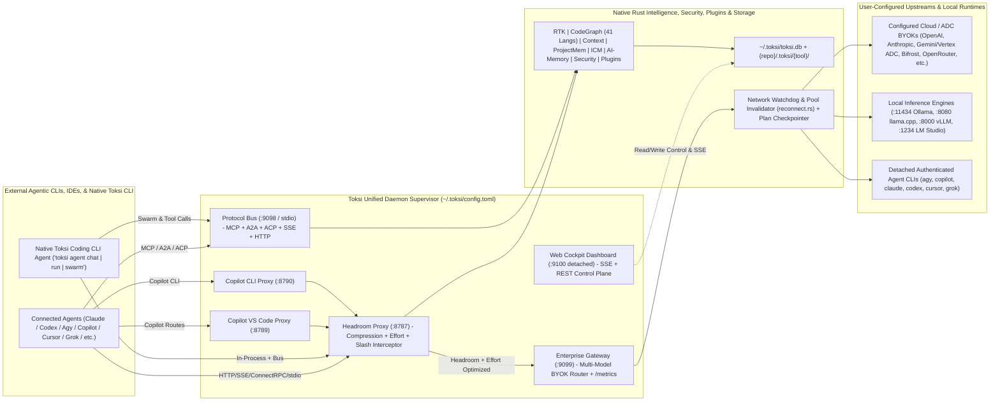
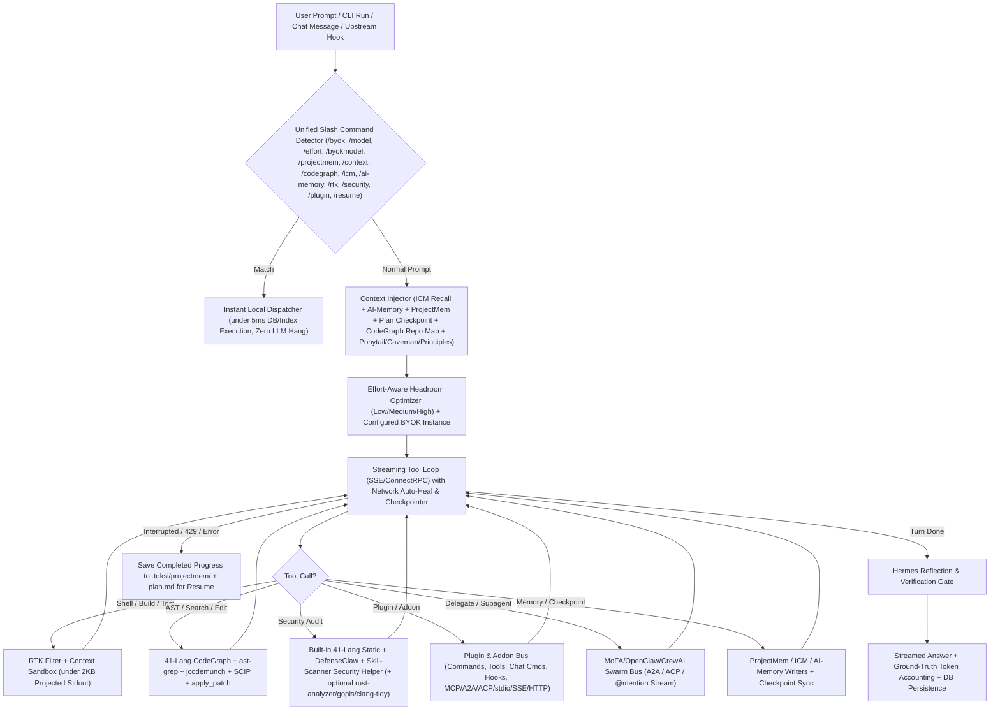
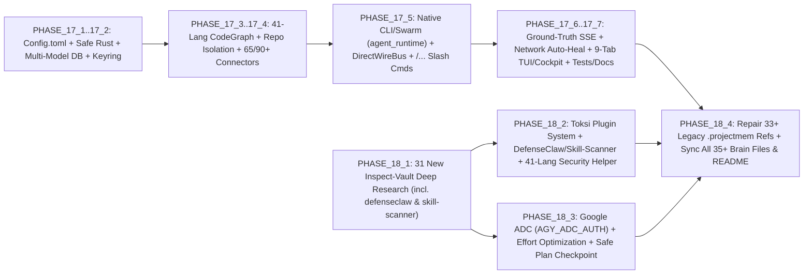

# Toksi Native Consolidation Master Research & Agentic Architecture Plan

> **Document Role:** Master Research Specification, Architectural Blueprint, Defect Remediation Dossier, Coding-CLI Plan (`/plan`), and Next-Research-Agent Execution Guide  
> **Canonical Output Path:** `crates/toksi/research/RESEARCHPLAN.md` (converted, corrected, researched, consolidated, and reorganized from `crates/toksi/research/RESEARCHPLAN.txt`)  
> **Scope Policy:** **Zero Omission ("Nothing Razored")** — Every vault (all **67** verified vaults), all **41** Tree-sitter languages, all **65** ecosystem providers (and **90+ / 22 local engine** extended catalog), Toksi Unified Plugin System (`MCP`, `A2A`, `ACP`, `stdio`, `SSE`, `HTTP`, agent-to-agent, commands, tools, chat commands, wire hooks), full `.agents`/vendor directory schemas, verbatim hook catalogs (Categories 1–3), all `.agents/brain/*.md` phase plans, CLI/TUI/Dashboard/TOML/DB/BYOK/Workspace/Security/Checkpoint specifications, and verified codebase bug remediations are preserved in full.

---

## 0. Mandatory Pre-Read Protocol, Terminology, & Ground-Truth Reference Files

Before researching, decomposing, or implementing any phase, every Research Agent and Swarm Worker MUST read these workspace files inside `<repo>` to preserve global master-plan knowledge, cross-tool coupling, directory topology, features, and decision history:

1. `crates/toksi/CONSOLIDATION_PLAN.md` — Master Architecture Plan (`# Toksi Native Consolidation Master Architecture Plan`)
2. `crates/toksi/PLAN.md` — Phased consolidation status checklist
3. `.toksi/projectmem/plan.md` — Active workspace roadmap and deferred engineering items *(replaces legacy `.projectmem/plan.md`)*
4. `.toksi/projectmem/PROJECT_MAP.md` — Canonical module map and subsystem ownership *(replaces legacy `.projectmem/PROJECT_MAP.md`)*
5. `.toksi/projectmem/summary.md` — Current project memory state, open bugs (including issues `#0033` and `#0034`), and recorded architectural decisions *(replaces legacy `.projectmem/summary.md`)*
6. `crates/toksi/research/full_ai_ecosystem_agent_runtimes_local_inference_engines_and_quota_architecture.md` — Comprehensive reference covering 13 cloud foundation APIs, 22 local inference engines/ports, 30 agentic CLIs + slash commands, 13 LSP/protocol providers, 15 editors/IDEs, 16 cloud platforms, 16 proxies/gateways/routers, quota categories, rate-limit headers, token bucket Lua scripts, and retry/failover engineering.
7. `inspect-vault/agents-structures/` — Ground-truth filesystem layout templates (`repository/` and `user/`) for `.agents`, `.claude`, `.codex`, `.copilot`, `.cursor`, `.gemini`, `.github`, and `.grok`.

### Canonical Lexicon (`RESEARCHPLAN.txt` Lines 2–6)

| Token | Authoritative Resolution in This Specification |
|-------|-----------------------------------------------|
| `<byok providers>` | **All** user-configured Bring-Your-Own-Key agent providers (`cli \| ide \| inprocess`) **and** all BYOK cloud, local, aggregator, gateway, and router providers (`frontier`, `accelerator`, `aggregators`, `specialized`, `multimodal`, `local`, `ecosystem`). |
| `<repo>` | The root workspace directory containing `<repo>/.git/` (Git metadata folder and tracked file tree). Never a nested crate subfolder and never a non-Git directory. |
| `<etc's>` | All sibling capabilities, adapters, telemetry hooks, edge-case guards, UX affordances, protocol bindings, new features, enhancements, and addon implementations implied by the context of that line. |
| `<detail's>` | Full, extensive, technical engineering specification—including schemas, state machines, API contracts, UI drill-downs, error paths, and verification commands—never hand-waved summaries. |
| `<enforce>` | **Mandatory Supply-Chain & Coding Security Enforcement:** All code, skills, scripts, commands, and distribution files MUST reside inside our repository distribution, undergo static/manual security analysis, and be sanitized of malicious, exfiltrative, or unsafe code before shipping or installing to agents/users. |

---

## 1. Corrections Audit Log & Specification Reconciliation

Converting raw `RESEARCHPLAN.txt` (lines 1–785) and reconciling it against verified files on disk in `crates/toksi/`, `.toksi/projectmem/`, `.agents/brain/`, and `inspect-vault/` uncovered contradictions, legacy paths, counting discrepancies, typos, and verified live bugs. Every Research Agent MUST treat these reconciliations as authoritative:

### 1.1 Contradictions & Policy Reversals Resolved

1. **Paid-Only BYOK Restriction Removed (`RESEARCHPLAN.txt` Line 112 vs. Line 158):**
   - *Earlier rule (Line 112):* Required rejecting free-tier accounts in BYOK rotation (`FreeTierDisqualified`).
   - *Authoritative reversal (Line 158):* **"Remove restrictions for PAID-qualified agent BYOK rotation from the code and everywhere."** Users are completely free to configure and rotate any accessible, working BYOK agent or provider enabled in `~/.toksi/config.toml` and `~/.toksi/toksi.db`.
   - *Verified codebase status:*
     - **Already refactored:** `crates/toksi/src/gateway/agent_cli/tier_check.rs` now treats `AccountTier::{Configured, OAuthSubscription, PaygApiKey, FreeOrTrial, Unknown}` strictly as non-blocking badges (`is_gateway_routing_active()` checks enabled BYOK routes).
     - **Still remaining to clean up:**
       - `crates/toksi/src/dashboard/assets/app.js:786` still renders `'Disqualified Free'` when `!isPaid`.
       - `crates/toksi/src/dashboard/api.rs:226–258` still hardcodes static provider/model/quota-badge pairs per agent instead of live configured BYOK profiles.
       - Legacy paid-only wording in `crates/toksi/CONSOLIDATION_PLAN.md` and `.agents/brain/PHASE_15_3_SMART_CLI_PROVIDERS_AND_PAID_QUOTA.md`.
   - *Preserved value:* Keep non-blocking **plan/tier observability badges** (`free`, `pro`, `team`, `enterprise`, `pay-go`, `local`) when the provider API exposes subscription/quota metadata without inference cost.

2. **Strict Configured-Only Activation & UI Visibility (`Lines 101, 152–153, 162`):**
   - Toksi MUST ONLY initialize gateway routes, wire agent hooks/protocols, launch smart CLI bridges, display active BYOK metrics, or list Keyring entries for agents and `<byok providers>` explicitly configured and enabled by the user in `~/.toksi/config.toml` / `~/.toksi/toksi.db`.
   - If zero BYOK providers are configured, the gateway router gracefully stays idle/standby while standalone agent usage (e.g., running `agy.exe` or `copilot.exe` directly with Headroom/RTK/MCP tools) operates cleanly without errors.

3. **Legacy `.projectmem/` -> `<repo>/.toksi/projectmem/` Migration (`Lines 7–8, 139`):**
   - Verified on disk: `<repo>/.toksi/projectmem/` exists and is active (`plan.md`, `PROJECT_MAP.md`, `summary.md`, `events.jsonl`, `config.toml`, `global/`, `issues/`), while `<repo>/.projectmem/` no longer exists at root.
   - However, `crates/toksi/CONSOLIDATION_PLAN.md`, `crates/toksi/PLAN.md`, and `.agents/brain/PHASE_*.md` (including `PHASE_17_1`..`PHASE_17_7`) still cite `.projectmem/*.md` in prompts and specs. Every plan and phase file MUST be repaired to `<repo>/.toksi/projectmem/`, and any remaining generic `.projectmem/` folders across crates/subfolders must be imported, merged (carefully preserving SQLite/JSONL records), and deleted.

### 1.2 Counting, Duplicate, Path, Port, & Typo Corrections

| Area | Erroneous / Ambiguous Input | Ground-Truth Verified Correction |
|------|-----------------------------|----------------------------------|
| **Inspect-Vault List** | `RESEARCHPLAN.txt` lines 12–78 contain 67 lines with `neo\inspect-vault\mofaclaw` duplicated (lines 47–48), plus `agents-structures` at lines 85 & 393. | **66 unique code/skill/security vaults + 1 directory-structure template vault (`agents-structures`) = 67 mandated vaults** (`+31` beyond earlier 36-vault drafts). Note: `inspect-vault/` on disk holds **180+ total directories** (e.g., `adk-rust`, `antigravity-sdk-rust`, `candle`, `claurst`, `codex-acp`, `higress`, `ironclaw`, `llama.cpp`, `mistral.rs`, `ollama`, `pi_agent_rust`, `qdrant`, `rig`, `sglang`, `tauri`, `vllm`); treat the 67 mandated vaults as primary targets and remaining directories as supplementary reference material. |
| **Tree-sitter Language Count** | Earlier `INDEX_AND_EXECUTION_GUIDE.md` cited `37` or `38` languages, and older drafts claimed only 7 grammars were wired. | `RESEARCHPLAN.txt:86` specifies **41 languages** (Section 8.1). Verified on disk: `crates/toksi/Cargo.toml`, `crates/toksi-grammars`, and `src/codegraph/kernel/langs.rs` already list **45** language IDs (`40` of `41` specified + `dart`, `r`, `luau`, `jsx`). **Remaining gaps:** `"dockerfile"` is in `LANGUAGES` (`langs.rs:17`) but **missing** from `grammar_for()` (`langs.rs:74–118`), and `"vue"`/`"scss"` alias `html`/`css` instead of dedicated SFC/SCSS grammars. |
| **Platform Provider List** | `RESEARCHPLAN.txt:90` lists both `Poolside AI` and `Poolside`. Categories 1–5 (lines 87–91) list 65 unique entries while `full_ai_ecosystem...md` expands Categories 1–5 to 90 providers + 22 local inference engines. | Core `RESEARCHPLAN.txt:87–91` deduplicated count = **65 providers** (`21` CLI/Bridge + `9` LSP/Protocol + `11` Editors/IDEs + `12` Platforms with `Poolside AI` deduplicated + `12` Proxies/Gateways). Extended `full_ai_ecosystem...md` tracks **90 ecosystem providers** + **22 local inference engines**. |
| **Reference Doc Path** | `RESEARCHPLAN.txt:177` references `@crates/research/full_ai_...md`. | Verified path is `crates/toksi/research/full_ai_ecosystem_agent_runtimes_local_inference_engines_and_quota_architecture.md`. |
| **Brain Phase Filename Case** | `RESEARCHPLAN.txt:142` cites `PHASE_06_IN_TREE_RULES_AND_skills.md`. | Verified filename on disk is `.agents/brain/PHASE_06_IN_TREE_RULES_AND_SKILLS.md` (uppercase `SKILLS`). Also `.agents/brain/` already contains `PHASE_17_1`..`PHASE_17_7` awaiting Wave 17/18 synchronization. |
| **SQLite DB & Tool Storage** | `RESEARCHPLAN.txt:95` warns against `localdata/toksi`; lines 117–118, 172–176 forbid `<user>/.toksi/<tool>` for workspace tools and forbid nested crate `.toksi/`. | User-level config/DB root: **`~/.toksi/config.toml` & `~/.toksi/toksi.db`**. Workspace tool stores (`codegraph`, `projectmem`, `context`, `icm`, `ai-memory`, `rtk`, `headroom`) live strictly inside **`<repo>/.toksi/<tool>/`**. |
| **Daemon Port Topology** | `dashboard/assets/index.html` & `api.rs` mislabel `:8788` as `BYOK / VIRTUAL GATEWAY`. | Verified active ports: **`8787`** (Headroom Streaming Proxy, `headroom/proxy.rs`), **`8788`** (Grok OAuth Proxy, `headroom/grok_daemon.rs` — NOT BYOK), **`8789`** (Copilot VS Code, `copilot_daemon.rs`), **`8790`** (Copilot CLI, `copilot_daemon.rs`), **`18787`** (BYOK Gateway, `util/byok.rs` + `headroom/byok_gateway.rs`), **`9098`** (Protocol Bus MCP/A2A/ACP/SSE), **`9099`** (Enterprise Gateway + `/metrics`), **`9100`** (Web Cockpit). All configurable in `~/.toksi/config.toml` `[ports]`. |
| **Terminology & Spelling** | Typos in `RESEARCHPLAN.txt`: `toking`, `extende`, `descipline`, `allways`, `hocks`, `kooked`, `balencer`, `Insperctor`, `graied`, `fidign`/`fedign`, `dorment`, `thecnicall`, `evrithing`, `cabalitities`, `toxi`, `implementig`, `Roo Clinic`, `research-securety-skills` (actual folder name on disk). | Normalized throughout into crisp technical English while retaining exact folder name `inspect-vault/research-securety-skills` and historical alias note `Roo Code (cited as Roo Clinic)`. |

### 1.3 Verified Live Codebase Bugs Flagged for Remediation (Audited Against `crates/toksi/src/`)

1. **Synthetic Telemetry Fabrication & Legacy UI Labels (`src/dashboard/api.rs`, `src/tui/app.rs`, `src/dashboard/assets/`):**
   - `api.rs:90–153` (`handle_waterfall`) still uses hardcoded synthetic shares (`0.38`, `0.42`, `0.20`) and constant `savings_pct: 68.0` when `tokens_saved > 0`.
   - `api.rs:226–277` (`handle_agents`) still hardcodes static provider/model pairs per agent and divides `live_tokens_saved / 17` evenly across all agents.
   - `tui/app.rs:257, 323, 464, 537–605` still has **7 tabs** (`tab_names: [&'static str; 7]`) instead of 9-tab parity, and `init_waterfall_samples()` still populates fake Claude/Cursor/Antigravity/OpenCode/Codex rows whenever `total_calls > 0`.
   - `dashboard/assets/index.html:45–55` still uses `Waterfall & Savings` and `Agent Fleet (17)` instead of `Savings` and `AI Agent Fleet & Quotas`; `app.js:786` still renders `'Disqualified Free'`.
2. **Non-Functional Heatmap Drill-Down (`src/dashboard/assets/app.js:463–480`):**
   - `renderHeatmap()` renders `.heatmap-cell` DOM nodes with **zero click event listeners** (`RESEARCHPLAN.txt:163`).
3. **Broken Keyring Naming & Unfiltered Audit (`src/keyring/mod.rs:214–221`):**
   - `audit_keyring_statuses()` unconditionally probes a hardcoded 5-agent table (`antigravity` -> `"gemini"`, `"antigravity"`, etc.) rather than filtering strictly to configured agents and reconciling normalized `gemini:antigravity` credentials (`RESEARCHPLAN.txt:168`).
4. **Synchronous Blocking TUI Loop (`src/tui/mod.rs:77–80` & `src/tui/app.rs`):**
   - `tui/mod.rs` enables `EnableMouseCapture`, but still runs synchronous polling/state updates inside the `50ms` UI loop instead of non-blocking `tokio::sync::watch` background snapshots (`RESEARCHPLAN.txt:103, 120`).
5. **Missing CLI Subcommands, Full TOML Config, Plugin System, & Native Coding Runtime (`src/commands/`, `src/util/ports.rs`):**
   - `util/ports.rs` implements partial `ToksiTomlConfig` (`[ports]` + `base_urls`), while full `src/config/mod.rs` (`default_agents`, `[dashboard]`, `[optimization]` effort profiles, `[auth.gcp_adc]`, `[security]`, `[plugins]`, `[[agents]]`, `[[byok.instances]]`) does not exist yet (`RESEARCHPLAN.txt:145–156`).
   - `dashboard/mod.rs:72–90` (`run_dashboard_cli`) lacks `start | stop | restart`; `commands/daemon.rs:49–74` lacks `--agents`; no `src/agent_runtime/` coding CLI (`toksi chat|run|swarm|exec|resume`), `src/plugins/` unified plugin/addon loader (`toksi plugin ...` wiring commands, tools, chat slash commands, hooks, `MCP`/`A2A`/`ACP`/`stdio`/`SSE`/`HTTP`, agent-to-agent), `src/security/` (`defenseclaw` fail-closed guardrails + `skill-scanner` CEL/multi-engine scanner), or `src/rules/skill_validator.rs` exists yet.
6. **Non-Git & Legacy Marker Fallback in Project Detection (`src/commands/index.rs:25–78`):**
   - `find_project_dir()` still includes `.projectmem` in `PROJECT_MARKERS` and falls back to `marker_root` or `current` non-Git directories instead of strict `<repo>/.git` root-only scoping (`RESEARCHPLAN.txt:170`).
7. **Remaining `unsafe` Blocks & Missing `#![deny(unsafe_code)]` (`src/{lib,main}.rs`):**
   - `commands/daemon.rs` enforces `#![deny(unsafe_code)]`, but `lib.rs` and `main.rs` do not yet; verified `unsafe` blocks remain in `commands/proxy.rs` (`L393–423`, 7x `set_var`), `commands/runmcp.rs` (`L139–183`, 4x `set_var`), `keyring/os_windows.rs` (`L42, 69, 126, 140`), `util/prompt.rs` (`L55, 64, 69, 75, 82, 192`), and `util/routing_lock.rs` (`L21, 34, 71, 84` `libc::flock`).
8. **Network Reconnect Stagnation, ConnectRPC Passthrough, & Stale Brain Paths (`src/headroom/proxy.rs`, `src/gateway/reconnect.rs`, `.agents/brain/*.md`):**
   - Network changes leave pooled connections dormant (`RESEARCHPLAN.txt:121`); Google Cloud Code / Antigravity ConnectRPC (`#0033`/`#0034`) routes require strict non-corrupting passthrough; `.agents/brain/*.md` still holds **33** stale `.projectmem` references.
   - *(Note: Earlier bugs in `commands/ctx.rs:22` `run_ctx_hook`, `commands/runmcp.rs:167–170` `aimemory` routing, and `headroom/live_zone.rs` `/byok/` interception have already been wired in-tree and now require verification + effort-aware scaling.)*

---

## 2. Complete Inspect-Vault Audit & Rust Porting Research Matrix (All 67 Verified Vaults)

Every directory in `neo/inspect-vault/` listed in `RESEARCHPLAN.txt` (lines 12–78 + line 85) MUST be treated as authoritative source material under **`<enforce>`** security review: inspect upstream updates, extract missing features, addons, new agents, and bugfixes, sanitize all code/skills/scripts, and convert/consolidate into pure safe Rust inside `crates/toksi/src/`.

### 2.1 Core Proxy, Compression, Routing & Telemetry Engines (8 Vaults)

| Vault (`inspect-vault/<name>`) | Verified Stack on Disk | Target `crates/toksi/src/` Module(s) | Status | Next-Agent Research & Porting Directives (`<enforce>`) |
|---|---|---|---|---|
| `tokless` | Go (`go.mod`, `cmd/`, `internal/`) | Root crate foundation, `commands/`, `tools/`, `telemetry/` | `[Migrated Baseline]` | Audit `tokless/internal/` and `docs/` for unported CLI/hook edge cases; eliminate residual `tokless_*` paths (`util/paths.rs`) and docs references. |
| `bifrost` | Go (`core/`, `framework/`, `transports/`, `cli/`, `plugins/`) + React UI (`ui/`) | `gateway/providers/aggregators/bifrost.rs`, `gateway/{routing,loadbalancer,semantic_cache,circuit_breaker}.rs`, `tools/mcp_dispatch.rs` | `[Partial]` | Register Bifrost as first-class BYOK provider; port plugin hooks (`on_gateway_connect`, `pre/post_route_request`, `pre/post_mcp_forward`), semantic cache, weighted load balancer, MCP federation, and Bifrost CLI bridge. |
| `headroom` | Rust (`Cargo.toml`, `crates/`) + Python (`headroom/`) | `headroom/{proxy,byok_gateway,live_zone,ccr,smart_crusher,search_compressor,diff_compressor,auth_mode,cache_align,adaptive_mem,router,responses_compat}.rs`, `headroom/compression/*`, `headroom/pruner/*` | `[Active / Effort & Economizer Polish]` | Pure-Rust `live_zone` + `CcrStore` + `SmartCrusher` + `/byok/` interception are already wired in `headroom/proxy.rs` & `copilot_daemon.rs`; eliminate any residual legacy Python references, wire live `lance`/`chroma` semantic cache, and add **thinking-effort-aware (`High`/`Medium`/`Low`) compression**. |
| `rtk` | Rust workspace (`Cargo.toml`, `engine/`, `plugin/`, `proxy/`, `text/`) | `rtk/{engine,hook,ansi}.rs`, `rtk/filters/*` | `[Active]` | Sync missing filter TOMLs, SQLite `Tracker` (`rtk gain`), `tee` raw-log recovery, `discover`/`learn` rules, multi-project workspace command detection, and `rtk-hook <agent>` standardization. |
| `TokenTracker` | TypeScript/JS (`package.json`, `dashboard/`, Linux/Win clients) | `telemetry/{collector,cost,tokentracker,tracker,prometheus}.rs`, `dashboard/` | `[Partial]` | Port 47+ tool/provider parsers, `cache_creation_input_tokens`, Responses API usage, `limits-cache` quota math, and `hour/day/week/month/year` aggregation with zero synthetic math. |
| `TokenEconomizer` | Python (`pyproject.toml`, `tokeneconomizer/`) + TS plugin | `headroom/compression/economizer.rs` | `[Partial / Unwired]` | Port 3-stage structural prompt pruning, `EnvFactsDistiller`, duplicate tool-schema dedup, `LoopGuard`, and token-budget compression aligned with thinking efforts (`High`/`Medium`/`Low`). |
| `tokview` | Python (`pyproject.toml`, `src/`, `tests/`, `web/`) | `telemetry/tokview.rs`, `dashboard/` | `[New Vault]` | Research `tokview`'s token visualization pipelines, per-turn token breakdown, prompt vs. tool vs. context-window attribution charts, and web UI inspection patterns for Tab 1 (`Savings`) & Tab 2 (`The War Room`). |
| `agent-opt` | TypeScript/JS (`package.json`, `src/`, `benchmarks/`, `manifests/`) | `agents/opt.rs`, `gateway/routing.rs`, `headroom/compression/` | `[Stub/Partial]` | Port AST 1-hop SHA-256 context deduplication (replacing randomized `DefaultHasher`), oscillation detector, and complexity/budget classifiers into per-`<byok, model, effort>` routing. |

### 2.2 Code Intelligence, AST Indexing, Search & Packing (6 Vaults)

| Vault | Verified Stack on Disk | Target `crates/toksi/src/` Module(s) | Status | Next-Agent Research & Porting Directives (`<enforce>`) |
|---|---|---|---|---|
| `context-mode` | TypeScript/JS (`package.json`, `src/`, `hooks/`, `plugins/`, `skills/`) | `contextmode/{sandbox,fts,filter,fetch,auto_memory,security,stats,cli,mcp,hooks}.rs` | `[Active / Parity Verify]` | `commands/ctx.rs:22` already dispatches to `contextmode::hooks::run_context_hook`; verify full parity with `core/policy/*`, `core/journal/*`, `core/compaction/*`, enforce `< 2KB` stdout projection, FTS5 ranking, `.gitignore`/`.ignore`, and complete `context-mode` -> `context` naming normalization. |
| `codegraph` | TypeScript (`src/`, `telemetry-*`, `ui/`) + Rust (`codegraph-kernel/Cargo.toml`) | `codegraph/{graph,walker,cache,mcp,mod}.rs`, `codegraph/kernel/*`, `crates/toksi-grammars` | `[Active / Missing dockerfile + vue/scss]` | `langs.rs` already registers 45 IDs (`40/41` specified + `dart`/`r`/`luau`/`jsx`); add missing `"dockerfile"` match in `grammar_for()` (`langs.rs:74–118`), upgrade `"vue"`/`"scss"` from `html`/`css` aliases to dedicated grammars, verify all `codegraph-kernel` extractors, partition `<repo>/crates/project1..N/` in `<repo>/.toksi/codegraph/`, and enforce `.ignore` purge. |
| `jcodemunch-mcp` | Python (`pyproject.toml`, `cli/`, `speedreview/`, `vscode-extension/`) | `codegraph/jcodemunch.rs` | `[Partial / Unwired]` | Wire O(1) byte-offset SQLite symbol slice extraction, repo outline maps, and minimal-token AST body retrieval into `codegraph/mod.rs`, CLI, and MCP. |
| `repomix` | TypeScript/JS (`package.json`, `src/`, `skills/`) | `codegraph/repomix.rs` | `[Partial / Unwired]` | Wire `secretlint`-grade secret scrubbing, Tree-sitter `--compress` skeleton extraction, `.ignore` precedence, BPE token counting, and monorepo subproject packing. |
| `ast-grep` | Rust workspace (`Cargo.toml`, `crates/`) + Python/TS wrappers | `codegraph/ast_grep.rs` | `[Partial / Unwired]` | Wire `ast-grep-core` structural pattern matcher, `MatchStrictness`, rewrite dry-run diff/apply, and static security rule matching across all 41 languages. |
| `scip` | Go (`go.mod`, `cmd/`, `reprolang/`) | `codegraph/scip.rs` | `[Partial / Unwired]` | Wire protobuf SCIP index ingestion/emission (`scip.proto` descriptor AST), cross-file definition/reference/implementation edges, and workspace crate resolution. |

### 2.3 Persistent Memory, Knowledge, Vector & Columnar Stores (7 Vaults)

| Vault | Verified Stack on Disk | Target `crates/toksi/src/` Module(s) | Status | Next-Agent Research & Porting Directives (`<enforce>`) |
|---|---|---|---|---|
| `projectmem` | Python (`pyproject.toml`, `src/`, `tests/`) | `projectmem/{schema,store,summary,heatmap,precheck,redaction,global,cli,mcp}.rs` | `[Active / Missing Tools]` | Port missing 3 MCP tools (`precheck_file`, `list_projects`, `current_project`) + `staleness`/`structure`; enforce `<repo>/.toksi/projectmem/` root-only DB + safe plan crash/rate-limit checkpointing; fix clickable Heatmap diagnostics. |
| `ai-memory` | Rust workspace (`Cargo.toml`, `crates/`, `companions/`, `evals/`, `hooks/`) | `aimemory/{mod,tiered,wiki,handoff,mem0_bridge,cli,mcp}.rs` | `[Active / Parity Verify]` | `commands/runmcp.rs:167–170` already routes `aimemory`/`handoff` to `aimemory::mcp`; enforce `<repo>/.toksi/ai-memory/` root-only isolation, `.ignore` vector purge, `mem0`/`openwiki` integration, and `/ai-memory` slash command. |
| `icm` | Rust (`Cargo.toml`, `crates/`, `bench/`, `plugins/`) | `icm/{mod,schema,store,recall,cli,mcp}.rs` | `[Active / Missing ~23 Tools]` | Port missing ~23 upstream `icm` MCP tools (`memoir`, `feedback`, `transcript`, `temporal`, `fusion`, etc.), enforce `<repo>/.toksi/icm/`, `.ignore` pruning, and `/icm` slash command. |
| `mem0` | Python (`pyproject.toml`, `mem0/`) + TS (`mem0-ts/`) | `aimemory/mem0_bridge.rs` | `[Partial]` | Port Mem0 fact extraction, `ADD`/`UPDATE`/`DELETE`/`NOOP` graph conflict resolution, user vs. repo scope separation, and episodic recall into pure Rust. |
| `chroma` | Rust (`Cargo.toml`) + Python/Go | `codegraph/vector.rs`, `aimemory/vector.rs` | `[Research / Target]` | Study `chroma/rust/` local embedded HNSW/SPANN vector collections, metadata filtering (`repo_root`, `subproject_id`, `rel_path`), and cascading document deletion for `.gitignore`/`.ignore` purges. |
| `lance` | Rust (`rust/`, `Cargo.toml`, `protos/`) + Python/Java | `aimemory/lance_store.rs`, `codegraph/vector.rs` | `[New Vault]` | Research Lance columnar & vector-index Rust crates (`lance` / `lance-index` IVF-PQ/HNSW + zero-copy Arrow storage + full-text & hybrid vector search + time-travel versioning) inside `<repo>/.toksi/` as high-speed pure-Rust vector/embedding backend with instant `.ignore` deletion. |
| `openwiki` | TypeScript/JS + Markdown (`src/`, `openwiki/`, `skills/`, `evals/`, `integrations/`) | `aimemory/wiki.rs`, `codegraph/wiki.rs` | `[New Vault]` | Research `openwiki` automated architectural wiki generation, symbol-linked documentation indexing, stale-doc detection on code edits, and structured knowledge synthesis for `aimemory::wiki` & `.agents/knowledge/`. |

### 2.4 Prompt Discipline, Protocols, & Cloud SDK Normalization (7 Vaults)

| Vault | Verified Stack on Disk | Target `crates/toksi/src/` Module(s) | Status | Next-Agent Research & Porting Directives (`<enforce>`) |
|---|---|---|---|---|
| `ponytail` | TS/JS (`package.json`, `.agents/`, `.codex-plugin/`, `.cursor/`, `.grok-plugin/`) | `rules/ponytail.rs`, `rules/assets/ponytail.*`, `tools/ponytail.rs` | `[Active]` | Sync 7-rung Ladder rules (`lite`/`full`/`ultra`), companion modes (`ponytail-audit`, `ponytail-debt`, `ponytail-review`), statusline, and multi-agent config templates. |
| `caveman` | Go (`go.mod`) + JS/TS (`package.json`, `shrink/`, `mcp/`, `extension/`, `proxy/`) | `rules/caveman.rs`, `rules/assets/caveman.*`, `tools/caveman.rs`, `headroom/compression/caveman_shrink.rs` | `[Active]` | Port Caveman v4 (`/ultracave`, `/megacave`, `shrink`, `browse`, `.blocks` preservation) and runtime wire compression profiles. |
| `andrej-karpathy-skills` | Markdown (`CLAUDE.md`, `CURSOR.md`, `skills/`, `EXAMPLES.md`) | `rules/principles.rs`, `rules/assets/principles.*`, `tools/principles.rs` | `[Active]` | Audit & keep all 4 Karpathy principles + `SKILL.md` frontmatter valid and synced under `<enforce>`. |
| `agent-client-protocol` | Rust (`Cargo.toml`, `schema/`, `schema-generator/`, `agent-client-protocol-schema/`) | `tools/multi_protocol.rs`, `agent_runtime/acp.rs` | `[New Vault]` | Import official ACP JSON-RPC schema types, session/turn/tool-call/permission/diff lifecycle payloads, stdio & Streamable HTTP/SSE transports directly from `agent-client-protocol` Rust crate definitions. |
| `litellm` | Python (`pyproject.toml`) + Rust (`litellm-rust/Cargo.toml`) + TS | `gateway/normalizer/{litellm,mod}.rs`, `gateway/compat/mod.rs` | `[Active]` | Inspect `litellm-rust/` for OpenAI/Anthropic/Gemini/xAI/DeepSeek/OpenRouter schema normalization, `thinking`/`reasoning_effort` (`low`/`medium`/`high`) translation, `/models` discovery, and rate-limit header parsers. |
| `python-genai` | Python (`pyproject.toml`, `google/genai/`) | `gateway/providers/frontier/gemini.rs`, `headroom/compression/gemini.rs` | `[New Vault]` | Research Google GenAI SDK (`v1`, `v1beta`, `v1alpha`), `GenerateContentConfig`, `thinking_config` (`thinking_budget`, `thinking_level`), `cached_content`, `usage_metadata`, SSE streaming formats, and Gemini Enterprise / Vertex / AI Studio auth differences. |
| `python-aiplatform` | Python (`google/cloud/aiplatform/`, `vertexai/`, `agentplatform/`) | `gateway/providers/frontier/vertex.rs`, `agents/antigravity.rs`, `keyring/adc.rs` | `[New Vault]` | Research **Google Cloud ADC authentication (`AGY_ADC_AUTH=true`)** for Gemini Enterprise / Vertex AI (`google.auth.default()`, `gcloud auth application-default login --project GCP_PROJECT`, `"gcp.project"`, `"gcp.location"`, regional endpoints `https://{location}-aiplatform.googleapis.com`, OAuth token refresh, and quota/rate-limit headers). |

### 2.5 Coding CLI Runtimes, Multi-Agent Orchestration, IDEs & Agent Structures (25 Unique Vaults)

| Vault | Verified Stack on Disk | Target `crates/toksi/src/` Module(s) | Status | Next-Agent Research & Porting Directives (`<enforce>`) |
|---|---|---|---|---|
| `agent-control` | Python/TS (`engine/`, `evaluators/`, `models/`, `sdks/`, `server/`, `telemetry/`, `ui/`) | `agent_runtime/guardrails.rs`, `gateway/policy.rs`, `telemetry/` | `[New Vault]` | Research policy/control-plane evaluator engine: runtime pre/post prompt & tool guardrails, regex/semantic/LLM-free deterministic evaluators, and control-plane rule telemetry. |
| `grok-build` | Rust (`Cargo.toml`, `crates/`) | `agents/grok.rs`, `gateway/agent_cli/grok*.rs`, `agent_runtime/edit_tools.rs` | `[Partial CLI]` | Port `HashlineEditTool`/`SearchReplaceTool`, `.grok/` hierarchical TOML (`managed_config.toml`, `requirements.toml`, `personas/*.toml`), Rust streaming tool loop, and xAI `reasoning_format`. |
| `codex` | Rust (`codex-rs/Cargo.toml`) + TS (`codex-cli/`) | `agents/codex.rs`, `gateway/agent_cli/codex.rs`, `agent_runtime/{sandbox,patch,tui}` | `[Partial CLI]` | Port `codex-rs` 3-OS native sandboxing (`Landlock`/Seatbelt/Windows Restricted Token), Lark `apply_patch` tool, `.codex/agents/*.toml` role presets, and `Interrupt`/`Stop` hooks. |
| `crush` | Go (`go.mod`, `internal/`) | `agent_runtime/{session,providers,tui_chat}` | `[Not Yet Ported]` | Port provider-agnostic TUI chat session UX, fast LSP-backed edit tools, mid-session model switching, and `on_session_boot`/`pre_patch`/`post_patch` hooks. |
| `crustly` | Rust (`Cargo.toml`, `src/`, `knowledge/`, `migrations/`) | `agent_runtime/`, `agent_runtime/security.rs` | `[Not Yet Ported]` | Port pure-Rust agent loop, SQLite session persistence, `PermissionPolicy`, `ssrf_guard`, `apply_patch.rs`, and Ratatui streaming chat patterns. |
| `goose` | Rust (`Cargo.toml`, `crates/`) + `oidc-proxy/` | `agent_runtime/{recipes,mcp_client,extensions}` | `[Not Yet Ported]` | Port Rust MCP client/extension lifecycle, YAML/declarative workflow recipes, headless/interactive loop, and `oidc-proxy` OAuth token broker patterns. |
| `hermes-agent` | Python (`agent/`, `gateway/`, `cron/`, `acp_adapter/`, `ui-tui/`) + TS | `agent_runtime/{hermes_loop,reflection,acp,cron}` | `[Not Yet Ported]` | Port `TurnFacadeMixin` durable turn leases, `RUN_BUDGET_WRAPUP_NOTICE` (80% budget), `RunawayStreamWatch`, `StopGateVerdict`, `StreamingContextScrubber`, `MoAChatCompletions`, and `_BackgroundReviewRun` critic fork. |
| `openclaw` | TS (`package.json`) + Rust (`crates/Cargo.toml`) | `agent_runtime/{loop_detect,a2a,advisor,channels}` | `[Not Yet Ported]` | Port 6-detector `ToolLoopDetector`, `PendingMessageQueue`, `A2aTaskStore` v1.0 JSON-RPC 2.0, `SessionActorQueue`, and `advisor` fork (`NO_CHANGE` / `<80w` `CORRECTION`). |
| `openclaw-rs` | Rust (`Cargo.toml`, `bridge/`, `crates/`) | `agent_runtime/{event_log,crdt,daemon}` | `[Not Yet Ported]` | Port pure-Rust agent daemon core, BLAKE2b-256 `EventLog`, CRDT state merge, and zero-Node native channels. |
| `mofaclaw` *(dedup lines 47–48)* | Rust workspace (`cli/`, `core/`, `skills/`) + Python | `agent_runtime/swarm/`, `agent_runtime/rbac.rs` | `[Not Yet Ported]` | Port `SHELL_METACHARS` RBAC, MoFA multi-agent orchestration + lightweight Claw channels, and hot-loadable skills. |
| `mofa` | Rust (`Cargo.toml`, `examples/`, `tests/`) | `agent_runtime/{mofa_bus,dora_nodes,a2a}` | `[Not Yet Ported]` | Port `MoFAAgent`, `AgentContext`, `InterruptSignal`, composable Rust dataflow nodes, and supervisor/worker A2A messaging. |
| `mofa-engine` | Rust multi-crate (`mofa-engine-core`, `mofa-kernel`, `mofa-engine-sdk`, `mofa-review`, `mofa-studio`) | `agent_runtime/engine/`, `gateway/routing.rs`, `dashboard/` | `[Not Yet Ported]` | Port `SubtaskDAG` (`petgraph`), wave `ParallelScheduler`, `SwarmHITLGate`, `ReflectionAgent`, `Router::route_ranked` 7-D deterministic scorer, `CircuitBreakerRegistry`, and `mofa-review` / `mofa-studio` patterns. |
| `gemini-cli` | TS/JS (`packages/`, `evals/`, `schemas/`) | `agents/antigravity.rs`, `gateway/agent_cli/gemini_agy.rs`, `agent_runtime/` | `[Partial Connector]` | Port CloudCode (`v1internal`/`v1main`/`v1beta`), `PreInvocation`/`PostInvocation` hooks, `thinkingConfig.thinkingBudget`, ADC auth (`AGY_ADC_AUTH=true`), `@file` & `/chat` slash commands. |
| `crewAI` | Python (`pyproject.toml`, `lib/`) | `agent_runtime/crew_roles.rs` | `[Not Yet Ported]` | Port `ProcessMode::{Sequential,Hierarchical,MoAFanout,CollectorSwarm}`, `ReasoningPlan`/`PlanStep`, task guardrails, and causal `event_id`/`parent_event_id` lineage. |
| `langgraph` | Python (`libs/`, `Makefile`) | `agent_runtime/graph_checkpoint.rs` | `[New Vault]` | Research LangGraph stateful cyclic DAG execution, **durable checkpointing & thread-state persistence (`interrupt`/`resume` across crashes/disconnects/rate-limits)**, and human-in-the-loop state replay for our Safe Plan Resume mechanism! |
| `langchain` | Python (`libs/`, `.mcp.json`) | `agent_runtime/tools_schema.rs`, `gateway/normalizer/` | `[New Vault]` | Research uniform tool-calling abstractions, structured output coercion, runnable streaming callbacks, and multi-provider message normalization. |
| `langfuse` | TS/JS monorepo (`web/`, `packages/`, `ai-gateway/`, `specs/`) | `telemetry/traces.rs`, `gateway/providers/routers/langfuse.rs`, `dashboard/` | `[New Vault]` | Research trace/span/generation OpenTelemetry ingestion, prompt-version correlation, per-trace cost/latency spans, and Langfuse gateway/observability adapter. |
| `langflow` | Python + React (`src/`, `deploy/`) | `agent_runtime/flow_graph.rs` | `[New Vault]` | Research declarative visual/JSON agent-flow node topology and multi-agent component chaining for potential workflow export/inspection. |
| `deepagents` | Python (`libs/`, `ACTION.md`) | `agent_runtime/deep_planning.rs` | `[New Vault]` | Research DeepAgents built-in planning (`write_todos` / plan tracking), filesystem middleware, context offloading, and subagent delegation prompts. |
| `bosun` | Rust (`Cargo.toml`, `src/`, `tests/`, `themes/`) | `agent_runtime/`, `tui/` | `[New Vault]` | Research `bosun` Rust CLI/TUI workflows, multi-agent task orchestration, themes, and daemon/supervisor patterns. |
| `Codewhale` | Rust (`Cargo.toml`, `crates/`, `extensions/`, `fleets/`, `integrations/`) | `agent_runtime/fleet.rs`, `tui/` | `[New Vault]` | Research `Codewhale` Rust multi-crate fleet orchestration, agent extensions, and terminal IDE/CLI integration. |
| `cline` | TS/JS (`src/`, `sdk/`, `evals/`, `.clinerules`, `.cline/`) | `agents/cline.rs`, `agent_runtime/modes.rs` | `[New Vault]` | Research Cline's MCP-native extension server, Plan vs. Act mode switching (`onAgentModeSwitch`), `.clinerules`, checkpoint diffing, and tool approval gates. |
| `kilocode` | TS/JS monorepo (`packages/`, `.kilo/`, `.kilocode/`) | `agents/kilo.rs`, `agent_runtime/modes.rs` | `[New Vault]` | Research Kilo CLI & editor modes (`Orchestrator`, `Architect`, `Code`, `Debug`), `.kilo/hooks.json` (`on_init`, `before_agent_step`, `pre_command`, `post_command`, `on_finish`), and multi-provider routing. |
| `alphacode` | Rust (`Cargo.toml`, `build.rs`, `src/`, `alphagrep/`, `tests/`) | `codegraph/`, `agent_runtime/` | `[New Vault]` | Research `alphacode` Rust coding agent + `alphagrep` fast search engine + `build.rs` patterns for native Toksi search and coding loop speedups. |
| `zeroclaw` | Rust (`Cargo.toml`, `crates/`, `apps/`, `benches/`, `firmware/`) | `agent_runtime/zeroclaw_core.rs` | `[New Vault]` | Research `zeroclaw` ultra-lightweight pure-Rust agent runtime, low-overhead memory footprint, benches, and embedded/daemon execution channels. |
| `agents-structures` | Directory templates (`repository/` + `user/`) | `agents/*`, `rules/sync.rs`, `util/paths.rs` | `[Reference Spec]` | Ground-truth schema template validator for `.agents`, `.claude`, `.codex`, `.copilot`, `.cursor`, `.gemini`, `.github`, and `.grok` across user & repo scopes. |

### 2.6 Security Analysis, Runtime Governance, Vulnerability Scanning, & Vetted Skills Distribution (13 Unique Vaults + `andrej-karpathy-skills` — `<enforce>`)

| Vault | Verified Stack on Disk | Target `crates/toksi/src/` Module(s) | Status | Next-Agent Research & Porting Directives (`<enforce>`) |
|---|---|---|---|---|
| `defenseclaw` | Go (`go.mod` Go 1.26.4, `cmd/defenseclaw*`, `internal/{acp,actionfacts,agentidentity,agentprobe,agentprocess,assetfacts,audit,codesig,enforce,enterprisepolicy,firewall,gateway,gitsafe,guardrail,hookguard,hooklayout,hookruntime,ipc,...}`, `policies/{guardrail,kernel,rego,sandbox,scanners,yara,default.yaml,strict.yaml,firewall-deny-default.yaml}`, `plugins/{plugin.go,registry.go}`) + Python CLI/TUI (`cli/defenseclaw/`, `pyproject.toml`) + TS OpenClaw Extension (`extensions/defenseclaw/openclaw.plugin.json`) | `security/{defenseclaw,guardrails,hookguard,audit,yara_mcp}.rs`, `plugins/{mod,registry,scanner_plugin}.rs`, `agents/hooks.rs`, `gateway/policy.rs` | `[New Vault]` | Port fail-closed capability & hook guard (`cmd/defenseclaw-hook-guard`, `internal/hookguard`, `internal/enforce`), runtime traffic inspection & guardrail policy bundles (`policies/guardrail/tool-chains.json`, cloud/DB/k8s/SSH destruction protection, `rego`, `yara/mcp-tools`, `scanners/codeguard` & `plugin-scanner`), `internal/acp` & `agentidentity`/`codesig` verification, durable audit evidence exporter (`internal/audit`), and `plugins/{plugin.go,registry.go}` (`plugin.yaml` / `openclaw.plugin.json`) plugin architecture into pure Rust. |
| `skill-scanner` | Python (`pyproject.toml`, `skill_scanner/{core,cli,api,config,data,hooks,threats,utils}/`, `evals/`, `docs/`) + Go CEL decision runtime (`cel-go` v0.32.0) + YARA-X & YAML signature packs (`skill_scanner/data/packs/core/{signatures,yara,python,pack.yaml}`) | `security/{skill_scanner,cel_decision,pipeline_taint,bytecode_audit,sarif}.rs`, `rules/skill_validator.rs`, `plugins/analyzer_plugin.rs` | `[New Vault]` | Port two-phase multi-engine skill & plugin scanner (`Static` YAML+YARA-X signatures, `Bytecode` `.pyc` integrity/source-mismatch detector, quote-aware shell `Pipeline` taint analyzer, `Behavioral` AST dataflow & cross-file taint tracker, `Trigger` specificity analyzer, `Cross-Skill` overlap/chaining detector, optional local/BYOK `LLM-as-a-judge` & `Meta` analyzer), typed bounded **CEL decision layer** over detector facts, AITech/AISubtech threat taxonomy, measured policy presets (`strict`, `balanced`, `low-noise`, `quiet`, `permissive`), pre-commit hook & SARIF/JSON/HTML/Markdown/Table reporters, and custom analyzer plugin interface directly into `toksi security` and `toksi plugin` gatekeepers. |
| `sage` | TS/JS (`packages/`, `hooks/`, `skills/`, `threats/`, `trusted-domains/`) | `security/sage_rules.rs`, `contextmode/security.rs`, `agent_runtime/security.rs` | `[New Vault]` | Research `sage/threats/` & `trusted-domains/` for prompt-injection detection, malicious skill/hook payload screening, domain allowlisting, and runtime URL/fetch threat guards. |
| `codex-security` | TS/Bun + Docker + Python (`sdk/`, `plugins/`, `evals/`, `github-action/`) | `security/analyzer.rs`, `security/triage.rs` | `[New Vault]` | Research AI-assisted + deterministic static security triage pipelines, exploitability validation, false-positive filtering, and repository threat modeling. |
| `deepsec` | TS/JS (`packages/`, `.deepsec/`, `prompt-samples/`, `fixtures/`) | `security/scanner.rs`, `security/prompt_audit.rs` | `[New Vault]` | Research `deepsec` static security rules, prompt/skill injection fixtures, and automated pre-install security gatechecks. |
| `osv-scanner` | Go (`go.mod`, `cmd/`, `internal/`, `pkg/`) | `security/osv.rs` | `[New Vault]` | Port lockfile/manifest dependency parsers (`Cargo.lock`, `package-lock.json`, `pnpm-lock.yaml`, `poetry.lock`, `go.sum`, `pom.xml`) and OSV vulnerability DB query/cache (zero unvetted execution) into Toksi's native security helper. |
| `semgrep` | OCaml + Python + Rust (`src/`, `cli/`, `libs/`, `languages/`) | `security/semgrep_engine.rs`, `codegraph/ast_grep.rs` | `[New Vault]` | Research Semgrep AST taint/dataflow rules & pattern semantics to elevate Toksi's 41-language Tree-sitter + `ast-grep` static security analyzer (without needing heavy runtime external deps for core checks). |
| `semgrep-rules` | YAML Rulesets (`ai/`, `bash/`, `c/`, `csharp/`, `dockerfile/`, `elixir/`, `go/`, `html/`, `java/`, `javascript/`, `json/`, etc.) | `security/rules/builtin/*` (embedded & security-vetted in-tree) | `[New Vault]` | Audit, curate, and compile high-signal, zero-false-positive security rules across all 41 languages into Toksi's embedded rule pack (`rust`, `ts/js`, `python`, `go`, `c/cpp`, `java`, `bash`, `dockerfile`, `sql`, `yaml/json`, `ai` prompt/agent rules). |
| `research-securety-skills` | Plugins/Python (`plugins/`, `.claude-plugin/`, `ruff.toml`) | `security/skill_audit.rs`, `rules/assets/` | `[New Vault]` | Audit security-research skills strictly under `<enforce>`; extract defensive static/dynamic audit checklists and verify zero malicious payloads before bundling any skill. |
| `agent-skills` | JS/TS (`packages/`, `skills/`, `scripts/`, `skills.sh.json`) | `rules/skills_catalog.rs`, `rules/assets/skills/` | `[New Vault]` | Inspect skill packaging/registry structure, sanitize every candidate skill, deduplicate overlapping names/triggers, and embed vetted skills in-repo. |
| `openagent-skills` | JS/TS (`src/`, `skills/`, `bin/`, `e2e/`) | `rules/skills_catalog.rs`, `rules/assets/skills/` | `[New Vault]` | Audit skill definitions & CLI installers; verify cross-agent compatibility and strip unsafe external curl/install scripts. |
| `openclaw-agent-skills` | Python/JS (`skills/`, `scripts/`, `package.json`, `requirements-dev.txt`) | `rules/skills_catalog.rs`, `rules/assets/skills/` | `[New Vault]` | Audit OpenClaw skills, extract clean procedural workflows, resolve name collisions, and verify YAML frontmatter. |
| `agentskills` | Spec + Validator (`skills-ref/`, `docs/`, `.claude/`) | `rules/skill_validator.rs` | `[New Vault]` | **Authoritative `SKILL.md` / `skill.md` Spec:** Port `skills-ref` YAML frontmatter parser, validator, and auto-healer directly into pure Rust so Toksi validates, heals broken YAML frontmatter, and guarantees zero duplicate/overwriting/blocking skills across the entire repo & installed agent directories! |

---

## 3. Disciplinary Coding Standards, Security (`<enforce>`), & Cross-Platform Portability Matrix

All code, skills, scripts, and configs added or refactored in `crates/toksi/` MUST satisfy strict engineering discipline (`RESEARCHPLAN.txt` Lines 6, 9, 93–95, 128–132, 174):

1. **Rust Edition 2024 Safety Baseline:** Enforce `#![deny(unsafe_code)]` on `crates/toksi/src/lib.rs` and `main.rs` (isolating unavoidable Win32/C-ABI FFI inside leaf crates `crates/toksi-sys` and `crates/toksi-grammars`), compile cleanly under `RUSTFLAGS="-D warnings"`, and allow zero `.unwrap()` / `.expect()` / `panic!()` in non-test production code. Use explicit typed errors (`thiserror::Error`) and `?`.
2. **Async Runtime Hygiene:** Zero blocking disk I/O, heavy Tree-sitter parses, SQLite transactions, or synchronous subprocess waits on Tokio executor threads—always wrap with `tokio::task::spawn_blocking` and bound worker pools. Decouple TUI rendering and telemetry updates via lock-free `tokio::sync::watch` / `mpsc`.
3. **Structured Observability & Zero Secret Leakage:** Use `tracing` + lock-free atomic counters (`AtomicU64`) on hot paths. Never log plaintext API keys, OAuth tokens, or PII (`projectmem/redaction.rs` scrubbing everywhere).
4. **Canonical Path & Slash Standard (`Line 91`):**
   - **Everywhere in Toksi internal paths, Unix/Windows APIs, Git-friendly configs, URIs, and docs:** Use forward slashes `/` exclusively (via `toksi_abs_strict` normalization) because Git Bash / MSYS2 and POSIX tools mangle unescaped `\`.
   - **Single Explicit Exception (`cmd.exe` inside JSON5 / TOML):** Only when writing native Windows shell commands targeting `cmd.exe` inside JSON5 / TOML `hooks.json` or `mcp` command strings requiring Windows backslashes, serialize valid escaped double backslashes `\\` (e.g., `"C:\\Programs\\neo\\bin\\toksi.exe"`). Wherever portable executable resolution suffices, prefer bare binary names resolved via `PATH`.
5. **Portable Binary Resolution — "Test & Inform `PATH`" Rule (`Line 92`):**
   - Never hardcode absolute installation paths inside persistent configs (`.db`, `.json`, `.toml`, hooks, MCP definitions) when launching binaries (`toksi`, `git`, `claude`, `codex`, `agy`, `copilot`, `cursor`, `grok`, `bash`, `cmd`, `rust-analyzer`, `gopls`, `clang-tidy`, tool binaries).
   - At validation, wire, doctor, or launch time, inspect `std::env::var_os("PATH")`. If a required binary is missing from `PATH`:
     - Surface a clear diagnostic in CLI, TUI, and Web Dashboard naming the exact executable(s) to add to `PATH` and instructing the user to retry once added.
     - Do **not** crash daemon startup; mark the missing agent/binary cleanly as unavailable (greyed out in UI).
6. **`<enforce>` Security & In-Repo Distribution Discipline (`Lines 6, 128–132`):**
   - **Zero External Runtime Downloads:** All tools, skills, rules, and security patterns ship inside the `<repo>` distribution.
   - **Security-Vetted Skills, Plugins, & Scripts (`skill-scanner` + `defenseclaw`):** Every bundled or user-installable skill, plugin (`src/plugins/`), hook script, or MCP definition MUST pass automated security screening before bundling, loading, or installing to any agent—combining **`skill-scanner`** (two-phase YAML+YARA-X signatures, `.pyc` bytecode integrity, quote-aware shell pipeline taint, behavioral AST dataflow, cross-skill overlap, bounded CEL decision layer, AITech threat taxonomy) and **`defenseclaw`** (fail-closed `hookguard`, `yara/mcp-tools`, `scanners/plugin-scanner` & `codeguard`, `tool-chains.json` guardrails, durable audit evidence, rejecting obfuscated shell payloads, unauthorized curl-pipe-sh, credential exfiltration, prompt-injection triggers, or arbitrary path traversal).
   - **Skill Conflict & Frontmatter Auto-Healing (`Line 129`):** Validate all `SKILL.md` / `skill.md` files against the `agentskills` spec (`inspect-vault/agentskills/skills-ref/`). Detect duplicate skill IDs, overlapping slash/trigger commands, mutual overwrites, or conflicting blocks; automatically repair malformed YAML frontmatter (`name`, `description`, quoting, indentation, delimiter closure) cleanly.
7. **Built-In Static Code Security Analysis Helper Tool (`Line 130`):**
   - Implement a pure-Rust static code security analyzer (`crates/toksi/src/security/`) covering **all 41+ Tree-sitter languages, shell scripts, Dockerfiles, IaC/YAML, and GitHub Actions**:
     - Synthesizes Tree-sitter + `ast-grep` structural taint/sink rules (`semgrep-rules`, `semgrep`), lockfile CVE auditing (`osv-scanner`), runtime guardrail & MCP/plugin policies (`defenseclaw`), multi-engine skill/plugin + CEL analysis (`skill-scanner`), prompt/agent threat detection (`sage`, `deepsec`, `codex-security`), and secret detection (`repomix` / `redaction.rs`).
     - Optionally integrates external language-server diagnostics when present in `PATH` (`rust-analyzer`, `gopls`, `clang-tidy`), gracefully falling back to Toksi's own built-in analyzer.
     - Exposes direct MCP / A2A / ACP / slash tool endpoints (`/security` / `toksi security scan`) and SARIF/JSON/HTML/Markdown/Table outputs so `toksi` agent and connected agents automatically query and receive structured security flaw reports (`severity`, `cwe`, `AITech`, `file:line`, `remediation`) when asked to analyze code.
8. **Incremental Verification & Test Skip Policy (`Line 171`):**
   - Maintain `.toksi/test-baseline.json` mapping test suites to `Cargo.lock` + watched source paths via BLAKE3 hashes.
   - Tests that previously passed on verified baselines **do not need to be re-run** when changes in the current phase do not touch their owned files or transitive dependencies (`[SKIP-UNCHANGED]`), while `cargo check --workspace`, `cargo clippy --workspace --all-targets -- -D warnings`, affected suites, and final milestone checks always run cleanly without relaxing assertions.

### Cross-Platform Portability Matrix

| Dimension | Windows (`x86_64-pc-windows-msvc`) | Linux (`x86_64` / `aarch64-unknown-linux-gnu`) | macOS (`aarch64` / `x86_64-apple-darwin`) |
|-----------|---------------------------------------|------------------------------------------------|-------------------------------------------|
| **User Config & DB Root** | `%USERPROFILE%/.toksi/{config.toml,toksi.db}` (NEVER `LocalAppData/toksi`) | `$HOME/.toksi/{config.toml,toksi.db}` | `$HOME/.toksi/{config.toml,toksi.db}` |
| **OS Keyring Backend** | Windows Credential Manager (`toksi-sys`) + AES-GCM fallback vault | Secret Service / D-Bus (`os_linux.rs`) + fallback vault | macOS Keychain (`os_macos.rs`) + fallback vault |
| **Detached Background Spawn** | `CREATE_NEW_PROCESS_GROUP \| DETACHED_PROCESS \| CREATE_NO_WINDOW` | `setsid` / `process_group(0)` piped to `/dev/null` | `setsid` / `launchd`-safe background spawn |
| **Path Serialization** | Forward slashes `/` globally; double `\\` strictly inside `cmd.exe` TOML/JSON5 command strings | Forward slashes `/` everywhere | Forward slashes `/` everywhere |
| **Process Liveness & Reap** | `sysinfo` / Win32 handle check | `/proc/<pid>` & `kill(pid, 0)` | `kill(pid, 0)` / `sysctl` |
| **Sandbox Engine (`context` & `codex`)** | Job Object + Restricted Token / `pwsh` wrapper | Landlock / seccomp / `bwrap` | Apple `sandbox-exec` (Seatbelt) `.sbpl` |

---

## 4. Unified System Architecture, `~/.toksi/config.toml`, SQLite DB, Multi-Port Runtime, & Safe Plan Checkpointing

Toksi runs via **one unified daemon launch** (`toksi daemon start`) that supervises proxy interception, gateway load balancing, MCP/A2A/ACP buses, Web Cockpit, smart detached CLI bridges, auto-indexing, static security scanning, checkpoint persistence, and self-healing network reconnection—controlled through `~/.toksi/config.toml` and `~/.toksi/toksi.db`.

### 4.1 High-Level Runtime Architecture



### 4.2 Port Separation Analysis (`Lines 105–106`)

- **Gateway `:9099` vs. Web Cockpit `:9100`:** Keep Enterprise AI Gateway on `:9099` (plus `/metrics` Prometheus scrape) strictly **separate** from the Web Cockpit Dashboard on `:9100`.
  - *Performance & Reliability Rationale:* LLM proxy streams hold long-lived chunked HTTP/SSE sockets, suffer upstream backpressure/429 retries, and run heavy compression pipelines. Isolating `:9100` eliminates TCP queue contention, isolates CORS/static headers from auth passthroughs, allows `toksi dashboard start|stop|restart` in background without dropping active agent streams, and prevents UI polling from adding tail latency to streaming tokens.
- **Copilot Dual-Port Research (`:8789` & `:8790`):** Differentiate `copilot-vscode` (`:8789`) and `copilot-cli` (`:8790`) explicitly in `copilot_daemon.rs`, `daemon status`, and `config.toml`; verify non-blocking `TcpListener::bind` + `/healthz` readiness before reporting `Up`.
- **Full Port Configurability (`Line 142`):** Every port (`8787`, `8788`, `8789`, `8790`, `9098`, `9099`, `9100`, `18787`) is user-editable in `~/.toksi/config.toml` `[ports]`.

### 4.3 Authoritative `~/.toksi/config.toml` Specification (`Lines 142–154`)

Module `[Target] crates/toksi/src/config/mod.rs` (validated on load and synchronized with `~/.toksi/toksi.db`):

```toml
# ~/.toksi/config.toml — Toksi Master Configuration (Forward-slash paths '/')

[storage]
home_dir = "~/.toksi"
db_path = "~/.toksi/toksi.db"
enforce_repo_root_dot_toksi = true      # Enforce <repo>/.toksi/<tool>

[ports]
headroom_proxy = 8787
grok_oauth_proxy = 8788
copilot_vscode = 8789
copilot_cli = 8790
protocol_bus = 9098                     # MCP / A2A / ACP Streamable HTTP & SSE
gateway = 9099
dashboard = 9100
byok_gateway = 18787

[daemon]
bind_host = "127.0.0.1"
auto_heal_network = true
reconnect_probe_interval_ms = 2500
default_agents = []                     # Default `--agents` for daemon/proxy commands

[dashboard]
background = true                       # Detached by default so terminal never blocks
auto_open_browser = false
theme = "cyber-slate"

[optimization]
adapt_to_thinking_effort = true         # Scale Headroom/Context compression per Low/Medium/High
low_effort_compression = "aggressive"
medium_effort_compression = "balanced"
high_effort_compression = "lossless_preserve_reasoning"

[auth.gcp_adc]
agy_adc_auth = false                    # AGY_ADC_AUTH=true enables Gemini Enterprise ADC mode
gcp_project = ""                        # Matches VS Code "gcp.project"
gcp_location = "us-central1"            # Matches VS Code "gcp.location"

[security]
enforce_in_repo_skills = true
auto_heal_skill_frontmatter = true
static_analyzer_enabled = true
defenseclaw_fail_closed = true          # Fail-closed default for hooks, guardrails, and plugin gates
skill_scanner_policy = "balanced"       # strict | balanced | low-noise | quiet | permissive
external_analyzers = ["rust-analyzer", "gopls", "clang-tidy"]

[plugins]
enabled = true
plugin_dirs = ["~/.toksi/plugins", "<repo>/.toksi/plugins", "<repo>/.agents/plugins"]
enforce_security_scan = true            # Mandatory <enforce> skill-scanner + defenseclaw audit before load
fail_closed_hooks = true                # DefenseClaw default: hooks & plugin gates fail closed
protocols = ["mcp", "a2a", "acp", "stdio", "sse", "http"]
allow_agent_to_agent = true

# Configured Agents (ONLY agents enabled/configured here + present in PATH activate)
[[agents]]
id = "antigravity"                      # Differentiated: antigravity | agy | antigravity-ide | copilot-cli | copilot-vscode
alias_kind = "cli"                      # cli | ide | inprocess
enabled = false
wire_mode = "direct"                    # direct | config | both
protocols = ["mcp", "a2a", "acp", "stdio", "sse", "http"]
install_components = ["hooks", "mcp", "skills", "rules", "instructions"]

# Multiple BYOK Agent CLI / Gateway Entries Allowed (even same provider, different model/effort!)
[[byok.instances]]
name = "openai-deep"                    # Unique instance alias
provider = "openai"                     # ProviderId
kind = "gateway"                        # gateway | cli | ide | inprocess
enabled = false                         # Stays completely hidden/inactive until true + valid auth
base_url = "https://api.openai.com/v1"  # Editable custom AI API endpoint
default_model = "o3"
think_effort = "high"                   # low | medium | high | xhigh (ignored if model unsupported)
auth_mode = "api_key"                   # api_key | oauth | adc | cli_bridge | subscription
pass_through_headroom = true            # Mandatory Headroom + tool optimization
routing_algorithm = "least_latency"     # Per-instance routing/load-balancer preference
priority = 1
```

### 4.4 `~/.toksi/toksi.db` SQLite Schema Extensions & Export/Import (`Lines 93, 152–153, 168`)

- **Default Path:** `~/.toksi/toksi.db` (WAL mode, `PRAGMA foreign_keys = ON`, checksummed migrations via `db/migrate.rs`).
- **Multi-Model BYOK Table Upgrade:** Store `(profile_id, provider_id, instance_label, model_id, thinking_effort, base_url, api_key_ref, auth_mode, is_enabled, priority, weight, headroom_enabled, quota_bucket_key)` so the **same BYOK provider** (e.g., Anthropic, Gemini/Antigravity, OpenAI, OpenRouter) can be configured multiple times with distinct models, custom endpoints, thinking efforts, and separate quota buckets. All provider API keys and CRUD updates persist in `toksi.db` (editable via CLI, TUI, Web Cockpit, and chat commands).
- **Direct Export / Import:** Atomic SQLite hot-backup + deterministic JSON bundle (`toksi db export <path>` / `toksi db import <path> --merge|--overwrite`) wired to CLI and Tab 9 (**Keyring & Database**).

### 4.5 Google Cloud ADC Enterprise Auth (`Line 125`) & Network Auto-Healing (`Lines 121`, `#0033`/`#0034`)

1. **Google Cloud ADC Enterprise Support (`AGY_ADC_AUTH=true`):**
   - Support Google Cloud AI Platform / Gemini Enterprise ADC login (`AGY_ADC_AUTH=true` enabling `agy` Antigravity Gemini Enterprise mode) as a first-class configurable BYOK gateway (`auth_mode = "adc"`).
   - Validate and guide required environment/IDE configuration cleanly (`toksi doctor` & Web Cockpit):
     - VS Code settings verification: `"gcp.project": "<GCP_PROJECT>"` and `"gcp.location": "<region>"`.
     - ADC credential probe (`~/.config/gcloud/application_default_credentials.json` or `%APPDATA%/gcloud/application_default_credentials.json`) + user diagnostic instructing `gcloud auth application-default login --project <GCP_PROJECT>` when missing or expired.
     - Automatic OAuth2 ADC access-token refresh (`python-aiplatform` / Google STS patterns) with zero hardcoded credentials.
2. **Active Reconnect Watchdog (`gateway/reconnect.rs` + `headroom/proxy.rs`):**
   - On upstream TCP reset, DNS failure, OS sleep/wake, VPN toggle, or interface change: atomically rebuild `reqwest::Client` pool behind `Arc<ArcSwap<Client>>`, flush stale keepalive sockets/DNS cache, transition `Healthy -> Reconnecting -> Healthy` with jittered exponential backoff, and broadcast SSE updates. **Zero dormant network lockups (`Line 121`).**
3. **Antigravity / Cloud Code ConnectRPC Passthrough (`#0033`/`#0034`):**
   - Preserve exact `x-goog-*`, `x-aicode-*`, `connect-protocol-version`, `content-type: application/connect+proto|grpc`, and `authorization: Bearer ya29.*` headers + binary framing on handshake/quota RPCs (`LoadCodeAssist`, `FetchLicenses`, `FetchUserInfo`, `FetchQuotaStatus`, `RetrieveUserQuota`, `FetchAvailableModels`); apply Headroom optimization **only** to validated generation payloads.

### 4.6 Safe Plan / Prompt Checkpoint & Resume Mechanism (`Line 129`)

To ensure zero lost progress when a plan or multi-step agent prompt errors, aborts, disconnects from network, or exhausts provider usage/rate limits:
1. **Atomic Execution Checkpointing (`agent_runtime/checkpoint.rs` + `projectmem/plan_checkpoint.rs`):**
   - Inspired by `langgraph` durable state checkpoints + `openclaw-rs` BLAKE2b event logs + `projectmem` ledger: persist every completed step, modified file list, verified test deltas, active tool outputs, and remaining tasks inside `<repo>/.toksi/projectmem/plan_checkpoints/<plan_id>.json` + `events.jsonl` AND update `<repo>/.toksi/projectmem/plan.md`.
2. **Automatic Interruption Hooks (`StopFailure`, `ErrorOccurred`, `Interrupt`, Rate-Limit 429 Exhaustion):**
   - Whenever a session encounters network loss, rate-limit exhaustion, or unexpected termination, emit a `plan_checkpoint` snapshot (`status: "paused_recoverable"`, `completed_steps`, `pending_steps`, `last_error`, `resume_hint`) into `<repo>/.toksi/projectmem/`.
3. **Cross-Session Seamless Resume (`/resume` & `toksi agent resume`):**
   - Any new chat session (native `toksi` CLI or hooked external agent) detects paused checkpoints on `SessionStart` or `/resume` and injects the exact compact recovery brief so work continues immediately from the last verified step without repeating completed work.

---

## 5. `/plan` Native `toksi` Coding CLI Agent Architecture (`toksi agent`)

> **Mandate (`Lines 79–81`):** *"Implement our real full coding CLI agent with all possible and full extensive features of all agents, `toksi` agent, unified with all tools and code, capable of agent-to-agent commands, streaming chats, agent-to-agent messaging, and multi-agent automation. Toksi is not only a token saver; it is a full agent with all tools and features implemented, deduplicating overlapping code/commands/skills and using unified `/<command>` chat commands."*

### 5.1 Agent Runtime Core, Thinking-Effort Optimization, & Tool Execution Loop



### 5.2 Multi-Agent Capabilities, Direct-Wiring, & Unified Slash Commands

1. **Synthesized Reference Capabilities from Inspect Vaults:**
   - **Reasoning, Verification & Thinking-Effort Adaptation (`hermes-agent`, `ponytail`, `karpathy-skills`, `Line 124`):** Adapt Headroom pruning aggressiveness, context window budget, and `reasoning_effort`/`thinkingBudget` across **`Low`**, **`Medium`**, and **`High`** profiles (`Low` = aggressive RTK/Economizer pruning + concise fast model routing; `Medium` = balanced context + standard CCR; `High` = lossless reasoning-chain retention + deep CodeGraph/SCIP slices + Hermes critic reflection).
   - **Agent-to-Agent Bus & Swarm Automation (`mofa`, `mofa-engine`, `mofaclaw`, `openclaw`, `openclaw-rs`, `crewAI`, `deepagents`, `langgraph`):** Pure-Rust typed `AgentMessage` envelope (`Command`, `StreamChunk`, `TaskHandoff`, `Escalation`, `Heartbeat`) over in-process channels, stdio, SSE, HTTP, A2A JSON-RPC 2.0, and ACP (`agent-client-protocol`). Supports role presets (`.codex/agents/*.toml`, `.agents/agents/`), 6-detector `ToolLoopDetector`, `SubtaskDAG` + wave scheduler, and cron/autonomous background runs (`toksi agent exec`).
   - **Isolated Patching & OS Sandboxing (`codex-rs`, `crush`, `crustly`, `goose`, `grok-build`):** `apply_patch` + `HashlineEditTool`, Git worktree isolation, and 3-OS process sandbox (`bwrap`/Landlock, Seatbelt, Windows Restricted Token/Job Objects).
   - **Deduplicated Unified Command Surface (`Line 81`):** Never expose redundant `/agent_name <command>` aliases; consolidate overlapping skills, commands, and tools into clean unified `/<command>` handlers.

2. **Direct-Wired Interception vs. Config-Wired Modes (`Line 156`):**
   - **`direct-wired` (Preferred Low-Latency Mode):** Bind directly in-process or via local stdio/IPC/proxy interception (`MCP`, `A2A`, `ACP`, `stdio`, `SSE`, `HTTP`) **without writing clutter into agent config files on disk**, reducing latency and enabling live agent-to-agent messaging. Mark status explicitly as `wired (direct)` and inform user cleanly; allow optional disk `config-wired` installation whenever user requests it.

3. **Unified In-Chat Slash Command Interceptor (`Lines 81, 128–129, 157–158`):**
   Executes deterministically in `< 5 ms` inside `toksi agent chat` **and** mid-flight when a hooked external agent (`agy`, `claude`, `codex`, `copilot`, `cursor`, `grok`, etc.) sends slash text through Toksi's proxy/hook pipeline—never hanging, timing out, aborting, or looping:
   - **`/byok [name]`** — Lists user-configured & enabled `<byok providers>` (`gateway`, `cli`, `ide`, `inprocess`); sets active session BYOK when provided.
   - **`/model [model_id]`** — Enforces BYOK-first selection: requires/prompts `/byok` first, then lists models discovered from that BYOK or sets active model.
   - **`/effort [low|medium|high]`** — Lists thinking efforts supported by active `<byok, model>` and applies/saves selection.
   - **`/byokmodel <byok> <model> [effort]`** — Atomic one-shot selector updating `toksi.db` for immediate gateway/proxy routing; silently ignores `[effort]` if incompatible with `<model>` without failing.
   - **`/projectmem [log|attempt|fix|decide|note|status|search <q>]`** — Direct SQLite/JSONL project ledger query/mutation.
   - **`/context [search <q>|run <cmd>|index <path>|stats]`** — Context FTS5 search, `< 2KB` sandbox command projection, or URL fetch.
   - **`/codegraph [explore <q>|callers <sym>|blast <sym>|reindex|status]`** — 41-language AST, `ast-grep`, `jcodemunch`, and SCIP exploration across `<repo>/crates/*`.
   - **`/icm [recall <q>|compact|tiers]`** — Infinite Context Manager recall & compaction.
   - **`/ai-memory [recall <q>|store <fact>|wiki|handoff]`** — Semantic/episodic memory & OpenWiki operations.
   - **`/rtk [stats|filters|test <cmd>]`** — Shell output compression stats & filter tester.
   - **`/security [scan [path]|scan-skills [path]|guardrails|audit-evidence|rules|audit-skills]`** — Run Toksi's 41-language static security analyzer, `skill-scanner` multi-engine + CEL skill/plugin audit, `defenseclaw` guardrail policy check & audit evidence export (`Lines 128–132`).
   - **`/plugin [list|load <id>|unload <id>|reload <id>|info <id>|scan <path>|enable <id>|disable <id>]`** — Discover, `<enforce>`-scan, load, hot-reload, or manage Toksi plugins and addons live across agent features, CLI commands, tools, chat slash commands, wire hooks (`MCP`/`A2A`/`ACP`/`stdio`/`SSE`/`HTTP`), and agent-to-agent channels (`Line 132`).
   - **`/resume [plan_id|list]`** — Inspect or resume interrupted/rate-limited/disconnected plans from `.toksi/projectmem/` checkpoints (`Line 131`).

### 5.3 Toksi Unified Plugin & Addon System Architecture (`crates/toksi/src/plugins/` — `Line 132`)

> **Mandate (`Line 132`):** *"Implement a plugin system for `toksi` to load and gain new features or addons directly onto `toksi` agent, CLI commands, tools, chat commands, agent wire hooks (`MCP`, `A2A`, `ACP`, `stdio`, `SSE`, `HTTP`), and agent-to-agent interactions, under `<detail's>` and `<enforce>`."*

1. **Unified Manifest & Multi-Vault Synthesis (`plugin.toml` / `plugin.yaml` / `openclaw.plugin.json`):**
   - Synthesizes `defenseclaw/plugins` (`plugin.yaml` discovery + typed `Scanner` plugin interface), `defenseclaw/extensions` (`openclaw.plugin.json`), `skill-scanner` (extensible analyzer plugin registry), `bifrost/plugins` (`on_gateway_connect`, `pre/post_route_request`, `pre/post_mcp_forward`), `goose` extensions, `mofaclaw` hot-loadable skills, `Codewhale` extensions, and `.gemini/plugins/`, `.codex/plugins/`, `.grok/plugins/` conventions into one pure-Rust `PluginRegistry` (`crates/toksi/src/plugins/`).
   - Discovers plugins cleanly from `~/.toksi/plugins/`, `<repo>/.toksi/plugins/`, and `<repo>/.agents/plugins/` without hardcoded paths (`PATH` test-and-inform rule applies to external plugin runtimes).
2. **Seven First-Class Addon Mount Surfaces on `toksi` Agent:**
   - **Agent Features & Sub-Agents:** Mount custom personas, reasoning/reflection gates, guardrail evaluators, and sub-agent profiles directly onto `toksi agent`.
   - **CLI Commands:** Dynamically register subcommands under `toksi plugin run <cmd>` and top-level CLI extension points with unified `--help` synthesis.
   - **Agent Tools:** Register typed JSON-Schema tools directly into `toksi`'s native streaming tool loop and federate them automatically onto MCP, A2A, and ACP catalogs.
   - **Unified In-Chat Slash Commands:** Register custom `/<command>` handlers into the `< 5 ms` chat interceptor (strictly preventing `/agent_name` duplication or built-in command hijacking).
   - **Agent Wire Hooks:** Attach lifecycle handlers across all Category 1–3 stages (`SessionInit`, `PromptPre`, `ToolPre`, `ToolPost`, `CompactPre`, `TurnStop`, `on_gateway_connect`, `pre/post_route_request`, `pre/post_mcp_forward`) with `defenseclaw`-grade **fail-closed** enforcement by default.
   - **All 6 Protocol Transports (`MCP`, `A2A`, `ACP`, `stdio`, `SSE`, `HTTP`):** Plugins communicate in-process or over `stdio` and expose/consume endpoints on the unified `:9098` Protocol Bus (Streamable HTTP, SSE, MCP JSON-RPC, A2A JSON-RPC 2.0, ACP `agent-client-protocol`).
   - **Agent-to-Agent (`A2A` / `ACP` / Swarm) Messaging:** Subscribe to peer agent streams, issue/handle `AgentMessage` (`Command`, `StreamChunk`, `TaskHandoff`, `AuditEvidence`), and participate in `SubtaskDAG` / `@mention` swarm workflows.
3. **Mandatory `<enforce>` Pre-Load Security Gate (`skill-scanner` + `defenseclaw`):**
   - **Zero Unvetted Execution:** Before any plugin loads or mounts commands/tools/hooks, Toksi runs `skill-scanner` (YAML + YARA-X signatures, `.pyc` bytecode integrity, quote-aware shell pipeline taint, behavioral AST dataflow, bounded **CEL decision layer**) AND `defenseclaw` (`scanners/plugin-scanner`, `codeguard`, `yara/mcp-tools`, `tool-chains.json`, `internal/codesig` BLAKE3/SHA-256 verification).
   - Failing plugins are rejected fail-closed, logged to `defenseclaw`-style durable audit evidence, and blocked from registering hooks or tools unless explicitly remediated.

### 5.4 Complete CLI Command Tree (`Lines 96–97, 132, 146–148, 155–156, 171`)

Every command MUST be documented completely in `toksi --help`, subcommand `--help`, and `crates/toksi/README.md`:

| Command Surface | Required Subcommands & Flags | Behavior Requirement |
|-----------------|------------------------------|----------------------|
| `toksi daemon` | `start \| stop \| restart \| status [--agents <a,b,...>]` | Reads defaults from `~/.toksi/config.toml`; `--agents` restricts supervised bridges/hooks to the selected configured set. Clean cross-OS PID stop/reap. |
| `toksi proxy` | `up \| down \| restart \| status [--agents <a,b,...>]` | Manages Headroom (`:8787`), Enterprise Gateway (`:9099`), Copilot (`:8789`/`:8790`), Grok (`:8788`), BYOK (`:18787`), filtering active routes by `--agents`. |
| `toksi dashboard` | `start \| stop \| restart [--port <p>] [--open] [--foreground]` | Launches Web Cockpit (`:9100`) **detached in background** by default (`Line 102`) so terminal never blocks; `stop` terminates cleanly. |
| `toksi agent` | **Runtime:** `chat \| run "<prompt>" \| swarm \| exec \| resume` <br>**Lifecycle:** `list \| wire \| unwire \| status \| health \| fix \| upgrade \| reinstall \| remove \| restore [--scope user\|repo] [--mode direct\|config]` | Native coding CLI/swarm runtime + external agent provisioning/health management. Verifies `PATH` and informs missing binaries (`Line 94`). |
| `toksi plugin` | `list \| install <path> \| remove <id> \| enable <id> \| disable <id> \| reload [id] \| scan <path> \| info <id> \| run <cmd> \| create <name>` | Manages Toksi plugins & addons across agent features, CLI commands, tools, `/command` chat commands, wire hooks, `MCP`/`A2A`/`ACP`/`stdio`/`SSE`/`HTTP`, and A2A messaging. Enforces `skill-scanner` + `defenseclaw` security gate prior to load (`Line 132`). |
| `toksi byok` | `list \| add \| edit \| remove \| enable \| disable \| set-url \| set-model \| models \| probe \| key` | Full CRUD in `toksi.db` over `<byok providers>`, custom `base_url`, API keys, default `(model, think_effort)`, Google ADC mode, and multiple named instances per provider. Zero free-tier blocks (`Line 158`). |
| `toksi security` | `scan [path] \| scan-skills [path] \| guardrails \| audit-evidence \| heal-skills \| analyzers [--format json\|sarif\|markdown\|table\|html] [--policy strict\|balanced\|low-noise\|quiet\|permissive]` | Runs built-in 41-language static code security analyzer (`Line 130`), `skill-scanner` multi-engine + CEL skill/plugin scanner, `defenseclaw` fail-closed guardrail & audit-evidence checks, and `SKILL.md` YAML frontmatter auto-healer (`Line 129`). |
| `toksi config` | `show \| path \| init \| set \| validate` | Inspects, validates, and updates `~/.toksi/config.toml` synchronized with SQLite. |
| `toksi db` | `path \| stats \| export <file> \| import <file> [--merge\|--overwrite] \| merge-repo` | Manages `~/.toksi/toksi.db`, exports/imports portable DB bundles (`Line 171`), and merges legacy `.projectmem` / nested crate DBs into root `<repo>/.toksi/` (`Lines 8, 117–118, 175`). |
| `toksi tui` | `[--view <1..9>] [--readonly]` | Launches non-blocking async mouse-enabled Ratatui cockpit (`Lines 98, 105`). |
| `toksi init` | `[--user] [--workspace] [--agents ...] [--components hooks,mcp,skills,rules,instructions]` | Auto-installs user-selected `~/.<agent>/` components; installs `<repo>/.<agent>/` ONLY on explicit user opt-in (`Line 120`). |

---

## 6. Best Agentic Workflow for Next Research & Implementation Agents

To organize the massive remaining research, conversion, security hardening, and implementation scope across bounded plans without exhausting context or losing global architecture awareness (`Lines 10, 129, 131–140`), the **next Research & Engineering Swarm** MUST run this disciplined workflow:

### 6.1 Swarm Role Topology & Execution Protocol

1. **Coordinator Agent (Lead Architect):**
   - Reads the 7 Pre-Read files (`Section 0`) + target `.agents/brain/PHASE_*.md`.
   - Never runs monolithic mega-phases in one blind pass: splits large work cleanly into disjoint Wave 17 / Wave 18 execution slices with zero overlapping file writes.
   - Forces checkpoint snapshots into `<repo>/.toksi/projectmem/` before long batches so rate-limits or network drops never erase progress.
2. **Vault & Ecosystem Research Workers (Read-Only Analysts):**
   - Inspect assigned `inspect-vault/*` batches (especially the 29 new vaults in Wave 18 + unported agentic vaults in Wave 17) and Ecosystem Categories 1–5 via `ctx_batch_execute` / `codegraph_explore`.
   - Produce exact Rust struct/protocol/API contracts, hook mappings, and security-vetting verdicts (`<enforce>`) before any code is written.
3. **Security & Skills Sanitization Auditor (`<enforce>` Gatekeeper):**
   - Runs before any skill, rule, script, or external pattern enters `crates/toksi/src/rules/assets/` or agent config folders.
   - Verifies zero malicious payloads, zero duplicate/blocking/overwriting skills, and valid `agentskills` YAML frontmatter.
4. **Isolated Implementation Workers (Worktree / Module-Slice Authors):**
   - Work in mutually exclusive module trees (`src/config/`, `src/security/`, `src/agent_runtime/`, `src/codegraph/`, `src/gateway/`, `src/dashboard/`, `src/tui/`).
   - Apply **Ponytail** (reuse existing codebase helpers first, write minimal clean code), **Karpathy Principles** (no speculative abstractions), and Edition 2024 `#![deny(unsafe_code)]`.
5. **Independent Verification Worker (No Self-Attestation):**
   - Executes `cargo check --workspace`, `cargo clippy --workspace --all-targets -- -D warnings`, targeted `cargo test` using `.toksi/test-baseline.json` incremental skip rules (`Line 171`), CLI smoke runs, and UI E2E checks.
6. **Memory & Plan Synchronizer:**
   - Uses `projectmem` writers (`log_issue`, `record_attempt`, `record_fix`, `add_decision` with `supersedes`) immediately on triggers.
   - Updates `crates/toksi/CONSOLIDATION_PLAN.md`, `crates/toksi/PLAN.md`, `<repo>/.toksi/projectmem/{plan.md,PROJECT_MAP.md,summary.md}`, `crates/toksi/README.md`, and **all `.agents/brain/*.md` files** inside `<repo>` only.

### 6.2 Mandatory Execution Loop per Task

```text
1. Precheck   -> Read Section 0 refs + codegraph_explore("<symbol>") + projectmem recall + check paused checkpoints
2. Analyze    -> ctx_batch_execute / ctx_execute_file for inspect-vault diffs & logs (keep main context clean)
3. Log Early  -> log_issue / add_decision BEFORE writing speculative fixes
4. Implement  -> Surgical Safe Rust (Edition 2024, #![deny(unsafe_code)], '/' paths, <enforce> security)
5. Checkpoint -> Persist completed substeps to <repo>/.toksi/projectmem/plan_checkpoints/ on every milestone
6. Test Delta -> cargo check + clippy -D warnings + affected tests (skip unchanged green suites via .toksi/test-baseline.json)
7. Sync Docs  -> Update CONSOLIDATION_PLAN.md, PLAN.md, .toksi/projectmem/*, .agents/brain/*.md, README.md, --help
8. Close Loop -> record_fix with exact command + observed pass evidence
```

---

## 7. Exhaustive BYOK Architecture, Multi-Model Routing, Capabilities Discovery, & Authentic Telemetry

### 7.1 Zero Account-Tier Restriction & Strict Configured-Only Sovereignty (`Lines 99, 149–150, 155, 159`)

1. **Eliminate Paid-Tier Disqualification Completely (`Line 155`):**
   - Remove `AccountTier::FreeTierDisqualified` rotation rejection in `crates/toksi/src/gateway/agent_cli/tier_check.rs` and all callers.
   - Any accessible, working BYOK agent CLI, IDE bridge, in-process runner, local engine, Google Cloud ADC enterprise gateway, or cloud API enabled by the user rotates equally.
2. **Strict Configured-Only Activation (`Lines 99, 149–150`):**
   - Gateway router activates **only** when `>= 1` configured BYOK instance is `enabled = true` and healthy.
   - When `0` BYOK gateways are configured, Toksi daemon/proxy still launches cleanly for Headroom/RTK/MCP/tools without error, allowing standalone agent CLIs (`agy.exe`, `copilot.exe`, etc.) to operate seamlessly.

### 7.2 Full Provider Catalog & First-Class Local Agent CLIs (`Lines 97–99, 107, 174`)

Cross-referencing `src/gateway/providers/mod.rs` and `crates/toksi/research/full_ai_ecosystem_agent_runtimes_local_inference_engines_and_quota_architecture.md`:

- **Gateway / Aggregator / Cloud Providers (`39+` Core IDs + Ecosystem Extensions):**
  - *Frontier:* Anthropic, OpenAI, Google Gemini (`v1`, `v1beta`, `v1alpha`, `v1main`, `v1internal` CloudCode) + **Google Cloud AI Platform / Vertex Enterprise ADC (`AGY_ADC_AUTH=true`)**, xAI Grok, DeepSeek, Mistral, Cohere, Amazon Bedrock, Azure OpenAI.
  - *Accelerators:* Groq, Cerebras, Together AI, Fireworks AI, SambaNova, Lepton AI, Baseten, FriendliAI.
  - *Aggregators & Routers (Category 5 — 12 Providers):* **Bifrost (`inspect-vault/bifrost`)**, **OpenRouter**, **Portkey**, **LiteLLM Proxy**, **Cloudflare AI Gateway**, **Helicone**, **Martian**, **Vercel AI Gateway**, **BerriAI**, **APIClaw**, **Langfuse**, **Unify AI**.
  - *Specialized:* Perplexity, HuggingFace Inference, Replicate, Novita AI, DeepInfra, AI21 Labs, Voyage AI, Jina AI.
  - *Multimodal:* ElevenLabs, Stability AI, Runway.
  - *Local Inference Engines (`22` Engines):* Ollama (`:11434`), LM Studio (`:1234`), vLLM (`:8000`), llama.cpp (`:8080`), SGLang (`:30000`), LocalAI (`:8080`), KoboldCpp (`:5001`), TabbyAPI/ExLlamaV2 (`:5000`), Jan (`:1337`), GPT4All (`:4891`), MLX LM (`:8080`), TensorRT-LLM (`:8000`), Ollama Turbo/Cloud, etc.
  - *Ecosystem:* GitHub Models, Nvidia NIM.
- **First-Class Local Agent CLI BYOK Providers (`Lines 99, 107, 146`):**
  - Local agent CLIs—**`agy` (`antigravity`), `copilot` (`copilot-cli` / `copilot-vscode`), `claude`, `codex`, `cursor`, `grok`** (plus expanded adapters like `opencode`, `kilo`, `goose`, `crush`, `aider`, `qwen-code`, `bifrost-cli`)—register as first-class `<byok providers>` when authenticated via OS Keyring/OAuth/ADC/session tokens, configured by the user, and reachable on chat endpoints.
  - **Smart Detached Background Launch (`Line 99`):** Spawn non-blocking detached bridge processes only for configured + authenticated CLI providers whose binary passes the `PATH` check.

### 7.3 Multi-Instance `<byok, model, think effort>` Profiles & Thinking-Effort Optimization (`Lines 124, 151–154, 167`)

- **Multiple Profiles per Same BYOK Provider (`Line 167`):** Register the same BYOK provider N times (`[[byok.instances]]` / `byok_profiles`), each with its own `(instance_label, provider_id, base_url, model_id, thinking_effort, quota_bucket_key)` and individual Dynamic Complexity Routing algorithm.
- **Thinking-Effort-Aware Token Optimization (`Line 124`):**
  - Translate thinking effort (`Low`, `Medium`, `High`, plus `None`/`Max`/`XHigh` where supported) cleanly across Anthropic (`thinking.budget_tokens`), OpenAI (`reasoning_effort`), Gemini/CloudCode/Vertex (`generationConfig.thinkingConfig.thinkingBudget`), xAI (`reasoning_effort`/`reasoning_format`), and DeepSeek (`reasoning_content`)—silently omitting unsupported effort fields when a model rejects them (`Line 157`).
  - Scale Toksi's Headroom/Economizer/Context pruning policies automatically with the active thinking effort (`Low` = maximum compression & concise context; `Medium` = balanced pruning; `High` = preserve full AST/reasoning/decision chains while stripping log boilerplate).
- **Mandatory Headroom Pass (`Line 154`):** All configured `<byok providers>` route through Headroom optimization + active tool compression (except raw binary/ConnectRPC auth handshakes).

### 7.4 Dynamic Model Discovery & Zero-Cost Ground-Truth Telemetry (`Lines 101–102, 157`)

1. **Free API Metadata Polling Only (`Line 102`):** Fetch models & quotas strictly via free metadata/header endpoints (`GET /v1/models`, `GET /v1beta/models`, CloudCode `FetchAvailableModels`/`FetchQuotaStatus`/`RetrieveUserQuota`, OpenRouter `/api/v1/auth/key`, `x-ratelimit-*` / `anthropic-ratelimit-*`). **Never send synthetic LLM inference prompts to check health or stats.**
2. **Authentic Session Accounting (`Lines 101–102`):** When idle (`0` active chats), **Tokens Saved = `0`**, **Tokens Used = `0`**, **USD Saved = `$0.00`**. Every saved token derives from measured pre- vs. post-compression deltas on real tool outputs and connected chat streams, aggregated across `hour` / `day` / `week` / `month` / `year` in `toksi.db`.

---

## 8. Code Intelligence (41 Tree-sitter Languages), Static Security Helper, Workspace Isolation, & Multi-Protocol Standards

### 8.1 Tree-sitter Grammar Expansion Matrix (All 41 Languages — `Lines 84, 128`)

Current `crates/toksi/Cargo.toml` + `crates/toksi-grammars` + `src/codegraph/kernel/langs.rs` already registers **45** language IDs (`LANGUAGES` covering **40 of the 41** specified languages plus `dart`, `r`, `luau`, `jsx`). **Verified remaining gaps in `langs.rs`:** `"dockerfile"` is declared in `LANGUAGES` (`langs.rs:17`) but **omitted from `grammar_for()` (`langs.rs:74–118`)**, `"vue"`/`"scss"` currently fall back to `tree_sitter_html`/`tree_sitter_css` instead of dedicated SFC/SCSS parsers, and all 41 languages require full AST symbol/call/security-rule extractors (`codegraph-kernel/src/*` + `src/security/`):

| Category | Specified Languages (`41 Total`) | Current Status in `Cargo.toml` & `langs.rs` | Remaining Extractor / Grammar Upgrade Scope |
|---|---|---|---|
| **Systems & Compiled (6)** | **Rust**, **C**, **C++**, **Go**, **Zig**, **Swift** | Grammar crates/shims wired (`tree-sitter-{rust,c,cpp,go,zig}` + `toksi_grammars::language_swift`) | Verify deep symbol + security taint rules across Zig & Swift (`crates/toksi-grammars`). |
| **JVM & Managed OOP (4)** | **Java**, **C#**, **Kotlin**, **Scala** | Grammar crates/shims wired (`tree-sitter-{java,c-sharp}` + `toksi_grammars::language_{kotlin,scala}`) | Verify deep AST/SCIP/security rule extractors across all 4 JVM/managed languages. |
| **Dynamic & Scripting (7)** | **TypeScript**, **JavaScript**, **Python**, **PHP**, **Ruby**, **Lua**, **Julia** | Grammar crates/shims wired (`tree-sitter-{typescript,javascript,python,php,ruby,julia}` + `toksi_grammars::language_lua` + `tree-sitter-luau`) | Verify deep AST + security rules for PHP, Ruby, Lua, Julia (`jsx` alias kept). |
| **Functional & BEAM (4)** | **Elixir**, **Erlang**, **OCaml**, **Haskell** | Grammar crates wired (`tree-sitter-{elixir,erlang,ocaml,haskell}`) | Verify AST symbol & pattern extractors for all 4 functional languages. |
| **Web, Components & APIs (7)** | **TSX**, **HTML**, **CSS**, SCSS, Vue, **Svelte**, **GraphQL** | `tsx`, `html`, `css`, `svelte` (`tree-sitter-svelte-ng`), `graphql` wired; **`vue` aliases `html` & `scss` aliases `css`** | Add dedicated `tree-sitter-vue-next` + `tree-sitter-scss` (embedded `<script>`/`<style>` AST parsing) + XSS/DOM security rules. |
| **Shell, Build & Infra (6)** | **Bash**, Dockerfile, **HCL**, **Nix**, **Make**, **CMake** | `bash`, `hcl`, `nix`, `make`, `cmake` wired; **`dockerfile` MISSING in `grammar_for()`** | **Wire `tree-sitter-dockerfile` (`toksi-grammars` or crate) into `grammar_for()`** + add shell/container/IaC static security rules. |
| **Data, Schemas & Docs (7)** | **JSON**, **YAML**, **TOML**, **Protocol Buffers**, **SQL**, **Markdown**, **LaTeX** | All 7 grammar crates wired (`tree-sitter-{json,yaml,toml-ng,proto,sequel,md}`, `codebook-tree-sitter-latex`) | Add schema/injection/secret/GitHub-Actions YAML static security rules across all 7 formats. |

### 8.2 Workspace Root Topology, Non-Git Safety, Legacy DB Merge, & Multi-Project Repo Awareness (`Lines 8, 115–117, 169–173`)

1. **Strict Scope Split — User Home vs. Git Root:**
   - **User Home (`~/.toksi/`):** Stores `toksi.db`, `config.toml`, fallback vault, and explicitly cross-project global memory. **Never store workspace repo tool indexes in `~/.toksi/<tool>`.**
   - **Repository Root (`<repo>/.toksi/<tool>/` where `<repo>/.git/` exists):** `codegraph`, `projectmem`, `context`, `icm`, `ai-memory`, `rtk`, and `headroom` MUST live strictly inside `<repo>/.toksi/<tool>/`.
   - **Root-Only Agent Dirs (`Lines 117, 172`):** Agent folders (`.claude`, `.cursor`, `.gemini`, `.codex`, `.copilot`, `.github`, `.grok`, `.agents`, `.vscode`, `.cline`) live ONLY at `<repo>/` root—NEVER inside subfolders or nested crates.
   - **Non-Git & `.git/` Protection (`Line 170`):** Never index folders lacking `<repo>/.git/`, and never index `<repo>/.git/` contents.
2. **Legacy & Nested Folder Migration + Careful SQLite DB Merge (`Lines 8, 115–116, 172`):**
   - Scan `<repo>` for legacy `.projectmem/`, `.codegraph/`, `.context-mode/`, `.icm/`, `.ai-memory/`, `.rtk/`, `.headroom/` AND nested `<subpath>/.toksi/<tool>/` or `<subpath>/.<agent>/`.
   - Transactionally merge SQLite rows (preserving timestamps, dedup hashes, `supersedes` chains, and rewritten `<subpath>/` relative paths) into `<repo>/.toksi/<tool>/` (and merge nested agent configs to `<repo>/.<agent>/`), deleting legacy folders only after merge verification succeeds.
3. **Monorepo / Multi-Project Awareness (`Line 173`):**
   - Single `<repo>/.toksi/<tool>/` partitions workspace subprojects (`<repo>/crates/project1..N/`, npm/pnpm workspaces, Python/Go modules) via `subproject_id` + repo-relative paths so agents evaluate individual crates cleanly without nested `.toksi/` folders.

### 8.3 `.gitignore` / `.ignore` Traversal & Dynamic Vector Cache Purge (`Lines 123, 170`)

- Walk `<repo>` via `ignore::WalkBuilder` honoring `.git/`, hierarchical `.gitignore`, `.ignore`, global excludes, and `.toksi/` across **all** tools (`codegraph`, `context`, `projectmem`, `icm`, `ai-memory`, `repomix`, `security`).
- **Dynamic Purge on `.gitignore` / `.ignore` Edit:** Detect `.gitignore`/`.ignore` changes (mtime/SHA-256 diff), match previously indexed paths now ignored (vendor bundles, build artifacts), and execute transactional cascade deletion across CodeGraph SQLite AST/edges, Context FTS5, ICM tiers, and AI-Memory vector embeddings & embedding caches (`PURGE_IGNORED`).

### 8.4 Standardized Tool Hooks, MCP Server Keys, Skill Dirs, & Multi-Protocol Bus (`Lines 108–109, 111–114, 122`)

1. **Naming Standardization Rules:**
   - **MCP Server Keys:** Bare names **`projectmem`**, **`context`**, **`codegraph`**, **`icm`**, **`ai-memory`**, **`rtk`**, **`security`** (auto-migrating legacy `toksi-projectmem`, `toksi-context-mode`, `toksi-codegraph-index`).
   - **Hook Command Syntax:** **`<tool>-hook <agent>`** (e.g., `codegraph-hook agy`, `projectmem-hook claude`, `context-hook copilot-cli`, `rtk-hook codex`), replacing legacy reversed commands like `agy-hook codegraph-index`.
   - **Agent CLI vs. IDE Differentiation (`Line 113`):** Distinct IDs **`antigravity;agy;antigravity-ide`** (`antigravity-cli`), **`copilot-cli;copilot-vscode`**, and uniform `-cli`/`-ide` suffixes for dual-surface agents.
   - **Skills Subdir Standardization (`Line 122`):** Convert legacy `mcp/<tool>/` instruction directories into `skills/<tool>/` inside `.gemini/antigravity/skills/<tool>/`, `.copilot/skills/<tool>/`, `.claude/skills/<tool>/`, `.agents/skills/<tool>/`.
2. **Universal MCP + 6-Protocol Exposure (`Lines 108–109`):**
   - Every tool and every agent connector supports **all 6 protocols**: **`MCP`**, **`A2A`**, **`ACP`**, **`stdio`**, **`SSE`**, and **`HTTP`** (REST / Streamable HTTP) via `src/tools/multi_protocol.rs` and `src/agents/`.

---

## 9. Complete Agent Directory Schemas (`.agents` & Vendor Protocols) & Auto-Install Governance

All directory layouts below mirror `RESEARCHPLAN.txt` lines 177–390 and `inspect-vault/agents-structures/` (`repository/` & `user/`) cleanly.

### 9.1 Installation, Skills Security Hygiene (`<enforce>`), & Governance Policy (`Lines 104, 118, 126–127`)

- **User Home (`~/.<agent_dir>/`):** Auto-install selected components (`hooks`, `mcps`, `instructions`, `rules`, `skills`, `configs`) when chosen by user.
- **Repository Workspace (`<repo>/.<agent_dir>/`):** **NEVER** auto-installed silently; only installed when explicitly chosen by user.
- **Granular Individual Management (CLI + TUI + Web Cockpit):** User controls each agent & component (`install`, `health`, `mismatch`, `upgrade`, `fix`, `reinstall`, `remove`, `restore`, `edit`, `inspect errors`).
- **Rule/Skill/Instruction Sync & Frontmatter Healing (`Lines 104, 126–127`):** Sync `rules*.md`, `skills*.md`, `instructions*.md`, `agents*.md` strictly in vendor-compatible locations; keep all distributed skills inside the repo under `<enforce>` security audit; deduplicate overlapping/blocking skills; automatically repair broken `SKILL.md`/`skill.md` YAML frontmatter per `agentskills` spec.

### 9.2 `.agents` Open Protocol (`Lines 180–233`)

Open standard folder used strictly for vendor-agnostic, open-standard agent configuration (`~/.agents/` globally and `<repo>/.agents/` at repo root alongside `AGENTS.md`, `CLAUDE.md`, `GEMINI.md`). Anything incompatible with OpenAgents belongs in its vendor folder; `mcp/<tool>/` converts to `skills/<tool>/`.

```text
.agents/
├── speakmcp-settings.json          # General settings
├── mcp.json                        # MCP servers & tool connector definitions
├── models.json                     # Model presets, routing configurations, & API keys
├── system-prompt.md                # Global baseline persona or system instruction override
├── agents.md                       # Core project instructions & style guides (AGENTS.md)
├── dotagents-settings.json         # Protocol runner configuration & engine preferences
├── layouts/
│   └── ui.json                     # UI, terminal, & canvas layout preferences
├── agents/                         # Multi-Agent ecosystem definitions (ACP compatible)
│   ├── <agent-id>/
│   │   ├── agent.md                # Sub-agent profile & local system prompt (with Frontmatter)
│   │   └── config.json             # Agent-specific tool permissions & routing limits
│   └── deploy-specialist/
│       └── agent.md                # Also supports flat agents/<name>.md + config.json
├── skills/                         # Composable, codified procedural workflows (incl. skills/<tool>/)
│   ├── <skill-id>/
│   │   └── skill.md                # Execution recipe, rules, & step-by-step logic
│   └── deploy-pipeline/
│       └── skill.md
├── tasks/                          # Automations, loops, & scheduled execution contexts
│   └── <task-id>/
│       └── task.md                 # Declarative definition & loop triggers (e.g. cron interval)
├── knowledge/                      # Persistent semantic memory & multi-modal documentation
│   └── <knowledge-domain>/
│       ├── architecture.md         # Markdown-based vector context injection files
│       ├── diagram.png             # Contextual domain asset (image/diagram support)
│       └── db-schema.pdf           # Dense technical documentation payload
├── memories/                       # Persistent memory notes
│   ├── arch-decisions.md
│   └── user-prefs.md
└── .backups/                       # Auto-rotated, timestamped system snapshots
    ├── skills/
    └── memories/
```

### 9.3 `.gemini` Antigravity Protocol (`Lines 235–245`)

- **Paths:** `~/.gemini/` (global) and `<repo>/.gemini/` (workspace).
- **All 5 Root Variants:** `.gemini/`, `.gemini/config/`, `.gemini/antigravity/`, `.gemini/antigravity-cli/`, `.gemini/antigravity-ide/`.
- **Supported Entries Inside Each Variant:** `config.json` *(in `.gemini/config/`)*, `hooks.json`, `mcp_config.json`, `settings.json`, `GEMINI.md`, `rules.json`, `skills.json`, `rules/<name>.md` or `rules/<name>/<name>.md`, `agents/<name>.md` or `agents/<name>/<agent>.md`, `skills/<name>/<SKILL>.md` *(legacy `mcp/<tool>/` converted to `skills/<tool>/`, e.g., `skills/codegraph/`, `skills/context/`, `skills/projectmem/`)`, `plugins/<plugin-folder>/`.

### 9.4 `.copilot` & `.github` Protocols (`Lines 246–281`)

- **Paths:** `~/.copilot/` & `<repo>/.copilot/`; `~/.github/` & `<repo>/.github/`.

```text
.copilot/
├── agents/                         # Personal custom agents
├── extensions/                     # Personal extensions
├── hooks/                          # User-level / repo hooks (codegraph.json, context.json, projectmem.json, rtk.json)
├── instructions/                   # Personal *.instructions.md files
├── skills/                         # Personal skills (incl. skills/<tool>/)
├── copilot-instructions.md         # Instructions for all sessions
├── mcp-config.json                 # User-level MCP servers
├── lsp-config.json                 # User-level LSP servers
├── providers.json                  # BYOK providers and models
├── settings.json                   # Personal CLI settings
├── permissions-config.json         # Saved permissions
├── logs/
├── session-state/
└── config.json                     # Automatically managed application state

.github/
├── agents/
│   └── reviewer.agent.md
├── hooks/                          # Repo/Copilot hooks
├── instructions/
│   └── frontend.instructions.md
├── copilot-instructions.md
├── copilot/
│   ├── settings.json
│   ├── settings.local.json
│   └── (agents/, extensions/, hooks/, instructions/, skills/, mcp-config.json per agents-structures)
├── mcp.json
└── skills/
    └── my-skill/
        └── SKILL.md
```

### 9.5 `.claude`, `.codex`, `.cursor`, & `.grok` Protocols (`Lines 282–388`)

```text
.claude/ (Global ~/.claude/ and Workspace <repo>/.claude/)
├── CLAUDE.md                       # Core project or global instructions loaded every session
├── settings.json                   # Shared configuration: permissions, hooks, env vars, model defaults
├── settings.local.json             # Personal local overrides (gitignored)
├── .mcp.json                       # Team-shared Model Context Protocol (MCP) servers
├── .worktreeinclude                # Files to carry over into new git worktrees
├── rules/                          # Topic-scoped or path-gated markdown rules (testing.md, security-design.md)
├── skills/                         # Reusable workflows/prompts (<skill-name>/SKILL.md)
├── commands/                       # Single-file custom slash commands (<command-name>.md)
├── agents/                         # Specialized AI subagent definitions (e.g. code-reviewer.md)
├── workflows/                      # Multi-step automated agent procedures
└── agent-memory/                   # Persistent auto-memory storage (<agent-name>/MEMORY.md)

.codex/ (Global ~/.codex/ and Workspace <repo>/.codex/)
├── config.toml
├── AGENTS.md
├── AGENTS.override.md
├── hooks.json
├── agents/
│   ├── architect.toml
│   ├── backend.toml
│   ├── frontend.toml
│   ├── database.toml
│   ├── reviewer.toml
│   ├── researcher.toml
│   ├── tester.toml
│   ├── debugger.toml
│   └── security.toml
├── rules/
│   ├── default.rules
│   ├── shell.rules
│   ├── git.rules
│   ├── testing.rules
│   └── security.rules
├── auth.json
├── history.jsonl
├── skills/                         # Per agents-structures
├── worktrees/
├── plugins/
└── logs/

.cursor/ (Global ~/.cursor/ and Workspace <repo>/.cursor/)
├── rules/                          # Global/repo AI rules (*.mdc: universal-styling.mdc, coding-safety.mdc)
├── skills/                         # Agent skills (<skill>/SKILL.md)
├── agents/                         # Custom agent blueprints (.md)
├── commands/                       # Slash commands (e.g. code-review.md)
├── hooks.json
├── cli-config.json                 # Core CLI preferences and terminal sync rules
├── mcp.json                        # Model Context Protocol integrations
└── permissions.json

.grok/ (Global ~/.grok/ or $GROK_HOME, and Workspace <repo>/.grok/)
├── config.toml                     # Personal defaults (full config)
├── managed_config.toml             # Per-user managed defaults (enterprise)
├── requirements.toml               # User policy pins (cannot be overridden below)
├── sandbox.toml                    # Custom sandbox profiles
├── trusted_folders.toml            # /hooks-trust and --trust decisions
├── mcp_credentials.json            # OAuth tokens for remote MCP servers
├── auth.json                       # Session credentials (failed team-pin logins not written)
├── hooks-paths                     # Extra hook roots
├── skills/                         # User skills (<skill>/SKILL.md)
├── plugins/
│   ├── marketplaces/               # Marketplace installs
│   └── known_marketplaces.json     # Marketplace sources (also [[marketplace.sources]] in config.toml)
├── hooks/*.json                    # Personal lifecycle hooks
├── agents/                         # Custom subagent types
├── personas/*.toml                 # Persona overlays
├── sessions/                       # Conversations keyed by working directory
├── worktrees/<repo>/<name>/        # Git worktrees for isolated sessions
├── logs/mcp/<server>.stderr.log    # stdio MCP stderr
└── crash/                          # Panic reports when GROK_CRASH_HANDLER=1
```

---

## 10. Complete 5-Category Agentic Ecosystem & Full Hook Lifecycle Catalog (`Lines 85–90, 393–782`)

Preserves **100% of all 65 unique agentic ecosystems** and **every verbatim hook keyword and description** for tool hook completeness and compatibility research (`rtk-hook`, `codegraph-hook`, `context-hook`, `projectmem-hook`, `icm-hook`, `ai-memory-hook`, `security-hook`).

### 10.1 Toksi Canonical Hook Normalization Architecture (`src/agents/hooks.rs`)

| Canonical Toksi Hook Stage | Purpose Across `rtk` / `context` / `codegraph` / `projectmem` / `icm` / `ai-memory` / `security` |
|---|---|
| `SessionInit` / `SessionEnd` | Initialize `<repo>/.toksi/<tool>`, check `PATH`, apply `.gitignore`/`.ignore` purge, inject `projectmem` summary + paused plan checkpoints + `ai-memory` handoff, flush session metrics. |
| `PromptPre` / `InstructionsLoaded` | Intercept unified slash commands (`/byok`, `/model`, `/effort`, `/byokmodel`, `/projectmem`, `/context`, `/codegraph`, `/icm`, `/ai-memory`, `/rtk`, `/security`, `/resume`), enforce Ponytail/Caveman/Principles injection, enrich RAG context. |
| `ToolPre` / `ToolPost` / `ToolFail` | Apply RTK shell filter rewriting, Context sandbox output projection (`< 2KB`), `ast-grep` / static security scan, log failed attempts to `projectmem`. |
| `SubagentPre` / `SubagentPost` / `TaskLifecycle` | Inject root `<repo>` boundaries into workers; capture verification outputs and close handoffs. |
| `CompactPre` / `CompactPost` | Save pre-compaction architectural decisions & checkpoints to `projectmem`; trigger `icm` hierarchical snapshot. |
| `FileWatch` / `WorktreeLifecycle` | Refresh 41-language Tree-sitter graph, honor `.worktreeinclude`, run security delta checks, purge ignored vectors. |
| `TurnStop` / `ErrorOccurred` | Trigger Hermes verification barrier, save crash/429 checkpoint if interrupted, emit ground-truth session tokens, trigger reconnect watchdog on upstream fault. |

### 10.2 Category 1: Agentic CLI & Bridge Providers (21 Providers — Full Hook Catalog)

#### 1. GitHub Copilot CLI (`.github/hooks/*.json` / CLI daemon)
- `sessionStart`: Fired upon agent session initialization/resume
- `sessionEnd`: Fired upon session termination or exit
- `userPromptSubmitted`: Triggered when user submits a prompt before model evaluation
- `userPromptTransformed`: Fired when prompt expansion/internal rewrite occurs
- `preToolUse`: Prior to invoking tools/commands (can block/deny execution)
- `postToolUse`: Immediately after tool execution finishes
- `agentStop`: Main agent finishes turn response
- `subagentStop`: Worker/subagent completes task before parent handover
- `preCompact`: Triggered prior to conversation memory/context compaction
- `errorOccurred`: Fired upon tool runtime errors or execution faults

#### 2. Claude Code (Anthropic) (`.claude/settings.json` / `hooks.json`)
- `SessionStart`: Session initialization or checkpoint restore
- `SessionEnd`: Session termination and teardown
- `Setup`: One-time setup via `/setup`, `--init`, or `--maintenance`
- `UserPromptSubmit`: Intercepts prompt submission (can mutate or reject)
- `UserPromptExpansion`: Evaluates custom command expansion before conversion to prompt
- `PreToolUse`: Before executing any tool (supports allow/ask/modify/deny)
- `PostToolUse`: Post-successful tool execution (linters, formatters)
- `PostToolUseFailure`: When a tool execution throws or exits non-zero
- `PostToolBatch`: Resolves combined results after parallel batch execution
- `PermissionRequest`: When prompt/tool triggers manual user approval
- `PermissionDenied`: Triggered when auto-mode or policy denies execution
- `SubagentStart`: Injects isolated context into newly spawned subagent
- `SubagentStop`: Validates delegated work; can reject stop to mandate more work
- `TaskCreated`: TaskCreate tool adds task to local tracker
- `TaskCompleted`: Task marked finished; validates test/deliverable evidence
- `Stop`: Final response turn check (can block completion if tests fail)
- `StopFailure`: Turn ends prematurely from API/network/auth errors
- `TeammateIdle`: Teammate agent becomes idle in multi-agent team mode
- `InstructionsLoaded`: Fired when `CLAUDE.md` or rules are injected into context
- `ConfigChange`: When local or project configuration is modified
- `CwdChanged`: Working directory changes during execution
- `DirectoryAdded`: Additional project directory/workspace added
- `FileChanged`: Monitored file changes on disk
- `WorktreeCreate`: Isolated git worktree created for subagent/sandbox
- `WorktreeRemove`: Git worktree cleanup/removal
- `PreCompact`: Triggered prior to context window compaction
- `PostCompact`: Triggered after context compaction finishes
- `Elicitation`: MCP server requests interactive user input
- `ElicitationResult`: Validates user input before returning it to the MCP server
- `Notification`: System desktop or external webhook alert dispatched
- `MessageDisplay`: Intercepts output rendering while assistant text displays

#### 3. OpenAI Codex CLI (`~/.codex/hooks.json` / project config)
- `SessionStart`: CLI session bootstrap & environment validation
- `SessionEnd`: CLI session close & log export
- `UserPromptSubmit`: Intercepts instruction before model parsing (allows rewrite)
- `PreToolUse`: Pre-execution barrier for shell/fs tools (can deny/halt)
- `PostToolUse`: Post-execution callback for formatters, test runners
- `PermissionRequest`: Intercepts elevated/sandbox breakout confirmation
- `PreCompact`: Context window sliding compaction alert
- `PostCompact`: Memory state verification post-truncation
- `Interrupt`: User SIGINT/cancellation event
- `Stop`: Turn resolution check (can block if criteria unmet)

#### 4. Gemini CLI / Antigravity CLI (Google) (`~/.gemini/hooks` / `antigravity.yaml`)
- `SessionStart`: Agent workspace initialization & config binding
- `SessionEnd`: Process wrap-up and sandbox artifact destruction
- `PreInvocation`: Intercepts prompt to inject dynamic RAG / GCP context
- `PostInvocation`: Intercepts raw token generation before tool dispatch
- `PreToolUse`: Validates bash/fs execution; allows blocking and mutation
- `PostToolUse`: Sanitizes and redacts sensitive data from tool output
- `PreCompact`: Pre-summarization hook for state capture
- `PostCompact`: Post-summarization hook for validation
- `Stop`: Completion barrier (forces continuation if needed)

#### 5. Grok Build (xAI) (`~/.grok/hooks.json`)
- `SessionStart`: Workspace agent boot
- `SessionEnd`: Teardown & telemetry sync
- `UserPromptSubmit`: Prompt interception
- `PreToolUse`: Pre-action boundary check (allow/deny decision payload)
- `PostToolUse`: Post-action validation hook
- `PostToolUseFailure`: Tool execution failure trigger
- `PermissionDenied`: Automatic policy denial callback
- `SubagentStart`: Delegated worker initialization
- `SubagentStop`: Delegated worker completion check
- `PreCompact`: Context compaction pre-hook
- `PostCompact`: Context compaction post-hook
- `Stop`: Turn completion verification (can block completion)
- `StopFailure`: Turn aborted due to API failure
- `Notification`: System alerts and warnings

#### 6. Bifrost CLI (Maxim AI Bridge) (`.bifrost/hooks.yaml`)
- `on_gateway_connect`: Fired when agent connects to proxy gateway
- `pre_route_request`: Intercepts inbound prompt before routing to provider
- `post_route_response`: Intercepts stream chunks/completions from provider
- `pre_mcp_forward`: Intercepts MCP tool calls routed through the bridge
- `post_mcp_forward`: Intercepts tool results returned across the bridge
- `on_gateway_disconnect`: Fired when gateway bridge shuts down

#### 7. Aider (`.aider.conf.yml` / git-hooks)
- `pre-commit`: Git commit hook running syntax check/linter before committing
- `post-commit`: Post-commit verification hook
- `pre-run`: Intercepts command execution prior to model inference
- `post-run`: After LLM response and automated git edits applied
- `on-auto-test`: Fired when configured test suite runs on modified code

#### 8. Goose (Block / Linux Foundation) (`~/.config/goose/hooks` / `config.yaml`)
- `session_created`: Fired when goose session starts
- `before_prompt_submit`: Intercepts user prompt before LLM dispatch
- `before_tool_call`: Tool execution gate (permits intercept/denial)
- `after_tool_call`: Tool execution observation and logging
- `on_error`: Unhandled agent loop error hook
- `session_closed`: Cleanup and memory persist hook

#### 9. Kilo CLI (`.kilo/hooks.json`)
- `on_init`: Environment setup and rule ingestion
- `before_agent_step`: Intercepts single step iteration in agent loop
- `pre_command`: Shell execution gate
- `post_command`: Shell execution analysis
- `on_finish`: Task completion gate

#### 10. OpenCode (`.opencode/hooks.json`)
- `session_start`: Agent environment initialization
- `session_shutdown`: Resource release and session archiving
- `before_agent_start`: Injects environment variables and dynamic prompts
- `turn_start`: Single turn inference inception
- `turn_end`: Single turn completion
- `tool_call`: Synchronous hook to approve, block, or mutate tool args
- `tool_result`: Output filtering before appending to history
- `shell.env`: Intercepts environment variables before running terminal

#### 11. Qwen Code (Alibaba Cloud) (`~/.qwencode/hooks.json`)
- `SessionInit`: Workspace indexing and model connection
- `PreToolExecute`: Intercepts tool execution (permission check)
- `PostToolExecute`: Analyzes tool return values
- `PromptPreprocess`: Redaction and context attachment
- `TurnFinalize`: Completion confirmation

#### 12. Amazon Q Developer CLI (`~/.aws/amazon-q/hooks.json`)
- `onSessionStart`: Session start and AWS credential check
- `onCommandBefore`: Intercepts CLI subcommands before execution
- `onCommandAfter`: Inspects CLI execution output
- `onToolInvocation`: Blocks or validates tool access
- `onSessionEnd`: Audit logging and teardown

#### 13. Warp AI / Agentic Terminal (`Warp Workflows / Rule Hooks`)
- `onTerminalLaunch`: Terminal session initialization
- `onCommandSuggested`: Intercepts model suggested shell script
- `beforeCommandRun`: User execution approval trigger
- `onCommandFailure`: Automatic diagnosis hook triggered on non-zero exit
- `onContextCompaction`: Rolling buffer truncation hook

#### 14. Mentat (`.mentat/hooks.py`)
- `on_session_start`: Initial context gathering hook
- `before_action`: Validates file edits/terminal commands
- `after_action`: Post-execution diff inspect hook
- `on_session_stop`: Session summary hook

#### 15. Plandex (`.plandex/hooks`)
- `on_plan_created`: Intercepts newly synthesized multi-step plan
- `before_apply_change`: Pre-diff application confirmation
- `after_apply_change`: Post-diff application verification
- `on_revert`: Triggered when a plan or change is rolled back

#### 16. Crush (`.crush/hooks.json`)
- `on_session_boot`: Session initialization
- `pre_patch`: Intercepts patch application to files
- `post_patch`: Post-patch compilation/syntax verification
- `on_exit`: Session wrap-up

#### 17. Devika (`devika/agent/hooks.py`)
- `on_project_init`: Project workspace scaffolding hook
- `on_agent_state_change`: State machine transitions (Research, Code, Test)
- `before_browser_action`: Web browsing/crawling interception
- `before_shell_execution`: Subprocess bash execution gate
- `on_agent_completed`: Goal fulfillment hook

#### 18. OpenHands CLI / OpenDevin (`openhands/events/hooks.py`)
- `ActionStartHook`: Intercepts actions (`CmdRunAction`, `FileWriteAction`, `Browse`)
- `ActionFinishedHook`: Post-action inspection and observation capture
- `StateChangeHook`: Agent lifecycle state shift (`Idle`, `Running`, `Paused`)
- `SecurityAnalyzerHook`: Blocks dangerous commands (sandboxing boundary)
- `ContextTruncationHook`: Triggered before context pruning

#### 19. SWE-agent (`sweagent/environment/hooks.py`)
- `on_init`: Docker container sandbox startup
- `on_setup_env`: Repository setup & test environment instantiation
- `on_action_start`: Pre-execution barrier for SWE shell tool
- `on_action_end`: Output analysis and observation mapping
- `on_turn_end`: Turn evaluation hook
- `on_task_completed`: Patch evaluation against benchmark/test suite

#### 20. GPT-Engineer (`gpt_engineer/core/hooks.py`)
- `pre_generate`: Intercepts specification/prompt before generation
- `post_generate`: Post-code generation syntax verification
- `pre_apply_code`: Pre-file write validation hook
- `post_apply_code`: Post-write build/execution verification

#### 21. Shell-Genie (`~/.config/shell-genie/hooks`)
- `on_prompt`: Prompt capture
- `pre_exec`: Intercepts generated command before terminal invocation
- `post_exec`: Captures return code of executed command

### 10.3 Category 2: Agentic LSP & Protocol Providers (9 Providers — Full Hook Catalog)

#### 1. Continue.dev (LSP Sidecar & Daemon) (`config.ts` / `config.yaml`)
- `modifyConfig`: Runtime hook to mutate entire config, model, and slash commands
- `onDidReceiveMessage`: Intercepts incoming messages to sidecar
- `onDidSendMessage`: Intercepts outgoing messages to UI/IDE
- `beforeModelRequest`: Intercepts prompts, context items, and token limits
- `afterModelResponse`: Intercepts streaming tokens/completions
- `onContextLoad`: Fired when custom context providers resolve items
- `onAutocompleteTrigger`: Fired before inline completion dispatch
- `onAutocompleteAccept`: Fired when inline code insertion accepted
- `onSessionClose`: Teardown and telemetry dump

#### 2. Cline (MCP-Native Extension) (`cline_hooks` / custom instructions)
- `onAgentModeSwitch`: Fired when switching modes (Code, Architect, Ask)
- `onPromptPrepared`: Injects dynamic rules before model invocation
- `preToolExecution`: Permission gate for file edits and bash execution
- `postToolExecution`: Post-action validation (triggers diagnostic sweep)
- `onMcpServerConnected`: Fired upon dynamic MCP server initialization
- `onMcpToolExecuted`: Audits MCP tool input/output data
- `onTaskCompleted`: Final review gate before declaring task done

#### 3. Roo Code *(historical alias in input: Roo Clinic)* (`roo_hooks` / `settings.json`)
- `onRoleChange`: Fired when active persona/mode changes
- `beforeToolRun`: Interception hook to block/approve file/terminal commands
- `afterToolRun`: Post-run observation and automatic linter pass
- `onCustomInstructionsLoad`: Dynamic system prompt enrichment
- `onCheckpointRestore`: Fired when reverting code/chat checkpoint
- `onTaskFinish`: Output validation gate

#### 4. lsp-ai (Language Server) (`lsp-ai.json`)
- `onInitialize`: LSP client-server capabilities negotiation
- `textDocument/didOpen`: Document open event (triggers context cache)
- `textDocument/didChange`: Document buffer mutation (debounced completion hook)
- `preTransformCompletion`: Intercepts model completion before sending to client
- `postTransformCompletion`: Formats LSP completion items for client
- `textDocument/didSave`: Save hook triggering whole-file diagnostics/checks

#### 5. Tabby (Self-Hosted Engine) (`config.toml` / `tabby-agent`)
- `onAgentStartup`: Agent daemon connection
- `onDocumentOpen`: File context load
- `onCompletionRequest`: Inline completion pre-filter (AST analysis)
- `onCompletionDelivered`: Inline completion post-processing
- `onCompletionAccepted`: Acceptance telemetry event
- `onCompletionDismissed`: Rejection telemetry event

#### 6. Model Context Protocol (MCP Bridges & LSP Daemons)
- `notifications/initialized`: Client confirms initialization
- `prompts/list_changed`: Informs client of dynamic prompt updates
- `resources/list_changed`: Dynamic resource index update
- `resources/subscribe`: Client subscribes to resource changes
- `resources/updated`: Emitted when resource contents mutate
- `tools/list_changed`: Informs client of toolset schema changes
- `roots/list_changed`: Workspace root URI mutation event
- `ping`: Heartbeat verification event

#### 7. FauxPilot LSP
- `on_init`: LSP server startup
- `on_completion_query`: Queries local Triton/vLLM backend
- `on_filter_response`: Cleans repetitive tokens or malformed completions
- `on_disconnect`: Client connection terminated

#### 8. Sourcegraph Cody Agent / LSP Daemon
- `initialized`: Agent daemon readiness handshake
- `textDocument/didFocus`: Intercepts active buffer focus shifts
- `chat/submitMessage`: Intercepts chat query (attaches local codebase context)
- `edit/taskCreated`: Intercepts inline edit task creation
- `edit/taskApplied`: Intercepts inline edit diff application
- `autocomplete/execute`: In-line autocompletion hook
- `telemetry/recordEvent`: Observability event

#### 9. Supermaven Engine (`sm_agent` daemon)
- `sm/init`: Engine connection & authentication
- `sm/file_context_update`: File buffer state sync
- `sm/completion_request`: Fast completion generation trigger
- `sm/completion_accepted`: Inline snippet accepted
- `sm/state_reset`: Cache invalidation hook

### 10.4 Category 3: Agentic Editors & Native IDE Providers (11 Providers — Full Hook Catalog)

#### 1. Cursor (Anysphere) (`.cursor/hooks.json` / workspace config)
- `sessionStart`: Workspace session initialization/resume
- `sessionEnd`: Workspace session closure
- `beforeSubmitPrompt`: Intercepts prompt submission (allows/cancels turn)
- `beforeReadFile`: File read access control (allow/deny)
- `beforeShellExecution`: Bash/terminal command gate (allow/ask/deny)
- `afterShellExecution`: Shell process termination & return code capture
- `beforeMCPExecution`: Pre-dispatch check for MCP tools (allow/ask/deny)
- `afterMCPExecution`: Intercepts and rewrites MCP response output
- `preToolUse`: Generic tool invocation gate (mutate tool arguments)
- `postToolUse`: Generic tool result hook (inject additional context)
- `afterFileEdit`: Triggered immediately when editor applies diff
- `subagentStart`: Background subagent task instantiation
- `subagentStop`: Subagent task termination verification
- `preCompact`: Rolling context window compression hook
- `stop`: Main agent loop termination check

#### 2. Windsurf / Cascade (Cognition / Codeium) (`.codeium/windsurf/hooks.json`)
- `onCascadeStart`: Cascade agent conversation/task initialized
- `onCascadeEnd`: Cascade agent completes task
- `preActionExecute`: Intercepts action before execution (command, write, run)
- `postActionExecute`: Intercepts action output and validates workspace state
- `onCommandRun`: Specialized bash/terminal execution gate
- `onFileModify`: Fired when Cascade applies multi-file changes
- `onMCPToolCall`: Model Context Protocol invocation gate
- `onRuleLoad`: Ingestion of `.windsurfrules` context
- `onContextExhausted`: Warning event when token threshold is reached

#### 3. GitHub Copilot Workspace & Agent Mode (Microsoft / GitHub) (`.github/copilot-agent-mode.json`)
- `onSessionStart`: Agent session workspace binding
- `onUserPrompt`: Prompt submission interceptor
- `onPlanGenerated`: Intercepts proposed multi-step implementation plan
- `onPlanStepExecute`: Fires before each discrete step in the plan
- `onFileEditProposed`: Diff review gate before applying changes
- `onFileEditApplied`: Diff application confirmation
- `onTerminalCommand`: Terminal execution permission check
- `onAgentFinish`: Full plan execution completed

#### 4. Void Editor (`.void/hooks.json`)
- `onEditorBoot`: Editor startup and local LLM connector initialization
- `beforePromptSend`: Pre-process user prompt & custom system prompt
- `beforeToolCall`: Intercepts local tool execution
- `afterToolCall`: Tool output inspection
- `onDiffApply`: Inline diff acceptance event

#### 5. Zed (Zed AI / Assistant Mode with Anthropic / Ollama) (`~/.config/zed/settings.json` / slash commands)
- `assistant:before-query`: Intercepts prompt and context slash-command inclusions
- `assistant:after-query`: Stream processing and response formatting
- `slash-command:invoked`: Fired when custom slash command executes
- `context-provider:resolve`: Fired when dynamic context provider retrieves state
- `tool:before-execute`: Tool execution approval
- `tool:after-execute`: Tool result post-processing

#### 6. Trae (ByteDance) (`~/.trae/hooks.json`)
- `onSessionOpen`: Trae workspace agent start
- `onUserQuery`: Inbound query interception
- `beforeToolExecution`: Tool execution gate (allow/deny)
- `afterToolExecution`: Tool execution result formatting
- `onCodeApply`: Code edit application hook
- `onSessionClose`: Workspace agent session termination

#### 7. Replit Agent (`.replit/agent_hooks.json`)
- `onAgentBoot`: Sandbox environment spinning up
- `onCheckpointCreate`: File tree checkpoint created before modifications
- `beforeShellCommand`: Terminal run approval gate
- `afterShellCommand`: Captures error output / exit codes
- `onPackageInstall`: Intercepts package manager installations (npm, pip, cargo)
- `onDeploymentTrigger`: Intercepts agent-triggered application deployment
- `onAgentHalted`: Agent finishes task or yields for user input

#### 8. Positron AI (Posit) (`~/.positron/agent/hooks`)
- `onSessionStart`: Data science IDE agent startup
- `onPromptSubmit`: Intercepts natural language data query
- `beforeKernelExecution`: Intercepts R/Python code block before running in kernel
- `afterKernelExecution`: Inspects data frames, console output, plots
- `onVariableInspect`: Variable/environment inspection hook
- `onSessionEnd`: Session tear down

#### 9. PearAI (`.pearai/hooks.json`)
- `onAgentInit`: Agent initialization
- `beforeMessageSend`: Prompt formatting and inventory injection
- `preToolCall`: Execution permission check
- `postToolCall`: Result formatting and linter invocation
- `onTaskComplete`: Task completion check

#### 10. Melty (`.melty/hooks.py`)
- `on_boot`: Boot hook; captures initial git state
- `before_commit_generation`: Evaluates diffs before committing
- `after_commit_generation`: Git commit creation validation
- `on_compiler_check`: Compiler error check hook
- `on_finish`: Task termination

#### 11. Amazon Q Developer (JetBrains & VS Code) (`~/.aws/q-ide/hooks.json`)
- `onAgentInit`: IDE plugin agent bootstrap
- `onChatPromptSubmit`: Prompt interception and IAM permission validation
- `onCodeTransformStart`: Language/framework modernization plan start
- `onCodeTransformStep`: Transformation step execution
- `onSecurityScanStart`: Code vulnerability scan trigger
- `onSecurityScanComplete`: Vulnerability results inspection
- `onInlineAccepted`: Inline code suggestion accepted
- `onInlineRejected`: Inline code suggestion rejected

### 10.5 Category 4 & Category 5 Expansion Targets (`Lines 88–90, 174–175`)

| Category | Complete Deduplicated List of Providers (`24 Total`) | Next-Research-Agent Deliverables |
|---|---|---|
| **Category 4: Agentic Service & Cloud Platform Providers (12 Unique)** | **Cognition AI (Devin)**, **Factory AI (Code Droids)**, **All-Hands AI (OpenHands Cloud)**, **Augment Code**, **Magic.dev**, **Poolside AI** *(deduplicated with Poolside)*, **Sweep AI**, **CodeRabbit**, **Qodo (formerly CodiumAI)**, **Grit.io**, **Ellipsis**, **GitHub Copilot Agent HQ** | Define webhook/MCP/A2A/HTTP connector profiles, automated PR review & security hooks, remote agent auth scopes, and Headroom context-pack export bridges (`repomix`/`codegraph` over A2A). |
| **Category 5: Agentic Proxy, Gateway & Router Providers (12)** | **Bifrost (Maxim AI high-performance LLM/MCP/agent gateway)**, **OpenRouter**, **Portkey**, **LiteLLM Proxy**, **Cloudflare AI Gateway**, **Helicone**, **Martian**, **Vercel AI Gateway**, **BerriAI**, **APIClaw**, **Langfuse**, **Unify AI** | Register all 12 in `gateway/providers/`, define custom header injection (`x-portkey-*`, `cf-aig-*`, `Helicone-*`), streaming SSE telemetry extraction, `/models` discovery paths, and rate-limit header parsers. |

---

## 11. Futuristic Async 9-Tab Mouse TUI & Web Cockpit Dashboard Specification (`Lines 96, 100–103, 159–168`)

1. **Zero TUI Hang & Smooth Mouse/Keyboard Navigation (`src/tui/`):** Move SQLite/HTTP snapshots to background Tokio workers publishing via `tokio::sync::watch<DashboardSnapshot>`; render at steady 60 FPS with responsive mouse hitboxes + `1..9`/`Tab`/`Arrow` controls (`< 5 ms`).
2. **Eliminate All Synthetic Numbers (`src/dashboard/api.rs`, `index.html`, `tui/app.rs`):** Remove `0.38`/`0.42`/`0.20` shares, hardcoded `68.0%`, fake latencies, `init_waterfall_samples()`, and static HTML counters. Show exact `0` / `"Idle"` when idle.
3. **Detached Background Dashboard (`Line 100`):** `toksi dashboard start` detaches on `:9100` by default unless `--foreground` is set.
4. **Unified 9-Tab Futuristic UI Parity (TUI + Web Cockpit):**

| Tab # | Exact Tab Name | Required Technical Capabilities (`<detail's>`) |
|---|---|---|
| **1** | **Savings** *(renamed from `Waterfall & Savings`)* | Per-configured-agent and per-`<byok, model, effort>` token savings, overall savings %, raw vs. compressed tokens, per-tool savings attribution (`rtk`, `context`, `codegraph`, `icm`, `ai-memory`, `projectmem`, `headroom`, `economizer`), prompt reduction rate, exact USD saved (`0` when idle). |
| **2** | **The War Room** | Live per-agent operational telemetry, implemented tools activity, 429 throttle/backoff counters, failover cascade (`L0 Direct -> L1 Configured BYOK -> L2 ICM Cache`), context-window watchdog, network auto-heal logs (`reconnect.rs`), and real-time event stream. |
| **3** | **AI Agent Fleet & Quotas** *(renamed from `Agent Fleet`)* | Lists all supported Toksi agents; green/ready when binary exists in `PATH`, **greyed out** with "Add to PATH" notice when missing (`Line 92`); `direct-wired`/`config-wired`/unwire toggles; read-only **plan badges** (zero tier blocks); free-API quota windows across **`hour` / `day` / `week` / `month` / `year`**. |
| **4** | **Memory Decision DAG** | Interactive `projectmem` decision/issue/attempt/fix lineage DAG + chronological timeline per agent, error vs. success breakdown, `supersedes` chains, paused plan checkpoints, AND **clickable Subsystem Failure Heatmap cells** opening full diagnostic inspector (`issue_id`, reason, `file:line`, attempts, retry/resolve actions). |
| **5** | **CodeGraph Explorer** | Live 41-language Tree-sitter + SCIP symbol explorer, workspace `<repo>/crates/project1..N/` switcher, caller/callee blast-radius graph, structural `ast-grep`, static security flaws + `skill-scanner` SARIF/CEL findings viewer, `.gitignore`/`.ignore` rule status + manual vector purge button. |
| **6** | **Sandbox Inspector** *(typo `Insperctor` fixed)* | Live OS sandbox engine (`bwrap`/Landlock/Seatbelt/Windows Restricted Token), `< 2KB` projected command journal, FTS5 search bar, URL fetch cache monitor, `defenseclaw` fail-closed hookguard/guardrail blocks, audit evidence exporter, and `sage`/SSRF/RBAC security blocks. |
| **7** | **System Controls** | Live `~/.toksi/config.toml` editor (`[ports]`, default `--agents`, custom URLs, ADC project/location, thinking-effort pruning, `[plugins]`/`[security]`), `daemon`/`proxy`/`dashboard` `start\|stop\|restart` controls, interactive **Plugin Manager** (`install`, `enable`, `disable`, `reload`, `scan`, protocol bindings `MCP`/`A2A`/`ACP`/`stdio`/`SSE`/`HTTP`), and per-agent/per-component manager (`hooks`, `mcp`, `skills`, `rules`, `instructions`, `configs`) with **`user` auto-install vs. explicit `repo` opt-in**, `install`, `health`, `mismatch`, `upgrade`, `fix`, `reinstall`, `remove`, `restore`, error inspection, and live event stream. |
| **8** | **AI Gateway & Quotas** | Multi-instance `<byok, model, think effort>` CRUD (multiple profiles under same BYOK provider for separate model quotas), editable custom `base_url`, zero-cost `/models` discovery + effort compatibility, **per-agent & per-`<byok, model, effort>` Dynamic Complexity Routing & load-balancer algorithm**, Headroom bypass telemetry, circuit breakers. |
| **9** | **Keyring & Database** | Strictly configured-only OS Keyring entries (fixed `gemini:antigravity` service naming), live key editor -> Keyring + `toksi.db`, SQLite table inspector, legacy nested DB repair, and **one-click DB Export & Import** (`Line 168`). |

---

## 12. Reorganized Master Phasing, `.agents/brain/*.md` Sync Matrix, & Next-Research-Agent Execution Plan

### 12.1 Mandatory Workspace Synchronization Rule (`Lines 7–8, 131–140`)

All planning, synchronization, and research updates **MUST live inside `<repo>`**—NEVER create or maintain project plans inside user directories like `~/.gemini/antigravity/brain/`. After executing each Research/Implementation Wave, the Research Agent MUST forcefully synchronize:

1. `crates/toksi/CONSOLIDATION_PLAN.md` (`# Toksi Native Consolidation Master Architecture Plan`) — complete technical spec with detailed `### Phase X` sections and worker prompts.
2. `crates/toksi/PLAN.md` — concise phase execution tracker covering Waves 1–18.
3. `<repo>/.toksi/projectmem/{plan.md,PROJECT_MAP.md,summary.md}` — via `projectmem` writers + direct updates (removing all stale `.projectmem/` and `crates/tokless/` paths).
4. `crates/toksi/README.md` & CLI `--help` output — comprehensive technical documentation across all commands, `config.toml`, 65 ecosystem connectors, `.agents`/vendor structures, 6 protocols, security tools, and troubleshooting.
5. **All 24 Existing `.agents/brain/*.md` Files + Wave 17 (`PHASE_17_1`..`PHASE_17_7`) + New Wave 18 (`PHASE_18_1`..`PHASE_18_4`)**:

#### Legacy & Wave 15–16 Files Requiring Path/Policy Sync (`Line 139`)
- `INDEX_AND_EXECUTION_GUIDE.md` *(fix 37->41 Tree-sitter count, `.projectmem/` -> `.toksi/projectmem/`, remove paid-only wording, register Wave 17 & Wave 18)*
- `PHASE_01_RTK_FILTER_ENGINE.md` .. `PHASE_05_CODEGRAPH_PURE_RUST.md` *(update `.toksi/projectmem/`, 41 Tree-sitter langs, multi-crate partitioning)*
- `PHASE_06_IN_TREE_RULES_AND_SKILLS.md` *(add `<enforce>` security audit, `agentskills` YAML frontmatter auto-healer, dedup)*
- `PHASE_07_HEADROOM_AND_GATEWAY_CATALOG.md` .. `PHASE_14_KEYRING_AND_CONFIG_SQLITE_DB.md` *(sync `.toksi/projectmem/`, remove fake telemetry, fix Antigravity keyring, incremental skip policy, DB export/import)*
- `PHASE_15_1_WORKSPACE_TOPOLOGY_AND_STANDARDS.md` .. `PHASE_15_6_ADVANCED_VAULT_INTELLIGENCE_ENGINES.md` *(sync `.toksi/projectmem/`, paid-tier removal, all 64+1 vaults, 6 protocols)*
- `PHASE_16_1_MOUSE_CAPABLE_TUI.md`, `PHASE_16_2_WEB_COCKPIT_DASHBOARD.md`, `PHASE_16_3_OPEN_AGENTS_AND_README_VERIFICATION.md` *(align 9 tabs verbatim, clickable Heatmap, zero fake metrics, `agents-structures/` compliance)*

#### Wave 17 Files on Disk (Update `.projectmem` -> `.toksi/projectmem/` & Sync Scope)
- `PHASE_17_1_CONFIG_TOML_CLI_AND_FREE_BYOK.md` — `~/.toksi/config.toml`, `daemon/proxy/dashboard` CLI process controls + `--agents`, `#![deny(unsafe_code)]`, `PATH` test-and-inform, zero paid-tier restriction.
- `PHASE_17_2_MULTI_MODEL_DB_KEYRING_AND_HEADROOM_PASS.md` — Multi-instance `<byok, model, effort>` SQLite DDL, DB export/import, `gemini:antigravity` keyring fix, pure-Rust `headroom-core` `live_zone`, mandatory BYOK Headroom pass.
- `PHASE_17_3_TREESITTER_41_LANGS_AND_REPO_ISOLATION.md` — All 41 Tree-sitter languages (`crates/toksi-grammars`), `<repo>/.toksi/<tool>` root-only storage, non-git guard, nested crate DB merge, monorepo `subproject_id`, `.ignore` dynamic vector purge.
- `PHASE_17_4_VAULT_ECOSYSTEM_CONNECTORS_AND_HOOK_CLEANUP.md` — Deep vault parity, 65/90+ ecosystem & 22 local engines, Category 1–5 connectors, `<tool>-hook <agent>`, `mcp/`->`skills/`, CLI/IDE ID split.
- `PHASE_17_5_AGENT_RUNTIME_DIRECT_WIRE_AND_SLASH_CMDS.md` — Native `toksi` coding CLI & swarm (`src/agent_runtime/`), `direct-wired` bus, all unified `/<command>` mid-chat interceptors (`< 5 ms`).
- `PHASE_17_6_TOKEN_ACCOUNTING_NETWORK_HEAL_AND_GATEWAY.md` — Ground-truth zero-idle SSE accounting, real Gateway dispatch (`:9099` / `:8789` / `:8790` / `:18787`), network reconnect auto-heal, ConnectRPC `#0033`/`#0034`.
- `PHASE_17_7_ASYNC_9TAB_UI_INCREMENTAL_TESTS_AND_DOCS.md` — Async 9-tab mouse TUI, Web Cockpit (`:9100`) + clickable Heatmap, `.toksi/test-baseline.json` incremental skip harness, CLI `--help`, full `README.md`.

#### Wave 18 Extension Phases (Create in `.agents/brain/` for New `RESEARCHPLAN.txt` Additions)



| New Phase ID | Scope & Target Modules | Concrete Acceptance Gate |
|---|---|---|
| **`PHASE_18_1`** | **31 New Inspect-Vault Research & Synthesis (`lance`, `openwiki`, `tokview`, `agent-control`, `agent-client-protocol`, `python-genai`, `python-aiplatform`, `langgraph`, `langchain`, `langfuse`, `langflow`, `deepagents`, `bosun`, `Codewhale`, `cline`, `kilocode`, `alphacode`, `zeroclaw`, `sage`, `codex-security`, `deepsec`, `osv-scanner`, `semgrep`, `semgrep-rules`, `research-securety-skills`, `agent-skills`, `openagent-skills`, `openclaw-agent-skills`, `agentskills`, `defenseclaw`, `skill-scanner`)** | Complete vault research notes written cleanly into `CONSOLIDATION_PLAN.md`; ACP official schema imported (`agent-client-protocol`); `lance`/`openwiki`/`tokview`/`langfuse`/`cline`/`kilocode`/`zeroclaw`/`alphacode`/`defenseclaw`/`skill-scanner` adapters/engines integrated without stubs. |
| **`PHASE_18_2`** | **Toksi Unified Plugin System (`src/plugins/`), `DefenseClaw` Fail-Closed Hook Guard & Guardrails, `Skill-Scanner` Multi-Engine + CEL Gatekeeper, `<enforce>` In-Repo Skills & `SKILL.md` Auto-Healer, & 41-Language Static Code Security Analyzer** (`src/plugins/*`, `src/security/*`, `src/rules/skill_validator.rs`, `src/rules/assets/`) | `toksi` loads plugins/addons across agent features, CLI commands, tools, unified `/command` chat commands, wire hooks (`MCP`, `A2A`, `ACP`, `stdio`, `SSE`, `HTTP`), and agent-to-agent messaging; every plugin and skill passes `skill-scanner` (YAML+YARA-X, bytecode integrity, shell pipeline taint, behavioral AST dataflow, bounded CEL decision layer) + `defenseclaw` fail-closed `hookguard`/`yara/mcp-tools`/`plugin-scanner` + audit evidence export, has zero duplicate/overwrite/blocking collisions, and auto-heals broken YAML frontmatter per `agentskills/skills-ref`; built-in static security analyzer (`semgrep-rules` + `osv-scanner` + `ast-grep` + `defenseclaw` + `skill-scanner` + optional `rust-analyzer`/`gopls`/`clang-tidy`) answers agent security queries via `/security` & MCP/A2A/ACP. |
| **`PHASE_18_3`** | **Google Cloud ADC Enterprise Auth (`AGY_ADC_AUTH=true`), Thinking-Effort Token Optimization (`Low`/`Medium`/`High`), & Safe Plan Crash/Rate-Limit Checkpoint Resume** (`src/keyring/adc.rs`, `src/headroom/compression/`, `src/agent_runtime/checkpoint.rs`, `src/projectmem/`) | `AGY_ADC_AUTH=true` + `"gcp.project"` / `"gcp.location"` + `gcloud auth application-default login` works as first-class BYOK gateway; Headroom/Economizer pruning adapts dynamically to `Low`/`Medium`/`High` thinking effort; interrupted/disconnected/rate-limited plans save progress to `<repo>/.toksi/projectmem/` and resume cleanly via `/resume` or `toksi agent resume`. |
| **`PHASE_18_4`** | **Global Legacy `.projectmem/` -> `.toksi/projectmem/` Repair & Full Master Documentation Synchronization** (`CONSOLIDATION_PLAN.md`, `PLAN.md`, `.toksi/projectmem/*`, `.agents/brain/*.md`, `README.md`) | All **33** verified stale `.projectmem/` references in `.agents/brain/*.md` plus any remaining refs in `CONSOLIDATION_PLAN.md` / `PLAN.md` are repaired to `.toksi/projectmem/`; all 24 legacy + Wave 17 + Wave 18 `.agents/brain/*.md` files, `CONSOLIDATION_PLAN.md`, `PLAN.md`, and `README.md` are 100% synchronized inside `<repo>`. |

### 12.2 Ready-to-Execute Prompt for the Next Research & Planning Agent

> **Copy-Paste Handoff Directive for the Next Research Agent:**
>
> "You are the Toksi Super-Intelligence Research & Architecture Agent. First read `crates/toksi/research/RESEARCHPLAN.md` (this file), `crates/toksi/CONSOLIDATION_PLAN.md`, `crates/toksi/PLAN.md`, `<repo>/.toksi/projectmem/{plan.md,PROJECT_MAP.md,summary.md}`, and `crates/toksi/research/full_ai_ecosystem_agent_runtimes_local_inference_engines_and_quota_architecture.md`.
>
> **Your Mission:**
> 1. Execute deep technical research across all **67** `inspect-vault/*` directories (including all **31** newly added vaults in Wave 18 — explicitly including `defenseclaw` and `skill-scanner` — and unported agentic/intelligence vaults from Wave 17) and all **65 / 90+** ecosystems in Categories 1–5 using `codegraph_explore` and `ctx_batch_execute` without saturating context.
> 2. Enforce `<enforce>` security across all skills/scripts/rules/plugins, design and specify the **Toksi Unified Plugin System** (`src/plugins/` loading agent features, CLI commands, tools, `/command` chat commands, wire hooks across `MCP`, `A2A`, `ACP`, `stdio`, `SSE`, `HTTP`, and agent-to-agent messaging under `<enforce>`), integrate `defenseclaw` fail-closed runtime governance + `skill-scanner` multi-engine/CEL skill & plugin scanning, and design the built-in 41-language static code security analyzer, `agentskills` YAML frontmatter auto-healer, Google Cloud ADC (`AGY_ADC_AUTH=true`) BYOK gateway, thinking-effort-aware (`High`/`Medium`/`Low`) token optimization, and `.toksi/projectmem/` plan checkpoint/resume mechanism.
> 3. Reorganize and forcefully update **only inside `<repo>`** (`crates/toksi/CONSOLIDATION_PLAN.md`, `crates/toksi/PLAN.md`, `<repo>/.toksi/projectmem/*`, `crates/toksi/README.md`, **all 24 existing `.agents/brain/*.md` files**, `PHASE_17_1`..`PHASE_17_7`, and create `PHASE_18_1`..`PHASE_18_4` + repair every legacy `.projectmem/` reference to `.toksi/projectmem/`), providing ready-to-execute worker prompts, exact file targets, zero paid-tier restrictions, and incremental verification gates (`cargo check`, `cargo clippy -- -D warnings`, `.toksi/test-baseline.json`)."

---

## 13. Verified Deep Technical Research & Architecture Contracts (`crates/toksi/src/`)

*(Directly verified against `crates/toksi/src/`, `inspect-vault/`, and `crates/toksi/Cargo.toml` for immediate worker execution in Waves 17–18.)*

### 13.1 Edition 2024 `#![deny(unsafe_code)]` Leaf Isolation (Verified Live `unsafe` Sites)

`commands/daemon.rs` enforces `#![deny(unsafe_code)]`, **but `crates/toksi/src/lib.rs` and `main.rs` do not yet**, and verified `unsafe` blocks remain in **5** production files:
- **Env Mutation (`std::env::set_var`):** `commands/proxy.rs` (`L393, 400, 404, 408, 412, 416, 423`), `commands/runmcp.rs` (`L139, 152, 161, 183`) -> **Delete `unsafe`**; use `OnceLock<RwLock<ToksiTomlConfig>>` + `Command::env()`.
- **File Locking (`libc::flock`):** `util/routing_lock.rs` (`L21, 34, 71, 84`) -> **Delete `unsafe`**; use `std::fs::File::lock()` / `fs2::FileExt` (matching `projectmem/store.rs`).
- **OS / Win32 FFI:** `keyring/os_windows.rs` (`L42, 69, 126, 140`), `util/prompt.rs` (`L55, 64, 69, 75, 82, 192`) -> isolate unavoidable Win32 Credential Manager & console mode FFI into leaf crate `crates/toksi-sys`, and keep C-ABI Tree-sitter shims inside `crates/toksi-grammars`, then add `#![deny(unsafe_code)]` at `src/lib.rs` & `src/main.rs`.

### 13.2 Verified Multi-Vault Consolidation & Bugfix Targets

1. **Agentic Coding Runtimes & Multi-Agent Swarm (`src/agent_runtime/` + `tools/multi_protocol.rs`):**
   - Keep `commands/agent.rs` lifecycle intact while wiring `toksi chat`, `toksi run`, `toksi exec`, `toksi swarm`, `toksi resume` (and `toksi agent <cmd>` aliases) via `src/commands/agent_runtime.rs` + `src/agent_runtime/`.
   - Synthesize `hermes-agent` (`TurnFacadeMixin`, `RunawayStreamWatch`, `StopGateVerdict`, `StreamingContextScrubber`, `MoAChatCompletions`), `openclaw` (6-detector `ToolLoopDetector`, `A2aTaskStore` JSON-RPC 2.0, `SessionActorQueue`, `advisor`), `openclaw-rs` (BLAKE2b-256 `EventLog`, CRDT merge), `mofa`/`mofa-engine`/`mofaclaw` (`SubtaskDAG`, wave scheduler, `SwarmHITLGate`, `Router::route_ranked`, `SHELL_METACHARS` RBAC), `codex-rs` (3-OS sandbox + `apply_patch`), `grok-build` (`HashlineEditTool`), `langgraph` (durable checkpoint/resume), `agent-client-protocol` (ACP schema), `cline`/`kilocode` (mode switches), `zeroclaw`/`alphacode` (lightweight execution & `alphagrep`).
2. **Broken Code, Stubs & Parity Fixes Across Intelligence Vaults (`crates/toksi/src/`):**
   - `headroom/` & `tools/headroom.rs`: Pure-Rust `live_zone` + `CcrStore` + `SmartCrusher` + `/byok/` interception are active in `proxy.rs:615, 706` and `copilot_daemon.rs:790`; verify removal of any residual legacy Python references, wire live semantic cache (`lance` / `chroma` ANN), integrate `TokenEconomizer` + `agent-opt`, and scale compression dynamically for `Low`/`Medium`/`High` thinking effort.
   - `gateway/{server.rs,proxy.rs,providers/aggregators/mod.rs}`: Replace static stubs and fake `50/50` / `0.0005` numbers with real `LoadBalancer` dispatch, `Router::route_ranked`, real SSE `StreamAccumulator`, `/v1/responses`, `/v1/embeddings`, live `/v1/models`, and real Copilot upstream on `:8789`/`:8790`. Supervise `:18787` BYOK gateway; keep `:8788` = Grok OAuth.
   - `commands/ctx.rs:22` & `commands/runmcp.rs:167–170`: Already wired to `contextmode::hooks::run_context_hook` and `aimemory::mcp`—audit full feature parity (`core/policy/*`, `core/journal/*`, `core/compaction/*`, `mem0`, `openwiki`).
   - `commands/index.rs::find_project_dir()` (`L25–78`): Remove `.projectmem` from `PROJECT_MARKERS` and stop falling back to `marker_root` / non-Git `current` directories—walk strictly to `<repo>/.git/` root, partition `<repo>/crates/*` via `subproject_id` inside root `<repo>/.toksi/`, and ensure `global.rs`/`icm`/`aimemory`/`contextmode`/`codegraph` never store repo indexes in `~/.toksi/<tool>` or index non-Git dirs.
   - `codegraph/kernel/langs.rs`: Add missing `"dockerfile"` match in `grammar_for()` (`L74–118`) and dedicated `vue`/`scss` SFC grammars; consolidate unwired `ast_grep.rs`, `scip.rs`, `jcodemunch.rs`, `repomix.rs`, `TokenTracker`, `tokview`, `rtk` SQLite `Tracker`/`tee`/`discover`, `icm` (missing upstream MCP tools), `projectmem` (missing MCP tools + `staleness`/`structure`), `caveman` v4, and `ponytail` companion modes.
   - `dashboard/` & `tui/`: Expand `tui/app.rs` from **7 tabs** (`tab_names: [&'static str; 7]`) to exact **9-tab parity**, replace `tui/app.rs` `init_waterfall_samples()` fake rows and `dashboard/api.rs` `handle_waterfall`/`handle_agents` synthetic math (`0.38/0.42/0.20`, `68.0`, `/ 17`), move TUI polling to background `tokio::sync::watch`, add click listeners in `app.js:463–480` (`renderHeatmap`), remove `'Disqualified Free'` in `app.js:786`, and rename `index.html:47–55` tabs to `Savings` & `AI Agent Fleet & Quotas`.
   - Purge legacy naming remnants: `toksi-projectmem`, `toksi-codegraph`, `toksi-codegraph-index`, `agy-hook codegraph-index`, `rtk hook cursor`, `tokless_*`, `resolve_npm_binary`, `toksi-codegraph-init.js`, `util/projectmem.rs`; reconcile all `agents-structures/` diffs and repair all **33** `.projectmem` references in `.agents/brain/*.md`.
3. **Unified Plugin & Runtime Security Architecture (`src/plugins/` + `src/security/{defenseclaw,skill_scanner}.rs`):**
   - Implement `PluginRegistry` (`plugin.toml`, `plugin.yaml`, `openclaw.plugin.json`) supporting agent features, CLI subcommands, native tools, `/<command>` chat slash commands, Category 1–3 wire hooks, 6-protocol transports (`MCP`, `A2A`, `ACP`, `stdio`, `SSE`, `HTTP`), and A2A/Swarm agent-to-agent messaging (`Line 132`).
   - Enforce `skill-scanner` (two-phase YAML+YARA-X signatures, `.pyc` bytecode integrity, quote-aware shell pipeline taint, behavioral AST dataflow, cross-skill overlap, bounded CEL decision layer, AITech threat taxonomy, SARIF output) and `defenseclaw` (fail-closed `hookguard`, `yara/mcp-tools`, `scanners/plugin-scanner` & `codeguard`, `tool-chains.json` guardrails, BLAKE3/SHA-256 verification, durable audit evidence) prior to loading any plugin or installing any skill (`<enforce>`).

### 13.3 Multi-Instance `<byok, model, effort>` & Plugin Registry SQLite DDL (`src/db/schema.rs` & `operations.rs`)

```sql
CREATE TABLE IF NOT EXISTS byok_profiles (
    profile_id       TEXT PRIMARY KEY,
    provider_id      TEXT NOT NULL,
    instance_label   TEXT NOT NULL,
    model_id         TEXT NOT NULL,
    thinking_effort  TEXT NOT NULL DEFAULT 'medium', -- none|low|medium|high|max|xhigh
    base_url         TEXT NOT NULL,
    api_key_ref      TEXT,                           -- keyring alias or encrypted blob in provider_keys
    auth_mode        TEXT NOT NULL DEFAULT 'api_key',-- api_key|oauth|adc|subscription|cli_bridge
    gcp_project      TEXT,                           -- populated when auth_mode = 'adc'
    gcp_location     TEXT,
    is_enabled       INTEGER NOT NULL DEFAULT 1,
    priority         INTEGER NOT NULL DEFAULT 100,
    weight           INTEGER NOT NULL DEFAULT 100,
    headroom_enabled INTEGER NOT NULL DEFAULT 1,
    updated_at       INTEGER NOT NULL
);
CREATE UNIQUE INDEX IF NOT EXISTS idx_byok_tuple
    ON byok_profiles(provider_id, instance_label, model_id, thinking_effort);

CREATE TABLE IF NOT EXISTS agent_profile_bindings (
    agent_id         TEXT PRIMARY KEY,
    primary_profile  TEXT NOT NULL,
    fallback_chain   TEXT NOT NULL DEFAULT '[]',
    wire_mode        TEXT NOT NULL DEFAULT 'direct', -- direct|config|both
    routing_algo     TEXT NOT NULL DEFAULT 'complexity',
    updated_at       INTEGER NOT NULL
);

CREATE TABLE IF NOT EXISTS quota_windows (
    profile_id       TEXT NOT NULL,
    window_kind      TEXT NOT NULL,                  -- hour|day|week|month|year
    limit_requests   INTEGER,
    remaining_reqs   INTEGER,
    limit_tokens     INTEGER,
    remaining_tokens INTEGER,
    reset_at_unix    INTEGER,
    updated_at       INTEGER NOT NULL,
    PRIMARY KEY (profile_id, window_kind)
);

CREATE TABLE IF NOT EXISTS plugins_registry (
    plugin_id            TEXT PRIMARY KEY,
    version              TEXT NOT NULL,
    manifest_path        TEXT NOT NULL,              -- Forward-slash '/' normalized path
    blake3_hash          TEXT NOT NULL,
    capabilities_json    TEXT NOT NULL DEFAULT '[]', -- agent_feature|cli_cmd|tool|chat_cmd|wire_hook|a2a
    protocols_json       TEXT NOT NULL DEFAULT '[]', -- mcp|a2a|acp|stdio|sse|http
    security_scan_status TEXT NOT NULL DEFAULT 'unscanned', -- passed|blocked_fail_closed|unscanned
    is_enabled           INTEGER NOT NULL DEFAULT 0,
    updated_at           INTEGER NOT NULL
);
```
- `export_dump()` MUST serialize `provider_models`, `byok_profiles`, `gateway_configs`, `agent_profile_bindings`, `quota_windows`, and `plugins_registry`; `import_dump(..., overwrite: bool)` MUST clear/upsert cleanly when `overwrite == true`. Zero `FreeTierDisqualified` rejection anywhere.

### 13.4 9-Tab Async TUI & Web Cockpit REST/SSE Contracts (`src/tui/` + `src/dashboard/`)

- Tab 1 **`Savings`**: `{ individual: { by_tool, by_provider, by_agent }, overall: { raw_tokens, saved_tokens, savings_pct, usd_saved } }` — zero fake shares or `1428 KB` stubs.
- Tab 2 **`The War Room`**: `{ agent_id, active_tool, latency_ms, rate_limit_status, port_target, wire_mode, failover_cascade, reconnect_heal }` — zero hardcoded 429s or `:8788` mislabels.
- Tab 3 **`AI Agent Fleet & Quotas`**: `{ agent_id, in_path, wire_mode, protocols, plan_badge, quotas: { hour, day, week, month, year } }` — greys out missing `PATH` binaries cleanly; zero `[PAID]`/`[DISQUALIFIED-FREE]` locks.
- Tab 4 **`Memory Decision DAG`**: `GET /api/memory/dag` + clickable `GET /api/memory/heatmap/:cell_id` modal drill-down + paused plan checkpoints + monorepo `subproject` filter.
- Tab 5 **`CodeGraph Explorer`**: Live 41-language `symbols.db` stats + `GET /api/graph/explore?q=...` + `GET /api/graph/impact?sym=...` + `ast-grep`/SCIP/Repomix + static security flaws (`POST /api/security/scan`, `skill-scanner` SARIF/CEL findings) + `.ignore` purge button.
- Tab 6 **`Sandbox Inspector`**: OS sandbox backend, `< 2KB` projected stdout journal, FTS5 search test bar, URL fetch cache, `defenseclaw` fail-closed hookguard/guardrail blocks & audit evidence (`GET /api/security/audit-evidence`), `sage`/SSRF/RBAC security blocks.
- Tab 7 **`System Controls`**: Live `~/.toksi/config.toml` editor, `daemon|proxy|dashboard` controls, interactive **Plugin Manager** (`GET/POST /api/plugins`, `POST /api/plugins/:id/{enable,disable,reload,scan}` across `MCP`/`A2A`/`ACP`/`stdio`/`SSE`/`HTTP`), Headroom/RTK/effort toggles, per-agent/component manager (`user` auto vs. explicit `repo` opt-in), and live event stream.
- Tab 8 **`AI Gateway & Quotas`**: Multi-instance `<byok, model, effort>` CRUD (`GET/POST/PUT/DELETE /api/byok/profiles`), zero-cost `POST /api/byok/models/refresh`, custom `base_url`, ADC project/location config, per-agent & per-`<byok, model, effort>` Dynamic Complexity Routing, circuit breakers.
- Tab 9 **`Keyring & Database`**: Configured-only OS Keyring entries (normalized `gemini:antigravity`), live key editor, `POST /api/db/export` & `POST /api/db/import`, legacy nested DB repair.

### 13.5 Incremental Unchanged-Test Skip Manifest (`.toksi/test-baseline.json`)

```json
{
  "schema_version": 1,
  "cargo_lock_blake3": "<hex>",
  "suites": {
    "phase1_rtk_verification": {
      "watched_paths": ["crates/toksi/src/rtk/", "crates/toksi/tests/phase1_rtk_verification.rs"],
      "tree_blake3": "<hex>",
      "last_passed_unix": 1794430000,
      "cargo_args": ["test", "-p", "toksi", "--test", "phase1_rtk_verification"]
    }
  }
}
```
- Never weaken or skip assertions inside modified suites. Compute BLAKE3 over `Cargo.lock` + `watched_paths` (`Cargo.toml` changes dirty all suites); skip unchanged green suites (`[SKIP-UNCHANGED]`) unless `--all` / `--force` is passed. Always execute `cargo check --workspace` and `cargo clippy --workspace --all-targets -- -D warnings` on modified builds.
