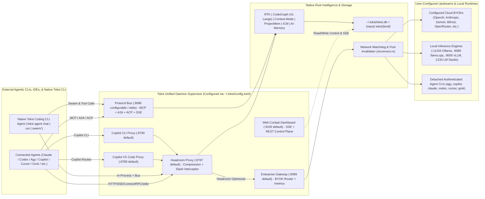
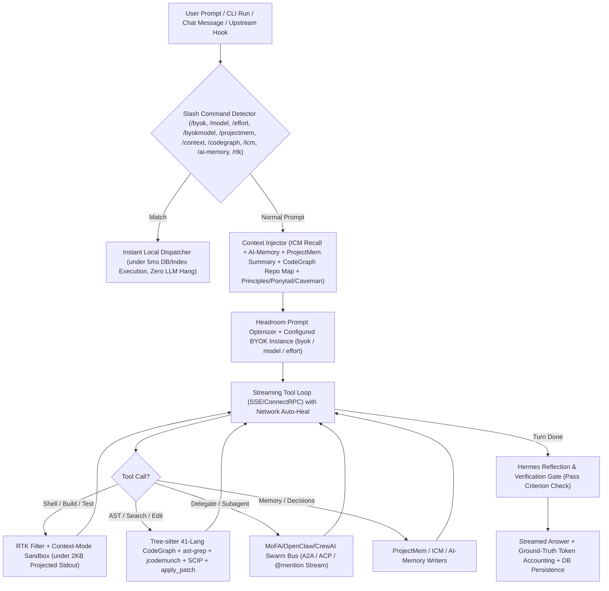

# Toksi Native Consolidation Master Research & Agentic Architecture Plan

> **Document Role:** Master Research Specification, Architectural Blueprint, Defect Remediation Dossier, Coding-CLI Plan, and Research-Agent Execution Guide  
> **Canonical Output Path:** `crates/toksi/research/RESEARCHPLAN.md` (converted, corrected, researched, and reorganized from `crates/toksi/research/RESEARCHPLAN.txt`)  
> **Scope Policy:** **Zero Omission ("Nothing Razored")** — Every vault, 41 Tree-sitter languages, 65 agentic providers, full `.agents`/vendor directory schemas, verbatim hook catalogs (Categories 1–3), all 24 `.agents/brain/*.md` phase plans, CLI/TUI/Dashboard/TOML/DB/BYOK/Workspace specifications, and bug remediations are preserved in full and reconciled with verified codebase state.

---

## 0. Mandatory Pre-Read Protocol, Terminology, & Ground-Truth Reference Files

Before researching, decomposing, or implementing any phase, every Research Agent and Swarm Worker MUST read these workspace files in full to preserve global master-plan knowledge, cross-tool coupling, and decision history:

1. `crates/toksi/CONSOLIDATION_PLAN.md` — Master Architecture Plan (`# Toksi Native Consolidation Master Architecture Plan`)
2. `crates/toksi/PLAN.md` — Phased consolidation status checklist
3. `.projectmem/plan.md` — Active workspace roadmap and deferred engineering items
4. `.projectmem/PROJECT_MAP.md` — Canonical module map and subsystem ownership
5. `.projectmem/summary.md` — Current project memory state, open bugs (including issues `#0033` and `#0034`), and recorded architectural decisions
6. `crates/toksi/research/full_ai_ecosystem_agent_runtimes_local_inference_engines_and_quota_architecture.md` — Comprehensive reference covering 13 cloud foundation APIs, 22 local inference engines/ports, 30 agentic CLIs + slash commands, 13 LSP/protocol providers, 15 editors/IDEs, 16 cloud platforms, 16 proxies/gateways/routers, quota categories, rate-limit headers, token bucket Lua scripts, and retry/failover engineering.
7. `inspect-vault/agents-structures/` — Ground-truth filesystem layout templates (`repository/` and `user/`) for `.agents`, `.claude`, `.codex`, `.copilot`, `.cursor`, `.gemini`, `.github`, and `.grok`.

### Canonical Lexicon (`RESEARCHPLAN.txt` Directives)

| Token | Authoritative Resolution in This Specification |
|-------|-----------------------------------------------|
| `<byok providers>` | **All** user-configured Bring-Your-Own-Key agent providers (`cli \| ide \| inprocess`) **and** all BYOK cloud, local, aggregator, gateway, and router providers (`frontier`, `accelerator`, `aggregators`, `specialized`, `multimodal`, `local`, `ecosystem`). |
| `<repo>` | The root workspace directory containing `<repo>/.git/` (Git metadata folder and tracked tree). Never a nested crate subfolder and never a non-Git directory. |
| `<etc's>` | All sibling capabilities, adapters, telemetry hooks, edge-case guards, UX affordances, protocol bindings, and feature enhancements directly implied by the context of that specification line. |
| `<detail's>` | Full, extensive, technical engineering specification—including schemas, state machines, API contracts, UI drill-downs, error paths, and verification commands—never hand-waved summaries. |

---

## 1. Corrections Audit Log & Specification Reconciliation

Converting raw `RESEARCHPLAN.txt` (lines 1–743) and superseding the stale earlier draft `RESEARCHPLAN.md` uncovered concrete contradictions, counting errors, typos, outdated paths, and verified bugs in `crates/toksi/src/`. Every Research Agent must treat these corrections as authoritative:

### 1.1 Contradictions & Policy Reversals Resolved

1. **Paid-Only BYOK Restriction Removed (`RESEARCHPLAN.txt` Line 77 vs. Line 721):**
   - *Earlier rule (Line 77):* Required rejecting free-tier accounts in BYOK rotation (`FreeTierDisqualified`).
   - *Authoritative reversal (Line 721):* **"Remove restrictions for PAID-qualified agent BYOK rotation from the code and everywhere."** Users are completely free to configure and rotate any BYOK agent or provider that is accessible, working, and enabled in `~/.toksi/config.toml` and `~/.toksi/toksi.db`.
   - *Verified codebase artifacts to refactor/remove:*
     - `crates/toksi/src/gateway/agent_cli/tier_check.rs` (`AccountTier::FreeTierDisqualified`, `ACTIVE_PAID_PROVIDERS`, gating checks in `is_gateway_routing_active()`).
     - `crates/toksi/src/dashboard/api.rs` (`"[DISQUALIFIED-FREE]"` hardcoded on `antigravity` at line 229 and `"[PAID]"` badges on lines 227–243).
     - `crates/toksi/src/dashboard/assets/app.js` (tier disqualification badges/locks around lines 760–786).
     - Legacy wording in `crates/toksi/CONSOLIDATION_PLAN.md` and `.agents/brain/PHASE_15_3_SMART_CLI_PROVIDERS_AND_PAID_QUOTA.md`.
   - *Preserved value:* Keep non-blocking **plan/tier observability badges** (`free`, `pro`, `team`, `enterprise`, `pay-go`, `local`) when the provider API exposes subscription/quota metadata without cost.

2. **Strict Configured-Only Activation & UI Visibility (`Lines 66, 715–716, 725`):**
   - Toksi MUST ONLY initialize gateway routes, wire agent hooks/protocols, launch smart CLI bridges, display active BYOK metrics, or list Keyring entries for agents and `<byok providers>` explicitly configured and enabled by the user in `~/.toksi/config.toml` / `toksi.db`.
   - If zero BYOK providers are configured, the gateway router gracefully stays idle/standby while standalone agent usage (e.g., running `agy.exe` or `copilot.exe` directly with Headroom/RTK/MCP tools) operates cleanly without errors.

### 1.2 Counting, Duplicate, Path, & Port Corrections

| Area | Erroneous / Ambiguous Input | Ground-Truth Verified Correction |
|------|-----------------------------|----------------------------------|
| **Tree-sitter Language Count** | Stale `RESEARCHPLAN.md` & `INDEX_AND_EXECUTION_GUIDE.md` cited `37` or `38` languages. Current `Cargo.toml` includes only **7** grammar crates (`rust`, `typescript`, `javascript`, `python`, `go`, `c`, `cpp`) mapped to **9** language IDs in `src/codegraph/kernel/langs.rs` (`tsx`/`jsx` share JS/TS). | `RESEARCHPLAN.txt:51` explicitly specifies **41 languages** (listed verbatim in Section 8.1). **32 grammar integrations** (33 named tokens accounting for `typescript`/`tsx` and `javascript`/`jsx` pairs) remain to be implemented. |
| **Inspect-Vault List** | `RESEARCHPLAN.txt` lines 39–40 duplicate `neo\inspect-vault\mofaclaw`; line 50 adds `agents-structures`. | **35 unique code vaults + 1 structure template vault (`agents-structures`) = 36 total verified vaults** on disk in `d:\AI\neo\inspect-vault\`. |
| **Platform Provider List** | `RESEARCHPLAN.txt:55` lists both `Poolside AI` and `Poolside`. Also `RESEARCHPLAN.txt:52–56` core categories enumerate 65 entries while `full_ai_ecosystem...md` expands Categories 1–5 to 90 providers + 22 local inference engines. | Core `RESEARCHPLAN.txt:52–56` deduplicated count = 65 providers (`21` CLI/Bridge + `9` LSP/Protocol + `11` Editors/IDEs + `12` Platforms + `12` Proxies/Gateways with `Poolside AI` alias note). Expanded `full_ai_ecosystem_agent_runtimes_local_inference_engines_and_quota_architecture.md` Sections 2.1–7.1 track **90 ecosystem providers** (`30+13+15+16+16`) plus **22 local inference engines** (`23` matrix rows incl. LiteLLM Proxy). |
| **Reference Doc Path** | `RESEARCHPLAN.txt:740` references `@crates/research/full_ai_...md`. | Actual verified path is `crates/toksi/research/full_ai_ecosystem_agent_runtimes_local_inference_engines_and_quota_architecture.md`. |
| **SQLite DB Location** | `RESEARCHPLAN.txt:60` warns against `localdata/toksi`. | Canonical user-level DB & config root is `~/.toksi/` (`~/.toksi/toksi.db` and `~/.toksi/config.toml`), resolved cross-platform via home directory, using `/` separators. Workspace tool data stores (`codegraph`, `projectmem`, `context`, `icm`, `ai-memory`, `rtk`, `headroom`) live strictly inside `<repo>/.toksi/<tool>/`. |
| **Daemon Port Topology** | Stale `RESEARCHPLAN.md` invented `:9098`/`:9097` while dropping `:8787`; `dashboard/assets/index.html` & `api.rs:185` mislabel `:8788` as `BYOK / VIRTUAL GATEWAY`. | Verified active ports on disk: **`8787`** (Headroom Streaming Proxy, `headroom/proxy.rs`), **`8788`** (Grok OAuth Proxy, `headroom/grok_daemon.rs:25` — NOT BYOK!), **`8789`** (Copilot VS Code, `copilot_daemon.rs`), **`8790`** (Copilot CLI, `copilot_daemon.rs`), **`18787`** (BYOK Gateway, `util/byok.rs:341` + `headroom/byok_gateway.rs:871`), **`9099`** (Enterprise Gateway + `/metrics`), **`9100`** (Web Cockpit). Every port overridable in `~/.toksi/config.toml` `[ports]`, plus optional `9098` MCP/A2A/ACP HTTP/SSE bus. |
| **Terminology & Spelling** | Typos in `RESEARCHPLAN.txt`: `toking`, `extende`, `descipline`, `allways`, `hocks`, `kooked`, `balencer`, `Insperctor`, `graied`, `fidign`/`fedign`, `dorment`, `thecnicall`, `evrithing`, `cabalitities`, `toxi`, `Roo Clinic`. | Normalized throughout into crisp technical English while retaining historical alias note `Roo Code (formerly cited as Roo Clinic)`. |

### 1.3 Verified Live Codebase Bugs Flagged for Remediation

1. **Synthetic Telemetry Fabrication (`src/dashboard/api.rs` & `src/tui/app.rs`):**
   - `api.rs:95–153` (`handle_waterfall`) uses hardcoded synthetic shares (`0.38`, `0.42`, `0.20`) and a constant `savings_pct: 68.0`.
   - `api.rs:226–250` (`handle_agents`) hardcodes static provider/model mappings and fake latencies (`0.12 ms`, `0.45 ms`, `184.20 ms`) regardless of measured telemetry.
   - `tui/app.rs:464, 537–605` (`init_waterfall_samples`) populates fake Claude/Cursor/Antigravity/OpenCode/Codex metrics whenever `total_calls > 0`.
   - `dashboard/assets/index.html` contains static placeholder counters (`Saved: 5,658,990 tokens`, `:8788 VIRTUAL GATEWAY`, static War Room 429s/throttles).
2. **Non-Functional Heatmap Drill-Down (`src/dashboard/assets/app.js:463–480`):**
   - `renderHeatmap()` renders `.heatmap-cell` DOM nodes with **zero click event listeners**, confirming `RESEARCHPLAN.txt:729` ("Subsystem Failure Heatmap clicking does nothing").
3. **Broken Keyring Naming (`src/keyring/mod.rs:216`):**
   - `audit_keyring_statuses()` probes `("antigravity", "gemini", "antigravity")` instead of normalized configured agent credentials (`RESEARCHPLAN.txt:734`).
4. **Synchronous Blocking TUI Loop (`src/tui/mod.rs` & `src/tui/app.rs`):**
   - Synchronous SQLite/HTTP reloads inside the `50ms` terminal polling loop cause UI freezes and locked tab/button navigation (`RESEARCHPLAN.txt:70, 87`).
5. **Missing CLI Subcommands & TOML Config Loader (`src/commands/{daemon,proxy,dashboard,mod}.rs`, `src/util/toml.rs`):**
   - `util/toml.rs` is only a helper parser for agent files (`grok.rs`, `codex.rs`); `~/.toksi/config.toml` global config does not yet exist.
   - `commands/dashboard.rs` lacks `start | stop | restart`; `commands/daemon.rs` and `commands/proxy.rs` lack `--agents` selective targeting; no interactive `toksi` coding CLI runtime (`toksi agent run|chat|swarm`) exists yet (`commands/agent.rs` only handles install/wire lifecycle).
6. **Network Reconnect Stagnation & Antigravity ConnectRPC Passthrough (`src/headroom/proxy.rs:615+`, `src/gateway/reconnect.rs`, `.projectmem/summary.md` `#0033`/`#0034`):**
   - Network changes leave pooled connections stale/dormant; Google Cloud Code / Antigravity ConnectRPC (`x-goog-*`, `connect-protocol-version`, `ya29.` OAuth) routes must remain strictly non-corrupting while applying safe gateway/BYOK forwarding.

---

## 2. Complete Inspect-Vault Audit & Rust Porting Research Matrix (All 36 Vaults)

Every directory in `neo/inspect-vault/` listed in `RESEARCHPLAN.txt` (lines 9–44 + line 50) MUST be treated as authoritative source material for feature extraction, updated upstream algorithms, missing addons, new agents, and bugfixes converted into pure safe Rust inside `crates/toksi/src/`.

### 2.1 Core Proxy, Compression, Routing & Telemetry Engines

| Vault (`d:/AI/neo/inspect-vault/<name>`) | Verified Upstream Stack | Target `crates/toksi/src/` Module(s) | Current Status | Next-Agent Research & Porting Directives |
|---|---|---|---|---|
| `tokless` | Go (`go.mod`, `cmd/`, `internal/`) | Root crate foundation, `commands/`, `tools/`, `telemetry/` | `[Migrated Baseline]` | Audit `tokless/internal/` and `docs/` for any unported CLI/hook edge cases and clean out residual `tokless` path references (e.g., `.projectmem/summary.md`). |
| `bifrost` | Go (`core/`, `framework/`, `transports/`, `cli/`, `plugins/`) + React UI (`ui/`) | `gateway/providers/aggregators/bifrost.rs`, `gateway/{routing,loadbalancer,semantic_cache,circuit_breaker}.rs`, `tools/mcp_dispatch.rs` | `[Partial]` | Port Bifrost plugin pipeline hooks (`on_gateway_connect`, `pre/post_route_request`, `pre/post_mcp_forward`), semantic caching, adaptive weighted load balancing, MCP gateway federation, and Bifrost CLI agent-to-gateway bridge. |
| `headroom` | Rust (`Cargo.toml`) + Python (`headroom/`) | `headroom/{proxy,byok_gateway,headroom,cache_align,adaptive_mem,router,responses_compat,cloudcode_patch}.rs`, `headroom/compression/*`, `headroom/pruner/*` | `[Active / Needs Fixes]` | Inspect upstream `headroom/crates/` & `headroom/` for AST/JSON/Log compression upgrades, CCR prompt-cache stability improvements, SSE streaming chunk usage extraction, and mandatory routing for all configured `<byok providers>` without breaking ConnectRPC (`#0033`/`#0034`). |
| `rtk` | Rust workspace (`Cargo.toml`, `engine/`, `plugin/`, `proxy/`, `text/`) | `rtk/{engine,hook,ansi}.rs`, `rtk/filters/{build,git,system,test,toml}.rs`, `rtk/filters/builtin/*.toml` | `[Active]` | Diff upstream `rtk/engine/` and `rtk/hooks/` against `crates/toksi/src/rtk/` for missing filter TOMLs, multi-project workspace command detection, ultra-compact exit-code preservation, and `rtk-hook <agent>` standardization. |
| `TokenTracker` | TypeScript/JS (`package.json`, `dashboard/`, Linux/Win clients) | `telemetry/{collector,cost,tokentracker,tracker,prometheus}.rs`, `dashboard/` | `[Partial]` | Research authentic per-provider, per-model cost tables, cached-token billing math, reasoning-token accounting, and hourly/daily/weekly/monthly/yearly bucket aggregation without fake math. |
| `TokenEconomizer` | Python (`pyproject.toml`, `tokeneconomizer/`) + TS plugin | `headroom/compression/economizer.rs` | `[Partial]` | Extract structural prompt-pruning, boilerplate stripping, duplicate tool-schema deduplication, and token-budget compression transforms into pure Rust. |
| `agent-opt` | TypeScript/JS (`package.json`, `src/`, `benchmarks/`, `manifests/`) | `agents/opt.rs`, `gateway/routing.rs`, `headroom/compression/` | `[Stub/Partial]` | Inspect optimization heuristics (context-window budgeting, prompt compression benchmarks, cheap-vs-frontier complexity classifiers) and integrate into per-`<byok, model, effort>` router policies. |

### 2.2 Code Intelligence, AST Indexing, Search & Context Bundling

| Vault | Verified Upstream Stack | Target `crates/toksi/src/` Module(s) | Current Status | Next-Agent Research & Porting Directives |
|---|---|---|---|---|
| `context-mode` | TypeScript/JS (`package.json`, `src/`, `hooks/`, `plugins/`, `skills/`) | `contextmode/{sandbox,fts,filter,fetch,auto_memory,security,stats,cli,mcp}.rs` | `[Active]` | Verify sandbox execution isolation on Windows/Unix (`pwsh`/`sh`), FTS5 snippet ranking fidelity, `< 2KB` stdout projection, URL fetch-and-index TTL/force behavior, `.gitignore`/`.ignore` enforcement, and `context` skill/MCP renaming. |
| `codegraph` | TypeScript (`src/`, `telemetry-*`, `ui/`) + Rust (`codegraph-kernel/Cargo.toml`) | `codegraph/{graph,walker,cache,mcp,mod}.rs`, `codegraph/kernel/*` | `[Active / Incomplete Grammars]` | Expand `kernel/langs.rs` & `Cargo.toml` from 9 language IDs (7 grammar crates) to all **41 Tree-sitter languages** (Section 8.1); add multi-crate `<repo>` project partitioning and dynamic `.gitignore`/`.ignore` vector purge. |
| `jcodemunch-mcp` | Python (`pyproject.toml`, `cli/`, `speedreview/`, `vscode-extension/`) | `codegraph/jcodemunch.rs` | `[Partial]` | Port byte-offset O(1) symbol slice extraction, repository map outline generation, and minimal token-overhead AST body retrieval into Rust `codegraph` & MCP tools. |
| `repomix` | TypeScript/JS (`package.json`, `src/`, `skills/`) | `codegraph/repomix.rs` | `[Partial]` | Port security/secret scrubbing, Tree-sitter skeleton compression (`--compress`), `.ignore`/`.gitignore` rule precedence, and multi-project workspace XML/Markdown packing into Rust. |
| `ast-grep` | Rust workspace (`Cargo.toml`, `crates/`) + Python/TS wrappers | `codegraph/ast_grep.rs` | `[Partial]` | Port native `ast-grep-core` structural pattern matcher & AST rewrite engine (dry-run diff preview + apply) directly into `codegraph` & native `toksi` coding agent tools. |
| `scip` | Go (`go.mod`, `cmd/`, `reprolang/`) | `codegraph/scip.rs` | `[Partial]` | Port protobuf SCIP index ingestion/emission (`scip.proto` via pure-Rust parser), cross-file definition/reference/implementation edges, and multi-crate workspace resolution. |

### 2.3 Persistent Memory, Project Decision Ledger, & Vector Stores

| Vault | Verified Upstream Stack | Target `crates/toksi/src/` Module(s) | Current Status | Next-Agent Research & Porting Directives |
|---|---|---|---|---|
| `projectmem` | Python (`pyproject.toml`, `src/`, `tests/`) | `projectmem/{schema,store,summary,heatmap,precheck,redaction,global,cli,mcp}.rs` | `[Active / UI Bug]` | Ensure strict SQLite event ledger (`issue`, `attempt`, `fix`, `decision`, `note` + `supersedes`), secret redaction, root-only `<repo>/.toksi/projectmem/` storage with crate DB merge, and clickable Subsystem Failure Heatmap diagnostics. |
| `ai-memory` | Rust workspace (`Cargo.toml`, `crates/`, `companions/`, `evals/`, `hooks/`) | `aimemory/{mod,tiered,wiki,handoff,mem0_bridge,cli}.rs` | `[Active]` | Inspect `ai-memory/crates/` & `hooks/` for hybrid BM25 + dense vector recall, session handoff snapshots, multi-repo isolation (`<repo>/.toksi/ai-memory/`), `.ignore` vector purging, and `/ai-memory` slash command parity. |
| `icm` | Rust (`Cargo.toml`, `crates/`, `bench/`, `plugins/`) | `icm/{mod,schema,store,recall,cli,mcp}.rs` | `[Active]` | Inspect `icm/crates/` for infinite context compaction tiers, hierarchical summarization DAG, deterministic recall scoring, `.ignore` pruning, and `/icm` slash command execution. |
| `mem0` | Python (`pyproject.toml`, `mem0/`) + TS (`mem0-ts/`) | `aimemory/mem0_bridge.rs`, `[Target] telemetry/memory_ops` | `[Partial]` | Port Mem0 fact extraction, conflict deduplication (`ADD`/`UPDATE`/`DELETE`/`NOOP` memory graph edges), user vs. workspace scope separation, and episodic recall into pure Rust. |
| `chroma` | Rust (`Cargo.toml`) + Python/Go | `[Target] codegraph/vector.rs` / `aimemory/vector.rs` (HNSW/SQLite-vec pure Rust) | `[Partial / Research]` | Study `chroma/rust/` local embedded vector collection architecture, metadata filtering (`repo_root`, `subproject`, `rel_path`), and cascading document/chunk deletion for instant `.gitignore`/`.ignore` vector purges without Python runtime dependencies. |

### 2.4 Prompt Engineering, Build Discipline & SDK Normalization

| Vault | Verified Upstream Stack | Target `crates/toksi/src/` Module(s) | Current Status | Next-Agent Research & Porting Directives |
|---|---|---|---|---|
| `ponytail` | TS/JS (`package.json`, `.agents/`, `.codex-plugin/`, `.cursor/`, `.grok-plugin/`, etc.) | `rules/ponytail.rs`, `rules/assets/ponytail.*`, `tools/ponytail.rs` | `[Active]` | Sync latest 7-rung Ladder rules (`Reuse first`, `Understand then simplify`, `Preserve`, `Verify`), multi-agent config templates, and `rules/skills` install toggles across user & repo dirs. |
| `caveman` | Go (`go.mod`) + JS/TS (`package.json`, `shrink/`, `mcp/`, `extension/`, `proxy/`) | `rules/caveman.rs`, `rules/assets/caveman.*`, `tools/caveman.rs`, `[Target] headroom/compression/caveman_shrink` | `[Active]` | Port `caveman/shrink/` runtime wire-compression & system-prompt injection profiles (`lite`, `full`, `ultra`), plus user-selectable installation across agent configs. |
| `andrej-karpathy-skills` | Markdown (`CLAUDE.md`, `CURSOR.md`, `skills/`, `EXAMPLES.md`) | `rules/principles.rs`, `rules/assets/principles.*`, `tools/principles.rs` | `[Active]` | Ensure all 4 Karpathy behavioral principles (`Think Before Coding`, `Simplicity First`, `Surgical Changes`, `Goal-Driven Execution`) + eval examples stay synced in `principles.*`. |
| `litellm` | Python (`pyproject.toml`) + Rust (`litellm-rust/Cargo.toml`) + TS | `gateway/normalizer/{litellm,mod}.rs`, `gateway/compat/mod.rs` | `[Active]` | Inspect `litellm/litellm-rust/` and provider adapters for request/response schema normalization across Anthropic/OpenAI/Gemini/xAI/DeepSeek/OpenRouter, reasoning effort field mapping, free-tier `/models` capability lists, and rate-limit header normalization. |

### 2.5 Coding CLI Runtimes, Multi-Agent Swarm Frameworks & Agent Structures (Deep Agentic Research Wave)

| Vault | Verified Upstream Stack | Target `crates/toksi/src/` Module(s) | Current Status | Next-Agent Research & Porting Directives |
|---|---|---|---|---|
| `grok-build` | Rust (`Cargo.toml`, `crates/`) | `agents/grok.rs`, `gateway/agent_cli/{grok,grok_cli}.rs`, `[Target] agent_runtime/` | `[Partial CLI Connector]` | Study `.grok/` config hierarchy (`managed_config.toml`, `requirements.toml`, `personas/*.toml`), Rust streaming tool loop, MCP credential handling, and xAI `reasoning_format` integration. |
| `codex` | Rust (`codex-rs/Cargo.toml`) + TS (`codex-cli/`) | `agents/codex.rs`, `gateway/agent_cli/codex.rs`, `[Target] agent_runtime/{sandbox,patch,tui}` | `[Partial CLI Connector]` | Research `codex-rs` Rust crates: OS-native sandboxing (`Landlock`/`Seatbelt`/Windows Restricted Token), `apply_patch` unified diff tool, TOML multi-agent profiles (`architect`, `backend`, `reviewer`, etc.), and approval hooks. |
| `crush` | Go (`go.mod`, `internal/`) | `[Target] agent_runtime/{session,providers,tui_chat}` | `[Not Yet Ported]` | Research Crush's provider-agnostic terminal chat UX, fast LSP-backed editing tools, multi-model session switching, and hook triggers (`on_session_boot`, `pre_patch`, `post_patch`). |
| `crustly` | Rust (`Cargo.toml`, `src/`, `knowledge/`, `migrations/`) | `[Target] agent_runtime/` | `[Not Yet Ported]` | Inspect pure-Rust agent execution loop, SQLite session persistence (`migrations/`), local knowledge graph linkage, and async Ratatui streaming patterns. |
| `goose` | Rust (`Cargo.toml`, `crates/`) + `oidc-proxy/` | `[Target] agent_runtime/{recipes,mcp_client,extensions}` | `[Not Yet Ported]` | Extract Goose Rust crates' MCP extension lifecycle, declarative workflow recipes, headless/interactive session loop, and OIDC/OAuth token broker patterns. |
| `hermes-agent` | Python (`pyproject.toml`, `agent/`, `gateway/`, `cron/`, `acp_adapter/`, `ui-tui/`) + TS | `[Target] agent_runtime/{hermes_loop,reflection,acp,cron}` | `[Not Yet Ported]` | Extract Hermes's Plan-Act-Reflect agent loop, self-verification reflection pass, ACP adapter, gateway/cron daemon scheduler, multi-provider registry (`providers/`), and TUI chat interaction patterns. |
| `openclaw` | TS (`package.json`) + Rust (`crates/Cargo.toml`) | `[Target] agent_runtime/{channels,routing,gateway_bridge}` | `[Not Yet Ported]` | Study `openclaw/crates/` & skill plugins (`custodian-skills/`) for autonomous background agent daemon channels, event routing, and security sandboxing. |
| `openclaw-rs` | Rust (`Cargo.toml`, `bridge/`, `crates/`) | `[Target] agent_runtime/` | `[Not Yet Ported]` | Inspect `openclaw-rs` pure-Rust agent daemon core & bridge architecture for zero-Node native agent execution and persistent message channels. |
| `mofaclaw` | Rust workspace (`Cargo.toml`, `cli/`, `core/`, `skills/`) + Python | `[Target] agent_runtime/swarm/` & `tools/multi_protocol.rs` | `[Not Yet Ported]` | Research `mofaclaw/core/` combining MoFA multi-agent orchestration with lightweight Claw daemon channels, CLI dispatch, and hot-loadable skills. |
| `mofa` | Rust (`Cargo.toml`, `examples/`, `tests/`) | `[Target] agent_runtime/{mofa_bus,dora_nodes,a2a}` | `[Not Yet Ported]` | Research MoFA's composable Rust agent traits, message-passing dataflow nodes (`mofa` framework), agent-to-agent command channels, and supervisor/worker lifecycle. |
| `mofa-engine` | Rust multi-crate workspace (`mofa-engine-core`, `mofa-kernel`, `mofa-engine-sdk`, `mofa-review`, `mofa-studio`) | `[Target] agent_runtime/engine/` & `dashboard/` | `[Not Yet Ported]` | Study `mofa-kernel` / `mofa-engine-core` streaming workflow graph engine, automated code-review agent (`mofa-review`), and studio observability telemetry (`mofa-studio`). |
| `gemini-cli` | TS/JS (`package.json`, `packages/`, `evals/`, `schemas/`) | `agents/antigravity.rs`, `gateway/agent_cli/gemini_agy.rs`, `[Target] agent_runtime/tools` | `[Partial Connector]` | Extract Google Cloud Code / `v1internal` / `v1main` / `v1beta` endpoints, `PreInvocation`/`PostInvocation` hooks, `thinkingConfig.thinkingBudget`, `@file` & `/chat` slash commands, and sandbox/eval patterns. |
| `crewAI` | Python (`pyproject.toml`, `lib/`) | `[Target] agent_runtime/crew_roles.rs` | `[Not Yet Ported]` | Extract declarative role/goal/backstory agent crew blueprints, sequential/hierarchical delegation pipelines, task guardrail validation, and inter-agent memory sharing into Rust swarm traits. |
| `agents-structures` | Directory templates (`repository/` + `user/`) | `agents/*`, `rules/sync.rs`, `util/paths.rs` | `[Reference Spec]` | Validate every generated directory, hook file path (`<tool>.json`), MCP filename (`mcp.json` vs `mcp_config.json` vs `.mcp.json`), and TOML/JSON schema against `agents-structures/` during Phase 16.3 / 17.4. |

---

## 3. Disciplinary Coding Standards & Cross-Platform Portability Matrix

All code added or refactored in `crates/toksi/` must satisfy strict engineering discipline:

1. **Rust Edition 2024 Safety Baseline:** Enforce `#![deny(unsafe_code)]`, `RUSTFLAGS="-D warnings"`, and zero `.unwrap()` / `.expect()` / `panic!()` in non-test production code. Use explicit typed domain errors (`thiserror::Error`) and structured error propagation (`?`).
2. **Async Runtime Hygiene:** Zero blocking disk I/O, heavy Tree-sitter parses, SQLite transactions, or synchronous subprocess waits on Tokio executor threads—always wrap with `tokio::task::spawn_blocking` and bound worker pools. Keep terminal UI rendering and network event loops decoupled over lock-free channels (`tokio::sync::mpsc` / `watch`).
3. **Structured Observability:** Use `tracing` (`info!`, `warn!`, `debug!`, `error!`) + lock-free atomic counters (`AtomicU64`) rather than blocking mutexes in request hot paths. Never log plaintext API keys, OAuth tokens, or PII (`projectmem/redaction.rs` scrubbing everywhere).
4. **Canonical Path & Slash Standard (`RESEARCHPLAN.txt:58`):**
   - **Everywhere in Toksi internal paths, Unix/Windows APIs, Git-friendly configs, URIs, and docs:** Use forward slashes `/` exclusively (e.g., via `toksi_abs_strict` normalization) because Git Bash / MSYS2 and POSIX tools mangle unescaped `\`.
   - **Single Explicit Exception (`cmd.exe` inside JSON5 / TOML):** Only when writing native Windows shell commands targeting `cmd.exe` inside JSON5 / TOML `hooks.json` or `mcp` command strings that explicitly require Windows backslash semantics, serialize valid escaped double backslashes `\\` (e.g., `"C:\\Programs\\neo\\bin\\toksi.exe"`). Wherever portable executable resolution suffices, prefer bare binary names resolved via `PATH`.
5. **Portable Binary Resolution — "Test & Inform `PATH`" Rule (`RESEARCHPLAN.txt:59`):**
   - Never hardcode absolute installation paths inside persistent configs (`.db`, `.json`, `.toml`, hooks, or MCP definitions) when launching binaries (`toksi`, `git`, `claude`, `codex`, `agy`, `copilot`, `cursor`, `grok`, `bash`, `cmd`, tool binaries).
   - At validation, wire, doctor, or launch time, inspect `std::env::var_os("PATH")` (platform `which`/`where` equivalent). If a required binary is missing from `PATH`:
     - Surface a clear, actionable diagnostic in CLI, TUI, and Web Dashboard naming the exact executable(s) to add to `PATH` and telling the user to retry once added.
     - Do **not** abort unrelated subsystems or crash daemon startup; mark the missing binary cleanly (greyed out in UI).
6. **Incremental Verification & Test Skip Policy (`RESEARCHPLAN.txt:737`):**
   - Build and maintain a module-to-test ownership manifest (`.toksi/test-baseline.json` or `cargo test` module mapper + `git diff --name-only`).
   - Tests that previously ran and passed on verified baseline commits **do not need to be re-executed** when changes in the current phase do not touch their owned source files or transitive library dependencies—saving massive iteration cycles while running full affected integration/E2E tests and final milestone suites before release.

### Cross-Platform Portability Matrix

| Dimension | Windows (`x86_64-pc-windows-msvc`) | Linux (`x86_64` / `aarch64-unknown-linux-gnu`) | macOS (`aarch64` / `x86_64-apple-darwin`) |
|-----------|---------------------------------------|------------------------------------------------|-------------------------------------------|
| **User Config & DB Root** | `%USERPROFILE%/.toksi/{config.toml,toksi.db}` (NEVER `LocalAppData/toksi`) | `$HOME/.toksi/{config.toml,toksi.db}` | `$HOME/.toksi/{config.toml,toksi.db}` |
| **OS Keyring Backend** | Windows Credential Manager (`keyring/os_windows.rs`) + AES-GCM fallback vault | Secret Service / D-Bus (`keyring/os_linux.rs`) + fallback vault | macOS Keychain (`keyring/os_macos.rs`) + fallback vault |
| **Detached Background Spawn** | `CREATE_NEW_PROCESS_GROUP \| DETACHED_PROCESS \| CREATE_NO_WINDOW` (non-blocking) | `setsid` / double-fork or `nohup` piped to `/dev/null` | `setsid` + `launchd`-safe background spawn |
| **Path Serialization** | Forward slashes `/` globally; double `\\` strictly inside `cmd.exe` TOML/JSON5 command strings | Forward slashes `/` everywhere | Forward slashes `/` everywhere |
| **Process Liveness & Reap** | Win32 PID handle / task check | `/proc/<pid>` & `kill(pid, 0)` | `kill(pid, 0)` / `sysctl` |
| **Sandbox Engine (`context-mode` & `codex`)** | Job Object + Restricted Token / `pwsh` sandbox wrapper | Landlock / seccomp / `bwrap` / unprivileged namespace | Apple `sandbox-exec` (Seatbelt) profile |

---

## 4. Unified System Architecture, `~/.toksi/config.toml`, SQLite DB, & Multi-Port Runtime

Toksi runs via **one unified daemon launch** (`toksi daemon start`) that supervises proxy interception, gateway load balancing, MCP/A2A/ACP buses, Web UI, smart detached CLI bridges, auto-indexing, and self-healing network reconnection—controlled cleanly through `~/.toksi/config.toml` and `~/.toksi/toksi.db`.

### 4.1 High-Level Runtime Architecture



### 4.2 Port Separation Analysis (`RESEARCHPLAN.txt:72–73`)

- **Architectural Decision (Gateway `:9099` vs. Web Cockpit `:9100`):** Keep Enterprise AI Gateway on `:9099` (with `/metrics` Prometheus scrape) strictly **separate** from the Web Cockpit Dashboard on `:9100`.
  - *Performance & Reliability Rationale:* LLM proxy streams hold long-lived chunked HTTP/SSE sockets, suffer upstream backpressure/429 retries, and process heavy JSON/SSE decompression pipelines. Isolating the Web Cockpit HTTP/SSE listener on `:9100` eliminates TCP listener queue contention, isolates CORS/static-asset headers from sensitive auth passthroughs, lets users run/restart `toksi dashboard` independently in the background without dropping active agent chats, and prevents dashboard polling from adding tail latency to streaming LLM tokens.
- **Copilot Dual-Port Research (`:8789` & `:8790`):** Verify `headroom/copilot_daemon.rs` and `gateway/agent_cli/copilot.rs` ensure independent socket bindings, non-blocking startup verification (`TcpListener::bind` + `/healthz` readiness probe before declaring `Up`), and explicit `copilot-vscode` (`:8789`) vs. `copilot-cli` (`:8790`) route differentiation inside `toksi daemon status` and `config.toml`.
- **Every Port Configurable:** Override all default ports (`8787`, `8789`, `8790`, `9098`, `9099`, `9100`, plus local engine endpoints) cleanly in `~/.toksi/config.toml` `[ports]`.

### 4.3 Authoritative `~/.toksi/config.toml` Specification (`RESEARCHPLAN.txt:708–725`)

New module `[Target] crates/toksi/src/config/mod.rs` (backed by strict schema validation and synchronized with SQLite `~/.toksi/toksi.db`):

```toml
# ~/.toksi/config.toml — Toksi Master Configuration (Forward-slash paths '/')

[storage]
home_dir = "~/.toksi"
db_path = "~/.toksi/toksi.db"
mirror_repo_tools_to_dot_toksi = true   # Enforce <repo>/.toksi/<tool>

[ports]
headroom_proxy = 8787
copilot_vscode = 8789
copilot_cli = 8790
protocol_bus = 9098                     # MCP / A2A / ACP Streamable HTTP & SSE
gateway = 9099
dashboard = 9100

[daemon]
bind_host = "127.0.0.1"
auto_heal_network = true
reconnect_probe_interval_ms = 2500
default_agents = []                     # Override default `--agents` for `daemon`/`proxy` commands

[dashboard]
background = true                       # Never block terminal when started without --foreground
auto_open_browser = false
theme = "cyber-slate"

# Configured Agents (ONLY agents explicitly enabled/configured here + valid in system activate)
[[agents]]
id = "antigravity"                      # Differentiated: antigravity | agy | antigravity-ide
alias_kind = "cli"                      # cli | ide | inprocess
enabled = false
wire_mode = "direct"                    # direct | config | both
protocols = ["mcp", "a2a", "acp", "stdio", "sse", "http"]
install_components = ["hooks", "mcp", "skills", "rules", "instructions"]

# Multiple BYOK Agent CLI / Gateway Entries Allowed (even same provider, different model/effort!)
[[byok.instances]]
name = "openai-deep"                    # Unique instance alias
provider = "openai"                     # ProviderId
kind = "gateway"                        # gateway | cli | ide | inprocess
enabled = false                         # Stays completely hidden/inactive until true + valid auth
base_url = "https://api.openai.com/v1"  # Editable custom AI API endpoint
default_model = "o3"
think_effort = "high"                   # low | medium | high | xhigh (ignored if model unsupported)
pass_through_headroom = true            # Mandatory Headroom + tool optimization
routing_algorithm = "least_latency"     # Per-instance routing/load-balancer preference
priority = 1
```

### 4.4 `~/.toksi/toksi.db` SQLite Schema Extensions & Export/Import

- **Default Path (`Line 60`):** `~/.toksi/toksi.db` (strictly WAL mode, foreign keys ON, migration checksummed via `db/migrate.rs`).
- **Multi-Model BYOK Table Upgrade (`Line 718–719, 733`):** Refactor `byok_routes` and `provider_configs` so the primary routing unit is `(instance_id, provider_id, model_id, think_effort)` with nullable `custom_base_url`, `kind (gateway|cli|ide|inprocess)`, `wire_mode`, `headroom_enabled`, `routing_weight`, `enabled`, and `quota_bucket_key`—allowing the **same BYOK provider** (e.g., Anthropic, Gemini/Antigravity, OpenRouter, OpenAI) to be registered N times with different models, API URLs, and independent quota buckets.
- **Direct Export / Import (`Line 734`):** Add atomic SQLite hot-backup (`rusqlite::backup::Backup`) + deterministic JSON bundle export/import (`toksi db export <path>` / `toksi db import <path> --merge`) wired to CLI and Web Dashboard **Keyring & Database** tab.

### 4.5 Network Auto-Healing & ConnectRPC Passthrough (`Issues #0033 / #0034` & `Line 88`)

1. **Active Reconnect Watchdog (`gateway/reconnect.rs` + `headroom/proxy.rs`):**
   - On upstream TCP reset, DNS resolution failure, OS suspend/resume, VPN toggle, or Wi-Fi/Ethernet interface change: immediately drop idle keepalive connections in `reqwest::Client` (rebuild client pool atomically behind `Arc<ArcSwap<Client>>`), flush stale DNS cache entries, transition status `Healthy -> Reconnecting -> Healthy` cleanly with jittered exponential backoff, and emit SSE telemetry updates to Web Cockpit + TUI. **Zero silent dormant socket lockup.**
2. **Antigravity / Cloud Code ConnectRPC Safe Passthrough (`#0033`/`#0034`):**
   - Preserve exact headers (`x-goog-*`, `x-aicode-*`, `connect-protocol-version`, `content-type: application/connect+proto|grpc`, `authorization: Bearer ya29.*`) and binary/proto framing when proxying non-JSON or OAuth/STS/Quota handshake calls (`LoadCodeAssist`, `FetchLicenses`, `FetchUserInfo`, `FetchQuotaStatus`, `RetrieveUserQuota`, `FetchAvailableModels`), applying Headroom JSON compression **only** to validated LLM generation payloads (`/generateContent`, `/streamGenerateContent`, `/v1/messages`, `/chat/completions`, `/responses`) and transparently tunneling binary frames.

---

## 5. `/plan` Native `toksi` Coding CLI Agent Architecture (`toksi agent`)

> **Mandate (`RESEARCHPLAN.txt:47–48`):** *"Implement our real, full coding CLI agent with all extensive features of all agents—`toksi` unified with all tools and code, capable of agent-to-agent commands, streaming chat, agent-to-agent messaging, and multi-agent automation. Toksi is not only a token saver; it is a full agent with all tools and features implemented."*

Right now `crates/toksi/src/commands/agent.rs` only manages configuration installation/wiring for external agents. Part of the next research wave MUST research, design, and build `[Target] crates/toksi/src/agent_runtime/` directly from the verified Rust/Go/Python reference architectures in `inspect-vault/` (`hermes-agent`, `openclaw-rs`, `openclaw`, `mofa`, `mofa-engine`, `mofaclaw`, `codex/codex-rs`, `crush`, `crustly`, `goose`, `grok-build`, `crewAI`, `gemini-cli`).

### 5.1 Agent Runtime Core & Tool Execution Loop



### 5.2 Multi-Agent Capabilities, Direct-Wiring, & Agent-to-Agent Messaging

1. **Synthesized Reference Capabilities from Inspect Vaults:**
   - **Reasoning & Verification Loop (`hermes-agent` + `andrej-karpathy-skills` + `ponytail`):** Before editing code, run structural ambiguity/tradeoff check; execute via Ponytail's 7-rung ladder; enforce final verification proof before yielding turn.
   - **Dataflow & Agent-to-Agent Bus (`mofa` + `mofa-engine` + `mofaclaw` + `openclaw-rs` + `crewAI`):** Pure-Rust typed `AgentMessage` envelope supporting `Command`, `StreamChunk`, `TaskHandoff`, `Escalation`, and `Heartbeat` over in-process channels, unix/named pipes, stdio, SSE, A2A JSON-RPC, and ACP. Role presets sourced directly from `.codex/agents/*.toml` (`architect`, `backend`, `frontend`, `database`, `reviewer`, `researcher`, `tester`, `debugger`, `security`) and `.agents/agents/`.
   - **Isolated Patching & OS Sandboxing (`codex/codex-rs` + `crush` + `crustly` + `grok-build` + `goose`):** Unified patch application with syntax validation, Git worktree creation/cleanup (`WorktreeCreate`/`WorktreeRemove` parity), and OS sandbox execution profiles (`contextmode/sandbox.rs`).
   - **Autonomous Schedules & Daemon Channels (`openclaw-rs` + `hermes-agent/cron`):** Background task scheduling (`tasks/<id>/task.md`), webhook/TUI notifications, and headless CI runner (`toksi agent exec --task "..."`).

2. **Direct-Wired Interception vs. Config-Wired Modes (`RESEARCHPLAN.txt:722`):**
   - **`direct-wired` (Preferred Low-Latency Mode):** For agents capable of in-process runtime hooking, stdio wrapper wrapping, env/base-URL redirection, or direct local IPC (`MCP`, `A2A`, `ACP`, `stdio`, `SSE`, `HTTP`), Toksi binds directly to the running/launched agent session **without cluttering agent config files on disk**, reducing latency and enabling live agent-to-agent commands and chat interception. Always display badge `wired (direct)` and inform user clearly which channels are active.
   - **`config-wired` (Persistent File Integration Mode):** When user explicitly chooses persistent agent disk integration (or when external GUI IDEs require config files), Toksi writes standardized entries into `.gemini/`, `.claude/`, `.codex/`, `.copilot/`, `.github/`, `.cursor/`, `.grok/`, `.agents/` and reports `wired (config)` (or `wired (direct+config)`).

3. **Universal In-Chat Slash Command Interceptor (`RESEARCHPLAN.txt:723–724`):**
   Works identically inside `toksi agent chat` **and** mid-flight when a hooked external agent (e.g., `agy`, `claude`, `codex`, `copilot`, `cursor`, `grok`) sends chat text through the Toksi proxy or hook pipeline. Commands execute deterministically in `< 5 ms` locally **without stalling, timing out, aborting the agent, or causing upstream feedback loops**:
   - **BYOK Sequential & Atomic Routing Commands (`Line 723`):**
     - `/byok` — Lists all **user-configured & enabled** `<byok providers>` (`gateway`, `cli`, `ide`, `inprocess`) and sets the active session BYOK when given an argument (`/byok <name>`).
     - `/model` — Enforces BYOK-first state: if no active BYOK is selected, prompts `/byok` selection; otherwise lists discovered models compatible with the selected BYOK and switches active model (`/model <model_id>`).
     - `/effort` — Lists reasoning/thinking effort tiers compatible with the currently active `<byok, model>` (`low`, `medium`, `high`, `xhigh`, token budgets) or persists selection to `config.toml`/`toksi.db`.
     - `/byokmodel <byok> <model> [effort]` — One-shot atomic selector configuring BYOK, model, and effort in `toksi.db` for immediate gateway/proxy routing; if `<effort>` is unsupported by `<model>`, silently ignores `<effort>` and informs user without error.
   - **Native Tool & Memory Slash Commands (`Line 724`):**
     - `/projectmem [log|attempt|fix|decide|note|status|search <q>]` — Direct ledger query/mutation.
     - `/context [search <q>|run <cmd>|index <path>|stats]` — Context-Mode FTS5 search, sandbox summary, or URL fetch.
     - `/codegraph [explore <q>|callers <sym>|blast <sym>|reindex|status]` — AST symbol & dependency exploration across `<repo>/crates/*`.
     - `/icm [recall <q>|compact|tiers]` — Infinite Context Manager lookup and tier compaction.
     - `/ai-memory [recall <q>|store <fact>|wiki|handoff]` — Semantic vector/episodic memory operations.
     - `/rtk [stats|filters|test <cmd>]` — Command output compression metrics and rule test.

### 5.3 Complete CLI Command Tree (`Lines 61, 709–711`)

Every command below MUST be documented cleanly in `toksi --help`, subcommand `--help`, and `crates/toksi/README.md`:

| Command Surface | Required Subcommands & Flags | Behavior Requirement |
|-----------------|------------------------------|----------------------|
| `toksi daemon` | `start \| stop \| restart \| status [--agents <a,b,...>]` | Reads defaults from `~/.toksi/config.toml`; `--agents` restricts supervised agent bridges/hooks to the specified configured set. `stop` writes sentinel + reaps PID cleanly across OSes. |
| `toksi proxy` | `up \| down \| restart \| status [--agents <a,b,...>]` | Starts/stops/restarts Headroom (`:8787`), Gateway (`:9099`), and Copilot (`:8789`/`:8790`) proxies cleanly, filtering wired/active routing for `--agents`. Note: `up`/`down` mirror `start`/`stop`. |
| `toksi dashboard` | `start \| stop \| restart [--port <p>] [--open] [--foreground]` | Runs Web Cockpit (`:9100` by default) **detached in background** by default (`Line 67`) so terminal never blocks unless `--foreground` is passed; `stop` cleanly terminates background dashboard PID. |
| `toksi agent` | **Runtime:** `chat \| run "<prompt>" \| swarm \| exec` <br>**Lifecycle:** `list \| wire \| unwire \| status \| health \| fix \| upgrade \| reinstall \| remove \| restore [--scope user\|repo] [--mode direct\|config]` | Separates Toksi's native coding CLI/swarm runtime from external agent provisioning/health management. Checks `PATH` and informs missing binaries (`Line 59`). |
| `toksi byok` | `list \| add \| edit \| remove \| enable \| disable \| set-url \| set-model \| models \| probe \| key` | Full CRUD over `<byok providers>`, custom `base_url`, API keys (`toksi.db`), default `(model, think_effort)`, and multiple named instances per provider (`Line 717–719, 733`). Zero free-tier blocks (`Line 721`). |
| `toksi config` | `show \| path \| init \| set \| validate` | Inspects, validates, and updates `~/.toksi/config.toml` synchronized with SQLite. |
| `toksi db` | `path \| stats \| export <file> \| import <file> [--merge] \| merge-repo` | Directly manages `~/.toksi/toksi.db`, exports/imports portable snapshots (`Line 734`), and merges legacy nested repo DBs (`Line 82–83, 738`). |
| `toksi tui` | `[--view <1..9>] [--readonly]` | Launches non-blocking async mouse-enabled Ratatui cockpit (`Line 63, 70`). |
| `toksi init` | `[--user] [--workspace] [--agents ...] [--components hooks,mcp,skills,rules,instructions]` | Auto-installs selected user-level components; requires explicit opt-in for workspace `<repo>` install (`Line 85`). |

---

## 6. Best Agentic Workflow for Next Research & Implementation Agents

To prevent context loss, ungrounded hallucinations, or half-ported stubs when executing this plan, the **next Research & Engineering Swarm** MUST adopt the following structured multi-agent workflow:

### 6.1 Swarm Role Topology & Execution Protocol

1. **Coordinator Agent (Lead Architect):**
   - Reads the 7 Pre-Read documents (`Section 0`) + current phase file in `.agents/brain/`.
   - Decomposes the phase into disjoint ownership slices (zero overlapping file writes across concurrent builders).
   - Never delegates blind full-file dumps; enforces Context-Mode + CodeGraph hygiene.
2. **Research Workers (Read-Only Vault & Ecosystem Analysts):**
   - Assigned per vault batch (`inspect-vault/<vault>`) or ecosystem category (`Category 1..5` + `full_ai_ecosystem...md`).
   - Extract exact struct/protocol/API contracts, hook names, endpoint formats, and bugfix deltas into dense structured notes.
   - Verify whether candidate crates compile natively under Rust Edition 2024 + `#![deny(unsafe_code)]` before recommending dependencies.
3. **Synthesis & Implementation Workers (Isolated Worktree Authors):**
   - Work in isolated Git worktrees or mutually exclusive module trees (`src/config/`, `src/agent_runtime/`, `src/codegraph/`, `src/gateway/`, `src/dashboard/`, `src/tui/`).
   - Apply **Ponytail** (reuse existing helpers first, write minimal surgical diff), **Karpathy Principles** (no unrequested speculative abstractions), and **Hermes Self-Check** (trace every caller via `codegraph_explore` before changing signatures).
4. **Independent Verification & QA Worker (No Self-Attestation):**
   - Never modifies implementation code without handing findings back or isolating fixes; executes incremental `cargo check`, `cargo clippy -- -D warnings`, targeted unit/integration tests (respecting Section 3 incremental skip rules), CLI smoke runs, and UI E2E checks.
5. **Memory & Plan Synchronizer:**
   - Immediately logs bugs/hypotheses (`log_issue`), trials (`record_attempt`), verified resolutions (`record_fix`), and architectural choices (`add_decision` with `supersedes`) via `projectmem`.
   - Updates `crates/toksi/CONSOLIDATION_PLAN.md`, `crates/toksi/PLAN.md`, `.projectmem/*`, and `.agents/brain/*.md` after every phase completion.

### 6.2 Mandatory Memory, Indexing, & Verification Loop per Task

```text
1. Precheck   -> codegraph_explore("<symbol/flow>") + projectmem_recall("<topic>")
2. Analyze    -> ctx_batch_execute / ctx_execute_file for vault diffs & large logs
3. Log Early  -> log_issue / add_decision BEFORE writing speculative fixes
4. Implement  -> Surgical Safe Rust (Edition 2024, zero unwrap, `/` path normalization)
5. Test Delta -> Run affected tests + skip confirmed unchanged suites (Line 737)
6. Sync Docs  -> Update CONSOLIDATION_PLAN.md, PLAN.md, .projectmem/*, .agents/brain/*.md, README.md, --help
7. Close Loop -> record_fix with exact command + test evidence
```

---

## 7. Exhaustive BYOK Architecture, Multi-Model Routing, Capabilities Discovery, & Authentic Telemetry

### 7.1 Zero Account-Tier Restriction & Strict Configured-Only Sovereignty (`Lines 66, 715–721`)

1. **Eliminate Paid-Tier Disqualification Completely (`Line 721`):**
   - Remove `AccountTier::FreeTierDisqualified` rotation rejection in `crates/toksi/src/gateway/agent_cli/tier_check.rs` and every caller in `byok_gateway.rs`, `gateway/routing.rs`, `gateway/proxy.rs`, and `dashboard/`.
   - Any agent CLI, IDE bridge, in-process runner, or cloud/local gateway provider authenticated and working for the user (free Google AI Studio, GitHub Copilot Free/Pro, local Ollama/vLLM/LM Studio, pay-as-you-go APIs, or enterprise endpoints) is an equal citizen for BYOK rotation when explicitly enabled by the user.
2. **Only Show, Wire, and Execute User-Configured & Accessible Providers (`Lines 66, 715–716, 725`):**
   - Gateway router activates **only** when `>= 1` configured BYOK provider/instance is `enabled = true` and verified healthy/authenticated.
   - If `0` BYOK gateways are configured, Toksi proxy/daemon still launches cleanly for Headroom/RTK/MCP/tools without errors, allowing external agent CLIs (`agy.exe`, `copilot.exe`, etc.) to function standalone seamlessly.

### 7.2 Full Provider Catalog & First-Class Local Agent CLIs (`Lines 64–65, 74, 740`)

Cross-referencing `src/gateway/providers/mod.rs` (`ProviderId::ALL_39`) and `research/full_ai_ecosystem_agent_runtimes_local_inference_engines_and_quota_architecture.md`:

- **Gateway / Aggregator / Cloud Providers (`39+` Core IDs + Ecosystem Extensions):**
  - *Frontier (9):* Anthropic, OpenAI, Google Gemini (`v1`, `v1beta`, `v1alpha`, `v1main`, `v1internal` CloudCode), xAI Grok, DeepSeek, Mistral, Cohere, Amazon Bedrock, Azure OpenAI.
  - *Accelerators (8):* Groq, Cerebras, Together AI, Fireworks AI, SambaNova, Lepton AI, Baseten, FriendliAI.
  - *Aggregators & Routers (5+ expanded from Category 5):* **Bifrost (`inspect-vault/bifrost`)**, **OpenRouter**, LiteLLM Proxy, Portkey, Cloudflare AI Gateway *(plus research/extend targets: Helicone, Martian, Vercel AI Gateway, BerriAI, APIClaw, Langfuse, Unify AI)*.
  - *Specialized (8):* Perplexity, HuggingFace Inference, Replicate, Novita AI, DeepInfra, AI21 Labs, Voyage AI, Jina AI.
  - *Multimodal (3):* ElevenLabs, Stability AI, Runway.
  - *Local Inference Engines (`11434`, `8080`, `8000`, `30000`, `1234`, etc.):* Ollama, LM Studio, vLLM, llama.cpp *(plus ecosystem reference targets from Section 2 of `full_ai_ecosystem...md`: SGLang `:30000`, LocalAI `:8080`, KoboldCpp `:5001`, TabbyAPI/ExLlamaV2 `:5000`, Jan `:1337`, GPT4All `:4891`, MLX LM `:8080`, TensorRT-LLM `:8000`, Ollama Turbo/Cloud, etc.)*.
  - *Ecosystem (2):* GitHub Models, Nvidia NIM.
- **First-Class Local Agent CLI BYOK Providers (`Line 74, 77`):**
  - All local agent CLIs—specifically **`agy` (`antigravity`), `copilot` (`copilot-cli` / `copilot-vscode`), `claude`, `codex`, `cursor`, `grok`** (plus expanded CLI/bridge adapters from Category 1 like `opencode`, `kilo`, `goose`, `crush`, `aider`, `qwen-code`, `bifrost-cli`)—register as first-class `<byok providers>` when authenticated via OS Keyring/OAuth/session file, configured by the user, and verified reachable on their chat/API endpoints.
  - **Smart Detached Background Launch (`Lines 66, 77`):** Spawn non-blocking detached bridge processes only for configured + authenticated CLI providers whose executable passes the `PATH` probe.

### 7.3 Multi-Instance `<byok, model, think effort>` Profiles & Custom API Addresses (`Lines 717–719, 733`)

- **Multiple Profiles per BYOK Provider:** The same BYOK provider may appear multiple times in `config.toml` / `toksi.db` (`[[byok.instances]]`), each bound to a distinct `(instance_name, provider_id, base_url, default_model, think_effort, quota_bucket)`. Example: users often have per-model quotas inside Google Antigravity, OpenAI, or OpenRouter (e.g., Gemini 2.5 Pro quota vs. Claude Sonnet quota vs. Flash quota) and need independent entries in routing & Dynamic Complexity algorithms.
- **Reasoning / Thinking Effort Normalization Matrix (`full_ai_ecosystem...md` Section 1.1 & Line 719, 723):**
  - Anthropic: `thinking: { type: "enabled", budget_tokens: N }` / adaptive effort
  - OpenAI (`o1`, `o3`, `o4-mini`, GPT-5 reasoning family): `reasoning_effort: "low" | "medium" | "high"`
  - Google Gemini / CloudCode: `generationConfig.thinkingConfig.thinkingBudget` / thinking level
  - xAI Grok: `reasoning_effort` / `reasoning_format`
  - DeepSeek (`deepseek-r1` / `reasoner`): native reasoning stream (`reasoning_content`)
  - *Compatibility Guard:* Probe capability metadata from provider `/models` + built-in model capability table; if a selected model does not support thinking effort, `/byokmodel` and routing silently omit thinking effort fields so upstream never rejects `400 Bad Request`.
- **Mandatory Headroom & Tool Optimization (`Line 720`):** Every configured BYOK stream passes through `Headroom` context/JSON/log compression, semantic cache, and active tool compression (unless an explicit non-generation handshake/ConnectRPC auth endpoint requires raw binary tunnel).

### 7.4 Dynamic Model Discovery & Zero-Cost Ground-Truth Telemetry (`Lines 68–69, 723, 726, 728`)

1. **Free Model & Quota Metadata Polling (`Line 69, 723, 728`):**
   - Query free provider catalog & quota endpoints **exclusively** (`GET /v1/models`, `GET /v1beta/models`, CloudCode `FetchAvailableModels` / `FetchQuotaStatus` / `RetrieveUserQuota`, OpenRouter `/api/v1/auth/key`, provider billing/rate-limit headers `x-ratelimit-remaining-requests`, `x-ratelimit-remaining-tokens`, `anthropic-ratelimit-*`).
   - **Strictly Zero-Token-Cost Policy:** Telemetry and fleet discovery MUST NEVER synthesize fake LLM completion prompts or burn inference tokens to test connectivity/quotas.
2. **Ground-Truth Session Token & Savings Accounting (`Lines 68–69, 726`):**
   - When idle (`0` active chat requests), **Tokens Saved = `0`**, **Tokens Used = `0`**, **Estimated Cost Saved = `$0.00`**.
   - Every displayed token saving MUST derive strictly from measured pre-compression vs. post-compression byte/token delta on real intercepted tool outputs (`rtk`, `context`, `codegraph`, `icm`, `projectmem`, `ai-memory`) and real LLM gateway prompts/SSE responses (`headroom`, `economizer`), reconciled against upstream `usage` / `usageMetadata` JSON chunks in the connected chat session.
   - Track rolling aggregates by window (`hour`, `day`, `week`, `month`, `year`) per `(agent_id, byok_instance, model_id)` in `toksi.db`.

---

## 8. Code Intelligence (41 Tree-sitter Languages), Workspace Consolidation, `.ignore` Purge, & Multi-Protocol Standards

### 8.1 Tree-sitter Grammar Expansion Matrix (All 41 Languages — `RESEARCHPLAN.txt:51`)

Currently `crates/toksi/Cargo.toml` includes **7** grammar crates mapped to **9** language IDs in `crates/toksi/src/codegraph/kernel/langs.rs` (`typescript`, `tsx`, `javascript`, `jsx`, `python`, `go`, `c`, `cpp`, `rust`), covering **8** of the **41** specified languages (plus `jsx`). **33 specified languages remain to be implemented** alongside unified AST symbol/import/call extractors, `ast-grep`, `jcodemunch-mcp`, `repomix`, and `scip` cross-file edges:

| Category | Specified Languages (`41 Total`) | Current `langs.rs` / `Cargo.toml` Status | Research & Implementation Scope |
|---|---|---|---|
| **Systems & Compiled (8)** | **Rust**, **C**, **C++**, **Go**, Zig, Swift | Implemented: `rust`, `c`, `cpp`, `go` <br>Missing (2): **Zig**, **Swift** *(Java/C#/Kotlin below)* | Add `tree-sitter-zig`, `tree-sitter-swift` (`tree-sitter 0.25` ABI compatible or clean C grammar build via `cc` in `build.rs` with zero `unsafe` in Rust). |
| **JVM & Managed OOP (4)** | Java, C#, Kotlin, Scala | Missing (4): **Java**, **C#** (`c_sharp`), **Kotlin**, **Scala** | Port symbol/class/interface/annotation extractors (`ast-grep` patterns + SCIP JVM/C# symbols). |
| **Dynamic & Scripting (7)** | **TypeScript**, **JavaScript**, **Python**, PHP, Ruby, Lua, Julia | Implemented: `typescript`, `javascript`, `python` <br>Missing (4): **PHP**, **Ruby**, **Lua**, **Julia** | Add class/module/function/require extractors (`jsx` alias retained as 42nd parser alias). |
| **Functional & BEAM (4)** | Elixir, Erlang, OCaml, Haskell | Missing (4): **Elixir**, **Erlang**, **OCaml**, **Haskell** | Add module/def/spec/typeclass extractors. |
| **Web, Components & APIs (6)** | **TSX**, HTML, CSS, SCSS, Vue, Svelte, GraphQL *(7 incl. TSX)* | Implemented: `tsx` (from `tree-sitter-typescript`) <br>Missing (6): **HTML**, **CSS**, **SCSS**, **Vue**, **Svelte**, **GraphQL** | Parse `<script>`/`<style>` embedded blocks for Vue/Svelte multi-grammar extraction. |
| **Shell, Build & Infra (6)** | Bash, Dockerfile, HCL, Nix, Make, CMake | Missing (6): **Bash**, **Dockerfile**, **HCL** (Terraform), **Nix**, **Make**, **CMake** | Extract targets, variables, resources, module sources (`rtk` + `codegraph` synergy). |
| **Data, Schemas & Docs (7)** | JSON, YAML, TOML, Protocol Buffers, SQL, Markdown, LaTeX | Missing (7): **JSON**, **YAML**, **TOML**, **Protocol Buffers** (`proto`), **SQL**, **Markdown**, **LaTeX** | Extract headings, tables/DDL, proto RPC/messages (`ConnectRPC`/`SCIP` awareness!), and frontmatter configs. |

*(Audit check: Implemented in line-51 list = 8 [`Rust, TypeScript, JavaScript, Python, Go, C, C++, TSX`] + `jsx` alias = 9 IDs in `langs.rs`; Missing = `2 + 4 + 4 + 4 + 6 + 6 + 7 = 33`; Total = `8 + 33 = 41` languages verbatim from `RESEARCHPLAN.txt:51`.)*

### 8.2 Workspace Root Topology, Non-Git Safety, Legacy DB Merge, & Multi-Project Repo Awareness (`Lines 60, 82–84, 735–739`)

1. **Strict Scope Split — User Home vs. Git Root (`Line 60, 83, 735–736`):**
   - **User Home (`~/.toksi/`):** Stores `toksi.db`, `config.toml`, global fallback vault, and explicitly global/cross-project memory (`~/.toksi/projectmem/global`, `~/.toksi/icm/global`, `~/.toksi/ai-memory/global`). **Never store workspace repo indexes in `~/.toksi/<tool>`.**
   - **Repository Root (`<repo>/.toksi/<tool>/` where `<repo>/.git/` exists):** All workspace intelligence tools—`codegraph`, `projectmem`, `context`, `icm`, `ai-memory`, `rtk`, `headroom`—MUST store their project indexes, FTS5 caches, and SQLite databases strictly inside `<repo>/.toksi/<tool>/`.
   - **Root-Only Agent Dirs (`Line 84, 738`):** Agent folders (`.claude`, `.cursor`, `.gemini`, `.codex`, `.copilot`, `.github`, `.grok`, `.agents`, `.vscode`, `.cline`) are created/managed ONLY at `<repo>/` root—NEVER inside subdirectories or nested Rust crates (`<repo>/crates/sub/`).
   - **Non-Git Directory Protection (`Line 736`):** If an agent runs inside a folder that has **no** enclosing `<repo>/.git/` directory, DO NOT index folder contents or create `.toksi/` workspace indexes there. Never index `<repo>/.git/` itself.
2. **Legacy & Nested Crate Folder Migration + Careful SQLite DB Merge (`Lines 82–83, 738–739`):**
   - On startup, `toksi doctor`, `toksi db merge-repo`, and `toksi index`: scan `<repo>` for legacy root dotdirs (`<repo>/.codegraph`, `<repo>/.projectmem`, `<repo>/.context-mode`, `<repo>/.icm`, `<repo>/.ai-memory`, `<repo>/.rtk`, `<repo>/.headroom`) **and** nested subfolder `<subpath>/.toksi/<tool>/` or `<subpath>/.<agent>/`.
   - Carefully **merge SQLite rows** (preserving original timestamps, event IDs/dedup hashes, vector chunks with rewritten `<subpath>/` relative paths, decision lineage `supersedes` foreign keys, and transactionally wrapping in `BEGIN IMMEDIATE ... COMMIT`) into `<repo>/.toksi/<tool>/` (or root `<repo>/.<agent>/`), and delete the legacy nested directory only after merge checksum verification succeeds.
3. **Monorepo / Multi-Project Repo Awareness (`Line 739`):**
   - Single `<repo>/.toksi/<tool>/` index MUST track subproject boundaries automatically (`Cargo.toml` workspace members `[workspace.members]` -> `<repo>/crates/project1..N/`, `package.json` workspaces, `pyproject.toml`, `go.mod`).
   - Tag indexed files, AST symbols, SCIP edges, `projectmem` events/heatmap rows, `context-mode` chunks, and `rtk` savings with `subproject_id` + repo-relative path so agents evaluate or filter individual crates/services (`project1..projectN`) cleanly without creating separate per-crate `.toksi/` folders.

### 8.3 `.gitignore` / `.ignore` Traversal & Dynamic Vector Cache Purge (`Lines 90, 736`)

- Walk `<repo>` strictly via `ignore::WalkBuilder` honoring `<repo>/.git/` exclusion, hierarchical `.gitignore`, `.ignore`, global git excludes, and `.toksi/` self-exclusion across **all** tools (`codegraph`, `context-mode`, `projectmem`, `icm`, `ai-memory`, `repomix`).
- **Dynamic Purge on `.gitignore` / `.ignore` Change:** Whenever a `.gitignore` or `.ignore` file changes (detected via file mtime/SHA-256 diff on pre-tool hook, daemon watch, or re-index):
  - Identify previously indexed paths that now match ignore rules (e.g., vendor bundles, `target/`, `node_modules/`, build artifacts).
  - Execute transactional cascade deletion across CodeGraph SQLite AST nodes/edges, Context-Mode FTS5 documents, ICM memory tiers, and AI-Memory vector embeddings & embedding caches (`PURGE_IGNORED`), reclaiming DB pages cleanly.

### 8.4 Standardized Tool Hooks, MCP Server Keys, Skill Dirs, & Multi-Protocol Bus (`Lines 75–81, 89`)

1. **Naming Standardization Rules (`Lines 78–81, 86, 89`):**
   - **MCP Server Keys:** Use clean bare names: **`projectmem`**, **`context`**, **`codegraph`**, **`icm`**, **`ai-memory`**, **`rtk`** (deprecating/auto-migrating legacy `toksi-projectmem`, `toksi-context-mode`, `toksi-codegraph-index`).
   - **Hook Command Syntax:** Standardize EVERY hook entry to **`<tool>-hook <agent>`** (e.g., `codegraph-hook agy`, `projectmem-hook claude`, `context-hook copilot-cli`, `rtk-hook codex`, `icm-hook cursor`), deprecating reversed `<agent>-hook <tool>` forms like `agy-hook codegraph-index`.
   - **Agent CLI vs. IDE Differentiation (`Line 80`):** Always support explicit qualified identifiers where CLI and IDE share ecosystems:
     - `antigravity;agy;antigravity-ide` (and `antigravity-cli`)
     - `copilot-cli;copilot-vscode` (mapped separately to `:8790` vs `:8789` and distinct config folders)
     - Apply uniform `-cli` / `-ide` suffixes for dual-surface agents (`cursor`, `windsurf`, `claude`, `zed`, `trae`).
   - **Skills / Instructions Subdir Standardization (`Lines 81, 89`):** Migrate legacy `.*/mcp/<tool>/` instruction directories (such as `context-mode` or `mcp/codegraph`) into standard `skills/<tool>/` inside each agent folder (e.g., `.gemini/antigravity/skills/context/`, `.copilot/skills/codegraph/`, `.claude/skills/projectmem/`, `.agents/skills/codegraph/`).
2. **Universal Tool MCP & Multi-Protocol Support (`Lines 75–76, 714`):**
   - Every intelligence tool (`rtk`, `codegraph`, `context`, `projectmem`, `icm`, `ai-memory`) MUST expose full MCP tools AND run over all **6 protocols** (`MCP`, `A2A`, `ACP`, `stdio`, `SSE`, `HTTP` / Streamable HTTP) via `crates/toksi/src/tools/multi_protocol.rs` and every connector in `crates/toksi/src/agents/`.

---

## 9. Complete Agent Directory Schemas (`.agents` & Vendor Protocols) & Auto-Install Governance

All directory layouts below mirror `RESEARCHPLAN.txt` lines 91–305 and `inspect-vault/agents-structures/` (`repository/` & `user/`) cleanly.

### 9.1 Installation & Governance Policy (`Lines 71, 85, 138–147`)

- **User Home (`~/.<agent_dir>/`):** Auto-install selected components (`hooks`, `mcps`, `instructions`, `rules`, `skills`, `configs`) when chosen by user.
- **Repository Workspace (`<repo>/.<agent_dir>/`):** **NEVER** auto-installed silently; only installed when user explicitly selects workspace installation.
- **Full Granular Control (CLI + TUI + Web Cockpit):** User can select exact agents and exact component types to `install`, check `health`, detect config `mismatch`, `upgrade`, `fix`, `reinstall`, `remove`, `restore` from `.backups/`, and `inspect errors` per item.
- **Rule/Skill/Instruction Sync (`Line 71`):** Keep `rules*.md`, `skills*.md`, `instructions*.md`, and `agents*.md` (Ponytail, Caveman, Karpathy Principles, Tool Skills) synchronized cleanly into each agent's vendor-compatible format without writing incompatible vendor keys into open `.agents/`.

### 9.2 `.agents` Open Protocol (`RESEARCHPLAN.txt:94–147`)

Open standard folder used strictly for vendor-agnostic, open-standard agent configuration:
- **Global shared path:** `~/.agents/` (`(user)/.agents/`)
- **Workspace repository path:** `<repo>/.agents/` (`(repository workspace dir)/.agents/`) plus repository root `AGENTS.md`, `CLAUDE.md`, `GEMINI.md`, etc.
- Anything incompatible with OpenAgents standards belongs strictly in its vendor folder (`.gemini/`, `.claude/`, etc.). Legacy `mcp/<tool>/` converts to `skills/<tool>/` (e.g., `skills/codegraph/`, `skills/context/`, `skills/projectmem/`).

```text
.agents/
├── speakmcp-settings.json          # General settings
├── mcp.json                        # MCP servers & tool connector definitions
├── models.json                     # Model presets, routing configurations, & API keys
├── system-prompt.md                # Global baseline persona or system instruction override
├── agents.md                       # Core project instructions & style guides (AGENTS.md)
├── dotagents-settings.json         # Protocol runner configuration & engine preferences
├── layouts/
│   └── ui.json                     # UI, terminal, & canvas layout preferences
├── agents/                         # Multi-Agent ecosystem definitions (ACP compatible)
│   ├── <agent-id>/
│   │   ├── agent.md                # Sub-agent profile & local system prompt (with Frontmatter)
│   │   └── config.json             # Agent-specific tool permissions & routing limits
│   └── deploy-specialist/
│       └── agent.md                # Also supports flat agents/<name>.md + config.json
├── skills/                         # Composable, codified procedural workflows (incl. skills/<tool>/)
│   ├── <skill-id>/
│   │   └── skill.md                # Execution recipe, rules, & step-by-step logic
│   └── deploy-pipeline/
│       └── skill.md
├── tasks/                          # Automations, loops, & scheduled execution contexts
│   └── <task-id>/
│       └── task.md                 # Declarative definition & loop triggers (e.g. cron interval)
├── knowledge/                      # Persistent semantic memory & multi-modal documentation
│   └── <knowledge-domain>/
│       ├── architecture.md         # Markdown-based vector context injection files
│       ├── diagram.png             # Contextual domain asset (image/diagram support)
│       └── db-schema.pdf           # Dense technical documentation payload
├── memories/                       # Persistent memory notes
│   ├── arch-decisions.md
│   └── user-prefs.md
└── .backups/                       # Auto-rotated, timestamped system snapshots
    ├── skills/
    └── memories/
```

### 9.3 `.gemini` Antigravity Protocol (`RESEARCHPLAN.txt:149–159`)

- **Global shared path:** `~/.gemini/`
- **Workspace repository path:** `<repo>/.gemini/`
- **All 5 Validated Root Variants (Antigravity App, `agy` CLI, Antigravity CLI, Antigravity IDE, Config):**
  1. `.gemini/`
  2. `.gemini/config/` *(also supports `config.json`)*
  3. `.gemini/antigravity/`
  4. `.gemini/antigravity-cli/`
  5. `.gemini/antigravity-ide/`
- **Files & Subdirectories Inside Each Variant:**
  `config.json` *(in `.gemini/config/`)*, `hooks.json`, `mcp_config.json`, `settings.json`, `GEMINI.md`, `rules.json`, `skills.json`, `rules/<name>.md` or `rules/<name>/<name>.md`, `agents/<name>.md` or `agents/<name>/<agent>.md`, `skills/<name>/<SKILL>.md` *(legacy `mcp/<tool>/` converted to `skills/<tool>/`, e.g., `skills/codegraph/`, `skills/context/`, `skills/projectmem/`)`, `plugins/<plugin-folder>/`.

### 9.4 `.copilot` & `.github` Protocols (`RESEARCHPLAN.txt:160–195` & `agents-structures`)

- **Paths:** `~/.copilot/` & `<repo>/.copilot/`; `~/.github/` & `<repo>/.github/`

```text
.copilot/
├── agents/                         # Personal custom agents
├── extensions/                     # Personal extensions
├── hooks/                          # User-level / repo hooks (e.g., codegraph.json, context.json, projectmem.json, rtk.json)
├── instructions/                   # Personal *.instructions.md files
├── skills/                         # Personal skills (including skills/<tool>/)
├── copilot-instructions.md         # Instructions for all sessions
├── mcp-config.json                 # MCP servers
├── lsp-config.json                 # LSP servers
├── providers.json                  # BYOK providers and models
├── settings.json                   # Personal CLI settings
├── permissions-config.json         # Saved permissions
├── logs/
├── session-state/
└── config.json                     # Automatically managed application state

.github/
├── agents/
│   └── reviewer.agent.md
├── hooks/                          # Repo/Copilot hooks (codegraph.json, context.json, projectmem.json, rtk.json)
├── instructions/
│   └── frontend.instructions.md
├── copilot-instructions.md
├── copilot/                        # Supports full Copilot layout inside .github/copilot/ per agents-structures
│   ├── mcp-config.json
│   ├── settings.json
│   ├── settings.local.json
│   ├── agents/, extensions/, hooks/, instructions/, skills/
├── mcp.json
└── skills/
    └── my-skill/
        └── SKILL.md
```

### 9.5 `.claude`, `.codex`, `.cursor`, & `.grok` Protocols (`RESEARCHPLAN.txt:196–305`)

```text
.claude/ (Global ~/.claude/ and Workspace <repo>/.claude/)
├── CLAUDE.md                       # Core project or global instructions loaded every session
├── settings.json                   # Shared configuration: permissions, hooks, env vars, model defaults
├── settings.local.json             # Personal local overrides (gitignored)
├── .mcp.json                       # Team-shared Model Context Protocol (MCP) servers
├── .worktreeinclude                # Files to carry over into new git worktrees
├── rules/                          # Topic-scoped or path-gated markdown rules (testing.md, security-design.md)
├── skills/                         # Reusable workflows/prompts invoked via /name or auto-invoked (<skill-name>/SKILL.md)
├── commands/                       # Single-file custom slash commands (<command-name>.md)
├── agents/                         # Specialized AI subagent definitions (YAML/Markdown, e.g., code-reviewer.md)
├── workflows/                      # Multi-step automated agent procedures
└── agent-memory/                   # Persistent auto-memory storage (<agent-name>/MEMORY.md)

.codex/ (Global ~/.codex/ and Workspace <repo>/.codex/)
├── config.toml
├── AGENTS.md
├── AGENTS.override.md
├── hooks.json
├── agents/
│   ├── architect.toml
│   ├── backend.toml
│   ├── frontend.toml
│   ├── database.toml
│   ├── reviewer.toml
│   ├── researcher.toml
│   ├── tester.toml
│   ├── debugger.toml
│   └── security.toml
├── rules/
│   ├── default.rules
│   ├── shell.rules
│   ├── git.rules
│   ├── testing.rules
│   └── security.rules
├── auth.json
├── history.jsonl
├── skills/                         # Supported per agents-structures
├── worktrees/
├── plugins/
└── logs/

.cursor/ (Global ~/.cursor/ and Workspace <repo>/.cursor/)
├── rules/                          # Global/repo AI rules (*.mdc: universal-styling.mdc, coding-safety.mdc)
├── skills/                         # Agent skills (<skill>/SKILL.md)
├── agents/                         # Custom agent blueprints (.md)
├── commands/                       # Slash commands (e.g., code-review.md)
├── hooks.json
├── cli-config.json                 # Core CLI preferences and terminal sync rules
├── mcp.json                        # Model Context Protocol integrations
└── permissions.json

.grok/ (Global ~/.grok/ or $GROK_HOME, and Workspace <repo>/.grok/)
├── config.toml                     # Personal defaults (full config)
├── managed_config.toml             # Per-user managed defaults (enterprise)
├── requirements.toml               # User policy pins (cannot be overridden below)
├── sandbox.toml                    # Custom sandbox profiles
├── trusted_folders.toml            # /hooks-trust and --trust decisions
├── mcp_credentials.json            # OAuth tokens for remote MCP servers
├── auth.json                       # Session credentials (failed team-pin logins not written)
├── hooks-paths                     # Extra hook roots
├── skills/                         # User skills (<skill>/SKILL.md)
├── plugins/
│   ├── marketplaces/               # Marketplace installs
│   └── known_marketplaces.json     # Marketplace sources (also [[marketplace.sources]] in config.toml)
├── hooks/*.json                    # Lifecycle hooks (codegraph.json, context.json, projectmem.json, rtk.json)
├── agents/                         # Custom subagent types
├── personas/*.toml                 # Persona overlays
├── sessions/                       # Conversations keyed by working directory
├── worktrees/<repo>/<name>/        # Git worktrees for isolated sessions
├── logs/mcp/<server>.stderr.log    # stdio MCP stderr
└── crash/                          # Panic reports when GROK_CRASH_HANDLER=1
```

---

## 10. Complete 5-Category Agentic Ecosystem & Full Hook Lifecycle Catalog (`Lines 52–57, 307–695, 740–741`)

This section preserves **100% of all 65 unique agentic ecosystems** and **every verbatim hook keyword and semantic definition** specified for research, completeness auditing, and tool hook generation (`rtk-hook`, `codegraph-hook`, `context-hook`, `projectmem-hook`, `icm-hook`, `ai-memory-hook`).

### 10.1 Toksi Canonical Hook Normalization Architecture

All provider-specific events below map into Toksi's unified internal hook bus (`crates/toksi/src/agents/hooks.rs`), invoked via standardized **`<tool>-hook <agent>`** CLI entrypoints or direct in-process bus dispatch (`direct-wired`):

| Canonical Toksi Hook Stage | Purpose Across `rtk` / `context` / `codegraph` / `projectmem` / `icm` / `ai-memory` |
|---|---|
| `SessionInit` / `SessionEnd` | Initialize `<repo>/.toksi/<tool>`, check `PATH`, load `.gitignore`/`.ignore` delta purge, inject `projectmem` summary + `ai-memory` handoff, flush session metrics. |
| `PromptPre` / `InstructionsLoaded` | Intercept in-chat slash commands (`/byok`, `/model`, `/effort`, `/byokmodel`, `/projectmem`, `/context`, `/codegraph`, `/icm`, `/ai-memory`, `/rtk`), enforce Ponytail/Caveman/Principles injection, enrich RAG context. |
| `ToolPre` / `ToolPost` / `ToolFail` | Apply RTK shell filter rewriting, Context-Mode sandbox output projection (`< 2KB`), `ast-grep` / CodeGraph validation, log failed tool attempts to `projectmem` automatically. |
| `SubagentPre` / `SubagentPost` / `TaskLifecycle` | Inject isolated workspace boundaries (`<repo>` root only) into spawned workers; capture worker verification outputs and close handoffs. |
| `CompactPre` / `CompactPost` | Save pre-compaction architectural decisions to `projectmem` and trigger `icm` hierarchical snapshot before window truncation. |
| `FileWatch` / `WorktreeLifecycle` | Refresh Tree-sitter 41-language incremental parse graph, honor `.worktreeinclude`, and purge ignored vector entries dynamically. |
| `TurnStop` / `ErrorOccurred` | Trigger Hermes verification barrier, emit authentic session token deltas, trigger reconnect watchdog on upstream fault. |

---

### 10.2 Category 1: Agentic CLI & Bridge Providers (21 Providers — Full Hook Catalog)

#### 1. GitHub Copilot CLI (`.github/hooks/*.json` / CLI daemon)
- `sessionStart`: Fired upon agent session initialization/resume
- `sessionEnd`: Fired upon session termination or exit
- `userPromptSubmitted`: Triggered when user submits a prompt before model evaluation
- `userPromptTransformed`: Fired when prompt expansion/internal rewrite occurs
- `preToolUse`: Prior to invoking tools/commands (can block/deny execution)
- `postToolUse`: Immediately after tool execution finishes
- `agentStop`: Main agent finishes turn response
- `subagentStop`: Worker/subagent completes task before parent handover
- `preCompact`: Triggered prior to conversation memory/context compaction
- `errorOccurred`: Fired upon tool runtime errors or execution faults

#### 2. Claude Code (Anthropic) (`.claude/settings.json` / `hooks.json`)
- `SessionStart`: Session initialization or checkpoint restore
- `SessionEnd`: Session termination and teardown
- `Setup`: One-time setup via `/setup`, `--init`, or `--maintenance`
- `UserPromptSubmit`: Intercepts prompt submission (can mutate or reject)
- `UserPromptExpansion`: Evaluates custom command expansion before conversion to prompt
- `PreToolUse`: Before executing any tool (supports allow/ask/modify/deny)
- `PostToolUse`: Post-successful tool execution (linters, formatters)
- `PostToolUseFailure`: When a tool execution throws or exits non-zero
- `PostToolBatch`: Resolves combined results after parallel batch execution
- `PermissionRequest`: When prompt/tool triggers manual user approval
- `PermissionDenied`: Triggered when auto-mode or policy denies execution
- `SubagentStart`: Injects isolated context into newly spawned subagent
- `SubagentStop`: Validates delegated work; can reject stop to mandate more work
- `TaskCreated`: TaskCreate tool adds task to local tracker
- `TaskCompleted`: Task marked finished; validates test/deliverable evidence
- `Stop`: Final response turn check (can block completion if tests fail)
- `StopFailure`: Turn ends prematurely from API/network/auth errors
- `TeammateIdle`: Teammate agent becomes idle in multi-agent team mode
- `InstructionsLoaded`: Fired when `CLAUDE.md` or rules are injected into context
- `ConfigChange`: When local or project configuration is modified
- `CwdChanged`: Working directory changes during execution
- `DirectoryAdded`: Additional project directory/workspace added
- `FileChanged`: Monitored file changes on disk
- `WorktreeCreate`: Isolated git worktree created for subagent/sandbox
- `WorktreeRemove`: Git worktree cleanup/removal
- `PreCompact`: Triggered prior to context window compaction
- `PostCompact`: Triggered after context compaction finishes
- `Elicitation`: MCP server requests interactive user input
- `ElicitationResult`: Validates user input before returning it to the MCP server
- `Notification`: System desktop or external webhook alert dispatched
- `MessageDisplay`: Intercepts output rendering while assistant text displays

#### 3. OpenAI Codex CLI (`~/.codex/hooks.json` / project config)
- `SessionStart`: CLI session bootstrap & environment validation
- `SessionEnd`: CLI session close & log export
- `UserPromptSubmit`: Intercepts instruction before model parsing (allows rewrite)
- `PreToolUse`: Pre-execution barrier for shell/fs tools (can deny/halt)
- `PostToolUse`: Post-execution callback for formatters, test runners
- `PermissionRequest`: Intercepts elevated/sandbox breakout confirmation
- `PreCompact`: Context window sliding compaction alert
- `PostCompact`: Memory state verification post-truncation
- `Interrupt`: User SIGINT/cancellation event
- `Stop`: Turn resolution check (can block if criteria unmet)

#### 4. Gemini CLI / Antigravity CLI (Google) (`~/.gemini/hooks` / `antigravity.yaml`)
- `SessionStart`: Agent workspace initialization & config binding
- `SessionEnd`: Process wrap-up and sandbox artifact destruction
- `PreInvocation`: Intercepts prompt to inject dynamic RAG / GCP context
- `PostInvocation`: Intercepts raw token generation before tool dispatch
- `PreToolUse`: Validates bash/fs execution; allows blocking and mutation
- `PostToolUse`: Sanitizes and redacts sensitive data from tool output
- `PreCompact`: Pre-summarization hook for state capture
- `PostCompact`: Post-summarization hook for validation
- `Stop`: Completion barrier (forces continuation if needed)

#### 5. Grok Build (xAI) (`~/.grok/hooks.json`)
- `SessionStart`: Workspace agent boot
- `SessionEnd`: Teardown & telemetry sync
- `UserPromptSubmit`: Prompt interception
- `PreToolUse`: Pre-action boundary check (allow/deny decision payload)
- `PostToolUse`: Post-action validation hook
- `PostToolUseFailure`: Tool execution failure trigger
- `PermissionDenied`: Automatic policy denial callback
- `SubagentStart`: Delegated worker initialization
- `SubagentStop`: Delegated worker completion check
- `PreCompact`: Context compaction pre-hook
- `PostCompact`: Context compaction post-hook
- `Stop`: Turn completion verification (can block completion)
- `StopFailure`: Turn aborted due to API failure
- `Notification`: System alerts and warnings

#### 6. Bifrost CLI (Maxim AI Agent-to-Gateway Bridge) (`.bifrost/hooks.yaml`)
- `on_gateway_connect`: Fired when agent connects to proxy gateway
- `pre_route_request`: Intercepts inbound prompt before routing to provider
- `post_route_response`: Intercepts stream chunks/completions from provider
- `pre_mcp_forward`: Intercepts MCP tool calls routed through the bridge
- `post_mcp_forward`: Intercepts tool results returned across the bridge
- `on_gateway_disconnect`: Fired when gateway bridge shuts down

#### 7. Aider (`.aider.conf.yml` / git-hooks)
- `pre-commit`: Git commit hook running syntax check/linter before committing
- `post-commit`: Post-commit verification hook
- `pre-run`: Intercepts command execution prior to model inference
- `post-run`: After LLM response and automated git edits applied
- `on-auto-test`: Fired when configured test suite runs on modified code

#### 8. Goose (Block / Linux Foundation) (`~/.config/goose/hooks` / `config.yaml`)
- `session_created`: Fired when goose session starts
- `before_prompt_submit`: Intercepts user prompt before LLM dispatch
- `before_tool_call`: Tool execution gate (permits intercept/denial)
- `after_tool_call`: Tool execution observation and logging
- `on_error`: Unhandled agent loop error hook
- `session_closed`: Cleanup and memory persist hook

#### 9. Kilo CLI (`.kilo/hooks.json`)
- `on_init`: Environment setup and rule ingestion
- `before_agent_step`: Intercepts single step iteration in agent loop
- `pre_command`: Shell execution gate
- `post_command`: Shell execution analysis
- `on_finish`: Task completion gate

#### 10. OpenCode (`.opencode/hooks.json`)
- `session_start`: Agent environment initialization
- `session_shutdown`: Resource release and session archiving
- `before_agent_start`: Injects environment variables and dynamic prompts
- `turn_start`: Single turn inference inception
- `turn_end`: Single turn completion
- `tool_call`: Synchronous hook to approve, block, or mutate tool args
- `tool_result`: Output filtering before appending to history
- `shell.env`: Intercepts environment variables before running terminal

#### 11. Qwen Code (Alibaba Cloud) (`~/.qwencode/hooks.json`)
- `SessionInit`: Workspace indexing and model connection
- `PreToolExecute`: Intercepts tool execution (permission check)
- `PostToolExecute`: Analyzes tool return values
- `PromptPreprocess`: Redaction and context attachment
- `TurnFinalize`: Completion confirmation

#### 12. Amazon Q Developer CLI (`~/.aws/amazon-q/hooks.json`)
- `onSessionStart`: Session start and AWS credential check
- `onCommandBefore`: Intercepts CLI subcommands before execution
- `onCommandAfter`: Inspects CLI execution output
- `onToolInvocation`: Blocks or validates tool access
- `onSessionEnd`: Audit logging and teardown

#### 13. Warp AI / Agentic Terminal (`Warp Workflows / Rule Hooks`)
- `onTerminalLaunch`: Terminal session initialization
- `onCommandSuggested`: Intercepts model suggested shell script
- `beforeCommandRun`: User execution approval trigger
- `onCommandFailure`: Automatic diagnosis hook triggered on non-zero exit
- `onContextCompaction`: Rolling buffer truncation hook

#### 14. Mentat (`.mentat/hooks.py`)
- `on_session_start`: Initial context gathering hook
- `before_action`: Validates file edits/terminal commands
- `after_action`: Post-execution diff inspect hook
- `on_session_stop`: Session summary hook

#### 15. Plandex (`.plandex/hooks`)
- `on_plan_created`: Intercepts newly synthesized multi-step plan
- `before_apply_change`: Pre-diff application confirmation
- `after_apply_change`: Post-diff application verification
- `on_revert`: Triggered when a plan or change is rolled back

#### 16. Crush (`.crush/hooks.json`)
- `on_session_boot`: Session initialization
- `pre_patch`: Intercepts patch application to files
- `post_patch`: Post-patch compilation/syntax verification
- `on_exit`: Session wrap-up

#### 17. Devika (`devika/agent/hooks.py`)
- `on_project_init`: Project workspace scaffolding hook
- `on_agent_state_change`: State machine transitions (Research, Code, Test)
- `before_browser_action`: Web browsing/crawling interception
- `before_shell_execution`: Subprocess bash execution gate
- `on_agent_completed`: Goal fulfillment hook

#### 18. OpenHands CLI / OpenDevin (`openhands/events/hooks.py`)
- `ActionStartHook`: Intercepts actions (CmdRunAction, FileWriteAction, Browse)
- `ActionFinishedHook`: Post-action inspection and observation capture
- `StateChangeHook`: Agent lifecycle state shift (Idle, Running, Paused)
- `SecurityAnalyzerHook`: Blocks dangerous commands (sandboxing boundary)
- `ContextTruncationHook`: Triggered before context pruning

#### 19. SWE-agent (`sweagent/environment/hooks.py`)
- `on_init`: Docker container sandbox startup
- `on_setup_env`: Repository setup & test environment instantiation
- `on_action_start`: Pre-execution barrier for SWE shell tool
- `on_action_end`: Output analysis and observation mapping
- `on_turn_end`: Turn evaluation hook
- `on_task_completed`: Patch evaluation against benchmark/test suite

#### 20. GPT-Engineer (`gpt_engineer/core/hooks.py`)
- `pre_generate`: Intercepts specification/prompt before generation
- `post_generate`: Post-code generation syntax verification
- `pre_apply_code`: Pre-file write validation hook
- `post_apply_code`: Post-write build/execution verification

#### 21. Shell-Genie (`~/.config/shell-genie/hooks`)
- `on_prompt`: Prompt capture
- `pre_exec`: Intercepts generated command before terminal invocation
- `post_exec`: Captures return code of executed command

---

### 10.3 Category 2: Agentic LSP & Protocol Providers (9 Providers — Full Hook Catalog)

#### 1. Continue.dev (Continue LSP Sidecar & Daemon) (`config.ts` / `config.yaml`)
- `modifyConfig`: Runtime hook to mutate entire config, model, and slash commands
- `onDidReceiveMessage`: Intercepts incoming messages to sidecar
- `onDidSendMessage`: Intercepts outgoing messages to UI/IDE
- `beforeModelRequest`: Intercepts prompts, context items, and token limits
- `afterModelResponse`: Intercepts streaming tokens/completions
- `onContextLoad`: Fired when custom context providers resolve items
- `onAutocompleteTrigger`: Fired before inline completion dispatch
- `onAutocompleteAccept`: Fired when inline code insertion accepted
- `onSessionClose`: Teardown and telemetry dump

#### 2. Cline (MCP-Native Extension Server) (`cline_hooks` / custom instructions)
- `onAgentModeSwitch`: Fired when switching modes (Code, Architect, Ask)
- `onPromptPrepared`: Injects dynamic rules before model invocation
- `preToolExecution`: Permission gate for file edits and bash execution
- `postToolExecution`: Post-action validation (triggers diagnostic sweep)
- `onMcpServerConnected`: Fired upon dynamic MCP server initialization
- `onMcpToolExecuted`: Audits MCP tool input/output data
- `onTaskCompleted`: Final review gate before declaring task done

#### 3. Roo Code *(historical alias in input: Roo Clinic)* (`roo_hooks` / `settings.json`)
- `onRoleChange`: Fired when active persona/mode changes
- `beforeToolRun`: Interception hook to block/approve file/terminal commands
- `afterToolRun`: Post-run observation and automatic linter pass
- `onCustomInstructionsLoad`: Dynamic system prompt enrichment
- `onCheckpointRestore`: Fired when reverting code/chat checkpoint
- `onTaskFinish`: Output validation gate

#### 4. lsp-ai (Open-Source Multi-Backend AI Language Server) (`lsp-ai.json`)
- `onInitialize`: LSP client-server capabilities negotiation
- `textDocument/didOpen`: Document open event (triggers context cache)
- `textDocument/didChange`: Document buffer mutation (debounced completion hook)
- `preTransformCompletion`: Intercepts model completion before sending to client
- `postTransformCompletion`: Formats LSP completion items for client
- `textDocument/didSave`: Save hook triggering whole-file diagnostics/checks

#### 5. Tabby (Self-Hosted LSP Code Engine) (`config.toml` / `tabby-agent`)
- `onAgentStartup`: Agent daemon connection
- `onDocumentOpen`: File context load
- `onCompletionRequest`: Inline completion pre-filter (AST analysis)
- `onCompletionDelivered`: Inline completion post-processing
- `onCompletionAccepted`: Acceptance telemetry event
- `onCompletionDismissed`: Rejection telemetry event

#### 6. Model Context Protocol (MCP Bridges & LSP Daemons)
- `notifications/initialized`: Client confirms initialization
- `prompts/list_changed`: Informs client of dynamic prompt updates
- `resources/list_changed`: Dynamic resource index update
- `resources/subscribe`: Client subscribes to resource changes
- `resources/updated`: Emitted when resource contents mutate
- `tools/list_changed`: Informs client of toolset schema changes
- `roots/list_changed`: Workspace root URI mutation event
- `ping`: Heartbeat verification event

#### 7. FauxPilot LSP
- `on_init`: LSP server startup
- `on_completion_query`: Queries local Triton/vLLM backend
- `on_filter_response`: Cleans repetitive tokens or malformed completions
- `on_disconnect`: Client connection terminated

#### 8. Sourcegraph Cody Agent / LSP Daemon
- `initialized`: Agent daemon readiness handshake
- `textDocument/didFocus`: Intercepts active buffer focus shifts
- `chat/submitMessage`: Intercepts chat query (attaches local codebase context)
- `edit/taskCreated`: Intercepts inline edit task creation
- `edit/taskApplied`: Intercepts inline edit diff application
- `autocomplete/execute`: In-line autocompletion hook
- `telemetry/recordEvent`: Observability event

#### 9. Supermaven Engine (`sm_agent` daemon)
- `sm/init`: Engine connection & authentication
- `sm/file_context_update`: File buffer state sync
- `sm/completion_request`: Fast completion generation trigger
- `sm/completion_accepted`: Inline snippet accepted
- `sm/state_reset`: Cache invalidation hook

---

### 10.4 Category 3: Agentic Editors & Native IDE Providers (11 Providers — Full Hook Catalog)

#### 1. Cursor (Anysphere) (`.cursor/hooks.json` / workspace config)
- `sessionStart`: Workspace session initialization/resume
- `sessionEnd`: Workspace session closure
- `beforeSubmitPrompt`: Intercepts prompt submission (allows/cancels turn)
- `beforeReadFile`: File read access control (allow/deny)
- `beforeShellExecution`: Bash/terminal command gate (allow/ask/deny)
- `afterShellExecution`: Shell process termination & return code capture
- `beforeMCPExecution`: Pre-dispatch check for MCP tools (allow/ask/deny)
- `afterMCPExecution`: Intercepts and rewrites MCP response output
- `preToolUse`: Generic tool invocation gate (mutate tool arguments)
- `postToolUse`: Generic tool result hook (inject additional context)
- `afterFileEdit`: Triggered immediately when editor applies diff
- `subagentStart`: Background subagent task instantiation
- `subagentStop`: Subagent task termination verification
- `preCompact`: Rolling context window compression hook
- `stop`: Main agent loop termination check

#### 2. Windsurf / Cascade (Cognition / Codeium) (`.codeium/windsurf/hooks.json`)
- `onCascadeStart`: Cascade agent conversation/task initialized
- `onCascadeEnd`: Cascade agent completes task
- `preActionExecute`: Intercepts action before execution (command, write, run)
- `postActionExecute`: Intercepts action output and validates workspace state
- `onCommandRun`: Specialized bash/terminal execution gate
- `onFileModify`: Fired when Cascade applies multi-file changes
- `onMCPToolCall`: Model Context Protocol invocation gate
- `onRuleLoad`: Ingestion of `.windsurfrules` context
- `onContextExhausted`: Warning event when token threshold is reached

#### 3. GitHub Copilot Workspace & Agent Mode (Microsoft / GitHub) (`.github/copilot-agent-mode.json`)
- `onSessionStart`: Agent session workspace binding
- `onUserPrompt`: Prompt submission interceptor
- `onPlanGenerated`: Intercepts proposed multi-step implementation plan
- `onPlanStepExecute`: Fires before each discrete step in the plan
- `onFileEditProposed`: Diff review gate before applying changes
- `onFileEditApplied`: Diff application confirmation
- `onTerminalCommand`: Terminal execution permission check
- `onAgentFinish`: Full plan execution completed

#### 4. Void Editor (`.void/hooks.json`)
- `onEditorBoot`: Editor startup and local LLM connector initialization
- `beforePromptSend`: Pre-process user prompt & custom system prompt
- `beforeToolCall`: Intercepts local tool execution
- `afterToolCall`: Tool output inspection
- `onDiffApply`: Inline diff acceptance event

#### 5. Zed (Zed AI / Assistant Mode with Anthropic / Ollama) (`~/.config/zed/settings.json` / slash commands)
- `assistant:before-query`: Intercepts prompt and context slash-command inclusions
- `assistant:after-query`: Stream processing and response formatting
- `slash-command:invoked`: Fired when custom slash command executes
- `context-provider:resolve`: Fired when dynamic context provider retrieves state
- `tool:before-execute`: Tool execution approval
- `tool:after-execute`: Tool result post-processing

#### 6. Trae (ByteDance) (`~/.trae/hooks.json`)
- `onSessionOpen`: Trae workspace agent start
- `onUserQuery`: Inbound query interception
- `beforeToolExecution`: Tool execution gate (allow/deny)
- `afterToolExecution`: Tool execution result formatting
- `onCodeApply`: Code edit application hook
- `onSessionClose`: Workspace agent session termination

#### 7. Replit Agent (`.replit/agent_hooks.json`)
- `onAgentBoot`: Sandbox environment spinning up
- `onCheckpointCreate`: File tree checkpoint created before modifications
- `beforeShellCommand`: Terminal run approval gate
- `afterShellCommand`: Captures error output / exit codes
- `onPackageInstall`: Intercepts package manager installations (npm, pip, cargo)
- `onDeploymentTrigger`: Intercepts agent-triggered application deployment
- `onAgentHalted`: Agent finishes task or yields for user input

#### 8. Positron AI (Posit) (`~/.positron/agent/hooks`)
- `onSessionStart`: Data science IDE agent startup
- `onPromptSubmit`: Intercepts natural language data query
- `beforeKernelExecution`: Intercepts R/Python code block before running in kernel
- `afterKernelExecution`: Inspects data frames, console output, plots
- `onVariableInspect`: Variable/environment inspection hook
- `onSessionEnd`: Session tear down

#### 9. PearAI (`.pearai/hooks.json`)
- `onAgentInit`: Agent initialization
- `beforeMessageSend`: Prompt formatting and inventory injection
- `preToolCall`: Execution permission check
- `postToolCall`: Result formatting and linter invocation
- `onTaskComplete`: Task completion check

#### 10. Melty (`.melty/hooks.py`)
- `on_boot`: Boot hook; captures initial git state
- `before_commit_generation`: Evaluates diffs before committing
- `after_commit_generation`: Git commit creation validation
- `on_compiler_check`: Compiler error check hook
- `on_finish`: Task termination

#### 11. Amazon Q Developer (JetBrains & VS Code) (`~/.aws/q-ide/hooks.json`)
- `onAgentInit`: IDE plugin agent bootstrap
- `onChatPromptSubmit`: Prompt interception and IAM permission validation
- `onCodeTransformStart`: Language/framework modernization plan start
- `onCodeTransformStep`: Transformation step execution
- `onSecurityScanStart`: Code vulnerability scan trigger
- `onSecurityScanComplete`: Vulnerability results inspection
- `onInlineAccepted`: Inline code suggestion accepted
- `onInlineRejected`: Inline code suggestion rejected

---

### 10.5 Category 4 & Category 5 Expansion Targets (`Lines 55–57, 740–741`)

The Research Agent MUST inspect Section 6 & Section 7 of `crates/toksi/research/full_ai_ecosystem_agent_runtimes_local_inference_engines_and_quota_architecture.md` to research connector hooks, webhooks, PR/review MCP integration, and gateway/telemetry adapters for all **24** platforms and routers below:

| Category | Complete Deduplicated List of Providers (`24 Total`) | Next-Research-Agent Deliverables |
|---|---|---|
| **Category 4: Agentic Service & Cloud Platform Providers (12 Unique)** | **Cognition AI (Devin)**, **Factory AI (Code Droids)**, **All-Hands AI (OpenHands Cloud)**, **Augment Code**, **Magic.dev**, **Poolside AI** *(deduplicated with Poolside)*, **Sweep AI**, **CodeRabbit**, **Qodo (formerly CodiumAI)**, **Grit.io**, **Ellipsis**, **GitHub Copilot Agent HQ** | Define webhook/MCP/A2A/HTTP connector profiles, automated PR review hooks, remote agent auth scopes, and Headroom context-pack export bridges (`repomix`/`codegraph` over A2A). |
| **Category 5: Agentic Proxy, Gateway & Router Providers (12)** | **Bifrost (Maxim AI high-performance LLM/MCP/agent gateway)**, **OpenRouter**, **Portkey**, **LiteLLM Proxy**, **Cloudflare AI Gateway**, **Helicone**, **Martian**, **Vercel AI Gateway**, **BerriAI**, **APIClaw**, **Langfuse**, **Unify AI** | Register all 12 in `gateway/providers/`, define custom header injection (`x-portkey-*`, `cf-aig-*`, `Helicone-*`), streaming SSE telemetry extraction, `/models` discovery paths, and rate-limit header parsers. |

---

## 11. Futuristic TUI & Web Cockpit Dashboard Modernization (`Lines 63, 67–70, 87, 725–734`)

### 11.1 Verified UI/UX & Backend Bugs Flagged for Fix

1. **TUI Freeze & Locked Navigation (`src/tui/mod.rs`, `src/tui/app.rs` — `Line 70, 87`):**
   - *Cause:* Synchronous SQLite queries and proxy state checks run directly inside the main terminal tick loop, stalling crossterm keyboard/mouse event draining and locking tab/button clicks.
   - *Fix:* Run background Tokio collector tasks writing lock-free snapshots into a `tokio::sync::watch::Receiver<DashboardSnapshot>`; render at steady 60 FPS (`crossterm::event::poll(Duration::from_millis(16))`) with non-blocking mouse hitboxes and `1..9` / `Tab` / `Shift+Tab` / arrow navigation that responds instantaneously (< 5 ms).
2. **Eliminate Synthetic Web UI & TUI Numbers (`src/dashboard/api.rs`, `src/dashboard/assets/index.html`, `src/tui/app.rs` — `Lines 68–69`):**
   - Remove `init_waterfall_samples()` hardcoded Claude/Cursor/Antigravity/OpenCode/Codex fake numbers (`tui/app.rs:537–605`).
   - Remove `0.38`/`0.42`/`0.20` layer shares and hardcoded `68.0%` (`api.rs:106–148`), fake `0.12 ms`/`0.45 ms`/`184.20 ms` agent latencies (`api.rs:248`), and static HTML counters (`index.html`). Show exact `0` / `"Idle"` when no session traffic exists.
3. **Strict Configured-Only Visibility (`Lines 715–716, 725`):**
   - Savings, AI Gateway, and Keyring panels ONLY render agents and `<byok providers>` configured by the user (`config.toml` / `toksi.db`), except **AI Agent Fleet & Quotas** which lists all supported Toksi agents while visibly **greying out (`unavailable`)** binaries missing from `PATH` with guided setup instructions (`Line 59, 728`).
4. **Detached Web Cockpit Launch (`Line 67`):**
   - `toksi dashboard start` spawns detached in the background by default (`http://127.0.0.1:9100` or configured port) so the terminal prompt returns immediately; `--foreground` runs attached.

### 11.2 Unified 9-Tab Futuristic UI Specification (TUI + Web Cockpit Parity)

Align `crates/toksi/src/tui/views/mod.rs` (currently 7 views) and `crates/toksi/src/dashboard/assets/index.html` into one cohesive, high-contrast cyberpunk/telemetry glassmorphism palette (`Cyber Slate` + cyan/emerald/amber semantic accents) with these **exact 9 tabs**:

| Tab # | Exact Tab Name (`Lines 726–734`) | Previous Label / Bug | Required Full Technical Capabilities (`<detail's>`) |
|---|---|---|---|
| **1** | **Savings** | Renamed from `Waterfall & Savings` | Live authentic per-configured-agent and per-`<byok, model, effort>` token savings, overall savings %, raw vs. compressed prompt tokens, per-tool savings attribution (`rtk`, `context`, `codegraph`, `icm`, `ai-memory`, `projectmem`, `headroom`, `economizer`), prompt reduction rate, cost saved USD (exact session metering; `0` at rest). |
| **2** | **The War Room** | Static placeholder counts | Deep live operational view of active agents + implemented tools telemetry, 429 throttle/backoff counters per upstream, failover cascade state (`L0 Direct -> L1 Configured BYOK -> L2 ICM Cache`), context-window utilization watchdog, reconnect auto-heal logs (`reconnect.rs`), and real-time event stream. |
| **3** | **AI Agent Fleet & Quotas** | Renamed from `Agent Fleet (17)` | Lists **all** Toksi-supported agents across CLIs/LSPs/IDEs (`65` ecosystem catalog adapters); green/ready if binary in `PATH`, **greyed out** with "Add to PATH" instructions if missing (`Line 59, 728`); one-click **`direct-wired` / `config-wired` / unwire** toggle; read-only **plan badges** (when exposed by free API, **zero restrictions**); free-API quota tracking across **`hour` / `day` / `week` / `month` / `year`** windows. |
| **4** | **Memory Decision DAG** | Non-clickable Heatmap (`app.js:463–480`) | Interactive `projectmem` decision/issue/attempt/fix lineage DAG + chronological timeline filtered by agent (`claude`, `codex`, `agy`, `toksi`, etc.), error vs. success breakdown, decision `supersedes` chains, AND **clickable Subsystem Failure Heatmap cells** opening full diagnostic inspector (`issue_id`, stack/reason, `file:line`, attempts, resolution/retry actions). |
| **5** | **CodeGraph Explorer** | Partial static sample symbols | Live AST & SCIP symbol explorer across all **41 Tree-sitter languages**, workspace `<repo>/crates/project1..N/` project switcher, caller/callee blast-radius graph, structural `ast-grep` query runner, `.gitignore`/`.ignore` rule status + manual vector purge button. |
| **6** | **Sandbox Inspector** | Fixed typo `Insperctor` | Live `context-mode` sandbox execution telemetry: command runs, stdout original vs. `< 2KB` projected bytes, FTS5 indexed chunks inspector, full-text search test bar, URL fetch cache monitor, security policy blocks. |
| **7** | **System Controls** | Missing TOML & granular installer | Interactive `~/.toksi/config.toml` viewer/editor (`[ports]`, default `--agents`, custom API URLs), `daemon`/`proxy`/`dashboard` `start\|stop\|restart` controls, Headroom & RTK compression toggles, and per-agent / per-component manager (`hooks`, `mcp`, `skills`, `rules`, `instructions`, `configs`) supporting **`user` auto-install vs. explicit `repo` opt-in**, `install`, `health`, `mismatch`, `upgrade`, `fix`, `reinstall`, `remove`, `restore`, and error inspection (`Line 85`). |
| **8** | **AI Gateway & Quotas** | Hardcoded `[PAID]`/`[DISQUALIFIED-FREE]` & single-entry BYOK | Live multi-instance `<byok, model, think effort>` configurator: add/edit/remove multiple profiles per same BYOK provider (different models/separate quotas), set custom API `base_url`, select discovered models + thinking effort, configure **per-agent & per-`<byok, model, effort>` Dynamic Complexity Routing & load-balancer algorithm** (`round_robin`, `weighted`, `least_latency`, `complexity_tier`, `failover_cascade`), Headroom bypass telemetry, circuit-breaker status. |
| **9** | **Keyring & Database** | Broken `antigravity` key & no DB transfer | **Keyring Inspector:** Strictly displays credentials for **configured** agents/BYOKs; fixes broken Antigravity/Gemini service naming (`antigravity` cleanly normalized, fixing `("antigravity", "gemini", "antigravity")` in `keyring/mod.rs:216`). **SQLite DB Manager:** Inspect `~/.toksi/toksi.db` tables (`byok_routes`, `provider_keys`, `provider_models`, `agent_configs`), repair legacy nested `<repo>` DBs, and perform **one-click DB Export & Import** (`Line 734`). |

---

## 12. Reorganized Consolidation Phases, Plan Sync Directives, & Next-Research-Agent Handoff

### 12.1 Mandatory Workspace Synchronization Rule (`Lines 697–706`)

All planning, synchronization, and research updates **MUST live inside `<repo>`**—NEVER create or maintain project plans inside user directories such as `~/.gemini/antigravity/brain/`. After completing Phase Research Waves, the next Research Agent MUST forcefully update and keep synchronized:

1. `crates/toksi/CONSOLIDATION_PLAN.md` (`# Toksi Native Consolidation Master Architecture Plan`) — complete technical spec with detailed `### Phase X` sections and worker prompts.
2. `crates/toksi/PLAN.md` — concise phase execution tracker matching exact completion & expanded Wave 17 phases (fix minor markdown indentation on lines 122–132).
3. `.projectmem/plan.md`, `.projectmem/PROJECT_MAP.md`, `.projectmem/summary.md` — via `projectmem` writer tools + direct updates to `plan.md`/`PROJECT_MAP.md` (cleaning stale `crates/tokless/` paths and logging `#0033`/`#0034` progress).
4. `crates/toksi/README.md` & CLI `--help` output across all commands — comprehensive technical usage, `config.toml`, 65 ecosystem connectors, `.agents`/vendor paths, protocols, and troubleshooting.
5. **All Existing `.agents/brain/*.md` Files (`24` Verified Files — Must Be Audited & Re-Synchronized):**
   - `INDEX_AND_EXECUTION_GUIDE.md` *(fix 37->41 Tree-sitter count, remove paid-only wording, register Wave 17 files)*
   - `PHASE_01_RTK_FILTER_ENGINE.md`
   - `PHASE_02_PROJECTMEM_PURE_RUST.md`
   - `PHASE_03_CONTEXTMODE_PURE_RUST.md`
   - `PHASE_04_ICM_AND_AIMEMORY.md`
   - `PHASE_05_CODEGRAPH_PURE_RUST.md` *(update to 41 Tree-sitter languages + multi-crate awareness)*
   - `PHASE_06_IN_TREE_RULES_AND_SKILLS.md`
   - `PHASE_07_HEADROOM_AND_GATEWAY_CATALOG.md`
   - `PHASE_08_DOWNLOADER_PURGE.md`
   - `PHASE_09_LEGACY_HEALING_UNHIJACK.md` *(add `mcp/`->`skills/`, `<tool>-hook <agent>`, root DB merge)*
   - `PHASE_10_NON_DESTRUCTIVE_ENV_INJECTION.md` *(add `PATH` check & inform, `/` vs `\\` cmd.exe escape)*
   - `PHASE_11_AGENT_DOCTOR_SELF_HEALING.md`
   - `PHASE_12_TUI_AND_TELEMETRY_DASHBOARD.md` *(remove fake telemetry)*
   - `PHASE_13_E2E_VERIFICATION_BENCHMARKS.md` *(incorporate incremental unchanged-suite skip policy)*
   - `PHASE_14_KEYRING_AND_CONFIG_SQLITE_DB.md` *(fix `~/.toksi/toksi.db`, broken Antigravity keyring name, DB export/import)*
   - `PHASE_15_1_WORKSPACE_TOPOLOGY_AND_STANDARDS.md` *(align root-only `<repo>/.toksi/<tool>`, non-git guard, crate DB merge, `antigravity;agy;antigravity-ide`)*
   - `PHASE_15_2_UNIFIED_5_PORT_DAEMON.md` *(add `~/.toksi/config.toml` port configurability + `stop/start/restart --agents`)*
   - `PHASE_15_3_SMART_CLI_PROVIDERS_AND_PAID_QUOTA.md` *(**CRITICAL UPDATE:** reflect line 721 Paid-Restriction Removal + configured-only visibility + free-API quota windows)*
   - `PHASE_15_4_MULTI_PROTOCOL_AND_IGNORE_PURGE.md` *(verify 6 protocols across all tools/connectors + dynamic `.gitignore`/`.ignore` vector purge)*
   - `PHASE_15_5_TOKEN_ACCOUNTING_AND_NETWORK_HEALING.md` *(zero idle tokens, SSE authentic parsing, reconnect auto-heal, ConnectRPC `#0033`/`#0034`)*
   - `PHASE_15_6_ADVANCED_VAULT_INTELLIGENCE_ENGINES.md` *(audit all 35 code vaults incl. `TokenEconomizer`, `agent-opt`, `chroma`, `mem0`, `scip`, `jcodemunch-mcp`, `repomix`, `ast-grep`)*
   - `PHASE_16_1_MOUSE_CAPABLE_TUI.md` *(fix blocking loop freeze, align 9 views verbatim)*
   - `PHASE_16_2_WEB_COCKPIT_DASHBOARD.md` *(align 9 tabs verbatim, fix Heatmap click, remove fake metrics & `[DISQUALIFIED-FREE]`, background detached launch)*
   - `PHASE_16_3_OPEN_AGENTS_AND_README_VERIFICATION.md` *(verify against `agents-structures/`, rules/skills sync, user vs repo install rules)*

### 12.2 Reorganized Extension Phases (`Wave 17: PHASE_17_1` – `PHASE_17_7`)

Create clean companion phase prompt files in `<repo>/.agents/brain/` (or fold atomically while preserving 1–16.3 history) covering every new requirement from `RESEARCHPLAN.txt` not yet implemented in `crates/toksi`:

| New Phase ID | Scope & Target Modules | Concrete Acceptance Gate |
|---|---|---|
| **`PHASE_17_1`** | **`~/.toksi/config.toml`, CLI Process Controls, & Paid-Restriction Removal** (`src/config/mod.rs`, `commands/{daemon,proxy,dashboard,mod}.rs`, `gateway/agent_cli/tier_check.rs`, `dashboard/assets/app.js`, `dashboard/api.rs`) | `config.toml` overrides all ports, default `--agents`, custom API endpoints, and enabled `<byok providers>`; `toksi daemon/proxy ... --agents` & `toksi dashboard start\|stop\|restart` work detached; zero `FreeTierDisqualified` rotation blocks remain; missing binaries cleanly fail `PATH` check with user notice. |
| **`PHASE_17_2`** | **Multi-Model `<byok, model, effort>` DB, Custom URLs, Keyring Fix, & Headroom Mandatory Pass** (`db/{schema,migrate,operations}.rs`, `commands/{byok,db}.rs`, `keyring/mod.rs`, `headroom/{byok_gateway,proxy}.rs`) | Multiple profiles under the same BYOK (`<byok, model, effort>`) stored cleanly in `toksi.db`; custom base URLs editable via CLI/TUI/Web/chat; `toksi db export\|import` works atomically; Antigravity keyring key mismatch resolved; all configured BYOK payloads route through Headroom optimizer. |
| **`PHASE_17_3`** | **41 Tree-sitter Languages, Multi-Project Repo Partitioning, Root DB Merge, & `.ignore` Purge** (`Cargo.toml`, `codegraph/kernel/*`, `codegraph/walker.rs`, `aimemory/`, `icm/`, `contextmode/`, `projectmem/`) | All 41 Tree-sitter languages compile & extract symbols; non-`.git/` directories skipped safely; nested crate `.toksi/` / `.projectmem/` SQLite DBs merge cleanly into root `<repo>/.toksi/<tool>/`; `<repo>/crates/project1..N/` partitioned cleanly; `.gitignore`/`.ignore` edits trigger `PURGE_IGNORED` across SQLite & vector caches. |
| **`PHASE_17_4`** | **Vault Research Wave 2, 65-Ecosystem Connector Matrix, & Hook/MCP/Skill Naming Cleanup** (`inspect-vault/{hermes-agent,openclaw,openclaw-rs,mofa,mofa-engine,mofaclaw,codex,crush,crustly,goose,grok-build,gemini-cli,crewAI}`, `agents/*`, `agents-structures/`) | Deep architectural extraction logged in `RESEARCHPLAN`/phase docs; Category 1–5 connectors & hook templates audited against Section 10; all hooks use `<tool>-hook <agent>`, MCP keys stripped of `toksi-`/`-mode`/`-index`, `mcp/` dirs migrated to `skills/`, CLI/IDE IDs separated (`antigravity;agy;antigravity-ide`, `copilot-cli;copilot-vscode`). |
| **`PHASE_17_5`** | **Native `toksi` Coding CLI Agent Runtime (`toksi agent`) + Direct-Wired Hook Bus + In-Chat Slash Commands** (`src/agent_runtime/*`, `commands/agent.rs`, `headroom/proxy.rs`, `tools/multi_protocol.rs`) | Interactive/headless `toksi agent chat\|run\|swarm\|exec` operational with Hermes loop, MoFA/OpenClaw/CrewAI multi-agent A2A/ACP messaging, streaming chat, RTK + Context-Mode + CodeGraph + `ast-grep` + `apply_patch` tools; `direct-wired` mode operates zero-config-file; `/byok`, `/model`, `/effort`, `/byokmodel`, `/projectmem`, `/context`, `/codegraph`, `/icm`, `/ai-memory`, `/rtk` execute `< 5 ms` mid-chat across native & hooked agents without hangs or loops. |
| **`PHASE_17_6`** | **Ground-Truth Token/Quota Accounting, Zero-Cost API Discovery, Network Auto-Heal, & `#0033`/`#0034` ConnectRPC Fix** (`telemetry/*`, `gateway/reconnect.rs`, `headroom/proxy.rs`, `gateway/providers/*`) | Idle sessions report strictly `0` saved/used tokens; SSE usage & rate-limit headers drive `hour/day/week/month/year` windows; `/models` & quota checks burn zero inference tokens; OS network reconnect resets pools cleanly with zero dormant lockup; Antigravity ConnectRPC headers & binary frames pass transparently (`#0033`/`#0034` closed). |
| **`PHASE_17_7`** | **Async Non-Blocking 9-Tab Mouse TUI + Futuristic Web Cockpit + Incremental Test Engine + Full Doc Sync** (`tui/*`, `dashboard/*`, `README.md`, `CONSOLIDATION_PLAN.md`, `PLAN.md`, `.agents/brain/*.md`) | Zero TUI freeze under load; mouse clicks & keys switch all 9 renamed tabs & controls smoothly; `.heatmap-cell` click opens full diagnostic modal; Gateway/Agent routing supports per-`<byok, model, effort>` Dynamic Complexity algorithms; incremental test script skips untouched passing suites cleanly; all master docs, `--help`, and `README.md` 100% synced. |

### 12.3 Ready-to-Execute Prompt Template for the Next Research & Planning Agent

> **Copy-Paste Handoff Directive for the Next Research Agent:**
>
> "You are the Toksi Research & Architecture Agent. First read `crates/toksi/research/RESEARCHPLAN.md` (this file), `crates/toksi/CONSOLIDATION_PLAN.md`, `crates/toksi/PLAN.md`, `.projectmem/{plan.md,PROJECT_MAP.md,summary.md}`, and `crates/toksi/research/full_ai_ecosystem_agent_runtimes_local_inference_engines_and_quota_architecture.md`.
>
> **Your Mission:**
> 1. Execute deep technical research across all 36 `inspect-vault/*` directories—especially the unported Wave 17 agentic vaults (`hermes-agent`, `openclaw`, `openclaw-rs`, `mofa`, `mofa-engine`, `mofaclaw`, `codex/codex-rs`, `crush`, `crustly`, `goose`, `grok-build`, `gemini-cli`, `crewAI`, `TokenEconomizer`, `agent-opt`, `chroma`, `scip`) and all 65 ecosystems in Categories 1–5—using `codegraph_explore` and `ctx_batch_execute` without saturating context.
> 2. Verify crate compatibility for all 33 missing Tree-sitter languages under Rust Edition 2024 + `#![deny(unsafe_code)]`, plus design the exact `src/config/mod.rs` (`~/.toksi/config.toml`), `src/agent_runtime/` (`toksi` coding CLI & swarm), multi-instance `<byok, model, effort>` SQLite schema, direct-wire hook bus, and 9-tab async UI contracts.
> 3. Forcefully update **only inside `<repo>`** (`crates/toksi/CONSOLIDATION_PLAN.md`, `crates/toksi/PLAN.md`, `.projectmem/*`, `crates/toksi/README.md`, and **all 24 existing `.agents/brain/*.md` files plus `PHASE_17_1`..`PHASE_17_7`**) with ready-to-execute worker prompts, exact file targets, zero paid-tier restrictions, and strict incremental verification gates (`cargo check`, `cargo clippy -- -D warnings`, targeted `cargo test`)."


---

## 13. Verified Wave 17 Deep Technical Research & Architecture Contracts

*(Verified directly against `d:/AI/neo/crates/toksi/src/`, all 36 `d:/AI/neo/inspect-vault/*` directories across Waves A/B/C, `full_ai_ecosystem_agent_runtimes_local_inference_engines_and_quota_architecture.md`, and crates.io Edition 2024 compatibility.)*

### 13.1 Edition 2024 `#![deny(unsafe_code)]` Leaf Isolation (`23` Verified Files)

**Verified Gap:** `#![deny(unsafe_code)]` is currently missing from `crates/toksi/src/lib.rs` and `crates/toksi/src/main.rs` (`main.rs:135` logs it erroneously). `23` files in `crates/toksi/src/` contain `unsafe` blocks:

| Category | Verified `crates/toksi/src/` Files & Symbols | Safe Pure-Rust Elimination / Leaf-Crate Isolation Design |
|---|---|---|
| **Process Env Mutation (`std::env::set_var`/`remove_var`)** | `agents/antigravity.rs:1725,1748,1803`, `commands/proxy.rs:393-423`, `commands/runmcp.rs:139-171`, `env_injector/{unix.rs:36,160,186, windows.rs}`, `util/exec.rs:196`, `util/pathsetup.rs:79` | **Delete `unsafe` completely.** Store runtime config in `OnceLock<RwLock<ToksiTomlConfig>>` (`src/config/mod.rs`) and pass per-process environment overrides exclusively via `std::process::Command::env()` / `Command::env_remove()`. |
| **File Locking** | `projectmem/store.rs:84-157` (`OVERLAPPED`/`LockFileEx`/`fcntl`), `util/routing_lock.rs:21-84` (`LockFile`/`flock`) | **Delete `unsafe` completely.** Replace with safe `std::fs::File::lock()` (stable stdlib) or `fs2::FileExt` (`try_lock_exclusive`/`unlock`). |
| **Detached Session Spawning (`pre_exec` `setsid`)** | `commands/doctor_stats.rs:500,580`, `gateway/agent_cli/{antigravity.rs:41,claude.rs:39,codex.rs:80,copilot.rs:86,cursor.rs:45,grok.rs:79}` | Replace Unix `pre_exec(setsid)` with safe `std::os::unix::process::CommandExt::process_group(0)` where process-group detachment suffices, or move true daemon `setsid` + `CREATE_NO_WINDOW` helpers into isolated leaf crate `crates/toksi-sys`. |
| **OS FFI (Win32 Registry, Credential Manager, Console, Signal, Process Inspection, Stack)** | `keyring/os_windows.rs` (`CredReadW`/`CredWriteW`/`CredDeleteW`), `env_injector/windows.rs` (`RegOpenKeyExW`/`SendMessageTimeoutW`), `env_injector/teardown.rs` (`SetConsoleCtrlHandler`/`libc::signal`), `util/prompt.rs` (`GetConsoleMode`/`SetConsoleMode`), `agents/proxy_provider.rs`, `headroom/{autostart.rs,process_identity.rs}`, `codegraph/kernel/stack.rs` | Replace `libc::signal` / `SetConsoleCtrlHandler` with `tokio::signal` + `ctrlc`; replace `process_identity.rs` raw Win32/sysctl walk with `sysinfo`; isolate unavoidable Win32 FFI (`advapi32`, `user32`, console) into leaf crate `crates/toksi-sys` with explicit `// SAFETY:` proofs. Then enforce `#![deny(unsafe_code)]` at top of `crates/toksi/src/lib.rs` and `crates/toksi/src/main.rs`. |
| **Tree-sitter C-ABI Grammar Shims** | Any older Tree-sitter grammar crate exposing raw `extern "C" fn` instead of safe `tree_sitter_language::LanguageFn` | Isolate FFI `extern "C"` wrappers inside leaf crate `crates/toksi-grammars` returning safe `tree_sitter_language::LanguageFn`, keeping `crates/toksi` 100% `#![deny(unsafe_code)]`. |

### 13.2 Verified 41+ Tree-sitter Crate Compatibility Matrix (`crates/toksi-grammars` + `codegraph/kernel/`)

Current `crates/toksi/Cargo.toml` + `src/codegraph/kernel/langs.rs` covers **8** of the 41 specified languages (`rust`, `typescript`/`tsx`, `javascript`/`jsx`, `python`, `go`, `c`, `cpp` = `9` entries). Note that `inspect-vault/codegraph/codegraph-kernel/src/` ALREADY contains unported pure-Rust extractors for **`csharp.rs`, `dart.rs`, `java.rs`, `kotlin.rs`, `lua.rs`, `php.rs`, `rlang.rs`, `ruby.rs`, `scala.rs`, `swift.rs`, `cfnptr.rs`** and `inspect-vault/codegraph/src/extraction/` contains **`astro`, `cfml`, `dfm`, `liquid`, `mybatis`, `razor`, `svelte`, `vue`** extractors!

| Group | Missing Specified Languages (33 + 2 Bonus) | Verified Crates.io Crate & Version (`tree-sitter = "0.25"`, `tree-sitter-language = "0.1"`) | Target Extractor / Upstream Source |
|---|---|---|---|
| **Systems / Native** | Zig, Swift *(already ported: Rust, C, C++, Go)* | `tree-sitter-zig 1.1.2` (`LANGUAGE`), `tree-sitter-swift 0.7.4` (`LANGUAGE`) | Port `codegraph-kernel/src/swift.rs`; add `zig.rs`. |
| **JVM / Managed OOP** | Java, C#, Kotlin, Scala | `tree-sitter-java 0.23.5` (`LANGUAGE`), `tree-sitter-c-sharp 0.23.5` (`LANGUAGE`), `tree-sitter-kotlin-sg 0.4.1` (`LANGUAGE`), `tree-sitter-scala 0.26.10` (`LANGUAGE`) | Port `codegraph-kernel/src/{java,csharp,kotlin,scala}.rs`. |
| **Dynamic / Scripting** | PHP, Ruby, Lua, Julia *(Bonus: Dart, R, Luau)* | `tree-sitter-php 0.24.2` (`LANGUAGE_PHP`), `tree-sitter-ruby 0.23.1` (`LANGUAGE`), `tree-sitter-lua 0.5.0` (`LANGUAGE`), `tree-sitter-julia 0.23.1` (`LANGUAGE`); Bonus: `tree-sitter-dart 0.3.0`, `tree-sitter-r 1.2.0`, `tree-sitter-luau 1.2.0` | Port `codegraph-kernel/src/{php,ruby,lua,dart,rlang}.rs`; add `julia.rs`. |
| **Functional / BEAM** | Elixir, Erlang, OCaml, Haskell | `tree-sitter-elixir 0.3.5` (`LANGUAGE`), `tree-sitter-erlang 0.21.0` (`LANGUAGE`), `tree-sitter-ocaml 0.24.x` (`LANGUAGE_OCAML`), `tree-sitter-haskell 0.24.1` (`LANGUAGE`) | Add BEAM (`defmodule`/`def`/`-module`/`-export`) & ML (`module`/`val`/`let`/`data`) extractors. |
| **Web / Components / APIs** | HTML, CSS, SCSS, Vue, Svelte, GraphQL *(TSX already in TS)* | `tree-sitter-html 0.23.2` (`LANGUAGE`), `tree-sitter-css 0.25.0` (`LANGUAGE`), `cortexkit-tree-sitter-scss` (via `toksi-grammars` if FFI), `tree-sitter-vue-next`, `tree-sitter-svelte-next 0.1.1`, `tree-sitter-graphql 0.3.0` (`LANGUAGE`) | Port `vue-extractor.ts` & `svelte-extractor.ts` embedded `<script>`/`<style>` splitting. |
| **Shell / Build / Infra** | Bash, Dockerfile, HCL, Nix, Make, CMake | `tree-sitter-bash 0.25.1` (`LANGUAGE`), `tree-sitter-dockerfile 0.2.0` (via `toksi-grammars` if older ABI), `tree-sitter-hcl 1.1.0` (`LANGUAGE`), `tree-sitter-nix 0.3.0` (`LANGUAGE`), `tree-sitter-make 1.1.1` (`LANGUAGE`), `tree-sitter-cmake 0.7.6` (`LANGUAGE`) | Extract targets, `resource`/`module` blocks, `fn`/exports, recipes, Docker `FROM`/`ENTRYPOINT`. |
| **Data / Schemas / Docs** | JSON, YAML, TOML, Protocol Buffers, SQL, Markdown, LaTeX | `tree-sitter-json 0.24.8` (`LANGUAGE`), `tree-sitter-yaml 0.7.2` (`LANGUAGE`), `tree-sitter-toml-ng 0.7.0` (`LANGUAGE`), `tree-sitter-proto 0.6.0` (`LANGUAGE`), `tree-sitter-sequel 0.3.11` (`LANGUAGE`), `tree-sitter-md 0.5.4` (`LANGUAGE`), `codebook-tree-sitter-latex 0.6.1` (`LANGUAGE`) | Extract ConnectRPC/SCIP `.proto` `service`/`rpc`/`message`, SQL DDL, YAML/TOML keys, Markdown headings/links, LaTeX sections. |

### 13.3 Deep Wave A/B/C Vault Research Synthesis & Exact `crates/toksi/src/` Consolidation Targets

1. **Agentic Coding Runtimes & Multi-Agent Swarm (`crates/toksi/src/agent_runtime/` + `tools/multi_protocol.rs`):**
   - **CLI Surface Isolation:** Keep existing `commands/agent.rs` lifecycle (`list|install|health|mismatch|upgrade|fix|restore|remove|edit`) intact while wiring `toksi chat`, `toksi run "<prompt>"`, `toksi exec "<prompt>"`, and `toksi swarm "<goal>"` (also aliased under `toksi agent chat|run|swarm|exec`) via `src/commands/agent_runtime.rs` + `src/agent_runtime/`.
   - **`hermes-agent` (`run_agent.py`, `agent/*`, `acp_adapter/*`, `tools/async_delegation.py`, `cron/*`, `gateway/hooks.py`):** Adopt `TurnFacadeMixin` durable turn leases, `RUN_BUDGET_WRAPUP_NOTICE` (80% wall-clock budget warning), `RunawayStreamWatch` (`MIN_FRAGMENT_LENGTH=400`, `_REPEAT_WINDOW=60`, `_MIN_REPEAT_COUNT=5`, `STOP_PATH_MIN_CHARS=16_000`), `StopGateVerdict` post-answer verification hooks, `ContextEngine` + `SUMMARY_PREFIX` `[CONTEXT COMPACTION — REFERENCE ONLY]`, `StreamingContextScrubber` egress secret stripping, `MoAChatCompletions` fan-out + aggregation (`moa.reference`/`moa.progress`/`moa.aggregating`), and `_BackgroundReviewRun` cache-sharing critic fork.
   - **`openclaw` (`packages/agent-core`, `src/agents/{tool-loop-detection,ultra-orchestration}.ts`, `src/acp/*`, `extensions/{a2a,advisor,autoreview,workboard}`):** Adopt 6-detector `ToolLoopDetector` (`generic_repeat`, `argument_churn`, `unknown_tool_repeat=10`, `known_poll_no_progress`, `global_circuit_breaker=30`, `ping_pong`, `CRITICAL_THRESHOLD=20`, normalized SHA-256 history size `30`) with single-chance `ToolLoopIntervention`, `PendingMessageQueue` rollback + mid-turn redirect, `A2aTaskStore` v1.0 JSON-RPC 2.0 (`SendMessage`/`GetTask` + `"message/send"`/`"tasks/get"` aliases, SHA-256 `timingSafeEqual` bearer check, 1 MiB frame cap, `(peer, messageId)` idempotent dedupe), `SessionActorQueue` per-session ACP serializer, and periodic `advisor` fork (`NO_CHANGE` / `<80w` `CORRECTION` skipping pending tool calls).
   - **`openclaw-rs`, `mofa`, `mofa-engine`, `mofaclaw`, `crewAI`:** Port pure-Rust Edition 2024 primitives: `MoFAAgent`/`AgentContext`/`InterruptSignal`, `SubtaskDAG` (`petgraph::DiGraph`) + wave `ParallelScheduler` + `SwarmHITLGate` (`HITLMode::{None, Required, Optional}`) + `TaskAnalyzer` risk patterns, `ReflectionAgent` (max 3 rounds, early stop), `ProcessMode::{Sequential, Hierarchical, MoAFanout, CollectorSwarm}`, `ReasoningPlan`/`PlanStep` + `InterceptionPoint`/`HookAborted`, `Router::route_ranked` 7-D deterministic model scorer + `DataClass::Confidential` local pinning + `CircuitBreakerRegistry` + `QualityGate`, single-sleep `CronService` + `MissedTickPolicy::{Skip, Burst, DelaySingle}` + `HEARTBEAT.md`, BLAKE2b-256 `EventLog` + CRDT merge (`openclaw-rs`) with causal `event_id`/`parent_event_id`/`emission_sequence` (`crewAI`).
   - **`codex/codex-rs`, `grok-build`, `crush`, `crustly`, `goose`, `gemini-cli`:** Port native 3-OS process sandbox (`bwrap`/seccomp/`Landlock` on Linux, `/usr/bin/sandbox-exec` `.sbpl` on macOS, `WindowsRestrictedToken` + Job Objects on Windows via `toksi-sys`, plus `PermissionPolicy`/`ssrf_guard` from `crustly` and `SHELL_METACHARS` RBAC from `mofaclaw`); Lark-grammar `ApplyPatchTool` (`codex-apply-patch` + `crustly/apply_patch.rs`) + `HashlineEditTool`/`SearchReplaceTool` (`grok-build`); unified `HookEventName` matrix (`PreModelRequest`, `PostModelRequest`, `PreToolUse`, `PostToolUse`, `PostToolUseFailure`, `PermissionRequest`, `PreCompact`, `PostCompact`, `SessionStart`, `SessionEnd`, `UserPromptSubmit`, `SubagentStart`, `SubagentStop`, `Stop`, `Interrupt`); and custom Markdown/TOML slash command loaders.
   - **Direct-Wired Hook Bus (`src/tools/direct_wire.rs`):** Enables zero-config-file in-process tool/hook invocation (`direct wired` status badge in UI/CLI/Doctor) alongside explicit `config-wired` JSON/TOML installation.

2. **Verified Critical Broken Code & Stub Fixes Across Intelligence Vaults (`crates/toksi/src/`):**
   - **`headroom/proxy.rs` (`L619-631, L754-844, L1271`) & `tools/headroom.rs:64`:** Remove Python `headroom` process spawn & `cloudcode_patch.rs`; import pure-Rust `inspect-vault/headroom/crates/{headroom-core,headroom-proxy}` (`compute_frozen_count` + `live_zone` byte-range surgery instead of prompt-cache-breaking JSON rewrite; `CcrStore` `<<ccr:HASH>>` SQLite + MCP `headroom_{compress,retrieve,stats,read}`; `SmartCrusher`; `SearchCompressor`; `DiffCompressor`; `AuthMode::{Payg, OAuth, Subscription}`; Gemini `contents[]` compression; HTTP/2 ConnectRPC support). Fix `/byok/` early return at `L619-631` so **all BYOK requests flow through Headroom**, and wire `semantic_cache.store()` + `lookup_semantic()` (`chroma` HNSW/USearch/SPANN ANN + `foyer` disk spill).
   - **`gateway/{server.rs,proxy.rs,providers/aggregators/mod.rs}` & `headroom/copilot_daemon.rs`:** Replace static stubs (`"AI Gateway operational"`, `"copilot proxy ready"`, `"wrap" "vscode|cli"`, hardcoded `50/50` tokens & `0.0005` USD, hardcoded `provider.default_endpoint()`) with real `LoadBalancer` dispatch, `cascade` failover, `mofa-engine` 7-D `Router::route_ranked`, real SSE `StreamAccumulator`, `/v1/responses`, `/v1/embeddings`, live `/v1/models` fetching, and real Copilot OAuth/SSE upstream proxy on `:8789`/`:8790`. Supervise `:18787` BYOK gateway inside `commands/daemon.rs` and clarify `:8788` = Grok OAuth (`grok_daemon.rs:25`).
   - **`commands/ctx.rs:417-434` & `commands/runmcp.rs:167-174`:** Replace `run_ctx_hook` passthrough `return 0` stub with real `context-mode` `core/policy/*` + `core/hooks/dispatch` + `core/journal/*` + `core/compaction/*`. Fix `runmcp.rs` routing `aimemory`/`handoff` to `icm::mcp` so it routes to `aimemory::mcp`.
   - **`codegraph/` & Repo-Only Storage Fixes:** Fix `commands/index.rs::find_project_dir()` so it NEVER stops at subcrate `Cargo.toml`/`package.json` inside `<repo>` (walk to `<repo>/.git/` only, partitioning `<repo>/crates/*` as `subproject_id` inside root `<repo>/.toksi/`). Fix `projectmem/global.rs`, `icm/mcp.rs`, `aimemory/mod.rs`, `contextmode/fts.rs`, `codegraph/mod.rs` to NEVER store workspace indexes/memories/graphs in `~/.toksi/<tool>` and NEVER index non-`<repo>` dirs or `.git/`. Consolidate unwired `ast_grep.rs` (tree-sitter CST + `MatchStrictness`), `scip.rs` (Protobuf + full descriptor AST), `jcodemunch.rs` (O(1) byte-offset SQLite slices), `repomix.rs` (secretlint + BPE) directly into `codegraph/mod.rs` + CLI + MCP.
   - **`TokenEconomizer`, `agent-opt`, `TokenTracker`, `rtk`, `icm`, `ai-memory`, `projectmem`, `caveman`, `ponytail`:** Port `TokenEconomizer` 3-stage pipeline + `EnvFactsDistiller` + `LoopGuard`; `agent-opt` AST 1-hop SHA-256 context dedup & oscillation detector (fixing randomized `DefaultHasher`); `TokenTracker` 47 tool parsers + `cache_creation_input_tokens` + Responses usage + `limits-cache`; `rtk` SQLite `Tracker` (`rtk gain`) + `tee` + `discover` + `learn`; `icm` missing ~23 MCP tools (`memoir`, `feedback`, `transcript`, `temporal`, `fusion`); `projectmem` missing 3 MCP tools (`precheck_file`, `list_projects`, `current_project`) + `staleness`/`structure`; `caveman` v4 (`/ultracave`, `/megacave`, `shrink`, `browse`, `.blocks`); `ponytail` modes + companion skills + statusline.
   - **Legacy Remnant Purge:** Remove `toksi-projectmem`, `toksi-codegraph`, `toksi-codegraph-index`, `agy-hook codegraph-index`, `rtk hook cursor` (`main.rs:340`), `tokless_*` (`paths.rs`), `resolve_npm_binary` (`util/exec.rs`), `toksi-codegraph-init.js` (`tools/autoindex.rs`), `util/projectmem.rs`; fix `agents/hooks.rs` (`antigravity-cli` vs `antigravity-ide`) and `agents/mcp_adapters.rs:992` (`openagents` + `.agents/mcp`); reconcile `agents-structures` diffs (`.grok/hooks/*.json`, `.copilot/hooks/`, `.github/copilot/`, `.gemini/{settings.json,commands/*.toml}`, `.claude/.mcp.json`).

### 13.4 Multi-Instance `<byok, model, effort>` SQLite DDL (`crates/toksi/src/db/schema.rs` & `operations.rs`)

```sql
CREATE TABLE IF NOT EXISTS byok_profiles (
    profile_id       TEXT PRIMARY KEY,
    provider_id      TEXT NOT NULL,
    instance_label   TEXT NOT NULL,
    model_id         TEXT NOT NULL,
    thinking_effort  TEXT NOT NULL DEFAULT 'medium', -- none|low|medium|high|max|xhigh
    base_url         TEXT NOT NULL,
    api_key_ref      TEXT,                           -- keyring alias or encrypted blob in provider_keys
    auth_mode        TEXT NOT NULL DEFAULT 'api_key',-- api_key|oauth|subscription|cli_bridge
    is_enabled       INTEGER NOT NULL DEFAULT 1,
    priority         INTEGER NOT NULL DEFAULT 100,
    weight           INTEGER NOT NULL DEFAULT 100,
    headroom_enabled INTEGER NOT NULL DEFAULT 1,
    updated_at       INTEGER NOT NULL
);
CREATE UNIQUE INDEX IF NOT EXISTS idx_byok_tuple
    ON byok_profiles(provider_id, instance_label, model_id, thinking_effort);

CREATE TABLE IF NOT EXISTS agent_profile_bindings (
    agent_id         TEXT PRIMARY KEY,
    primary_profile  TEXT NOT NULL,
    fallback_chain   TEXT NOT NULL DEFAULT '[]',
    wire_mode        TEXT NOT NULL DEFAULT 'direct', -- direct|config|both
    routing_algo     TEXT NOT NULL DEFAULT 'complexity',
    updated_at       INTEGER NOT NULL
);

CREATE TABLE IF NOT EXISTS quota_windows (
    profile_id       TEXT NOT NULL,
    window_kind      TEXT NOT NULL,                  -- hour|day|week|month|year
    limit_requests   INTEGER,
    remaining_reqs   INTEGER,
    limit_tokens     INTEGER,
    remaining_tokens INTEGER,
    reset_at_unix    INTEGER,
    updated_at       INTEGER NOT NULL,
    PRIMARY KEY (profile_id, window_kind)
);
```
- **Operations Fixes (`db/operations.rs`):** `export_dump()` MUST serialize `provider_models`, `byok_profiles`, `gateway_configs`, `agent_profile_bindings`, and `quota_windows` alongside providers/keys/routes/agents; `import_dump(..., overwrite: bool)` MUST actually clear/upsert when `overwrite == true`. Zero `FreeTierDisqualified` rejection anywhere in schema or gateway.

### 13.5 9-Tab Async TUI & Web Cockpit REST/SSE JSON Contracts (`src/tui/` + `src/dashboard/`)

1. **Exact Unified 9-Tab Parity (`src/tui/views/` & `src/dashboard/assets/index.html` — matching Section 11.2 verbatim):**
   - Tab 1 **`Savings`** *(renamed from `Waterfall & Savings`)*: `{ individual: { by_tool: {rtk, headroom, mcp_pruner, ccr, cache_align, context, economizer}, by_provider, by_agent }, overall: { raw_tokens, saved_tokens, savings_pct, usd_saved } }` — zero fake `0.38/0.42/0.20` or `1428 KB` stubs.
   - Tab 2 **`The War Room`**: Live per-agent tool execution stream (`{ agent_id, active_tool, latency_ms, rate_limit_status, port_target, wire_mode, failover_cascade, reconnect_heal }`) — zero hardcoded 429 rows or `:8788` mislabels.
   - Tab 3 **`AI Agent Fleet & Quotas`** *(renamed from `Agent Fleet (17)`)*: All supported Toksi + 65/90+ ecosystem agents (`in_path: bool` — grays out missing PATH binaries cleanly; `wire_mode: direct | config | both`; `Wire`/`Unwire` buttons; read-only plan badges + `hour|day|week|month|year` quota gauges; zero `[PAID]`/`[DISQUALIFIED-FREE]` badges).
   - Tab 4 **`Memory Decision DAG`**: Interactive `projectmem` decision/issue/attempt/fix DAG (`GET /api/memory/dag`) + clickable `projectmem::heatmap` (`GET /api/memory/heatmap/:cell_id` modal drill-down to exact file/symbol/issue) + ICM/ai-memory L0/L1/L2 + monorepo `subproject` selector.
   - Tab 5 **`CodeGraph Explorer`**: Live `symbols.db` stats (`files`, `symbols`, `edges`, `languages_41`, zero fake 6-symbol fallback) + `GET /api/graph/explore?q=...` + `GET /api/graph/impact?sym=...` + AST-grep, SCIP, & Repomix preview + manual `.ignore` purge button.
   - Tab 6 **`Sandbox Inspector`** *(typo `Insperctor` fixed)*: Live OS sandbox backend (`bwrap`/`Landlock`/`Seatbelt`/`WindowsRestrictedToken`), command journal (`< 2KB` projected stdout), FTS5 search test bar, URL fetch cache monitor, SSRF/RBAC blocks.
   - Tab 7 **`System Controls`**: Live `~/.toksi/config.toml` editor (`[ports]`, default `--agents`, custom URLs), `daemon|proxy|dashboard` `start|stop|restart` controls, Headroom/RTK toggles, per-agent/per-component manager (`hooks`, `mcp`, `skills`, `rules`, `instructions`, `configs`) for user-auto vs explicit-repo opt-in, plus live log/event stream.
   - Tab 8 **`AI Gateway & Quotas`**: CRUD over multiple `<byok, model, effort>` instances (`GET/POST/PUT/DELETE /api/byok/profiles`, live `POST /api/byok/models/refresh` calling zero-cost `/v1/models`), editable custom `base_url`, per-agent & per-`<byok, model, effort>` Dynamic Complexity Routing (`complexity | least_latency | lowest_cost | weighted | round_robin`), circuit breakers (`OPEN|HALF_OPEN|CLOSED`), Headroom bypass telemetry.
   - Tab 9 **`Keyring & Database`**: Configured-only OS Keyring entries (normalized `gemini:antigravity` alias via `crate::keyring`), live key editor persisted to Keyring + `toksi.db`, real `POST /api/db/export` & `POST /api/db/import` (`overwrite`), SQLite table inspector, and legacy nested `<repo>` DB repair/Backup/Restore.

### 13.6 Incremental Unchanged-Test Skip Manifest (`.toksi/test-baseline.json`)

```json
{
  "schema_version": 1,
  "cargo_lock_blake3": "<hex>",
  "suites": {
    "phase1_rtk_verification": {
      "watched_paths": ["crates/toksi/src/rtk/", "crates/toksi/tests/phase1_rtk_verification.rs"],
      "tree_blake3": "<hex>",
      "last_passed_unix": 1794430000,
      "cargo_args": ["test", "-p", "toksi", "--test", "phase1_rtk_verification"]
    }
  }
}
```
- **Policy:** Never remove or weaken assertions in any test. Before running tests, recompute BLAKE3 over `Cargo.lock` + each suite's `watched_paths` (`Cargo.toml` changes mark all suites dirty). Only suites whose `tree_blake3` differs or whose previous run failed execute; unchanged green suites log `[SKIP-UNCHANGED] <suite>` cleanly unless `--all` / `--force` is passed. `cargo check --workspace` and `cargo clippy --workspace --all-targets -- -D warnings` ALWAYS run across every modified build!
